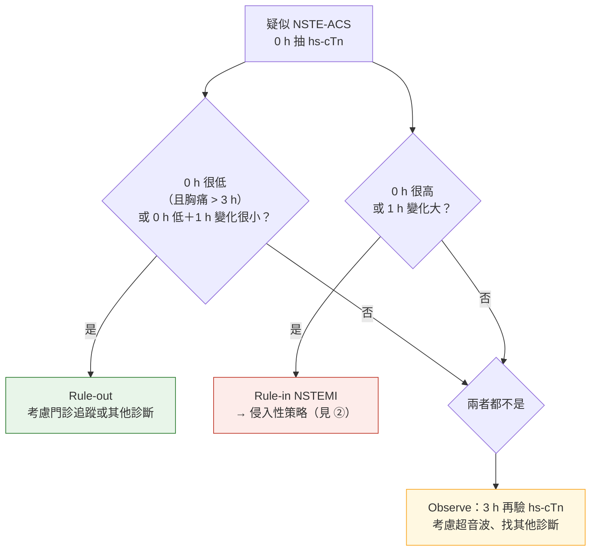

> [!abstract] 一句話重點
> ACS 是一個**光譜**：先依 ECG 分成 **STEMI（含 STEMI equivalent）** 與 **NSTE-ACS**，再用 **hs-cTn** 分成 **NSTEMI** 與 **unstable angina**。**==ECG 在 FMC 後 10 分鐘內==**、**==hs-cTn 抽血後 60 分鐘內出結果==**，用 **ESC 0 h/1 h（或 0 h/2 h）演算法** rule-in／rule-out，**不確定 → 3 小時再驗**。下壁 STEMI 或懷疑完全阻塞但標準導程不確定 → **加做 V3R、V4R、V7–V9**。**休克或懷疑機械併發症 → 緊急 TTE**；**不常規做早期 CCTA**。

> [!info] 系列導覽
> ↑ 回到 [[cardiology/acs-esc-2023/index|2023 ESC ACS 指引總覽]]
>
> ① 分類、分流與診斷（本篇）｜② [[cardiology/acs-esc-2023/acs23-2-reperfusion-invasive|再灌流與侵入性策略]]｜③ [[cardiology/acs-esc-2023/acs23-3-antithrombotic|抗血栓治療]]｜④ [[cardiology/acs-esc-2023/acs23-4-hospital-longterm|住院、特殊情況與長期治療]]｜⑤ [[cardiology/acs-esc-2023/acs23-exam|內專考點]]
>
> 本篇來源：2023 ESC ACS Guidelines Section 2–4、Table 3–5、Figure 1–6

## 總覽與分類（Figure 1–3、Table 3–5）

- **2023 版第一次把 STEMI 與 NSTE-ACS 合成一份指引**：ACS 是一連串的臨床表現，從 unstable angina 到 STEMI、cardiogenic shock、cardiac arrest
- **Working diagnosis（工作診斷）**：依 ECG 先決定 **STEMI 路徑**（立即再灌流）或 **NSTE-ACS 路徑**（依風險決定侵入時機）

| 工作診斷 | ECG | hs-cTn |
| --- | --- | --- |
| **STEMI** | **持續 ST 上升或 equivalent**（後壁 MI、新的 LBBB 或 paced rhythm 合併缺血症狀、de Winter 等） | 上升（但**不必等**） |
| **NSTEMI** | 沒有持續 ST 上升（ST 下降、T 倒置或正常） | **上升且有變化** |
| **Unstable angina** | 同上 | **正常** |

### 侵入性策略的名詞（Table 3）

| 名詞 | 意思 |
| --- | --- |
| **FMC**（first medical contact） | 病人第一次接觸到能做 ECG 與初步處置的醫療人員 |
| **Primary PCI** | STEMI 的緊急 PCI（不先打 fibrinolysis） |
| **Rescue PCI** | **Fibrinolysis 失敗**後盡快做的 PCI |
| **Pharmaco-invasive** | Fibrinolysis 後（成功）**2–24 小時**做冠狀動脈攝影 |
| **Immediate invasive** | NSTE-ACS **盡快**（very high risk） |
| **Early invasive** | NSTE-ACS **24 小時內**（high risk） |
| **Selective invasive** | 依非侵入性檢查或臨床決定 |

## 初步分流（Figure 4–5）

**A.C.S. 評估**（Figure 5）：
- **A**：**Abnormal ECG?**（ST 上升 → STEMI 路徑）
- **C**：**Clinical context?**（症狀、生命徵象、理學檢查）
- **S**：**Stable patient?**（血行動力、心律、休克）

| 建議 | 等級 |
| --- | --- |
| **懷疑 STEMI → 立即分流到緊急再灌流** | **I A** |
| 診斷與短期風險：結合病史、症狀、生命徵象、理學檢查、**ECG**、**hs-cTn** | I B |
| **==12 導程 ECG：FMC 後 < 10 分鐘==** | **I B** |
| 懷疑 STEMI、其他 ECG 變化或持續胸痛、確診 MI → **連續 ECG 監測＋隨時可電擊** | I B |
| **下壁 STEMI** 或懷疑完全阻塞但標準導程不確定 → **V3R、V4R、V7–V9** | I B |
| 症狀復發或診斷不確定 → 再做 12 導程 | I C |

## hs-cTn 演算法（Figure 6）

| 建議 | 等級 |
| --- | --- |
| **到院立即測 hs-cTn，抽血後 60 分鐘內出結果** | **I B** |
| 用 **ESC 0 h/1 h 或 0 h/2 h** 演算法 rule-in／rule-out NSTEMI | **I B** |
| 0 h/1 h 前兩次**不確定**、也沒有其他診斷 → **3 小時再驗** | I B |

- **切點依各家 hs-cTn 試劑而不同**，見 Figure 6 原圖
- 要能 rule-out，0 h 很低值通常要求**胸痛已超過 3 小時**（太早來的病人 troponin 可能還沒上升）

## 影像

| 建議 | 等級 |
| --- | --- |
| **Cardiogenic shock 或懷疑機械併發症 → 緊急 TTE** | **I C** |
| **不常規做早期 CCTA** | **III B** |

## 相關筆記

- [[cardiology/acs-esc-2023/acs23-2-reperfusion-invasive|② 再灌流與侵入性策略]]
- [[cardiology/pulmonary-embolism-esc/index|肺栓塞 PE（ESC 2019）]]（胸痛鑑別）
- [[cardiology/acs-esc-2023/acs23-exam|⑤ 內專考點]]

## 參考資料

- Byrne RA, Rossello X, Coughlan JJ, et al. 2023 ESC Guidelines for the management of acute coronary syndromes. *Eur Heart J* 2023;44(38):3720–3826（Section 2–4、Table 3–5、Figure 1–6）（參考資料庫：心臟科／2023 ESC Guidelines for the management of acute coronary syndromes.pdf）
