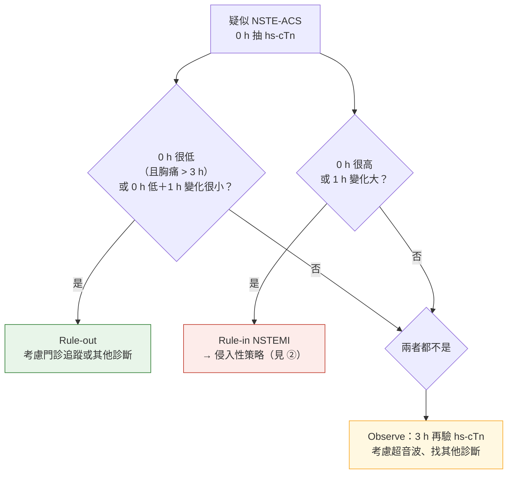

> [!abstract] 一句話重點
> ACS 是一個**光譜**：先依 ECG 分成 **STEMI（含 STEMI equivalent）** 與 **NSTE-ACS**，再用 **hs-cTn** 分成 **NSTEMI** 與 **unstable angina**。**==ECG 在 FMC 後 10 分鐘內==**、**==hs-cTn 抽血後 60 分鐘內出結果==**，用 **ESC 0 h/1 h（或 0 h/2 h）演算法** rule-in／rule-out，**不確定 → 3 小時再驗**。下壁 STEMI 或懷疑完全阻塞但標準導程不確定 → **加做 V3R、V4R、V7–V9**。**休克或懷疑機械併發症 → 緊急 TTE**；**不常規做早期 CCTA**。

> [!info] 系列導覽
> ↑ 回到 [[cardiology/acs-esc-2023/index|2023 ESC ACS 指引總覽]]
>
> ① 分類、分流與診斷（本篇）｜② [[cardiology/acs-esc-2023/acs23-2-reperfusion-invasive|再灌流與侵入性策略]]｜③ [[cardiology/acs-esc-2023/acs23-3-antithrombotic|抗血栓治療]]｜④ [[cardiology/acs-esc-2023/acs23-4-hospital-longterm|住院、特殊情況與長期治療]]｜📋 [[cardiology/acs-esc-2023/acs23-5-recommendations|建議總整理]]｜⑤ [[cardiology/acs-esc-2023/acs23-exam|內專考點]]
>
> 本篇來源：2023 ESC ACS Guidelines Section 2–4、Table 3–5、Figure 1–6

## 總覽與分類（Figure 1–3、Table 3–5）

- **2023 版第一次把 STEMI 與 NSTE-ACS 合成一份指引**：ACS 是一連串的臨床表現，從 unstable angina 到 STEMI、cardiogenic shock、cardiac arrest
- **Working diagnosis（工作診斷）**：依 ECG 先決定 **STEMI 路徑**（立即再灌流）或 **NSTE-ACS 路徑**（依風險決定侵入時機）

| 工作診斷 | ECG | hs-cTn |
| --- | --- | --- |
| **STEMI** | **持續 ST 上升或 equivalent**（後壁 MI、新的 LBBB 或 paced rhythm 合併缺血症狀、de Winter 等） | 上升（但**不必等**） |
| **NSTEMI** | 沒有持續 ST 上升（ST 下降、T 倒置或正常） | **上升且有變化** |
| **Unstable angina** | 同上 | **正常** |

**Central illustration（Figure 1）：ACS 的五個「Think」**

1. **Think A.C.S.**：Abnormal ECG？Clinical context？Stable patient？
2. **Think invasive management**：STEMI → PPCI（不及時則 fibrinolysis）｜very high-risk NSTE-ACS → 立即攝影｜high-risk → 24 h 內攝影
3. **Think antithrombotic therapy**：**aspirin＋P2Y12**，**加**抗凝（UFH、LMWH、bivalirudin 或 fondaparinux 擇一）
4. **Think revascularization**：依臨床、共病、病灶複雜度選 **PCI 或 CABG**，**目標完全再通**，可用血管內影像與生理檢查輔助
5. **Think secondary prevention**：抗血栓、降血脂、戒菸、心臟復健、危險因子控制、心理社會

### ACS 光譜（Figure 2 依內容重新整理）

| 臨床表現 | 幾乎沒症狀 → 胸痛加重 → 持續胸痛 → 休克或急性 HF → 心跳停止 |
| --- | --- |
| **ECG** | 正常 → **ST 下降** → **ST 上升** → 惡性心律不整 |
| **工作診斷** | 前段 **NSTE-ACS**、後段 **STEMI** |
| **hs-cTn** | **沒上升**（UA）或**上升又下降**（MI） |
| **最終診斷** | **Unstable angina** → **NSTEMI** → **STEMI** |

### 從工作診斷到最終診斷（Figure 3 依內容重新整理）

1. **臨床表現**：有疑似 ACS 的症狀或徵象 → **FMC 後 10 分鐘內 ECG**
2. **工作診斷**：依 ECG 與臨床分成 **STEMI** 或 **NSTE-ACS**，用來**初步分流**
3. **進一步檢查**：**hs-cTn**、± 冠狀動脈攝影、± 影像
4. **最終診斷**：**STEMI、NSTEMI、unstable angina**，或**不是 ACS**（工作診斷是 ACS 的病人，最後可能是其他診斷）

### 侵入性策略的名詞（Table 3）

| 名詞 | 意思 |
| --- | --- |
| **FMC**（first medical contact） | 病人第一次接觸到能做 ECG 與初步處置的醫療人員 |
| **Primary PCI** | STEMI 的緊急 PCI（不先打 fibrinolysis） |
| **Rescue PCI** | **Fibrinolysis 失敗**後盡快做的 PCI |
| **Pharmaco-invasive** | Fibrinolysis 後（成功）**2–24 小時**做冠狀動脈攝影 |
| **Immediate invasive** | NSTE-ACS **盡快**（very high risk） |
| **Early invasive** | NSTE-ACS **24 小時內**（high risk） |
| **Selective invasive** | 依非侵入性檢查或臨床決定 |

### 2023 新建議重點（Table 4 依內容重新整理）

| 主題 | 新建議 | 等級 |
| --- | --- | --- |
| **抗血栓** | 為 CABG 停 DAPT → **術後恢復 DAPT ≥ 12 個月** | I C |
| | 老人（尤其 HBR）→ P2Y12 可選 **clopidogrel** | IIb B |
| **縮短／簡化抗血小板** | DAPT **3–6 個月**沒事件、非高缺血風險 → **單一抗血小板（偏好 P2Y12i）** | IIa A |
| | 長期 **P2Y12i 單方**可取代 aspirin 單方 | IIb A |
| | **HBR：DAPT 1 個月後**改 aspirin 或 P2Y12i 單方 | IIb B |
| | 需要 OAC → **6 個月停抗血小板、只留 OAC** | IIb B |
| | **==ACS 後 30 天內不降階抗血小板==** | **III B** |
| **心跳停止** | 昏迷存活者**入院 ≥ 72 小時後**才評估神經預後 | I C |
| | OHCA 依當地流程送 cardiac arrest center | IIa C |
| **侵入技術** | **SCAD**：只有持續缺血、大範圍心肌受威脅、前向血流差才 PCI | I C |
| | **血管內影像引導 PCI** | IIa A |
| **多條血管** | 休克：**非罪犯血管分期 PCI** | IIa C |
| | 穩定 STEMI：非罪犯血管 PCI **依血管攝影嚴重度**決定；當次**不做 IRA 非罪犯段的功能評估**（III） | I B |
| **併發症** | **高度 AV block ≥ 5 天未恢復 → 永久起搏器** | I C |
| | 懷疑 **LV thrombus**、超音波不清楚 → CMR（IIa）；前壁 MI 心尖看不清 → 顯影劑超音波（IIb） | IIa／IIb C |
| | 反覆致命心室心律不整 → **鎮靜或全身麻醉**降交感 | IIb C |
| **共病** | 依 HF、CKD、肥胖選長期降糖藥 | I A |
| | 癌症：高風險 ACS、**預期存活 ≥ 6 個月 → 侵入性**；< 6 個月或極高出血風險 → 保守（IIa）；**PLT < 10k 不給 aspirin、< 30k 不給 clopidogrel、< 50k 不給 prasugrel／ticagrelor**（III） | I B |
| **長期** | 原本就吃降血脂藥 → **住院中加強** | I C |
| | **Colchicine 0.5 mg qd** | IIb A |
| | 住院中 **高劑量 statin＋ezetimibe** | IIb B |
| **病人觀點** | 以病人為中心、共同決策與決策輔助、teach-back、心理健康評估 | I／IIa |

### 2023 修訂建議（Table 5 依內容重新整理）

| 主題 | 以前（2017／2020） | **2023** |
| --- | --- | --- |
| **NSTE-ACS 影像** | 胸痛不再發、ECG 與 troponin 正常 → stress test 或 CCTA（I B） | hs-cTn 不高或不確定、ECG 無變化 → **CCTA 或非侵入 stress imaging 可考慮（IIa A）** |
| **NSTE-ACS 24 h 內侵入** | 高風險 → **I A** | 同樣的高風險條件（NSTEMI、動態 ST／T、短暫 ST 上升、GRACE > 140）→ **降為 IIa A** |
| **STEMI pre-treatment** | PCI 前或當下給強效 P2Y12i（I A） | Primary PCI **pre-treatment 只是 IIb B** |
| **長期抗血栓** | 3–6 個月後停 aspirin（IIa A） | 3–6 個月沒事件、非高缺血風險 → **SAPT（偏好 P2Y12i）（IIa A）** |
| **OHCA 攝影** | 穩定、無 ST 上升 → 延後攝影（IIa B） | **==穩定、無持續 ST 上升 → 不常規立即攝影（III A）==** |
| **體溫** | 32–36 °C 至少 24 h（TTM，I B） | **持續監測核心體溫、主動預防發燒（> 37.7 °C）**（I B） |
| **住院影像** | 超音波不清楚 → CMR（IIa C） | → CMR **IIb C** |
| **多條血管 STEMI** | 出院前常規處理非罪犯病灶（IIa A） | **==完全再通：當次或 45 天內（I A）==** |
| **血糖** | > 180 mg/dL 考慮降糖（IIa B） | **持續高血糖**才降糖、避免低血糖（IIa C） |

## 初步分流（Figure 4–5）

**A.C.S. 評估**（Figure 5）：
- **A**：**Abnormal ECG?**（ST 上升 → STEMI 路徑）
- **C**：**Clinical context?**（症狀、生命徵象、理學檢查）
- **S**：**Stable patient?**（血行動力、心律、休克）

| 建議 | 等級 |
| --- | --- |
| **懷疑 STEMI → 立即分流到緊急再灌流** | **I A** |
| 診斷與短期風險：結合病史、症狀、生命徵象、理學檢查、**ECG**、**hs-cTn** | I B |
| **==12 導程 ECG：FMC 後 < 10 分鐘==** | **I B** |
| 懷疑 STEMI、其他 ECG 變化或持續胸痛、確診 MI → **連續 ECG 監測＋隨時可電擊** | I B |
| **下壁 STEMI** 或懷疑完全阻塞但標準導程不確定 → **V3R、V4R、V7–V9** | I B |
| 症狀復發或診斷不確定 → 再做 12 導程 | I C |

### 初步分流全貌（Figure 4 依內容重新整理）

| 階段 | 內容 |
| --- | --- |
| **A.C.S. 初評** | ECG、理學檢查、病史、生命徵象、hs-cTn（**STEMI 或 very high-risk 不必等 hs-cTn**） |
| **工作診斷** | **STEMI**｜**NSTE-ACS＋very high risk**｜**NSTE-ACS 沒有 very high risk** |
| **依風險決定攝影** | STEMI：**立即攝影 ± PPCI**，PPCI 不及時 → **fibrinolysis**｜very high：**立即攝影 ± PCI**｜high risk：**24 小時內攝影**（住院中一定要做） |
| **進一步檢查** | 非立即攝影、超音波、血管內影像、非侵入影像、hs-cTn、ECG 監測 |
| **後續處置** | PCI 或 CABG、長期藥物、生活型態、戒菸 |

## hs-cTn 演算法（Figure 6）

| 建議 | 等級 |
| --- | --- |
| **到院立即測 hs-cTn，抽血後 60 分鐘內出結果** | **I B** |
| 用 **ESC 0 h/1 h 或 0 h/2 h** 演算法 rule-in／rule-out NSTEMI | **I B** |
| 0 h/1 h 前兩次**不確定**、也沒有其他診斷 → **3 小時再驗** | I B |

- **切點依各家 hs-cTn 試劑而不同**，見 Figure 6 原圖
- 要能 rule-out，0 h 很低值通常要求**胸痛已超過 3 小時**（太早來的病人 troponin 可能還沒上升）

## 影像

| 建議 | 等級 |
| --- | --- |
| **Cardiogenic shock 或懷疑機械併發症 → 緊急 TTE** | **I C** |
| **不常規做早期 CCTA** | **III B** |

## 相關筆記

- [[cardiology/acs-esc-2023/acs23-2-reperfusion-invasive|② 再灌流與侵入性策略]]
- [[cardiology/pulmonary-embolism-esc/index|肺栓塞 PE（ESC 2019）]]（胸痛鑑別）
- [[cardiology/acs-esc-2023/acs23-exam|⑤ 內專考點]]

## 參考資料

- Byrne RA, Rossello X, Coughlan JJ, et al. 2023 ESC Guidelines for the management of acute coronary syndromes. *Eur Heart J* 2023;44(38):3720–3826（Section 2–4、Table 3–5、Figure 1–6）（參考資料庫：心臟科／2023 ESC Guidelines for the management of acute coronary syndromes.pdf）
