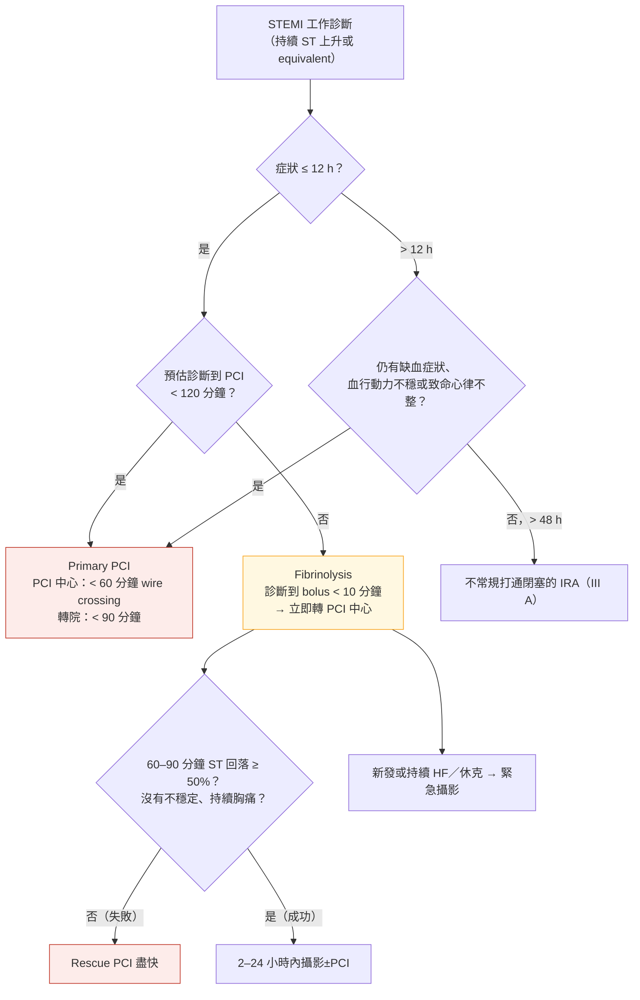

> [!abstract] 一句話重點
> - **STEMI ≤ 12 小時 → 再灌流（I A）**：**預估診斷到 PCI < 120 分鐘 → primary PCI**（PCI 中心 **< 60 分鐘**、轉院 **< 90 分鐘**到 wire crossing）
>   - **做不到 → 12 小時內 fibrinolysis（診斷到 bolus < 10 分鐘）**，打完**立即轉 PCI 中心**，**60–90 分鐘 ST 回落 < 50% → rescue PCI**，成功則 **2–24 小時**攝影
> - **> 12 小時**仍有症狀或不穩定 → PPCI；**> 48 小時沒症狀 → 不常規打通閉塞血管（III A）**
> - **NSTE-ACS**：
>   - **very high risk → immediate（盡快）**
>   - **high risk（確診 NSTEMI、動態 ST-T、短暫 ST 上升、GRACE > 140）→ 24 小時內（IIa）**
>   - 其他 → selective
> - **休克 → 只做 IRA（I B）、不常規 IABP（III B）**；穩定 STEMI 多條血管 → **45 天內完全再通（I A）**
> - **MINOCA → CMR**

> [!info] 系列導覽
> ↑ 回到 [[cardiology/acs-esc-2023/index|2023 ESC ACS 指引總覽]]
>
> ① [[cardiology/acs-esc-2023/acs23-1-diagnosis|分類、分流與診斷]]｜② 再灌流與侵入性策略（本篇）｜③ [[cardiology/acs-esc-2023/acs23-3-antithrombotic|抗血栓治療]]｜④ [[cardiology/acs-esc-2023/acs23-4-hospital-longterm|住院、特殊情況與長期治療]]｜📋 [[cardiology/acs-esc-2023/acs23-5-recommendations|建議總整理]]｜⑤ [[cardiology/acs-esc-2023/acs23-exam|內專考點]]
>
> 本篇來源：2023 ESC ACS Guidelines Section 4–5、7、9–11、Figure 7–8、13–16、Table 9（What to do）

## 初始處置與系統（Section 4）

| 建議 | 等級 |
| --- | --- |
| **SaO2 < 90% 才給氧** | I C |
| **==SaO2 > 90% 不常規給氧==** | **III A** |
| EMS 把疑似 STEMI 直接送 **PCI 中心**（跳過非 PCI 醫院） | I C |
| 轉院做 PPCI 的病人**跳過急診與 CCU，直接進導管室** | I B |
| PPCI 中心 **24/7** 不延誤 | I B |
| 救護人員能判讀 ECG、電擊、必要時給 fibrinolysis | I C |

## STEMI 再灌流（Figure 7–8）

| 建議 | 等級 |
| --- | --- |
| **STEMI、症狀 ≤ 12 小時 → 再灌流** | **I A** |
| **==預估診斷到 PCI < 120 分鐘 → PPCI 優於 fibrinolysis==** | **I A** |
| 無法 120 分鐘內 PPCI → **12 小時內 fibrinolysis**（無禁忌） | **I A** |
| **Rescue PCI**：fibrinolysis 失敗（**60–90 分鐘 ST 回落 < 50%**）、血行動力或電氣不穩、缺血惡化、持續胸痛 | **I A** |
| > 12 小時仍有缺血症狀、不穩定或致命心律不整 → PPCI | I C |
| **> 48 小時、沒有持續症狀 → 不常規 PCI 閉塞的 IRA** | **III A** |
| **Fibrinolysis 後所有病人立即轉 PCI 中心** | I A |
| Fibrinolysis 後新發或持續 HF／休克 → **緊急攝影** | I A |
| **成功 fibrinolysis 後 2–24 小時攝影** | **I A** |
| Fibrinolysis 要**到院前盡快、診斷到 bolus < 10 分鐘** | I A |
| 用 **fibrin-specific** 藥物（tenecteplase、alteplase、reteplase） | I B |

## NSTE-ACS 侵入時機

| 風險 | 條件 | 策略 | 等級 |
| --- | --- | --- | --- |
| **==Very high==** | **血行動力不穩或休克**、**藥物無效的反覆或持續胸痛**、**院內致命心律不整**、**MI 機械併發症**、**缺血造成的急性 HF**、**反覆動態 ST-T 變化（尤其間歇性 ST 上升）** | **Immediate**（盡快） | **I C** |
| **High** | **確診 NSTEMI（hs-cTn 演算法）**、**動態 ST-T 變化**、**短暫 ST 上升**、**GRACE > 140** | **Early（24 小時內）** | IIa A |
| | 高風險或高度懷疑 UA → 住院期間侵入性策略 | — | **I A** |
| **Low** | 沒有上述、低度懷疑 | **Selective** | I A |

## 心跳停止與心因性休克

| 建議 | 等級 |
| --- | --- |
| **復甦後 ECG 持續 ST 上升（或 equivalent）→ PPCI** | I B |
| **==復甦後血行動力穩定、沒有持續 ST 上升 → 不常規立即攝影==** | **III A** |
| 復甦後仍昏迷 → **溫度控制**（監測核心體溫、主動預防發燒 > 37.7°C） | I B |
| 昏迷存活者：**神經預後不早於 72 小時** | I C |
| **ACS 合併休克 → 立即攝影＋IRA PCI** | I B |
| IRA PCI 不可行或失敗 → **緊急 CABG** | I B |
| 血行動力不穩的機械併發症 → Heart Team 決定緊急手術或導管修補 | I C |
| **==休克、沒有機械併發症 → 不常規 IABP==** | **III B** |

## PCI 技術（Section 9、Figure 13）

| 建議 | 等級 |
| --- | --- |
| **Radial access** 為標準 | **I A** |
| PPCI 時 IRA 放支架 | I A |
| **DES 優於 BMS** | I A |
| **SCAD**：只有持續缺血、大範圍心肌受威脅、血流變差才 PCI | I C |
| **不常規 thrombus aspiration** | **III A** |

### 血管內影像怎麼用（Figure 13 依內容重新整理）

| 攝影結果 | 怎麼做 | 等級 |
| --- | --- | --- |
| **罪犯病灶清楚、適合 PCI** | **IVUS 或 OCT 導引 PCI** → PCI 罪犯病灶 | **IIa** |
| **看不出罪犯病灶** | <strong>血管內影像（OCT 較佳）</strong>找罪犯 → 依影像結果治療 → 需要時再做其他檢查 | IIb |

- **攝影上容易看不清楚的情況**：多條血管病變、模糊病灶或鈣化、血管彎曲或偏心
- **OCT 可能看到**：斑塊**侵蝕（erosion）**、**鈣化結節（nodule）**、**破裂（rupture）**、**SCAD**，或**完全沒有病灶**（→ 想 MINOCA）
- 還不清楚 → **左心室攝影、心臟超音波、CMR**

## 多條血管疾病（Section 10、Figure 14）

| 情境 | 建議 | 等級 |
| --- | --- | --- |
| 一般 | 依臨床狀態、共病、病灶複雜度決定 IRA PCI、多條 PCI 或 CABG | I B |
| **==休克==** | **Index 只做 IRA**（CULPRIT-SHOCK） | **I B** |
| **穩定 STEMI** | **完全再通：index 或 45 天內** | **I A** |
| | Non-IRA 依**血管攝影嚴重度**決定 | I B |
| | Index 時**不做 IRA 非罪犯段的功能評估** | III C |

**Figure 14 依內容重新整理**：ACS 做罪犯血管 PCI、且 ≥ 1 條非罪犯血管有明顯狹窄時

| 表現 | Index 手術 | 之後 |
| --- | --- | --- |
| **心因性休克** | **只做罪犯血管（Class I）** | **分次完全再通（IIa）** |
| **STEMI** | **完全再通：index 或 45 天內（Class I）**，非罪犯血管依**攝影嚴重度** | — |
| **NSTE-ACS** | **完全再通（IIa），最好在 index**；非罪犯血管可在 index 做**侵入性功能評估（IIb）** | — |

> [!info] 🆕 新版指引（2025 ACC/AHA/ACEP/NAEMSP/SCAI ACS Guideline）
> - 多條血管 ACS（STEMI 與 NSTEMI）**治療嚴重的非罪犯血管為 Class 1**，可在 index 或分次；**休克例外**（只做罪犯血管）
> - **PCI 時用血管內影像（IVUS／OCT）升為 Class 1**
> - 心因性休克：**microaxial flow pump 2a**；**常規 IABP 或 ECMO 為 Class 3**；轉到有休克經驗的中心 Class 1；機械併發症以 MCS 橋接手術 2a

## MINOCA（Section 11、Figure 15–16）

**MINOCA** = 符合 MI 定義、**冠狀動脈攝影沒有阻塞（< 50%）**，且沒有其他明顯原因。

| 建議 | 等級 |
| --- | --- |
| **攝影後診斷仍不明 → CMR** | **I B** |
| 依**最終診斷**處理 | I B |
| 用診斷流程找出最終診斷 | I C |

- **可能原因（Figure 15 依內容重新整理，並非全部）**：

| 冠狀動脈原因 | 非冠狀動脈的心臟原因 | 非心臟原因 |
| --- | --- | --- |
| **冠狀動脈栓塞**、**微血管功能不良**、**痙攣**、冠狀動脈血栓、**心肌橋**、**斑塊破裂或侵蝕**、**SCAD** | 心臟外傷、**心肌病**、心臟毒性物質、**心肌炎**、劇烈運動、**Takotsubo**、移植排斥 | ARDS、過敏反應、**末期腎病**、發炎、**PE**、**sepsis**、**stroke** |

### MINOCA 三步驟評估（Figure 16 依內容重新整理）

| 步驟 | 地點 | 可考慮的檢查 |
| --- | --- | --- |
| **Step 1** | **導管室** | 病史、理學檢查、ECG；**仔細看血管攝影 ± 左心室攝影（含 LVEDP）**；**血管內影像（IVUS／OCT）**；**冠狀動脈微血管功能與血管反應性（acetylcholine 測試）** |
| **Step 2** | **病房** | 病史、理學檢查、ECG、**心臟超音波**、**CMR**、**抽血**（CBC、腎功能、troponin、CRP、**D-dimer**、NT-proBNP）、**CTPA**（想到 PE）或 **CT brain**（懷疑顱內出血造成 ST 上升） |
| **Step 3** | **出院後** | 門診追蹤、**重做超音波或 CMR**、心臟復健 |

- **STEMI 直接進導管室**（Step 1 → 2）；**NSTE-ACS 或 UA 常先在病房穩定**（Step 2 → 1），所以檢查順序依病人在哪裡而不同
- 不是每個人都要做全部檢查，**依表現與病程選擇**
- 原則：**MINOCA 是工作診斷**，要找出**最終病因**（斑塊破裂或侵蝕、痙攣、SCAD、栓塞、微血管功能不良；或非冠狀動脈原因如心肌炎、Takotsubo），再依病因治療

## 相關筆記

- [[cardiology/acs-esc-2023/acs23-3-antithrombotic|③ 抗血栓治療]]（fibrinolysis 合併用藥）
- [[cardiology/resuscitation-aha-2025/cpr25-3-post-arrest-special|ROSC 後照護]]（arrest 後心導管時機）
- [[cardiology/heart-failure-esc-2026/hf26-3-decompensated|心衰竭 ③ 心因性休克與 MCS]]
- [[cardiology/acs-esc-2023/acs23-exam|⑤ 內專考點]]

## 參考資料

- Byrne RA, Rossello X, Coughlan JJ, et al. 2023 ESC Guidelines for the management of acute coronary syndromes. *Eur Heart J* 2023;44(38):3720–3826（Section 4–5、7、9–11）（參考資料庫：心臟科／2023 ESC Guidelines for the management of acute coronary syndromes.pdf）
- 🆕 Rao SV, O'Donoghue ML, Ruel M, et al. 2025 ACC/AHA/ACEP/NAEMSP/SCAI Guideline for the Management of Patients With Acute Coronary Syndromes. *Circulation* 2025；摘要依 [Cleveland Clinic ConsultQD](https://consultqd.clevelandclinic.org/new-guideline-on-acute-coronary-syndromes-key-takeaways-for-cardiologists)
