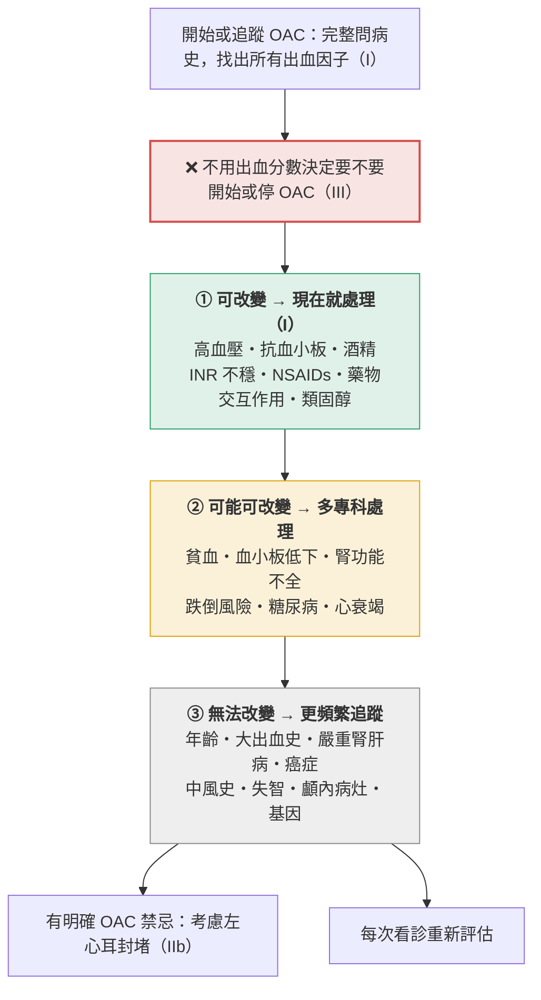
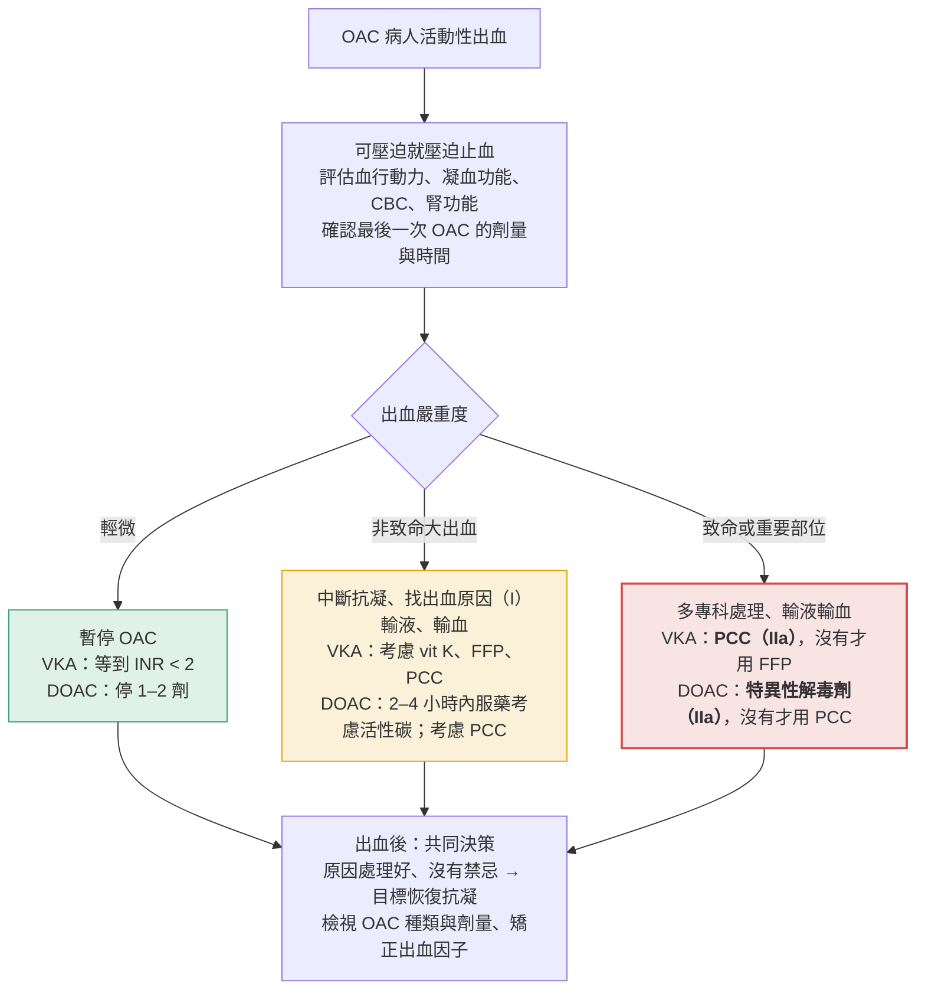

> [!abstract] 一句話重點
> 2024 ESC 改用**不含性別的 CHA₂DS₂-VA**：**≥ 2 分給 OAC、1 分應考慮**；優先用 **DOAC 標準劑量**，只有符合各藥減量條件才減量；出血分數**不能**拿來決定不抗凝，而是用來找出可矯正的出血因子。

> [!info] 系列導覽（本系列只整理指引中的 Table 與 Figure）
> ↑ 回到 [[cardiology/atrial-fibrillation/index|心房顫動 AF 總覽]]
>
> ① [[af-esc-2024-1-overview|定義、診斷與 AF-CARE]]｜② 抗凝血與出血（本篇）｜③ [[af-esc-2024-3-rate-rhythm|Rate 與 rhythm control]]｜④ [[af-esc-2024-4-screening|篩檢與危險因子]]｜⑤ [[af-esc-2024-5-recommendations|新增、修訂與必做／不做]]
>
> 本篇涵蓋：Table 10、11；Figure 9、10、11、14

## Table 10：CHA₂DS₂-VA 分數的新定義

| 字母 | 項目 | 定義重點 | 分數 |
| --- | --- | --- | --- |
| **C** | 慢性心衰竭 | 有心衰竭症狀與徵候，**不論 LVEF**（HFpEF、HFmrEF、HFrEF 都算）；或無症狀但 LVEF ≤ 40% | 1 |
| **H** | 高血壓 | 至少兩次休息血壓 > 140/90 mmHg，或正在服降壓藥 | 1 |
| **A** | 年齡 ≥ 75 歲 | 年齡是中風的獨立危險因子，風險其實是連續的，為了實用把 ≥ 75 歲給 2 分 | **2** |
| **D** | 糖尿病 | 第 1 型或第 2 型，或正在使用降血糖藥 | 1 |
| **S** | 中風、TIA 或動脈栓塞病史 | 曾發生栓塞者復發風險很高 | **2** |
| **V** | 血管疾病 | **冠心病**（MI、心絞痛、冠狀動脈重建、影像上明顯 CAD）**或周邊血管疾病**（跛行、周邊血管重建、腹主動脈介入、影像上的**複雜主動脈斑塊**：活動、潰瘍、帶蒂或厚度 ≥ 4 mm） | 1 |
| **A** | 年齡 65–74 歲 | | 1 |

**為什麼拿掉女性（Sc）？** 女性是**隨年齡出現的風險修飾因子**，本身不算危險因子；把性別放進分數讓臨床使用更複雜，也排除了非二元性別、跨性別或接受性荷爾蒙治療的人。過去 ESC 其實是對男女設不同門檻，等於早就在用不含性別的版本。

**使用方式**（沒有其他在地驗證工具時）：

- **==CHA₂DS₂-VA ≥ 2 分：建議 OAC==**
- **1 分：應考慮 OAC**，以病人為中心共同決策
- 分數以外，還要考慮其他會提高栓塞風險的因素：**癌症、CKD**、族裔（黑人、西班牙裔、亞洲人）、**troponin、BNP**；特定族群還有心房擴大、高血脂、抽菸、肥胖

> [!warning] Pitfall
> - 舊版 CHA₂DS₂-VASc 女性 2 分＝男性 1 分；新版**==直接不算性別==**，門檻男女相同
> - 心衰竭現在**==不分 LVEF==**，HFpEF 也算 1 分

## Figure 9：口服抗凝劑常見的藥物交互作用

我把原圖依「該怎麼處理」重新整理，只列常見或重要的交互作用：

| 藥物 | 盡量避免併用 | 減量或調整 | 其他注意 |
| --- | --- | --- | --- |
| **Warfarin（VKA）** | NSAIDs、fluconazole、voriconazole、fluoxetine | **需減少 warfarin**：amiodarone、metronidazole、sulfonamides、allopurinol、fluvastatin、gemfibrozil、fluorouracil；**需增加 warfarin**：carbamazepine | **密切監測 INR**：dronedarone、statin、penicillin／macrolide／quinolone 類抗生素、rifampicin、methotrexate、ritonavir、phenytoin、valproate、tamoxifen、化療；限制酒精、葡萄柚／蔓越莓汁、St John's wort |
| **Apixaban** | carbamazepine、phenytoin、phenobarbital、rifampicin、ritonavir、itraconazole、ketoconazole | 若同時有另一個交互作用藥物，避免或減量：posaconazole、voriconazole、protease inhibitor、apalutamide、enzalutamide、tyrosine kinase inhibitor | 限制葡萄柚汁、St John's wort |
| **Dabigatran** | **dronedarone**、carbamazepine、phenytoin、rifampicin、ritonavir、itraconazole、ketoconazole、cyclosporin、glecaprevir/pibrentasvir、tacrolimus | 錯開服藥時間或調整劑量：**amiodarone、ticagrelor、verapamil**、quinidine、clarithromycin、posaconazole | 同上 |
| **Edoxaban** | carbamazepine、phenytoin、phenobarbital、rifampicin、ritonavir | **dronedarone** → 避免或減量；若同時有另一個交互作用藥物，避免或減量：cyclosporin、itraconazole、ketoconazole、erythromycin | 同上 |
| **Rivaroxaban** | **dronedarone**、carbamazepine、phenytoin、phenobarbital、itraconazole、ketoconazole、posaconazole、voriconazole、rifampicin、ritonavir | 若同時有另一個交互作用藥物則避免：protease inhibitor、tyrosine kinase inhibitor；**腎功能不好時小心**：verapamil、cyclosporin、clarithromycin、erythromycin、fluconazole | 同上 |

> [!tip] Pearl
> - 所有 DOAC 都要避開的「強誘導劑」：**carbamazepine、phenytoin、rifampicin**（多數也包含 phenobarbital），會讓 DOAC 濃度大降
> - AF 病人常用的 **dronedarone**：dabigatran、rivaroxaban 要避免，edoxaban 要減量
> - 原圖只列常見交互作用，完整資訊要查 EMA 或各院藥典

## Table 11：DOAC 建議劑量

| DOAC | 標準劑量 | 減量條件 | 減量後劑量 |
| --- | --- | --- | --- |
| **Apixaban** | **5 mg BID** | **三項中符合兩項**：年齡 ≥ 80 歲、體重 ≤ 60 kg、血清肌酸酐 ≥ 133 µmol/L（約 **1.5 mg/dL**） | **2.5 mg BID** |
| **Dabigatran** | **150 mg BID** | **建議減量**（任一）：年齡 ≥ 80 歲、併用 verapamil **個別考慮減量**（任一）：年齡 75–80 歲、CrCl 30–50 mL/min、胃炎／食道炎／胃食道逆流、其他出血風險高 | **110 mg BID** |
| **Edoxaban** | **60 mg QD** | 任一：CrCl 15–50 mL/min、體重 ≤ 60 kg、併用 cyclosporin、dronedarone、erythromycin 或 ketoconazole | **30 mg QD** |
| **Rivaroxaban** | **20 mg QD** | CrCl 15–49 mL/min | **15 mg QD** |

> [!danger] DOAC 劑量的關鍵原則
> - **==原則上用標準劑量==**，才能有效預防栓塞；**不符合減量條件卻減量，不建議（Class III）**
> - 開始 DOAC 時，多數病人要**停掉抗血小板藥**
> - Apixaban 是「**==三選二==**」，只有一項不能減量；其他三種是「**任一項**」

> [!tip] Pearl：VKA 何時用、何時換
> - **機械瓣或中重度二尖瓣狹窄**只能用 VKA
> - VKA 的 TTR 長期 > 70% 時可以有效預防栓塞；**TTR < 70% 建議改 DOAC**
> - 但 **≥ 75 歲、多重用藥或衰弱**且 INR 穩定的病人，有試驗顯示換成 DOAC 反而出血更多，可以共同決策後**繼續 VKA**

## Figure 10：降低抗凝相關出血風險

**圖解**（依原圖內容重新繪製）：

整體流程：開始或追蹤 OAC 時完整問病史，找出所有出血危險因子（I）→ **==不用出血分數決定要不要開始或停 OAC（III）==** → 依可否改變分三層處理 → 每次見面重新評估。

### 第一層：可改變的出血危險因子（共同決策處理，I）

| 因子 | 處置 |
| --- | --- |
| 高血壓 | 積極降壓（I） |
| **抗血小板藥** | 穩定 CCS 或血管疾病的 OAC 病人，**抗血小板不要用超過 12 個月（III）**；不要為了預防栓塞或中風復發在 OAC 上加抗血小板（III）；需要抗血小板時**用 DOAC 不用 VKA（I）** |
| 酒精 | 每週少於 3 份（I） |
| INR 不穩定 | INR 維持 2.0–3.0（I）、TTR > 70%（IIa）；VKA 無法維持 TTR 就改 DOAC（I）；縮短 heparin bridging 時間 |
| NSAIDs | 改用其他止痛或疾病修飾治療 |
| 其他 | 注意藥物交互作用、減少類固醇、**GI 出血風險高時給 PPI**、避免危險的嗜好或工作 |

### 第二層：可能可改變的因子

貧血、血小板低下或功能異常、腎功能不全、跌倒風險、糖尿病、心衰竭 → 多專科合作、確認 OAC 劑量與監測正確；心衰竭要達到 euvolemia（I）、糖尿病有效控制血糖（I）。

### 第三層：無法改變的因子

年齡、過去大出血、嚴重腎功能不全／透析／腎移植、嚴重肝病或肝硬化、癌症、基因（例如 CYP2C9）、中風病史、認知障礙或失智、顱內病灶 → **更頻繁追蹤**；若有**明確的 OAC 禁忌症**，考慮**左心耳封堵（IIb）**。

> [!tip] Pearl
> 真正的 OAC 絕對禁忌很少，例如原發性顱內腫瘤、類澱粉血管病變造成的腦出血；多數禁忌是**相對或暫時**的。出血風險高的病人，答案通常是**矯正出血因子**，而不是不給抗凝。

## Figure 11：OAC 相關出血的處置

**圖解**（依原圖內容重新繪製）：

**所有出血的前四步**：可壓迫就壓迫止血 → 評估血行動力、基本凝血功能、CBC、腎功能 → **確認最後一次 OAC 的劑量與時間**、所有併用藥物 → 依出血嚴重度分流。

| 嚴重度 | VKA | DOAC |
| --- | --- | --- |
| **輕微出血** | 暫停 VKA，等到 **INR < 2** 再恢復 | 暫停 **1–2 劑**（或依恢復情況延長） |
| **非致命大出血** | 中斷抗凝並診斷／治療（I）；輸液、輸血；考慮 vitamin K、FFP、PCC | 中斷抗凝並診斷／治療（I）；輸液、輸血；**2–4 小時內服用 DOAC 可考慮口服活性碳或洗胃**；考慮 PCC |
| **致命或重要部位出血** | 多專科處理；輸液、輸血；**PCC（IIa）**，沒有 PCC 才用 FFP；必要時補血小板 | 多專科處理；輸液、輸血；**特異性解毒劑（IIa）**，沒有解毒劑才用 PCC；必要時補血小板；監測 DOAC 濃度 |

**出血後**：共同決策討論重啟 OAC 的利弊；**==沒有禁忌或出血原因已處理，就以重新開始抗凝為目標==**；評估再出血風險、加強矯正出血因子、檢視 OAC 種類與劑量、密切追蹤。

> [!warning] Pitfall
> 致命出血的首選：**VKA 用 PCC、DOAC 用特異性解毒劑**（兩者都是 IIa），FFP 和 PCC 分別是「沒有首選時」的替代。出血處理完後，**目標是恢復抗凝**，不是永久停藥。

## Figure 14：AF 合併急性或慢性冠心症的抗栓治療

### 共通原則

- 合併抗血小板時，**優先 DOAC 而非 VKA（I）**
- **DOAC 用適當劑量**，不符合減量條件不要減量（III）；若用 rivaroxaban 或 dabigatran 且**出血風險大於支架血栓或缺血性中風風險**，應考慮減量（15 mg、110 mg，IIa）
- 用 VKA 合併抗血小板時，INR 維持 **2.0–2.5**、TTR > 70%（IIa）；單用 VKA 則 INR 2.0–3.0（I）
- 合併 OAC 時，**==P2Y12 inhibitor 首選 clopidogrel==**

### 依情境的療程

**圖解：療程時間軸**（依原圖內容重新繪製）

0–1 週

1 週–1 個月

1–6 個月

6–12 個月

12 個月後

ACS 接受 PCI

三合一（I）

OAC + P2Y12i（I）

只用 OAC（I）

ACS 缺血風險高

三合一 ≤ 1 個月（IIa）

OAC + P2Y12i（I）

只用 OAC（I）

ACS 內科治療

OAC + 單一抗血小板 6–12 個月

只用 OAC

CCS 單純 PCI

三合一（I）

OAC + P2Y12i（I）

只用 OAC（I）

CCS 缺血風險高

三合一 ≤ 1 個月（IIa）

雙重（I）

只用 OAC（I）

穩定 CCS

只用 OAC

三合一：OAC + P2Y12i + aspirin雙重：OAC + 抗血小板只用 OAC

| 情境 | 三合一（OAC + P2Y12i + aspirin） | 雙重（OAC + P2Y12i） | 之後 |
| --- | --- | --- | --- |
| **ACS 接受 PCI** | **最多 1 週（I）** | 到 **12 個月**（I） | 單用 OAC（I） |
| ACS、缺血風險高 | 最多 **1 個月**（IIa） | 到 12 個月（I） | 單用 OAC（I） |
| ACS 內科治療（未重建） | — | OAC + 單一抗血小板 **6–12 個月**（多用 clopidogrel） | 單用 OAC |
| **CCS 接受單純 PCI** | **最多 1 週（I）** | 到 **6 個月**（I） | 單用 OAC（I） |
| CCS、缺血風險高 | 最多 1 個月（IIa） | 到 6 個月（I） | 單用 OAC（I） |
| **穩定 CCS** | — | — | **只用 OAC** |

- **缺血風險高**：例如 STEMI、曾有支架血栓、複雜冠狀動脈介入、持續心臟不穩定
- 糖尿病病人接受支架時，若栓塞風險大於出血風險，三合一（低劑量 aspirin + clopidogrel + OAC）可延長到 **3 個月**

> [!tip] Pearl
> 記法：**==三合一越短越好（預設 1 週）==**，雙重治療 **==ACS 12 個月、CCS 6 個月==**，之後**單用 OAC**；穩定 CCS 超過 12 個月就不需要再加抗血小板。

## 相關筆記

- [[af-esc-2024-1-overview|AF 指引圖表①定義、診斷與 AF-CARE]]：Figure 3 的 [A] 五步驟
- [[af-esc-2024-3-rate-rhythm|AF 指引圖表③ Rate 與 rhythm control]]：cardioversion 前後的抗凝
- [[af-esc-2024-5-recommendations|AF 指引圖表⑤新增、修訂與必做／不做]]

## 參考資料

- Van Gelder IC, Rienstra M, Bunting KV, et al. 2024 ESC Guidelines for the management of atrial fibrillation developed in collaboration with the European Association for Cardio-Thoracic Surgery (EACTS). *Eur Heart J*. 2024;45(36):3314–3414.（Table 10、11；Figure 9、10、11、14）
