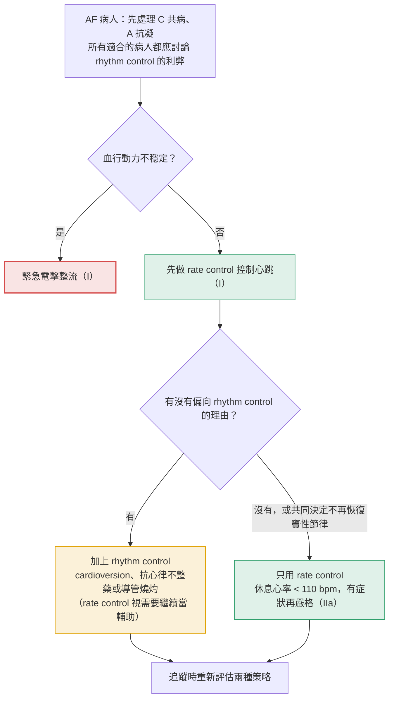
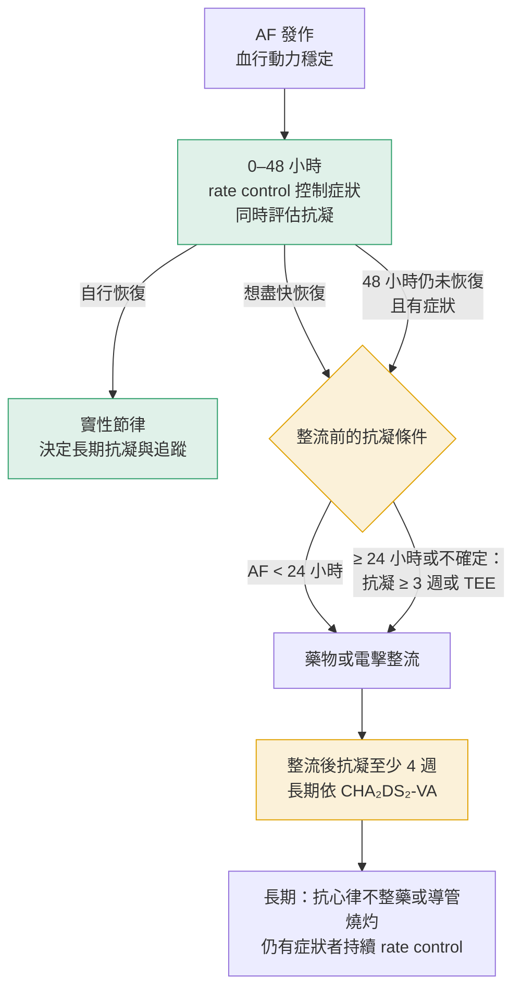
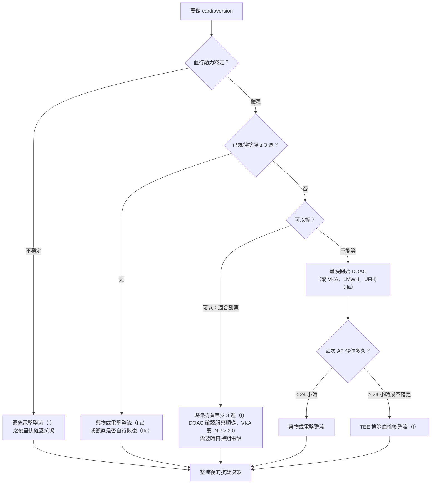

> [!abstract] 一句話重點
> Rate control 先看 **LVEF**：**≤ 40% 只能用 beta-blocker 或 digoxin**，> 40% 才能加 diltiazem／verapamil；cardioversion 的關鍵是**抗凝狀態與 AF 持續時間**，而且**做完不論分數都要抗凝 4 週**。

> [!info] 系列導覽（本系列只整理指引中的 Table 與 Figure）
> ↑ 回到 [[cardiology/atrial-fibrillation/index|心房顫動 AF 總覽]]
>
> ① [[af-esc-2024-1-overview|定義、診斷與 AF-CARE]]｜② [[af-esc-2024-2-anticoagulation|抗凝血與出血]]｜③ Rate 與 rhythm control（本篇）｜④ [[af-esc-2024-4-screening|篩檢與危險因子]]｜⑤ [[af-esc-2024-5-recommendations|新增、修訂與必做／不做]]
>
> 本篇涵蓋：**何時用 rate control、何時用 rhythm control**（依指引內文整理）；Table 12、13；Figure 12（各類型 AF 的 rhythm control 路徑見①的 Figure 4–7）

## 何時用 rate control、何時用 rhythm control

> [!info] 本段來源
> 依指引第 7 章內文與 Recommendation Table 14–19 整理（不是 Table／Figure 本身），補充下方 Table 12、13 和 Figure 12 的使用時機。

### 先釐清：不是二選一

- **大多數病人兩者合併使用**，而且追蹤時要重新評估；以病人為中心，**所有適合的病人都應討論 rhythm control 的利弊**
- **Rate control 有三種角色（I）**：急性期的**初始治療**、rhythm control 的**輔助**、或**單獨**作為長期策略
- **Rhythm control 永遠不是單獨的策略**，一定要放在 AF-CARE 裡（共病處理、抗凝照做）

**圖解：選擇策略**

### 兩種策略比較

| | Rate control | Rhythm control |
| --- | --- | --- |
| **目的** | 控制心跳、減輕症狀 | 恢復並維持竇性節律、改善生活品質、延緩 AF 進展；選擇性病人可降低併發症與死亡 |
| **什麼時候用** | 急性期第一步；所有 AF 類型都適用；permanent AF 的唯一策略 | 仍有症狀；或符合下方「偏向 rhythm control」的條件 |
| **工具** | Beta-blocker、diltiazem／verapamil、digoxin；必要時 AV node 燒灼 + 節律器 | 電擊或藥物整流、長期抗心律不整藥、導管燒灼、外科／混合式燒灼 |
| **目標** | **休息心率 < 110 bpm**（寬鬆控制，IIa），仍有症狀再更嚴格 | 症狀改善；**復發變少、變短、變輕就不算失敗** |
| **抗凝** | 依 CHA₂DS₂-VA | 依 CHA₂DS₂-VA；**整流前後另有固定規則**（見 Figure 12） |

### 什麼情況偏向 rhythm control

| 情況 | 依據 |
| --- | --- |
| 治療心跳後**仍有症狀** | 最主要的理由；試驗顯示維持竇性節律能改善生活品質 |
| **不確定症狀是不是 AF 造成的** | 先試著恢復竇性節律是合理的第一步；persistent AF 可用**電擊整流當診斷工具**（IIa） |
| 懷疑**心搏過速引起的心肌病變**、AF 病史短、**左心房沒有擴大**、病人希望 | 內文列出的有利因素 |
| **診斷後 12 個月內**、有栓塞風險的選擇性病人 | 應考慮早期 rhythm control（IIa），可降低心血管死亡或住院（EAST-AFNET 4：> 75 歲或有心血管疾病，八成用抗心律不整藥） |
| **HFrEF** | 高度懷疑心搏過速心肌病變：導管燒灼（I）；其他選擇性病人為改善預後：燒灼（IIa） |

**只用 rate control 的情況**：permanent AF（共同決定不再恢復竇性節律）；以及經共同決策選擇只控制心跳的病人（rate control 可以單獨作為長期策略，I）。

### 給藥時機：從發作到長期

**圖解：穩定病人的時間軸**

#### ① 急性期：血行動力不穩定

- **緊急電擊整流（I）**
- 需要快速控制心跳、但血行動力不穩或 **LVEF 很差**：可用 **IV amiodarone、digoxin 或 landiolol**（IIb）

#### ② 急性期：血行動力穩定

1. **先找並處理誘因**：敗血症、體液過多、心因性休克等
2. **先給 rate control（I）**
   - **任何 LVEF：beta-blocker**；**LVEF > 40%：也可用 diltiazem／verapamil**
   - 這兩類起效快，**優先於 digoxin**；LVEF ≤ 40% 用 beta-blocker 和／或 digoxin（I）
   - 單一藥物不夠：合併使用（IIa），避免心搏過慢；beta-blocker 合併 diltiazem／verapamil 只在密切監測下使用
3. **同時評估抗凝**，再決定要不要整流
   - **新發 AF 有 76–83% 會自行恢復**（3 小時內 10–18%、24 小時內 55–66%、48 小時內 69%），所以**可以觀察 48 小時等它自己好（IIa）**，取代立即整流
   - 想盡快恢復：**AF < 24 小時**可直接整流；**≥ 24 小時或不確定**，要先**規律抗凝 ≥ 3 週或做 TEE**（不然 Class III）
   - 有症狀的 persistent AF：整流作為 rhythm control 的一部分（IIa）

#### ③ 要整流時選哪一種、用什麼藥

- **電擊整流**：成功率比藥物高；可在急性或擇期使用
  - **事先給藥可提高成功率並減少早期復發**：整流前 3–4 天給 flecainide、ibutilide、propafenone 或 amiodarone，或當下給 vernakalant；amiodarone 整流前 200–800 mg/day 給 1–6 週、之後 200 mg/day
- **藥物整流**：只用於**血行動力穩定**者，不需空腹、鎮靜或麻醉

| 病人狀況 | 首選藥物 | 起效 |
| --- | --- | --- |
| **沒有嚴重 LVH、HFrEF、冠心病** | **IV flecainide 或 propafenone（I）** | 快；flecainide 4 小時內轉換率最高之一，IC 類 12 小時內轉換率最好 |
| **沒有近期 ACS、HFrEF、嚴重主動脈瓣狹窄** | **IV vernakalant（I）** | 快；4 小時內轉換率最高之一 |
| **有嚴重 LVH、HFrEF 或冠心病** | **IV amiodarone（I）** | **較慢（約 24 小時內）**，要接受延遲 |
| **竇房結功能異常、AV 傳導障礙、QTc > 500 ms** | **不建議藥物整流（III）**，除非已評估致心律不整與心搏過慢風險 | — |

劑量見下方 [[#Table 13：用於恢復竇性節律的抗心律不整藥|Table 13]]。整流後**所有人抗凝至少 4 週**，長期依 CHA₂DS₂-VA。

#### ④ 長期：維持竇性節律

**開始抗心律不整藥之前**：先找出可逆誘因、處理共病，減少 AF 的基質。藥物以**安全性**為選擇依據，不是效果；**不要合併多種抗心律不整藥**。

| 心臟狀況 | 長期抗心律不整藥 |
| --- | --- |
| **HFrEF** | **Amiodarone（I）**，注意心臟外毒性 |
| HFmrEF、HFpEF、缺血性心臟病、瓣膜疾病 | **Dronedarone（I）** |
| **沒有左心室收縮功能差、嚴重 LVH 或冠心病** | **Flecainide 或 propafenone（I）**，**併用 beta-blocker、diltiazem 或 verapamil（IIa）** 避免轉成 flutter 時 1:1 傳導 |
| LVEF 正常或冠心病 | Sotalol（IIb），要密切監測 QT、血鉀、腎功能 |
| **嚴重傳導障礙且沒有節律器** | **不可用抗心律不整藥（III）** |

- **導管燒灼**：paroxysmal AF 可當**第一線（I）**；persistent AF 的第一線只有選擇性病人（IIb）；藥物無效或無法耐受時（I）
- 一種藥無效，可以換另一類藥試試

#### ⑤ Pill-in-the-pocket：病人自己吃藥整流

- 適合：**偶爾發作的 paroxysmal AF**、有症狀（IIa）
- 藥物：單次口服 **flecainide 或 propafenone**
- 條件：**先在院內試過一次證實安全有效**；排除竇房結功能異常、AV 傳導障礙、**Brugada**、嚴重 LVH、HFrEF、冠心病
- 同時給 **AV node 阻斷劑**，避免轉成 flutter 時 1:1 傳導

> [!warning] Pitfall
> - **==Dronedarone 不可用來控制 permanent AF 的心跳==**（會增加心衰竭、中風與心血管死亡）
> - **Amiodarone 不是 rate control 的常規藥**，因毒性只當最後手段（合併用藥也控制不了、又不適合 AV node 燒灼時）
> - **==Class IC 藥物（flecainide、propafenone）一定要搭配 AV node 阻斷劑==**，而且不能用在結構性心臟病或冠心病
> - **==AF 超過 24 小時，沒有抗凝 3 週或 TEE 就不能整流==**，不管用藥物還是電擊

## Table 12：Rate control 藥物

### 用藥前先知道（本章內文）

- **目標心率**：一開始用**==寬鬆控制，休息心率 < 110 bpm==**（RACE II 試驗顯示不劣於嚴格控制 < 80 bpm）；仍有症狀或懷疑心搏過速引起的心肌病變，才要更嚴格
- **急性期**：先找並處理誘因（敗血症、體液過多、心因性休克）；**beta-blocker（任何 LVEF）和 diltiazem／verapamil（LVEF > 40%）優先於 digoxin**，起效較快
- **血行動力不穩或 LVEF 很差**：可用 IV amiodarone、landiolol 或 digoxin
- **Beta-blocker 合併 diltiazem／verapamil**：只在專科、有 24 小時 ECG 監測下使用，避免心搏過慢
- **==Dronedarone 不可用於 permanent AF 的 rate control==**（會增加心衰竭、中風與心血管死亡）
- **Amiodarone** 因肺、眼、肝、甲狀腺毒性，是**最後手段**

### Beta-blocker

| 藥物 | IV | 口服維持 |
| --- | --- | --- |
| Metoprolol tartrate | 2.5–5 mg，2 分鐘推注；累積最多 15 mg | 25–100 mg BID |
| Metoprolol succinate（XL） | — | 50–200 mg QD |
| Bisoprolol | — | 1.25–20 mg QD |
| Atenolol | — | 25–100 mg QD（**HFrEF 和懷孕不要用**） |
| Esmolol | 500 µg/kg，1 分鐘推注，之後 50–300 µg/kg/min | — |
| Landiolol | 可先給 100 µg/kg，1 分鐘推注，之後 10–40 µg/kg/min；**重症（心功能差、敗血性休克）從 1–10 µg/kg/min 開始**調整 | — |
| Nebivolol | — | 2.5–10 mg QD |
| Carvedilol | — | 3.125–50 mg BID |

**禁忌**：急性心衰竭、嚴重支氣管痙攣病史；氣喘病人避免非選擇性 beta-blocker。Propranolol、labetalol 不建議專門用來 rate control。

### Non-DHP calcium channel blocker

| 藥物 | IV | 口服維持 |
| --- | --- | --- |
| Verapamil | 2.5–10 mg，5 分鐘推注 | 40 mg BID 到 480 mg（長效）QD |
| Diltiazem | 0.25 mg/kg，5 分鐘推注，之後 5–15 mg/h | 60 mg TID 到 360 mg（長效）QD |

**禁忌**：**==LVEF ≤ 40% 禁用==**；肝腎功能不全要調整劑量。

### Digitalis 與其他

| 藥物 | IV | 口服維持 | 注意 |
| --- | --- | --- | --- |
| Digoxin | 0.5 mg 推注（24 小時內分次共 0.75–1.5 mg） | 0.0625–0.25 mg QD | 血中濃度高會有副作用；**開始前查腎功能，CKD 要調劑量** |
| Digitoxin | 0.4–0.6 mg | 0.05–0.1 mg QD | 同上 |
| Amiodarone | 300 mg 加入 250 mL D5W，30–60 分鐘給完（最好走中心靜脈），之後 900–1200 mg／24 小時（稀釋於 500–1000 mL，走中心靜脈） | 負荷 200 mg TID × 4 週，之後 200 mg QD 或更少（依心率減少其他 rate control 藥） | 碘過敏禁用；肺、眼、肝、甲狀腺毒性；交互作用多 |

> [!danger] WPW 症候群
> **==所有 rate control 藥物在 WPW 都禁用，IV amiodarone 也一樣==**：阻斷 AV node 會讓心房衝動全部走旁路，可能變成心室顫動。

### AV node 燒灼加節律器（本章內文）

- **==節律器要在燒灼前幾週先植入==**，燒灼後起始心率設 **70–90 bpm**
- 多用於年長者；年輕人只有在其他藥物與非藥物方法都無效時才考慮
- **Permanent AF、症狀嚴重、至少一次心衰竭住院**：應考慮 AV node 燒灼 + **CRT**（APAF-CRT 試驗，窄 QRS 病人效果優於藥物）

> [!tip] Pearl
> 記住三個「不」：**HFrEF 不用 non-DHP CCB、WPW 不用 AV node 阻斷劑、permanent AF 不用 dronedarone 控制心率**。

## Figure 12：AF 的 cardioversion 流程

我依「先看什麼、再看什麼」重新整理原圖：

**整流後的抗凝**：

- **所有病人整流後都要短期抗凝 4 週**，即使 CHA₂DS₂-VA = 0
- 唯一例外：**確定 AF 發作 < 24 小時且栓塞風險低**，4 週抗凝可以視情況省略
- 長期是否抗凝，依栓塞風險評估決定（不看整流是否成功）

**觀察等待（wait-and-see）的依據**：RACE 7 ACWAS 試驗中，血行動力穩定的新發症狀性 AF，觀察到 48 小時內等待自行恢復，4 週後結果不劣於立即整流。

> [!warning] Pitfall
> - 切點是 **24 小時**（不是常聽到的 48 小時）：**≥ 24 小時或不知道多久，沒有抗凝 3 週就要先做 TEE**；2024 新增建議也明訂 AF > 24 小時、沒有適當抗凝或 TEE 時**不可早期整流（Class III）**
> - **==整流後 4 週抗凝幾乎是每個人都要==**，不是看 CHA₂DS₂-VA 分數

## Table 13：用於恢復竇性節律的抗心律不整藥

| 藥物 | 途徑 | 起始劑量 | 後續／〔長期維持〕 | 急性成功率（時間） |
| --- | --- | --- | --- | --- |
| **Flecainide** | 口服 | 200–300 mg | 〔50–150 mg BID〕 | 3 小時 50–60%，6–8 小時 75–85% |
| | IV | 1–2 mg/kg，10 分鐘 | | 52–95%（6 小時內） |
| **Propafenone** | 口服 | 450–600 mg | 〔150–300 mg TID〕 | 3 小時 45–55%，8 小時 69–78% |
| | IV | 1.5–2 mg/kg，10 分鐘 | | 43–89%（6 小時內） |
| **Amiodarone** | IV（／口服） | 300 mg IV，30–60 分鐘 | 900–1200 mg IV／24 小時（或 200 mg 口服 TID × 4 週）〔200 mg QD〕 | 44%（8–12 小時到數天） |
| **Ibutilide** | IV | 1 mg，10 分鐘（體重 < 60 kg 用 0.01 mg/kg） | 10–20 分鐘後可再給 1 mg | AF 31–51%（30–90 分鐘）；**atrial flutter 60–75%** |
| **Vernakalant** | IV | 3 mg/kg，10 分鐘（最多 339 mg） | 10–15 分鐘後 2 mg/kg（最多 226 mg） | **10 分鐘內 50%** |

長期維持的其他口服藥：**dronedarone 400 mg BID、sotalol 80–160 mg BID**。

### 各藥的禁忌與注意

| 藥物 | 重點 |
| --- | --- |
| **Flecainide、propafenone**（class IC） | **==嚴重結構性心臟病或冠心病不可用==**；Brugada 症候群、嚴重腎衰竭（CrCl < 35）不可用；**要併用 AV node 阻斷劑**（避免轉成 atrial flutter 時 1:1 傳導）；QRS 變寬 > 25% 或出現束支傳導阻滯就停止輸注；竇房結或 AV node 功能不好要小心；**==不可用來轉 atrial flutter==**；pill-in-the-pocket 前要先在院內證實安全有效 |
| **Amiodarone** | 靜脈炎（用大的周邊靜脈、IV 不超過 24 小時、最好用輸液幫浦）；低血壓、心搏過慢／AV block、QT 延長；**甲亢病人只有別無選擇時才用**（甲狀腺風暴風險）；交互作用多 |
| **Ibutilide** | 會 QT 延長和 **torsades de pointes**，要在心臟加護環境使用，給藥後至少 **==ECG 監測 4 小時==**；QT 延長、嚴重 LVH、LVEF 低者不可用 |
| **Vernakalant** | **SBP < 100、1 個月內 ACS、NYHA III–IV 心衰竭、QT 延長、嚴重主動脈瓣狹窄**不可用；可能造成低血壓、QT 延長、QRS 變寬、非持續性 VT |

> [!tip] Pearl：怎麼選藥
> - **沒有結構性心臟病** → flecainide、propafenone（最快）或 vernakalant
> - **有結構性心臟病或心衰竭** → **amiodarone**（起效最慢，但結構性心臟病也能用）
> - **Atrial flutter** → ibutilide 效果最好；**IC 類藥物不能用來轉 flutter**
> - 本章內文強調：**選藥依安全性，而不是效果**；結構性心臟病的病人 proarrhythmia 風險較高，AAD 也**不要合併使用**

## 相關筆記

- [[af-esc-2024-1-overview|AF 指引圖表①定義、診斷與 AF-CARE]]：Figure 4–7 各類型 AF 的 rhythm control 路徑
- [[af-esc-2024-2-anticoagulation|AF 指引圖表②抗凝血與出血]]：CHA₂DS₂-VA、DOAC 劑量
- [[af-esc-2024-5-recommendations|AF 指引圖表⑤新增、修訂與必做／不做]]

## 參考資料

- Van Gelder IC, Rienstra M, Bunting KV, et al. 2024 ESC Guidelines for the management of atrial fibrillation developed in collaboration with the European Association for Cardio-Thoracic Surgery (EACTS). *Eur Heart J*. 2024;45(36):3314–3414.（Table 12、13；Figure 12）
