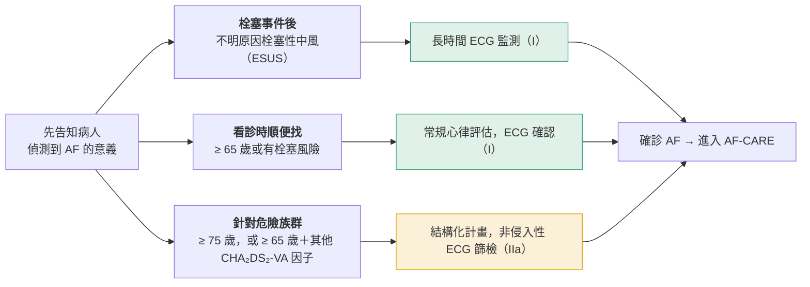

> [!abstract] 一句話重點
> 穿戴裝置或 PPG 只能「提示」AF，**確診一定要醫師判讀的 ECG**（單導程 > 30 秒或 12 導程）；**≥ 65 歲每次看診都該評估心律**，≥ 75 歲或 65 歲以上合併危險因子可考慮族群篩檢。

> [!info] 系列導覽（本系列只整理指引中的 Table 與 Figure）
> ↑ 回到 [[cardiology/atrial-fibrillation/index|心房顫動 AF 總覽]]
>
> ① [[af-esc-2024-1-overview|定義、診斷與 AF-CARE]]｜② [[af-esc-2024-2-anticoagulation|抗凝血與出血]]｜③ [[af-esc-2024-3-rate-rhythm|Rate 與 rhythm control]]｜④ 篩檢、危險因子與誘發因子（本篇）｜⑤ [[af-esc-2024-5-recommendations|新增、修訂與必做／不做]]
>
> 本篇涵蓋：Table 14、15、16；Figure 15、16

## Table 14：誘發 AF 的非心臟因素（trigger-induced AF）

| 類型 | 因素 |
| --- | --- |
| **急性狀況** | **感染**（細菌、病毒）；心包膜炎、心肌炎；急重症（燒傷、嚴重創傷、休克）；**狂飲酒精**；藥物（methamphetamine、cocaine、opiates、大麻）；**急性處置、介入與手術**；內分泌疾病（甲狀腺、腎上腺、腦下垂體等） |
| **慢性狀況**（發炎、讓心房更容易 AF） | 自體免疫疾病（類風濕性關節炎、SLE、IBD、乳糜瀉、乾癬等）；肥胖；COPD；**OSA**；癌症；脂肪肝；壓力；內分泌疾病 |

**本章內文的處置重點**：

- Trigger-induced AF 的**==栓塞風險和一般 AF 差不多==**（回溯與觀察性資料）
- 處置一樣**照 AF-CARE 原則**，並處理背後的危險因子與共病
- 栓塞風險高的合適病人，**應考慮長期 OAC**：**等急性誘因矯正後再開始**，並考慮淨臨床效益與病人意願
- 敗血症急性期抗凝的利弊不明確
- 這類病人 AF 復發率高，rate／rhythm control 依之後是否復發與症狀個別決定

> [!warning] Pitfall
> **==誘因造成的 AF 不代表誘因解決就沒事==**：栓塞風險和一般 AF 相近，復發率也高，風險高者應考慮長期抗凝並持續追蹤。

## Figure 15：AF 篩檢的非侵入性方法

| | ECG 類 | 非 ECG 類 |
| --- | --- | --- |
| **能否確診** | **可以**，前提是**==經醫師確認==**（Class I） | **==不能確診==**，只能提示可能有 AF |
| 方法 | 單導程或雙導程、6 導程、> 6 導程（如 12 導程） | 摸脈搏、oscillometry（血壓計）、**PPG**（接觸式或非接觸式）、mechanocardiography、智慧音箱（非接觸式） |

## Table 15：AF 篩檢工具

1. **摸脈搏**
2. **AI 演算法**找出高風險病人
3. **ECG 裝置**
   - 傳統 ECG：12 導程 ECG、**Holter（24 小時到一週以上）**、住院中的遙測、手持式裝置、**穿戴式貼片（最長 14 天）**、生物紡織品（最長 30 天）、智慧裝置（30 秒）
   - **植入式心電圖記錄器（ILR，3–5 年）**
4. **非 ECG 裝置**：PPG 與自動演算法（接觸式：指尖、智慧裝置、手環；非接觸式：影像）、oscillometry（血壓計判斷心律規則性）、mechanocardiography（加速度計、陀螺儀偵測心臟機械活動）、非接觸式影像 PPG、智慧音箱（偵測異常心率型態）

**本章內文的重點**：

- 多數消費型裝置用 PPG，早期研究顯示敏感度與特異度很高，但多為小型、選擇偏差大的研究
- **==PPG 或其他工具提示 AF 時，要用單導程或連續 ECG > 30 秒，或 12 導程 ECG，由熟悉判讀的醫師確認==**才能確診
- 敏感度高的方法會偵測到更多 AF，但偽陽性和低 burden 的 AF 也變多

> [!tip] Pearl
> 監測時間由短到長：**智慧裝置 30 秒 → Holter 1 天到一週 → 貼片 14 天 → 生物紡織品 30 天 → ILR 3–5 年**。隱源性中風找 AF，需要的就是長時間監測。

## Figure 16：AF 篩檢的策略

**圖解**（依原圖內容重新繪製）：

| 篩檢方式 | 對象舉例 | 場合 | 篩檢方法 |
| --- | --- | --- | --- |
| **栓塞事件之後** | **不明原因的栓塞性中風**（ESUS） | 事件發生後開始 | 侵入性或非侵入性 ECG **長時間監測（I）** |
| **看診時順便找** | **≥ 65 歲**或有栓塞風險 | 一般看診 | 任何心律檢查，再以 ECG 確認：**常規心律評估（I）** |
| **針對有危險因子者** | **≥ 75 歲，或 ≥ 65 歲加上其他 CHA₂DS₂-VA 危險因子** | 全國或區域性的結構化篩檢計畫 | 族群篩檢，用**非侵入性 ECG（IIa）** |

- 每種方式都要先**告知病人偵測到 AF 的意義**
- 篩檢出 AF 後，一律進入 **AF-CARE** 流程

**研究背景（本章內文）**：

- **單次篩檢**（某一時間點做一次 ECG）在 ≥ 65 歲族群，並沒有比常規照護找到更多 AF
- **長時間篩檢**能找到更多 AF、更多人開始抗凝：STROKESTOP（75–76 歲每天兩次單導程 ECG、持續 2 週）主要複合終點小幅下降；LOOP（ILR 平均 3.3 年）找到更多 AF（31.8% vs 12.2%），但中風或栓塞沒有減少
- 裝置偵測到的亞臨床 AF 多為**低 burden**，中風風險較低；多少 burden 才需要抗凝仍不清楚

> [!tip] Pearl
> 三種篩檢的等級要分清楚：**==ESUS 後長時間監測（I）、≥ 65 歲看診時評估心律（I）、族群篩檢（IIa）==**。

## Table 16：與新發 AF 相關的因素

| 類別 | 因素 |
| --- | --- |
| **人口學** | **年齡**、男性、歐洲血統、社經地位較低 |
| **生活型態** | 抽菸、**酒精**、缺乏運動、**高強度運動、競技或耐力型運動員**、咖啡因 |
| **共病與危險因子** | **高血壓**、心衰竭、瓣膜疾病、冠心病、周邊動脈疾病、先天性心臟病、心率與心率變異度、總膽固醇、LDL、HDL、三酸甘油酯、葡萄糖耐受不良與糖尿病、腎功能不全／CKD、**肥胖**、BMI 與體重、身高、**睡眠呼吸中止**、COPD |
| **亞臨床動脈硬化** | 冠狀動脈鈣化、頸動脈內膜中層厚度與斑塊 |
| **ECG 異常** | PR 間期延長、病竇症候群、WPW |
| **基因** | AF 家族史、GWAS 找到的易感基因位點、short QT 症候群、遺傳性心肌病變 |
| **生物標記** | CRP、fibrinogen、GDF-15、**natriuretic peptide（ANP、BNP）**、心肌 troponin、發炎標記 |
| **其他** | **甲狀腺功能異常**、自體免疫疾病、空氣污染、敗血症、心理因素 |

**本章內文**：這些因素在觀察性研究中和 AF 相關，但**不一定是因果關係**；孟德爾隨機化研究支持**==收縮壓和 BMI 是真正的致病因子==**。

> [!tip] Pearl
> 運動和 AF 呈 **J 型關係**：缺乏運動和高強度、耐力型運動都和 AF 相關。可以控制、而且證據最強的兩個是**血壓和體重**。

## 相關筆記

- [[af-esc-2024-1-overview|AF 指引圖表①定義、診斷與 AF-CARE]]：Table 6 的 device-detected subclinical AF、Figure 8 共病處理
- [[af-esc-2024-2-anticoagulation|AF 指引圖表②抗凝血與出血]]
- [[af-esc-2024-5-recommendations|AF 指引圖表⑤新增、修訂與必做／不做]]

## 參考資料

- Van Gelder IC, Rienstra M, Bunting KV, et al. 2024 ESC Guidelines for the management of atrial fibrillation developed in collaboration with the European Association for Cardio-Thoracic Surgery (EACTS). *Eur Heart J*. 2024;45(36):3314–3414.（Table 14、15、16；Figure 15、16）
