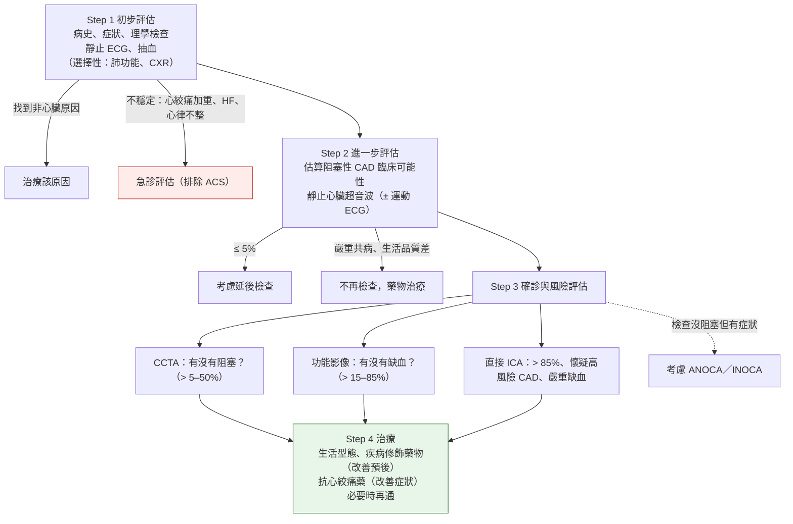
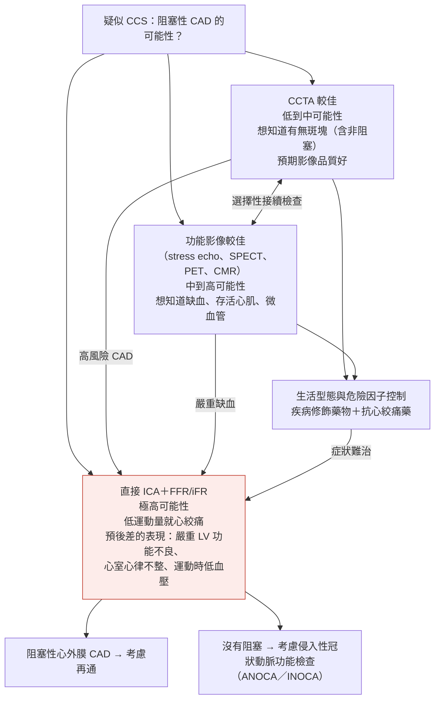

> [!abstract] 一句話重點
> - 疑似 CCS 走四步：
>   - **① 初步評估**（病史、ECG、抽血：**LDL-C、CBC、Cr、HbA1c、甲狀腺**）→ **② 用 RF-CL 估算阻塞性 CAD 的臨床可能性**（症狀分數＋危險因子數＋年齡性別）→ **③ 依可能性選第一線檢查**：**≤ 5% 先不檢查**、**＞ 5–50% 首選 CCTA**、**＞ 15–85% 功能性影像**（stress echo、SPECT／**PET 較佳**、CMR）、**＞ 85% 或低運動量就心絞痛 → 直接 ICA**
>   - **④ 治療**
> - **運動心電圖不再用來排除 CAD**（有 CCTA 或功能影像時 III）
> - **高風險**（LM ≥ 50%、三條 ≥ 70%、近端 LAD、缺血 ≥ 10%）→ **ICA＋FFR/iFR**

> [!info] 系列導覽
> ↑ 回到 [[cardiology/chronic-coronary-syndrome-esc-2024/index|2024 ESC 慢性冠心症指引總覽]]
>
> ① 臨床表現與診斷（本篇）｜② [[cardiology/chronic-coronary-syndrome-esc-2024/ccs24-2-medical-therapy|藥物與生活型態治療]]｜③ [[cardiology/chronic-coronary-syndrome-esc-2024/ccs24-3-revascularization|血管再通與 HF]]｜④ [[cardiology/chronic-coronary-syndrome-esc-2024/ccs24-4-anoca-special-followup|ANOCA/INOCA、特殊族群與追蹤]]｜📋 [[cardiology/chronic-coronary-syndrome-esc-2024/ccs24-5-recommendations|建議總整理]]｜⑤ [[cardiology/chronic-coronary-syndrome-esc-2024/ccs24-exam|內專考點]]
>
> 本篇來源：2024 ESC CCS Guidelines Section 2–3、Table 3–6、Figure 1–8、Recommendation Table 1–14

## 2024 有什麼新觀念

- **CCS 的定義變寬**：不只「穩定型心絞痛＋阻塞性 CAD」，也包含 **ANOCA／INOCA**（心絞痛或缺血但冠狀動脈沒有阻塞）、**微血管與血管痙攣**等機轉
- **Pre-test likelihood 改用 RF-CL 模型**：把危險因子數算進去，**大幅降低估計值**（以前的模型高估）
- **CCTA 成為低到中可能性的首選**；**運動心電圖退居評估運動耐受、症狀、預後**，不再拿來排除 CAD
- **抗心絞痛藥不再硬性分第一線、第二線**，依病人特性與機轉量身選擇

### 新建議（Table 3）與修訂建議（Table 4）

| 主題 | 2024 的改變 |
| --- | --- |
| **診斷** | **RF-CL 模型估算可能性（I B）**；低可能性（> 5–15%）可用 **CACS 重新分類（IIa B）**；**≤ 5% 延後檢查（IIa B）**；**PET 灌流**、CMR、stress echo **加顯影劑**評估灌流 |
| **抗心絞痛** | 不再分第一線、第二線：**long-acting nitrate、ranolazine（IIa）**、nicorandil、trimetazidine（IIb）可加上或在特定病人作為起始治療 |
| **抗血栓** | **Clopidogrel 75 mg 可當成 aspirin 的長期替代（I A，升級）**；**沒 MI、沒再通但有阻塞性 CAD → aspirin 終生（I B，升級）**；PCI 後預設 **DAPT（aspirin＋clopidogrel）6 個月**；高出血風險 **1–3 個月** |
| **降血脂** | 加入 **bempedoic acid**（statin 不耐受 I B） |
| **心血管保護** | **SGLT2-I、GLP-1 RA（T2DM＋CCS，I A）**；**semaglutide（無 DM、BMI ≥ 27，IIa B）**；**colchicine 0.5 mg qd（IIa A）** |
| **再通** | **LVEF > 35%：LM、三條、近端 LAD → 再通改善預後（I）**；**LVEF ≤ 35% 多條血管 → CABG（I B）**；LM 低 SYNTAX → PCI 可當替代（I A）；LM 中等 SYNTAX（23–32）PCI **升為 IIa A** |
| **ANOCA／INOCA** | **持續症狀 → 侵入性冠狀動脈功能檢查找 endotype（I B）**，依 endotype 用藥 |

- **逐條中文整理（含原圖）**：[[cardiology/chronic-coronary-syndrome-esc-2024/ccs24-5-recommendations#table-32024-新增的建議|📋 Table 3 新增]]、[[cardiology/chronic-coronary-syndrome-esc-2024/ccs24-5-recommendations#table-4與舊版相比修訂的建議|📋 Table 4 修訂（舊版 vs 2024 對照）]]

## CCS 的臨床表現與缺血機轉（Figure 1 依內容重新整理）

**五種臨床表現**：
1. **運動或情緒誘發心絞痛（或等同症狀）＋阻塞性 CAD**
2. **心絞痛或等同症狀、但沒有阻塞性 CAD（ANOCA／INOCA）**
3. **ACS、PCI 或 CABG 後的穩定期**
4. **缺血性 LV 功能不良或 HF**
5. **沒有症狀，但冠狀動脈解剖或功能檢查異常**

| 缺血機轉 | 結構性 | 功能性 |
| --- | --- | --- |
| **心外膜血管** | 動脈硬化（局部或瀰漫）、穩定的壁內血腫、心肌橋、冠狀動脈瘤 | **血管痙攣**（內皮功能不良、平滑肌過度反應、自律神經失調） |
| **微血管** | 小動脈向內重塑、微血管減少、血管內阻塞、血管周圍纖維化或浸潤、**外部壓迫（心肌肥厚、LVEDP 上升）** | **擴張不良**、**收縮過度**（內皮功能不良、自律神經失調） |

## 四步驟初步處置（Figure 2 依內容重新繪製）

- 再通的兩個目的：**改善症狀**（GDMT 無法緩解）與**改善預後**（高風險病人）

## Step 1：病史、ECG 與抽血（Recommendation Table 1–2）

| 建議 | 等級 |
| --- | --- |
| 詳細評估危險因子、病史與症狀特徵（發作、時間、性質、位置、誘因、緩解方式、時段） | I C |
| **情緒誘發胸痛、運動時喘或頭暈、手臂下巴頸部上背痛、疲倦 → 可能是心絞痛等同症狀** | IIa B |
| **臨床或 ECG 較像 ACS → 立即轉急診、重複測 hs-troponin** | **I B** |
| **所有胸痛都做 12 導程 ECG**，最好在發作中或剛發作後 | I C |
| ❌ **SVT（尤其 AVRT）時的 ST 偏移不能當作阻塞性 CAD 的證據** | **III B** |
| **抽血：LDL-C（I A）、CBC、Cr＋eGFR、HbA1c 或空腹血糖（I B）** | I |
| **甲狀腺功能至少驗一次** | I B |
| hs-CRP 和／或 fibrinogen | IIa B |

### 症狀：心絞痛與運動性喘（Figure 3 依內容重新整理）

| | **越像 CCS** | **越不像 CCS** |
| --- | --- | --- |
| **性質** | 勒住、緊縮、擠壓、壓迫、沉重 | 灼熱、刺痛、撕裂、肋膜痛、痠痛 |
| **位置與大小** | **胸骨後**，可延伸到**左手臂、頸部、肩胛間**；約**拳頭大** | 右側、會移動、範圍很大或只有一點 |
| **時間** | **短：運動或情緒誘發約 5–10 分鐘內** | 持續很久 |
| **誘因** | **用力時**；**冷天、強風、飽餐後**更常；情緒壓力 | **休息時**、深吸氣或咳嗽時、**按壓肋骨胸骨時** |
| **緩解** | **停止用力 1–5 分鐘內**；**舌下 NTG 加速緩解** | 吃制酸劑、喝牛奶 |
| **喘：像 CCS** | 用力時喘不過氣，**停止用力很快緩解** | 呼氣困難、喘鳴、休息與用力都會、咳嗽時；休息或吸支氣管擴張劑才慢慢好 |

### 心絞痛嚴重度 CCS 分級（Table 5 依內容重新整理）

| 分級 | 誘發程度 | 例子 |
| --- | --- | --- |
| **I** | 只有**劇烈**用力 | 快走、長時間或用力的日常活動才發作 |
| **II** | **中度**用力，日常活動稍受限 | 快走、飯後、冷天、風中、情緒壓力、剛起床幾小時內；**上坡、正常速度爬超過一層樓** |
| **III** | **輕度**用力，日常活動明顯受限 | **走一兩個街口**或**正常速度爬一層樓**就發作 |
| **IV** | **休息時** | 不需要用力就發作 |

## Step 2：估算阻塞性 CAD 的臨床可能性（Figure 4–5）

| 建議 | 等級 |
| --- | --- |
| **用 RF-CL（Risk Factor-weighted Clinical Likelihood）模型估算** | **I B** |
| 用其他臨床資料（周邊動脈、ECG、超音波、舊影像上的血管鈣化）**調整** | I C |
| **≤ 5% → 延後進一步檢查** | IIa B |
| **＞ 5–15% → 用 CACS 重新分類**，找出更多 ≤ 5% 的人 | IIa B |
| > 5–15%：運動 ECG、非冠狀動脈的動脈硬化可用來調整 | IIb C |

### RF-CL 模型三步驟（Figure 4 依內容重新整理）

**① 症狀分數（0–3 分）**：胸痛三個特徵各 1 分
- **性質與位置**：胸骨後或頸、下巴、肩、手臂的緊縮感（1 分）
- **誘因**：**身體或情緒壓力**誘發（1 分）
- **緩解**：**休息或 nitrate 5 分鐘內**緩解（1 分）
- 或主訴是**用力時喘**（**2 分**）
- 以前的「典型心絞痛」＝3 分、「非典型」＝2 分、「非心絞痛」＝0–1 分（舊名稱容易誤導，改用分數）

**② 危險因子數（0–5）**：**家族史**（一等親早發 CAD：男 < 55、女 < 65 歲）、**吸菸**（現在或過去）、**血脂異常**、**高血壓**、**糖尿病**

**③ 查表得到可能性（%）**：

| 年齡 | 0–1 分 女｜男 | 2 分 女｜男 | 3 分 女｜男 |
| --- | --- | --- | --- |
| **30–39** | 0–2｜1–5 | 0–3｜2–8 | 2–10｜9–22 |
| **40–49** | 1–3｜2–8 | 1–5｜3–12 | 4–12｜14–27 |
| **50–59** | 1–5｜4–12 | 2–7｜6–17 | 6–15｜21–33 |
| **60–69** | 2–7｜8–17 | 3–11｜12–25 | 10–19｜32–39 |
| **70–80** | 4–11｜15–24 | 6–16｜22–34 | 16–23｜**44–45** |

- 每格範圍是**危險因子 0–1 → 4–5 個**的數值
- 分級：**≤ 5% 極低**、**＞ 5–15% 低**、**＞ 15–50% 中**、**＞ 50–85% 高**、**＞ 85% 極高**
- **重點：最高也只有 45%**，大部分門診病人落在低到中可能性 → 這是 CCTA 成為首選的原因

### 調整與重新分類（Figure 5 依內容重新整理）

1. **用 RF-CL 估算**（I）
2. **有以下異常就往上調**（I）：**靜止 ECG 變化**（Q 波、ST-T）、**LV 功能不良**（嚴重或區域性）、**運動 ECG 異常**、**心室心律不整**、**舊胸部 CT 有冠狀動脈鈣化**、**PAD**
3. **RF-CL 低（> 5–15%）→ 做 CACS 重新分類**（IIa）：**CACS 0** 會把可能性拉到很低；**CACS ≥ 1000** 會大幅提高

## Step 2 的其他檢查（Recommendation Table 4–7）

| 檢查 | 建議 | 等級 |
| --- | --- | --- |
| **靜止 TTE** | **所有人**：LVEF、容積、舒張功能、區域壁動、非冠狀動脈心臟病、RV 與 sPAP | **I B** |
| CMR | 超音波看不清楚時 | IIb C |
| **運動 ECG** | 評估**運動耐受、症狀、心律不整、血壓反應、事件風險** | I C |
| | ❌ **靜止 ST 下降 ≥ 0.1 mV、LBBB、使用 digitalis → 不用於診斷** | **III C** |
| | ❌ **＞ 5–50% 且有 CCTA 或功能影像 → 不用來排除 CAD** | **III C** |
| | 沒有影像可用時當替代 | IIb B |
| CXR | 懷疑 HF、肺病、主動脈或其他胸腔原因 | IIa C |
| **Holter** | 胸痛且懷疑心律不整 | I C |
| | 懷疑**血管痙攣性心絞痛** | IIa B |

## Step 3：確診與風險評估

### 第一線檢查怎麼選（Figure 6 依內容重新整理）

| 臨床可能性 | 第一線檢查 |
| --- | --- |
| **極高 > 85%** | **直接侵入性冠狀動脈攝影（ICA）** |
| **高 > 50–85%** | **功能性影像**（PET／SPECT、CMR、stress echo） |
| **中 > 15–50%** | **CCTA 或功能性影像** |
| **低 > 5–15%** | **CCTA**，或先**調整可能性**（CACS 等） |
| **極低 ≤ 5%** | **延後檢查** |

### 有症狀疑似 CCS 的初步處置（Figure 7 依內容重新繪製）

- **CCTA 上的高風險 CAD**：**LM ≥ 50%**、**三條血管嚴重狹窄（≥ 70%）**、**一或兩條且包含近端 LAD 嚴重狹窄** → 再做功能影像或直接侵入性檢查

### 各種非侵入性檢查比較（Table 6 依內容重新整理）

| 檢查 | 看什麼 | 需要什麼 | 限制 |
| --- | --- | --- | --- |
| **CCTA** | 心外膜冠狀動脈的**動脈硬化（阻塞與非阻塞）** | 碘顯影劑、輻射；**beta-blocker 或 ivabradine 控心跳**、**NTG 擴張血管** | **嚴重腎功能不良**、碘過敏、**beta-blocker 也壓不住的快心律**、輻射（年輕女性） |
| SPECT/CT、PET/CT 的 CT | 動脈硬化、**CACS** | 輻射 | 輻射 |
| **Stress echo** | LVEF、容積、**壁動異常**、灌流、冠狀動脈流速儲備 | 運動、dobutamine 或血管擴張劑；顯影劑改善影像與評估灌流 | **超音波窗口差**、壓力藥物禁忌 |
| **CMR** | LVEF、**疤痕**、**缺血與血流**、壁動異常 | 血管擴張劑或 dobutamine＋gadolinium | **不相容的金屬裝置、幽閉恐懼、血液透析**、壓力藥物禁忌 |
| **SPECT** | LVEF、**缺血、存活心肌** | 血管擴張劑或運動、放射性示蹤劑 | 輻射、壓力藥物禁忌 |
| **PET** | LVEF、**缺血、血流量化**、存活心肌 | 血管擴張劑、示蹤劑（13N-ammonia、15O-water、82Rb） | 輻射、壓力藥物禁忌 |

### 非侵入性影像的建議（Recommendation Table 8–10、13）

| 建議 | 等級 |
| --- | --- |
| **＞ 5–50%：CCTA 診斷阻塞性 CAD 並估 MACE 風險** | **I A** |
| **＞ 5–50% 要排除阻塞性 CAD → CCTA 是首選** | **I B** |
| 其他非侵入檢查沒有結論 → CCTA；CCTA 結果功能意義不明或沒結論 → 功能影像 | I B |
| ❌ **CCTA 不做：eGFR < 30、失償 HF、大量鈣化、快且不規則心律、嚴重肥胖、無法閉氣** | **III C** |
| **＞ 15–85%：stress echo、SPECT 或（較佳）PET、CMR 灌流**診斷缺血並估 MACE | **I B** |
| Stress echo **≥ 2 個相鄰節段看不清 → 用超音波顯影劑**；顯影劑評估灌流 | I B |
| 做 PET／SPECT 時順便**用衰減校正 CT 算 CACS** | I B |
| **＞ 5% 有症狀 → 第一個檢查用 CCTA 或功能影像** | I B |
| CCTA 上近端或中段的中度狹窄 → **CT-FFR** | IIb B |
| 非侵入檢查不確定 → **ICA＋侵入性功能評估**確認或排除阻塞性 CAD 或 ANOCA／INOCA | I B |

### 先解剖再功能的接續檢查（Figure 8 依內容重新整理）

- 曲線表示：在不同**檢查前可能性**下，CCTA 或 dobutamine stress echo（DSE）**陽性或陰性後的檢查後可能性**
- **CCTA 陰性 → 排除能力最強**（低到中可能性時，陰性後幾乎可排除）
- **DSE 陽性 → 確診能力較強**；CCTA 陽性的確診能力較弱（會看到功能不顯著的狹窄）
- 因此：**低到中可能性先做 CCTA 排除**；CCTA 陽性但功能意義不明 → **再做功能影像確認**（A → B → C 逐步提高確定性）

## 侵入性冠狀動脈攝影（Recommendation Table 11–12）

| 建議 | 等級 |
| --- | --- |
| **ICA 首選 radial 路徑** | **I A** |
| **非 LM 的中度狹窄 → 再通前做壓力評估（FFR/iFR）** | **I A** |
| **極高可能性（> 85%）、GDMT 難治的嚴重症狀、低運動量心絞痛、高事件風險 → ICA 診斷** | I C |
| **低運動量就出現的新症狀、高度懷疑 → 心臟科評估後直接 ICA** | I C |
| **中度狹窄的功能評估：FFR ≤ 0.80 或 iFR ≤ 0.89（I A）、QFR ≤ 0.80（I B）** | **I** |
| LM 中度狹窄：FFR/iFR（IIa A）、IVUS（IIa B） | IIa |
| ❌ **不常規對所有血管做壓力導線評估** | **III A** |

## 高事件風險的定義（Recommendation Table 14）

| 檢查 | 高風險 |
| --- | --- |
| **運動 ECG** | **Duke Treadmill Score < −10** |
| **SPECT／PET** | **缺血 ≥ 10% LV 心肌** |
| **Stress echo** | **16 節段中 ≥ 3 個**壓力誘發 hypokinesia 或 akinesia |
| **Stress CMR** | **≥ 2 個**灌流缺損節段，或 **≥ 3 個** dobutamine 誘發功能異常節段 |
| **CCTA** | **LM ≥ 50%**、**三條血管 ≥ 70%**、**兩條 ≥ 70% 含近端 LAD**、**近端 LAD 單條 ≥ 70% 且 CT-FFR ≤ 0.8** |

- 先用**基本臨床資料**（年齡、ECG、心絞痛閾值、DM、CKD、LVEF）初步分層（I B）
- **高事件風險（不論症狀）→ ICA ± FFR/iFR**，目標是精確分層、經再通改善症狀與預後（**I A**）

## 相關筆記

- [[cardiology/chronic-coronary-syndrome-esc-2024/ccs24-2-medical-therapy|② 藥物與生活型態治療]]
- [[cardiology/chronic-coronary-syndrome-esc-2024/ccs24-4-anoca-special-followup|④ ANOCA/INOCA]]（沒阻塞但有心絞痛）
- [[cardiology/acs-esc-2023/index|急性冠心症 ACS（ESC 2023）]]（像 ACS 就轉急診）
- [[cardiology/chronic-coronary-syndrome-esc-2024/ccs24-exam|⑤ 內專考點]]

## 參考資料

- Vrints C, Andreotti F, Koskinas KC, Rossello X, et al. 2024 ESC Guidelines for the management of chronic coronary syndromes. *Eur Heart J* 2024;45(36):3415–3537（Section 2–3、Table 3–6、Figure 1–8、Recommendation Table 1–14）（參考資料庫：心臟科／2024 ESC Guidelines for the management of chronic coronary syndromes.pdf）
