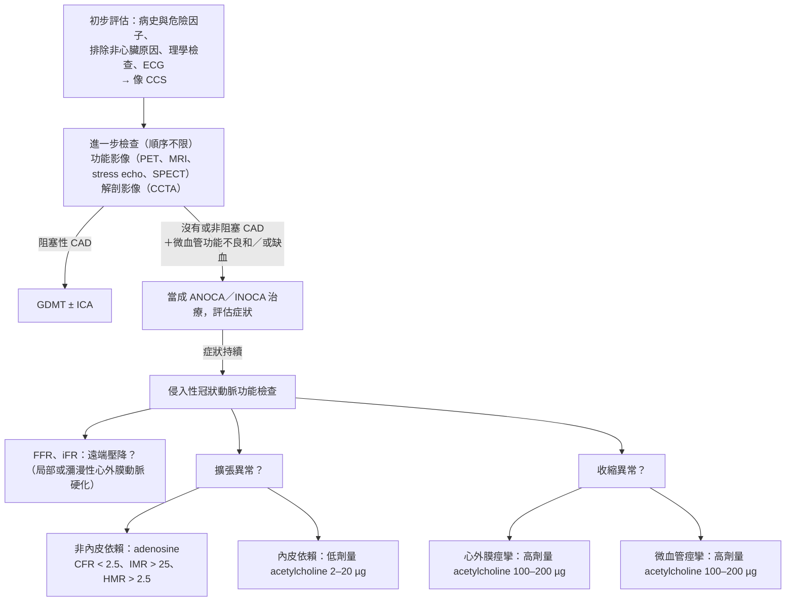

> [!abstract] 一句話重點
> **心絞痛但冠狀動脈沒有阻塞（ANOCA）很常見**（送侵入檢查的人最多約 7 成），機轉是**微血管功能不良**（CFR < 2.5、IMR > 25）或**血管痙攣**（acetylcholine 誘發）。**治療無效、生活品質差 → 侵入性冠狀動脈功能檢查找 endotype（I B）**，再依 endotype 用藥：**血管痙攣 → CCB（I A）＋nitrate（IIa）**；**微血管擴張不良 → beta-blocker、CCB 等抗缺血藥（IIa）**；**內皮功能不良 → ACE-I＋statin（IIa）**。特殊族群：老人注意藥物副作用、**停經後荷爾蒙療法不建議（III A）**、**PRECISE-DAPT 或 ARC-HBR 評估出血（I B）**、HIV 注意 statin 交互作用。**穩定者每年回診**，**新出現或惡化症狀 → stress imaging 分層**；**穩定者不常規重做缺血檢查**。

> [!info] 系列導覽
> ↑ 回到 [[cardiology/chronic-coronary-syndrome-esc-2024/index|2024 ESC 慢性冠心症指引總覽]]
>
> ① [[cardiology/chronic-coronary-syndrome-esc-2024/ccs24-1-diagnosis|臨床表現與診斷]]｜② [[cardiology/chronic-coronary-syndrome-esc-2024/ccs24-2-medical-therapy|藥物與生活型態治療]]｜③ [[cardiology/chronic-coronary-syndrome-esc-2024/ccs24-3-revascularization|血管再通與 HF]]｜④ ANOCA/INOCA、特殊族群與追蹤（本篇）｜⑤ [[cardiology/chronic-coronary-syndrome-esc-2024/ccs24-exam|內專考點]]
>
> 本篇來源：2024 ESC CCS Guidelines Section 5–6、Table 10、Figure 12–18、Recommendation Table 25–31

## ANOCA／INOCA

- **ANOCA**（angina with non-obstructive coronary arteries）：**有心絞痛**，冠狀動脈**沒有阻塞**
- **INOCA**（ischaemia with non-obstructive coronary arteries）：ANOCA 中**有客觀缺血證據**者
- 兩大 endotype：<strong>冠狀動脈微血管功能不良（CMD）</strong>與**心外膜或微血管痙攣**，常重疊
- **女性較多**；**預後並不良性**（MACE、HF 住院增加），生活品質差

### 送侵入性功能檢查的 ANOCA／INOCA 有多常見（Figure 12 依內容重新整理）

| 發現 | 比例 |
| --- | --- |
| 送 ICA＋功能檢查的人中 **ANOCA** | **最多約 70%** |
| ANOCA 中 **內皮功能不良** | **約 80%** |
| ANOCA 中 **acetylcholine 試驗陽性** | **約 60%** |
| ANOCA 中 **CFR 下降（≤ 2.5）** | **約 50%** |
| ANOCA 中**非侵入檢查證實缺血（INOCA）** | **只有約 25%** |

- 意思是：**非侵入檢查陰性不代表沒事**，大部分 ANOCA 要靠侵入性功能檢查才找得到機轉
- 血管痙攣比例會因 acetylcholine 劑量與流程不同而差異

### 診斷建議（Recommendation Table 25）

| 建議 | 等級 |
| --- | --- |
| **==治療下仍持續症狀、懷疑 ANOCA／INOCA、生活品質差 → 侵入性冠狀動脈功能檢查==**，找可治療的 endotype | **I B** |
| 冠狀動脈正常或中度狹窄但 FFR/iFR 正常 → **導線測 CFR 和／或微血管阻力** | IIa B |
| 同上 → **冠狀動脈內 acetylcholine**（ECG 監測下）評估微血管痙攣 | IIb B |
| 懷疑 CMD 時，非侵入的 **PET 或 CMR 灌流**（測心肌血流儲備） | — |
| **懷疑血管痙攣 → 發作時做 12 導程 ECG** | I C |
| **反覆休息時心絞痛＋ST 變化、nitrate 或 CCB 可緩解 → 侵入性功能攝影確診並評估動脈硬化** | I C |
| 懷疑血管痙攣且症狀頻繁 → **門診 ST 監測**（Holter）捕捉發作時 ST 偏移 | IIa B |

### 診斷流程（Figure 13 依內容重新繪製）

- **Acetylcholine 判讀**：誘發**心外膜血管明顯收縮＋症狀＋缺血 ECG 變化 → 心外膜痙攣**；**症狀＋ECG 變化但心外膜沒有明顯收縮 → 微血管痙攣**

### 痙攣誘發與功能檢查流程（Figure 14 依內容重新整理）

| 步驟 | 內容 |
| --- | --- |
| 準備 | **停用 CCB 與 nitrate 至少 24 小時** |
| 監測 | 全程**連續 Doppler 血流、12 導程 ECG 與症狀** |
| ① 基準攝影 | — |
| ② Acetylcholine 逐步加量 | **2 µg → 20 µg → 100 µg → 200 µg** 冠狀動脈內，**每劑 60 秒以上**，**每劑後重複攝影**；**誘發出痙攣就停止加量** |
| ③ 解除痙攣 | **NTG 200 µg 冠狀動脈內** |
| ④ 測 CFR／微血管阻力 | **Adenosine 200 µg 冠狀動脈內**（或靜脈輸注） |
| ⑤ 最後攝影 | — |

- <strong>低劑量 acetylcholine（2–20 µg）</strong>看內皮依賴性擴張；<strong>高劑量（100–200 µg）</strong>看內皮功能不良與痙攣

### 治療（Recommendation Table 25、Figure 15）

| 建議 | 等級 |
| --- | --- |
| 有症狀的 ANOCA／INOCA → **依冠狀動脈功能檢查結果用藥** | IIa A |
| **內皮功能不良 → ACE-I** 控制症狀 | IIa B |
| **微血管心絞痛（血流儲備下降）→ 預防需求性缺血的抗心絞痛藥（如 beta-blocker）** | IIa B |
| **==單純血管痙攣性心絞痛 → CCB（控制症狀、預防缺血與致命併發症）==** | **I A** |
| 血管痙攣 → **nitrate 預防復發** | IIa B |
| endotype 重疊 → nitrate、CCB 與其他血管擴張劑合併 | IIb B |

**治療三層次（Figure 15 依內容重新整理）**：

1. **生活型態**：飲食、運動、壓力調適、體重控制、戒菸
2. **危險因子**：高血壓、血脂異常、糖尿病
3. **依病理生理 endotype 用藥**：

| Endotype | 藥物 |
| --- | --- |
| **內皮功能不良＋共存動脈硬化** | **Statin＋ACE-I** |
| **微血管擴張不良** | **Beta-blocker**、CCB、ranolazine、trimetazidine、ivabradine |
| **微血管收縮異常（痙攣）** | **CCB**、第二種 CCB、nitrate |
| **心外膜血管痙攣** | **CCB**、nitrate、nicorandil |

- 痙攣類（心外膜或微血管）的藥物只列 **CCB、nitrate、nicorandil**；Figure 9 中**血管痙攣性心絞痛**也只列為 **DHP-CCB、diltiazem／verapamil、nitrate** 的適應症，**beta-blocker 不在其中**

## 特殊族群（Section 5.3、Recommendation Table 26）

| 族群 | 建議 | 等級 |
| --- | --- | --- |
| **老人（≥ 75 歲）** | 特別注意**副作用、不耐受、藥物交互作用、過量與手術併發症** | I C |
| | 診斷與再通決策依**症狀、缺血範圍、衰弱、餘命、共病、意願**，與年輕人相同原則 | I C |
| **女性** | 與男性**相同的預防治療** | I C |
| | ❌ **停經後全身性荷爾蒙療法**（沒有 CV 好處、增加血栓） | **III A** |
| **高出血風險** | 用 **PRECISE-DAPT、ARC-HBR** 等評估 | I B |
| **HIV** | 注意**抗反轉錄病毒藥與 statin 的交互作用** | I B |
| 社經弱勢 | 增加安全有效照護的可近性、納入臨床試驗 | I C |

- 其他共病（發炎性風濕病、高血壓、AF、瓣膜病、CKD、癌症）依各自指引；CKD 注意顯影劑與藥物劑量

## 無症狀者的 CAD 篩檢（Recommendation Table 27）

| 建議 | 等級 |
| --- | --- |
| **伺機篩檢危險因子，用 SCORE2、SCORE2-OP 估風險**，找出高風險者 | I C |
| 舊胸部 CT 有冠狀動脈鈣化 → 用來加強風險分層、治療危險因子 | IIa C |
| 在治療決策閾值附近 → **CACS** 改善分類 | IIb C |
| 沒有 CACS → 頸動脈超音波替代 | IIb B |

## 長期追蹤與順從（Section 6）

### 改善服藥順從的五個面向（Figure 16 依內容重新整理）

| 面向 | 做法 |
| --- | --- |
| **疾病** | 留意順從性差的預測因子；多重共病時**逐步加藥**、**避免頻繁換藥** |
| **醫療人員** | 正確、及時、充分的資訊；溝通技巧；調整病人對風險的認知；**避免臨床惰性** |
| **病人** | 心理社會支持（壓力、憂鬱、焦慮）；提升健康識能；**增加自我效能** |
| **治療** | **優先 polypill**；多用 mHealth、e-Health；考慮病人的負擔 |
| **醫療體系** | 讓就醫容易、快速、負擔得起；社區計畫；**納入非正式照顧者** |

- 共通基礎：**共同決策**、結構化工具（PROMs、臨床流程）→ 改善結果

### 長期維持健康生活（Figure 17 依內容重新整理）

**HEALTHY**：**H**ealthy diet（健康飲食）｜**E**xercise（運動）｜**A**chieve normal weight（正常體重）｜**L**eave smoking（戒菸）｜**T**ake control of cholesterol and BP（控制膽固醇與血壓）｜**H**andle alcohol（節制飲酒）｜**Y**ield to stress management（壓力管理）

**支持方法**：良好溝通與視覺化工具、**多專科行為介入**、**mHealth 與遠距照護**、**固定劑量複方與簡化處方**、PROMs 與回饋

| 建議（Recommendation Table 28） | 等級 |
| --- | --- |
| **行動健康介入**（簡訊、app、穿戴裝置）改善生活型態與服藥順從 | I A |
| 行為介入 | I B |
| **簡化處方（固定劑量複方）** | I B |
| 多專業與家人參與 | I C |

### 疾病進展的追蹤（Figure 18、Recommendation Table 29）

**每次回診照順序問**（Figure 18 依內容重新整理）：

1. **症狀的嚴重度與頻率？**
2. **ECG 變化？**
3. **已知 CAD 的範圍與嚴重度？**
4. **LV 功能？其他心臟病**（AF、瓣膜病、RV 功能不良）？
5. **有沒有再發或新的 CAD 事件？**
6. **需要更頻繁追蹤或新的診斷、治療嗎？**

同時考慮：年齡性別、ACS／PCI／CABG 病史、危險因子、共病（CKD、PAD）、**順從性與生活型態**、遺傳、發炎指標、心理社會因素。

| 建議 | 等級 |
| --- | --- |
| **不論症狀，定期（例如每年）回診**評估危險因子控制與風險變化 | I C |
| **LV 收縮功能惡化且找不到可逆原因 → 重新評估 CAD** | I C |
| **新出現或惡化的症狀 → 風險分層，最好用 stress imaging** | I C |
| **藥物難治的症狀或高事件風險 → ICA（必要時 FFR/iFR）** | I C |
| 曾再通、藥物難治 → **CCTA 看繞道或支架（≥ 3 mm）通暢** | IIa B |

- **穩定、無症狀者不需要例行重做缺血檢查**，症狀或功能改變時才評估

### 再通失敗與難治性心絞痛（Recommendation Table 30–31）

| 建議 | 等級 |
| --- | --- |
| **DES 內再狹窄 → 用 DES 優於藥物塗層氣球** | I A |
| 重做 CABG → **LIMA 是首選**（以前沒用過的話） | I B |
| 沒有通暢的 LIMA→LAD → 考慮重做 CABG | IIa B |
| **PCI 處理被繞過的原生血管，優於 PCI 繞道血管** | IIa B |
| 難治心絞痛、生活品質差、懷疑 ANOCA／INOCA → **侵入性冠狀動脈功能檢查**找 endotype | I B |

## What to do／What not to do（Table 10）

整份指引的 Class I 與 Class III 建議整理在 Table 10，本系列各篇的建議表大多來自這張表。

## 相關筆記

- [[cardiology/chronic-coronary-syndrome-esc-2024/ccs24-1-diagnosis|① 臨床表現與診斷]]
- [[cardiology/acs-esc-2023/acs23-2-reperfusion-invasive|ACS ② MINOCA]]（急性版的「沒阻塞」）
- [[cardiology/dyslipidemia-esc/index|血脂異常]]（SCORE2、CACS）
- [[cardiology/chronic-coronary-syndrome-esc-2024/ccs24-exam|⑤ 內專考點]]

## 參考資料

- Vrints C, Andreotti F, Koskinas KC, Rossello X, et al. 2024 ESC Guidelines for the management of chronic coronary syndromes. *Eur Heart J* 2024;45(36):3415–3537（Section 5–6、Table 10、Figure 12–18、Recommendation Table 25–31）（參考資料庫：心臟科／2024 ESC Guidelines for the management of chronic coronary syndromes.pdf）
