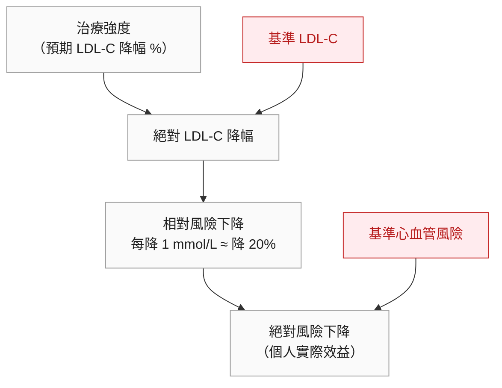
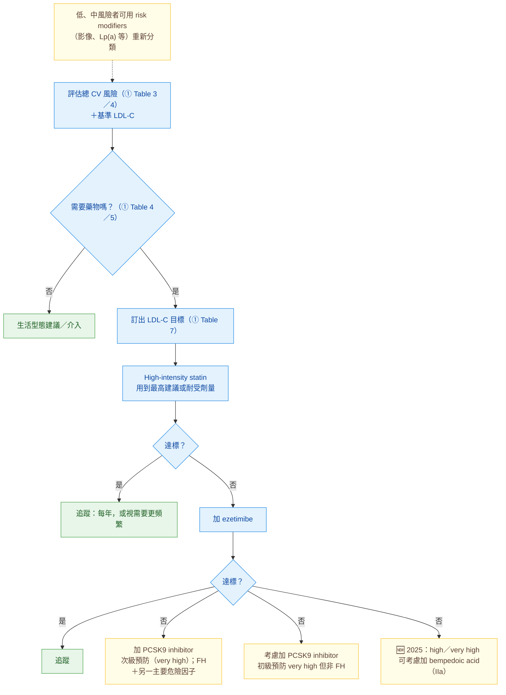

> [!abstract] 一句話重點
> 標準三步驟：**high-intensity statin 用到最高耐受劑量（I-A）→ 未達標加 ezetimibe（I-B）→ 次級預防仍未達標加 PCSK9 inhibitor（I-A）**。效益取決於**絕對 LDL-C 降幅**（每降 1 mmol/L，主要血管事件降約 22%）。🆕 2025：**不能用 statin 的人，建議用有 CV 證據的 non-statin（ezetimibe、PCSK9 mAb、bempedoic acid）單用或合併（I-A）**；**bempedoic acid** 進入建議（不能用 statin 時 I-B；加在 statin±ezetimibe 上 IIa-C）；HoFH 可考慮 **evinacumab**（IIa-B）。

> [!info] 系列導覽（本系列只整理指引中的 Table 與 Figure）
> ↑ 回到 [[cardiology/dyslipidemia-esc/index|血脂異常 ESC/EAS 指引總覽]]
>
> ① [[cardiology/dyslipidemia-esc/lipid-esc-1-risk-goals|風險分層與 LDL-C 目標]]｜② [[cardiology/dyslipidemia-esc/lipid-esc-2-lab|血脂檢驗、ApoB 與 Lp(a)]]｜③ [[cardiology/dyslipidemia-esc/lipid-esc-3-lifestyle|生活型態與營養補充品]]｜④ 降 LDL-C 藥物（本篇）｜⑤ [[cardiology/dyslipidemia-esc/lipid-esc-5-tg-genetic|高 TG 與遺傳性血脂異常]]｜⑥ [[cardiology/dyslipidemia-esc/lipid-esc-6-special|特殊族群]]｜⑦ [[cardiology/dyslipidemia-esc/lipid-esc-7-monitoring|監測、新增修訂與必做／不做]]｜⑧ [[cardiology/dyslipidemia-esc/lipid-esc-exam|內專考點]]
>
> 本篇涵蓋：**2019** Figure 3、4A；Table 10；降 LDL-C 藥物建議表 ｜ **2025** Figure 2；Recommendation Table 2

## Figure 3：降 LDL-C 治療的預期臨床效益

（依原圖內容重新繪製）

| 治療（2019 原圖） | 平均 LDL-C 降幅 |
| --- | --- |
| Moderate-intensity statin | 約 30% |
| **High-intensity statin** | 約 **50%** |
| High-intensity statin＋ezetimibe | 約 65% |
| PCSK9 inhibitor | 約 60% |
| PCSK9 inhibitor＋high-intensity statin | 約 75% |
| PCSK9 inhibitor＋high-intensity statin＋ezetimibe | 約 **85%** |

> [!tip] Pearl
> 同一個藥，**基準 LDL-C 越高、基準風險越高，絕對效益越大**。估算方式：**預期降幅 % × 基準 LDL-C = 絕對降幅**，再乘上每 mmol/L 約 20% 的相對風險下降，最後乘上基準風險。

## 🆕 2025 Figure 2：各種藥物與組合的平均 LDL-C 降幅

（依原圖數據重新繪製；BA = bempedoic acid、EZE = ezetimibe）

| 治療 | 平均降幅 |
| --- | --- |
| Moderate-intensity statin | ~30% |
| High-intensity statin | ~50% |
| EZE | ~20% |
| BA | ~23% |
| EZE＋BA | ~38% |
| High-intensity statin＋EZE | ~60% |
| High-intensity statin＋BA | ~58% |
| High-intensity statin＋EZE＋BA | ~68% |
| PCSK9 mAb | ~60% |
| PCSK9 mAb＋EZE | ~70% |
| PCSK9 mAb＋EZE＋BA | ~75% |
| High-intensity statin＋PCSK9 mAb | ~75% |
| High-intensity statin＋EZE＋PCSK9 mAb | ~80% |
| **High-intensity statin＋EZE＋BA＋PCSK9 mAb** | **~86%** |

> [!warning] Pitfall
> 注意 **high-intensity statin＋ezetimibe** 在 2019 Figure 3 寫 **~65%**，2025 Figure 2 寫 **~60%**——兩份圖表數字不同，以 2025 為新版。個體差異很大，**開始或加強治療後 4–6 週要再驗 LDL-C**。

## Figure 4A：降 LDL-C 的藥物治療流程

（依原圖內容重新繪製，並併入 🆕 2025 的修訂）

> [!info] 🆕 新版指引（2025）：選第二、第三個藥的原則
> 最大耐受 statin 仍未達標時，加上**有 CV 證據的 non-statin**（ezetimibe、PCSK9 mAb 或 bempedoic acid），單用或合併；**依還需要降多少、病人偏好、可取得性與費用來選**。ACS 病人則改採「**strike early and strong**」：住院期間就合併治療（見 ⑥）。

## 建議：藥物降 LDL-C

| 建議 | 等級 |
| --- | --- |
| **==High-intensity statin== 用到最高耐受劑量**，以達到該風險等級的目標 | **I-A** |
| 最大耐受 statin 未達標 → **==加 ezetimibe==** | **I-B** |
| 初級預防、very high 但非 FH，statin＋ezetimibe 仍未達標 → 可考慮加 PCSK9 inhibitor | **IIb-C** |
| **次級預防**、very high，statin＋ezetimibe 仍未達標 → **==加 PCSK9 inhibitor==** | **I-A** |
| **Very high 的 FH**（有 ASCVD 或另一主要危險因子），statin＋ezetimibe 仍未達標 → **加 PCSK9 inhibitor** | **I-C** |
| 任何劑量的 statin 都無法耐受（即使 rechallenge）→ 應考慮 ezetimibe（2019 原文；已更新，見下方 🆕） | **IIa-C** |
| 同上 → 可考慮 PCSK9 inhibitor 加在 ezetimibe 上（2019 原文；已更新，見下方 🆕） | **IIb-C** |
| 未達標 → 可考慮 statin＋bile acid sequestrant | **IIb-C** |

> [!info] 🆕 新版指引（2025 Focused Update）Recommendation Table 2（補充、不取代 2019 的表）
>
> | 建議 | 等級 |
> | --- | --- |
> | **不能用 statin** 的病人，建議用**有 CV 效益證據的 non-statin**（ezetimibe、PCSK9 mAb、bempedoic acid），單用或合併，以降 LDL-C 與 CV 事件；依還需要降多少來選 | **I-A** |
> | **不能用 statin** 者，建議用 **bempedoic acid** 達到 LDL-C 目標 | **I-B** |
> | **High 或 very high** 風險者，在最大耐受 statin（±ezetimibe）上**加 bempedoic acid** 應考慮 | **IIa-C** |
> | **HoFH ≥ 5 歲**、最大劑量降脂治療仍未達標 → 應考慮 **evinacumab** | **IIa-B** |
>
> 所以 statin 不耐受者的處置，從 2019 的 ezetimibe IIa-C、PCSK9 IIb-C，**升級為 non-statin 合併治療 I-A**。

## 各類藥物重點（2019 Section 8＋🆕 2025，自己整理）

### Statin

- **機轉**：競爭性抑制 **HMG-CoA reductase**（膽固醇合成的速率限制步驟）→ 肝細胞內膽固醇下降 → **LDLR 表現增加** → 清除 LDL 與其他 ApoB 粒子
- **強度定義**：**==high-intensity 指平均降 LDL-C ≥ 50%==**；moderate = 30–50%；同劑量個體差異大
- 其他血脂：TG 降 10–20%；HDL-C 升 1–10%；**Lp(a) 幾乎不受影響**
- **CTT**（> 17 萬人、26 個 RCT）：LDL-C 每降 1 mmol/L，5 年內**主要血管事件降 22%**、主要冠狀動脈事件 23%、CAD 死亡 20%、總中風 17%、**總死亡 10%**；各次族群相對效益相同；**第一年效益只有之後的一半**；**不增加癌症**等非 CV 死亡
- **無效的族群**：**==HF==**、**==血液透析==**病人
- 效益基本上是 **class effect**，由絕對 LDL-C 降幅決定，所以選哪一種 statin 看能否達到目標
- **肌肉**：最重要的副作用是 myopathy；**rhabdomyolysis** 時 CK > 10 倍（常 > 40 倍）ULN，約 **1–3／10 萬人年**。觀察性研究的 **SAMS** 約 10–15%，但**==盲性 RCT 中 statin 組肌肉症狀幾乎不增加==**——**nocebo effect**（ASCOT-LLA）。無法每天服用者，可考慮 atorvastatin 或 rosuvastatin **隔天或每週兩次**
- **肝**：輕度 ALT 上升 0.5–2%；臨床有意義的定義是**連續兩次 > 3 倍 ULN**；進展到肝衰竭極罕見 → **==不再建議常規監測 ALT==**；脂肪肝輕度 ALT 上升者用 statin 不會惡化
- **新發糖尿病**：劑量相關，**==NNH 約 255（4 年）==**；高強度、老人、有 DM 危險因子者較高；但 CV 效益遠大於此風險
- **Hemorrhagic stroke**：觀察性資料有小幅關聯，但整體中風效益遠超過
- **腎**：無明顯好壞影響；rosuvastatin 80 mg 有 12% 出現 tubular proteinuria（通常短暫）
- **交互作用**：除了 **pravastatin、rosuvastatin、pitavastatin**，多數 statin 經 **CYP（主要 CYP3A4）**代謝（見 Table 10）；**==statin＋gemfibrozil 一定要避免==**，和 fenofibrate 等其他 fibrate 合用風險很低

### Ezetimibe

- 抑制小腸刷狀緣 **NPC1L1** 的膽固醇吸收 → 送到肝的膽固醇減少 → LDLR 上調
- 單用 10 mg 降 LDL-C **15–22%**；加在 statin 上再降 **21–27%**；比 statin 劑量加倍多降 13–20%
- **IMPROVE-IT**（ACS 後，simvastatin 40 mg ± ezetimibe）：LDL-C 70 vs 55 mg/dL，事件 34.7% vs **32.7%**，**ischaemic stroke 降 21%**，沒有傷害
- 不需依年齡、性別或輕中重度腎功能調整；與 statin 合用不增加 CK 異常
- 🆕 2025：**EWTOPIA 75**（≥ 75 歲、無 CAD）支持**不合併 statin 的 ezetimibe** 也能減少 ASCVD 事件

### Bile acid sequestrant

- Cholestyramine 24 g、colestipol 20 g、colesevelam 4.5 g → LDL-C 降 **18–25%**；**可能升 TG**；colesevelam 還能降血糖
- 腸胃副作用（脹氣、便秘）常見，影響**脂溶性維生素**吸收；交互作用多，**其他藥要在服用前 4 小時或後 1 小時**吃（colesevelam 較少交互作用）
- **不被吸收**，是**懷孕**時唯一可考慮的降脂藥（見 ⑥）

### PCSK9 inhibitor（alirocumab、evolocumab）

- PCSK9 會讓 LDLR 被送去溶小體分解；抗體降低 PCSK9 → **LDLR 回收增加**；**statin 會提高 PCSK9**，所以和 statin 合用效果最好
- LDL-C 平均降 **60%**；加在 statin 上比安慰劑多降 46–73%、比 ezetimibe 多 30%；也**降 Lp(a)**、TG 約 26%
- **FOURIER**（穩定 ASCVD，evolocumab）：LDL-C 92 → 30 mg/dL，2.2 年主要終點降 **15%**（HR 0.85），**CV 死亡與總死亡不變**；**ODYSSEY Outcomes**（近期 ACS，alirocumab）：主要終點降 15%（HR 0.85），總死亡下降為探索性結果
- 皮下注射每 2 週或每月；副作用為注射部位反應、類流感症狀；**EBBINGHAUS** 未發現認知影響；無口服藥物交互作用
- 🆕 2025：**inclisiran**（siRNA，抑制 PCSK9 合成）降 LDL-C 約 50%，**CV 結果試驗預計 2026–2027 公布**，所以尚未列入有 CV 效益證據的藥物

### 🆕 Bempedoic acid（2025 新增）

- **ATP-citrate lyase 抑制劑**，作用在 HMG-CoA reductase **上游**；是 prodrug，活化酵素**不存在骨骼肌** → **肌肉副作用和安慰劑相近**
- 固定劑量 **180 mg/天**：單用降約 23%、加在 statin 上約 18%、**＋ezetimibe 固定劑量複方約 38%**；降 CRP，不升 HbA1c
- **CLEAR Outcomes**（13,970 名 **statin 不耐受**、高風險者，約 70% 次級預防）：LDL-C 差 22 mg/dL，**==MACE 降 13%==（HR 0.87）**，**CV 死亡不變**
- 副作用：**尿酸升高（10.9% vs 5.6%）、痛風（3.1% vs 2.1%）**、肝酵素 > 2 倍 ULN、腎功能下降、**膽結石**、血小板增加、血容比下降 → **==痛風病史要小心==（但非絕對禁忌）**

### 其他

| 藥物 | 重點 |
| --- | --- |
| **Lomitapide** | **MTP 抑制劑**（阻斷 VLDL 與 chylomicron 形成），口服，用於 **HoFH**；LDL-C 降約 50%；**肝酵素上升、脂肪肝**、腸胃副作用 |
| **Mipomersen** | ApoB-100 mRNA 的 antisense；用於 HoFH，FDA 核准但 EMA 未核准；肝毒性、脂肪肝 |
| 🆕 **Evinacumab** | 抗 **ANGPTL3** mAb，HoFH 中 statin、PCSK9 效果有限時可降 LDL-C 近 50%（不依賴 LDLR） |
| **Niacin** | 兩個大型試驗無益且嚴重副作用增加；歐洲已無核准產品 |
| **CETP inhibitor** | 大幅升 HDL-C 但無明顯效益（torcetrapib 死亡率增加；anacetrapib 事件降 9%，和 LDL-C／non-HDL-C 降幅相符） |

## Table 10：經 CYP3A4 代謝的 statin 可能交互作用藥物（增加 myopathy／rhabdomyolysis）

| 抗感染藥 | Calcium channel blocker | 其他 |
| --- | --- | --- |
| **Itraconazole** | **Verapamil** | **Ciclosporin** |
| Ketoconazole | **Diltiazem** | Danazol |
| Posaconazole | Amlodipine | **Amiodarone** |
| **Erythromycin** | | Ranolazine |
| **Clarithromycin** | | **葡萄柚汁** |
| Telithromycin | | Nefazodone |
| **HIV protease inhibitors** | | **Gemfibrozil** |

> [!danger] 交互作用重點
> 經 CYP3A4 代謝的 statin（simvastatin、atorvastatin、lovastatin）遇到 **macrolide（clarithromycin、erythromycin）、azole、HIV protease inhibitor、diltiazem／verapamil、amiodarone、ciclosporin、葡萄柚汁** → **==myopathy、rhabdomyolysis 風險上升==**。**Pravastatin、rosuvastatin、pitavastatin 不經主要 CYP 代謝**，是有交互作用疑慮時的選擇；**gemfibrozil 經 glucuronidation 抑制 statin 代謝，不可合用**。

## 相關筆記

- [[cardiology/dyslipidemia-esc/lipid-esc-1-risk-goals|① LDL-C 目標]]
- [[cardiology/dyslipidemia-esc/lipid-esc-7-monitoring|⑦ 監測 ALT、CK（Table 13）]]
- [[cardiology/dyslipidemia-esc/lipid-esc-6-special|⑥ ACS 的降脂策略]]

## 參考資料

- Mach F, Baigent C, Catapano AL, et al. 2019 ESC/EAS Guidelines for the management of dyslipidaemias. *Eur Heart J*. 2020;41(1):111–188. Section 8（Figure 3–4、Table 10）。參考資料庫：心臟科／2019ESCGuidelinesforthemanagement of dyslipidaemias.pdf
- 🆕 Mach F, Koskinas KC, Roeters van Lennep JE, et al. 2025 Focused Update of the 2019 ESC/EAS Guidelines for the management of dyslipidaemias. *Eur Heart J*. 2025;46(42):4359–4378. Section 4（Figure 2、Recommendation Table 2）。參考資料庫：心臟科／2025 Focused Update.pdf
