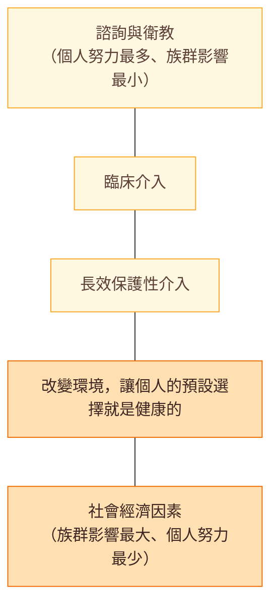

> [!abstract] 一句話重點
> **開始或調整藥物後 8（±4）週驗血脂**（🆕 2025：**4–6 週**），達標後**每年**。**ALT** 治療前與開始後 8–12 週各驗一次，**之後不必常規追蹤**；ALT ≥ 3 倍 ULN 才停藥或減量。**CK** 治療前驗，**> 4 倍 ULN 先不開始**；之後只在有肌肉症狀時驗；**CK > 10 倍 ULN 停藥**。2019 的核心變化：**目標更低（very high < 55、high < 70 mg/dL＋降 50%）**、**ApoB 升為 I**、**Lp(a) 一生測一次**；2025 再加 **SCORE2、bempedoic acid、ACS 早期合併、HIV statin**。

> [!info] 系列導覽（本系列只整理指引中的 Table 與 Figure）
> ↑ 回到 [[cardiology/dyslipidemia-esc/index|血脂異常 ESC/EAS 指引總覽]]
>
> ① [[cardiology/dyslipidemia-esc/lipid-esc-1-risk-goals|風險分層與 LDL-C 目標]]｜② [[cardiology/dyslipidemia-esc/lipid-esc-2-lab|血脂檢驗、ApoB 與 Lp(a)]]｜③ [[cardiology/dyslipidemia-esc/lipid-esc-3-lifestyle|生活型態與營養補充品]]｜④ [[cardiology/dyslipidemia-esc/lipid-esc-4-drugs|降 LDL-C 藥物]]｜⑤ [[cardiology/dyslipidemia-esc/lipid-esc-5-tg-genetic|高 TG 與遺傳性血脂異常]]｜⑥ [[cardiology/dyslipidemia-esc/lipid-esc-6-special|特殊族群]]｜⑦ 監測、新增修訂與必做／不做（本篇）｜⑧ [[cardiology/dyslipidemia-esc/lipid-esc-exam|內專考點]]
>
> 本篇涵蓋：**2019** Table 3、13；Figure 5、6；Box 8；Key messages、What to do／not ｜ **2025** 全部更新項目總整理

## Table 13：治療前與治療中血脂、酵素的監測

### 血脂

| 問題 | 建議 |
| --- | --- |
| 開始用藥前驗幾次？ | **至少兩次，間隔 1–12 週**；但 **ACS、very high** 等需要立即治療者例外 |
| 開始治療後多久驗？ | 開始後 **==8（±4）週==**；調整後 **8（±4）週**，直到達標 |
| 達標後多久驗？ | **每年一次**（除非有遵從性問題或其他理由） |

> [!info] 🆕 新版指引（2025 Focused Update）
> 2025 Focused Update 寫明：**==開始或加強降脂治療後 4–6 週驗 LDL-C==**（沿用 2019 ACS 章節的 4–6 週），因為對同一藥物的反應個體差異很大。（2019 Table 13 的「8 ± 4 週」；已更新為 4–6 週）

### 肝酵素（ALT）

| 問題 | 建議 |
| --- | --- |
| 什麼時候驗？ | **治療前**；開始用藥或加量後 **8–12 週驗一次** |
| 之後要常規追蹤嗎？ | **==Statin 治療中不建議常規追蹤 ALT==**，除非出現肝病症狀；**fibrate 治療中仍建議追蹤** |
| **ALT < 3 倍 ULN** | **繼續治療**，4–6 週後再驗 |
| **ALT ≥ 3 倍 ULN** | **==停藥或減量==**，4–6 週內再驗；ALT 恢復正常後可謹慎再開始；持續升高要找其他原因 |

### CK

| 問題 | 建議 |
| --- | --- |
| 治療前 | **開始前驗**；**==基準 CK > 4 倍 ULN → 先不要開始==，重驗** |
| 治療中 | **不必常規追蹤**；出現 **myalgia** 才驗。高風險者要警覺：**老人、合併干擾藥物、多重用藥、肝腎疾病、運動員** |
| **CK ≥ 4 倍 ULN** | 重新評估 statin 適應症；**==> 10 倍 ULN → 停藥==**，檢查腎功能，每 2 週追 CK；**< 10 倍且無症狀** → 繼續並每 2–6 週追 CK；**< 10 倍但有症狀** → 停藥，CK 恢復後以**較低劑量**再挑戰；考慮運動等短暫原因、持續升高考慮 myopathy、考慮合併治療或換藥 |
| **CK < 4 倍 ULN** | 無肌肉症狀 → **繼續 statin**（提醒回報症狀）；有症狀 → 監測症狀與 CK；**持續 6 週**仍有症狀 → 停藥並重新評估；可用同一或另一種 statin 再挑戰，或**低劑量、隔天或每週 1–2 次**、合併治療 |

### HbA1c 或血糖

- **高 DM 風險**及**使用高劑量 statin** 者，應考慮定期檢查
- 尤其老人、MetS、肥胖或其他 insulin resistance 表現者

> [!tip] Pearl
> 監測的三個數字：**ALT 3 倍、CK 4 倍、CK 10 倍**。ALT ≥ 3× 停或減；CK 基準 > 4× 不開始；CK > 10× 停藥查腎功能。

## Table 3：2019 版的新建議與新觀念（相對 2016 版）

### 新建議

| 主題 | 新建議 | 等級 |
| --- | --- | :---: |
| 影像評估 | 低或中風險者，**carotid／femoral plaque** 作為 risk modifier | IIa |
| 影像評估 | 低或中風險者，**CAC score** 作為 risk modifier | IIb |
| 血脂檢驗 | **Lp(a) 每位成人一生至少測一次**，找出 > 180 mg/dL（> 430 nmol/L）的人 | IIa |
| 高 TG | High 以上風險、statin 下 TG 135–499 mg/dL → **icosapent ethyl 2 × 2 g/天** | IIa |
| HeFH | 初級預防、FH 且 very high → 下降 ≥ 50% 且 < 55 mg/dL | IIa |
| 老人 | **≤ 75 歲**依風險用 statin 做初級預防 | I |
| 老人 | **> 75 歲**、high 以上，可考慮開始 statin 初級預防 | IIb |
| DM | T2DM very high → ≥ 50% 且 < 55；high → ≥ 50% 且 < 70；T1DM high 以上用 statin | I |
| DM | 先加強 statin 再合併；未達標加 ezetimibe | IIa |
| DM | **停經前 DM 女性計畫懷孕或未避孕 → 不用 statin** | III |
| ACS | 已服最大 statin＋ezetimibe 仍未達標 → **住院中就加 PCSK9 inhibitor** | IIa |

### 等級改變（2016 → 2019）

| 主題 | 2016 | 2019 |
| --- | --- | --- |
| **ApoB** | 替代指標（IIa） | **建議用於風險評估，可作為主要指標（I）** |
| **Statin＋ezetimibe** | 應考慮（IIa） | **建議（I）** |
| **PCSK9（次級預防 very high）** | 可考慮（IIb） | **建議（I）** |
| **PCSK9（very high 的 FH）** | 應考慮（IIa） | **建議（I）** |
| 高 TG 的 statin | 可考慮（IIb） | **建議（I）**（TG > 200 mg/dL 的高風險者） |
| HeFH 的目標 | 應考慮 < 100 或 < 70（IIa） | **FH＋ASCVD：≥ 50% 且 < 55（I）** |
| 老人的 statin 劑量 | 應考慮低劑量開始（IIa） | **建議低劑量開始（I）** |
| ACS 加 PCSK9 | 可考慮（IIb） | **4–6 週未達標建議加（I）** |

### 新觀念

- **各風險等級的 LDL-C 目標更低**：very high **< 55 mg/dL 且 ≥ 50%**；ASCVD 2 年內再發可考慮 **< 40**；high **< 70 且 ≥ 50%**；moderate < 100；low < 116
- **絕對 LDL-C 降幅**（由治療前 LDL-C 與藥效決定）決定相對風險下降，再依基準風險決定絕對效益
- **FH 的風險分類**：FH＋ASCVD 或另一主要危險因子 = very high，否則 high
- 區分**正式的 statin myopathy** 與 **statin-associated muscle symptoms**，並檢討 RCT 與觀察性研究的差異
- 新章節：**非侵入性影像**、脂蛋白的生物學與 LDL-C 的**因果角色**、新藥（降 LDL-C、TG、Lp(a)）、**inflammation**、PCSK9 結果試驗、**成本效益**（statin、ezetimibe 已有 generic）

## 🆕 2025 Focused Update 更新總整理

| 主題 | 2025 新增或修訂 | 等級 | 詳見 |
| --- | --- | :---: | --- |
| **風險估計** | **SCORE2**（< 70 歲）、**SCORE2-OP**（≥ 70 歲）取代 SCORE | I-B | ① |
| 風險分類 | 新 **Table 3**：SCORE2 < 2%／2–10%／10–20%／≥ 20%（取代 2019 Table 4） | — | ① |
| Risk modifier | **影像 subclinical coronary atherosclerosis 或 CAC 升高**（取代 CAC IIb） | IIa-B | ① |
| Risk modifier | **Box 1** 的 risk modifiers（新） | IIa-B | ① |
| 初級預防用藥 | very high＋LDL ≥ 70 或 high＋LDL ≥ 100 → 建議用藥 | I-A | ① |
| 初級預防用藥 | 其他組合（Table 4 黃色格）→ 應考慮用藥 | IIa-A | ① |
| **Statin 不耐受** | **有 CV 證據的 non-statin 單用或合併** | **I-A** | ④ |
| **Bempedoic acid** | 不能用 statin 時 | **I-B** | ④ |
| Bempedoic acid | 加在最大 statin ± ezetimibe（high／very high） | IIa-C | ④ |
| **Evinacumab** | HoFH ≥ 5 歲未達標 | IIa-B | ④⑤ |
| **ACS** | 已在服藥者**住院期間就加強** | I-C | ⑥ |
| ACS | 未用藥且預期 statin 單用不夠 → **住院就 statin＋ezetimibe** | IIa-B | ⑥ |
| **Lp(a)** | **> 50 mg/dL（105 nmol/L）**為所有成人的風險增強因子 | IIa-B | ② |
| 高 TG | **High-dose icosapent ethyl** 2 × 2 g/天（明確限定純化 EPA） | IIa-B | ⑤ |
| 高 TG | **Volanesorsen**：FCS、TG > 750 mg/dL | IIa-B | ⑤ |
| **HIV** | **≥ 40 歲初級預防一律 statin** | **I-B** | ⑥ |
| 癌症 | 高心毒性風險的 anthracycline 治療 → statin | IIa-B | ⑥ |
| **營養補充品** | 無證據的補充品或維生素**不建議** | **III-B** | ③ |

> [!note] 2025 沒有改變的
> **LDL-C 目標（Figure 1）與治療強度原則（Table 4）不變**；仍以絕對風險決定降 LDL-C 的強度；fibrate 仍 IIb；頸／股動脈 plaque 仍 IIa。

## Figure 5：Health impact pyramid

（依原圖內容重新繪製）

金字塔越往下，**對族群的影響越大**；越往上，**需要的個人努力越多**。指引共識是每一層都需要，但應**強調下層**（族群層級政策，如減鹽、禁菸立法）以縮小社經造成的健康差距。過去 30 年 CV 死亡下降**超過一半**來自族群層級的危險因子改變。

## Figure 6：Statin 治療的主要血管事件絕對減少量

（依原圖數據重新整理；每 10,000 人治療 5 年**可避免的主要血管事件數**，原圖引自 Collins et al. Lancet 2016）

| 5 年主要血管事件風險 ＼ statin 降 LDL-C | 1 mmol/L | 1.5 mmol/L | 2 mmol/L |
| --- | ---: | ---: | ---: |
| 5–< 10% | 170 | 250 | 310 |
| 10–< 20% | 370 | 540 | 680 |
| 20–< 30% | 540 | 800 | 1010 |
| ≥ 30% | 730 | 1130 | **1440** |

> [!tip] Pearl
> **==風險越高、LDL-C 降越多，絕對效益越大==**：同樣降 2 mmol/L，高風險（≥ 30%）者每萬人可避免 1440 件，是低風險（5–10%）者的 4–5 倍。這就是成本效益的核心邏輯（Box 8）。

## Box 8：成本效益的關鍵訊息

- 以生活型態、藥物或兩者預防 CVD，在許多情境（族群策略與針對高風險個人）都**符合成本效益**
- 成本效益取決於**基準 CVD 風險、LDL 濃度、治療成本、預防策略的使用率**
- **在高風險個人與族群，預防 CVD 最符合成本效益**
- 低成本 generic **statin、ezetimibe** 已證實符合成本效益；**PCSK9 inhibitor** 以 2018 年中價格大多**不符合**，限縮在最高風險者（臨床 CVD、FH、高 LDL-C）會改善

## Key messages（2019 Section 14，自己整理）

1. **LDL-C 是 ASCVD 的原因**；「**lower is better**」，至少到 **40 mg/dL（1 mmol/L）**都沒有下限；每降 1 mmol/L，ASCVD 約降**五分之一**
2. **PCSK9 inhibitor** 在 statin 上進一步降低 ASCVD 風險，可能需要限於最高風險者
3. **CAC score** 有助於 **moderate risk** 者的治療決策；頸／股動脈 plaque 也有幫助
4. **ApoB** 在高 TG、DM、肥胖或 LDL-C 很低時，可能比 LDL-C 更能反映致動脈硬化脂蛋白的暴露
5. **Lp(a) 測一次**可找出遺傳性極高 Lp(a)；也可協助邊界風險者分類
6. **強化目標**：very high 同時要求 **≥ 50% 下降**與 **< 55 mg/dL**，high 為 **< 70 mg/dL**；FH＋ASCVD 或另一主要危險因子算 very high
7. **近期 ACS**：最大 statin＋ezetimibe **4–6 週**未達標就加 PCSK9 inhibitor
8. **極低 LDL-C（< 40 mg/dL）目前沒有已知的不良影響**
9. **Statin「不耐受」**：placebo-controlled RCT 顯示**==真正的 statin 不耐受很少==**，絕大多數人都能用某種形式的 statin（換藥、減量）
10. **老人**：效益由絕對 LDL-C 降幅與基準風險決定，和年齡無關；但 **> 75 歲初級預防**證據較少；**腎功能不佳或有交互作用時低劑量開始**

## What to do／What not to do（2019 Section 16 重點）

| 必做（Class I 舉例） | 不做（Class III） |
| --- | --- |
| > 40 歲無症狀成人用風險系統估計總風險（🆕 改用 SCORE2／SCORE2-OP） | **一般族群的風險分數不用於 DM 或 FH**（III-C） |
| LDL-C 為主要血脂指標；高 TG、DM、肥胖、低 LDL-C 時評估 non-HDL-C 與 ApoB | **停經前 DM 女性計畫懷孕或未避孕 → 不用 statin**（III-C） |
| Very high → ≥ 50% 且 < 55；high → ≥ 50% 且 < 70 mg/dL | **HF 無其他適應症 → 不開始降脂藥**（III-A） |
| High-intensity statin 到最高耐受劑量；未達標加 ezetimibe；次級預防再加 PCSK9 | **AS 無 CAD → 不為延緩 AS 而開始降脂藥**（III-A） |
| ACS 盡早 high-dose statin，4–6 週未達標依序加藥 | **透析且無 ASCVD → 不開始 statin**（III-A） |
| FH：臨床診斷＋DNA、cascade screening、5 歲起檢測兒童 | 🆕 **無證據的營養補充品或維生素 → 不用於降 ASCVD 風險**（III-B） |
| 高風險且 TG > 200 mg/dL → statin 為首選 | |
| 老人依風險用 statin（≤ 75 歲初級預防 I）；低劑量開始 | |
| CKD stage 3–5 非透析用 statin±ezetimibe；PAD 用最大 statin＋ezetimibe±PCSK9 | |
| 🆕 HIV ≥ 40 歲初級預防用 statin；不能用 statin 時用 non-statin 合併 | |

## 相關筆記

- [[cardiology/dyslipidemia-esc/lipid-esc-4-drugs|④ Statin 副作用與交互作用]]
- [[cardiology/dyslipidemia-esc/lipid-esc-1-risk-goals|① LDL-C 目標]]

## 參考資料

- Mach F, Baigent C, Catapano AL, et al. 2019 ESC/EAS Guidelines for the management of dyslipidaemias. *Eur Heart J*. 2020;41(1):111–188. Section 2.1、11、12、14、16（Table 3、13；Figure 5–6；Box 8）。參考資料庫：心臟科／2019ESCGuidelinesforthemanagement of dyslipidaemias.pdf
- 🆕 Mach F, Koskinas KC, Roeters van Lennep JE, et al. 2025 Focused Update of the 2019 ESC/EAS Guidelines for the management of dyslipidaemias. *Eur Heart J*. 2025;46(42):4359–4378. 全文。參考資料庫：心臟科／2025 Focused Update.pdf
