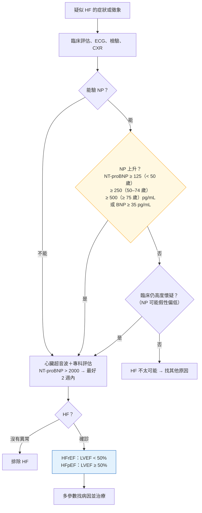

> [!abstract] 一句話重點
> **==2026 最大改變：HFmrEF 被取消，HFrEF 擴大為 LVEF < 50%，HFpEF 為 LVEF ≥ 50%==**；「acute HF」改稱 **decompensated HF（DHF）**；採用 **stage A–D**；治療改稱 **FMT（foundational）＋AMT（additional）＋GDIT（interventional）**。**Improved LVEF**：絕對值上升 ≥ 10% 且 > 40%，**FMT 仍要繼續**。診斷：症狀徵象 → ECG、檢驗、CXR → **==NT-proBNP 依年齡：< 50 歲 ≥ 125、50–74 歲 ≥ 250、≥ 75 歲 ≥ 500 pg/mL（或 BNP ≥ 35）==** → 心臟超音波；**NT-proBNP > 2000 pg/mL 最好 2 週內做超音波**。HFpEF 要有**結構或功能異常的客觀證據**（Table 10）。預防：**血壓 < 130 mmHg**、T2DM＋CV 危險因子 → **GLP-1 RA**（新）；stage B：**LVEF ≤ 40% → ACE-I／ARB**、**LVEF < 50% → beta-blocker**。

> [!info] 系列導覽
> ↑ 回到 [[cardiology/heart-failure-esc-2026/index|2026 ESC 心衰竭指引總覽]]
>
> ① 定義、分類、預防與診斷（本篇）｜② [[cardiology/heart-failure-esc-2026/hf26-2-chronic-treatment|慢性 HF 治療]]｜③ [[cardiology/heart-failure-esc-2026/hf26-3-decompensated|Decompensated HF 與休克]]｜④ [[cardiology/heart-failure-esc-2026/hf26-4-advanced-comorbidities|Advanced HF、共病與特殊情況]]｜⑤ [[cardiology/heart-failure-esc-2026/hf26-exam|內專考點]]
>
> 本篇來源：2026 ESC HF Guidelines Section 2–5、Table 4–10、Figure 1–9、Recommendation Table 1–4

## 2026 有什麼新觀念（Table 4）

| 新觀念 | 內容 |
| --- | --- |
| **==HFrEF 擴大到 LVEF < 50%==** | 以前 ≤ 40% |
| **HFmrEF 取消** | 以前 41–49%；病理生理、預後、對藥物的反應都比較像 HFrEF |
| **HFpEF＝LVEF ≥ 50%** | 加上舒張功能異常或充填壓上升的客觀證據、NP 上升支持 |
| **Decompensated HF 取代 acute HF** | — |
| **採用 stage A–D** | 從危險因子到 advanced HF |
| **新的治療分類** | **FMT**＋**AMT**（兩者合稱 GDMT）＋**GDIT** |

## 定義與分類（Section 3、Figure 2–3）

- **HF＝臨床症候群**：心臟結構或功能異常 → 心內壓上升和／或心輸出不足（休息或運動時），造成症狀和／或徵象；要有**心因性肺或全身鬱血的客觀證據**與支持性檢查
- 盛行率：成人 **1–3%**

| 分類 | 定義 |
| --- | --- |
| **HFrEF** | **LVEF < 50%**＋HF 症狀或徵象 |
| **HFpEF** | **LVEF ≥ 50%**＋症狀或徵象＋**LV 舒張功能異常或充填壓上升的客觀證據**（NP 上升支持） |
| **Improved LVEF** | LVEF **絕對值上升 ≥ 10%** 且 **> 40%**；預後較好，但**除少數外仍要繼續治療** |

- 用單一 LVEF 切點有點武斷；**MR 時 LVEF 可能假性偏高**

| Stage | 意義 |
| --- | --- |
| **A：At risk** | 有危險因子（高血壓、糖尿病、肥胖、心毒性藥物等），沒有結構異常 |
| **B：Pre-HF** | **沒有症狀**，但有**結構或功能異常**（LVH、心腔擴大、壁動異常、LGE、瓣膜疾病、LVEF 下降、充填壓上升） |
| **C：HF** | 現在或過去有 HF 症狀 |
| **D：Advanced HF** | 治療下仍嚴重症狀、反覆住院（見 ④） |

**治療的新名稱（Figure 3）**：金字塔底層是 **FMT（foundational medical therapy）**，上層是 **AMT（additional medical therapy）** 與 **GDIT（guideline-directed interventional therapy）**；**GDMT＝FMT＋AMT**。

## 預防：Stage A、B（Section 4）

| 建議 | 等級 |
| --- | --- |
| **所有 stage A、B**：健康生活型態衛教（體重、飲食、不久坐、**戒菸、不酗酒**、不用 cocaine、amphetamine、類固醇） | **I C**（新） |
| **高血壓或 stage B → 嚴格控制，SBP < 130 mmHg** | **I A**（修訂） |
| **T2DM＋至少一個其他 CV 危險因子 → GLP-1 RA** 降低 HF 或 CV 死亡 | **IIa A**（新） |
| **Stage B、LVEF ≤ 40% → ACE-I**（不耐受改 ARB） | **I A**（新） |
| **Stage B、LVEF < 50% → beta-blocker** | **I B1**（新） |
| **MI 後 LVEF ≤ 40%，有 HF 徵象或糖尿病 → eplerenone** | **I B1**（新） |

## 診斷慢性 HF（Section 5）

### 症狀、徵象與 NYHA（Table 7–8）

| 典型症狀 | 較特異的徵象 |
| --- | --- |
| **Breathlessness、orthopnoea、PND**、運動耐受下降、疲倦、腳踝腫 | **頸靜脈壓上升**、**hepatojugular reflux**、**S3**、心尖搏動側移 |

| NYHA | 意義 |
| --- | --- |
| I | 一般活動不受限 |
| II | 輕度受限；休息舒服，**一般活動**就喘、累、心悸 |
| III | 明顯受限；休息舒服，**比一般更少的活動**就有症狀 |
| IV | 任何活動都不舒服；**休息時可能也有症狀** |

### 所有疑似 HF 都要做（Recommendation Table 3）

| 檢查 | 等級 |
| --- | --- |
| **檢驗**：CBC、**腎功能（eGFR、UACR）**、電解質、肝功能、甲狀腺、HbA1c、血脂、**iron status（TSAT、ferritin）** | I C |
| **Natriuretic peptide**（依年齡、肥胖等因素解讀） | I C |
| **12 導程 ECG** | I C |
| **胸部 X 光** | I C |
| **經胸心臟超音波**：確診、分型、找原因 | I C |

### 診斷流程（Figure 4 依內容重新繪製）

- 以前的單一 rule-out 切點（NT-proBNP < 125）**對老人特異度差**：> 80 歲的健康人 **> 75% 超過 125** → 改用**年齡分層**
- **NT-proBNP 不受 ARNI 影響**（BNP 會被 sacubitril 抑制分解而上升）

### NP 為什麼高或低（Table 9）

| 偏高 | 偏低 |
| --- | --- |
| **ACS、AF**、**高齡**、**腎功能不良**、**PE**、**肺高壓**、**sepsis／肺炎**、**COPD**、OSA、LVH、心肌炎、RV pacing、嚴重貧血、肝病、DKA、SAH、女性、高血壓、瓣膜病 | **==肥胖==**、**ARNI／ACE-I／ARB、beta-blocker、MRA、SGLT2-I**、**constrictive pericarditis**、非洲裔 |

### HFpEF 的客觀證據（Table 10）

| 項目 | 切點 |
| --- | --- |
| **LVH** | LV mass index **≥ 95 g/m²（女）、≥ 115 g/m²（男）**，或 relative wall thickness **> 0.42** |
| **左心房擴大** | LAVI **> 34 mL/m²（竇性）**、**> 40 mL/m²（AF）** |
| **充填壓上升** | 休息時 **E/e′ > 9** |
| **肺動脈壓上升** | 估計 **sPAP > 35 mmHg** 或 **TR velocity > 2.8 m/s** |

### 找病因（Figure 5–9、Recommendation Table 4）

- **HFrEF 主要原因**（概略整理，完整見 Figure 5 原圖）：缺血性心臟病、高血壓、瓣膜病、心肌病（基因、心肌炎、毒性如酒精、化療）、心律不整、浸潤性疾病等
- **HFpEF 主要危險因子**（概略整理，完整見 Figure 6 原圖）：高齡、高血壓、肥胖、糖尿病、CKD、AF 等
- 新建議：
  - **懷疑 cardiac amyloidosis → serum／urine immunofixation、serum free light chains、DPD／PYP／HMDP 骨掃描**（I B）
  - 符合心肌病診斷標準 → **基因檢測**（能幫助診斷、預後、治療或家族篩檢時；I C）
  - 懷疑 **cardiac sarcoidosis → FDG-PET**（IIa C）
  - **有 CIED、新發或惡化 HFrEF → 檢查 RV pacing 比例**（IIa C）
  - persistent AF 不確定恢復竇律有沒有幫助 → **電擊整流當診斷工具**（IIb C）
  - **Contrast CMR**：懷疑心肌病或病因不明（I C）
  - HFrEF＋高度懷疑阻塞性 CAD → **侵入性冠狀動脈攝影**（IIa C）

## 相關筆記

- [[cardiology/heart-failure-esc-2026/hf26-2-chronic-treatment|② 慢性 HF 治療]]
- [[cardiology/atrial-fibrillation/index|心房顫動 AF（ESC 2024）]]（AF 會讓 NP 上升）
- [[cardiology/dyslipidemia-esc/index|血脂異常]]
- [[cardiology/heart-failure-esc-2026/hf26-exam|⑤ 內專考點]]

## 參考資料

- 2026 ESC Guidelines for the management of heart failure. *Eur Heart J* 2026;47(38):5346 起（Section 2–5、Table 4–10、Figure 1–9、Recommendation Table 1–4）（參考資料庫：心臟科／2026 ESC Guidelines for the management of heart failure.pdf）
