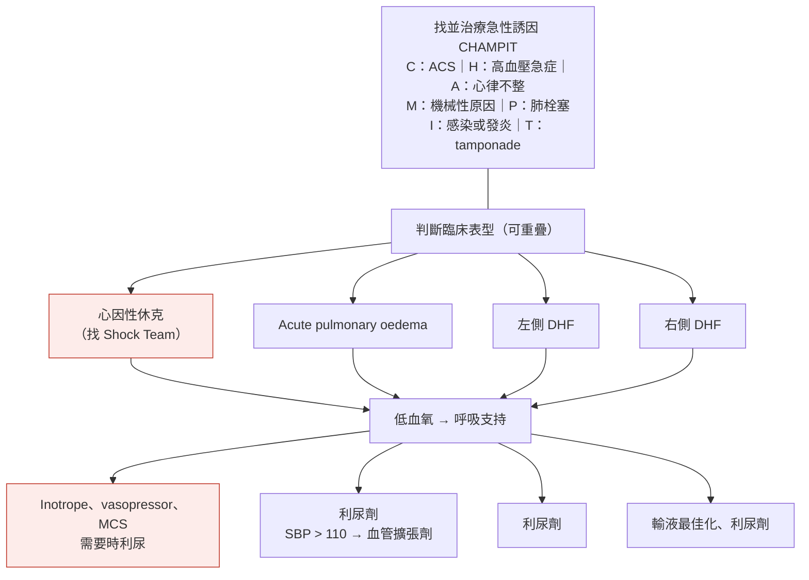
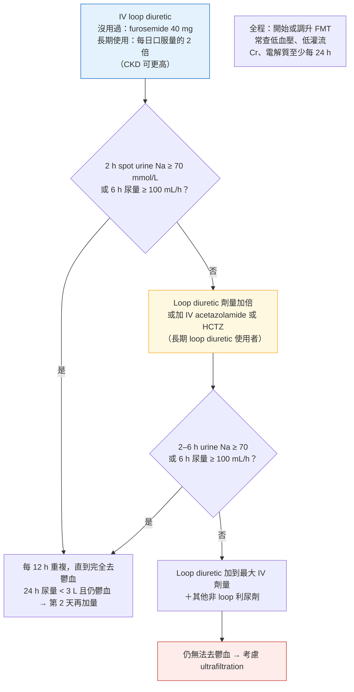

> [!abstract] 一句話重點
> **先找誘因（CHAMPIT）＋分型**（cardiogenic shock／acute pulmonary oedema／左側／右側 DHF）。**氧氣只給 SpO2 < 90% 或 PaO2 < 60**；呼吸窘迫（RR > 25、SpO2 < 90%）→ **盡早 NIPPV**。**==IV loop diuretic：沒用過的人 furosemide 40 mg，長期使用者給每日口服量的 2 倍==** → **2 小時 spot urine Na ≥ 70 mmol/L 或 6 小時尿量 ≥ 100 mL/h** → 有反應就每 12 小時重複；沒反應 → **劑量加倍，或加 IV acetazolamide 500 mg qd 或 HCTZ**（IIa B1）→ 再不夠 → 加到最大（furosemide 一般最多 600 mg/day）＋其他利尿劑 → ultrafiltration。**==穩定後住院中就開始 SGLT2-I（I B1）==**，出院前**快速調升 FMT、6 週內密集追蹤（I B2）**。**Vasodilator 只在 SBP > 110**；**inotrope 只在 SBP < 90＋低灌流**；**vasopressor 首選 norepinephrine**；**不常規給 opiate**。休克：**Shock Team**；**STEMI 休克＋LV 功能差、沒有缺氧腦傷 → 可考慮 microaxial flow pump（IIa B1）**；**未篩選的 MI 休克不用 temporary MCS（III）**、**IABP 不建議（III）**。

> [!info] 系列導覽
> ↑ 回到 [[cardiology/heart-failure-esc-2026/index|2026 ESC 心衰竭指引總覽]]
>
> ① [[cardiology/heart-failure-esc-2026/hf26-1-definition-diagnosis|定義、分類、預防與診斷]]｜② [[cardiology/heart-failure-esc-2026/hf26-2-chronic-treatment|慢性 HF 治療]]｜③ Decompensated HF 與休克（本篇）｜④ [[cardiology/heart-failure-esc-2026/hf26-4-advanced-comorbidities|Advanced HF、共病與特殊情況]]｜⑤ [[cardiology/heart-failure-esc-2026/hf26-exam|內專考點]]
>
> 本篇來源：2026 ESC HF Guidelines Section 7、Table 12–13、Figure 11–15、Recommendation Table 8–10

## 診斷與分型（Figure 11、Table 12）

**DHF（decompensated HF）**取代以前的「acute HF」：症狀或徵象**快速或逐漸惡化**，需要緊急就醫或住院。

| 左側鬱血 | 右側鬱血 | **低灌流** |
| --- | --- | --- |
| Dyspnoea、**orthopnoea**、咳嗽、呼吸急促、**rales**、**S3**、肋膜積水、NP 上升 | **周邊水腫**、腹脹、肝腫大、**JVD**、**hepatojugular reflux**、肋膜積水、Cr 上升、膽紅素／ALP／GGT 上升、NP 輕度上升 | **四肢冰冷濕黏**、蒼白、頭暈、**意識混亂**、**少尿**、**脈壓窄**、**lactate 上升**、Cr 上升、轉胺酶上升 |

### 心因性休克 SCAI 分期（Table 13）

| 分期 | 意義 |
| --- | --- |
| **A：At risk** | 還沒有休克徵象，但有風險 |
| **B：Beginning（pre-shock）** | 血行動力不穩（相對低血壓或心搏過速），**還沒有低灌流** |
| **C：Classic** | **低灌流**，需要介入（inotrope、vasopressor 或機械支持） |
| **D：Deteriorating** | 像 C，但**初始處置沒反應、惡化** |
| **E：Extremis** | **頑固性休克或心跳停止**，需要多種同時的急救介入 |

## 初始處置（Figure 13 依內容重新繪製）

### 住院三階段與目標（Figure 12 依內容重新整理）

| 階段 | 目標 |
| --- | --- |
| **① 初始處置** | 處理**致命狀況**、治療**病因或誘因**、開始**血行動力穩定**、開始**去鬱血** |
| **② 穩定期** | 鞏固血行動力、**完全去鬱血並改口服利尿劑**、**開始或最佳化 FMT**、找出 HF 病因與共病 |
| **③ 出院前** | **排除殘餘鬱血**（Figure 14）、開始或最佳化 **FMT 與 AMT**、需要時考慮 **GDIT**、處理共病、規劃長期照護 |
| **③ 出院後早期** | 進一步最佳化 FMT 與 AMT、**疾病管理與復健計畫**、自我照顧衛教與生活型態調整 |

## 治療建議（Recommendation Table 9）

| 主題 | 建議 | 等級 |
| --- | --- | --- |
| **氧氣** | **SpO2 < 90% 或 PaO2 < 60 mmHg** 才給 | I C |
| **NIPPV** | 呼吸窘迫（**RR > 25、SpO2 < 90%**）→ **盡早開始**，減少插管 | IIa B2 |
| 插管 | 給氧或 NIV 後仍持續惡化的呼吸衰竭 | I C |
| **==IV loop diuretic==** | 所有因**體液過多**住院的 DHF | **I A** |
| **加 acetazolamide 或 HCTZ** | 以前用過 loop diuretic、體液過多 → **短期 IV acetazolamide 或口服 HCTZ** | **IIa B1**（修訂） |
| **尿鈉導引** | 前幾天用 **spot urine Na** 調整利尿劑 | IIb B1（新） |
| **==SGLT2-I==** | **初步穩定後住院中就開始**：改善生活品質與鬱血、降低 HFH | **I B1**（新） |
| **Vasodilator** | **SBP > 110 mmHg** 的初始治療 | IIb C |
| **Inotrope** | **SBP < 90＋低灌流**，標準治療（含 fluid challenge）無效 | IIb C |
| **Vasopressor** | 心因性休克 → **首選 norepinephrine** | IIb C |
| **Opiate** | **不常規使用**（除非嚴重疼痛或焦慮），可能有害 | **III C** |

### 去鬱血流程（Figure 15 依內容重新繪製）

| 加的藥 | 劑量 |
| --- | --- |
| **Acetazolamide** | **500 mg IV qd**（較進展的 CKD 可能較好） |
| **HCTZ**（依 eGFR） | eGFR **> 50：25 mg qd**｜**20–50：50 mg qd**｜**< 20：100 mg qd** |
| **Furosemide 最大 IV 劑量** | 一般 **600 mg/day**；嚴重腎功能不良可到 **1000 mg** |
| 低血鉀 | 考慮 **MRA** 與補鉀 |

## 出院前與出院後（Recommendation Table 8、Figure 14）

| 建議 | 等級 |
| --- | --- |
| **出院前仔細評估，排除殘餘鬱血** | I C |
| **==出院前快速開始並調升 FMT，出院後前 6 週密集回診==** | **I B2** |
| DHF 盡早安全時開始心臟復健 | IIa B1 |

### 出院前怎麼確認去鬱血完成（Figure 14 依內容重新整理）

這些工具都是**選用的**（沒有 RCT 證據），依可近性挑選：

| 工具 | 理想 | 可接受 |
| --- | --- | --- |
| **Congestion score**（喘、端坐呼吸、疲倦、rales、水腫、JVD） | **0** | 1–2 |
| **體重** | 下降 | — |
| **NYHA** | **≤ II** | — |
| **NP** | **下降 ≥ 30%**，或 **NT-proBNP < 1500**、**BNP < 250 pg/mL** | — |
| **胸部 X 光** | 鬱血徵象消失（congestion score index＝0） | — |
| **LV 充填壓（超音波）** | **E/e′ < 10**（或 ΔE/e′ > 5） | E/e′ < 15；E/A < 2、DT > 130 ms、TR velocity < 2.8 m/s |
| **IVC** | **< 21 mm 且塌陷率 > 50%** | < 21 mm 或塌陷率 > 50% |
| **肺部超音波** | **< 5 條 B-lines**（28 或 8 區掃描） | < 15 條（28 區） |

## 心因性休克與 temporary MCS（Recommendation Table 10）

| 建議 | 等級 |
| --- | --- |
| **Shock Team**（HF 心臟科、心臟外科、介入、重症）決定裝置 | **I C**（新） |
| **==STEMI 造成的休克、LV 收縮不良、沒有缺氧腦傷風險 → microaxial flow pump==** 降低死亡 | **IIa B1**（新） |
| **==未篩選的 AMI 休克 → 不建議 temporary MCS==**（有害） | **III B1**（新） |
| **==IABP 不建議用在未篩選的心因性休克==**（沒效） | **III B1** |
| **MI 機械性併發症** → temporary MCS 當橋接 | IIa C（新） |
| HF 相關的血行動力不穩 → temporary MCS 當 BTR、BTD、BTB、BTC、BTT | IIa C |

- **DanGer Shock**（360 位 STEMI 休克）：microaxial flow pump **180 天死亡 HR 0.74**，效果持續到 10 年；但**出血、肢體缺血較多**
- **VA-ECLS**（最多 6 L/min）會**增加 LV 後負荷**，可能需要用 microaxial pump 或 IABP 卸載；ECLS-SHOCK 試驗沒有顯示存活好處

## 相關筆記

- [[cardiology/heart-failure-esc-2026/hf26-2-chronic-treatment|② 慢性 HF 治療]]（FMT 劑量）
- [[cardiology/resuscitation-aha-2025/cpr25-3-post-arrest-special|ROSC 後照護]]（arrest 後的 cardiogenic shock、MCS）
- [[cardiology/pulmonary-embolism-esc/index|肺栓塞 PE（ESC 2019）]]
- [[pulmonology/emergent-airway-management|緊急呼吸道處置]]
- [[cardiology/heart-failure-esc-2026/hf26-exam|⑤ 內專考點]]

## 參考資料

- 2026 ESC Guidelines for the management of heart failure. *Eur Heart J* 2026;47(38):5346 起（Section 7、Table 12–13、Figure 11–15、Recommendation Table 8–10）（參考資料庫：心臟科／2026 ESC Guidelines for the management of heart failure.pdf）
