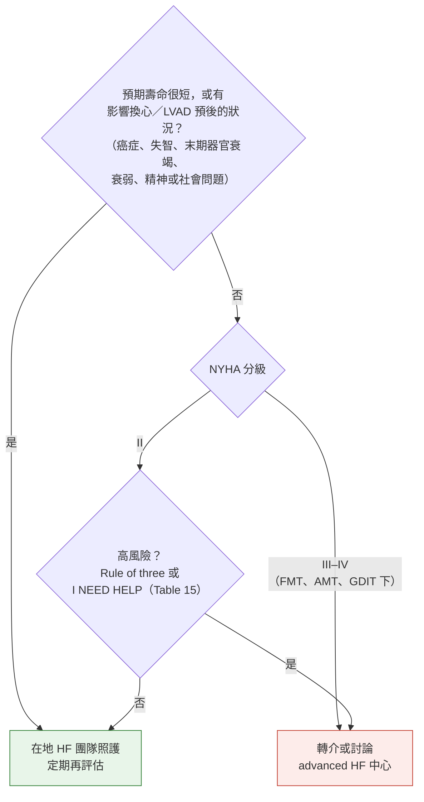
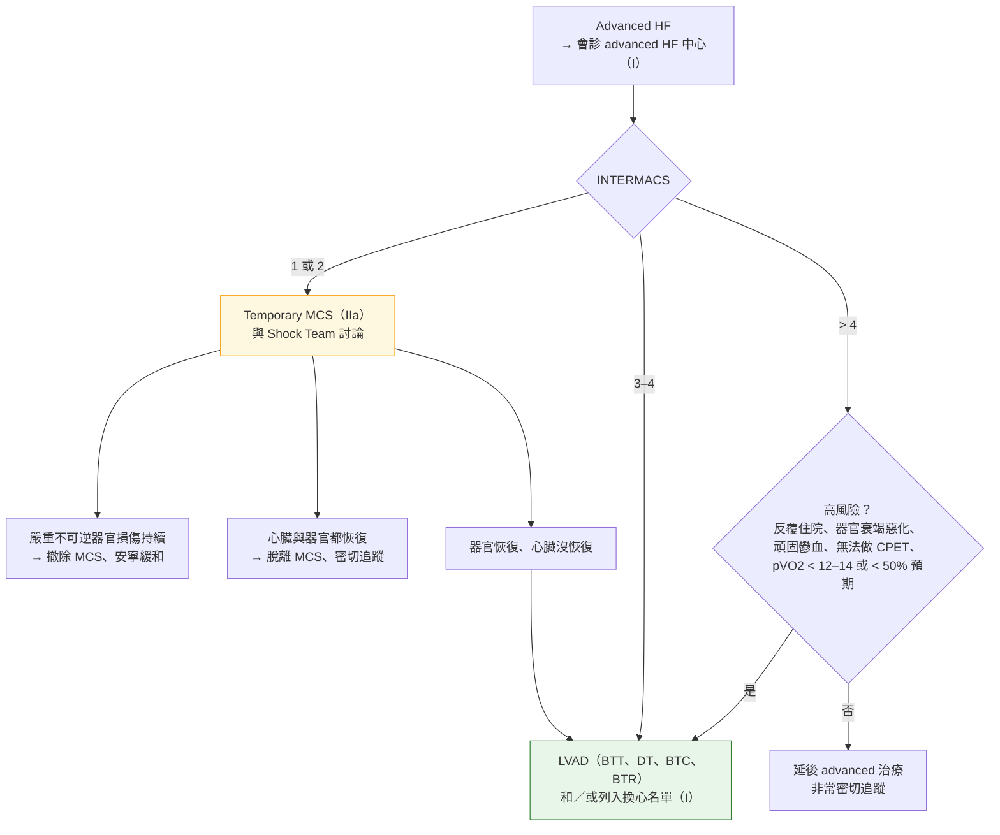
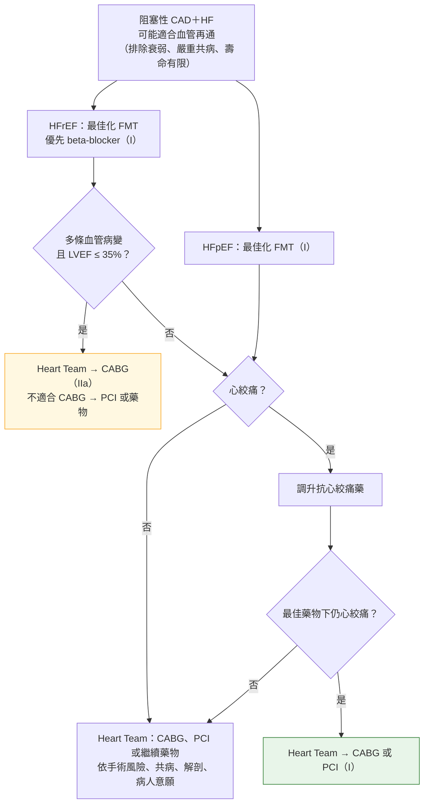
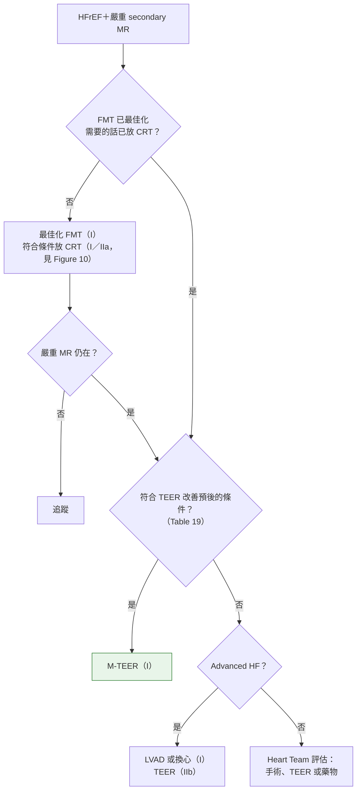
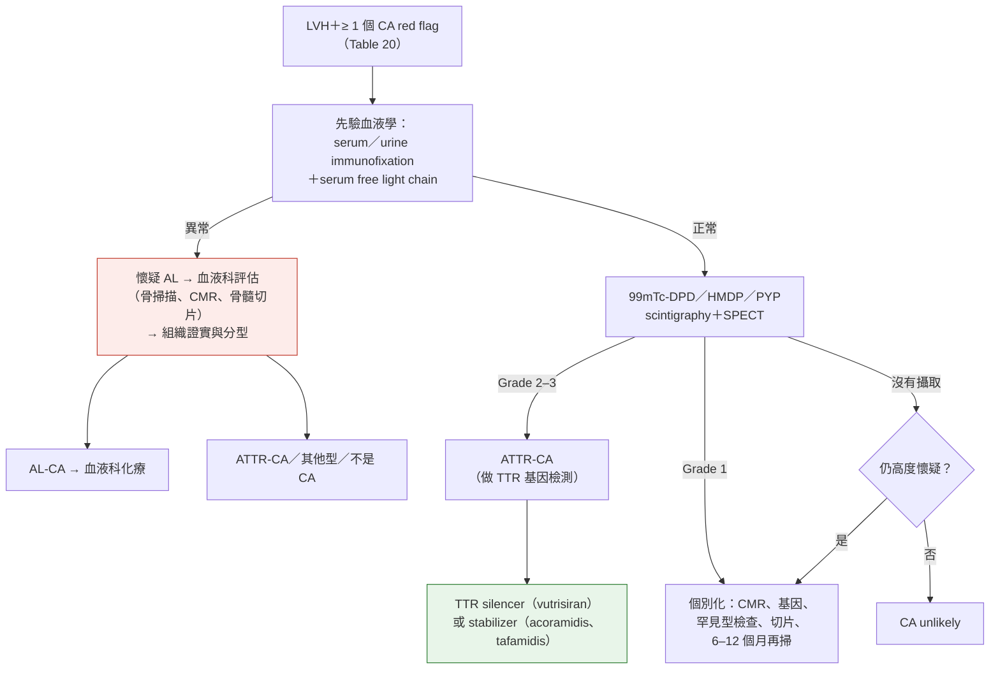

> [!abstract] 一句話重點
> - **Advanced HF（stage D）**：FMT＋AMT＋GDIT 下仍 **NYHA III–IV**、**嚴重心臟功能不良（LVEF ≤ 30% 等）**、**12 個月內 ≥ 2 次非計畫住院或需要 inotrope**、**運動能力極差** → **==盡早轉 advanced HF 中心評估換心或 LVAD（I A）==**
>   - 低灌流時可**減量或停 beta-blocker／ivabradine（IIa C）**
>   - **LVAD（I C）**
> - 共病：
>   - **AF → CHA₂DS₂-VA 決定抗凝（HF 算 1 分）**、**穩定 HFrEF＋AF 的 rate control 首選 beta-blocker（I C）**、不穩定 → **IV amiodarone 或 digoxin**
>   - **HFrEF＋iron deficiency → IV iron（I B1）**
>   - **LVEF ≥ 45%、BMI ≥ 30 → semaglutide 或 tirzepatide（IIa B1）**
>   - **嚴重 AS → TAVI／SAVR（I B1）**
>   - **secondary MR 符合條件 → M-TEER（I B1）**
>   - **TTR amyloidosis → vutrisiran、tafamidis、acoramidis（I A）**
> - **懷孕：ACE-I、ARB、ARNI、MRA、ivabradine、SGLT2-I 都不能用（III C）**

> [!info] 系列導覽
> ↑ 回到 [[cardiology/heart-failure-esc-2026/index|2026 ESC 心衰竭指引總覽]]
>
> ① [[cardiology/heart-failure-esc-2026/hf26-1-definition-diagnosis|定義、分類、預防與診斷]]｜② [[cardiology/heart-failure-esc-2026/hf26-2-chronic-treatment|慢性 HF 治療]]｜③ [[cardiology/heart-failure-esc-2026/hf26-3-decompensated|Decompensated HF 與休克]]｜④ Advanced HF、共病與特殊情況（本篇）｜📋 [[cardiology/heart-failure-esc-2026/hf26-5-recommendations|建議總整理]]｜⑤ [[cardiology/heart-failure-esc-2026/hf26-exam|內專考點]]
>
> 本篇來源：2026 ESC HF Guidelines Section 8–12、Table 14–20、Figure 16–23、Recommendation Table 11–28

## Advanced HF（Section 8）

### 定義（Table 14）：在 FMT、AMT、GDIT 下**全部符合**

1. **嚴重且持續的症狀**（NYHA III 或 IV）
2. **嚴重心臟功能不良**，至少一項：**LVEF ≤ 30%**、孤立 RV failure（例如 ARVC）、無法開刀的嚴重瓣膜或先天異常、**持續很高（或上升）的 BNP／NT-proBNP 加上嚴重舒張功能不良或結構異常**（HFpEF、肥厚性或限制性心肌病）
3. **肺或全身鬱血需要高劑量 IV 利尿劑（或合併利尿劑），或惡性心律不整，12 個月內 ≥ 2 次非計畫就診或住院**；或 **≥ 1 次低心輸出需要 inotrope 或升壓劑**
4. **運動能力嚴重受損**：無法運動、6 分鐘走路 **< 300 m**、或 pVO2 **< 12–14 mL/kg/min**

### 高風險、該提早轉介的線索（Table 15 依內容重新整理）

| **Rule of three**（≥ 1 項） | **I NEED HELP**（≥ 1 項） |
| --- | --- |
| **過去一年 HFH ≥ 2 次**，或 ≥ 1 次需要 inotrope | **I**notropes：需要 inotrope |
| **Diuretic resistance** | **N**YHA III–IV 或 **NP 持續很高** |
| **神經荷爾蒙藥物不耐受**，出現 cardiorenal syndrome | **E**nd-organ dysfunction（肝、腎） |
| | **E**F **< 20%** 或 RV 功能差 |
| | **D**efibrillator 放電 |
| | **H**FH > 1 次 |
| | **E**scalating diuretics：利尿劑越用越多 |
| | **L**ow BP、high HR |
| | **P**rognostic medication：**FMT 不耐受或必須減量** |

### 何時轉介 advanced HF 中心（Figure 16 依內容重新繪製）

- **NYHA II 也可能要轉**：只要符合 Table 15 的高風險線索
- Advanced HF 中心＝能做 **LVAD 植入和／或換心**的中心

### INTERMACS 分級（Figure 17 依內容重新整理）

| 等級 | 名稱 | 狀態 | MCS 時機 |
| --- | --- | --- | --- |
| **1** | **Critical cardiogenic shock**（crash and burn） | 升 inotrope 仍致命低血壓，acidosis／lactate 證實器官低灌流 | **數小時內** |
| **2** | **Progressive decline**（sliding on inotropes） | IV inotrope 下仍惡化：腎功能、營養、體液變差；或無法耐受 inotrope | **數天內** |
| **3** | **Stable but inotrope dependent** | 靠持續 inotrope 或暫時支持才穩定，因低血壓或腎功能一再脫離失敗 | 選擇性：數週到數月 |
| **4** | **Resting symptoms**（frequent flyer） | 容積接近正常仍每天有鬱血症狀，利尿劑需求高且起伏，順從性差 | 選擇性：數週到數月 |
| **5** | **Housebound**（exertion intolerant） | 休息與輕度日常活動 OK，幾乎足不出戶，可能有頑固水腫與腎功能不良 | 視器官功能、營養、衰弱而定 |
| **6** | **Exertion limited**（walking wounded） | 可出門做輕度活動，但稍有意義的活動幾分鐘就累；沒水腫，需 **CPET** 確認嚴重度 | 同上 |
| **7** | **Advanced NYHA III**（placeholder） | 輕度活動 OK、近期體液穩定 | **目前不需要** |

- **數字越小越危急**；用來分層風險並決定 **durable MCS 或換心的時機**（inotrope 依賴的定義見補充資料）

### Advanced HF 治療（Figure 18 依內容重新繪製）

- **INTERMACS 2 也可直接走 LVAD／換心**（不一定先上 temporary MCS）
- **預立醫療照護計畫與安寧緩和貫穿全程（I）**；同時考慮共病與禁忌（Table 16–17）
- 不適用此流程：**心律不整風暴、頑固心絞痛**；HCM、amyloidosis、其他限制性心肌病、ARVC、成人先天性心臟病也是例外

| 建議 | 等級 |
| --- | --- |
| **==有動機、沒有絕對禁忌 → 盡早會診 advanced HF 中心==**，評估換心或 durable MCS | **I A**（新） |
| **低灌流的 advanced HFrEF → 減量或停 beta-blocker／ivabradine**，增加心輸出 | IIa C（新） |
| **持續 inotrope**：advanced HFrEF、低心輸出、低灌流 → 當 BTD、BTT 或 durable MCS 的橋接 | IIa C（修訂） |
| **Durable MCS（LVAD）**：FMT、GDIT 下仍 advanced HFrEF → BTT、BTC、BTR 或 destination therapy | **I C**（修訂） |
| 非缺血性 HF 換心或 LVAD 時，**取下的心臟組織做病理**（找可治療的病因、家族篩檢） | IIa C（新） |
| 主動討論病程、照護目標、**預立醫療照護計畫** | I B1（新） |
| **整合性 HF 安寧緩和團隊** | I B2（新） |

### LVAD 與換心的適應症、禁忌（Table 16–17 依內容重新整理）

| | **LVAD**（Table 16） | **換心**（Table 17） |
| --- | --- | --- |
| **適應症** | LVEF 嚴重下降，且符合其一：① **INTERMACS 1–2** 上 temporary MCS 後神經與器官恢復、心臟沒恢復 ② **INTERMACS 2–4** ③ **NYHA III–IV（INTERMACS > 4）**，optimal FMT、GDIT 下仍有：無法運動或 **pVO2 < 12–14 mL/kg/min**（或 < 50% 預期）、**CI ≤ 2 L/min/m²** 造成的器官功能惡化（腎、肝、group 2 PH、cachexia）、**12 個月內反覆 HFH 且沒有明顯誘因** | **Advanced HF 且沒有其他治療選擇**（durable MCS 當 BTT 除外） |
| **絕對禁忌** | **euvolemia 下仍嚴重 RV 功能不良**、不可逆的嚴重腎或肝病、不可逆的嚴重神經疾病、嚴重肺病、**不能長期口服抗凝**、順從性差或社會支持不足、心理狀態不穩 | **無法配合治療**（例如失智）、換心也無法逆轉的**嚴重共病** |
| **相對／其他禁忌** | 肥胖或營養不良、影響復健的肌肉骨骼病、癌症（依類型與預後）、嚴重 PAD、全身感染、**6 個月內酒精／藥物濫用或仍吸菸**、認知障礙、衰弱 | 活動性感染、嚴重 PAD 或腦血管病、**藥物無法逆轉的高 PVR**、癌症、不可逆肝硬化或腎功能不良、多器官的全身性疾病、**BMI > 35 或嚴重 cachexia**、**6 個月內酒精／藥物濫用或仍吸菸**、心理不穩、社會支持不足 |

- **RV 衰竭是 LVAD 的關鍵禁忌**（LVAD 只幫左心）；**高 PVR 是換心的關鍵禁忌**（新心臟的 RV 撐不住）

## 心血管共病（Section 9）

### AF（Recommendation Table 15、Table 18）

| 建議 | 等級 |
| --- | --- |
| **依 CHA₂DS₂-VA 決定口服抗凝** | **I A** |
| **==穩定 HFrEF＋AF：beta-blocker 是短期與長期 rate control 的首選==** | **I C**（修訂：升級） |
| **血行動力不穩的 HFrEF＋AF → IV amiodarone 或 digoxin** 急性控速 | IIb C（新） |
| **有症狀 AF＋HFrEF → catheter ablation**，改善生活品質、降低 HFH 或死亡 | IIa C（修訂） |
| **永久性 AF、症狀嚴重、藥物控速不佳、≥ 1 次 HFH → AV node ablation＋CRT** | IIa B1（新） |

**CHA₂DS₂-VA（Table 18）**：**C** 慢性 HF（**stage B、C、D**）1｜**H** 高血壓 1｜**A** ≥ 75 歲 2｜**D** 糖尿病 1｜**S** 中風／TIA／動脈栓塞 2｜**V** 血管疾病（CAD、PAD）1｜**A** 65–74 歲 1

### 其他心血管共病

| 主題 | 建議 | 等級 |
| --- | --- | --- |
| **心室心律不整** | 持續 VT：先穩定（電擊）→ 找誘因 → 最佳化 FMT；**amiodarone 減少心律不整但不降 SCD 或死亡**；**PVC 負荷約 10% 起就增加 HF 風險** → 定期追 LVEF | 敘述 |
| **CAD** | HF＋阻塞性 CAD＋FMT 與抗心絞痛藥下仍心絞痛 → **血管再通**緩解症狀 | I C（修訂） |
| **嚴重 AS** | **SAVR 或 TAVI** 改善症狀、降低死亡 | **I B1**（修訂） |
| **高血壓** | **HF 專屬目標沒有 RCT**（依 2024 ESC 高血壓指引：SBP 120–129）｜**HFrEF**：FMT 本身降壓，調完仍高 → **amlodipine 或 felodipine**（容積正常）；**❌ verapamil、diltiazem、moxonidine**；alpha-blocker 不用來降壓；**沒症狀的低血壓要接受**以維持 FMT｜**HFpEF**：MRA、loop diuretic（鬱血）、ACE-I／ARB／CCB（LVH 退化）；**避免低血壓**｜頑固型 → 找 **primary aldosteronism、renovascular、OSA** | 敘述 |
| **Secondary MR** | 血行動力穩定、有症狀 HFrEF、optimized FMT（與 CRT）下仍嚴重 MR、符合條件 → **M-TEER** | **I B1**（修訂：升級） |

**M-TEER 選擇條件（Table 19）**：FMT 與 CRT 已最佳化｜**NYHA ≥ II**｜**1 年內 ≥ 1 次 HFH**，或 **BNP ≥ 300／NT-proBNP ≥ 1000 pg/mL**｜不是 advanced HF｜不需要冠狀動脈再通｜不是肥厚、限制或浸潤性心肌病｜**LVEF 20–50%**｜**LVESD ≤ 70 mm**｜解剖適合｜**sPAP ≤ 70 mmHg**｜沒有嚴重 RV 功能不良｜沒有嚴重主動脈瓣或三尖瓣疾病

### HF 合併 CAD（Figure 19 依內容重新繪製）

- **緩解心絞痛 → 再通是 I**；**為了預後（多條病變＋LVEF ≤ 35%）→ CABG 是 IIa**

### HFrEF 合併 secondary MR（Figure 20 依內容重新繪製）

- **先把 FMT 和 CRT 做好，MR 常會改善**；做完仍嚴重才評估 TEER

## 非心血管共病（Section 10）

| 主題 | 建議 | 等級 |
| --- | --- | --- |
| **==肥胖==** | **有症狀 HF、LVEF ≥ 45%、BMI ≥ 30**（不論有無糖尿病）→ **semaglutide 或 tirzepatide**：減重、改善運動能力與生活品質 | **IIa B1**（新） |
| 肥胖 | **BMI ≥ 35**、生活型態與減重藥都無法維持 → **減重手術** | IIb C（新） |
| **==Iron deficiency==** | **有症狀 HFrEF＋缺鐵 → IV iron** 改善症狀與生活品質 | **I B1** |
| | 同上 → **降低 HFH** | IIa B1 |
| 睡眠呼吸障礙 | HFrEF、以 **OSA 為主** → adaptive servo-ventilation 可考慮 | IIb C（新） |
| 心理 | 評估**焦慮、憂鬱、衰弱** | IIa C（新） |

- 缺鐵的定義與 IV iron 劑量見指引正文（本篇未摘錄）

## 多專科照護與追蹤（Section 11）

| 建議 | 等級 |
| --- | --- |
| 穩定病人：**個人化運動訓練（心臟復健內）** | **I B1**（新） |
| 心臟復健以外的長期個人化運動 | I B2（新） |
| **LVAD 病人做心臟復健** | I B1（新） |
| **遠端肺動脈壓監測**：有症狀、**NYHA III、12 個月內 HFH** | IIa B1（修訂） |

### HF 團隊（Figure 21 依內容重新整理）

- **核心團隊**：**病人本人**、照顧者、HF 心臟科醫師、HF 護理師與相關專業人員、基層醫療、心臟復健
- **依需要擴充**：安寧緩和、心理、共病專科、社福、病友支持團體、遺傳諮詢、心臟外科、介入／電生理心臟科

| H-F-TEAM | 內容 |
| --- | --- |
| **Heart Failure**（原則） | 以病人為中心、多專科、由專業人員執行、參與研究與品質稽核、爭取照護可近性 |
| **Treatments** | 取得 HF 治療與介入；目標是**防止惡化、控制症狀**；處理共病與心理困擾 |
| **Education** | 個人化衛教，讓病人與照顧者能**自我照護、察覺症狀變化**；也教育非 HF 專科人員 |
| **Assessment** | 找**病因**；依病人與分期持續評估；評估影響就醫與順從的社會因素；**衰弱評估** |
| **Monitoring** | 協調照護；監測以利**調藥、及早發現惡化、提早出院**，並把握**預立醫療照護、轉介 advanced HF 與安寧**的時機 |

### 穩定 HF 的長期追蹤：做什麼、多久、誰（Figure 22 依內容重新整理）

| | **Stage A** at risk | **Stage B** pre-HF | **Stage C** 有症狀 | **Stage D** advanced |
| --- | --- | --- | --- | --- |
| **做什麼** | 重評風險、理學檢查、ECG、心臟超音波* | 理學檢查、ECG、心臟超音波* | 理學檢查、ECG、超音波*、**抽血**、CIED 判讀*；**惡化時 CPET、RHC、轉 advanced HF 中心**（I NEED HELP） | 理學檢查、ECG、超音波*、抽血、CIED 判讀*；**轉 advanced HF 中心、預立醫療照護計畫** |
| **多久** | **3–5 年** | **1 年** | **6–12 個月** | **3–6 個月** |
| **誰** | 家醫／心臟科 | 心臟科／家醫 | **HF 多專科團隊**／家醫 | HF 團隊／advanced HF 中心／家醫／**安寧** |

- ＊臨床需要時才做；**間隔可以更短**

## 特殊情況（Section 12）

| 主題 | 建議 | 等級 |
| --- | --- | --- |
| **懷孕前** | 諮詢：HF 藥物、懷孕、避孕、胚胎著床前基因篩檢、人工生殖 | I C（新） |
| **懷孕 HFrEF** | **非選擇性 beta-blocker 換成 beta1 選擇性（metoprolol、bisoprolol）**，密切監測母胎 | I C（新） |
| **==懷孕==** | **ACE-I、ARB、ARNI、MRA、ivabradine、SGLT2-I 都不建議**（胎兒毒性或致畸） | **III C**（新） |
| **TTR cardiac amyloidosis** | **variant 或 wild-type、NYHA I–III → TTR silencer（vutrisiran）或 stabilizer（tafamidis、acoramidis）** | **I A**（修訂） |

### Cardiac amyloidosis red flags（Table 20 依內容重新整理）

| 類別 | ATTR 與 AL 都有 | 偏 **ATTR** | 偏 **AL** |
| --- | --- | --- | --- |
| **心臟外** | Polyneuropathy、dysautonomia、腎功能不全、proteinuria | **雙側 carpal tunnel**、**biceps tendon 斷裂**、**lumbar spinal stenosis**、耳聾、玻璃體沉積與家族史（variant ATTR） | **皮膚瘀青**、**macroglossia** |
| **臨床** | **原本高血壓的人變成血壓正常或低血壓** | | |
| **ECG** | **Pseudo-infarct pattern**、**QRS low voltage（相對 LV 厚度）**、AV 傳導疾病 | | |
| **檢驗** | **NT-proBNP 高得不成比例**、troponin 持續上升 | | |
| **心臟超音波** | 心肌顆粒狀發亮、RV 壁增厚、瓣膜增厚、心房中膈增厚、心包積液、**longitudinal strain 下降但 apical sparing** | | |
| **CMR** | **全面性 subendocardial 或 transmural LGE**、native T1 上升、ECV 增加、gadolinium 動力異常 | | |

- 核心矛盾：**LV 很厚但 ECG 電壓低** → 想到 amyloidosis

### Cardiac amyloidosis 診斷與治療（Figure 23 依內容重新繪製）

- **==一定先排除 AL==**（血液學檢查）：**血液學異常時，骨掃描陽性不能直接診斷 ATTR**，要組織證實（通常先做心臟外切片）
- **血液學正常＋骨掃描 grade 2–3 → 不用切片即可診斷 ATTR-CA**
- 所有型別都要處理心臟與心臟外表現

## 相關筆記

- [[cardiology/atrial-fibrillation/index|心房顫動 AF（ESC 2024）]]（CHA₂DS₂-VA、AF 合併 HF）
- [[cardiology/heart-failure-esc-2026/hf26-2-chronic-treatment|② 慢性 HF 治療]]
- [[cardiology/heart-failure-esc-2026/hf26-3-decompensated|③ Decompensated HF 與休克]]
- [[cardiology/heart-failure-esc-2026/hf26-exam|⑤ 內專考點]]

## 參考資料

- 2026 ESC Guidelines for the management of heart failure. *Eur Heart J* 2026;47(38):5346 起（Section 8–12、Table 14–20、Figure 16–23、Recommendation Table 11–28）（參考資料庫：心臟科／2026 ESC Guidelines for the management of heart failure.pdf）
