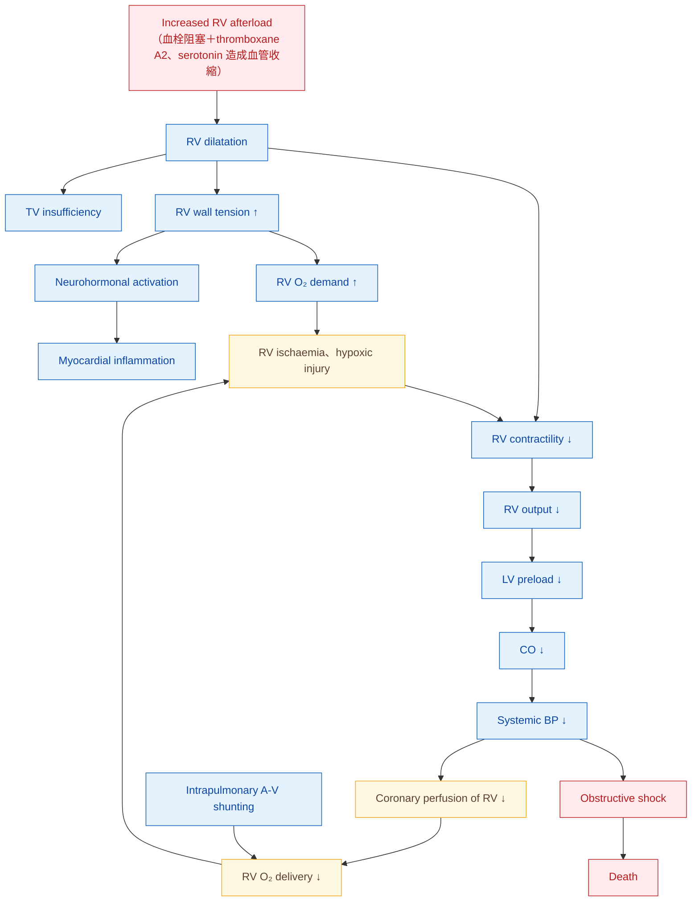

> [!abstract] 一句話重點
> PE 致死的主因是 **acute RV failure**：afterload 突然上升 → RV dilatation、wall tension ↑、septum 推向 LV → **LV preload 與 CO 下降 → obstructive shock**。**High-risk PE 只看 hemodynamic instability（Table 4）**：**cardiac arrest、obstructive shock（SBP < 90 或需 vasopressor＋end-organ hypoperfusion）、persistent hypotension（SBP < 90 或下降 ≥ 40 mmHg 持續 > 15 分鐘）**三者其一。

> [!info] 系列導覽（本系列只整理指引中的 Table 與 Figure）
> ↑ 回到 [[cardiology/pulmonary-embolism-esc/index|急性肺栓塞 ESC 2019 指引總覽]]
>
> ① 流行病學、危險因子與病生理（本篇）｜② [[cardiology/pulmonary-embolism-esc/pe-esc-2-diagnosis|臨床機率與診斷]]｜③ [[cardiology/pulmonary-embolism-esc/pe-esc-3-risk|嚴重度與早期死亡風險分層]]｜④ [[cardiology/pulmonary-embolism-esc/pe-esc-4-acute-treatment|急性期治療]]｜⑤ [[cardiology/pulmonary-embolism-esc/pe-esc-5-long-term|長期抗凝、復發與癌症]]｜⑥ [[cardiology/pulmonary-embolism-esc/pe-esc-6-pregnancy-cteph|懷孕、追蹤與 CTEPH]]｜⑦ [[cardiology/pulmonary-embolism-esc/pe-esc-7-key-messages|新增修訂、Key messages 與必做／不做]]｜⑧ [[cardiology/pulmonary-embolism-esc/pe-esc-exam|內專考點]]
>
> 本篇涵蓋：Table 1–4；Figure 1–2

## Table 1–2：建議等級與證據等級

| Class | 意思 | 指引用語 |
| --- | --- | --- |
| **I** | 證據或共識認為有益、有效 | is recommended／is indicated（**建議**） |
| **IIa** | 證據傾向有效 | should be considered（**應考慮**） |
| **IIb** | 有效性證據較弱 | may be considered（**可考慮**） |
| **III** | 無效，甚至有害 | is not recommended（**不建議**） |

| Level | 證據來源 |
| --- | --- |
| **A** | 多個 RCT 或統合分析 |
| **B** | 單一 RCT 或大型非隨機研究 |
| **C** | 專家共識、小型研究、回溯性研究或登錄資料 |

## Figure 1：全球 PE 發生率與致死率的趨勢

依原圖內容重新整理（不重繪逐點數字）：

| 項目 | 重點 |
| --- | --- |
| 左圖：年發生率 | 1997–2013 年間各國（美、中、義、西、澳）**PE 診斷率持續上升** |
| 右圖：住院致死率 | 同期 **case fatality rate 下降** |
| 解讀 | 有效治療與遵循指引可能讓預後變好；但也可能是 **overdiagnosis（subsegmental 或根本不存在的 PE）灌大分母**，造成致死率「假性下降」 |

**流行病學要點**（自己整理）：

- VTE（DVT＋PE）是**第三常見的急性心血管症候群**，僅次於 MI 與 stroke
- PE 年發生率約 **39–115／10 萬**；**≥ 80 歲的 VTE 發生率約為 40–49 歲的 8 倍**
- 歐洲模型推估：VTE 相關死亡中 **34% 在發病數小時內猝死**，**59% 死後才診斷**，生前正確診斷的只有 **7%** → ==PE 是「最常被漏掉」的致命診斷==

## Table 3：VTE 的易發因子

| 強度 | 危險因子 |
| --- | --- |
| **Strong（OR > 10）** | **Lower limb fracture**、**hip／knee replacement**、**major trauma**、**spinal cord injury**、**previous VTE**、3 個月內 **MI**、3 個月內因 **HF 或 AF／flutter 住院** |
| **Moderate（OR 2–9）** | Arthroscopic knee surgery、autoimmune disease、blood transfusion、central venous line、IV catheter 與 lead、chemotherapy、CHF 或 respiratory failure、ESA、HRT（依劑型）、IVF、**oral contraceptive**、**post-partum**、infection（**pneumonia、UTI、HIV**）、IBD、**cancer（metastatic 最高）**、paralytic stroke、superficial vein thrombosis、thrombophilia |
| **Weak（OR < 2）** | **Bed rest > 3 天**、DM、hypertension、**久坐（長途車程或飛行）**、年紀增加、laparoscopic surgery（如 cholecystectomy）、obesity、**pregnancy**、varicose veins |

**表格之外的重點**：

- **==約 40% 的 PE 病人找不到任何易發因子==**：沒有危險因子不代表可以排除
- **癌症**：胰臟、血液腫瘤、肺、胃、腦部癌症風險最高；癌症也是 VTE 後全死因死亡的強危險因子
- **口服避孕藥**：combined OC 使風險增加約 **2–6 倍**；**第三代**（desogestrel、gestodene）比第二代（levonorgestrel）風險高；**hormone-releasing IUD 與部分 progesterone-only pill 不增加風險** → 有 VTE 病史的女性可以考慮
- **感染**是常見誘因；輸血與 ESA 也會增加風險
- VTE 和動脈疾病共用危險因子（抽菸、肥胖、高血脂、HTN、DM）；MI 與 HF 會增加 PE 風險，反過來 VTE 病人之後 MI、stroke 的風險也較高

> [!tip] Pearl
> 這張表是**急性期的易發因子**；決定**抗凝要用多久**時，看的是 ⑤ 的 [[cardiology/pulmonary-embolism-esc/pe-esc-5-long-term#Table 11：依長期復發風險分類 VTE 危險因子|Table 11]]（依復發風險分 low／intermediate／high），兩張表用途不同。

## Figure 2：PE 造成 hemodynamic collapse 的關鍵機轉

（依原圖內容重新繪製）

> [!note] 圖註
> 原圖以螺旋狀呈現「**惡性循環**」：RV ischaemia 讓 contractility 更差 → output 更低 → BP 更低 → coronary perfusion 更差。**Afterload 上升之後的確切事件順序仍未完全清楚。**

**病生理重點**（自己整理）：

| 機轉 | 重點 |
| --- | --- |
| **肺動脈壓上升的門檻** | 肺動脈床截面積被阻塞 **> 30–50%** 時 PAP 才上升 |
| **RV 的極限** | 沒有適應過、薄壁的 RV **產生不了 > 40 mmHg 的 mean PAP** → 若測到很高的 PA pressure，要想到**慢性**（CTEPH 或其他 PH） |
| **Ventricular interdependence** | RV 收縮時間延長到 LV early diastole → **septum 往左推（D-shape）**；新發 **RBBB** 會讓不同步更嚴重 → LV filling ↓ → CO ↓ |
| **RV ischaemia** | Troponin 上升與預後差相關；**RV infarction 少見**，但供需失衡會傷害心肌，hypotension 讓 coronary driving pressure 更差 |
| **延遲惡化** | 發病 **24–48 小時後**可能再惡化：RV 心肌的發炎細胞浸潤（epinephrine 誘發的 PE-induced「myocarditis」），或早期復發栓塞 |
| **Hypoxaemia** | 主要是 **V/Q mismatch**＋low CO 使 mixed venous O₂ ↓；約 **1/3** 經 **PFO** 出現 right-to-left shunt → 嚴重低血氧、**paradoxical embolism 與 stroke** |
| **Pulmonary infarction** | 小的遠端栓子造成 alveolar haemorrhage → **hemoptysis、pleuritic pain、輕微 pleural effusion**，通常不太影響氣體交換 |

## Table 4：Hemodynamic instability 的定義（= high-risk PE）

**到院時符合以下任一項：**

| 表現 | 定義 |
| --- | --- |
| **(1) Cardiac arrest** | 需要 CPR |
| **(2) Obstructive shock** | **SBP < 90 mmHg** 或**需要 vasopressor 才能維持 SBP ≥ 90**（已給足夠 volume）**且**合併 **end-organ hypoperfusion**（意識改變、冰冷濕黏皮膚、少尿或無尿、**lactate 上升**） |
| **(3) Persistent hypotension** | **SBP < 90 mmHg** 或 **SBP 下降 ≥ 40 mmHg**，**持續 > 15 分鐘**，且**不是**新發心律不整、hypovolaemia 或 sepsis 造成 |

> [!warning] Pitfall
> - **==沒有 hemodynamic instability 不代表低風險==**：RV dysfunction 可能已經開始（甚至正在惡化），仍需進一步分層（見 ③）
> - Persistent hypotension 要排除**其他**原因（arrhythmia、hypovolaemia、sepsis）才算 PE 造成
> - 2019 版的新觀念之一，就是**明確定義** hemodynamic instability 與 high-risk PE

## 相關筆記

- [[cardiology/pulmonary-embolism-esc/pe-esc-2-diagnosis|② 臨床機率與診斷]]
- [[cardiology/pulmonary-embolism-esc/pe-esc-3-risk|③ 嚴重度與早期死亡風險分層]]
- [[cardiology/syncope/symptom-to-diagnosis/syncope-5-structural|暈厥：structural 與心肺原因（含 PE）]]

## 參考資料

- Konstantinides SV, Meyer G, Becattini C, et al. 2019 ESC Guidelines for the diagnosis and management of acute pulmonary embolism developed in collaboration with the European Respiratory Society (ERS). *Eur Heart J*. 2020;41(4):543–603. doi:10.1093/eurheartj/ehz405。Section 2–3、Table 1–4、Figure 1–2。參考資料庫：心臟科／2019ESCGuidelinesfor the diagnosis and management of acutepulmonaryembolism.pdf
