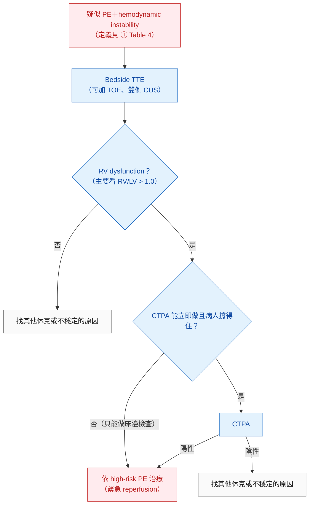
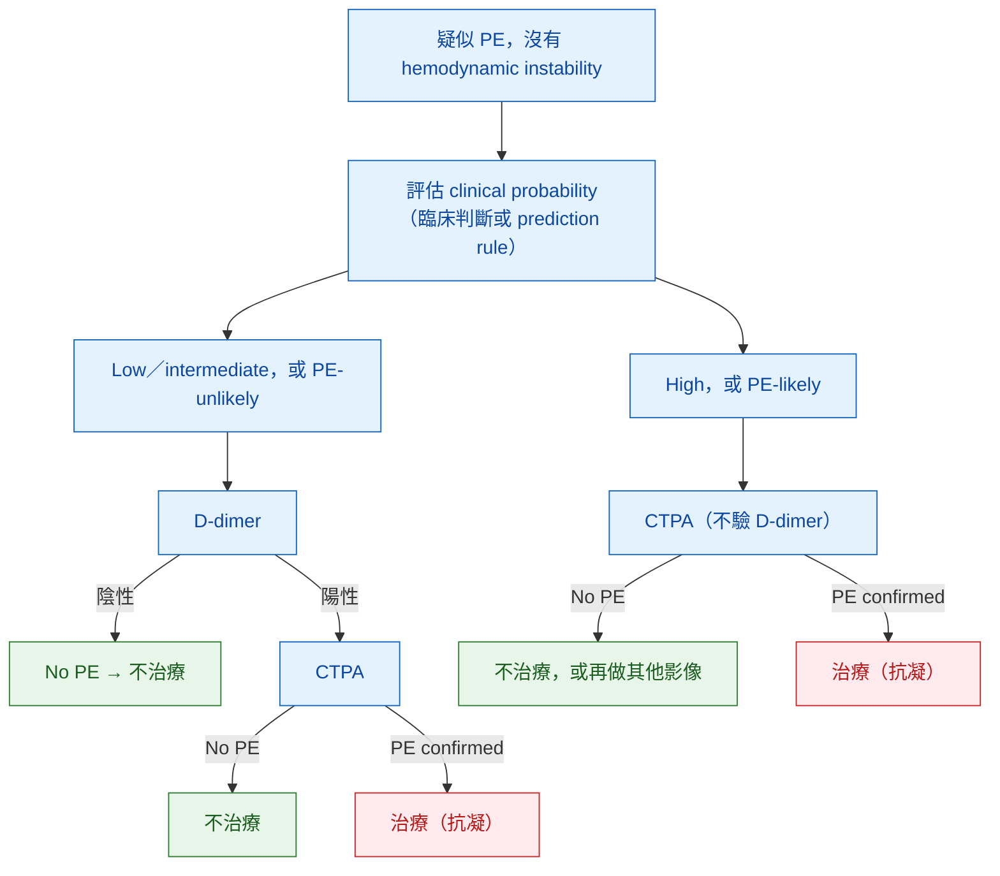

> [!abstract] 一句話重點
> **先分有沒有 hemodynamic instability**：不穩定 → **bedside TTE 或立即 CTPA**（Figure 4）；穩定 → **先估 clinical probability**（Geneva／Wells）→ **低／中機率做 D-dimer**（> 50 歲用 **age × 10 µg/L**，或 **YEARS**）→ 陽性才 **CTPA**；**高機率直接 CTPA，==不驗 D-dimer==（III-A）**（Figure 5）。高或中機率者**診斷期間就先抗凝**（I-C）。

> [!info] 系列導覽（本系列只整理指引中的 Table 與 Figure）
> ↑ 回到 [[cardiology/pulmonary-embolism-esc/index|急性肺栓塞 ESC 2019 指引總覽]]
>
> ① [[cardiology/pulmonary-embolism-esc/pe-esc-1-basics|流行病學、危險因子與病生理]]｜② 臨床機率與診斷（本篇）｜③ [[cardiology/pulmonary-embolism-esc/pe-esc-3-risk|嚴重度與早期死亡風險分層]]｜④ [[cardiology/pulmonary-embolism-esc/pe-esc-4-acute-treatment|急性期治療]]｜⑤ [[cardiology/pulmonary-embolism-esc/pe-esc-5-long-term|長期抗凝、復發與癌症]]｜⑥ [[cardiology/pulmonary-embolism-esc/pe-esc-6-pregnancy-cteph|懷孕、追蹤與 CTEPH]]｜⑦ [[cardiology/pulmonary-embolism-esc/pe-esc-7-key-messages|新增修訂、Key messages 與必做／不做]]｜⑧ [[cardiology/pulmonary-embolism-esc/pe-esc-exam|內專考點]]
>
> 本篇涵蓋：Table 5–6；Figure 3–5；診斷建議表（Section 4.11）

## 臨床表現

| 表現 | 重點 |
| --- | --- |
| 常見主訴 | **dyspnoea、chest pain、presyncope／syncope、haemoptysis**；也可能無症狀、偶然發現 |
| Dyspnoea | Central PE 急而嚴重；周邊小 PE 輕微、短暫；原本有 HF 或肺病者，**喘變嚴重可能是唯一線索** |
| Chest pain | 多為 distal emboli 造成 **pulmonary infarction 的 pleuritic pain**；central PE 可呈 **angina-like**（RV ischaemia），要和 **ACS、aortic dissection** 鑑別 |
| Syncope | 與 hemodynamic instability、RV dysfunction 較常見相關；一項研究中 syncope 住院病人 **17%** 有 PE |
| 血氧 | Hypoxaemia 常見，但**最多 40% SaO₂ 正常**、**20% A-a gradient 正常**；常有 **hypocapnia** |
| CXR | 常異常但不特異，主要用來**排除其他原因** |
| ECG | 嚴重者有 RV strain：**V1–V4 T wave inversion、V1 QR、S1Q3T3、RBBB**；輕者可能只有 **sinus tachycardia（約 40%）**；也可伴 AF |

> [!warning] Pitfall
> - **==SpO₂ 正常、ABG 正常都不能排除 PE==**
> - **S1Q3T3 特異但少見，不是診斷必要條件**；最常見的 ECG 異常是 sinus tachycardia

## Table 5：Revised Geneva clinical prediction rule

| 項目 | Original | Simplified |
| --- | --- | --- |
| Previous PE 或 DVT | 3 | 1 |
| HR **75–94** bpm | 3 | 1 |
| HR **≥ 95** bpm | 5 | 2 |
| 一個月內手術或骨折 | 2 | 1 |
| Haemoptysis | 2 | 1 |
| Active cancer | 2 | 1 |
| Unilateral lower-limb pain | 3 | 1 |
| 下肢深靜脈壓痛＋unilateral oedema | 4 | 1 |
| Age > 65 歲 | 1 | 1 |

| 臨床機率 | Original | Simplified |
| --- | --- | --- |
| **三級**：Low | 0–3 | 0–1 |
| Intermediate | 4–10 | 2–4 |
| High | ≥ 11 | ≥ 5 |
| **二級**：PE-unlikely | 0–5 | 0–2 |
| PE-likely | ≥ 6 | ≥ 3 |

**怎麼用**：

- 不論用 Geneva 或 Wells（Wells 在線上附錄 Supplementary Table 1），確診比例大約是 **low 10%、intermediate 30%、high 65%**；二級分法 **PE-unlikely 12%、PE-likely 30%**
- 兩者直接比較的診斷表現相近；**臨床判斷（implicit）也有效**，只是較難標準化
- Geneva 的特色是**全部客觀項目**，沒有 Wells 的「PE 比其他診斷更可能」這種主觀項

## 避免過度檢查：PERC rule

- 給**急診**病人用，目的是挑出**連檢查都不必開始**的人
- **8 項全部符合**才算 PERC 陰性：**age < 50、HR < 100、SaO₂ > 94%、沒有單側腿腫、沒有 haemoptysis、近期沒有外傷或手術、沒有 VTE 病史、沒有口服荷爾蒙**
- 只能用在**臨床機率低**的人；驗證研究中 PE 盛行率低，**推論到其他族群要小心**

## D-dimer 的用法

| 重點 | 內容 |
| --- | --- |
| 用途 | **NPV 高、PPV 低** → 只能用來**排除**，不能確診 |
| 偽陽性多 | **癌症、住院病人、嚴重感染或發炎、懷孕**；這些族群 number needed to test 從急診一般病人的 3 升到 **≥ 10** |
| 高敏感度檢測 | ELISA 或衍生方法 sensitivity **≥ 95%** → 可用於 **low 或 intermediate** 機率；急診約 **30%** 疑似病人可單靠 D-dimer＋臨床機率排除；未治療者 3 個月血栓風險 **< 1%** |
| **Age-adjusted cut-off** | **> 50 歲：age × 10 µg/L**（取代固定 500 µg/L）；≥ 75 歲族群可排除比例由 **6.4% 升到 30%**，沒有增加偽陰性 |
| **YEARS**（依臨床機率調整） | 三個項目：**DVT 徵象、haemoptysis、PE 是最可能的診斷**；**0 項 → D-dimer < 1000 ng/mL 排除**；**≥ 1 項 → < 500 ng/mL 排除**；其餘做 CTPA。CTPA 減少到 48%（傳統方法 34%），3 個月 VTE 0.61% |
| Point-of-care | Sensitivity 只有約 **88%** → **只能用在低臨床機率** |

> [!tip] Pearl
> **==Age-adjusted D-dimer：50 歲以上用「年齡 × 10」==**，例如 80 歲的 cut-off 是 800 µg/L。這是內專與臨床都最常用的數字。

## Table 6：PE 診斷的影像檢查比較

| 檢查 | 優點 | 缺點／限制 | 輻射（effective dose） |
| --- | --- | --- | --- |
| **CTPA** | 多數醫院 24 小時可做；準確度極佳；前瞻性管理研究驗證充分；**不確定結果少（3–5%）**；**排除 PE 時可給替代診斷**；掃描快 | 輻射；iodine 顯影劑（**iodine allergy、hyperthyroidism 限制使用**；孕婦與哺乳有風險；**嚴重腎衰竭禁忌**）；太方便而**容易過度使用**；**subsegmental PE 的臨床意義不明** | **3–10 mSv**；年輕女性乳房組織劑量明顯 |
| **Planar V/Q scan** | **幾乎沒有禁忌**；便宜；驗證充分 | 不是每間醫院都有；判讀者差異；結果以 likelihood ratio 表示；**約 50% 無法下結論**；不能給替代診斷 | 低於 CTPA，約 **2 mSv** |
| **V/Q SPECT** | 幾乎沒有禁忌；**non-diagnostic 最少（< 3%）**；準確度高；二元判讀（PE／no PE） | 技術與診斷標準不一；不能給替代診斷；**沒有前瞻性管理研究驗證** | 約 **2 mSv** |
| **Pulmonary angiography** | 歷史上的 gold standard | **侵入性**；不是每間醫院都有 | **最高，10–20 mSv** |

> [!note] 表註
> 胸部 X 光全身 effective dose 約 **0.1 mSv** 作為對照。Table 6 用 **mSv（全身 effective dose）**，⑥ 的 Table 12 用 **mGy（單一器官或胎兒吸收劑量）**，兩者單位不同。

**各檢查的補充重點**：

| 檢查 | 重點 |
| --- | --- |
| **CTPA** | PIOPED II：sensitivity **83%**、specificity **96%**。**陰性 CTPA 的 NPV**：low 96%、intermediate 89%，**high 只有 60%**；**陽性 CTPA 的 PPV**：intermediate／high 92–96%，**low 只有 58%** → ==臨床判斷和 CTPA 不一致時要再查== |
| **V/Q scan** | 三分法：**normal（排除）／high probability（多數可確診）／non-diagnostic**；normal perfusion scan 停抗凝是安全的；**CXR 正常可只做 perfusion scan**；適合**門診低機率且 CXR 正常、年輕女性、孕婦、顯影劑 anaphylaxis 史、嚴重腎衰竭** |
| **Pulmonary angiography** | 1111 人研究：procedure 死亡 **0.5%**、major 併發症 1%；死亡多是 hemodynamic 不穩者 |
| **MRA** | Sensitivity 低、不確定結果多 → **不用來排除 PE（III-A）** |
| **CT venography** | 加做下肢靜脈的附加價值有限、輻射更多 → **不建議（III-B）** |
| **Pre-existing CTEPH** | 疑似急性 PE 時也別漏掉已存在的 CTEPH（CTPA 徵象見線上附錄 Supplementary Table 2） |

## Figure 3：TTE 評估 RV pressure overload 的參數

依原圖內容重新整理（原圖為 8 格示意圖）：

| 格 | 切面 | 發現 | 切點 |
| --- | --- | --- | --- |
| A | Parasternal long axis | **RV 擴大** | — |
| B | Apical 4-chamber | **RV 擴大，basal RV/LV ratio > 1.0**；**McConnell sign**（RV free wall 運動差但 **apex 保留**） | **RV/LV > 1.0** |
| C | Parasternal short axis | **Interventricular septum 變平（D-shape）** | — |
| D | Subcostal | **IVC 擴大、吸氣塌陷減少** | — |
| E | RVOT Doppler＋TR jet | **60/60 sign**：pulmonary ejection **AcT < 60 ms**（mid-systolic notch）＋**TR peak gradient < 60 mmHg**（只輕度上升） | **< 60 ms、< 60 mmHg** |
| F | 各切面 | **Right heart mobile thrombus** | — |
| G | M-mode | **TAPSE 下降** | **< 16 mm** |
| H | Tissue Doppler | **Tricuspid annulus S′ 下降** | **< 9.5 cm/s** |

**Echo 在 PE 的角色**：

- **Echo 陰性不能排除 PE**（NPV 只有 40–50%）；反過來 RV overload 也可能來自其他心肺病
- **60/60 sign** 與 **McConnell sign** 特異性高（即使有心肺共病），但只出現在 **12% 與 20%** 的 PE；RV infarction 也會有類似 McConnell 的表現，看有沒有 RV pressure overload 可以區分
- **==TR gradient > 60 mmHg 或 TR velocity > 3.8 m/s、RV wall 增厚==** → 超出急性 RV 能產生的壓力 → 想 **CTEPH 或其他慢性 PH**
- **Mobile right-heart thrombi**：未篩選病人 **< 4%**、ICU 可達 **18%**；幾乎可確診 PE，且早期死亡率高
- 血行動力**穩定**的疑似 PE 不必常規做 echo；但在**疑似 high-risk PE**：**沒有 RV overload 幾乎可排除 PE 是休克原因**，並可找 tamponade、急性瓣膜失能、LV dysfunction、aortic dissection、hypovolaemia

## Compression ultrasonography（CUS）

- 約 **70%** 的 PE 病人有 DVT（venography）；CUS 在 PE 病人中找到 DVT 的比例 **30–50%**
- 疑似 PE 時做**四點檢查**（雙側 groin、popliteal fossa）；唯一驗證過的 DVT 標準是 **incomplete compressibility**，flow 測量不可靠
- 在疑似 PE 情境：specificity **96%**、sensitivity **41%** → **有 proximal DVT 就可以開始治療**；適合有 CT 禁忌的人
- **用 CUS 確診的人一樣要做 PE 嚴重度分層**（IIa-C）

## Figure 4：疑似 high-risk PE（hemodynamic instability）的診斷流程

（依原圖內容重新繪製）

> [!note] 圖註
> - 床邊輔助檢查：**TOE** 可直接看到 main PA 與主要分支的血栓；**雙側 CUS** 找到 DVT 即確認 VTE
> - 病人危急到只能做床邊檢查時，**echo 上的 RV dysfunction 就足以確認 high-risk PE 並立即 reperfusion**；看到 right heart thrombi 更支持
> - 臨床機率通常很高；鑑別：**tamponade、ACS、aortic dissection、急性瓣膜失能、hypovolaemia**
> - 穩定下來後仍要用 CT angiography 做最後確認
> - 因疑似 ACS 直接進 cath lab 的不穩定病人：排除 ACS 後，若 PE 可能且考慮 catheter-directed treatment，可做 pulmonary angiography

## Figure 5：疑似 PE 但沒有 hemodynamic instability 的診斷流程

（依原圖內容重新繪製）

> [!note] 圖註
> - 懷孕的流程另見 ⑥ Figure 7
> - 臨床機率可用三級（low／intermediate／high）或二級（unlikely／likely）；**中等敏感度的 D-dimer 只用在 low 或 PE-unlikely**，**高敏感度的才可用在 intermediate**
> - **住院病人 D-dimer 用處有限**
> - CTPA 要有 **segmental 或更近端**的血栓才算確診
> - 高機率但 CTPA 陰性 → 停治療前**可考慮**再做其他影像（臨床上這種不一致少見，3 個月血栓風險也低）
> - **V/Q 為主的策略**：D-dimer 陽性但不能做 CTPA，或想減少輻射（年輕人、女性）時可用；**non-diagnostic V/Q＋CUS 陰性＋低機率**可排除；**低機率卻得到 high-probability scan** 要再確認

## 建議：診斷（Section 4.11）

| 建議 | 等級 |
| --- | --- |
| **疑似 high-risk PE**：依可近性做 **bedside echo 或緊急 CTPA** | **I-C** |
| 疑似 high-risk PE：**立即 IV UFH（含依體重 bolus）** | **I-C** |
| 穩定者：使用**驗證過的診斷標準** | I-B |
| **High 或 intermediate 臨床機率：診斷期間就開始抗凝** | **I-C** |
| 診斷策略以 clinical probability 為基礎（臨床判斷或驗證過的 rule） | I-A |
| 門診／急診 **low 或 intermediate**（或 PE-unlikely）：驗 **D-dimer**（最好高敏感度） | **I-A** |
| **Age-adjusted D-dimer**（> 50 歲：age × 10 µg/L）作為固定 cut-off 的替代 | **IIa-B** |
| **依臨床機率調整的 D-dimer**（YEARS）作為替代 | IIa-B |
| **==High clinical probability 不驗 D-dimer==**（陰性也不能安全排除） | **III-A** |
| Low／intermediate 機率 **CTPA 正常 → 排除 PE** | **I-A** |
| Intermediate／high 機率 **CTPA 有 segmental 以上 filling defect → 確診** | **I-B** |
| High 機率 CTPA 正常 → 應考慮排除 PE | IIa-B |
| **Isolated subsegmental filling defect** → 可考慮再做其他影像確認 | IIb-C |
| CT venography 加做 | **III-B** |
| **Perfusion scan 正常 → 排除 PE** | **I-A** |
| V/Q **high probability** → 應考慮確診 | IIa-B |
| **Non-diagnostic V/Q＋proximal CUS 陰性＋低機率** → 應考慮排除 | IIa-B |
| V/Q SPECT 可考慮用於診斷 | IIb-B |
| **CUS 有 proximal DVT → 確診 VTE（及 PE）** | **I-A** |
| CUS **只有 distal DVT** → 應考慮再檢查確認 PE | IIa-B |
| 用 proximal CUS 確診時，應做 PE 嚴重度評估 | IIa-C |
| **MRA 排除 PE** | **III-A** |

## 相關筆記

- [[cardiology/pulmonary-embolism-esc/pe-esc-1-basics|① 流行病學、危險因子與病生理]]（Table 4：hemodynamic instability 定義）
- [[cardiology/pulmonary-embolism-esc/pe-esc-3-risk|③ 嚴重度與早期死亡風險分層]]（RV/LV ratio、troponin 的預後意義）
- [[cardiology/pulmonary-embolism-esc/pe-esc-6-pregnancy-cteph|⑥ 懷孕、追蹤與 CTEPH]]（懷孕的診斷流程）

## 參考資料

- Konstantinides SV, Meyer G, Becattini C, et al. 2019 ESC Guidelines for the diagnosis and management of acute pulmonary embolism developed in collaboration with the European Respiratory Society (ERS). *Eur Heart J*. 2020;41(4):543–603. doi:10.1093/eurheartj/ehz405。Section 4、7.1；Table 5–6；Figure 3–5。參考資料庫：心臟科／2019ESCGuidelinesfor the diagnosis and management of acutepulmonaryembolism.pdf
