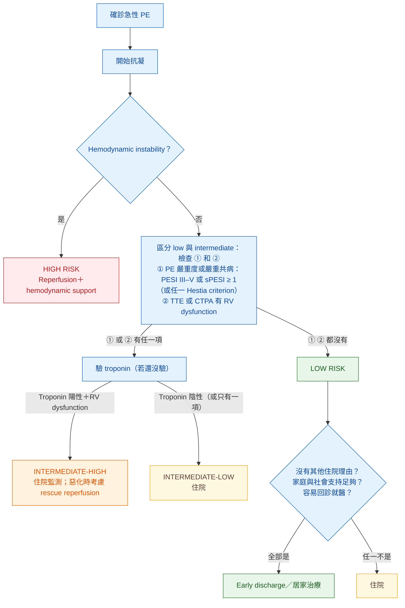

> [!abstract] 一句話重點
> - **High-risk → UFH＋systemic thrombolysis（rtPA 100 mg／2 h，I-B）**，溶栓禁忌或失敗 → **surgical embolectomy（I-C）或 catheter-directed treatment（IIa-C）**
>   - **intermediate／low-risk → 抗凝即可，==不常規溶栓（III-B）==**，intermediate-high 要**監測**，惡化才 **rescue thrombolysis（I-B）**
>   - 抗凝首選 **NOAC（I-A）**，注射用 **LMWH／fondaparinux 優於 UFH（I-A）**
>   - **low-risk 且條件允許 → 早期出院（IIa-A）**

> [!info] 系列導覽（本系列只整理指引中的 Table 與 Figure）
> ↑ 回到 [[cardiology/pulmonary-embolism-esc/index|急性肺栓塞 ESC 2019 指引總覽]]
>
> ① [[cardiology/pulmonary-embolism-esc/pe-esc-1-basics|流行病學、危險因子與病生理]]｜② [[cardiology/pulmonary-embolism-esc/pe-esc-2-diagnosis|臨床機率與診斷]]｜③ [[cardiology/pulmonary-embolism-esc/pe-esc-3-risk|嚴重度與早期死亡風險分層]]｜④ 急性期治療（本篇）｜⑤ [[cardiology/pulmonary-embolism-esc/pe-esc-5-long-term|長期抗凝、復發與癌症]]｜⑥ [[cardiology/pulmonary-embolism-esc/pe-esc-6-pregnancy-cteph|懷孕、追蹤與 CTEPH]]｜⑦ [[cardiology/pulmonary-embolism-esc/pe-esc-7-key-messages|新增修訂、Key messages 與必做／不做]]｜⑧ [[cardiology/pulmonary-embolism-esc/pe-esc-exam|內專考點]]
>
> 本篇涵蓋：Table 9–10；Figure 6（Central Illustration）；治療建議表（Section 6.6–6.10）

## Figure 6（Central Illustration）：依風險調整的急性 PE 處置策略

（依原圖內容重新繪製）

> [!note] 圖註
> - 疑似 high-risk 的緊急處置流程另見線上附錄 Supplementary Figure 1
> - **Cancer、heart failure、chronic lung disease** 已包含在 PESI／sPESI 中
> - **Hestia criteria**（線上附錄 Supplementary Table 12）：床邊可回答的一串問題，**任一答「是」就不能早期出院**；它同時涵蓋嚴重度、共病與居家治療可行性
> - Troponin 可能在診斷時就已驗過

## 呼吸與循環支持

### 氧氣與通氣

- **SaO₂ < 90%** 才給氧
- 一般氧氣無效的嚴重低血氧 → 想 **PFO 或 ASD 的 right-to-left shunt**
- 優先 **HFNC 或 NIV**；**==只有無法耐受 NIV 才插管==**：RV failure 病人在 **induction、插管、正壓通氣**時極易嚴重低血壓
- 若要 mechanical ventilation：**PEEP 小心給**（減少 venous return）；**tidal volume 約 6 mL/kg lean body weight**、**plateau pressure < 30 cmH₂O**；**避免容易造成低血壓的麻醉誘導藥**
- 低血氧要真正改善，**必須同時做肺部 reperfusion**

### Table 9：Acute high-risk PE 的 RV failure 治療

| 策略 | 用法與作用 | 注意事項 |
| --- | --- | --- |
| **Volume optimization** | 謹慎輸液：saline 或 Ringer's lactate **≤ 500 mL、15–30 分鐘**；用在 **CVP 正常偏低**（例如合併 hypovolaemia） | ==輸液可能讓 RV 過度擴張==、加重 ventricular interdependence、**反而降低 CO** |
| **Norepinephrine** | **0.2–1.0 µg/kg/min**；增加 RV 收縮力與 systemic BP、改善心室交互作用、恢復 coronary perfusion gradient | 過度血管收縮可能讓組織灌流變差 |
| **Dobutamine** | **2–20 µg/kg/min**；增加 RV 收縮力、降低 filling pressure | **單用（沒有 vasopressor）可能讓低血壓更糟**；可能誘發心律不整 |
| **VA-ECMO／ECLS** | 快速短期支持，附 oxygenator | 用久（**> 5–10 天**）併發症多（出血、感染）；**==除非合併 surgical embolectomy，否則沒有臨床效益==**；需有經驗的團隊 |

> [!note] 表註
> Cardiac arrest 時用 **epinephrine**。

**表格之外的重點**：

- **CVP 高（IVC 擴大、不塌陷）就不要再輸液**；小而會塌陷的 IVC 才代表 volume 不足
- Norepinephrine **限用於 cardiogenic shock**；dobutamine 可考慮用在 **低 cardiac index 但 BP 正常**者（但可能把血流導向未阻塞的血管，加重 V/Q mismatch）
- **Levosimendan、IV vasodilator、inhaled NO**：目前**沒有臨床效益證據**；IV vasodilator 可能讓低血壓更嚴重
- **ECMO 單獨＋抗凝**仍有爭議，要考慮合併 surgical embolectomy；Impella 只有個案報告

### Cardiac arrest

- PE 是 **non-shockable rhythm（PEA）** 的鑑別診斷之一；依 ACLS
- 決定以 PE 治療要**早**；應考慮給溶栓
- **==給了溶栓劑後，CPR 至少持續 60–90 分鐘才停止急救==**

## 抗凝

### 注射型

| 藥物 | 重點 |
| --- | --- |
| **LMWH／fondaparinux** | **==優先於 UFH==**：major bleeding 與 **HIT** 較少；**不需常規監測 anti-Xa** |
| **UFH** | 現在主要用在：**hemodynamic 不穩或即將失代償、準備做 primary reperfusion**的人；**嚴重腎功能不全（CrCl ≤ 30 mL/min）**、**嚴重肥胖**；依 **aPTT** 調整 |
| LMWH 在 CrCl 15–30 | 要用調整過的劑量 |

### NOAC

| 藥物 | 作用 | 急性期起始方式（phase III 試驗的用法） |
| --- | --- | --- |
| **Apixaban** | Factor Xa | **單藥起始**：前 **7 天**用較高劑量（10 mg bid），之後 5 mg bid |
| **Rivaroxaban** | Factor Xa | **單藥起始**：前 **3 週**用較高劑量（15 mg bid），之後 20 mg qd |
| **Dabigatran** | Thrombin | 先用注射抗凝**至少 5 天**，再換 150 mg bid |
| **Edoxaban** | Factor Xa | 先用注射抗凝**至少 5 天**，再換 60 mg qd；**CrCl 30–50 用 30 mg**（試驗中也包括低體重、併用 P-gp 抑制劑） |

- 統合分析：NOAC vs VKA 復發 **2.0% vs 2.2%（不劣）**；**major bleeding 1.1% vs 1.7%（RR 0.60）**；**intracranial bleeding（RR 0.37）**、**fatal bleeding（RR 0.36）**明顯較少
- 試驗中 dabigatran、rivaroxaban、apixaban 在 **CrCl 30–60 不減量**；**CrCl < 25（apixaban）或 < 30（其他三種）被排除**
- High-risk 病人被排除在 NOAC 試驗之外：**穩定後才轉口服**，時機依臨床判斷；轉換時仍要遵守 apixaban／rivaroxaban 的高劑量期或 dabigatran／edoxaban 的 5 天 heparin
- **Intermediate-high**：PEITHO 中惡化或死亡平均發生在約 **1.8 天** → **==前 2–3 天先用 LMWH，確定穩定再換口服==**

> [!danger] NOAC 不能用的情況（III-C）
> - **嚴重腎功能不全**：**dabigatran CrCl < 30 不建議**；**edoxaban CrCl 15–50 用 30 mg qd、< 15 不建議**；**rivaroxaban、apixaban CrCl 15–29 小心使用、< 15 不建議**
> - **懷孕與哺乳**
> - **==Antiphospholipid antibody syndrome==**（用 VKA）

### VKA

- 與 UFH、LMWH 或 fondaparinux **重疊 ≥ 5 天**，**且 INR 2.0–3.0 連續 2 天**
- Warfarin 起始：年輕（< 60 歲）健康者 **10 mg**；年長者 **≤ 5 mg**；之後 5–7 天依 INR 調整，目標 **INR 2.0–3.0**
- Pharmacogenetic testing 可改善控制、可能減少出血，但**不減少血栓或死亡**
- 抗凝門診與合適病人的**自我監測**可改善 TTR 與結果

## Reperfusion

### Systemic thrombolysis

- 比單用 UFH 更快改善肺動脈阻塞、PAP、PVR 與 RV 擴大
- **發病 48 小時內效益最大**，但 **6–14 天**內仍可能有用
- High-risk PE 約 **8%** 溶栓失敗（36 小時後仍不穩、RV 沒改善）
- 統合分析（主要是 high-risk）：死亡＋復發減少，代價是 **severe bleeding 9.9%、ICH 1.7%**
- **PEITHO（intermediate-high）**：溶栓**減少 hemodynamic decompensation**，但 **severe extracranial 與 intracranial bleeding 增加**，30 天死亡兩組都低 → **==不常規溶栓==**
- **Reduced-dose rtPA** 證據不足，暫無建議；reteplase、desmoteplase、**tenecteplase 目前都未核准用於 PE**
- 長期來看，溶栓**不能預防 CTEPH 或長期症狀** → 不能拿「預防後遺症」當溶栓理由

### Table 10：溶栓藥物的用法與禁忌

| 藥物 | 用法 |
| --- | --- |
| **rtPA（alteplase）** | **==100 mg IV over 2 h==** |
| rtPA 加速法 | **0.6 mg/kg over 15 min（最多 50 mg）**；**未正式核准**，有時用在 cardiac arrest 等極度不穩定 |
| Streptokinase | 250,000 IU loading over 30 min → 100,000 IU/h × 12–24 h；加速法 1.5 million IU over 2 h |
| Urokinase | 4400 IU/kg loading over 10 min → 4400 IU/kg/h × 12–24 h；加速法 3 million IU over 2 h |

- **rtPA 2 小時的加速給法優於** streptokinase／urokinase 的長時間輸注
- **Alteplase 輸注期間可以繼續 UFH**；**streptokinase、urokinase 輸注時要停 UFH**

| 禁忌 | 內容 |
| --- | --- |
| **Absolute** | **Haemorrhagic stroke 或不明原因 stroke 病史**；**6 個月內 ischaemic stroke**；**CNS neoplasm**；**3 週內 major trauma、手術或頭部外傷**；**bleeding diathesis**；**active bleeding** |
| **Relative** | **6 個月內 TIA**；正在口服抗凝；**懷孕或產後第一週**；不可壓迫的穿刺部位；**traumatic resuscitation**；**難治性高血壓（SBP > 180 mmHg）**；**advanced liver disease**；**infective endocarditis**；**active peptic ulcer** |

> [!warning] Pitfall
> 記憶時注意時間：**ischaemic stroke「6 個月」、major trauma／surgery／head injury「3 週」、TIA「6 個月」（relative）、產後「第一週」（relative）**。

### Catheter-directed treatment

- 經 femoral 進入肺動脈：mechanical fragmentation、aspiration，或最常見的 **pharmacomechanical**（機械或超音波碎栓＋**局部低劑量溶栓**）
- 登錄資料 procedural success 可達 **87%**（可能有發表偏差）
- **ULTIMA（59 位 intermediate-risk）**：ultrasound-assisted thrombolysis 24 小時 **RV/LV 改善較多**，出血未增加；但**沒有直接和 systemic thrombolysis 比較、沒有臨床結果 RCT**

### Surgical embolectomy

- Cardiopulmonary bypass 下切開兩側主肺動脈取出新鮮血栓
- New York 資料：溶栓 vs 手術 30 天死亡 15% vs 13%，溶栓 stroke 與再介入較多、**復發需住院 7.9% vs 2.8%**（非隨機）
- STS 資料：院內死亡 **12%**，**術前 cardiac arrest 者 32%**
- **ECMO＋surgical embolectomy** 的經驗支持在 high-risk（含 CPR 中）合併使用

## PE response team（PERT）

- 心臟、胸腔、血液、血管、麻醉／重症、心臟外科、介入放射科等**即時開會**（面對面或視訊）決定治療
- 組成與運作依各醫院資源而定

## Vena cava filter

- 可能適應症：**VTE＋抗凝絕對禁忌**、**足量抗凝下仍復發**、高風險者的初級預防
- **PREPIC**：永久 filter **減少 PE 但增加 DVT**，VTE 或死亡沒差；**PREPIC-2**（可回收 filter）：復發 VTE 沒差
- 統合分析：PE 約 **減少 50%**、DVT 約 **增加 70%**，死亡無差異
- 併發症常見：**穿出靜脈壁 19%**、約 5% 需要重大處置；還有 filter 斷裂、移位、IVC thrombosis
- **==Floating thrombus 不是放 filter 的理由==**（沒有抗凝禁忌時）

## 低風險 PE：早期出院與居家治療

**三組條件都要符合**：

1. **PE 相關早期死亡或嚴重併發症風險低**
2. **沒有需要住院的嚴重共病或惡化因素**
3. **門診照護與抗凝可行**（順從度、醫療與社會資源）

| 工具 | 證據與特點 |
| --- | --- |
| **Hestia criteria** | 單臂試驗：24 小時內出院者 3 個月復發 **2.0%**；隨機試驗：Hestia 單獨 vs 加驗 **NT-proBNP ≤ 500 pg/mL**，兩組結果都很低 → **加驗 NT-proBNP 沒有明顯額外價值**；**已內建居家治療可行性** |
| **PESI／sPESI** | 較標準化，但共病清單較少；**sPESI 把所有癌症排除在低風險外**；**用 PESI 時要另外評估居家治療可行性** |
| **加上 RV 評估** | HoT-PE：臨床條件＋**沒有 RV dysfunction**，rivaroxaban 門診治療，3 個月復發 **0.6%**、major bleeding 1.2%、無 PE 相關死亡 |

> [!tip] Pearl
> **==計畫立即或早期（24–48 小時內）出院時，先排除 RV dysfunction 與 right heart thrombi==**：用診斷時的 CTPA 或一次 echo 就能做到，代價小、可避免把「臨床上看似低風險」的人太早送回家。

## 建議：high-risk PE 的急性期治療（Section 6.6）

| 建議 | 等級 |
| --- | --- |
| **立即 UFH 抗凝**（含依體重 bolus） | **I-C** |
| **Systemic thrombolysis** | **I-B** |
| 溶栓**禁忌或失敗** → **surgical pulmonary embolectomy**（有專業與資源時） | **I-C** |
| 溶栓禁忌或失敗 → **percutaneous catheter-directed treatment**（有專業與資源時） | IIa-C |
| **Norepinephrine 和／或 dobutamine** | IIa-C |
| **ECMO**＋surgical embolectomy 或 catheter-directed treatment，用於**難治性循環衰竭或 cardiac arrest** | IIb-C |

> [!note] 表註
> 血行動力穩定後，抗凝照 intermediate／low-risk 的方式繼續。

## 建議：intermediate 或 low-risk PE 的急性期治療（Section 6.7）

| 建議 | 等級 |
| --- | --- |
| **High 或 intermediate 臨床機率**：診斷期間就開始抗凝 | **I-C** |
| 注射型抗凝：多數病人用 **LMWH 或 fondaparinux（優於 UFH）** | **I-A** |
| 口服抗凝：符合條件者 **==NOAC 優於 VKA==** | **I-A** |
| 用 VKA 時，與注射抗凝**重疊到 INR 2.5（2.0–3.0）** | **I-A** |
| **NOAC 不用於嚴重腎功能不全、懷孕與哺乳、antiphospholipid antibody syndrome** | **III-C** |
| 抗凝中**血行動力惡化** → **rescue thrombolysis** | **I-B** |
| 惡化時替代 rescue thrombolysis：**surgical embolectomy 或 catheter-directed treatment** | IIa-C |
| **==Intermediate 或 low-risk 不常規做 primary systemic thrombolysis==** | **III-B** |

## 建議：PE team、IVC filter、早期出院（Section 6.8–6.10）

| 建議 | 等級 |
| --- | --- |
| 依醫院資源，應考慮建立處理 high-risk（及部分 intermediate-risk）PE 的**多專科團隊** | IIa-C |
| **急性 PE＋抗凝絕對禁忌** → IVC filter | IIa-C |
| **足量抗凝下仍復發** → IVC filter | IIa-C |
| **==不常規放 IVC filter==** | **III-A** |
| 經仔細挑選的 **low-risk PE**，若門診照護與抗凝可行 → 早期出院、居家治療 | **IIa-A** |

## 相關筆記

- [[cardiology/pulmonary-embolism-esc/pe-esc-3-risk|③ 嚴重度與早期死亡風險分層]]（Table 8）
- [[cardiology/pulmonary-embolism-esc/pe-esc-5-long-term|⑤ 長期抗凝、復發與癌症]]
- [[cardiology/atrial-fibrillation/af-esc-2024-2-anticoagulation|AF 指引：抗凝]]（NOAC 劑量與腎功能）

## 參考資料

- Konstantinides SV, Meyer G, Becattini C, et al. 2019 ESC Guidelines for the diagnosis and management of acute pulmonary embolism developed in collaboration with the European Respiratory Society (ERS). *Eur Heart J*. 2020;41(4):543–603. doi:10.1093/eurheartj/ehz405。Section 6、7.2；Table 9–10；Figure 6。參考資料庫：心臟科／2019ESCGuidelinesfor the diagnosis and management of acutepulmonaryembolism.pdf
- NOAC 起始劑量為 phase III 試驗用法（指引線上附錄 Supplementary Table 8 所列試驗：EINSTEIN-PE、AMPLIFY、Hokusai-VTE、RE-COVER）
