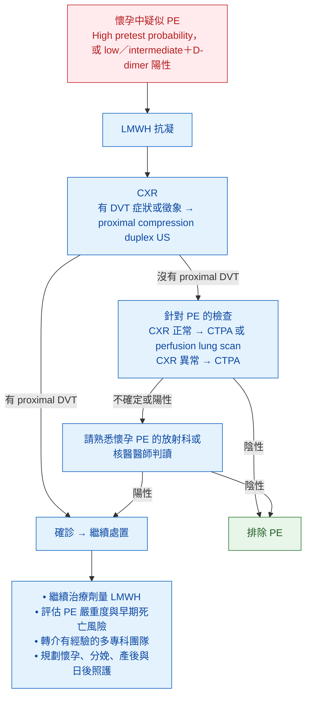
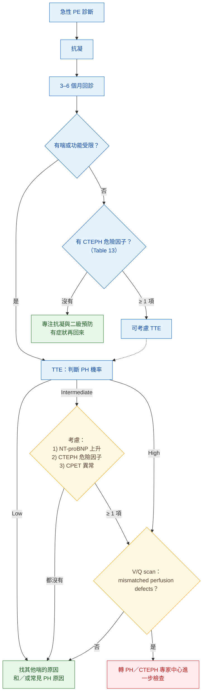

> [!abstract] 一句話重點
> - **懷孕**：
>   - 一樣要用驗證過的流程（I-B），D-dimer 與 prediction rule 可用（IIa-B）
>   - 有 DVT 症狀先做 **CUS**，**CXR 正常 → CTPA 或 perfusion scan**、**CXR 異常 → CTPA**
>   - 治療用**依早期懷孕體重的固定治療劑量 LMWH（I-B）**，**==NOAC 禁用（III-C）==**
>   - **最後一劑治療劑量 LMWH 後 24 小時內不打 neuraxial**、**拔 epidural catheter 後 4 小時內不給 LMWH**
> - **追蹤**：
>   - PE 後 **3–6 個月常規回診（I-B）**
>   - 有症狀＋V/Q **mismatched perfusion defect** → 轉 **PH／CTEPH 中心（I-C）**
>   - **CTEPH 診斷：抗凝 ≥ 3 個月後 mPAP ≥ 25、PAWP ≤ 15＋V/Q mismatch**，治療首選 **pulmonary endarterectomy**

> [!info] 系列導覽（本系列只整理指引中的 Table 與 Figure）
> ↑ 回到 [[cardiology/pulmonary-embolism-esc/index|急性肺栓塞 ESC 2019 指引總覽]]
>
> ① [[cardiology/pulmonary-embolism-esc/pe-esc-1-basics|流行病學、危險因子與病生理]]｜② [[cardiology/pulmonary-embolism-esc/pe-esc-2-diagnosis|臨床機率與診斷]]｜③ [[cardiology/pulmonary-embolism-esc/pe-esc-3-risk|嚴重度與早期死亡風險分層]]｜④ [[cardiology/pulmonary-embolism-esc/pe-esc-4-acute-treatment|急性期治療]]｜⑤ [[cardiology/pulmonary-embolism-esc/pe-esc-5-long-term|長期抗凝、復發與癌症]]｜⑥ 懷孕、追蹤與 CTEPH（本篇）｜⑦ [[cardiology/pulmonary-embolism-esc/pe-esc-7-key-messages|新增修訂、Key messages 與必做／不做]]｜⑧ [[cardiology/pulmonary-embolism-esc/pe-esc-exam|內專考點]]
>
> 本篇涵蓋：Figure 7–8；Table 12–13；懷孕建議表（Section 9.5）；追蹤建議表（Section 10.4）

## 懷孕的 PE：流行病學與診斷

- PE 是高所得國家**直接孕產婦死亡**的主要原因之一
- VTE 風險在懷孕期間上升，**產後達高峰**；IVF（尤其第一孕期）、過去 VTE、肥胖、共病、死產、preeclampsia、產後出血、**剖腹產**會再增加風險
- 疑似 PE 的孕婦中**確診只有 2–7%**；症狀和正常懷孕重疊
- **D-dimer 整個孕期持續上升**，第三孕期約 **1/4** 超過排除門檻；但流程化使用仍可安全排除部分病人：
  - Geneva＋D-dimer＋CUS＋CTPA 流程：非高機率者約 **11.7%** 單靠 D-dimer 排除（第三孕期降到 4.2%）
  - **Pregnancy-adapted YEARS**（498 人）：3 個月內被排除者只有 1 人發生 DVT、**沒有人發生 PE**
- **==Overdiagnosis 在孕婦同樣有害==**：分娩出血風險、往後不能用 estrogen 避孕、之後每次懷孕都要預防性抗凝

## Figure 7：懷孕到產後 6 週疑似 PE 的診斷與處置

（依原圖內容重新繪製）

> [!note] 圖註
> - CXR 異常時也要想其他胸部症狀的原因
> - **CUS 排除不了 pelvic vein DVT**：整條腿腫、臀部痛或其他骨盆血栓症狀 → 考慮 **MR venography**
> - CTPA 要用**胎兒輻射極低**的技術（Table 12）
> - 給治療劑量 LMWH 前：**CBC（Hb、platelet）、算 CrCl**，評估出血風險並確認沒有禁忌

## Table 12：PE 診斷檢查的輻射吸收劑量

| 檢查 | 胎兒吸收劑量（mGy） | 母親乳房吸收劑量（mGy） |
| --- | --- | --- |
| CXR | < 0.01 | < 0.1 |
| Perfusion lung scan（Tc-99m albumin）低劑量約 40 MBq | 0.02–0.20 | 0.16–0.5 |
| Perfusion lung scan 高劑量約 200 MBq | 0.20–0.60 | 1.2 |
| Ventilation lung scan | 0.10–0.30 | < 0.01 |
| **CTPA** | **0.05–0.5** | **3–10** |

> [!note] 表註
> 這裡用 **mGy**（單一器官或胎兒的吸收劑量）；② 的 Table 6 用 **mSv**（全身 effective dose）。

**影像重點**：

- V/Q 與 CTPA 的胎兒劑量都**遠低於**胎兒併發症門檻（**50–100 mSv**）
- CTPA 的乳房劑量：現代技術（縮小掃描範圍、降低 kV、iterative reconstruction）可低到 **3–4 mGy**，終生癌症風險只增加 1.0003–1.0007 倍 → **==不能以母親癌症風險為理由不做 CTPA==**
- **Normal perfusion scan 和 negative CTPA 一樣安全**；不確定結果 4–33%，**懷孕後期較多**；初始選哪個依當地專業與資源
- **V/Q SPECT** 有潛力但需更多評估；**MRA**：gadolinium 對胎兒長期影響未知、不確定結果多 → **不建議**
- **傳統 pulmonary angiography** 胎兒劑量明顯較高（2.2–3.7 mSv）→ **避免**

## 懷孕的 PE：治療

| 項目 | 重點 |
| --- | --- |
| **首選** | **==LMWH==**：不通過胎盤、無胎兒出血或致畸風險；比 UFH 藥動學更可預測、風險較好 |
| **劑量** | 與非懷孕相近，**qd 或 bid，依早期懷孕體重** |
| **anti-Xa 監測** | 一般不需要；保留給**復發 VTE、腎功能不全、體重極端**等高風險情況（原書；2025 版另見下方 🆕） |
| UFH | 與 HIT 及骨質流失有關；LMWH 長期使用者的骨密度研究沒有發現骨鬆或骨折 |
| Fondaparinux | 對 LMWH 過敏或不良反應時可考慮；少量通過胎盤 |
| **VKA** | 通過胎盤；**第一孕期 embryopathy**；第三孕期胎兒與新生兒出血、胎盤早期剝離；整個孕期都可能有 CNS 異常 |
| **NOAC** | **禁用** |
| **High-risk PE** | 系統性回顧（127 例）：溶栓後存活 94%、手術取栓 86%；溶栓後 major bleeding **懷孕中 18%、產後 58%**；胎兒死亡 12%（溶栓）、20%（取栓）；**==peripartum 除非危及生命，否則不溶栓==**；急性期一般用 **UFH** |
| Vena cava filter | 適應症同非懷孕，但經驗有限、風險可能較高 |

### 分娩與麻醉時機

- 接受治療劑量 LMWH → **與多專科團隊計畫分娩**，避免在完全抗凝下自然產程開始
- **Neuraxial（spinal／epidural）**：距最後一劑**治療劑量 LMWH ≥ 24 小時**（腎功能正常；體重極端另評估）
- **高風險情況（如最近的 PE）**：分娩前 **≥ 36 小時**把 LMWH 換成 **UFH**；**預計分娩前 4–6 小時停 UFH**，aPTT 正常才做區域麻醉（原書；2025 版另見下方 🆕）
- **拔除 epidural catheter 後 ≥ 4 小時才給 LMWH**；剖腹產後可先給一次**預防劑量**（拔管 ≥ 4 小時後），與下一次**治療劑量**相隔 **≥ 8–12 小時**
- **產後至少抗凝 6 週，總療程至少 3 個月**
- **哺乳**：**LMWH 與 warfarin 可用**，**NOAC 不建議**

> [!info] 🆕 新版指引（2025 ESC Guidelines for the management of cardiovascular disease and pregnancy）
> 2025 ESC 懷孕與心血管疾病指引的 VTE 章節（Section 11）重點，與 2019 PE 指引大致一致，差異與補充如下：
> - **Anti-Xa 監測**：常規監測不影響臨床結果，**只在腎功能不全或肥胖時考慮**
> - **分娩**：使用**治療劑量** LMWH 者要**計畫分娩**，**任何分娩方式前 24 小時停用治療劑量 LMWH**；預防劑量者不必計畫分娩
> - **Peripartum 溶栓或介入取栓**：不建議，**只有 high-risk PE 且經專科多專科討論後**才考慮；**不穩定的 PE 初期可用 UFH**
> - **產後**：治療性抗凝**至少 6 週、總共至多 3 個月**（除非需要無限期）；**哺乳可用 LMWH 或 VKA**
> - **D-dimer**：懷孕中每個孕期可上升達 39%；使用 YEARS 時，有 YEARS 項目者門檻 **< 500 µg/L**、沒有者 **< 1000 µg/L**；穩定孕婦以臨床特徵、D-dimer、venous ultrasound 減少 CTPA，**不要預設直接做 CTPA**
> - 新增懷孕 PE 診斷與治療流程圖（穩定與不穩定分開，2025 Figure 10）
>
> （各條建議的 class／level 未能取得原文表格，未列出）

## Amniotic fluid embolism（AFE）

- 懷孕中或分娩後**突發、無法解釋的心肺惡化**，常合併 **DIC**；是**排除性的臨床診斷**
- 發生率約 **2–7／10 萬**次生產，致死率約 13–19%
- 可能危險因子：既有心臟、腦血管、腎臟疾病，**placenta previa**、**polyhydramnios**、死產、chorioamnionitis、高血壓疾病、器械助產、**剖腹產**
- 治療以**支持性**為主：高品質急救、**迅速處理出血與凝血病變**

## 建議：懷孕的 PE（Section 9.5）

| 建議 | 等級 |
| --- | --- |
| 懷孕或產後疑似 PE → **用驗證過的方法做正式診斷評估** | **I-B** |
| 應考慮用 **D-dimer 與 prediction rule** 排除 PE | IIa-B |
| 疑似 PE（尤其有 DVT 症狀）→ 應考慮 **venous CUS** 以避免不必要的輻射 | IIa-B |
| 應考慮 **perfusion scintigraphy 或低劑量 CTPA** 排除 PE；**CXR 異常時 CTPA 為第一線** | IIa-C |
| 多數**血行動力穩定**的孕婦：**依早期懷孕體重的固定治療劑量 LMWH** | **I-B** |
| **High-risk PE** 孕婦 → 應考慮**溶栓或 surgical embolectomy** | IIa-C |
| **==最後一劑治療劑量 LMWH 未滿 24 小時，不放 spinal／epidural needle==** | **III-C** |
| **==拔 epidural catheter 後 4 小時內不給 LMWH==** | **III-C** |
| **==懷孕與哺乳不用 NOAC==** | **III-C** |
| 懷孕或產後出現**不明原因 cardiac arrest、持續低血壓或呼吸惡化**（尤其合併 DIC）→ 應考慮 **AFE** | IIa-C |

## 長期後遺症

### 持續症狀與功能受限

- 多數人肺動脈在**前幾個月就恢復通暢** → **==不需要常規追蹤 CTPA==**
- 6 個月到 3 年間**持續或惡化的喘、體能差很常見**；自覺比診斷時差的比例 **20–75%**
- 加拿大世代研究：**47%** 一年內 peak VO₂ < 80% 預測值；但 **PFT 與 echo 多半正常**
- 結論：多數是**deconditioning**（尤其合併體重過重、心肺共病），**不是殘留大血栓或 PH**
- 預測因子：高齡、心肺共病、高 BMI、抽菸、診斷時 **PASP 高與 RV dysfunction**、出院時殘留阻塞、女性、主肺動脈直徑大

### CTEPH

| 項目 | 重點 |
| --- | --- |
| 定義與機轉 | 器質化血栓**持續阻塞**肺動脈 → 血流重新分布＋**microvascular remodelling** → PVR 逐漸上升；**影像上的阻塞程度和血行動力不一定相關**，沒有復發也可能惡化 |
| 發生率 | PE 後 2 年累積 **0.1–9.1%**（範圍大因轉介偏差等）；瑞士前瞻性篩檢：**2 年 0.79%** |
| 病史 | 國際登錄中 **75%** 有急性 PE 病史；診斷中位年齡 **63 歲**，男女相同 |
| 症狀 | 早期非特異或沒有，晚期才有右心衰竭；症狀到診斷中位 **14 個月**；和 PAH 比，CTEPH **較多 oedema、haemoptysis**，PAH **較多 syncope** |
| **診斷** | **==有效抗凝至少 3 個月後==**；RHC **mPAP ≥ 25 mmHg**＋**PAWP ≤ 15 mmHg**＋V/Q 上 **mismatched perfusion defects**；CT 或血管攝影特徵：**ring-like stenoses、webs、slits、chronic total occlusion** |
| **CTED** | 有症狀、有慢性血栓阻塞但**靜止時沒有 PH** → 由 CTEPH 中心評估 |
| 影像 | **Planar V/Q 是第一線**（sensitivity **96–97%**、specificity 90–95%）；**CTPA 不能單獨用來排除**；PAH 與 PVOD 的 mismatch 通常是**非節段性** |
| 鑑別 | Pulmonary arteritis、**pulmonary angiosarcoma**、tumour embolism、hydatid cyst、異物栓塞、先天或後天肺動脈狹窄 |
| **治療：PEA** | **==可手術的 CTEPH 首選 pulmonary endarterectomy==**：深低溫＋間歇循環停止的雙側 endarterectomy；院內死亡 **4.7%**；**高齡本身不是禁忌**、**沒有任何血行動力門檻排除手術**；由多專科 CTEPH 團隊決定 operability；3 年存活：手術 **89%** vs 未手術 70% |
| **BPA** | **技術上無法手術**者的有效選擇；需要多次（**4–10 次**）；併發症：肺損傷、咳血、穿孔；日本 249 人：mPAP **43 → 24 mmHg**，30 天死亡 2.6% |
| **藥物** | **終生 VKA**（PEA 或 BPA 成功後也是）；**NOAC 沒有資料**；**riociguat**：唯一核准用於**不能手術或 PEA 後持續／復發 PH**；macitentan 改善 PVR 與 6MWD（phase II）；bosentan 主要終點未達到 |
| CTED | **靜止時沒有 PH 的有症狀者不用藥物治療** |

## Table 13：CTEPH 的危險因子與易發狀況

| 急性 PE 時的發現 | 共病與易發狀況（PE 診斷時或 3–6 個月追蹤時） |
| --- | --- |
| **過去 PE 或 DVT** | **Ventriculo-atrial shunt** |
| **CTPA 上肺動脈大血栓** | **感染的長期 IV 管路或 pacemaker** |
| **Echo 上 PH 或 RV dysfunction 徵象**（CTPA：RV/LV > 1.0） | **Splenectomy 病史** |
| **CTPA 已有慢性血栓疾病的徵象** | **Thrombophilia**，尤其 **APS** 與 **factor VIII 高** |
| | **Non-O blood group** |
| | **接受甲狀腺素治療的 hypothyroidism** |
| | **癌症病史** |
| | **Myeloproliferative disorder** |
| | **IBD** |
| | **Chronic osteomyelitis** |

## Figure 8：PE 後的追蹤策略與長期後遺症檢查

（依原圖內容重新繪製）

> [!note] 圖註
> - 回診時同時看：**喘或功能受限的持續或新發**、**VTE 復發、癌症、抗凝出血**
> - 喘可用 **MRC scale** 或 WHO functional class 標準化
> - PH 機率依 ESC／ERS PH 指引的 echo 標準
> - **CPET** 異常包括 peak VO₂ 下降、VE/VCO₂ 上升、end-tidal CO₂ 下降；**V/Q 正常但症狀仍無法解釋時**也可做 CPET（找出需要復健、運動或減重的人）
> - 也可用 **dual-energy CT** 取代 V/Q（有專業時）

### Integrated model of care

- 合格護理師、醫師跨專科合作、標準化流程、**醫院與基層的雙向轉介**
- 護理師追蹤：復發與併發症徵象、服藥順從度、戒菸、飲食、運動、彈性襪、活動與自我照護

## 建議：急性 PE 後的追蹤（Section 10.4）

| 建議 | 等級 |
| --- | --- |
| **==急性 PE 後 3–6 個月常規臨床評估==**（復發、出血、癌症、運動受限症狀，並決定是否延長抗凝） | **I-B** |
| **整合式照護模式**（醫院專科、合格護理師、基層醫師）確保從醫院順利轉到社區 | **I-C** |
| **有症狀**且 PE **3 個月後**V/Q 仍有 **mismatched perfusion defects** → 參考 echo、natriuretic peptide 和／或 CPET 後**轉 PH／CTEPH 中心** | **I-C** |
| PE 後**持續或新發喘、運動受限** → 應考慮依 Figure 8 進一步評估 | IIa-C |
| **無症狀但有 CTEPH 危險因子** → 可考慮進一步評估 | IIb-C |

## 相關筆記

- [[cardiology/pulmonary-embolism-esc/pe-esc-2-diagnosis|② 臨床機率與診斷]]（Table 6：影像輻射）
- [[cardiology/pulmonary-embolism-esc/pe-esc-5-long-term|⑤ 長期抗凝、復發與癌症]]

## 參考資料

- Konstantinides SV, Meyer G, Becattini C, et al. 2019 ESC Guidelines for the diagnosis and management of acute pulmonary embolism developed in collaboration with the European Respiratory Society (ERS). *Eur Heart J*. 2020;41(4):543–603. doi:10.1093/eurheartj/ehz405。Section 9–10；Table 12–13；Figure 7–8。參考資料庫：心臟科／2019ESCGuidelinesfor the diagnosis and management of acutepulmonaryembolism.pdf
- 🆕 De Backer J, Haugaa KH, et al. 2025 ESC Guidelines for the management of cardiovascular disease and pregnancy. *Eur Heart J*. 2025;46(43):4462–4568. doi:10.1093/eurheartj/ehaf193。Section 11（Venous thromboembolism in pregnancy and post-partum）
