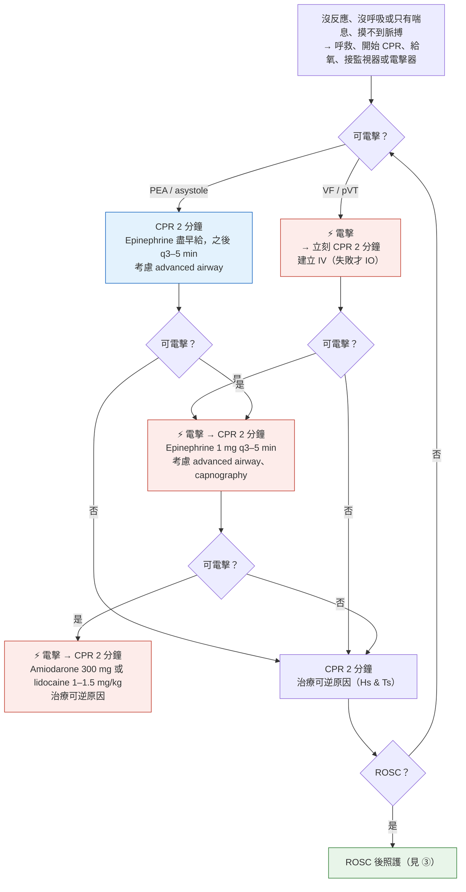

> [!abstract] 一句話重點
> **高品質 CPR＋盡早電擊是基石**，藥物都是之後的事。**==Shockable（VF/pVT）：先電擊，初次電擊失敗後才給 epinephrine 1 mg IV/IO q3–5 min==**（2025 更新）；**nonshockable（PEA/asystole）：epinephrine 盡早給**。**Refractory VF/pVT → amiodarone 300 mg → 150 mg，或 lidocaine 1–1.5 → 0.5–0.75 mg/kg**。**==給藥路徑先 IV，失敗才 IO==**（2025 更新）。**Vasopressin 沒有額外好處**；**double sequential、vector change defibrillation 效益未確立**；**head-up CPR 只限試驗**。**不穩定 WCT → synchronized cardioversion**；**==AF 同步電擊起始 ≥ 200 J==**（flutter 也可 200 J）。**不穩定 bradycardia：atropine 1 mg q3–5 min（最多 3 mg）→ TCP 或 dopamine／epinephrine 滴注 → 藥物無效考慮 transvenous pacing**（2025 新增）。

> [!info] 系列導覽
> ↑ 回到 [[cardiology/resuscitation-aha-2025/index|2025 AHA 急救指引總覽]]
>
> ① [[cardiology/resuscitation-aha-2025/cpr25-1-systems-bls|救命之鏈、倫理與 BLS]]｜② 成人 ALS（本篇）｜③ [[cardiology/resuscitation-aha-2025/cpr25-3-post-arrest-special|ROSC 後照護與特殊情況]]｜④ [[cardiology/resuscitation-aha-2025/cpr25-4-peds-neonatal-education|兒童、新生兒與教育]]｜⑤ [[cardiology/resuscitation-aha-2025/cpr25-exam|內專考點]]
>
> 本篇來源：2025 AHA Guidelines Highlights「Adult Advanced Life Support」；劑量與流程依 AHA 2025 成人 cardiac arrest、bradycardia、tachyarrhythmia algorithm（AHA 官網）補充

## 背景數字

- EMS 處理的 **OHCA 存活出院約 10%**；**IHCA 約 24%**；存活出院者**約 85% 神經學預後良好**
- 2025 指引共 **760 條建議**，**只有 11 條（1.4%）是 Level A**——急救研究很難做

## 成人 cardiac arrest 流程（AHA 2025 algorithm 依內容重新整理）

### 數字速記

| 項目 | 數值 |
| --- | --- |
| 按壓 | **100–120 次/分**、**至少 5 cm（2 吋）**、**完全回彈**、**減少中斷**、**每 2 分鐘換人**（累了更早） |
| 沒有 advanced airway | **30:2** |
| 有 advanced airway | **每 6 秒 1 次（10 次/分）**，按壓不停 |
| 電擊能量 | **Biphasic：依廠商建議（例如 120–200 J）**，不知道就用**最大值**；之後相同或更高｜**Monophasic 360 J** |
| **Epinephrine** | **1 mg IV/IO q3–5 min** |
| **Amiodarone** | **300 mg IV/IO bolus → 第二劑 150 mg** |
| **Lidocaine** | **1–1.5 mg/kg → 第二劑 0.5–0.75 mg/kg** |
| CPR 品質監測 | **連續 waveform capnography**；ETCO2 低或下降 → 檢查 CPR 品質 |

### 可逆原因：Hs & Ts

| Hs | Ts |
| --- | --- |
| **Hypovolemia** | **Tension pneumothorax** |
| **Hypoxia** | **Tamponade**（cardiac） |
| **Hydrogen ion**（acidosis） | **Toxins** |
| **Hypo-／hyperkalemia** | **Thrombosis, pulmonary**（PE） |
| **Hypothermia** | **Thrombosis, coronary**（MI） |

> [!tip] Pearl：PEA 先想 Hs & Ts
> PEA 多是**可逆原因**造成（失血、缺氧、酸中毒、鉀異常、tamponade、tension pneumothorax、PE）；**外傷性 arrest** 優先處理**止血、輸血、胸腔減壓、心包減壓**，藥物次要。

## 2025 新增與更新的建議

### 電擊

| 建議 | 狀態 |
| --- | --- |
| **持續 VF/pVT（≥ 3 次連續電擊後）用 vector change defibrillation**：效益**未確立** | 2025 New |
| **Double sequential defibrillation**（同上情境）：效益**未確立** | 2025 Updated |

- 依據只有**一個小型 RCT**（2023 ILCOR），還有許多問題待研究

### 給藥路徑

| 建議 | 狀態 |
| --- | --- |
| **==成人 arrest 先嘗試 IV==** | 2025 Updated |
| **IV 失敗或不可行 → IO 合理** | 2025 Updated |

- 2025 ILCOR 統合分析（含 3 個大型 RCT）：IO **沒有比 IV 好**，而且 **IO 達到 sustained ROSC 的機會較低**

### 升壓劑與抗心律不整藥

| 建議 | 狀態 |
| --- | --- |
| **==Shockable rhythm：初次電擊失敗後才給 epinephrine==** | 2025 Updated |
| **Vasopressin（單用或合併 epinephrine）取代 epinephrine：沒有好處** | 2025 Updated |
| Refractory VF/pVT 用 **β-blocker、bretylium、procainamide、sotalol**：**效益不確定** | 2025 New |

- 先電擊、再給藥：shockable 病人**優先快速電擊**，CPR＋電擊失敗後才加 epinephrine
- Bretylium 最近重新在美國上市，但**沒有新的有效性或安全性證據**

### CPR 輔助與終止

| 建議 | 狀態 |
| --- | --- |
| **Head-up CPR**：**臨床試驗以外不建議** | 2025 New |
| 有 ALS 與 BLS 的分層 EMS 系統：使用 **universal termination of resuscitation rule** 合理 | 2025 Updated |

- **Universal TOR rule**（與 BLS rule 相同）：**arrest 不是 EMS 目擊**、**沒有電擊過**、**沒有 ROSC** → 可考慮在現場終止

## 有脈搏的心律不整

### Tachyarrhythmia（AHA 2025 algorithm）

| 步驟 | 內容 |
| --- | --- |
| 1 | 通常 **HR ≥ 150/min**；評估呼吸道、給氧（低血氧時）、監視器、IV、**12 導程 ECG** |
| 2 | **不穩定？**（低血壓、急性意識改變、休克、缺血性胸痛、急性心衰竭） |
| 不穩定 | **==Synchronized cardioversion==**（可行時先鎮靜）；**規則窄 QRS → 可先考慮 adenosine** |
| 穩定、**窄 QRS**（< 0.12 s） | **規則 → vagal maneuver、adenosine**；β-blocker 或 CCB；考慮會診 |
| 穩定、**寬 QRS**（≥ 0.12 s） | **規則且單形 → 才可用 adenosine**；**antiarrhythmic 滴注**；考慮會診 |
| 無效 | 找原因、**提高下一次電擊能量**、**加 antiarrhythmic**、會診 |

| 藥物 | 劑量 |
| --- | --- |
| **Adenosine** | **6 mg rapid IV push＋NS flush → 需要時 12 mg** |
| **Procainamide** | **20–50 mg/min** 滴注，直到心律不整停止、低血壓、**QRS 變寬 > 50%**、或達 **17 mg/kg**；維持 1–4 mg/min｜**QT 延長或 CHF 避免** |
| **Amiodarone** | **150 mg over 10 分鐘**（VT 復發可重複）→ **1 mg/min × 6 小時** |

| 2025 建議 | 狀態 |
| --- | --- |
| **血行動力不穩的 WCT → synchronized cardioversion** | 2025 Updated |
| **穩定 WCT**：vagal 或藥物無效或禁忌 → **synchronized cardioversion** | 2025 Updated |
| **==AF 同步電擊：biphasic 起始至少 200 J==**，失敗再加 | 2025 Updated |
| **Atrial flutter 同步電擊：起始 200 J** 可能合理 | 2025 Updated |
| **Double synchronized cardioversion** 當 AF 初始策略：**效益不確定** | 2025 New |

- 200 J 起始：> 3,000 位 AF 病人的 RCT 與網絡統合分析，三種美國 biphasic 機型**累積成功率 > 90%**；**低能量 monophasic** 電 AF 時**較易誘發 VF**，電 flutter 時較易誘發 AF

> [!warning] Pitfall：寬 QRS 心搏過速
> **WCT 在確定之前一律當 VT**，尤其有 **prior MI、CAD、structural heart disease**。**Verapamil、diltiazem 不能用在 VT**（可能血行動力崩潰）。Adenosine 只能用在**規則且單形**的 WCT。

### Bradycardia（AHA 2025 algorithm）

| 步驟 | 內容 |
| --- | --- |
| 1 | 通常 **HR < 50/min**；評估 |
| 2 | **心肺功能受損？**（低血壓、急性意識改變、休克、缺血性胸痛、急性心衰竭）→ 沒有：找原因、12 導程、觀察 |
| 3 | 呼吸道、給氧、正壓通氣（需要時）、監視器 |
| 4 | **==Atropine 1 mg IV q3–5 min，最多 3 mg==** |
| 5 | Atropine 無效 → **transcutaneous pacing** 和／或 **dopamine 5–20 µg/kg/min** 或 **epinephrine 2–10 µg/min** 滴注 |
| 6 | 會診、**transvenous pacing** |

| 2025 建議 | 狀態 |
| --- | --- |
| **持續血行動力不穩、藥物無效的 bradycardia → temporary transvenous pacing 合理** | 2025 New |

- 可能原因：**心肌缺血或梗塞**、**藥物**（CCB、β-blocker、digoxin）、低血氧、**電解質（hyperkalemia）**

## 相關筆記

- [[cardiology/resuscitation-aha-2025/cpr25-1-systems-bls|① BLS]]（高品質 CPR、30:2）
- [[cardiology/resuscitation-aha-2025/cpr25-3-post-arrest-special|③ ROSC 後照護與特殊情況]]
- [[cardiology/atrial-fibrillation/index|心房顫動 AF（ESC 2024）]]（electrical cardioversion）
- [[cardiology/syncope/index|暈厥]]（bradyarrhythmia、VT）
- [[pulmonology/emergent-airway-management|緊急呼吸道處置]]
- [[cardiology/resuscitation-aha-2025/cpr25-exam|⑤ 內專考點]]

## 參考資料

- American Heart Association. Highlights of the 2025 American Heart Association Guidelines for Cardiopulmonary Resuscitation and Emergency Cardiovascular Care. 2025（Adult Advanced Life Support）（參考資料庫：心臟科／Highlights of the 2025 American Heart Association Guidelines for Cardiopulmonary Resuscitation.pdf）
- American Heart Association. 2025 Adult Cardiac Arrest Algorithm；Adult Bradyarrhythmia With a Pulse Algorithm；Adult Tachyarrhythmia With a Pulse Algorithm（cpr.heart.org, accessible long descriptions, 2025）
- Del Rios M, Bartos JA, Panchal AR, et al. Part 1: Executive Summary: 2025 American Heart Association Guidelines for CPR and ECC. *Circulation* 2025;152(suppl 2).
