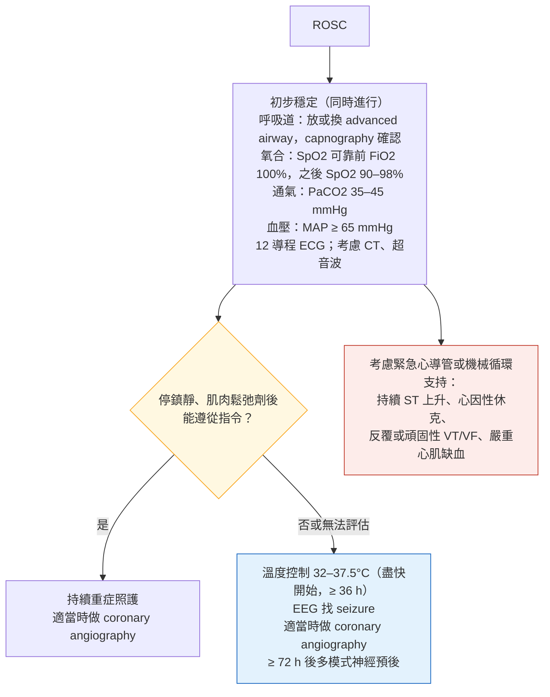

> [!abstract] 一句話重點
> **ROSC 後一次做完**：**呼吸道確認（waveform capnography）**、**==SpO2 90–98%（PaO2 60–105）、PaCO2 35–45==**、**==MAP ≥ 65 mmHg==**（更高 MAP 沒有好處）、**12 導程 ECG**，可考慮 **head-to-pelvis CT** 與**心臟超音波**。**不能遵從指令 → 溫度控制 32–37.5°C，至少 36 小時**（2025 更新）；**EEG 找 seizure**；**==神經預後至少等 72 小時、多模式==**，新增**良好預後**的指標（**72 小時內連續 EEG、沒有放電**）與 **neurofilament light chain**。**沒有 EEG 對應的 myoclonus 不要壓**。**疑似心因性 → 出院前做 coronary angiography**；**ST 上升、休克、反覆 VT/VF → 緊急**。特殊情況：**==孕婦 arrest 時就開始準備，5 分鐘內完成 resuscitative delivery==**；**hyperkalemia arrest 給 IV calcium 效益未確立**（不能延誤 CPR、電擊、epinephrine）；**LVAD 病人灌流不足就要按壓**；**鴉片類過量給 naloxone 但不干擾 CPR**。

> [!info] 系列導覽
> ↑ 回到 [[cardiology/resuscitation-aha-2025/index|2025 AHA 急救指引總覽]]
>
> ① [[cardiology/resuscitation-aha-2025/cpr25-1-systems-bls|救命之鏈、倫理與 BLS]]｜② [[cardiology/resuscitation-aha-2025/cpr25-2-adult-als|成人 ALS]]｜③ ROSC 後照護與特殊情況（本篇）｜④ [[cardiology/resuscitation-aha-2025/cpr25-4-peds-neonatal-education|兒童、新生兒與教育]]｜⑤ [[cardiology/resuscitation-aha-2025/cpr25-exam|內專考點]]
>
> 本篇來源：2025 AHA Guidelines Highlights「Post–Cardiac Arrest Care」「Cardiac Arrest Due to Special Circumstances」、Figure 7–8

## ROSC 後照護（Figure 7 依內容重新整理）

### 目標速記

| 項目 | 目標 |
| --- | --- |
| **氧合** | SpO2 可靠前 **FiO2 100%** → **==SpO2 90–98%（PaO2 60–105 mmHg）==** |
| **通氣** | **==PaCO2 35–45 mmHg==**（沒有嚴重酸血症時） |
| **血壓** | **==MAP ≥ 65 mmHg==**（升壓劑或輸液） |
| **血糖** | **避免 < 70 mg/dL 和 > 180 mg/dL** |
| **溫度控制** | **32–37.5°C**，不能遵從指令者 **≥ 36 小時** |
| **神經預後** | **≥ 72 小時**（從 ROSC 或恢復正常體溫起算）、**多模式** |
| 其他 | **考慮抗生素**；治療 arrest 原因與併發症 |

### 2025 建議

| 主題 | 2025 建議 | 狀態 |
| --- | --- | --- |
| **血壓** | **MAP 至少 65 mmHg** 避免低血壓 | Updated |
| **CT** | **Head-to-pelvis CT** 找 arrest 原因與急救併發症，可能合理 | New |
| **超音波** | **心臟超音波或 POCUS** 找需要處理的診斷，可能合理 | New |
| **==溫度控制==** | **不能遵從口令者，溫度控制至少 36 小時** | Updated |
| **冠狀動脈攝影** | 疑似心因性 arrest 的存活者，**出院前做 coronary angiography**，尤其 **shockable 初始心律、無法解釋的 LV 收縮功能不良、嚴重缺血證據** | Updated |
| **機械循環支持** | arrest 後**頑固性 cardiogenic shock**，高度選擇的病人**可考慮 temporary MCS** | New |
| **Myoclonus** | **==沒有 EEG 對應的 myoclonus 不建議用藥壓抑==** | New |
| **神經預後** | **72 小時內連續 EEG 背景、沒有放電**（配合其他檢查）可支持**良好**預後 | New |
| 康復 | 存活者與照顧者**出院前做情緒困擾的結構化評估與處置或轉介** | Updated |

- **MAP**：4 個 RCT 比較高低 MAP 目標，**較高 MAP 沒有改善存活或神經預後**；**用哪種升壓劑沒有足夠證據**
- **溫度控制**包括**低溫（32–34°C）**與**正常體溫／預防發燒（36–37.5°C）**；**36 小時是總溫度控制的最短建議時間**
- 神經預後新增**良好預後指標**；血清標記新增 **neurofilament light chain**
- 約 **1/4 的存活者與照顧者**有情緒困擾

## 特殊情況

| 情況 | 2025 建議 | 狀態 |
| --- | --- | --- |
| **致命性氣喘** | 標準治療無效 → 可考慮 **ECLS**（VV 或 VA ECMO）或**吸入性麻醉劑** | New |
| **==Hyperkalemia arrest==** | **IV calcium 的效益未確立**；給之前要權衡，**不能延誤高品質 CPR、電擊、epinephrine** | Updated |
| **低體溫 arrest** | 用 **HOPE、ICE 預後分數**決定是否 **ECLS 回溫**；**嚴重低體溫（< 28°C）沒有 arrest** 也可考慮 ECLS 回溫 | New |
| **致命性高體溫**（> 40°C） | **冰水浸泡（1–5°C）優於其他方法**；**降溫速度至少 0.15°C/min**；也適用 sympathomimetic、cocaine 中毒 | New |
| **==LVAD==** | 沒反應＋**灌流不足 → 要做胸外按壓**；可以**立即按壓、同時找 LVAD 可逆原因** | New |
| **==孕婦 arrest==** | **辨識 arrest 時就開始準備 resuscitative delivery**（取代 perimortem cesarean 一詞），**目標 5 分鐘內完成**；標準急救無效可用 **ECPR**；疑似 **amniotic fluid embolism → 平衡式大量輸血** | Updated／New |
| **鴉片類過量** | arrest 時給 **naloxone** 可能合理，**前提是不干擾高品質 CPR（含人工呼吸）**；**出院時給 naloxone 並教怎麼用** | New |
| 感染風險 | 按壓、袋瓣罩通氣、電擊、抽吸、插管都視為**產生氣霧的處置** | — |

- **Hyperkalemia 的 calcium**：人類證據有限，重點是**不要因為給 calcium 而耽誤**標準急救（降鉀的完整處置見[[nephrology/hemodialysis-emergencies|血液透析急症]]）
- **孕婦**：配合**手動將子宮推向左側**（manual left lateral uterine displacement）；ECPR 在孕婦的存活率 **55–75%**
- **鴉片類過量的存活者**再次過量風險高 → 除了心理社會介入與轉介，給**帶回家的 naloxone**

### LVAD 病人沒有反應（Figure 8 依內容重新整理）

**灌流足夠**（任一即可，**可能摸不到脈搏**）：**膚色與溫度正常**、**微血管回填正常**、**MAP > 50 mmHg**（壓脈帶量不到 → Doppler 或動脈導管）、**PETCO2 > 20 mmHg**

| 灌流 | 處置 |
| --- | --- |
| **足夠** | **不做胸外按壓**；必要時輔助通氣；找**非 LVAD 原因**（心律不整、出血、低血糖、低血氧、藥物過量、RV failure、sepsis、stroke）；轉送、**聯絡 VAD 中心** |
| **不足** | **立即胸外按壓**；第二位施救者**檢查 LVAD**（警報、聽 LVAD 嗡嗡聲、**driveline、電源有沒有接好**、要不要換控制器）；找非 LVAD 原因；**繼續 BLS／ALS** |

- CPR 的潛在好處**大於**理論上的裝置脫落風險

## 相關筆記

- [[cardiology/resuscitation-aha-2025/cpr25-2-adult-als|② 成人 ALS]]
- [[cardiology/pulmonary-embolism-esc/index|肺栓塞 PE（ESC 2019）]]（arrest 時的 thrombolysis）
- [[nephrology/hemodialysis-emergencies|血液透析急症]]（hyperkalemia）
- [[pulmonology/emergent-airway-management|緊急呼吸道處置]]
- [[cardiology/resuscitation-aha-2025/cpr25-exam|⑤ 內專考點]]

## 參考資料

- American Heart Association. Highlights of the 2025 American Heart Association Guidelines for Cardiopulmonary Resuscitation and Emergency Cardiovascular Care. 2025（Post–Cardiac Arrest Care、Special Circumstances；Figure 7–8）（參考資料庫：心臟科／Highlights of the 2025 American Heart Association Guidelines for Cardiopulmonary Resuscitation.pdf）
- Del Rios M, Bartos JA, Panchal AR, et al. Part 1: Executive Summary: 2025 American Heart Association Guidelines for CPR and ECC. *Circulation* 2025;152(suppl 2).
