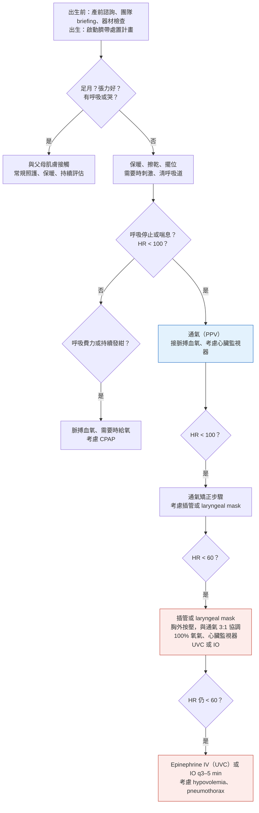

> [!abstract] 一句話重點
> - **兒童 ALS**：
>   - **nonshockable 盡早給 epinephrine**（< 3 分鐘預後最好）
>   - 有侵入性呼吸道時 **ETCO2 監測 CPR 品質**，但<strong>==不能只用某個 ETCO2 數值決定停止急救==</strong>
>   - 有動脈導管時 **diastolic BP 嬰兒 ≥ 25、≥ 1 歲 ≥ 30 mmHg**
>   - ROSC 後 **SBP 與 MAP > 第 10 百分位**
>   - 神經預後**多模式**、**72 小時內 EEG** 合理
> - **新生兒**：
>   - **不需立即急救者延遲斷臍 ≥ 60 秒**
>   - **通氣最優先**（PIP 20–30 cmH2O、30–60 次/分）
>   - **==胸外按壓前先用 ECG==**、**按壓：通氣 3:1**
>   - **目標 SpO2 從 2 分鐘 65–70% 開始**
> - **教育**：訓練用**回饋裝置**、**teamwork**；**VR 不能用來教 CPR 技能**

> [!info] 系列導覽
> ↑ 回到 [[cardiology/resuscitation-aha-2025/index|2025 AHA 急救指引總覽]]
>
> ① [[cardiology/resuscitation-aha-2025/cpr25-1-systems-bls|救命之鏈、倫理與 BLS]]｜② [[cardiology/resuscitation-aha-2025/cpr25-2-adult-als|成人 ALS]]｜③ [[cardiology/resuscitation-aha-2025/cpr25-3-post-arrest-special|ROSC 後照護與特殊情況]]｜④ 兒童、新生兒與教育（本篇）｜⑤ [[cardiology/resuscitation-aha-2025/cpr25-exam|內專考點]]
>
> 本篇來源：2025 AHA Guidelines Highlights「Pediatric Advanced Life Support」「Neonatal Life Support」「Education Science」、Figure 4–5

## 兒童高級救命術（PALS）

| 主題 | 2025 建議 | 狀態 |
| --- | --- | --- |
| **Epinephrine** | **初始 nonshockable** → **盡早給第一劑**（**< 3 分鐘**的預後最好） | Updated |
| **ETCO2** | 有侵入性呼吸道 → 可考慮用 ETCO2 監測 CPR 品質 | Updated |
| **==ETCO2 與停止急救==** | **不能單獨用某個 ETCO2 切點**決定停止急救（平均 < 20 mmHg 也有人存活） | New |
| **Diastolic BP** | 有動脈導管 → **嬰兒 ≥ 25 mmHg**、**≥ 1 歲 ≥ 30 mmHg** | New |
| **SVT** | vagal、adenosine、同步電擊都無效且心肺受損、找不到專家 → 可考慮 **IV procainamide、amiodarone 或 sotalol** | Updated |
| **ROSC 後血壓** | **SBP 與 MAP > 該年齡第 10 百分位**（低血壓＝< 第 5 百分位；ROSC 後 25–50% 有低血壓） | Updated |
| **神經預後** | **多模式**；**咳嗽、作嘔反射、對疼痛反應**的預測價值**未確立**；配合其他檢查，**72 小時內的 EEG** 合理 | Updated／New |
| 康復 | 存活兒童**第一年內**評估身體、認知、情緒需求 | Updated |

- ETCO2 ≥ 20 mmHg（前 10 分鐘平均）與 ROSC、存活出院較多有關

## 新生兒急救（Neonatal Resuscitation Algorithm，Figure 4 依內容重新整理）

- 美加每年約 400 萬新生兒，**每 10–20 個就有 1 個**需要協助轉換到呼吸空氣
- 演算法更新重點：**強調臍帶處置**；**目標 SpO2 表從 2 分鐘開始**（因為延遲斷臍，1 分鐘通常量不到）；**胸外按壓前建議接 ECG**

| 時間 | 目標 SpO2 |
| --- | --- |
| 2 分鐘 | 65–70% |
| 3 分鐘 | 70–75% |
| 4 分鐘 | 75–80% |
| 5 分鐘 | 80–85% |
| 10 分鐘 | 85–95% |

| 主題 | 2025 建議 | 狀態 |
| --- | --- | --- |
| **延遲斷臍（足月）** | 不需立即急救 → **延遲 ≥ 60 秒**（血液學指標、鐵質較好） | Updated |
| **延遲斷臍（< 37 週）** | 不需立即急救 → **延遲 ≥ 60 秒（建議）**（**降低死亡率**） | Updated |
| **Intact cord milking** | **沒活力的足月或 ≥ 35 週**早產兒 → 可能合理 | New |
| **通氣壓力** | 起始 **PIP 20–30 cmH2O**，再調整 | Updated |
| **通氣速率** | **30–60 次/分** | Updated |
| 插管 | **Video laryngoscopy** 有用（成功率較高）；傳統喉鏡仍合理 | New |
| **Laryngeal mask** | **≥ 34 週**、面罩通氣失敗 → 可替代插管；也**可能可以當第一線介面** | New |
| **脈搏血氧** | 需要呼吸支持或給氧 → **盡快放** | New |
| **< 32 週的起始氧氣** | **30–100%** 可能合理，再往下調 | Updated |
| **按壓位置** | **胸骨下 1/3**，**避開劍突**（劍突受壓會傷肝） | New |
| **換人** | **每 2–5 分鐘換按壓者**，在評估心跳時換 | New |

## 教育與訓練

| 主題 | 2025 建議 | 狀態 |
| --- | --- | --- |
| **回饋裝置** | 醫護與民眾的 CPR 訓練**都建議用** | Updated |
| Rapid-cycle deliberate practice | 可納入 BLS、ALS 訓練 | New |
| **Teamwork** | 醫護訓練**要特別強調團隊合作**（14 個 RCT 中 12 個較好） | Updated |
| 遊戲化 | 醫護與民眾都可能合理 | New |
| **VR／AR** | **VR 可支援知識學習**；**AR 可提供即時回饋**；**==VR 不應用來教 CPR 技能==**（深度、速率不比傳統好） | New |
| 鴉片類過量 | 民眾要學辨識與初步處置；最佳訓練方式未確立 | Updated |
| **弱勢族群** | 針對特定族群、女性、低社經、語言隔離社區加強訓練 | Updated |
| **學童** | **12 歲以前就開始教 CPR** | New |
| 替代物練習（枕頭等） | 效益未確立 | New |
| Debriefing 腳本 | 講師可能可以使用 | New |
| **Cognitive aids** | **醫護可能可用**；**民眾不建議**（延誤開始 CPR） | New |

## 相關筆記

- [[cardiology/resuscitation-aha-2025/cpr25-1-systems-bls|① BLS]]（嬰兒按壓手法、兒童異物哽塞）
- [[cardiology/resuscitation-aha-2025/cpr25-3-post-arrest-special|③ ROSC 後照護]]
- [[teaching/index|教學資源]]
- [[cardiology/resuscitation-aha-2025/cpr25-exam|⑤ 內專考點]]

## 參考資料

- American Heart Association. Highlights of the 2025 American Heart Association Guidelines for Cardiopulmonary Resuscitation and Emergency Cardiovascular Care. 2025（Pediatric ALS、Neonatal Life Support、Education Science；Figure 4–5）（參考資料庫：心臟科／Highlights of the 2025 American Heart Association Guidelines for Cardiopulmonary Resuscitation.pdf）
