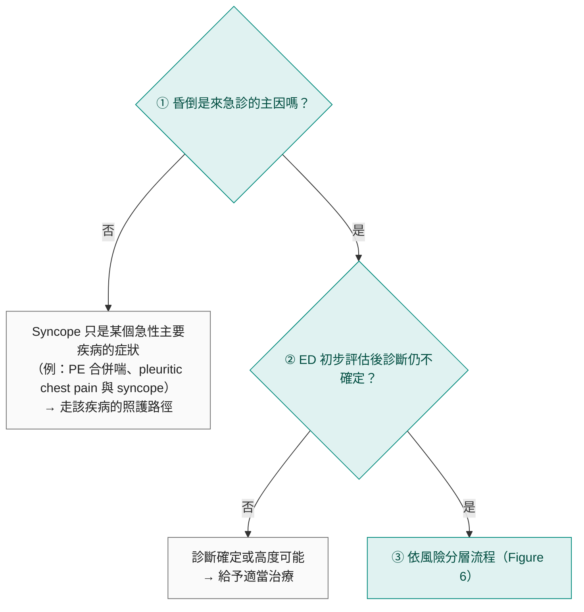

> [!abstract] 一句話重點
> 急診要回答 **3 個問題：有沒有嚴重的潛在病因？嚴重預後的風險多高？要不要住院？** 依 **Table 6** 分層：**只有 low-risk → 直接出院（I-B）**；**任一 high-risk → 不可出院，早期密集評估（syncope unit、ED observation unit 或住院，I-B）**；**兩者皆無 → ED 或 syncope unit 觀察，不必住院（I-B）**。Risk score 不比臨床判斷好（IIb-B，不可單獨使用）。

> [!info] 系列導覽（本系列只整理指引中的 Table 與 Figure）
> ↑ 回到 [[cardiology/syncope-esc-2018/index|暈厥 2018 ESC 指引總覽]]
>
> ① [[cardiology/syncope-esc-2018/esc-syncope-1-overview|定義、分類與初步評估]]｜② 急診風險分層（本篇）｜③ [[cardiology/syncope-esc-2018/esc-syncope-3-tests|診斷檢查]]｜④ [[cardiology/syncope-esc-2018/esc-syncope-4-treatment|治療]]｜⑤ [[cardiology/syncope-esc-2018/esc-syncope-5-special|特殊族群、mimics 與 syncope unit]]｜⑥ [[cardiology/syncope-esc-2018/esc-syncope-6-key-messages|新增修訂、Key messages 與必做／不做]]｜⑦ [[cardiology/syncope-esc-2018/esc-syncope-exam|內專考點]]
>
> 本篇涵蓋：Figure 5–6；Table 6–7；急診處置建議表

## 急診的三個問題與流行病學

| 問題 | 重點 |
| --- | --- |
| **1. 有沒有可辨識的嚴重潛在病因？** | 短期不良事件**多半是潛在急性疾病**造成，不是 syncope 本身；**40–45%** 的非心血管與部分心血管致命原因在 ED 就看得出來 |
| **2. 嚴重預後的風險多高？** | High-risk 較可能是 cardiac syncope；**structural heart disease 與 primary electrical disease** 是 SCD 和死亡的主要危險因子。Low-risk 多半是 reflex，預後極好。OH 的死亡風險約為一般族群 **2 倍**（因共病較重） |
| **3. 要不要住院？** | 約 **50%** 的 ED syncope 病人被收住院（各地 12–86%）；但 7–30 天內只有 **0.8% 死亡**、**6.9%** 在 ED 期間發生非致命嚴重事件、另 **3.6%** 在離開 ED 後發生。**不必要的住院對低風險病人有害** |

## Figure 5：急診處理 TLOC 疑似 syncope 的流程

（依原圖內容重新繪製）

> [!note] 表註
> 「Syncope 是急性主要疾病的症狀」**不包括昏倒後造成的外傷**：昏倒摔傷仍要回頭找昏倒的原因。

## Table 6：急診初步評估的 high-risk 與 low-risk features

### 昏倒事件本身

| Low-risk | High-risk **Major** | High-risk **Minor**（**合併 structural heart disease 或 ECG 異常**才算 high-risk） |
| --- | --- | --- |
| 典型 reflex prodrome（頭暈、發熱感、冒汗、nausea、vomiting） | **新發生的 chest discomfort、breathlessness、abdominal pain 或 headache** | **沒有預兆或 prodrome < 10 秒** |
| 突然看到、聽到、聞到不舒服的東西或疼痛後 | **運動中或平躺時昏倒** | **年輕猝死家族史** |
| 久站、擁擠悶熱的地方 | **突然心悸後馬上昏倒** | **坐著時昏倒** |
| 用餐中或飯後 | | |
| 咳嗽、排便、排尿誘發 | | |
| 轉頭或壓迫 carotid sinus（腫瘤、刮鬍子、領口緊） | | |
| 由躺或坐姿站起來時 | | |

### 過去病史

| Low-risk | High-risk Major |
| --- | --- |
| 多年反覆昏倒、特徵與這次相同且都是 low-risk | **嚴重 structural 或 coronary artery disease**（HF、**low LVEF**、**previous MI**） |
| 沒有 structural heart disease | |

### 身體檢查

| Low-risk | High-risk Major |
| --- | --- |
| 檢查正常 | 急診**不明原因 SBP < 90 mmHg** |
| | **肛診提示 GI bleeding** |
| | 清醒、非運動訓練者 **persistent bradycardia < 40 bpm** |
| | **沒診斷過的 systolic murmur** |

### ECG

| Low-risk | High-risk **Major** | High-risk **Minor**（**病史符合 arrhythmic syncope** 才算 high-risk） |
| --- | --- | --- |
| ECG 正常 | **Acute ischemia** 的 ECG 變化 | **Mobitz I** 2° AV block、PR 明顯延長的 1° AV block |
| | **Mobitz II 2° 或 3° AV block** | 無症狀不適當輕度 sinus bradycardia（**40–50 bpm**）或 slow AF（40–50 bpm） |
| | **Slow AF（< 40 bpm）** | **Paroxysmal SVT 或 AF** |
| | 清醒非運動員 **persistent sinus bradycardia < 40 bpm**，或反覆 SA block、**sinus pause > 3 秒** | **Pre-excited QRS** |
| | **BBB**、intraventricular conduction disturbance、ventricular hypertrophy，或符合 IHD／cardiomyopathy 的 **Q wave** | **Short QTc（≤ 340 ms）** |
| | **Sustained 或 non-sustained VT** | **Atypical Brugada pattern** |
| | **Pacemaker 或 ICD 功能異常** | 右胸導程 negative T、**epsilon wave**（ARVC） |
| | **Type 1 Brugada pattern**（V1–V3 type 1 ST elevation） | |
| | 重複 12-lead ECG **QTc > 460 ms**（LQTS） | |

> [!warning] Pitfall
> **==Minor feature 單獨出現不算 high-risk==**：事件類的 minor（無 prodrome、家族史、坐著昏倒）要**合併 structural heart disease 或 ECG 異常**；ECG 的 minor 要**病史符合 arrhythmic syncope**。另外部分 ECG 變化本身就是診斷（見 ① 的 arrhythmic syncope 標準），這時直接治療，不必再檢查。

> [!tip] Pearl
> 數字要記熟：**SBP < 90**、**HR < 40**、**pause > 3 s**、**QTc > 460 ms**（long）／**≤ 340 ms**（short）、**prodrome < 10 s**。

## 建議：急診處置

| 建議 | 等級 |
| --- | --- |
| **Low-risk features**、可能是 reflex、situational 或 OH 的病人 → **從 ED 出院** | **I-B** |
| **High-risk features** → 在 **syncope unit 或 ED observation unit**（若有）**早期、密集、迅速評估**，或住院 | **I-B** |
| **Neither high nor low risk** → 在 **ED 或 syncope unit 觀察**，**不要住院** | **I-B** |
| Risk stratification score 可考慮用於 ED 風險分層 | **IIb-B** |

**補充觀點**：

- **Presyncope 和 syncope 預後相同**，在 ED 要一樣仔細處理
- **CXR、brain CT、常規血液與生化、D-dimer、cardiac markers** 診斷率低、對風險分層影響小，**==除非臨床評估特別懷疑，否則不要常規做==**
- ED syncope 病人約 **10%** 在 7–30 天內發生嚴重事件，其中將近一半發生在離開 ED 之後
- 有 **cardiac device** 的 syncope 病人要**盡快 device interrogation**，可減少不必要住院
- **Risk score 表現不比好的臨床判斷好，==不可單獨用來分層==**

## Figure 6：急診風險分層流程

（依原圖內容重新繪製）

Syncope（或 presyncope）｜ED 初步評估後

↓ 依 Table 6 分層

只有 low-risk features 可能是 reflex、situational 或 orthostatic → <b>可直接從 ED 出院</b> 反覆發作 → 轉 <b>syncope 門診（SU）</b>

Neither high nor low risk <b>不應從 ED 出院</b> → <b>ED 或醫院 syncope observation unit</b>（若有） → 之後轉 SU 門診，或必要時住院

任何一項 high-risk feature 需要<b>密集診斷</b>、<b>不應從 ED 出院</b> → observation unit，或<b>住院診斷與治療</b> 監測：多數研究建議 <b>ED 最多 6 小時、住院最多 24 小時</b>，且在可急救的環境

Low-risk 仍可能因合併疾病、外傷或社會因素需要住院；low-risk 也可轉 SU 門診做治療

High riskIntermediateLow risk

依 2018 ESC 暈厥指引 Figure 6 內容重新繪製

- **Low-risk**：ED 不需再做檢查；給予衛教、安心（可用 ESC 給 reflex syncope 病人的衛教單）
- **High-risk**：歸為 HIGH RISK，需要密集檢查，可能需緊急治療與住院
- **兩者皆無**：需要 syncope 專家意見，多半可在**門診**安全處理；**沒有直接證據顯示住院能改善預後**，但 ED observation unit 或 fast-track 到 SU 有好處
- 單一中心經驗：ED 觀察 **≤ 48 小時**＋fast-track 到 SU，把住院率降到 **29%**

## Table 7：High-risk 病人留 ED observation／fast-track SU，還是住院？

| 偏向 **ED observation unit、fast-track 到 SU** | 偏向**住院** |
| --- | --- |
| High-risk features **且**： | High-risk features **且**： |
| 穩定、已知的 structural heart disease | 有需要住院的**嚴重共病** |
| 嚴重慢性病 | **昏倒造成外傷** |
| 運動中昏倒 | 需要進一步緊急評估或治療，且**無法用其他方式（如 observation unit）完成**：ECG monitoring、echo、stress test、EPS、angiography、device 故障等 |
| 平躺或坐著時昏倒 | 需要**治療 syncope 本身** |
| 沒有 prodrome | |
| 昏倒時心悸 | |
| 不適當的 sinus bradycardia 或 SA block | |
| 懷疑 device 故障或不適當放電 | |
| Pre-excited QRS | |
| SVT 或 paroxysmal AF | |
| ECG 提示遺傳性心律不整疾病 | |
| ECG 提示 ARVC | |

> [!tip] Pearl
> **High-risk ≠ 一定住院**。指引的精神是：**只有「短期嚴重事件風險」高的人才收住院**；其他 high-risk 在 observation unit 或 syncope unit 做早期密集評估即可。

## 相關筆記

- [[cardiology/syncope-esc-2018/esc-syncope-1-overview|① 初步評估與診斷標準]]
- [[cardiology/syncope-esc-2018/esc-syncope-3-tests|③ 診斷檢查（monitoring、ILR、EPS）]]
- [[cardiology/syncope-esc-2018/esc-syncope-5-special|⑤ Syncope unit（Table 11–14）]]
- 另見：教科書整理的 [[cardiology/syncope/index|暈厥 Syncope（Symptom to Diagnosis）]]

## 參考資料

- Brignole M, Moya A, de Lange FJ, et al. 2018 ESC Guidelines for the diagnosis and management of syncope. *Eur Heart J*. 2018;39(21):1883–1948. Section 4.1.2（Figure 5–6、Table 6–7）。參考資料庫：心臟科／ESC guideline Syncope.pdf
