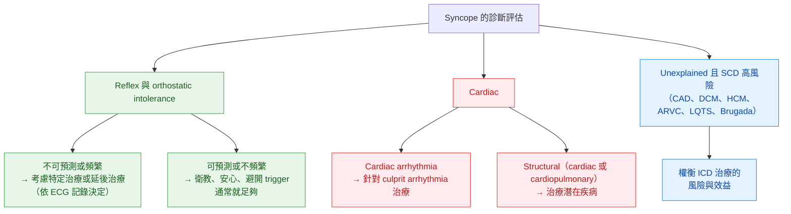
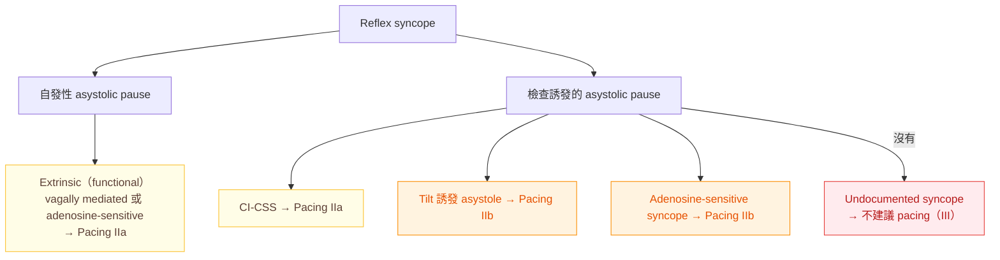
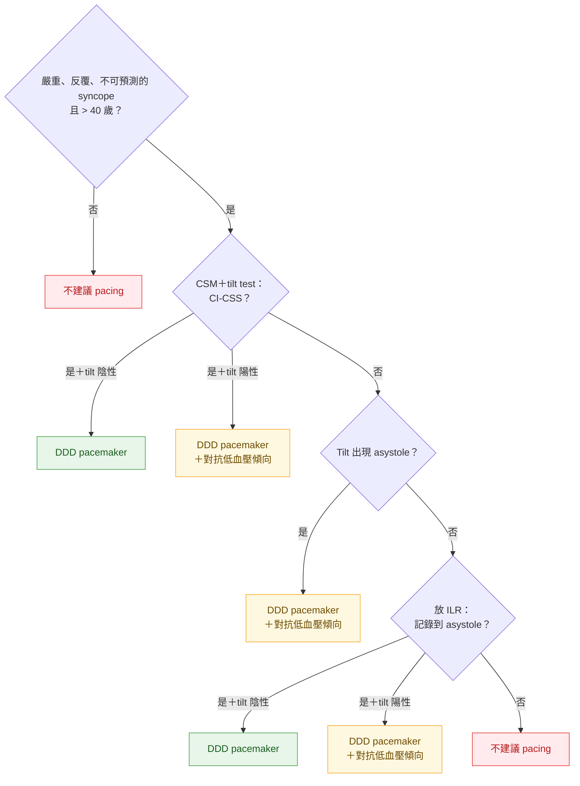
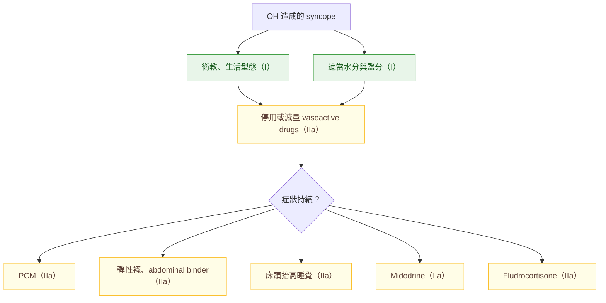
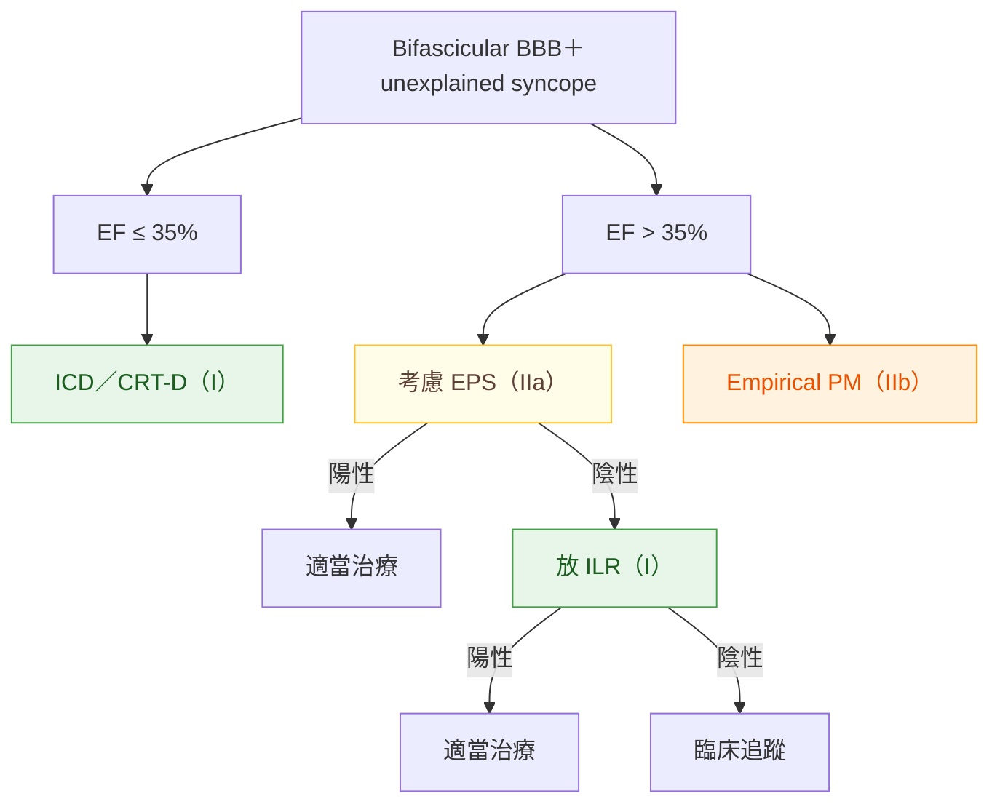

> [!abstract] 一句話重點
> 治療依 **Figure 8** 分三條路：**reflex／OH → 衛教是基礎，嚴重者依「年齡」選加強治療**；**cardiac → 治療 culprit arrhythmia 或結構性疾病**；**unexplained＋SCD 高風險 → 權衡 ICD**。Reflex syncope 的 **pacemaker 只給 > 40 歲、有記錄到 asystole（症狀 > 3 秒或無症狀 > 6 秒）、CI-CSS 或 tilt asystole** 的人（🆕 2021 ESC pacing 指引升為 **I-A**），**tilt 陽性（有低血壓傾向）療效較差**；**beta-blocker 無效（III-A）**。

> [!info] 系列導覽（本系列只整理指引中的 Table 與 Figure）
> ↑ 回到 [[cardiology/syncope-esc-2018/index|暈厥 2018 ESC 指引總覽]]
>
> ① [[cardiology/syncope-esc-2018/esc-syncope-1-overview|定義、分類與初步評估]]｜② [[cardiology/syncope-esc-2018/esc-syncope-2-ed|急診風險分層]]｜③ [[cardiology/syncope-esc-2018/esc-syncope-3-tests|診斷檢查]]｜④ 治療（本篇）｜⑤ [[cardiology/syncope-esc-2018/esc-syncope-5-special|特殊族群、mimics 與 syncope unit]]｜⑥ [[cardiology/syncope-esc-2018/esc-syncope-6-key-messages|新增修訂、Key messages 與必做／不做]]｜⑦ [[cardiology/syncope-esc-2018/esc-syncope-exam|內專考點]]
>
> 本篇涵蓋：Figure 8–15；Table 9；reflex、OH、arrhythmia 與 SCD 高風險 unexplained syncope 的建議表

## Figure 8：治療總架構

（依原圖內容重新繪製）

> [!tip] Pearl
> 治療目標是**降低再發與致命後果**，而不只是「找到原因」。**> 50%** 在過去 1–2 年反覆昏倒的病人，評估後 1–2 年**不再發作**；而被轉到 syncope unit 的 reflex syncope 只有 **14%** 需要衛教以外的加強治療。

## Table 9：永久 pacemaker 後預期的 syncope 再發率

| 臨床情境 | 2 年 syncope 再發率（pacing 療效） |
| --- | --- |
| **確定是 bradycardia**、**沒有**低血壓機轉 | **高效（≤ 5%）** |
| **確定是 bradycardia**、**合併**低血壓機轉 | 中等（5–25%） |
| **懷疑** bradycardia、合併低血壓機轉 | **低效（> 25%）** |

> [!tip] Pearl
> Pacing 有沒有效取決於兩件事：**症狀和 bradycardia 的關係有多確定**、**有沒有合併 hypotensive susceptibility**。Pacemaker 只能治「心跳慢」，治不了「血管擴張」。

## 建議：Reflex syncope 的治療

| 建議 | 等級 |
| --- | --- |
| **所有病人**：解釋診斷、安心、說明再發風險、避開 trigger 與情境 | **I-B** |
| **Vasodepressor syncope** 盡可能調整或停用降壓藥 | **IIa-B** |
| **Isometric PCM**：有 prodrome、**< 60 歲** | **IIa-B** |
| **Tilt training** 可用於教育年輕病人 | **IIb-B** |
| **Fludrocortisone**：年輕、**orthostatic form VVS**、**BP 偏低正常**、無禁忌 | **IIb-B** |
| **Midodrine**：orthostatic form VVS | **IIb-B** |
| **==Beta-blocker 無效==** | **III-A** |
| **Pacing**：**> 40 歲**，記錄到自發性**有症狀 asystolic pause > 3 秒**或**無症狀 pause > 6 秒**（sinus arrest、AV block 或兩者）（2018 原文；已更新，見下方 🆕） | **IIa-B** |
| **Pacing**：**cardioinhibitory CSS**、> 40 歲、反覆頻繁且不可預測的 syncope（2018 原文；已更新，見下方 🆕） | **IIa-B** |
| Pacing：**tilt 誘發 asystolic response**、> 40 歲、反覆頻繁不可預測（2018 原文；已更新，見下方 🆕） | **IIb-B** |
| Pacing：臨床表現符合 **adenosine-sensitive syncope** | **IIb-B** |
| **沒有記錄到 cardioinhibitory reflex → 不放 pacemaker** | **III-B** |

> [!info] 🆕 新版指引（2021 ESC Guidelines on cardiac pacing and CRT）
> 2021 ESC pacing 指引把 reflex syncope 的 pacing **合併並升級為 ==I-A==**：**> 40 歲**、嚴重、不可預測、反覆的 syncope，且有下列任一 → **dual-chamber pacing 以減少再發**：
> - 自發性記錄到**有症狀 asystolic pause > 3 秒**或**無症狀 pause > 6 秒**（sinus arrest 或 AV block）
> - **Cardioinhibitory CSS**
> - **Tilt test 時 asystolic syncope**（2018 為 IIb）
>
> 沒變的：**adenosine-sensitive syncope 仍是 IIb-B**；**沒有記錄到 cardioinhibitory reflex 不 pacing（III-B）**。Tilt 陽性（低血壓傾向）仍代表療效較差，pacing 後要同時處理低血壓。

**證據重點**（自己整理）：

| 治療 | 關鍵數據 |
| --- | --- |
| **衛教、生活型態** | 沒有 RCT，但強烈共識；可補充水分，鹽可考慮 **120 mmol／天** NaCl；直接處理 trigger（止咳、坐著排尿） |
| **PCM** | PC-Trial（223 人、平均 38 歲）：再發 **RRR 39%**；**prodrome 太短或沒有就做不到**，**> 60 歲**效果較差 |
| **Fludrocortisone** | POST 2（210 位年輕、BP 偏低者，0.05–0.2 mg／天）：HR 0.69（**未達顯著**）；12 個月仍有 44% vs 60.5% 再發 |
| **Midodrine** | 一般劑量 **2.5–10 mg t.i.d.**；可能**加重 supine hypertension**、尿滯留，老人男性小心 |
| **Pacing（asystole 記錄）** | **ISSUE-3**：ILR 記錄到 ≥ 3 秒（有症狀）或 ≥ 6 秒（無症狀）asystole 的 77 人，2 年再發 **pacemaker 關 57% vs 開 25%** |
| **Tilt 結果與 pacing** | ILR 證實 asystolic reflex syncope 者放 pacemaker 後，3 年再發 **tilt 陰性 2% vs tilt 陽性 33%**；**tilt 反應是 pacing 療效最強的預測因子** |
| **CSS 的 pacing** | 證據足以支持，但因缺乏大型 RCT，從 2013 pacing 指引的 **Class I 降為 IIa**（🆕 2021 pacing 指引升為 **I-A**） |

> [!warning] Pitfall
> **==Pacing 有效 ≠ 必須 pacing==**。Reflex syncope 是**良性疾病、常見於年輕人**，pacemaker 只限高度篩選的少數：**中老年才開始反覆昏倒、常因無預警而受傷**、且有**記錄到 asystole** 的人。

## Figure 9：Reflex syncope 第一線治療的決策路徑

（依原圖內容重新繪製；**年輕 < 40 歲、老年 > 60 歲**，40–60 歲重疊）

Reflex syncope

↓

<b>衛教、生活型態（I）</b>：所有人

↓ 嚴重或反覆發作

偏年輕（< 40 歲） <b>低血壓體質</b>（長期 SBP 約 110 mmHg）→ <b>fludrocortisone、midodrine（IIb）</b> <b>有 prodrome</b> → <b>PCM（IIa）</b>、tilt training（IIb）

偏年長（> 60 歲） <b>用降壓藥</b> → <b>停用或減量（IIa）</b> <b>Dominant cardioinhibition</b> → <b>pacing（IIa／IIb，見 Figure 10）</b>

沒有或很短的 prodrome（各年齡） 選擇性病人 → <b>ILR-guided management（I，見 ③）</b>，依記錄到的機轉決定治療

次分組可重疊；年輕人在特定情況也可能 pacing、老人也可能用 fludrocortisone（指引無法給建議）；midodrine 任何年齡都可用

所有人年輕年長無 prodrome

依 2018 ESC 暈厥指引 Figure 9 內容重新繪製

- **Prodrome ≤ 5 秒**可區分 arrhythmic syncope 與 reflex syncope；沒有 structural heart disease 時，**> 10 秒**則偏向 reflex。「沒有或很短」的實際意思是：**來不及坐下或躺下**
- **Dominant cardioinhibition**：自發或激發（CSM、tilt、ILR）證實突然的 cardioinhibition 是主要機轉；**沒有 prodrome** 就是一條線索
- 沒有 prodrome 的病人要**繼續找機轉**再決定治療；**< 40 歲**有時也要考慮 ILR

> [!tip] Pearl
> **==選 reflex syncope 治療最重要的分界是年齡==**：年輕人靠 PCM、增加容積的藥；老人先停降壓藥（目標 **SBP 140 mmHg**），cardioinhibitory 才考慮 pacemaker。

## Figure 10：Reflex syncope 的 pacing 適應症總覽

（依原圖內容重新繪製）

> [!info] 🆕 新版指引（2021 ESC pacing）
> 上圖是 2018 原圖的等級；2021 起 **自發 asystole、CI-CSS、tilt asystole 三者都是 I-A**（> 40 歲、嚴重反覆不可預測），adenosine-sensitive 仍 IIb。

## Figure 11：Reflex syncope 的 pacing 決策路徑

（依原圖內容重新繪製）

> [!tip] Pearl
> 順序是 **CSM → tilt → ILR**；只要 **tilt 陽性**，就代表有低血壓傾向，**除了 DDD pacemaker 還要停降壓藥、加強容積等措施**。「對抗低血壓傾向」就是 Table 9 的觀念。

## 建議：Orthostatic hypotension 的治療

| 建議 | 等級 |
| --- | --- |
| 所有病人：解釋診斷、安心、說明再發風險、避開 trigger | **I-C** |
| **適當水分與鹽分**（**2–3 L／天、NaCl 10 g**） | **I-C** |
| **調整或停用降壓藥物** | **IIa-B** |
| **Isometric PCM** | **IIa-C** |
| **Abdominal binder、彈性襪**減少 venous pooling | **IIa-B** |
| **床頭抬高 > 10°** 睡覺，增加體液容積 | **IIa-C** |
| 症狀持續 → **midodrine** | **IIa-B** |
| 症狀持續 → **fludrocortisone** | **IIa-C** |

- 已確定 OH、有跌倒危險因子者，**避免積極降壓**，目標改為 **SBP 140–150 mmHg**，並考慮停藥
- 需要降壓時優先選 **ACEI、ARB、CCB**；**==diuretic 與 beta-blocker 和 OH、跌倒有關==**，高風險者避免
- 快速喝冷水對 orthostatic intolerance 和 postprandial hypotension 有效
- Fludrocortisone **0.1–0.3 mg 每天一次**；midodrine **2.5–10 mg t.i.d.**（三個 RCT 證實有效）
- 其他較少證據：desmopressin（夜尿）、octreotide（postprandial hypotension）、erythropoietin（貧血）、pyridostigmine；**droxidopa** 已獲 FDA 核准用於症狀性 neurogenic OH，但療效在 2 週後證據不足

## Figure 12：OH 的治療流程

（依原圖內容重新繪製）

> [!note] 和 reflex syncope 比較
> 同樣是 PCM、midodrine、fludrocortisone，**在 OH 都是 IIa**，在 reflex syncope 則是 PCM IIa、**兩種藥只有 IIb**。

## 建議：Cardiac arrhythmia 造成的 syncope

| 建議 | 等級 |
| --- | --- |
| **Bradycardia（intrinsic）** | |
| 症狀性 bradycardia 和 syncope **關係確定**：**sick sinus syndrome** → pacing | **I-B** |
| 同上：**intrinsic AV block** → pacing | **I-B** |
| **Intermittent／paroxysmal 3° 或 2° AV block**（含 **slow AF**），**即使沒有症狀－ECG 相關記錄** → pacing | **I-C** |
| Syncope 和無症狀 sinus node dysfunction 的關係**較不確定** → 考慮 pacing | **IIa-C** |
| **有可逆原因**的 bradycardia → **不 pacing** | **III-C** |
| **Bifascicular BBB** | |
| Syncope＋BBB＋**EPS 陽性或 ILR 記錄到 AV block** → pacing | **I-B** |
| 不明 syncope＋bifascicular BBB → 可考慮 pacing | **IIb-B** |

> [!info] 🆕 新版指引（2021 ESC pacing）
> Bifascicular block＋不明 syncope 的架構不變：**EPS 應考慮（IIa-B）**、**HV ≥ 70 ms 或誘發 block → pacemaker（I-B）**、**未做 EPS 的 empirical pacing 仍為 IIb-B**；但 2021 明確寫出**老年、衰弱者可優先選 empirical pacemaker 而不做 EPS（IIa-B）**。

| **Tachycardia** | |
| SVT 或 VT 造成的 syncope → **catheter ablation** | **I-B** |
| VT 造成 syncope＋**EF ≤ 35%** → **ICD** | **I-A** |
| Syncope＋**previous MI**＋**EPS 誘發 VT** → **ICD** | **I-C** |
| **EF > 35%**、VT 反覆 syncope、ablation 與藥物失敗或無法做 → 考慮 ICD | **IIa-C** |
| SVT 或 VT 造成 syncope → 考慮 antiarrhythmic（含 rate control）藥物 | **IIa-C** |

- **沒有任何 conduction disturbance 證據的不明 syncope，不 pacing**
- Bifascicular BBB＋syncope 最後**不到一半**是 cardiac syncope；指引建議先做 **CSM、EPS 或 ILR** 找出機轉再決定
- 老年 bifascicular BBB、完整檢查後仍不明，若 syncope **無預警**、**平躺或運動中**發生，可能從 empirical pacemaker 獲益
- **ICD 能預防 SCD，但不一定能預防 VT 造成的 syncope**；VT 造成 syncope 時，可行就**一定要加做 ablation**

## Figure 13：Intrinsic cardiac bradycardia 的 pacing 適應症

（依原圖內容重新整理）

| 情境 | 條件 | Pacing 等級 |
| --- | --- | --- |
| **ECG 記錄到 bradycardia** | **有症狀 SND**：SB 和 syncope 的關係已確定 | **I** |
| | **無症狀 SND**：SB 和 syncope 的關係未確定 | **IIa** |
| | **2° 與 3° AV block**：persistent AVB、paroxysmal AVB（窄 QRS 或 BBB）、**AF with slow HR** | **I** |
| **Bifascicular BBB**（沒有 ECG 記錄到 bradycardia） | **EPS 或 ILR 陽性**：HV ≥ 70 ms 或誘發 AV block；有症狀 pause > 3 秒；無症狀 pause > 6 秒 | **I** |
| | **EPS／ILR 陰性或沒做**：empirical pacing（機轉不確定） | **IIb** |

## Figure 14：Bundle branch block＋unexplained syncope 的處置

（依原圖內容重新繪製）

- **LVEF ≤ 35% 先想 SCD**：這群人總死亡與猝死率高，主要來自潛在心臟病與 ventricular tachyarrhythmia，所以直接走 **ICD／CRT-D**
- LVEF > 35%：**EPS → 陰性再 ILR** 的策略，約一半病人因此放了 pacemaker，且 pacing 後再發只有 0–7%
- **Empirical pacemaker** 在高跌傷風險的老人（不可預測的昏倒）可接受，但需個別權衡

> [!warning] Pitfall
> 不明 syncope＋bifascicular block，**==empirical pacing 只有 IIb==**：約四分之一不必要，最後只有四分之一證實是適當的。**EPS 陽性（HV ≥ 70 ms）或 ILR 記錄到 AV block 才是 Class I**。

## Figure 15：Tachyarrhythmia 造成 syncope 的治療選擇

（依原圖內容重新整理）

| 心律 | Catheter ablation | ICD | Antiarrhythmic drugs |
| --- | --- | --- | --- |
| **SVT** | **I** | — | IIa |
| **VT** | **I** | **I**（EF ≤ 35% 或 MI＋誘發 VT）／**IIa**（EF > 35%、其他失敗） | IIa |

- SVT（AVNRT、AVRT、typical flutter、ectopic AT）造成 syncope：**ablation 是首選**，藥物只是過渡或 ablation 失敗時使用；合併 AF 或 atypical left atrial flutter 要個別決定
- **Torsades de pointes** 多半是**延長 QT 的藥物**造成 → 立即停藥

## 建議：Unexplained syncope 且 SCD 高風險

**Unexplained syncope 的定義**：**不符合**任何一條 ① 與 ③ 中的 **Class I 診斷標準**。在下列疾病中，unexplained syncope 被視為 **ventricular tachyarrhythmia 的危險因子**。

| 族群 | 建議 | 等級 |
| --- | --- | --- |
| **LV systolic dysfunction** | 症狀性 HF（NYHA II–III）、LVEF **≤ 35%**、GDMT ≥ 3 個月、預期存活 ≥ 1 年 → **ICD** | **I-A** |
| | Unexplained syncope＋systolic impairment，但**目前沒有 ICD 適應症** → 考慮 ICD | **IIa-C** |
| | 同上、反覆發作 → 可用 **ILR 取代 ICD** | **IIb-C** |
| **HCM** | Unexplained syncope 的 ICD 決策**依 ESC HCM Risk-SCD score** | **I-B** |
| | 反覆 unexplained syncope、**Risk-SCD 低風險** → **ILR 取代 ICD** | **IIa-C** |
| **ARVC** | ARVC＋unexplained syncope → 可考慮 ICD | **IIb-C** |
| | 反覆發作、多參數評估為低風險 → **ILR 取代 ICD** | **IIa-C** |
| **LQTS** | **服用足量 beta-blocker 仍** unexplained syncope → **ICD＋beta-blocker** | **IIa-B** |
| | 症狀性 LQTS 且 beta-blocker 無效／不耐受／禁忌、ICD 禁忌或拒絕、或 ICD 反覆放電 → **left cardiac sympathetic denervation** | **IIa-C** |
| | 反覆發作、低風險 → **ILR 取代 ICD** | **IIa-C** |
| **Brugada** | **自發性 type 1 ECG pattern**＋unexplained syncope → **ICD** | **IIa-C** |
| | 反覆發作、低風險 → **ILR 取代 ICD** | **IIa-C** |

- Syncope **不論原因都會增加死亡率**，所以在這些疾病中是危險因子；要不要放 ICD 或先做 ILR，取決於整體評估、利弊與其他 SCD 危險因子
- **LQTS** 所有臨床診斷者都建議 beta-blocker（**LQT3** 可能例外）
- **Brugada** 的心律事件年發生率：曾 SCA **7.7%**、有 syncope **1.9%**、無症狀 **0.5%**

> [!tip] Pearl
> 2018 版新觀念：**ILR 可以當 ICD 的替代**（低風險、反覆 unexplained syncope 的 cardiomyopathy 或遺傳性心律不整病人），先抓到機轉再決定。HCM 的 ICD 由 IIa **升為 I**，ARVC 的 ICD 由 IIa **降為 IIb**（見 ⑥ Figure 1）。

## 相關筆記

- [[cardiology/syncope-esc-2018/esc-syncope-3-tests|③ 診斷檢查（CSM、tilt、ILR、EPS）]]
- [[cardiology/syncope-esc-2018/esc-syncope-6-key-messages|⑥ 新增與修訂建議（Figure 1）]]
- 另見：教科書整理的 [[cardiology/syncope/index|暈厥 Syncope（Symptom to Diagnosis）]]

## 參考資料

- Brignole M, Moya A, de Lange FJ, et al. 2018 ESC Guidelines for the diagnosis and management of syncope. *Eur Heart J*. 2018;39(21):1883–1948. Section 5（Figure 8–15、Table 9）。參考資料庫：心臟科／ESC guideline Syncope.pdf
- 🆕 Glikson M, Nielsen JC, Kronborg MB, et al. 2021 ESC Guidelines on cardiac pacing and cardiac resynchronization therapy. *Eur Heart J*. 2021;42(35):3427–3520. 建議原文經 Dutch guideline database 附錄（Overzicht van aanbevelingen, 2025）核對；另參考 Tomaino M, et al. *Arrhythm Electrophysiol Rev*. 2021（PMC8785081）
