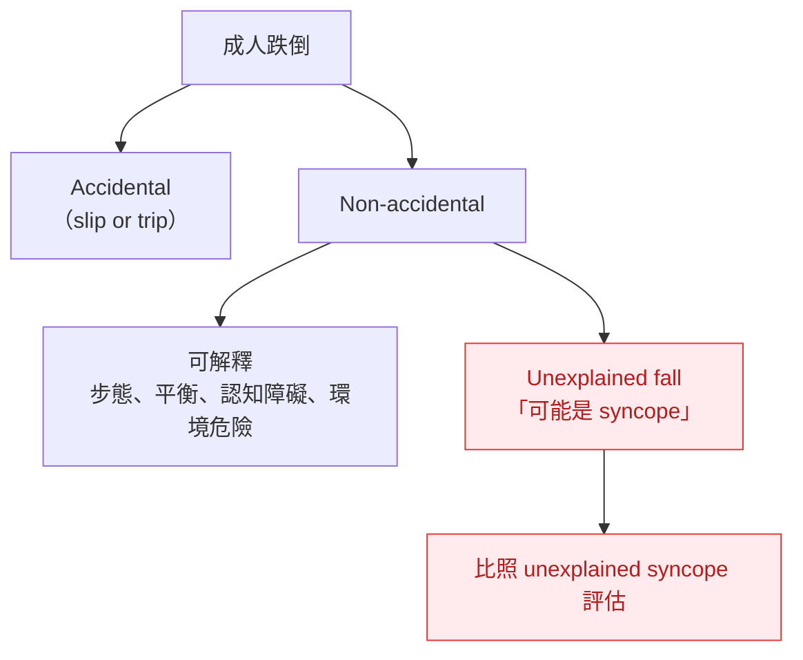
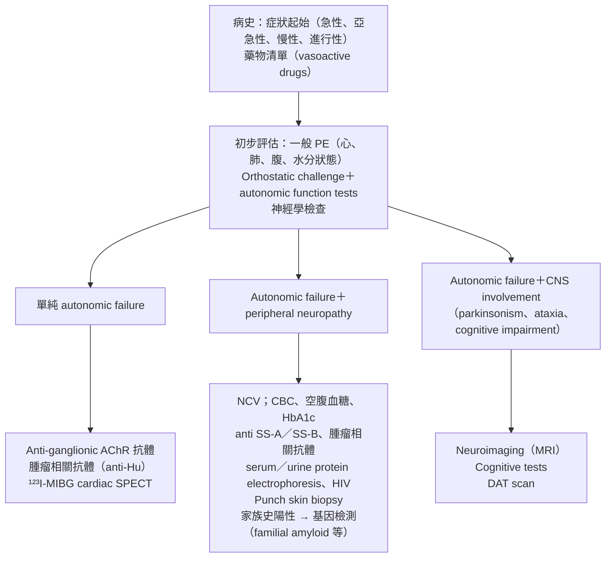

> [!abstract] 一句話重點
> **老人**：多重原因一起評估（I-B），**unexplained fall 要當 unexplained syncope 評估（IIa-C）**。**Syncope vs seizure（Table 10）**：看 **myoclonus 的數量與時機、咬舌頭位置、恢復時間、事後 confusion**。**EEG、頸動脈超音波、腦部 CT／MRI 不是 syncope 的常規檢查（III-B）**。**Syncope unit** 是 2018 版的組織面重點（Table 11–14）。

> [!info] 系列導覽（本系列只整理指引中的 Table 與 Figure）
> ↑ 回到 [[cardiology/syncope-esc-2018/index|暈厥 2018 ESC 指引總覽]]
>
> ① [[cardiology/syncope-esc-2018/esc-syncope-1-overview|定義、分類與初步評估]]｜② [[cardiology/syncope-esc-2018/esc-syncope-2-ed|急診風險分層]]｜③ [[cardiology/syncope-esc-2018/esc-syncope-3-tests|診斷檢查]]｜④ [[cardiology/syncope-esc-2018/esc-syncope-4-treatment|治療]]｜⑤ 特殊族群、mimics 與 syncope unit（本篇）｜⑥ [[cardiology/syncope-esc-2018/esc-syncope-6-key-messages|新增修訂、Key messages 與必做／不做]]｜⑦ [[cardiology/syncope-esc-2018/esc-syncope-exam|內專考點]]
>
> 本篇涵蓋：Figure 16–17；Table 10–14；老人、PPS、神經學評估的建議表

## 建議：合併共病與衰弱的老年病人

| 建議 | 等級 |
| --- | --- |
| 老年病人的 syncope 與不明跌倒可能**不只一個原因** → **多面向評估與介入** | **I-B** |
| 老年人 syncope 或不明跌倒 → **認知評估與身體功能測試** | **I-C** |
| **調整或停用可能的元凶藥物**，尤其降壓藥與 **psychotropic drugs** | **IIa-B** |
| **Unexplained fall** 應比照 unexplained syncope 評估 | **IIa-C** |

- 衰弱老人的評估深度取決於配合度與預後；**能活動、不衰弱、認知正常的老人，評估方式和年輕人一樣**
- **Orthostatic BP、CSM、tilt 即使在衰弱、認知障礙的老人也耐受良好**
- 不明跌倒的老人，即使 orthostatic BP、CSM、tilt 重現 syncope，**常否認失去意識**（對 TLOC 有 amnesia）
- 用 phasic BP 量，**> 80 歲社區長者高達 40%** 站立後血壓無法穩定，是日後跌倒與昏倒的危險因子
- 老人的 syncope 常同時有 OH（藥物）、CSS、心律不整等多個機轉；沒有目擊者時，falls、epilepsy、TIA、syncope 很難區分

## Figure 16：Unexplained fall 的判斷流程

（依原圖內容重新繪製）

> [!tip] Pearl
> 老人超過一半的 syncope **沒有目擊者**；不明原因跌倒（不是滑倒絆倒，也沒有步態、平衡等可解釋原因）很可能就是 syncope，只是病人不記得。

## 建議：Psychogenic pseudosyncope（PPS）

| 建議 | 等級 |
| --- | --- |
| **目擊者錄影**自發性發作，用於診斷 PPS | **IIa-C** |
| **Tilt test**，最好同時 **EEG＋錄影** | **IIb-C** |
| 醫師診斷 PPS 後**應直接告訴病人** | **IIa-C** |
| 解釋後仍發作 → 可考慮 **CBT** | **IIb-C** |

- PPS 的線索：多數持續時間和 syncope 一樣短，但**持續很久**很有診斷價值（可躺在地上 **15–30 分鐘**）；**發作頻繁**（一週或一天數次）；發作時**眼睛閉著**（syncope 與 seizure 時眼睛多半張開）；通常**沒有可辨識的 trigger**，也沒有冒汗、蒼白
- Tilt 中「看起來失去意識」，但 **BP、HR 正常、EEG 正常** → 支持 PPS

## 建議：神經學評估與檢查

| 建議 | 等級 |
| --- | --- |
| Syncope 由 **autonomic failure** 造成 → 神經學評估找潛在疾病 | **I-C** |
| TLOC 懷疑 **epilepsy** → 神經學評估 | **I-C** |
| 神經學檢查顯示 **parkinsonism、ataxia 或 cognitive impairment** → **brain MRI** | **I-C** |
| **急性或亞急性**發生的多系統 autonomic failure → 篩檢 **paraneoplastic 抗體**與 **anti-ganglionic AChR 抗體** | **I-B** |
| **==EEG、頸動脈超音波、腦部 CT 或 MRI 不建議用於 syncope==** | **III-B** |

- 任何 paraneoplastic 或 anti-ganglionic AChR 抗體陽性 → 進一步找**潛藏的惡性腫瘤**
- **Ictal asystole**：約 9 成 seizure 伴隨 tachycardia，但 **0.3–0.5%** 會出現 ictal bradycardia／asystole；發生在 **complex partial seizure**（不是 generalized），asystole 超過約 8 秒就會昏倒。典型病史是平常的 partial seizure 進行到一半，**突然軟倒**——2018 版列入新觀念

## Table 10：Syncope vs epileptic seizure

| 臨床特徵 | Syncope | Epileptic seizure |
| --- | --- | --- |
| **有用的特徵** | | |
| Trigger | **很常見** | 少見 |
| Trigger 的性質 | 依類型：VVS 是疼痛、久站、情緒；situational 有特定 trigger；OH 是站起來 | **閃光**最為人知；也有其他少見 trigger |
| Prodrome | 常有 presyncope（reflex 的 autonomic activation、OH 的頭暈、cardiac 的心悸） | **Epileptic aura**：每人固定、重複；**déjà vu**、上腹往上竄的感覺、奇怪難聞的味道 |
| Myoclonus 特徵 | **< 10 下、不規則**、幅度不一、不同步、不對稱；**LOC 之後**才開始 | **20–100 下、同步、對稱**、可單側；**多和 LOC 同時開始**；明顯長時間 automatism（咀嚼、咂嘴） |
| **咬舌頭** | 少見，**舌尖** | **舌頭側邊**（很少雙側） |
| 意識恢復時間 | **10–30 秒** | 可達**數分鐘** |
| 事後 confusion | **< 10 秒**搞不清楚狀況，之後完全清醒 | **Memory deficit**：重複問同樣問題、數分鐘記不住 |
| **用處有限的特徵** | | |
| Incontinence | 不少見 | 常見 |
| 有 myoclonus | **很常見** | 約 60%（看觀察是否仔細） |
| 發作時眼睛張開 | 常見 | **幾乎都是** |
| 事後疲倦想睡 | 常見（兒童尤其） | 很常見 |
| Blue face | 少見 | 相當常見 |

> [!warning] Pitfall
> **==Syncope 也常有抽動（myoclonus）與 incontinence==**，這兩項鑑別力有限。真正有用的是：**抽動次數與開始時機、咬舌的位置、恢復時間、事後 confusion 的型態**。

## Figure 17：Cardiovascular autonomic failure 的診斷流程

（依原圖內容重新繪製）

## Table 11：Syncope unit 的核心要素

- **主導** syncope 的醫療服務，並負責相關醫護人員的教育訓練
- 由**具 TLOC 專業的醫師**領導，搭配必要團隊成員（例如 clinical nurse specialist），依當地模式運作
- 至少提供 **reflex syncope、OH** 的核心治療，以及 **cardiac syncope、跌倒、PPS、epilepsy** 的治療或優先轉介
- 轉介來源：**家醫、急診、院內與院外**，或病人自行就診，依風險分層決定；建議 **fast-track**（獨立候診名單、排定追蹤）
- 使用**品質指標、流程指標與預期結果目標**

**Syncope unit 定義**：用**標準化流程**診斷與處理 TLOC 及相關症狀，有專責人員並能取得適當檢查與治療。**Syncope specialist** 則是負責從風險分層、診斷、治療到追蹤全程的醫師，要能辨識所有主要 TLOC 型態、mimics 與 orthostatic intolerance。

## Table 12：Syncope unit 的組成

| 面向 | 內容 |
| --- | --- |
| **人員** | 一位以上任何專科的 **syncope specialist**；多專科團隊（醫師、專科護理師等）與行政支援；人員不一定全職 |
| **場所與流程** | 多數照護在**門診**（也處理急診與住院病人）；遵循經各方同意的**院內流程**；需要適當空間 |
| **必要設備** | 12-lead ECG 與 3-lead 監測、**non-invasive beat-to-beat BP**（可記錄分析）、**tilt table**、Holter／external loop recorder、**ILR** 與其追蹤、24 小時 BP 監測、基本 autonomic function tests |
| **可轉介的檢查** | Echo、EPS、stress test、neuroimaging |
| **會診** | 心臟、神經、內科、老年醫學、心理 |
| **治療** | 除非需要 unit 以外的專業，病人在 unit 內接受治療 |
| **資料庫** | 病歷含追蹤，並可和其他 syncope unit 合作研究 |

## Table 13：Syncope unit 可做的檢查與評估

| 類別 | 項目 |
| --- | --- |
| **初步評估（每人都做）** | History、PE（含 **3 分鐘 orthostatic BP**；POTS 可能需站更久）、**12-lead ECG** |
| **後續檢查（有適應症才做）** | |
| 血液 | 電解質、Hb、troponin、BNP、glucose、D-dimer、血氧或 ABG |
| 激發試驗 | CSM、tilt test |
| 監測 | External loop、ILR、1–7 天 ambulatory ECG、24–48 小時 BP |
| Autonomic | Standing test、Valsalva、deep breathing、cold pressor 等 |
| 心臟 | Echo、stress test、EPS、coronary angiography（建立轉介流程） |
| 神經 | CT、MRI、EEG、video-EEG（建立轉介流程） |
| 老年 | 跌倒風險評估（認知、步態平衡、視力、環境）、步態平衡訓練 |
| 心理精神 | 心理或精神科會診（心理問題、psychogenic syncope） |

## Table 14：各項處置由誰執行

| 處置或檢查 | Syncope unit 醫師 | Syncope unit 人員 | Unit 以外人員 |
| --- | :---: | :---: | :---: |
| 病史 | ✔ | | |
| 結構化病史（軟體、演算法） | | ✔ | |
| 12-lead ECG、抽血 | | ✔ | |
| Echo 與影像 | | | ✔ |
| **CSM** | ✔ | | |
| Active standing、basic autonomic tests | | ✔ | |
| **Tilt test** | (✔)¹ | ✔ | |
| ECG monitoring（Holter、external loop）判讀 | ✔ | ✔ | |
| ILR | ✔ | (✔)² | |
| Remote monitoring | | ✔ | |
| 其他心臟檢查（stress、EPS、angiography） | | | ✔ |
| 神經學檢查（CT、MRI、EEG、video-EEG） | | | ✔ |
| Pacemaker、ICD、ablation | | | ✔ |
| 衛教、biofeedback 訓練、PCM 衛教單 | ✔ | ✔ | |
| 最終報告與門診紀錄 | ✔ | | |
| 與病人、轉介醫師溝通；追蹤 | ✔ | ✔ | |

¹ 醫師不必在檢查室內，但附近要有受過急救訓練的醫師。² 目前只有少數國家由護理人員放 ILR。Biofeedback 是指用連續 BP 監測，當場回饋讓病人練習 PCM。

> [!info] Syncope unit 的品質指標（EHRA 共識）
> - 不明原因 TLOC 的比例**減少 20%**
> - 低、中風險 TLOC 病人由 ED 收住院的比例 **< 20%**
> - 相較一般照護**成本減少 20%**，且預後改善（syncope 再入院 **< 5%**；pacing 病人 1 年內再發 **< 20%**）

## 相關筆記

- [[cardiology/syncope-esc-2018/esc-syncope-1-overview|① Table 4：容易被誤認為 syncope 的情況]]
- [[cardiology/syncope-esc-2018/esc-syncope-2-ed|② 急診與 syncope unit 的分流]]
- 另見：教科書整理的 [[cardiology/syncope/syncope-6-mimics|⑥ Nonsyncopal TLOC（Symptom to Diagnosis）]]

## 參考資料

- Brignole M, Moya A, de Lange FJ, et al. 2018 ESC Guidelines for the diagnosis and management of syncope. *Eur Heart J*. 2018;39(21):1883–1948. Section 6–9（Figure 16–17、Table 10–14）。參考資料庫：心臟科／ESC guideline Syncope.pdf
