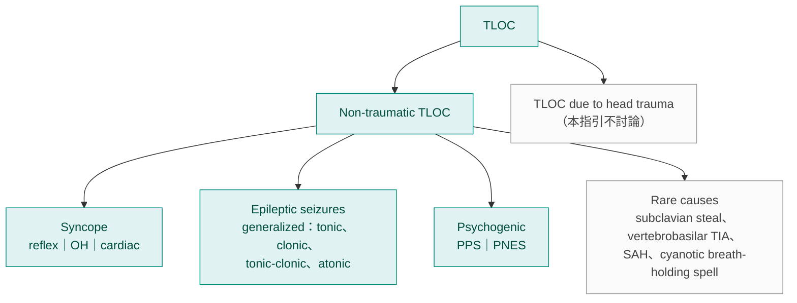
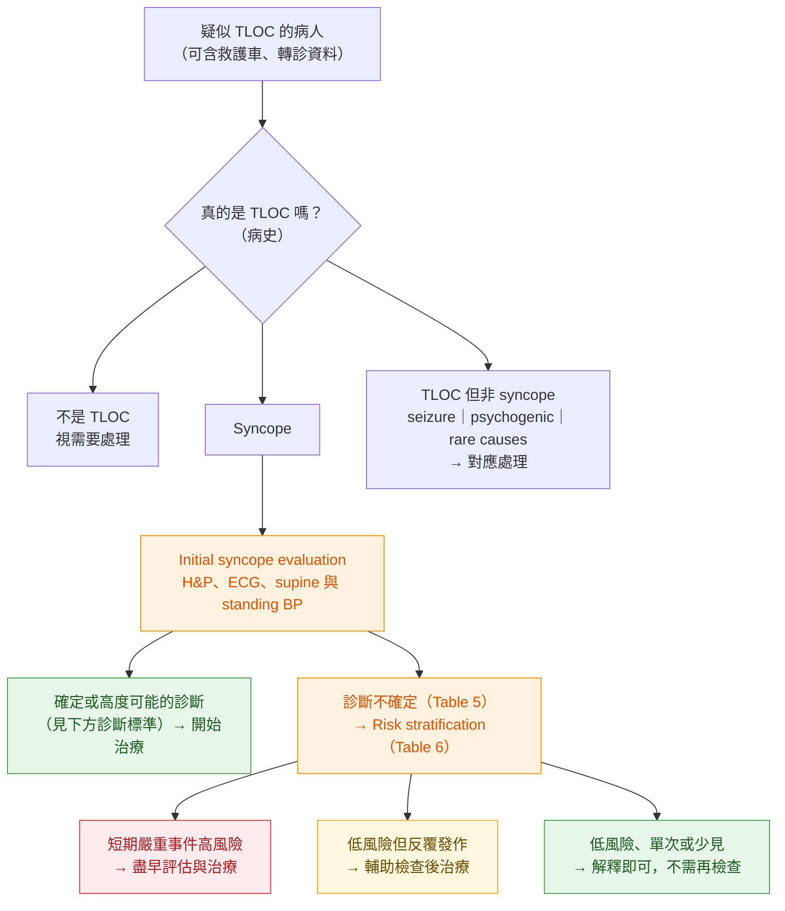

> [!abstract] 一句話重點
> 2018 ESC 定義 **syncope = cerebral hypoperfusion 造成的 TLOC**（rapid onset、short duration、spontaneous complete recovery）。分三大類：**reflex、OH、cardiac**。每個病人都做 **initial syncope evaluation：history＋PE（含 supine 與 standing BP）＋ECG**，能確診的就治療，不能確診的就進入 **risk stratification**。

> [!info] 系列導覽（本系列只整理指引中的 Table 與 Figure）
> ↑ 回到 [[cardiology/syncope/esc-2018/index|② 2018 ESC 指引總覽]]
>
> ① 定義、分類與初步評估（本篇）｜② [[cardiology/syncope/esc-2018/esc-syncope-2-ed|急診風險分層]]｜③ [[cardiology/syncope/esc-2018/esc-syncope-3-tests|診斷檢查]]｜④ [[cardiology/syncope/esc-2018/esc-syncope-4-treatment|治療]]｜⑤ [[cardiology/syncope/esc-2018/esc-syncope-5-special|特殊族群、mimics 與 syncope unit]]｜⑥ [[cardiology/syncope/esc-2018/esc-syncope-6-key-messages|新增修訂、Key messages 與必做／不做]]｜⑦ [[cardiology/syncope/esc-2018/esc-syncope-exam|內專考點]]
>
> 本篇涵蓋：Table 1–5；Figure 2–4；Central illustration；初步評估的診斷標準（建議表）

## Table 1–2：建議等級與證據等級

| Class | 意思 | 指引用語 |
| --- | --- | --- |
| **I** | 證據或共識認為有益、有效 | is recommended／is indicated（**建議**） |
| **IIa** | 證據傾向有效 | should be considered（**應考慮**） |
| **IIb** | 有效性證據較弱 | may be considered（**可考慮**） |
| **III** | 無效，甚至有害 | is not recommended（**不建議**） |

| Level | 證據來源 |
| --- | --- |
| **A** | 多個 RCT 或統合分析 |
| **B** | 單一 RCT 或大型非隨機研究 |
| **C** | 專家共識、小型研究、回溯性研究或登錄資料 |

> [!tip] Pearl
> 這份指引的建議**絕大多數是 Level C**：syncope 領域 RCT 很少，很多「Class I」其實是專家共識。看到 I-A 的反而要特別記（例如 **ILR 的兩個 I-A 適應症**，見 [[cardiology/syncope/esc-2018/esc-syncope-3-tests|③]]）。

## Central illustration：2018 版的新觀念

依原圖內容重新整理成四個面向：

| 面向 | 新增或修訂的觀念 |
| --- | --- |
| **臨床情境與檢查** | Tilt test 的意義改成 **hypotensive susceptibility**（低血壓傾向），不再當確診工具；**prolonged ECG monitoring** 角色變大；鼓勵**錄影**；新增 adenosine-sensitive syncope（無 prodrome、ECG 正常、心臟正常）；neurology 的 **ictal asystole** |
| **治療適應症** | Reflex syncope 依**年齡、嚴重度、臨床型態**選治療的流程；挑選適合 **pacemaker** 的病人；SCD 高風險者「unexplained syncope」的定義與 **ICD** 適應症；部分病人可用 **ILR 取代 ICD** |
| **急診處置** | Low／high-risk features 清單；風險分層流程圖；**ED observation unit**、fast-track 到 **syncope unit**；限縮住院條件；**risk score 用處有限** |
| **Syncope unit（門診）** | 人員、設備與流程；可做的檢查；轉介方式；clinical nurse specialist 的角色；品質指標 |

## 定義：TLOC 與 syncope

- **Syncope**：因 **cerebral hypoperfusion** 造成的 TLOC，特徵是 **rapid onset、short duration、spontaneous complete recovery**
- **TLOC**：真的或看起來像失去意識，有四個特徵：**short duration、abnormal motor control、loss of responsiveness、amnesia**
- 定義是靠**病生理**區分，不是靠臨床表現：syncope 是 hypoperfusion、epileptic seizure 是腦部異常放電、psychogenic TLOC 是 conversion
- 生理數字：腦血流**中斷 6–8 秒**、或心臟高度的 **SBP 50–60 mmHg**（站姿腦部約 30–45 mmHg）就足以失去意識

## Figure 2：TLOC 的分類

（依原圖內容重新繪製）

- 四組的排列順序就是**發生率高低**：syncope ＞ seizure ＞ psychogenic ＞ rare causes
- 只有會讓病人**失去姿勢張力而跌倒**的 seizure 才算 TLOC；complex partial seizure、absence 病人仍坐著或站著，**不算 TLOC**，但常被誤認為 syncope
- Psychogenic 分兩種：沒有大動作、像昏倒的 **PPS**，以及有抽動、像癲癇的 **PNES**

## Table 3：Syncope 的分類

| 大類 | 次分類與例子 |
| --- | --- |
| **Reflex（neurally mediated）** | **Vasovagal**：orthostatic（久站，較少是坐著）、emotional（恐懼、疼痛、器械操作、怕血） **Situational**：排尿、腸胃刺激（吞嚥、排便）、咳嗽、打噴嚏、運動後、其他（大笑、吹銅管樂器） **Carotid sinus syndrome** **Non-classical**：沒有 prodrome、沒有明顯 trigger 或表現不典型 |
| **OH** | **Drug-induced（==OH 最常見原因==）**：vasodilator、diuretic、phenothiazine、antidepressant **Volume depletion**：出血、腹瀉、嘔吐 **Primary autonomic failure**（neurogenic OH）：pure autonomic failure、MSA、Parkinson's disease、dementia with Lewy bodies **Secondary autonomic failure**：DM、amyloidosis、spinal cord injury、autoimmune／paraneoplastic autonomic neuropathy、kidney failure |
| **Cardiac** | **Arrhythmia**：bradycardia（sinus node dysfunction 含 brady-tachy syndrome、AV conduction disease）、tachycardia（SVT、VT） **Structural**：AS、acute MI／ischemia、HCM、cardiac mass（myxoma 等）、tamponade、coronary anomaly、prosthetic valve dysfunction **Cardiopulmonary／great vessels**：PE、acute aortic dissection、pulmonary hypertension |

表註的重點：

- 降血壓藥、酒精、volume depletion、肺病、熱環境會讓**各類** syncope 更容易發生（尤其 reflex 與 OH）
- Reflex syncope 有兩種機轉：**vasodepression**（交感收縮不足 → 低血壓）與 **cardioinhibition**（bradycardia、asystole）。**==血行動力型態和 trigger 無關==**：排尿型或久站型都可能是 cardioinhibitory 或 vasodepressor
- Non-classical reflex syncope 要先排除其他原因（沒有 structural heart disease）或 tilt 重現症狀才算 probable；目前也包含 **low adenosine plasma level** 的 syncope
- Orthostatic intolerance 的心血管原因：classical OH、initial OH、delayed OH、POTS、orthostatic VVS

## Figure 3：Syncope 分類的病生理基礎

（依原圖的同心圓內容重新整理）

**最終共同路徑：低血壓 → global cerebral hypoperfusion**。血壓 = cardiac output × total peripheral resistance，任一邊下降都會昏倒，而且常常兩者一起。

| 機轉 | 原因 | 屬於哪一大類 |
| --- | --- | --- |
| **Low peripheral resistance** | 反射性交感撤退 → **vasodepressor** reflex | Reflex |
| | **Drug-induced** autonomic failure | OH |
| | **Structural damage of ANS**（primary、secondary autonomic failure） | OH |
| **Low cardiac output** | 反射性 bradycardia → **cardioinhibitory** reflex | Reflex |
| | **Cardiac**：arrhythmia、structural、PE、pulmonary hypertension | Cardiac |
| | **Inadequate venous return**：volume depletion、venous pooling | OH |
| | Autonomic failure 造成 chronotropic、inotropic incompetence | OH |

> [!tip] Pearl
> 圖中 **reflex 與 OH 都同時跨越「low resistance」和「low output」兩邊**；只有 cardiac syncope 純粹落在 low output。Venous pooling 本身也會觸發 orthostatic VVS 的反射，所以久站昏倒時 OH 和 VVS 常常交織。

## Table 4：容易被誤診為 syncope 的情況

| 情況 | 和 syncope 不同的地方 |
| --- | --- |
| **Generalized seizure** | 見 [[cardiology/syncope/esc-2018/esc-syncope-5-special#Table 10：Syncope vs epileptic seizure|⑤ Table 10]] |
| **Complex partial seizure、absence** | **不會跌倒**，但沒有反應、事後 amnesia |
| **PPS（pseudocoma）** | 「失去意識」持續**數分鐘到數小時**；頻率高，一天可好幾次 |
| **Falls without TLOC** | 沒有 unresponsiveness 或 amnesia |
| **Cataplexy** | 跌倒、flaccid paralysis、沒反應，但**事後沒有 amnesia** |
| **ICH、SAH** | 意識是**漸進下降**而不是立刻消失；伴隨 **severe headache**、其他神經學徵象 |
| **Vertebrobasilar TIA** | **一定有 focal neurologic signs**，通常不會 LOC；若 LOC，時間比 TLOC 長 |
| **Carotid TIA** | 實際上**不會失去意識**，但有明顯 focal neurologic deficit |
| **Subclavian steal** | 伴隨 focal neurologic signs |
| **Metabolic**（hypoglycemia、hypoxia、hyperventilation with hypocapnia） | 時間比 TLOC 長很多；意識是**受損**而非消失 |
| **Intoxication** | 同上 |
| **Cardiac arrest** | LOC 但**不會自行恢復** |
| **Coma** | 持續時間遠長於 TLOC |

> [!warning] Pitfall
> **==Carotid TIA 不會造成 TLOC==**；有 focal deficit 的「昏倒」要想 TIA／stroke，而不是 syncope。這也是為什麼 syncope 不需要常規做 neck artery ultrasound（III，見 ⑤）。

## Figure 4：初步評估與風險分層流程

（依原圖內容重新繪製）

初步評估要回答 **4 個問題**：

1. 這是 **TLOC** 嗎？
2. 如果是 TLOC，是 **syncopal 還是 non-syncopal**？
3. 如果懷疑 syncope，有沒有**明確的病因診斷**？
4. 有沒有證據顯示**心血管事件或死亡的高風險**？

> [!tip] Pearl
> **詳細病史就能在約 60% 的病人區分 syncope 與其他 TLOC**。Initial syncope evaluation 只有三樣：**history（含目擊者）、PE（含 ==supine 與 standing BP==）、ECG**；依結果再加做 **immediate ECG monitoring**（懷疑 arrhythmia）或 **echo**（已知心臟病、懷疑 structural heart disease）。

## 建議：初步評估就能下的診斷

| 建議 | 等級 |
| --- | --- |
| **VVS 高度可能**：由疼痛、恐懼或久站誘發，且有典型、**漸進的 prodrome**（pallor、sweating、nausea） | **I-C** |
| **Situational reflex syncope 高度可能**：發生在 Table 3 的特定 trigger 當下或剛結束時 | **I-C** |
| **OH syncope 確診**：站著時昏倒，且同時有顯著 OH | **I-C** |
| 不符合上述，但有 reflex／OH 的特徵、沒有 cardiac 的特徵（Table 5）→ 應認為 reflex 或 OH 可能 | **IIa-C** |
| **Arrhythmic syncope 高度可能**，ECG 出現： • 清醒、非運動員時 **persistent sinus bradycardia < 40 bpm 或 sinus pause > 3 秒** • **Mobitz II 2° 或 3° AV block** • **Alternating LBBB 與 RBBB** • **VT 或快速 paroxysmal SVT** • **NSVT polymorphic VT＋long 或 short QT** • **Pacemaker／ICD 故障造成 pause** | **I-C** |
| **Ischemia-related syncope 確診**：同時有 acute myocardial ischemia（不論有無 MI） | **I-C** |
| **Structural cardiopulmonary syncope 高度可能**：prolapsing atrial myxoma、left atrial ball thrombus、**severe AS**、**PE**、**acute aortic dissection** | **I-C** |

> [!tip] Pearl
> 年輕、沒有心臟病史、沒有猝死家族史、不是 supine／睡覺／運動中昏倒、沒有奇怪 trigger、**ECG 正常** → cardiac syncope 機會非常低；**< 35 歲的 SCD 發生率只有 1–3／100,000**。只要嚴格符合 VVS、situational 或 OH 的定義，**即使有其他異常發現，也可視為確定或高度可能**。

## Table 5：初步評估時提示診斷的臨床特徵

| Reflex syncope | OH syncope | Cardiac syncope |
| --- | --- | --- |
| 長期反覆昏倒，尤其 **40 歲前**就開始 | 站著時或剛站起來 | **運動中**或**平躺時** |
| 看到、聽到、聞到不舒服的東西或疼痛後 | 久站 | **突然心悸後馬上昏倒** |
| 久站 | 運動後站著 | **年輕猝死的家族史** |
| 用餐中 | Postprandial hypotension | 有 **structural heart disease 或 CAD** |
| 擁擠或悶熱的地方 | 和**開始或調整降壓藥、利尿劑**時間相關 | ECG 提示 arrhythmic syncope（見下） |
| 昏倒前 autonomic activation：pallor、sweating、nausea、vomiting | 有 **autonomic neuropathy 或 parkinsonism** | |
| 轉頭或壓迫 carotid sinus（腫瘤、刮鬍子、領口太緊） | | |
| **沒有心臟病** | | |

**提示 arrhythmic syncope 的 ECG**（比上面的「高度可能」標準弱一級）：

- **Bifascicular block**（LBBB 或 RBBB＋LAFB 或 LPFB）
- 其他 intraventricular conduction abnormality（**QRS ≥ 0.12 秒**）
- **Mobitz I** 2° AV block、PR 明顯延長的 1° AV block
- 無症狀的輕度不適當 sinus bradycardia（**40–50 bpm**）或 slow AF（40–50 bpm），且沒用負性變時藥物
- **NSVT**
- **Pre-excited QRS**
- **Long 或 short QT**
- **Early repolarization**
- V1–V3 **type 1 Brugada pattern**
- 右胸導程 negative T、**epsilon wave**（ARVC）
- LVH 提示 **HCM**

> [!warning] Pitfall
> 注意兩個門檻的差別：**< 40 bpm 或 pause > 3 秒**是「==arrhythmic syncope 高度可能（I-C）==」；**40–50 bpm** 的無症狀 bradycardia 只是「提示」，還要繼續找證據。

## 相關筆記

- [[cardiology/syncope/esc-2018/esc-syncope-2-ed|② 急診風險分層（Table 6、Figure 6）]]
- [[cardiology/syncope/esc-2018/esc-syncope-5-special|⑤ Syncope vs seizure（Table 10）]]
- 另見：教科書整理的 [[cardiology/syncope/symptom-to-diagnosis/index|① 教科書整理（Symptom to Diagnosis）]]

## 參考資料

- Brignole M, Moya A, de Lange FJ, et al. 2018 ESC Guidelines for the diagnosis and management of syncope. *Eur Heart J*. 2018;39(21):1883–1948. Section 1–4.1（Table 1–5、Figure 2–4、Central illustration）。參考資料庫：心臟科／ESC guideline Syncope.pdf
