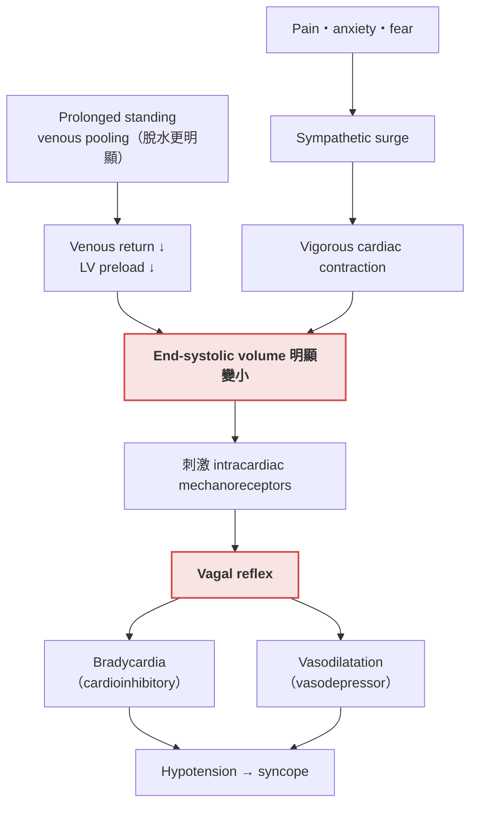
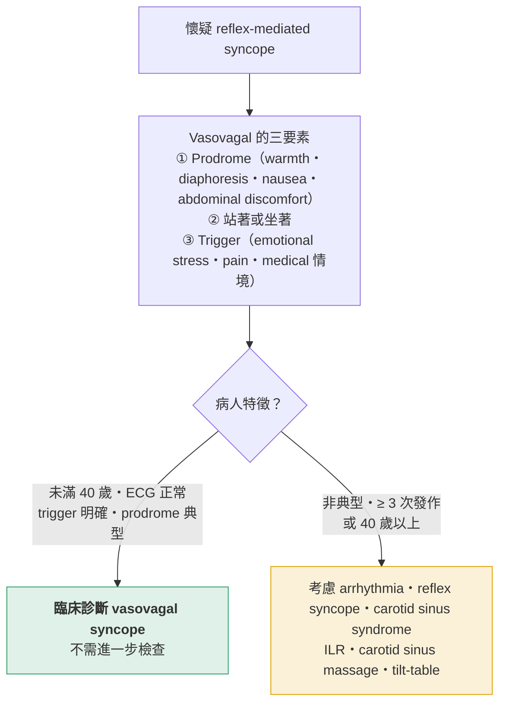

> [!abstract] 一句話重點
> - Reflex syncope 是**不適當的心血管反射**造成 hypotension：**cardioinhibitory（bradycardia）、vasodepressor（vasodilatation）或兩者**
> - 最常見的是 **vasovagal syncope**（占 syncope 20–33%）：**年輕、有明確 trigger（久站、疼痛、恐懼）、典型 prodrome、ECG 正常 → 臨床診斷即可**，不需要再做檢查
>   - **> 40 歲、非典型或反覆發作**才要找 arrhythmia、做 ILR、CSM 或 tilt-table

> [!info] 系列導覽
> ↑ 回到 [[cardiology/syncope/symptom-to-diagnosis/index|① 教科書整理總覽]]
>
> ① [[cardiology/syncope/symptom-to-diagnosis/syncope-1-approach|診斷三步驟]]｜② Reflex syncope（本篇）｜③ [[cardiology/syncope/symptom-to-diagnosis/syncope-3-orthostatic|Orthostatic hypotension]]｜④ [[cardiology/syncope/symptom-to-diagnosis/syncope-4-arrhythmia|Arrhythmic syncope]]｜⑤ [[cardiology/syncope/symptom-to-diagnosis/syncope-5-structural|Structural cardiac syncope]]｜⑥ [[cardiology/syncope/symptom-to-diagnosis/syncope-6-mimics|Nonsyncopal TLOC]]｜⑦ [[cardiology/syncope/symptom-to-diagnosis/syncope-7-cases|四個病例推理]]｜⑧ [[cardiology/syncope/symptom-to-diagnosis/syncope-exam|內專考點]]

## 三種 reflex syncope

| 類型 | Trigger | 族群 |
| --- | --- | --- |
| **Vasovagal（neurocardiogenic）** | 直立姿勢（久站或坐著），可合併 emotional stress、pain | 年輕人最常見 |
| **Situational** | **Micturition、defecation、swallowing、coughing** 時或剛結束時（vagal tone 上升） | 任何年齡 |
| **Carotid sinus syndrome** | 頸動脈受壓：轉頭、扣領口、刮鬍子、頸部動作；也可自發 | **老年人**（平均 77 歲，< 40 歲少見） |

> [!tip] Pearl：為什麼要分 cardioinhibitory 與 vasodepressor？
> 因為治療不同：**嚴重、反覆、有症狀的 ==cardioinhibitory== reflex syncope** 才有 pacemaker 的角色；vasodepressor type 裝 pacemaker 沒有用。

## Vasovagal syncope

### Textbook presentation

年輕人在 trigger 之後（**久站**，有或沒有 emotional stressor）出現 **prodrome**：warmth、nausea、diaphoresis、sweating、lightheadedness，接著短暫失去意識，醒來沒有 confusion。

### 病生理

**圖解**（依原書 Figure 31-4 內容重新繪製）：

機轉的關鍵：**preload 不足＋心臟用力收縮 → ==end-systolic volume 很小，觸發心臟內 mechanoreceptors== → 反射性 vagal 放電** → bradycardia、vasodilatation 或兩者 → hypotension。

### Evidence-based diagnosis

**History**：沒有單一發現夠 sensitive（14–60%）：

- Trigger：prolonged standing 37%、warm environment 42%、lack of food 23%、fear 9–21%、acute pain 14%
- Prodrome：sweating 32–66%、nausea 13–60%、warmth 6–18%

**但下列發現相當 specific，一出現就讓 vasovagal 機率大增**：

| 發現 | LR+ |
| --- | --- |
| **Prolonged standing** | **9.0** |
| **Abdominal discomfort prior to syncope** | **8** |
| 發生在打針或 cannulation 時 | 7 |
| Dehydration | 3.7 |
| Syncope 後 nausea | 3.5 |

> [!warning] Pitfall
> **運動「後」** venous pooling 可誘發 vasovagal；**運動「中」昏倒 → 想 cardiac syncope**。

### 什麼時候要做檢查？

**圖解**（依原書 Figure 31-5 內容重新繪製）：

- **典型 history、PE 與 ECG 正常、沒有 red flags**（supine／sitting／exertional syncope、chest pain、palpitations、dyspnea、age > 60、心臟病史、猝死家族史）→ **不用再檢查**
- **> 40 歲、atypical（沒有明確誘因）、有心臟病或 red flags** → echocardiogram，必要時 tilt-table 與／或 ILR

### Tilt-table testing

| 項目 | 內容 |
| --- | --- |
| 做法 | 先平躺 20–45 分鐘 → 傾斜到 **70 度**，維持 30–40 分鐘，持續監測 pulse 與 BP |
| 藥物激發 | Isoproterenol、sublingual nitroglycerin：**sensitivity 上升但 specificity 下降** |
| 陽性 | **重現 presyncope 或 syncope 症狀**，並伴隨 hypotension、bradycardia 或兩者 |
| 準確度 | 沒有 gold standard；用 ILR 當對照的研究顯示 **sensitivity 只有 26–56%** |

> [!warning] Pitfall：Tilt-table 陽性不等於 vasovagal
> - **沒有 syncope 病史的人也可能陽性**
> - **Structural heart disease 或 arrhythmia 造成 syncope 的人，tilt-table 也可能誘發 vagal reflex** → 誤診為 vasovagal
> - 所以 ==positive tilt-table 對 neurocardiogenic syncope 並不 specific==，下診斷前要先排除其他原因

### ILR 在 reflex syncope

- 植入左胸 pectoral 區，可記錄長達 36 個月
- 適合**反覆發作**、短期 loop monitor 抓不到、tilt-table 也誘發不出來的人
- 在 ≥ 3 次發作、推測 vasovagal 的病人，yield 37%：vasovagal 確認 21–32%，但 **5–16% 找到其他 arrhythmia**，**24% 可能從 pacemaker 獲益**

### 治療

| 措施 | 重點 |
| --- | --- |
| **衛教** | Reassure、避開 trigger、**感覺快要昏倒時立刻躺下** |
| **減少降壓藥（與酒精）** | 反覆 vasodepressor vasovagal syncope 發作明顯減少（**NNT 3**） |
| **Counterpressure maneuvers** | Hand grip、arm tensing、squatting、leg crossing，肌肉用力約 2 分鐘 → BP 上升，減少 syncope（ARR 19%、**NNT 5**） |
| Midodrine | Alpha-agonist，可能有幫助；但**一天三次**、副作用（urinary retention）使順從性差 |
| Fludrocortisone、beta-blockers | **未被證實有效** |
| **Pacemaker** | 只給**嚴重、反覆、已記錄到 cardioinhibitory reflex** 的病人：有症狀 pause > 3 s，或無症狀 pause > 6 s 或 AV block，且其他治療無效（**NNT 3**）；🆕 見下方年齡條件 |

> [!info] 🆕 新版指引（2021 ESC Pacing & CRT Guidelines）：reflex syncope 的 pacing
> **Dual-chamber pacing** 用於 **==> 40 歲==**、**嚴重、無法預期、反覆發作**的 syncope，且符合任一：
> - 自發性**有症狀 asystolic pause > 3 秒**，或**無症狀 pause > 6 秒**（sinus arrest 或 AV block）
> - **Cardioinhibitory carotid sinus syndrome**
> - **Tilt test 誘發 asystolic syncope**

## Situational syncope

Reflex syncope 的一種，發生在 **micturition、defecation、swallowing、coughing** 當下或剛結束時，機轉是 vagal tone 上升。

## Carotid sinus syndrome（CSS）

### Disease highlights

- **Carotid sinus hypersensitivity（CSH）**：carotid 過度敏感，壓到時因 bradycardia、vasodilatation 或兩者造成 hypotension
- **老年人越來越常見**：> 40 歲不明原因 syncope 的 8–15%；**平均 77 歲**，< 40 歲少見
- **15–56% 的病人只說跌倒、否認昏倒**：可能是 retrograde amnesia，或血壓降到站不住但還不至於失去意識
- 不明原因跌倒的人 19–27% 有 CSS，**意外跌倒者 0%**
- 47% 的人說抬頭往上看會誘發

> [!tip] Pearl
> **==老年人不明原因跌倒，要想到 carotid sinus syndrome==**。

### 診斷：carotid sinus massage（CSM）

| 項目 | 內容 |
| --- | --- |
| 做法 | 單側按摩 **5–10 秒**，同時連續監測 ECG 與 BP；兩側都要做（間隔 ≥ 1 分鐘），**平躺與直立都要做** |
| 為什麼兩側、兩姿勢 | 81% 的反應只出現在單側；**30–50% 只在直立時才有反應** |
| 併發症 | 暫時或永久 neurologic symptoms 0.24% |
| **禁忌** | **Carotid bruit、已知 carotid stenosis > 70%、近 3 個月內 CVA、TIA 或 MI** |

| 名詞 | 定義 | 意義 |
| --- | --- | --- |
| **CSH** | CSM 時出現 **≥ 3 秒 pause** 或 **SBP 下降 ≥ 50 mmHg** | 單獨存在不 specific：35% 無症狀老年人也有 |
| **CSS** | 上述反應＋**不明原因的 syncope**，符合 reflex 機轉 | 較 specific：無跌倒、頭暈、syncope 的老年人只 5% 有；追蹤中只有 8% 改診斷 |

部分作者主張：CSM 時有症狀且 **SBP ≤ 85 mmHg** 也算 CSS，可把 sensitivity 從 93% 提高到 100%。

### 治療

AHA 與 ESC 認為：**cardioinhibitory CSS 且 CSM 時記錄到 asystole ≥ 3 秒**的 syncope 病人，**裝 pacemaker 是合理的**，可把 syncope 與跌倒從 38% 降到 9%。🆕 2021 ESC 對 **> 40 歲、反覆無法預期 syncope 的 cardioinhibitory CSS** 建議 **dual-chamber pacing**（見上方 🆕）。

## 相關筆記

- [[cardiology/syncope/symptom-to-diagnosis/syncope-1-approach|① 診斷三步驟]]
- [[cardiology/syncope/symptom-to-diagnosis/syncope-3-orthostatic|③ Orthostatic hypotension]]（counterpressure maneuver、midodrine 也用在慢性 orthostatic hypotension）
- [[cardiology/syncope/symptom-to-diagnosis/syncope-4-arrhythmia|④ Arrhythmic syncope]]（long QT 可以模仿 vasovagal）
- [[cardiology/syncope/symptom-to-diagnosis/syncope-7-cases|⑦ 病例 1：醫學生在解剖室昏倒]]

## 參考資料

- Stern SDC. I have a patient with transient loss of consciousness. How do I determine the cause? In: Stern SDC, Cifu AS, Altkorn D, eds. *Symptom to Diagnosis: An Evidence-Based Guide*. 4th ed. McGraw-Hill; 2020. Chapter 31（Figure 31-4、31-5；Situational Syncope；Carotid Sinus Syndrome）。參考資料庫：`心臟科/syncope.pdf`
- Brignole M, Moya A, de Lange FJ, et al. 2018 ESC Guidelines for the diagnosis and management of syncope. *Eur Heart J*. 2018;39(21):1883–1948.
- Glikson M, Nielsen JC, Kronborg MB, et al. 2021 ESC Guidelines on cardiac pacing and cardiac resynchronization therapy. *Eur Heart J*. 2021;42(35):3427–3520.（🆕）
