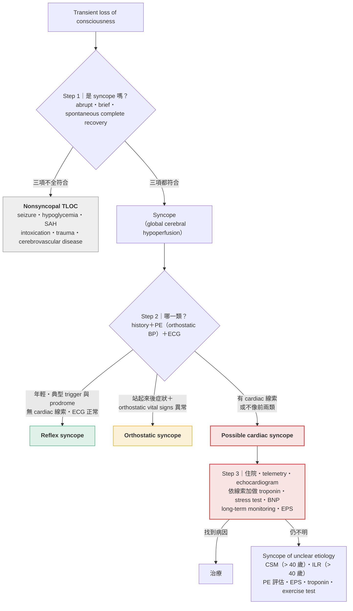

> [!abstract] 一句話重點
> Syncope 的評估是**三個 pivotal step**：① 先確定是 syncope（**abrupt onset、brief、spontaneous complete recovery**）而不是 seizure、hypoglycemia 等 nonsyncopal TLOC → ② 用 **history＋PE（含 orthostatic vital signs）＋ECG** 分成 **reflex、orthostatic、cardiac** 三類 → ③ 懷疑 **cardiac syncope 就住院**，再找出特定病因。三類裡只有 cardiac syncope 會**猝死**，所以每一位病人都要先回答「有沒有 cardiac 的線索」。

> [!info] 系列導覽
> ↑ 回到 [[cardiology/syncope/index|暈厥 Syncope 總覽]]
>
> ① 診斷三步驟（本篇）｜② [[cardiology/syncope/syncope-2-reflex|Reflex syncope]]｜③ [[cardiology/syncope/syncope-3-orthostatic|Orthostatic hypotension]]｜④ [[cardiology/syncope/syncope-4-arrhythmia|Arrhythmic syncope]]｜⑤ [[cardiology/syncope/syncope-5-structural|Structural cardiac syncope]]｜⑥ [[cardiology/syncope/syncope-6-mimics|Nonsyncopal TLOC]]｜⑦ [[cardiology/syncope/syncope-7-cases|四個病例推理]]｜⑧ [[cardiology/syncope/syncope-exam|內專考點]]

## 定義：syncope 只是 TLOC 的一部分

Transient loss of consciousness（TLOC）的原因很多：trauma、intoxication、seizure、hypoglycemia、subarachnoid hemorrhage、牽涉 brainstem 的 cerebrovascular disease，以及 syncope。

**Syncope 專指 ==transient global cerebral hypoperfusion== 造成的 TLOC**，而 global hypoperfusion 幾乎都是因為短暫的嚴重 hypotension。從這個機轉就能推出 syncope 的三個特徵：

| 特徵 | 為什麼 |
| --- | --- |
| **Abrupt onset** | 腦部血流一斷，意識馬上消失 |
| **Brief** | 血流必須很快恢復，不然病人會死，不會以 syncope 來表現 |
| **Spontaneous、unaided、complete recovery** | 血流一恢復，意識自己就回來 |

> [!tip] Pearl：問「你記得的下一件事是什麼？」
> 這個問題最能分辨 syncope 與 nonsyncopal TLOC。**醒來後 ==confusion 持續超過 1–2 分鐘==**，就要想到 postictal state 等 nonsyncopal 原因；不記得救護車、事後失憶 > 5 分鐘 → 要評估 seizure（見 [[cardiology/syncope/syncope-6-mimics|⑥]]）。

## 三步驟總覽

**圖解**（依原書 Figure 31-1～31-3 內容重新繪製，合成一張）：

### Step 2 要收集什麼

| 面向 | 內容 |
| --- | --- |
| **事件描述** | Setting（久站、悶熱）、先前 volume loss（vomiting、diarrhea、melena、rectal bleeding）、**當時在做什麼**（是否 exertion）、**姿勢**（站、坐、躺）、trigger（pain、anxiety）、prodrome（nausea、abdominal pain）、伴隨症狀（**chest pain、palpitations、dyspnea**）、目擊者看到什麼、醒來後記得什麼 |
| **病史與用藥** | Ischemic、valvular heart disease、HF；降壓藥、alpha-blockers 等 |
| **PE** | **Vital signs＋orthostatic BP**、完整 cardiac exam、基本 neurologic exam |
| **ECG** | **==每一位 syncope 病人都要做==**：找 arrhythmia、conduction disease、ischemia、structural heart disease 的跡象 |

**Orthostatic syncope 的判斷**：站起來時出現症狀，**而且** ≥ 1 項 —— pulse 上升 ≥ 30 bpm、**==SBP 下降 ≥ 20 mmHg==**、DBP 下降 ≥ 10 mmHg。建議**站起來立刻量，3 分鐘後再量一次**。

> [!warning] Pitfall
> 「只有三類 syncope」這件事很有用：**病人的描述既不像 orthostatic、也不像 reflex 時，就要往 cardiac 想**，不是歸為「不明原因」就放回家。

## Clues to cardiac syncope

懷疑 cardiac syncope 的病人**==應住院評估==**。下列任一出現，cardiac 的可能性就上升：

| 來源 | 線索 |
| --- | --- |
| **History** | 已知 heart disease（HF、CAD、valvular）；**syncope while supine、sitting 或 during exercise**；伴隨 **chest pain、palpitations、dyspnea**；**family history of sudden death**；age > 60 |
| **PE** | Abnormal rhythm、significant murmur、**gallop**、**JVD**、lung crackles、significant edema |
| **ECG** | Sinus bradycardia、second／third-degree AV block、bundle branch block、ischemic changes、SVT 或 VT、LVH 或 RVH、preexcitation、long／short QT、AF |

> [!tip] Pearl
> 姿勢本身就是線索：**一站起來就昏 → orthostatic**；**久站或伴隨腹部不適 → vasovagal**；**躺著、坐著或運動中昏 → cardiac**。

### 臨床特徵的 LR（cardiac syncope）

| Clinical feature | Sensitivity | Specificity | LR+ | LR− |
| --- | --- | --- | --- | --- |
| Syncope with effort | 13–14% | 98–99% | **6.5–14** | 0.87–0.89 |
| Syncope while supine | 4–14% | 97–100% | **4.0–∞** | 0.89–0.96 |
| Suspected or certain cardiac disease | 95% | 53% | 2.0 | **0.09** |

解讀：**exertional、supine syncope 很少見，但一出現就強烈指向 cardiac（rule in）**；反過來，**沒有已知或懷疑的心臟病**、初步 history、PE、ECG 都正常時，cardiac syncope 就不太可能（LR− 0.09–0.12，rule out）。

> [!warning] Pitfall
> **Exercise 中昏倒 ≠ exercise 後昏倒**。運動**後** venous pooling 可以誘發 vasovagal；運動**中**昏倒則要當 cardiac syncope 處理（AS、HCM、CAD、long QT 都是 exertional syncope 的鑑別）。

## Cardiac syncope 的線索 → 假說 → 檢查

依原書 Table 31-1 重新整理成「看到什麼 → 想到什麼 → 做什麼」：

| 線索 | 想到 | 檢查 |
| --- | --- | --- |
| **Palpitations** | Arrhythmia | Holter、event monitor、ILR |
| **Chest pain** | Aortic dissection、AS、HCM、MI、PE | ECG、echo、troponin、CTA |
| **Dyspnea** | Aortic dissection、MI、PE | ECG、troponin、CTA |
| **Exertional syncope** | AS、CAD、HCM、long QT | ECG、echo、stress test（**==懷疑 critical AS 時禁做==**）、cardiac cath |
| 病史：**CAD** | VT、AV block | ECG、troponin、stress test 或 cath、monitor、ILR、EPS |
| 病史：**HF** | VT | Monitor、EPS |
| 病史：AS／HCM | Critical AS；obstruction 或 VT | Echo；HCM 加 EPS |
| 病史：DVT 或其危險因子（immobilization、surgery） | PE | CTA |
| PE：**murmur** | AS、HCM | Echo |
| PE：RV failure（JVD）、unilateral leg edema、tachycardia、hypoxia | PE | CTA |
| PE：LV failure（S₃ gallop、crackles、JVD、bilateral edema） | VT（from HF） | Echo、event monitor、ILR、EPS |
| ECG：sinus bradycardia 或 pauses | Sick sinus syndrome | Monitor、ILR |
| ECG：second／third-degree AV block | AV block、VT | Monitor、ILR、EPS |
| ECG：**BBB** | AV block 或 VT；RBBB 另想 PE | Monitor、ILR、EPS、CTA |
| ECG：S1Q3T3、RAD、RBBB | PE | CTA |
| ECG：**short PR 或 delta wave** | WPW | EPS |
| ECG：LVH | VT（HF）、HCM、AS | Echo、monitor、EPS |
| ECG：**QTc ≥ 0.44 s** | VT | Monitor、EPS |
| ECG：ischemic changes | VT、AV block、ACS | Troponin、echo、stress test 或 cath |
| Echo：HFrEF | VT | Monitor、EPS |
| Echo：RV failure | PE | CTA |
| Echo：severe AS／hypertrophied septum | AS／HCM | — |

## Nonsyncopal 與 syncopal causes 一覽

依原書 DDx 清單重新整理：

| 大類 | 項目 |
| --- | --- |
| **Nonsyncopal TLOC** | **Generalized seizures**；**cerebrovascular disease**（vertebrobasilar insufficiency、subclavian steal、SAH）；**hypoglycemia**；trauma；intoxication |
| **Reflex syncope** | **Vasovagal**；**situational**（cough、micturition、defecation）；carotid sinus syndrome |
| **Orthostatic syncope** | **Dehydration**（vomiting、diarrhea、uncontrolled DM、overdialysis）；**hemorrhage**；autonomic failure（primary：multisystem atrophy、Parkinson disease；secondary：DM、vitamin B₁₂ deficiency、uremia）；medications（diuretics、alpha-blockers、vasodilators、nitrates） |
| **Cardiac：tachyarrhythmia** | **VT**（structural heart disease：HF、ischemic heart disease、MI、valvular；congenital：long QT、Brugada；electrolyte 或 hypoxia；QT-prolonging drugs）；rapid SVT（如 WPW） |
| **Cardiac：bradyarrhythmia** | Sinus node disorders（**sinus bradycardia < 35 bpm、sinus pauses > 3 s 或有症狀 > 2 s**）；second／third-degree AV block |
| **Cardiac：structural（obstruction）** | **AS**、**HCM**、**PE**；少見：atrial myxoma、prosthetic valve dysfunction、aortic dissection |

## Cardiac syncope 的檢查工具

| 檢查 | 什麼時候有用 | 重點 |
| --- | --- | --- |
| **Echocardiogram** | 懷疑 AS、HCM（systolic murmur）；任何有 cardiac 線索的病人 | 有 cardiac 線索者 27% 有 EF ≤ 40%，其中一半最後診斷 significant arrhythmia；**沒有心臟病史、ECG 正常的 unexplained syncope 做了沒幫助** |
| BNP、troponin | 懷疑 MI 或 HF 時才做 | 單獨拿來診斷 cardiac syncope 準確度不夠（2017 ACC/AHA/HRS） |
| Exercise test | Exertional syncope、chest pain、ischemic ECG changes | 要非常小心做；**懷疑 critical AS 禁做** |
| **Cardiac monitoring** | Holter（數天）→ external event monitor（數週）→ **ILR（數年）**；症狀越少見，需要的監測越久 | 只有在「**症狀發作時抓到 arrhythmia**」或「**症狀時節律正常（排除 arrhythmia）**」才算有診斷價值；ESC 另把 Mobitz II／3° AV block、SVT > 160 bpm 持續 > 32 跳、VT、asystole ≥ 3 s 視為即使無症狀也有意義 |
| ILR | 反覆 unexplained syncope | Yield 55%（external monitor 19%）；19% 抓到嚴重 bradyarrhythmia（多為 asystole），另 11% 發作時節律正常而排除 arrhythmia |
| **EPS** | 有心臟病的 unexplained syncope | 需 right heart cath；**VT sensitivity 90%、bradyarrhythmia 只有 33%**；yield：有心臟病 50%、無心臟病 10%；ECG 異常 22%、ECG 正常 3.7% |

**EPS 的適應症**（unexplained syncope）：prior MI、structural heart disease、impaired LV function、**bifascicular block**、監測提示 sinus node dysfunction 或 AV block。**已經符合 ICD class I（EF ≤ 35%）的人不需要 EPS**；ESC 認為沒有 structural heart disease、ECG 正常、沒有 palpitations 的 unexplained syncope 做 EPS 沒幫助。風險：cardiac perforation、MI、AV fistula、DVT、PE。

> [!tip] Pearl
> 結合 risk factor 與 ECG 的 **clinical decision rules** 都有人做過，但**有經驗的臨床判斷**預測 30 天嚴重事件的 sensitivity（94%）反而比任何 score（約 75%）好。

## 相關筆記

- [[cardiology/syncope/syncope-2-reflex|② Reflex syncope]]、[[cardiology/syncope/syncope-3-orthostatic|③ Orthostatic hypotension]]
- [[cardiology/syncope/syncope-4-arrhythmia|④ Arrhythmic syncope]]、[[cardiology/syncope/syncope-5-structural|⑤ Structural cardiac syncope]]
- [[cardiology/syncope/syncope-6-mimics|⑥ Nonsyncopal TLOC]]
- [[cardiology/atrial-fibrillation/index|心房顫動 AF]]
- [[nejm-cases/cardiology/streptococcus-mitis-aortic-valve-endocarditis-root-abscess|NEJM 個案：老人跌倒其實是 syncope]]

## 參考資料

- Stern SDC. I have a patient with transient loss of consciousness. How do I determine the cause? In: Stern SDC, Cifu AS, Altkorn D, eds. *Symptom to Diagnosis: An Evidence-Based Guide*. 4th ed. McGraw-Hill; 2020. Chapter 31（Figure 31-1～31-3、Table 31-1、31-3）。參考資料庫：`心臟科/syncope.pdf`
- Brignole M, Moya A, de Lange FJ, et al. 2018 ESC Guidelines for the diagnosis and management of syncope. *Eur Heart J*. 2018;39(21):1883–1948.
- Shen WK, Sheldon RS, Benditt DG, et al. 2017 ACC/AHA/HRS guideline for the evaluation and management of patients with syncope. *Circulation*. 2017;136(5):e60–e122.
