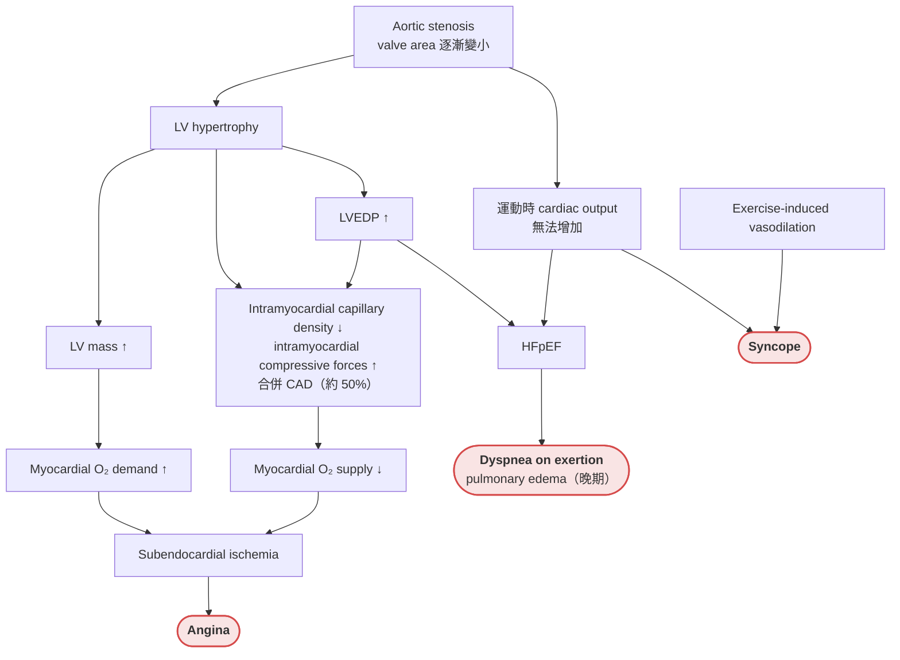

> [!abstract] 一句話重點
> 會造成 syncope 的 structural（obstructive）病因有 **HCM、AS、PE**，再加上少見的 ACS。**HCM 是年輕人與年輕運動員心血管死亡的第一名**，murmur **站起來（preload ↓）變大、squatting 或抬腿變小**；**AS 一旦出現 angina、syncope、dyspnea，不換瓣膜的話死亡率急升（syncope 50% 3 年）**，**懷疑 critical AS 不能做 stress test**；**PE 造成的 syncope 代表大量栓塞，25% 沒有其他症狀**，不明原因 syncope 要想到 PE。

> [!info] 系列導覽
> ↑ 回到 [[cardiology/syncope/index|暈厥 Syncope 總覽]]
>
> ① [[cardiology/syncope/syncope-1-approach|診斷三步驟]]｜② [[cardiology/syncope/syncope-2-reflex|Reflex syncope]]｜③ [[cardiology/syncope/syncope-3-orthostatic|Orthostatic hypotension]]｜④ [[cardiology/syncope/syncope-4-arrhythmia|Arrhythmic syncope]]｜⑤ Structural cardiac syncope（本篇）｜⑥ [[cardiology/syncope/syncope-6-mimics|Nonsyncopal TLOC]]｜⑦ [[cardiology/syncope/syncope-7-cases|四個病例推理]]｜⑧ [[cardiology/syncope/syncope-exam|內專考點]]

## 四個病因一覽

| 病因 | 典型病人 | Syncope 的機轉 | 關鍵檢查 |
| --- | --- | --- | --- |
| **HCM** | 年輕人、運動員；猝死家族史；**站起來變大的 systolic murmur** | Ventricular arrhythmia、outflow tract obstruction | **Echo**（LV wall ≥ 15 mm）、cardiac MRI |
| **AS** | 老年人；**exertional syncope**、angina、dyspnea；right 2nd ICS crescendo-decrescendo murmur 傳到頸部 | 運動時 cardiac output 無法增加＋exercise-induced vasodilation | **Echo**；**critical AS 不做 stress test** |
| **PE** | VTE 危險因子；突然 chest pain、dyspnea 加上昏倒 | **大量栓塞（> 50% 肺血管床）** → LV 回流不足 → hypotension | D-dimer、CTA；echo 常見 **RV dysfunction** |
| ACS | CAD 病史或危險因子；**症狀常不典型** | Reflex syncope（inferior MI）、advanced AV block（anterior MI）、VT | ECG、troponin |

---

## Hypertrophic cardiomyopathy（HCM）

### Textbook presentation

可以無症狀，因下列情況被發現：猝死家族史、無症狀 systolic murmur 的評估、運動員賽前篩檢；或出現症狀（syncope、HF、AF、cardiac arrest）。

### Disease highlights

- **==年輕人與年輕運動員心血管死亡的最常見原因==**
- **Sarcomere 成分（如 myosin）的突變** → myocyte hypertrophy 與 disarray、cardiac fibrosis 增加、diastolic dysfunction；已報告超過 1400 種突變（多為 **autosomal dominant**），分布在 11 個基因
- 一般成人盛行率 0.02–0.23%
- **特徵是 LVH，但沒有 loading condition**（hypertension、AS 等）
  - LVH 可在兒童、青春期或成年才出現
  - 可影響 LV 任何部位，**常以 ventricular septum 為主** → **LV outflow tract obstruction（LVOTO）**

#### LVOTO 的病生理

- LVOTO 增加進展到 HF、stroke、sudden cardiac death 的風險；obstruction 可以是**固定或動態**的
- 機轉：① septal hypertrophy 使 subaortic outflow tract 變窄；② 血流把 mitral valve leaflet 拉向 outflow tract（**SAM**），也會造成 mitral regurgitation
- **心室腔越小，obstruction 越嚴重**（anterior leaflet 更接近肥厚的 septum）：

| 讓 obstruction ↑（murmur ↑） | 讓 obstruction ↓（murmur ↓） |
| --- | --- |
| **Preload ↓**：hypovolemia、**站立**、Valsalva | Preload ↑：**squatting**、**passive leg elevation** |
| **Afterload ↓**：vasodilators | Afterload ↑：hand grip |
| **Contractility ↑**：positive inotropes | Contractility ↓：beta-blockers |

### 併發症

| 併發症 | 重點 |
| --- | --- |
| **HF** | 通常是 **diastolic dysfunction**，也可發展為 systolic dysfunction；**有 LVOTO 者較常見**；outflow obstruction＋diastolic dysfunction 合併造成；最常見症狀是 **dyspnea on exertion**；合併 MR 時更嚴重 |
| **Angina** | 25–30%；典型或不典型；原因：無 CAD 的 supply-demand mismatch、CAD、LVOTO |
| **Syncope** | **15–25%**；ventricular arrhythmia、outflow tract obstruction，少數是 conduction block；**==unexplained syncope 是 sudden cardiac death 的危險因子==** |
| **Sudden cardiac death** | **最可怕的併發症**；常發生在**之前沒症狀**的人；通常是 ventricular tachyarrhythmia（myocardial fibrosis 與 disarray、outflow obstruction 或 ischemia 誘發），偶爾 asystole、heart block、PEA、thromboembolism；**每年 1–2%** |
| **AF** | **20%**；LA 擴大（LV compliance ↓、MR）是 AF 的基質；**AF 使 LV filling ↓、outflow obstruction 惡化**；**thromboembolism 風險大增（OR 17.7）** |
| Stroke | 通常是 AF 造成的 embolization |

### Sudden cardiac death 的危險因子

| 等級 | 危險因子 |
| --- | --- |
| **Prior events** | **Prior cardiac arrest**；**spontaneous sustained VT** |
| **High-risk clinical factors** | **一等親 < 40 歲因 HCM 猝死**（或任何年齡的一等親確診 HCM 後猝死）；**unexplained syncope**（尤其反覆、運動誘發、或發生在兒童）；**massive LVH（≥ 30 mm）** |
| 其他 | 運動時 BP 反應異常（≤ 40 歲者 SBP 下降 > 20 mmHg）；**NSVT**（Holter：≥ 3 跳、≥ 120 bpm）；年輕；LVOTO；LA 擴大；cardiac MRI 的 **late gadolinium enhancement** |

**EPS 不建議用於常規 risk stratification**。

### Evidence-based diagnosis

**Echocardiogram 是首選檢查**：

- 診斷標準：**LV wall thickness ≥ 15 mm**，且沒有其他會造成 LVH 的狀況（hypertension、AS）
- LVH 可出現在 LV 任何部位，分布常不對稱；經典型態是 **septal hypertrophy**

**Cardiac MRI 與 TEE**：TTE 不夠清楚時使用；**late gadolinium enhancement 代表 myocardial fibrosis，與 sudden cardiac death 風險上升有關**。

**PE**：可能完全正常，或聽到：

1. **LVOTO 的 systolic murmur**：粗糙，位於 **apex 與 lower left sternal border**
2. 和／或 **SAM 造成的 MR murmur**

| 動作 | 效果 | Sensitivity | Specificity | LR+ | LR− |
| --- | --- | --- | --- | --- | --- |
| **Squatting → standing** | **Murmur 變大** | 95% | 84% | 5.9 | **0.06** |
| **Passive leg elevation** | **Murmur 變小** | 85% | 91% | **9.4** | 0.16 |

> [!tip] Pearl
> **==HCM murmur 會因 chamber size 變小（preload ↓）而變大==** —— 這是 HCM 和 AS 最大的分別：AS 的 murmur 在 squatting 時反而變大（見 [[cardiology/syncope/syncope-exam|⑧ 內專考點]]）。

**ECG**：

- **ECG 異常可能早於 echo 異常**，且隨年齡增加
- 異常包括 repolarization changes（ST elevation、depression 或 T wave inversion）、LVH voltage criteria、prominent Q waves、LA enlargement、left axis deviation
- Echo 有 LVH 的人 86–90% ECG 異常；**基因陽性但無 LVH 的人 46% ECG 異常**
- LVH voltage criteria：echo 有 LVH 者 65%、基因陽性無 LVH 者 32%

**DNA analysis**：

- 不夠精確：**< 50% 能找到突變**，且很多突變意義不明
- **檢測親屬有用**（尤其先證者已知 pathogenic mutation）：可在 LVH 出現前找出受影響的親屬，也可排除

**HCM vs athlete's heart**：受過高度訓練的運動員偶爾 LVH 達 13–15 mm。支持 HCM 的發現：

| 發現 | 準確度 |
| --- | --- |
| **LV end-diastolic volume 較小（< 55 mm）** | Sensitivity 100%、specificity 100% |
| T wave inversions | Sensitivity 52%、specificity 93%、LR+ 7.4 |
| HCM 家族史 | — |
| Cardiac MRI late gadolinium enhancement | — |

### 治療

**評估（初始與每年）**：

1. 12-lead ECG、TTE、**48 小時 Holter**、continuous loop event monitor（有 palpitations 或 light headedness 者）、**symptom-limited stress test**（評估運動時 BP 反應與 ischemia）
2. 考慮 **cardiac MRI＋late gadolinium enhancement**
3. **評估 LVOTO**：**gradient > 50 mmHg 視為明顯**，會增加 sudden death 風險；因為是動態的，**resting gradient < 50 mmHg 的有症狀病人**要做 **standing echo**（降 preload）或 exercise TTE

**無症狀病人**：

- **避免 dehydration 與劇烈運動**；低強度有氧運動可以
- Beta-blockers 與 CCB 在無症狀 HCM 的效果**未被證實**
- **有 obstruction 者避免 vasodilators 與高劑量 diuretics**
- **不要做 septal reduction**

**有症狀病人**：

| 問題 | 處置 |
| --- | --- |
| **LVOTO** | ① **Beta-blockers**（降 contractility、減慢 HR 增加 diastolic filling → 減少動態 obstruction；dyspnea 或 angina 也建議）→ ② beta-blocker 無效可加 **disopyramide** → ③ **verapamil 或 diltiazem**（beta-blocker 無效或不能耐受；**==verapamil 不要和 beta-blocker 併用==**，heart block 與 HF 頻繁；advanced HF、高 gradient、sinus bradycardia 也禁用）→ ④ **有症狀（不是無症狀）且 gradient ≥ 50 mmHg**（最大藥物治療下仍 HF，或 LVOTO 造成反覆 exertional syncope）→ 考慮 **septal reduction**：surgical septal myectomy 或 **alcohol septal ablation**（冠狀動脈注入酒精造成 septal 梗塞） |
| LVOTO 要避免的 | **Dehydration**、過量酒精，以及 **digoxin、positive inotropes、arterial 與 venodilators（含 dihydropyridines、nitrates、PDE inhibitors 如 sildenafil、tadalafil、vardenafil）** |
| Chest pain | Nonspecific ECG 與 nuclear imaging 異常很多，stress test 用處有限；**典型 exertional angina、sudden death 存活者、sustained VT → coronary angiography** |
| **Syncope** | 建議 12-lead ECG、**exercise stress echo**、**48 小時 Holter**；評估 sudden death 風險：**高風險 → ICD**；低風險 → 可進一步做 ILR |
| HF with LVOTO | 同上 LVOTO 處理 |
| **HFrEF（< 50%）** | ACEI（或 ARB）＋beta-blocker；仍喘可加低劑量 diuretics；考慮 MRA |
| HFpEF | Beta-blocker 無效考慮 verapamil 或 diltiazem；症狀持續加低劑量 diuretics |
| **AF** | 因 thromboembolism 風險高，**建議 anticoagulation** |

**ICD**：

1. **預防 HCM 猝死最有效的策略**
2. 建議用於高風險病人：
   - **Prior cardiac arrest 或 hemodynamically significant spontaneous sustained VT → 建議 ICD**
   - **合理**：一等親猝死家族史、**近期 unexplained syncope**、**massive LVH**；以及部分 **NSVT（≥ 120 bpm、≥ 3 跳）或運動時 BP 反應異常**且合併其他危險因子的人
3. ESC 有風險計算器，但一項大型分析顯示不夠敏感：「high risk」對 sudden death 的 sensitivity 只有 20%（specificity 93%、LR+ 2.6、LR− 0.9）；moderate risk 也只有 41%（LR− 0.8）
4. 選病人很複雜、建議還在演變，**建議會診**

**篩檢**：

1. **HCM 病人的一等親轉介 genetic counseling**，討論 HCM 篩檢
2. 一般族群：**年輕競技運動員的賽前篩檢**（history 含家族史、PE、**ECG**）使 sudden cardiac death 減少 79%，主要是 HCM 死亡減少

---

## Aortic stenosis（AS）

### Textbook presentation

多半在常規 PE 時意外發現：**right 2nd intercostal space 響亮的 crescendo-decrescendo systolic murmur，可傳到頸部**。嚴重時出現三大症狀：**syncope、angina 或 HF（通常是 exertional dyspnea）**。

### Disease highlights

- 瓣葉增厚、鈣化 → 血流逐漸受阻 → **LVH 代償**
- 盛行率：**≥ 75 歲 3%**
- 病因：
  1. 最常見：**trileaflet aortic valve 鈣化**
  2. **Congenital bicuspid valve 會加速**：1–2% 的人天生 bicuspid；**66% 會發生 severe AS，且比 tricuspid 早**；**aortic root 也常異常，可能進行性擴張，需要修補以防 rupture 或 dissection**
  3. Rheumatic heart disease
- **Severe AS**：**valve area < 1 cm²**、**velocity ≥ 4 m/s**、**mean gradient > 40 mmHg**；low cardiac output 時 gradient 與 velocity 可能較低

#### 症狀的病生理

**圖解**（依原書 Figure 31-9 內容重新繪製）：

**Exertional syncope 的機轉**：固定的出口阻塞讓 cardiac output 在運動時無法增加，同時運動造成週邊血管擴張 → BP 掉下來。

#### Prognosis

**一旦出現症狀，死亡率急速上升**。最常見症狀是運動耐受度下降與 exertional dyspnea。**有症狀而沒換瓣膜**的死亡率：

| 症狀 | 死亡率 |
| --- | --- |
| Angina | **50% 5 年** |
| **Syncope** | **==50% 3 年==** |
| Dyspnea | **50% 2 年** |

晚期表現：

1. **AF**：耐受很差，因為 noncompliant LV 依賴 atrial contraction 來填充
2. **出血傾向**：異常瓣膜破壞 large von Willebrand multimers

### Evidence-based diagnosis

**History 與 PE**（多數研究顯示不同檢查者間一致性只算普通）：

| 發現 | 意義 |
| --- | --- |
| Systolic murmur 病人的 **effort syncope** | LR+ 1.3–∞、LR− 0.76 |
| **Slow carotid upstroke** | Sensitivity 15–42%、specificity 95–100%、**LR+ 9.2–∞** |
| **Murmur radiating to right carotid** | Sensitivity 71–73%、specificity 90%、LR+ 7.5 |
| **沒有任何 murmur** | **LR− 0.0** → 幾乎排除 |
| Right clavicular head 下方沒有 murmur | LR− 0.1 |

合併 HF 時 murmur 可能變小聲。

**Echocardiogram**：

1. **評估 AS 的首選檢查**
2. **≥ grade III/VI systolic murmur** 的病人建議做
3. Severe AS：**velocity > 4.0 m/s**，相當於 **valve area < 1.0 cm²**、**gradient ≥ 40 mmHg**
4. **HF 或小而肥厚的 LV** 經 AV 的流速可能較低，會**低估** AS 的嚴重度
5. 追蹤：**severe AS 每 6 個月**；mild-moderate AS 合併明顯鈣化每年一次；症狀改變與懷孕時也要做
6. **Bicuspid valve 合併 AS 或 aortic root 擴張（> 40 mm）每年 echo**；沒有狹窄或擴張者每 2 年

**Stress testing**：

1. **==Severe AS 且 EF < 50% 或已有症狀，不能做==**
2. **無症狀** severe AS、EF 正常者可以做，用來確認真的沒有症狀

### 治療

1. **無症狀 severe AS** 每 6 個月追蹤，詢問 HF 症狀、angina、syncope，並衛教**出現新症狀要回報**
2. **有症狀 → 機械矯正，不是藥物治療**
3. 等手術期間若有 HF 症狀，可小心使用 diuretics 與 ACEI
4. **機械矯正**：
   - 換瓣膜幾乎**完全依症狀決定**
   - **明確適應症**：**有症狀的 severe AS**；**exercise testing 誘發症狀**的 severe AS；**要做其他心臟手術**（如 CABG）的無症狀 severe AS；**EF < 50%** 的無症狀 severe AS
   - 2014 AHA 另列「合理」適應症：低風險、**非常嚴重的無症狀 AS（velocity > 5 m/s 或 mean gradient > 60 mmHg）**
   - 術前通常做 angiography 判斷是否需要同時 CABG（CAD 症狀、CAD 危險因子包括 ≥ 40 歲男性與停經女性、或 EF 下降）
   - 三種選擇：**surgical mechanical valve**、**surgical bioprosthetic valve**、**TAVR（catheter-inserted bioprosthetic）**

| 選擇 | 優點 | 缺點與用藥 |
| --- | --- | --- |
| **TAVR** | 不需開心；多經 femoral artery；對**中到高手術風險**的 symptomatic severe AS 是合理替代；perioperative MI、早期大出血、AKI、新發 AF 較少 | 耐久度未明；早期血管併發症、需要 pacemaker、paravalvular leak 較多；**DAPT 3–6 個月後終生 aspirin** |
| **Mechanical valve** | 耐久度高、失敗與再換率低，**< 55 歲尤其重要** | Thromboembolism 風險 → **終生 VKA**；**==DOAC 不建議==**；warfarin 外加 aspirin 75–100 mg/day |
| **Bioprosthetic valve** | 只需短期 VKA（置放後 3–6 個月） | 耐久度有限，通常留給 **> 65 歲**（不太需要第二次換瓣）；終生 aspirin 75–100 mg/day |
| Balloon valvotomy | 姑息用 | 併發症率高（> 10%），效果短暫（6–12 個月）；用於有嚴重或致命共病者，或作為 TAVR、AVR 前的 bridge（血行不穩或需緊急非心臟手術） |

5. **劇烈運動要避免**；中到重度 AS 的 **vasodilators（hydralazine、nitroglycerin、nifedipine）要避免或小心使用**

---

## Pulmonary embolism（PE）

### Textbook presentation

有 VTE 危險因子的老年人，**突然 chest pain、dyspnea，並且昏倒**。

### Disease highlights

- **PE 是比一般認為更常見的 syncope 原因**：首次 syncope 住院、沒有明顯原因（如 dehydration、vasovagal）的病人中，**17% 診斷為 PE**
- PE 病人 9–24% 會發生 syncope
- 機轉：**massive embolization（> 50% 肺血管床）**嚴重限制回到 LV 的血流 → cardiac output ↓ → hypotension 與 syncope

### Evidence-based diagnosis

1. **Echo：88–94% 的 PE＋syncope 有 RV dysfunction**（要大量栓塞才會昏）
2. 撐到醫院的病人常已穩定（可能血栓碎裂、LV 回流改善），**可能 hemodynamically stable、相對沒症狀**
3. **==25% 的 PE＋syncope 沒有其他提示 PE 的症狀或徵象==**（容易漏診）
4. 也可能有典型危險因子、症狀（chest pain、dyspnea）與徵象
5. 提示 PE 的發現：**tachypnea（LR+ 6.4）**、**unilateral leg swelling（LR+ 8.9）**
6. 其他：persistent hypotension；**hypoxia（PaO₂ < 60 mmHg）**；**ECG：S1Q3T3、right axis deviation 或 right BBB**；X 光：不明原因 pleural effusion 或提示 pulmonary infarction 的浸潤；**echo：RA 或 RV enlargement**
7. 最常用的檢查：**D-dimer 與 CT angiogram**

> [!warning] Pitfall
> **==Syncope 原因不明時，即使沒有其他 PE 症狀與徵象，也要想到 PE==**。

---

## Acute coronary syndrome（ACS）與 syncope

- ACS 是**少見**的 syncope 原因：約占急診 syncope 的 **3%**
- 機轉：**reflex syncope（尤其 inferior MI）**、**advanced AV block（尤其 anterior MI）**、**VT**
- **Syncope 病人的 acute MI 症狀常不典型**：chest pain 只有 17%、dyspnea 30%、CAD 病史 54%
- 檢驗：到院時 **troponin 上升 50%**、**ST elevation 9%**
- **Normal ECG**（sinus rhythm、沒有新的或無法判讀的變化）讓 acute MI 不太可能：**NPV 99%**（sensitivity 80%、specificity 64%、LR+ 2.2、LR− 0.31）

## 相關筆記

- [[cardiology/syncope/syncope-1-approach|① 診斷三步驟]]
- [[cardiology/syncope/syncope-4-arrhythmia|④ Arrhythmic syncope]]（VT、ICD）
- [[cardiology/syncope/syncope-7-cases|⑦ 病例 1：年輕人要不要擔心 HCM、long QT]]
- [[cardiology/atrial-fibrillation/af-esc-2024-2-anticoagulation|AF 抗凝]]（HCM 合併 AF 一律抗凝；機械瓣用 warfarin）

## 參考資料

- Stern SDC. I have a patient with transient loss of consciousness. How do I determine the cause? In: Stern SDC, Cifu AS, Altkorn D, eds. *Symptom to Diagnosis: An Evidence-Based Guide*. 4th ed. McGraw-Hill; 2020. Chapter 31（Alternative Diagnosis: HCM；ACS & Syncope；PE；Aortic Stenosis；Figure 31-9）。參考資料庫：`心臟科/syncope.pdf`
