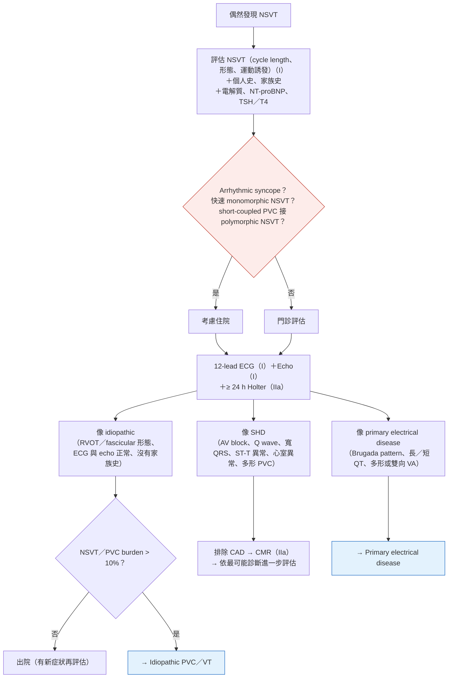
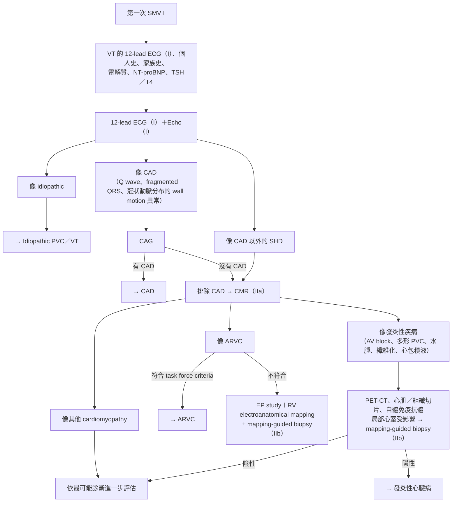
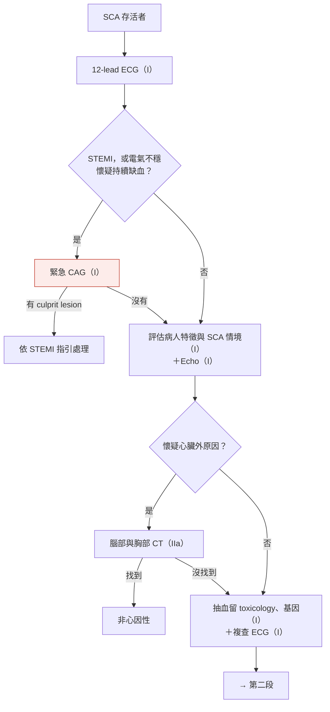
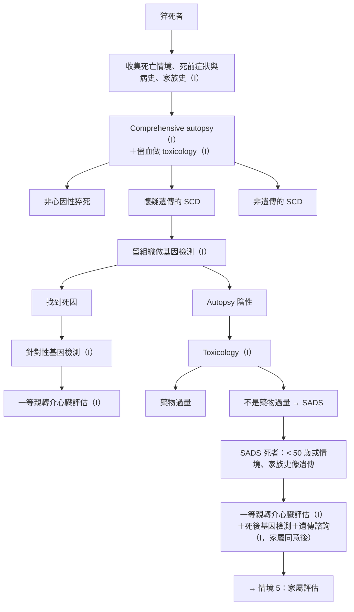
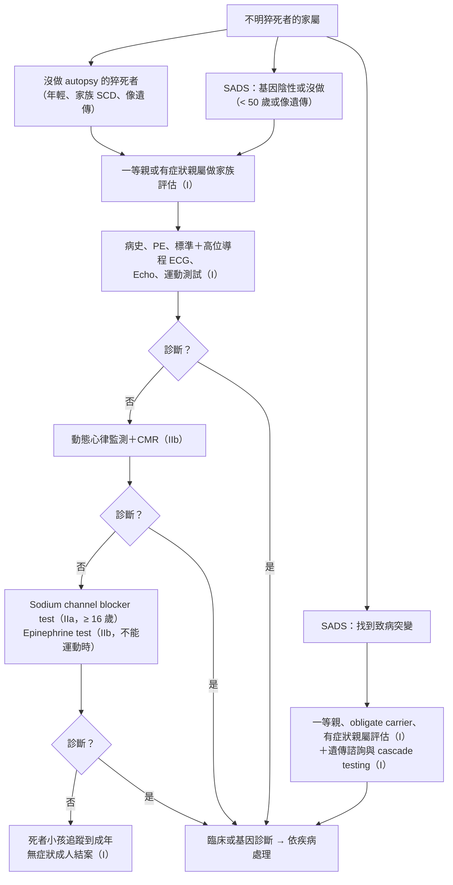

> [!abstract] 一句話重點
> - **定義**
>   - VT：≥ 3 下、> 100 bpm
>   - NSVT：3 下到 30 秒；sustained：≥ 30 秒或需要介入才停
>   - ==Electrical storm：24 h 內 ≥ 3 次需介入的 VA==（每次間隔 ≥ 5 分鐘）
> - **新發現的 VA（頻繁 PVC、NSVT、SMVT）**
>   - ==12-lead ECG（盡量錄到 VA 本身）＋echo==（I C）
>   - 懷疑 CAD 以外的 SHD → CMR（IIa B）
> - **SCA 存活者**
>   - STEMI 或電氣不穩懷疑缺血 → 緊急 CAG
>   - 抽血留 toxicology 與基因、讀裝置紀錄、重複 ECG（含高位胸前導程）、echo
>   - 原因不明 → ==coronary imaging＋CMR＋sodium channel blocker test＋運動測試==（皆 I）
> - **猝死者**
>   - ==< 50 歲一定要 autopsy==，留 DNA 樣本與 toxicology
>   - Autopsy 陰性＝SADS → 一等親評估＋針對 primary electrical disease 的死後基因檢測
> - **不要做**
>   - SADS 做 hypothesis-free exome／genome（III B）
>   - 證據不足的 index patient 做基因檢測（III C）
>   - LQTS 常規 epinephrine challenge（III C）

> [!info] 系列導覽
> ↑ 回到 [[cardiology/ventricular-arrhythmia-esc-2022/index|2022 ESC 心室心律不整指引總覽]]
>
> ① 定義與評估（本篇）｜② [[cardiology/ventricular-arrhythmia-esc-2022/va22-2-acute-longterm|急性處置、藥物與 ICD]]｜③ [[cardiology/ventricular-arrhythmia-esc-2022/va22-3-cad-idiopathic|CAD、Idiopathic PVC/VT]]｜④ [[cardiology/ventricular-arrhythmia-esc-2022/va22-4-cardiomyopathies|心肌病變與其他 SHD]]｜⑤ [[cardiology/ventricular-arrhythmia-esc-2022/va22-5-primary-electrical|Primary electrical disease 與特殊族群]]｜📋 [[cardiology/ventricular-arrhythmia-esc-2022/va22-6-recommendations|建議總整理]]｜⑥ [[cardiology/ventricular-arrhythmia-esc-2022/va22-exam|內專考點]]
>
> 本篇來源：2022 ESC VA Guidelines Section 3–5、Table 6–7、Figure 1–8、Recommendation Table 1–7

## 定義（Section 3）

| 名詞 | 定義 |
| --- | --- |
| **PVC** | 提早出現的寬 QRS（通常 ≥ 120 ms），T 波寬、方向與 QRS 相反，前面沒有 P 波 |
| Short-coupled PVC | PVC 打在前一個正常心跳的 **T 波上**（idiopathic VF 的典型 trigger） |
| **VT** | ≥ 3 個連續、> 100 bpm 的心室搏動，不依賴心房與 AV node |
| **NSVT** | 連續心室搏動 3 下到 30 秒 |
| **Sustained VT（SMVT／SPVT）** | 持續 ≥ 30 秒，或需要介入才能停 |
| MVT／PVT | 每一下 QRS 形態相同／一直在變 |
| **Bidirectional VT** | QRS 額面電軸一下一下左右交替：CPVT、Andersen–Tawil、digoxin 中毒、急性心肌炎 |
| **TdP** | QT 延長背景下的 PVT，QRS 像繞著基線旋轉 |
| VF | 時間與形態都不規則、沒有可辨識的 QRS |
| **==Electrical storm==** | **24 h 內 ≥ 3 次** VA，每次間隔 ≥ 5 分鐘，每次都需要介入才停 |
| Incessant VT | 反覆介入後**數小時內一直馬上復發**的 sustained VT |

| 猝死相關名詞 | 定義 |
| --- | --- |
| **SCA** | 心臟突然停止、血行動力崩潰 |
| **SCD** | 推測為心因性的自然猝死：有目擊 → 症狀出現 1 h 內；沒目擊 → 最後一次被看到活著的 24 h 內 |
| SIDS | **< 1 歲**、病理、毒物、現場調查都陰性 |
| **SADS** | > 1 歲、autopsy 與 toxicology 都陰性的不明猝死（＝autopsy-negative sudden unexplained death） |
| **Arrhythmic syncope** | 高度懷疑由間歇性 bradycardia、快速 SVT 或 VA 造成的暈厥 |
| Mutation | 本指引專指 **Class IV（likely pathogenic）或 V（pathogenic）** variant；Class III＝VUS |

## 流行病學與 Central figure（Section 4、Figure 1）

- SCD 約佔**所有心血管死亡的 50%**，其中**最多一半是第一個心臟病表現**；發生率隨年齡上升（兒童約 1/10 萬人年 → 50–60 歲約 50 → 80 幾歲 ≥ 200）
- **男性任何年齡都較高**；西方國家 SCD 最主要的原因是 **CAD**
- **年輕人**：primary electrical disease、cardiomyopathy、myocarditis、coronary anomaly 為主；**< 50 歲**超過一半是遺傳性電氣疾病或非缺血性結構疾病；40 歲左右約一半已是 CAD（尤其 ACS）
- 一般族群沒有證據支持大規模篩檢；**LVEF（加 NYHA）是 CAD、DCM 決定 primary prevention ICD 的唯一常規指標**

### 各疾病的發病年齡與 VA 型態（Figure 1 依內容重新整理）

| 疾病 | 基因風險 | 典型誘因 | 好發年齡（VA／SCD） | 主要 VA 型態 |
| --- | --- | --- | --- | --- |
| **CPVT** | — | 運動 | 10–20 歲最高峰 | 幾乎全是 PVT |
| **LQTS** | ✓ | 游泳、鬧鐘（聽覺刺激）、睡眠 | 10–20 歲 | PVT（TdP） |
| **BrS** | — | 睡眠 | 30–40 歲，男性為主 | PVT／VF |
| ACS | ✓ | — | 中老年、隨年齡上升 | **PVT／VF 為主** |
| Sarcoidosis | — | — | 40–50 歲 | PVT 與 MVT 約各半 |
| HCM | ✓ | 運動 | 30–50 歲 | MVT 稍多 |
| DCM | ✓ | — | 40–60 歲 | **MVT 為主** |
| **ARVC** | ✓ | 運動 | 雙峰：青少年、30–40 歲 | MVT 為主 |
| rTOF | — | — | 雙峰（20–30 歲、40 歲以後） | **MVT 為主** |
| Chronic CAD | — | 運動 | **60 歲前後最高** | MVT 為主（scar-related） |

> [!tip] Pearl：看 VA 型態猜病因
> - **PVT／VF → 缺血（ACS）、channelopathy（CPVT、LQTS、BrS）**
> - **MVT → 疤痕（chronic MI、DCM、ARVC、rTOF、sarcoidosis）**：reentry 需要固定的疤痕迴路

## 公眾 BLS 與 AED（Recommendation Table 1）

| 建議 | 等級 |
| --- | --- |
| 在容易發生 cardiac arrest 的地點（購物中心、體育場、車站、賭場）放置 **public-access AED** | I B |
| **OHCA 由旁觀者立即 CPR** | I B |
| 推廣社區 BLS 訓練，提高旁觀者 CPR 與 AED 使用率 | I B |
| 用**手機 app 通知**附近受過 BLS 訓練的志工 | IIa B（新） |

- 急救細節見 [[cardiology/resuscitation-aha-2025/index|心肺復甦與急救（2025 AHA）]]

## 診斷工具（Section 5.1）

| 工具 | 重點 |
| --- | --- |
| **病史紅旗** | 沒有 vagal 前驅症狀的暈厥；家族早發猝死（LQTS 常偽裝成溺水、車禍）；家族 epilepsy、SIDS、耳聾（LQTS）、< 50 歲裝 pacemaker 或 HF |
| 身體檢查線索 | **MVP 的 mid-systolic click**；HCM 的 outflow murmur（Valsalva 變大）；lupus pernio、erythema nodosum（sarcoidosis）；angiokeratoma（Fabry）；palmoplantar keratosis（ARVC） |
| 檢驗 | BNP／NT-proBNP 和 SCD 風險有關，但**不能用來決定要不要放 ICD** |
| Holter／ILR | 監測時間要配合症狀頻率：每天發作 → **24–48 h Holter**；偶爾 → 事件記錄器或手機；疑似危及生命的不明暈厥 → ILR |
| **SAECG** | 偵測 QRS 尾端 late potentials，可輔助 ARVC 診斷 |
| 運動測試 | **CPVT（bidirectional／PVT）**、運動誘發 idiopathic MVT；恢復期第 4 分鐘 QTc 幫助診斷 LQTS |
| Echo | 第一線；**global longitudinal strain** 可在 LVEF 正常時抓到早期功能異常 |
| **CMR** | 功能測量最準；LGE 纖維化可幫 HCM、DCM、MVP 做 VA 風險分層；ARVC 比 echo 敏感、可診斷 LVNC、找 HCM 心尖瘤 |
| Coronary CTA | **CAD 機率低**時排除冠狀動脈狹窄的首選 |
| **EPS／PES** | 現在主要用來確認 VT、誘發可 mapping 的 VT（ablation 終點是誘發不出來）；LVEF ≤ 35% 的 HF 本來就有 ICD 適應症，不需先誘發；SHD＋LVEF 輕度下降或正常＋不明暈厥 → 誘發出 SMVT 有意義；誘發出 PVT／VF 在 SHD 屬非特異；primary electrical disease 中 PES 沒有預後價值（BrS 除外）；myotonic dystrophy 很重要 |

### 靜脈激發試驗（Table 6）

| 試驗 | 用途 | 怎麼給 | 陽性 |
| --- | --- | --- | --- |
| **Ajmaline** | 家族史有 BrS 或 SADS；沒有 SHD 的 CA 存活者 | 1 mg/kg、5–10 分鐘（最多 100 mg） | ==Type 1 Brugada ECG== |
| **Flecainide** | 同上（沒有 ajmaline 時） | 2 mg/kg、10 分鐘（最多 150 mg） | 同上 |
| **Epinephrine** | CPVT、不能做運動測試的 CA 存活者；家族 SADS | 0.025 µg/kg/min 起，每 5 分鐘升到 0.05、0.1、0.2 | ≥ 3 下 PVT 或 bidirectional VT |
| **Acetylcholine** | 疑似 coronary vasospasm | 冠狀動脈內：RCA 20、50 µg；LCA 20、50、100 µg | 看到 spasm |
| **Ergonovine** | 同上 | 冠狀動脈內逐步注射 | 同上 |
| **Adenosine** | 排除隱藏的 pre-excitation | 6、12、18 mg bolus（最多 24 mg） | 看到 accessory pathway |

| 試驗 | 禁忌與注意 | 觀察時間 |
| --- | --- | --- |
| Ajmaline | 已有 type 1 ECG、HF；有傳導疾病要備 temporary pacing | 陰性 30 分鐘、陽性 4 h |
| Flecainide | 同 ajmaline | 陰性 4 h、陽性 24 h |
| Epinephrine | QTc ≥ 480 ms | 30 分鐘 |
| Acetylcholine、ergonovine | Left main > 50%、三條血管病變、NYHA III–IV、腎衰竭；acetylcholine 另加嚴重氣喘 | 一般術後觀察 |
| Adenosine | 氣喘、sinus node disease | 5 分鐘 |

- Na 阻斷劑試驗要同時錄標準與==高位胸前導程==，錄 30 分鐘
- **停止試驗的條件**：sodium channel blocker → **出現 VT／VF、type 1 ECG、PVC、QRS 變寬 > 150%（原本的 1.5 倍）**；epinephrine → SBP ≥ 200、NSVT 或 PVT、PVC > 10 次／分、T wave alternans、病人受不了
- **處理**：sodium channel blocker 誘發 VT／VF → **IV isoprenaline、IV sodium bicarbonate**；epinephrine 停了症狀還在 → IV metoprolol 2.5–5 mg；adenosine 拮抗劑 → theophylline；acetylcholine／ergonovine 要放 temporary pacing wire、有心因性休克風險
- **==LQTS 不常規做 epinephrine challenge（III C）==**：偽陽性高，運動測試就夠

## 基因檢測（Section 5.1.4、Recommendation Table 2、Table 7）

| 建議 | 等級 |
| --- | --- |
| 活著或已過世的人被診斷**可能有遺傳基礎、且有 VA／SCD 風險**的疾病 → 做基因檢測 | I B |
| 第一次找到可能致病的 variant → 用國際標準架構（ACMG）判定致病性 | I C |
| 找到 **Class IV／V variant** → 一等親、有症狀的親屬、obligate carrier 做基因檢測 | I C |
| 由**多專科團隊**做基因檢測與諮詢 | I C |
| **Class III（VUS）與 Class IV** → 盡可能在家族中做 segregation、定期重新判讀 | I C |
| **==證據不足的 index patient 不做基因檢測==** | **III C** |

### Primary electrical disease 的基因檢測與檢查（Table 7 依內容重新整理）

| | **LQTS** | **BrS** | **CPVT** | Idiopathic VF | ERS |
| --- | --- | --- | --- | --- | --- |
| **基因檢測** | I（含新生兒） | I | I（含新生兒） | IIb | IIb |
| **先證者診斷的核心** | ECG＋運動測試 | ECG＋高位胸前導程 ECG＋sodium channel blocker test（已有 type 1 就不做） | 運動測試 | 見 SCA survivor 流程 | ECG |
| 其他 | **排除 acquired LQTS** | 排除 phenocopy（例如發燒、藥物） | 排除 phenocopy／SHD | — | Holter、echo |
| **親屬篩檢** | ECG、運動測試，從出生開始 | 高位胸前導程 ECG：10 歲開始；sodium channel blocker test：> 16 歲（除非臨床需要） | ECG、運動測試，從出生開始 | ECG（含高位導程）、運動、echo | ECG、echo |
| 追蹤 | 表現型陽性或帶 Class IV／V → **每 1–3 年**（依風險）；表現型陰性且沒帶 variant → 結案 | | | | |

## 第一次發現 VA 的五大情境（Section 5.2）

### 所有新發現的 VA（Recommendation Table 3）

| 建議 | 等級 |
| --- | --- |
| **新發現的 VA（頻繁 PVC、NSVT、SMVT）→ baseline 12-lead ECG＋盡量用 12-lead 錄下 VA 本身＋心臟超音波** | I C |
| 初步評估後**懷疑 CAD 以外的 SHD** → CMR | IIa B |
| **偶然發現 NSVT → ≥ 24 h Holter** | IIa C |

### 情境 1：偶然發現 NSVT（Figure 2 依內容重新繪製）

### 情境 2：第一次 SMVT（Figure 4 依內容重新繪製、Recommendation Table 4）

- **建議**：第一次 SMVT，可考慮 **EPS、electroanatomical mapping、mapping-guided biopsy** 找病因（IIb C）
- **BBR-VT（bundle branch reentry）**：ECG 像 bundle branch block，**本來就有傳導延遲**的病人（DCM、myotonic dystrophy、瓣膜手術後）要想到（Figure 5）
- 典型 idiopathic VT 形態（Figure 3）：

| | **RVOT VT** | **LV fascicular VT** |
| --- | --- | --- |
| QRS 形態 | **LBBB-like** | RBBB-like |
| 電軸 | **Inferior axis** | Superior axis |
| 其他 | 胸前導程約 **V4 轉換** | QRS 相對窄（約 130 ms） |
| 急性處理 | **IV beta-blocker** | IV verapamil |

### 情境 3：SCA 存活者（Figure 6 依內容重新繪製、Recommendation Table 5）

| 建議 | 等級 |
| --- | --- |
| 沒有明顯心臟外原因的 SCA 存活者 → **多專科團隊**評估 | I B |
| **電氣不穩定、懷疑持續缺血 → 冠狀動脈攝影** | I C |
| 病人特徵、ECG、echo 不像心因性 → **腦部與胸部 CT** | IIa C |
| **到院時抽血保留，做 toxicology 與基因檢測** | I B |
| **讀取 CIED 與穿戴裝置的紀錄** | I B |
| 穩定心律下**重複 12-lead ECG（含高位胸前導程）**＋連續監測 | I B |
| **所有人做 echo** | I C |
| **原因不明 → coronary imaging＋CMR with LGE** | I B |
| **原因不明 → sodium channel blocker test＋運動測試** | I B |
| 診斷 vasospasm → ergonovine、acetylcholine 或過度換氣試驗 | IIb B |

**第一段：急性期（先排除 STEMI 與心臟外原因）**

**第二段：一關一關找病因（每一關「有」就停、「沒有」往下）**

| 順序 | 檢查 | 找到什麼就停 |
| --- | --- | --- |
| 1 | 複查 ECG | Pre-excitation → pre-excited AF；或 primary electrical disease |
| 2 | Echo | CAD、cardiomyopathy、瓣膜或其他 SHD → 依診斷評估（SMVT 走情境 2） |
| 3 | ==Cardiac CT 或 CAG==（I） | CAD、coronary anomaly |
| 4 | ==CMR==（I） | 有 LGE → 依診斷評估 |
| 5 | ==高位導程與重複 12-lead ECG==（I） | Primary electrical disease |
| 6 | ==Sodium channel blocker test＋運動測試==（I） | Primary electrical disease（BrS、CPVT、LQTS） |
| 7 | 懷疑 vasospasm → 激發試驗（IIb） | Vasospasm |
| 8 | 全部陰性 | ==Idiopathic VF== |

> [!warning] Pitfall：SCA 後馬上的檢查會騙人
> - **QT 要過幾天再量**：arrest 後早期 QT 常延長
> - **LVEF 要過幾天再評估**：排除 **stunning** 造成的收縮不良
> - 高度懷疑 vasospasm（典型症狀、監測中看到短暫 ST 上升）→ 可**提早**做激發試驗

### 情境 4：猝死者（Figure 7 依內容重新繪製、Recommendation Table 6）

| 建議 | 等級 |
| --- | --- |
| 調查不明猝死（尤其懷疑遺傳）應列為**公衛優先事項** | I B |
| 詳細收集**死亡情境、死前症狀、家族史**、調閱病歷 | I B |
| **==Comprehensive autopsy：理想上所有不明猝死都做，< 50 歲一定要做==** | **I B** |
| 懷疑遺傳或死因不明 → **保留可抽 DNA 的樣本**、會診心臟病理專家 | I B |
| 死因不明 → **toxicology** | I B |
| 已知或懷疑遺傳的 SCD → **針對該病因**做基因檢測 | I B |
| **SADS**：死者 < 50 歲或情境、家族史支持 → 針對 primary electrical disease 做死後基因檢測 | I B |
| Autopsy 診斷可能遺傳的心臟病，或沒做 autopsy 但懷疑遺傳 → **一等親轉介專門門診** | I B |
| SADS 死者加做更多基因 | IIb C |
| **==SADS 不做 hypothesis-free 的 exome／genome sequencing==** | **III B** |

- **年輕（< 50 歲）SCD 有 25–49% 找得到遺傳性心臟病**；**心臟病理專家會改變 41% 的初步診斷**
- 年輕猝死 **31–56% 由 toxicology 找到藥物過量或多重用藥**
- 「懷疑遺傳」包括：autopsy 陰性或不確定、**非缺血性 cardiomyopathy**、**懷疑 familial hypercholesterolaemia 的 CAD**、胸主動脈剝離

### 情境 5：SADS 死者的家屬（Figure 8 依內容重新繪製、Recommendation Table 7）

| 建議 | 等級 |
| --- | --- |
| **家族評估對象**：一等親、依家族史必然帶基因者、有可疑症狀的親屬、死者 < 50 歲或有其他線索 | I B |
| 死者死後基因檢測找到致病突變 → 家族評估**包含基因檢測** | I B |
| **基本評估：病史、身體檢查、標準＋高位胸前導程 ECG、echo、運動測試** | I B |
| 評估後仍無診斷 → **死者的小孩追蹤到成年** | I C |
| **≥ 16 歲**、基本檢查或死者情況懷疑 BrS → sodium channel blocker test | IIa B |
| 動態心律監測與 CMR | IIb C |
| 基本檢查正常的一等親 → epinephrine（不能運動時）與 sodium channel blocker test | IIb B |
| **評估後仍無診斷的無症狀成人 → 不需追蹤**，有症狀或家族史改變再回來 | **III C** |

- 家族評估的**診斷率約 18–53%**（LQTS、BrS、CPVT 與 cardiomyopathy 最多）

## 相關筆記

- [[cardiology/ventricular-arrhythmia-esc-2022/va22-2-acute-longterm|② 急性處置、藥物與 ICD]]（wide QRS tachycardia、electrical storm）
- [[cardiology/ventricular-arrhythmia-esc-2022/va22-5-primary-electrical|⑤ Primary electrical disease]]（LQTS、BrS、CPVT、idiopathic VF）
- [[cardiology/syncope/index|暈厥 Syncope]]（arrhythmic syncope 的評估）
- [[cardiology/resuscitation-aha-2025/index|心肺復甦與急救（2025 AHA）]]
- [[cardiology/ventricular-arrhythmia-esc-2022/va22-exam|⑥ 內專考點]]

## 參考資料

- Zeppenfeld K, Tfelt-Hansen J, de Riva M, et al. 2022 ESC Guidelines for the management of patients with ventricular arrhythmias and the prevention of sudden cardiac death. *Eur Heart J* 2022;43(40):3997–4126（Section 3–5、Table 6–7、Figure 1–8、Recommendation Table 1–7）（參考資料庫：心臟科／2022 ESC Guidelines for the management of patients with ventricular arrhythmias.pdf）
