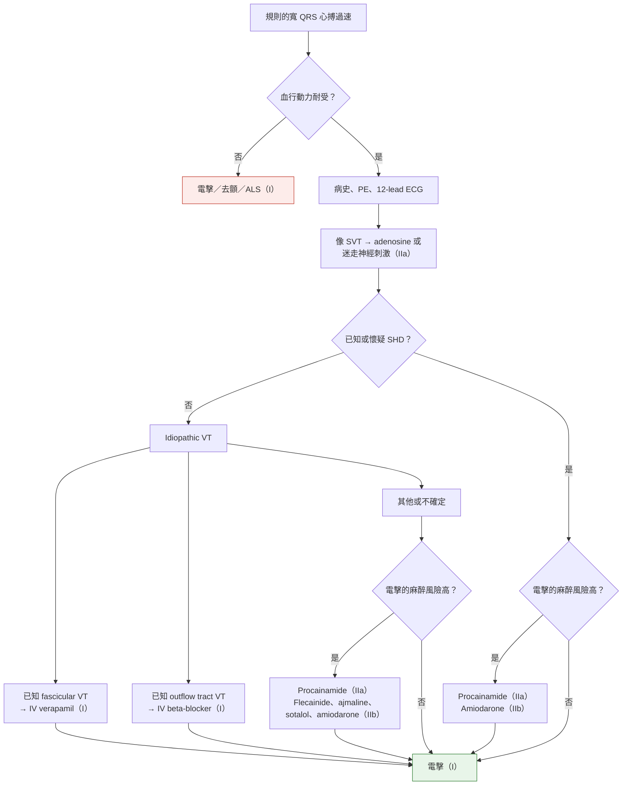
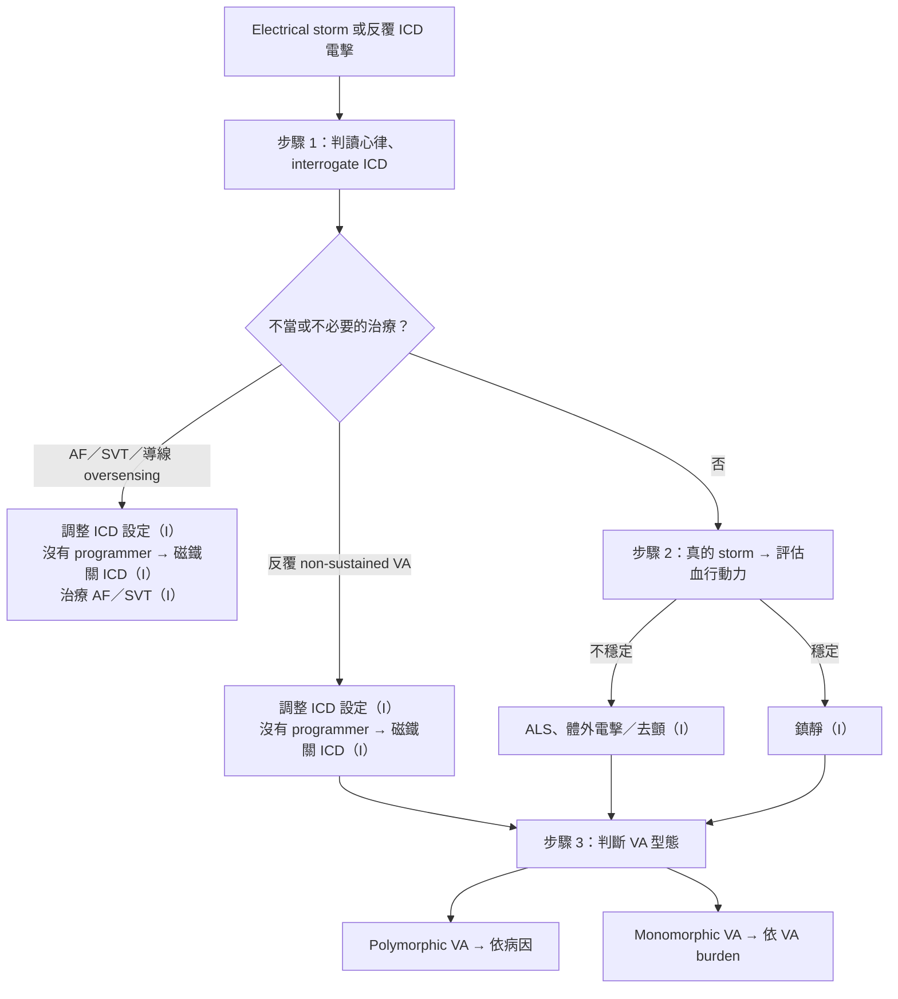
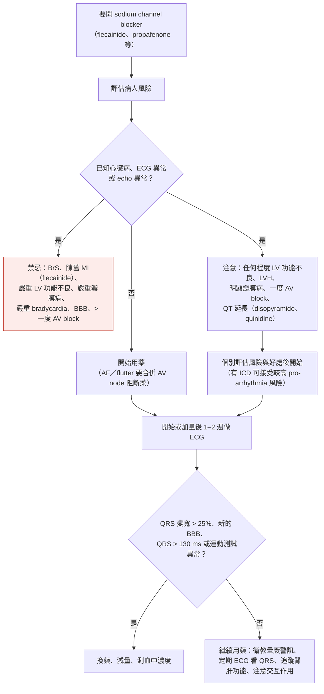
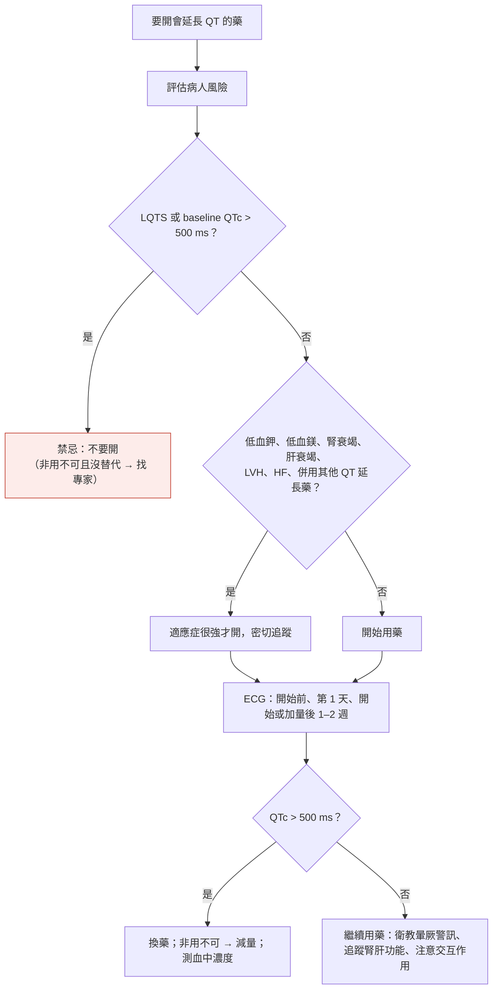

> [!abstract] 一句話重點
> - **寬 QRS 心搏過速**
>   - 不穩定 → ==電擊==
>   - 穩定的 SMVT → 麻醉風險低也是首選電擊（I C）
>   - 用藥：SHD → procainamide（IIa）；病因不明 → amiodarone（IIb）
>   - 已知 idiopathic：RVOT → IV beta-blocker；fascicular → IV verapamil
>   - ==病因不明不可給 IV verapamil==（III B）
> - **Electrical storm**
>   1. 判讀 ICD，排除不當電擊
>   2. 鎮靜
>   3. ==Non-selective beta-blocker＋IV amiodarone==（I B）
>   4. SMVT 藥物無效 → catheter ablation（I B）
> - **TdP**
>   - IV magnesium＋補鉀
>   - 仍反覆 → isoproterenol 或 pacing 拉快心跳
> - **Pump 怎麼選**
>   - Amiodarone 是預設；lidocaine 留給 ACS 的第二線
>   - Short-run VT、很多 VPC 通常不需要 pump
> - **長期用藥**
>   - 除了 beta-blocker，沒有 AAD 證明降低總死亡
>   - Na 阻斷劑：QRS 變寬 > 25% 要調整；QT 藥物：QTc > 500 ms 要換
> - **ICD**
>   - ==預期良好生活品質的存活 > 1 年才放==
>   - VF 或不穩定 VT、沒有可逆原因 → ICD（I A）
>   - 設定：延長偵測、primary prevention 最慢治療區 ≥ 188 bpm、每區至少一次 ATP

> [!info] 系列導覽
> ↑ 回到 [[cardiology/ventricular-arrhythmia-esc-2022/index|2022 ESC 心室心律不整指引總覽]]
>
> ① [[cardiology/ventricular-arrhythmia-esc-2022/va22-1-evaluation|定義與評估]]｜② 急性處置、藥物與 ICD（本篇）｜③ [[cardiology/ventricular-arrhythmia-esc-2022/va22-3-cad-idiopathic|CAD、Idiopathic PVC/VT]]｜④ [[cardiology/ventricular-arrhythmia-esc-2022/va22-4-cardiomyopathies|心肌病變與其他 SHD]]｜⑤ [[cardiology/ventricular-arrhythmia-esc-2022/va22-5-primary-electrical|Primary electrical disease 與特殊族群]]｜📋 [[cardiology/ventricular-arrhythmia-esc-2022/va22-6-recommendations|建議總整理]]｜⑥ [[cardiology/ventricular-arrhythmia-esc-2022/va22-exam|內專考點]]
>
> 本篇來源：2022 ESC VA Guidelines Section 6、Table 8、Figure 9–13、Recommendation Table 8–21；pump 劑量另參考 2025 AHA 與 amiodarone 仿單

## 可逆原因（Recommendation Table 8）

| 建議 | 等級 |
| --- | --- |
| **懷疑藥物引起的 VA → 停掉致病藥物** | I B |
| VA 病人都要找**可逆原因**（電解質、缺血、低血氧、發燒等） | I C |
| **即使找到可矯正的原因**，仍要個別評估之後 VA／SCD 風險，考慮 ICD | IIa C |

- **可逆原因可能佔 SCA 的一半**，但常常很難確定真的是「它」造成的
- 常見：**低血鉀**（快速升高的血鉀反而造成 asystole）、bradycardia、缺血、vasospasm、發燒、**急性飢餓或節食**、thiazide／loop diuretic 造成的電解質異常
- **==SCA 歸因於可逆原因的存活者，之後放 ICD 仍和較低死亡率相關（急性 MI 中發生的除外）==** → 不要因為「找到原因」就自動不放 ICD

## 急性處置：規則的寬 QRS 心搏過速（Figure 9 依內容重新繪製、Recommendation Table 9）

| 建議 | 等級 |
| --- | --- |
| **血行動力不耐受的 SMVT → 電擊為第一線** | I B |
| **耐受的 SMVT → 只要麻醉／鎮靜風險低，電擊仍是第一線** | I C（新） |
| 已知 idiopathic VT：**RVOT → IV beta-blocker**、fascicular → IV verapamil | I C |
| 規則、耐受的寬 QRS、懷疑 SVT → **adenosine 或迷走神經刺激** | IIa C |
| 耐受的 SMVT＋**已知或懷疑 SHD → IV procainamide** | IIa B（新） |
| 耐受的 SMVT＋**病因未確定 → IV amiodarone** | IIb B（新） |
| 耐受的 SMVT＋**沒有明顯 SHD → flecainide、ajmaline 或 sotalol** | IIb C |
| **==病因不明的寬 QRS 心搏過速 → 不給 IV verapamil==** | **III B** |

> [!danger] 寬 QRS 心搏過速不可以做的事
> - ==病因不明就給 IV verapamil==（III B）
> - ==不規則的寬 QRS（pre-excited AF）給 adenosine、beta-blocker、amiodarone==
> - Procainamide 用在嚴重 HF、急性 MI、末期腎病

> [!tip] Pearl：為什麼 procainamide 排在 amiodarone 前面
> - **PROCAMIO**：耐受的 wide QRS tachycardia，**procainamide 終止率較高、重大不良事件較少**
> - **Procainamide 不可用在：嚴重 HF、急性 MI、末期腎病**；很多國家買不到
> - **Adenosine 也可能終止某些 idiopathic VT**（cAMP 介導的 triggered activity），所以 adenosine 有效**不代表一定是 SVT**
> - **Pre-excited AF（FBI：fast、broad、irregular）** 會像 VT → **不可給 adenosine、beta-blocker、amiodarone 等減慢 AV 傳導的藥**
> - **重複的 NSVT（Figure 10：一陣陣 VT 中間夾幾個竇性心跳）不是電擊適應症**
> - 有 ICD：VT 速度低於偵測區時，可用 **manual overdrive pacing** 終止

## Electrical storm 與 incessant VT（Figure 11 依內容重新繪製）

| 建議 | 等級 |
| --- | --- |
| **Electrical storm → 輕到中度鎮靜**（減輕痛苦、降低交感張力） | I C |
| **==SHD＋electrical storm → beta-blocker（偏好 non-selective）＋IV amiodarone==** | **I B** |
| **TdP → IV magnesium＋補鉀** | I C |
| **Acquired LQT＋矯正誘因、給 Mg 後仍反覆 TdP → isoproterenol 或 transvenous pacing 拉快心跳** | I C |
| **Incessant VT 或 SMVT 造成的 storm、AAD 無效 → catheter ablation** | I B |
| 藥物無效的頑固 storm → **深度鎮靜／插管** | IIa C |
| 同一形態 PVC 觸發的反覆 PVT／VF，藥物或血管重建無效 → catheter ablation | IIa C |
| CAD＋反覆 PVT 的 storm、其他 AAD 失敗 → **quinidine** | IIb C |
| 藥物無效且 ablation 無效或做不到 → **autonomic modulation**（stellate ganglion block、胸椎硬膜外麻醉、LCSD） | IIb C |
| 藥物無效的 storm＋心因性休克 → **mechanical circulatory support** | IIb C |

### 步驟 1–3：先排除不當電擊，再看血行動力，再分型

### Polymorphic VA：依病因處理

| 病因 | 處置 |
| --- | --- |
| **急性缺血** | 走 STEMI 流程（見 [[cardiology/ventricular-arrhythmia-esc-2022/va22-3-cad-idiopathic\|③]] Figure 14） |
| 外在誘因 | 依原因處理（I） |
| **單一形態 PVC 觸發** | Catheter ablation（IIa）；quinidine（IIb，cardiomyopathy 沒資料） |
| **Acquired long QT** | 移除誘因（I）、IV Mg／K（I）、isoproterenol（I）、pacing（I） |
| **Brugada、ERS** | Isoproterenol（IIa）、quinidine（IIa）、catheter ablation（IIa） |
| **Idiopathic VF** | Isoproterenol（IIa）、quinidine（IIa）、verapamil（IIa）、ablation PVC trigger（IIa） |
| **Long QT（先天）、CPVT** | Beta-blocker（I）、pacing（I，bradycardia 或 pause 誘發時）、IV Mg／K（I）、依病因 AAD（IIa）、autonomic modulation（IIa） |
| 以上仍反覆 | **深度鎮靜／插管（IIa）** → mechanical circulatory support（IIb） |

> [!warning] Pitfall：isoproterenol 的兩面
> - **Acquired LQT、Brugada、ERS、idiopathic VF 的 storm → isoproterenol 有效**（拉快心跳、縮短 QT、抑制 J wave）
> - **先天 LQTS、CPVT → 交感刺激會誘發**，用的是 **beta-blocker**
> - Isoproterenol **禁忌：ACS、LQTS**（Table 8）

### Monomorphic VA：依 VA burden 處理

| | **High burden**（VA 一直來、只有短暫穩定心律） | **Low burden**（反覆 ATP 或電擊後能維持穩定） |
| --- | --- | --- |
| 第一步 | **調整 ICD 設定（I）＋beta-blocker／鎮靜（I）＋IV amiodarone（I）** | 調整 ICD 設定（I） |
| 下一步 | 仍反覆 → **catheter ablation（I）** | 已在吃 amiodarone 或不適合用 → catheter ablation（I）；否則依病因與心功能加 AAD，再反覆 → ablation |
| 再不行 | 深度鎮靜／插管（IIa）、autonomic modulation（IIb）、**MCS（IIb）**、overdrive pacing（暫時壓住慢的 incessant VT） | |

- Storm 最常見的原因是 **SHD 合併 SMVT**，適合 ablation；成功 ablation 可降低復發、改善存活
- **Incessant 的慢 MVT → ablation 優先**（AAD 可能只會讓 VT 更慢）
- **Propranolol 在 storm 優於 metoprolol**；amiodarone 無效的不耐受 VT 可用 **landiolol**
- **預防性 MCS** 用在高風險（**PAINESD score 高**）病人死亡率較低；ablation 中才「救援」放 MCS 死亡率高

## 值班常問：lidocaine pump 還是 amiodarone pump？

指引沒有直接比較兩種 pump，下面依 2022 ESC 的建議等級與 Table 8 的藥物特性整理；劑量另外對照 2025 AHA 與仿單。

> [!tip] 先記結論
> - **Amiodarone 是預設選擇**：有 SHD 或 HF 的 sustained VT、storm 都用它（搭配 beta-blocker）
> - **Lidocaine 是缺血時的第二線**：==ACS 的反覆 PVT／VF，beta-blocker 與 amiodarone 無效或 amiodarone 不能用時==
> - **QT 長的多形 VT（TdP）兩個都不是答案**：停藥、Mg、補 K、拉快心跳
> - **Short-run VT、很多 VPC 通常不需要 pump**：找原因、矯正 K 與 Mg、給 beta-blocker

### 依心律決定

| 眼前的心律 | 先做 | 選哪個 pump |
| --- | --- | --- |
| **Sustained monomorphic VT、不穩定** | 同步電擊 | 電擊後復發 → amiodarone |
| **Sustained monomorphic VT、穩定** | 麻醉風險低 → 電擊（I）；procainamide（IIa） | Amiodarone（IIb）；手邊沒有 IV procainamide 時它就是主要選擇 |
| **反覆 VT／VF、storm（SHD）** | Interrogate ICD、鎮靜 | Beta-blocker＋amiodarone（I B）；其他 AAD（含 lidocaine）視情況加，同時找 EP 談 ablation |
| **ACS 中的 polymorphic VT／VF** | 再灌流、補 K 與 Mg | IV beta-blocker（I）→ amiodarone（IIa）→ ==lidocaine==（IIb） |
| **TdP（QT 長）** | 停 QT 延長藥、IV Mg、補 K | ==不用 amiodarone==（會延長 QT）；仍反覆 → isoproterenol 或 pacing |
| **Short-run VT（NSVT）** | 找缺血、電解質、HF、藥物；12-lead ECG、echo | 通常不需要；有症狀或很頻繁 → 先 beta-blocker |
| **很多 VPC** | 同上；算 burden（Holter） | 不需要 pump；不為了「壓 VPC」開 AAD |

### 兩種藥的差別

| | **Amiodarone** | **Lidocaine** |
| --- | --- | --- |
| 最適合 | SHD、HF 的 VT 與 VF；storm | 急性缺血相關的 VT、VF |
| ESC 建議 | Storm I B；ACS IIa；穩定 SMVT IIb | ACS IIb；其他情況「視情況」 |
| QT | 延長 | 不延長 |
| 血行動力 | 快速給會低血壓、bradycardia | 影響少 |
| 主要毒性 | 低血壓、bradycardia、AV block、靜脈炎、肝指數上升 | 中樞神經：嗜睡、頭暈、意識改變、抽搐 |
| 要減量 | 不需依腎功能調整 | ==肝血流低：休克、嚴重 HF、併用 beta-blocker== |
| 起效 | 抗心律不整作用較慢才完整 | 快，停藥後很快消失 |

### 劑量與給法

| | Loading | 維持（pump） | 注意 |
| --- | --- | --- | --- |
| **Amiodarone** | 150 mg 用 10 分鐘給（VT 復發可再給 150 mg） | ==1 mg/min × 6 h → 0.5 mg/min × 18 h== | 用 D5W 稀釋；濃度 > 2 mg/mL 要走中央靜脈；前 24 h 總量超過 2100 mg 低血壓風險上升 |
| **Lidocaine** | 50–200 mg bolus（AHA：1–1.5 mg/kg） | ==2–4 mg/min== | 老人、HF、休克、肝功能差用低劑量；出現意識改變或抽搐先停藥 |

- ESC Table 8 的 amiodarone IV 寫法是 5 mg/kg（20 分鐘–2 h），24 h 內可重複 2–3 次，之後 600–1200 mg/24 h；和上表的仿單給法總量相近
- 兩種 pump 都只是過渡：穩定後要回到==治療原因==（缺血、HF、電解質）、評估 ICD 與 ablation

> [!warning] Pitfall：看到 short-run VT 就上 pump
> - ==除了 beta-blocker，沒有 AAD 證明降低總死亡==；CAST 顯示 MI 後用 AAD 壓 VPC 死亡反而增加
> - ACS 預防性給 AAD（beta-blocker 以外）是 III B
> - Repetitive NSVT 也不是電擊適應症
> - 該做的是：矯正 K 與 Mg、找缺血、把 beta-blocker 與 HF 藥物調好
> - VPC burden ≥ 10% 合併 EF 下降 → 想 PVC-induced cardiomyopathy，見 [[cardiology/ventricular-arrhythmia-esc-2022/va22-3-cad-idiopathic|③]]

## 長期藥物治療（Section 6.2.1、Recommendation Table 10）

| 建議 | 等級 |
| --- | --- |
| **所有 HFrEF：ACE-I／ARB／ARNI、MRA、beta-blocker、SGLT2-I** | I A（新） |

> [!info] 🆕 新版指引（2026 ESC Heart Failure Guidelines）
> - **HFrEF 定義改為 LVEF < 50%**（取消 HFmrEF）；**SGLT2-I＋MRA 用於所有有症狀 HF**（I A），HFrEF 再加 **beta-blocker＋ACE-I 或 ARNI**（I A），**每 1–2 週調升**
> - 詳見 [[cardiology/heart-failure-esc-2026/hf26-2-chronic-treatment|② 慢性 HF 治療（2026 ESC）]]

- **==除了 beta-blocker，沒有任何 AAD 證明降低總死亡率==**；每種 AAD 都可能 **pro-arrhythmia**、延長 QT、減慢心跳、惡化 HF
- 查 QT 延長藥物：**crediblemeds.org**；BrS 該避免的藥：**brugadadrugs.org**

### 抗心律不整藥一覽（Table 8 依內容重新整理）

先看速查表，要細節再點開下面每種藥的卡片。

| 藥物 | 什麼時候用 | 最該記的禁忌 |
| --- | --- | --- |
| **Amiodarone** | VT、VF、storm；HF 可用 | 嚴重傳導疾病；QT 延長 |
| **Lidocaine** | ACS 相關的 VT／VF | 肝血流低要減量 |
| **Procainamide** | 耐受的 SMVT（SHD） | 嚴重 LV 功能不良、BrS |
| **Beta-blocker** | PVC、VT；LQTS、CPVT 用 nadolol、propranolol | 失代償 HF、vasospasm、BrS |
| **Landiolol** | Storm（amiodarone 無效時） | 低血壓、bradycardia |
| **Verapamil** | Fascicular VT | 不明 VT、HFrEF、ACS、WPW |
| **Adenosine** | 不明寬 QRS、outflow tract VT | Pre-excited AF、嚴重氣喘 |
| **Flecainide、propafenone** | Idiopathic PVC／VT；CPVT 加 flecainide | 陳舊 MI、SHD、BrS |
| **Sotalol** | SHD 的 VT（取代 beta-blocker） | HFrEF、CrCl < 30、LQTS |
| **Mexiletine** | LQT3；VT 輔助 | 嚴重 HF、傳導疾病 |
| **Quinidine** | BrS、ERS、idiopathic VF、SQTS | 陳舊 MI、SHD、LQTS |
| **Isoproterenol** | BrS、ERS、IVF 的 storm；acquired LQT 的 TdP | ACS、先天 LQTS |
| **Disopyramide** | PVC、VT；HCM 的 LVOT 阻塞 | 陳舊 MI、SHD |
| **Ajmaline** | 揭露 Brugada ECG | 已有 type 1 ECG |
| **Ranolazine** | VT（LQT3） | 嚴重 HF |

> [!example]- Amiodarone｜VT、VF、storm
> - **ECG**：心跳變慢、QT 延長
> - **IV**：5 mg/kg（20 分鐘–2 h），24 h 內可 2–3 次，之後 600–1200 mg/24 h
> - **口服**：loading 600–1200 mg/day × 8–10 天，維持 200–400 mg/day
> - **副作用**：bradycardia、TdP（少）；光敏感、角膜沉積、甲狀腺低下或亢進、肺毒性、肝毒性、神經病變、皮膚變色
> - **注意**：sinus node dysfunction、嚴重 AV block、甲亢；HF 可用；和 statin 併用肌病變風險上升

> [!example]- Lidocaine｜ACS 相關的 VT／VF
> - **ECG**：沒有明顯效應（不延長 QT）
> - **IV**：50–200 mg bolus，之後 2–4 mg/min
> - **副作用**：sinoatrial arrest；中樞神經（嗜睡、頭暈）
> - **注意**：肝血流低（休克、beta-blocker、嚴重 HF）要減量；血鉀高時較有效；血行動力副作用少

> [!example]- Procainamide｜耐受的 SMVT
> - **ECG**：PR、QRS、QT 延長
> - **IV**：100 mg bolus，5 分鐘可重複，最多 500–750 mg（速度 ≤ 50 mg/min），之後 2–6 mg/min
> - **副作用**：低血壓、bradycardia、TdP；皮疹、類狼瘡、agranulocytosis
> - **禁忌**：嚴重傳導疾病、嚴重 LV 功能不良、低血壓、BrS

> [!example]- Beta-blocker、nadolol、propranolol、landiolol
> - **ECG**：心跳慢、PR 延長、QT 縮短
> - **Nadolol**（non-selective）：40–120 mg/day；半衰期 20–24 h；LQTS、CPVT
> - **Propranolol**（non-selective）：80–320 mg/day（IV 160 mg/24 h）；storm、LQTS、CPVT
> - **Landiolol**（超短效 β1）：IV 100 µg/kg bolus（1 分鐘），之後 10–40 µg/kg/min（最多 80）；超過 24 h 經驗有限
> - **副作用**：bradycardia、AV block、低血壓、負性肌力；疲倦、支氣管痙攣、四肢冰冷
> - **禁忌**：嚴重 sinus／AV 傳導疾病、失代償 HF、coronary vasospasm、嚴重氣喘、BrS

> [!example]- Verapamil｜LV fascicular VT
> - **ECG**：PR 延長
> - **IV**：5–10 mg 緩慢推，30 分鐘可重複；口服 120–480 mg/day
> - **副作用**：bradycardia、AV block、負性肌力、低血壓
> - **禁忌**：HFrEF、嚴重傳導疾病、不明來源的 VT、ACS、WPW

> [!example]- Adenosine｜不明寬 QRS、outflow tract VT
> - **ECG**：暫時性 AV block
> - **IV**：6–18 mg bolus
> - **副作用**：胸痛、潮紅、支氣管收縮
> - **禁忌**：嚴重氣喘、pre-excited AF；拮抗劑 theophylline

> [!example]- Flecainide、propafenone｜idiopathic PVC／VT
> - **ECG**：PR、QRS、QT 延長
> - **Flecainide**：200–400 mg/day；IV 1–2 mg/kg（10 分鐘）
> - **Propafenone**：450–900 mg/day
> - **副作用**：pro-arrhythmia、負性肌力、AV block、flutter 時 1:1 傳導；頭暈、複視
> - **禁忌**：陳舊 MI、明顯 SHD、BrS、嚴重傳導疾病、先天 LQTS（LQT3 除外）；flecainide CrCl < 35 不用
> - **追蹤**：QRS 變寬 > 25% 或出現 BBB 就停

> [!example]- Sotalol｜VT
> - **ECG**：心跳慢、QT 延長
> - **口服**：160–640 mg/day；IV 0.5–1.5 mg/kg（10 分鐘，6 h 後可重複）
> - **副作用**：同 beta-blocker；TdP > 2%，要密切監測 QT 與 CrCl
> - **禁忌**：HFrEF、明顯 LVH、CrCl < 30、vasospasm、LQTS；低血鉀要小心

> [!example]- Mexiletine、ranolazine｜LQT3
> - **Mexiletine**：600–1200 mg/day（loading 400 mg，24 h 內再 600 mg）；ECG 沒有明顯效應；副作用為顫抖、構音困難、頭暈、腸胃不適；禁忌為 sinus node dysfunction、嚴重 AV block、嚴重 HF
> - **Ranolazine**：750–2000 mg/day；QT 延長；禁忌為嚴重 HF、LQTS（LQT3 除外）

> [!example]- Quinidine｜BrS、ERS、idiopathic VF、SQTS
> - **ECG**：PR、QRS、QT 延長
> - **口服**：600–1600 mg/day；loading 200 mg q3h 到有效，24 h 最多 3 g
> - **副作用**：低血壓、TdP；腸胃、聽力視力障礙、溶血性貧血、血小板低下
> - **禁忌**：嚴重傳導疾病、陳舊 MI、明顯 SHD、低血壓、LQTS

> [!example]- Isoproterenol｜channelopathy 的 storm、acquired LQT
> - **ECG**：心跳快、QT 縮短
> - **IV**：0.5–10 µg/min；半衰期 2 分鐘
> - **用途**：BrS、idiopathic VF、ERS 的 storm；TdP；acquired LQTS；beta-blocker 過量
> - **禁忌**：ACS、LQTS

> [!example]- Disopyramide、ajmaline
> - **Disopyramide**：250–750 mg/day；QRS、QT 延長；負性肌力、抗膽鹼；禁忌為陳舊 MI、明顯 SHD、嚴重傳導疾病；可減少 HCM 的 LVOT 阻塞
> - **Ajmaline**：IV 1 mg/kg（5–10 分鐘，最多 100 mg）；揭露 BrS ECG；可能 VF、TdP、膽汁滯留性黃疸；禁忌為已有 type 1 ECG、QT 延長

- 所有會延長 QT 的藥：QTc > 500 ms 就停；有其他延長 QT 的因素要小心

> [!danger] 最容易出事的四個用藥錯誤
> - ==不明原因的寬 QRS 心搏過速給 verapamil== → 血行動力崩潰（III B）
> - ==Pre-excited AF 給 adenosine、beta-blocker、amiodarone== → 可能變 VF
> - ==陳舊 MI 或 SHD 用 flecainide、propafenone== → pro-arrhythmia、死亡增加
> - ==先天 LQTS、CPVT 的 storm 給 isoproterenol== → 交感刺激會誘發（要用 beta-blocker）

### 開 sodium channel blocker 之前與之後（Figure 12 依內容重新繪製）

### 開會延長 QT 的藥之前與之後（Figure 13 依內容重新繪製）

## ICD 與其他裝置（Section 6.2.2–6.2.3）

### 一般原則與 secondary prevention（Recommendation Table 11–15）

| 建議 | 等級 |
| --- | --- |
| **==只有預期有良好生活品質的存活 > 1 年才放 ICD==** | **I C**（新） |
| **Incessant VA 未控制前不放 ICD** | **III C** |
| **==有記錄的 VF 或血行動力不耐受的 VT，且沒有可逆原因 → ICD（secondary prevention）==** | **I A** |
| 有 ICD 適應症但**沒有 ICD 可放、有禁忌或病人拒絕** → amiodarone | IIb C |
| 同上，且 SMVT 或由同一形態 PVC 觸發的 SPVT／VF → catheter ablation | IIb C（新） |
| **S-ICD**：不需要 bradycardia pacing、CRT 或 ATP → 可取代經靜脈 ICD | IIa B |
| **要放 ICD 時，評估是否適合 CRT-D** | I C |
| **WCD**：有 secondary prevention 適應症但暫時不能放 ICD | IIa C |
| **WCD**：MI 後早期、選擇性病人 | IIb B（新） |

- **ICD 不會預防 VA 發生**，只是把它終止
- **Primary prevention ICD 的試驗中女性代表性不足**，可能獲益較少；要考慮**非心律不整死亡的競爭風險**，與病人共同決策（MADIT-ICD benefit score 可參考）
- **S-ICD**（PRAETORIAN）：沒有血管內導線、**不能 ATP**；併發症與不當電擊不劣於經靜脈 ICD
- **WCD**（VEST）：MI 後 LVEF ≤ 35%，90 天**心律不整死亡沒有顯著差異**（穿戴時間中位數只有 18 h）→ MI 後不常規使用

### ICD 程式設定（Recommendation Table 16）

| 建議 | 等級 |
| --- | --- |
| 最佳化設定，避免不當與不必要的治療、**降低死亡率** | I A |
| 沒有 bradycardia pacing 適應症的單腔或雙腔 ICD → **盡量減少心室起搏** | I A |
| **==延長偵測時間：至少 6–12 秒或 30 個間期==** | **I A** |
| **==Primary prevention：最慢的治療區 ≥ 188 bpm==** | **I A** |
| **SHD：每個心搏過速區至少設一次 ATP** | I A |
| **SVT／VT 鑑別演算法用到 230 bpm** | I B |
| 開啟導線失效警示 | I B |
| **遠端監測**減少不當電擊 | I B |
| **Burst ATP 優於 ramp** | I B |
| S-ICD：**雙區設定**，低的 conditional shock zone 開啟鑑別演算法 | I B |
| 一般設定開 > 1 個偵測區 | IIa B |

- **高偵測速率＋長偵測時間（ADVANCE III ≥ 188、MADIT-RIT ≥ 200 bpm）→ 治療次數與總死亡都下降，暈厥沒有增加**
- 很可能只有 VF 的病人（primary electrical disease）可設單一高速率區

### 避免不當電擊、心理、LVAD、併發症、臨終（Recommendation Table 17–21）

| 建議 | 等級 |
| --- | --- |
| **反覆 SVT 造成不當電擊 → catheter ablation** | I C |
| **AF 造成不當電擊**（設定已最佳化）→ 藥物或 catheter ablation | I C |
| 評估並治療 ICD 病人的**心理壓力** | I C |
| 放 ICD 前與病程進展時，**討論 ICD 相關疑慮與生活品質** | I C |
| **LVAD 病人有症狀的 sustained VA → ICD** | IIa B |
| **==Primary prevention、沒有心房或 AV sequential pacing 需求 → 單腔優於雙腔 ICD==**（併發症較少） | **I A** |
| 單 coil 導線優於雙 coil（拔導線併發症較少） | IIa C |
| **放置前與健康明顯惡化時，和病人家屬討論 ICD 關閉選項、共同決策** | I C |

- **HF 病人 beta-blocker 調到最高耐受劑量**可減少不當電擊（**carvedilol 優於 metoprolol**）
- **約 20% ICD 病人有焦慮、憂鬱**，且和死亡率上升有關；壓力多來自**擔心被電**而非真的被電過
- 靜脈通路：**cephalic 或 axillary 優於 subclavian**（減少氣胸與導線失效）；**HCM、右側植入**等去顫閾值可能較高時才用雙 coil
- 臨終：**一般不建議關掉 anti-bradycardia pacing**（影響生活品質）

### Catheter ablation 與 autonomic modulation（Section 6.2.4）

- **SHD 的 SMVT 多為疤痕 reentry** → 通常要放 ICD，但 ICD 不能預防復發；藥物選擇主要只有 **beta-blocker、amiodarone、sotalol**
- **Ablation 的地位在 2022 大幅提升**：CAD 反覆 SMVT 吃 amiodarone 仍發作 → **ablation 優於加藥（I B）**；RVOT／fascicular idiopathic VT → ablation 第一線（I B）（見 ③）
- **Autonomic modulation**（stellate ganglion block、胸椎硬膜外麻醉、**LCSD**）：藥物與 ablation 都無效的 storm；LQTS、CPVT 的 LCSD 見 ⑤

## 相關筆記

- [[cardiology/ventricular-arrhythmia-esc-2022/va22-1-evaluation|① 定義與評估]]
- [[cardiology/ventricular-arrhythmia-esc-2022/va22-3-cad-idiopathic|③ CAD 與 idiopathic PVC／VT]]（primary prevention ICD 的 LVEF 門檻）
- [[cardiology/heart-failure-esc-2026/hf26-2-chronic-treatment|慢性 HF 治療（2026 ESC）]]（FMT、ICD、CRT）
- [[cardiology/resuscitation-aha-2025/cpr25-2-adult-als|成人 ALS（2025 AHA）]]
- [[cardiology/ventricular-arrhythmia-esc-2022/va22-exam|⑥ 內專考點]]

## 參考資料

- Zeppenfeld K, Tfelt-Hansen J, de Riva M, et al. 2022 ESC Guidelines for the management of patients with ventricular arrhythmias and the prevention of sudden cardiac death. *Eur Heart J* 2022;43(40):3997–4126（Section 6、Table 8、Figure 9–13、Recommendation Table 8–21）（參考資料庫：心臟科／2022 ESC Guidelines for the management of patients with ventricular arrhythmias.pdf）
- Amiodarone hydrochloride injection, US prescribing information（loading 150 mg／10 分鐘、1 mg/min × 6 h、0.5 mg/min × 18 h；濃度 > 2 mg/mL 用中央靜脈）
- 2025 AHA Guidelines for CPR and ECC（lidocaine 1–1.5 mg/kg；見 [[cardiology/resuscitation-aha-2025/cpr25-2-adult-als|成人 ALS]]）
- 2026 ESC Guidelines for the management of heart failure. *Eur Heart J* 2026（HFrEF 定義與 FMT；參考資料庫：心臟科／2026 ESC Guidelines for the management of heart failure.pdf）
