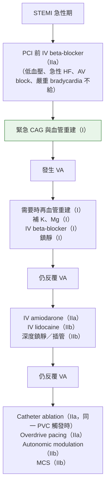
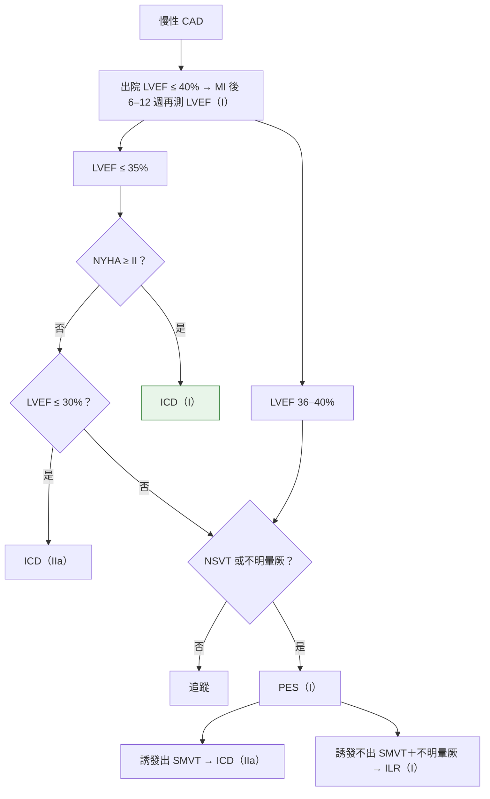
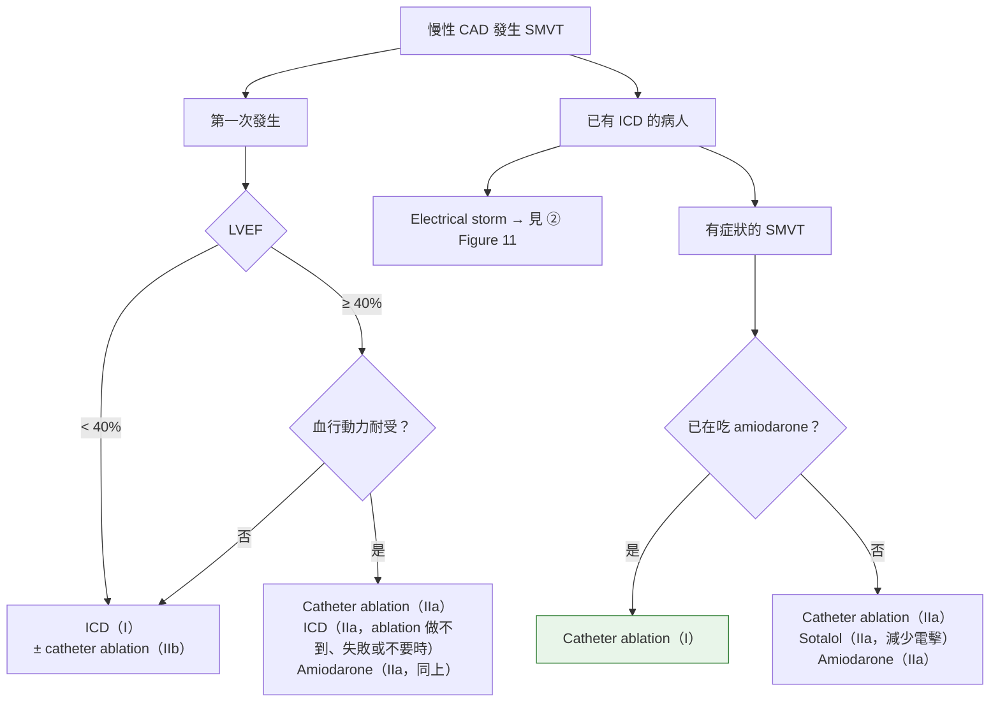
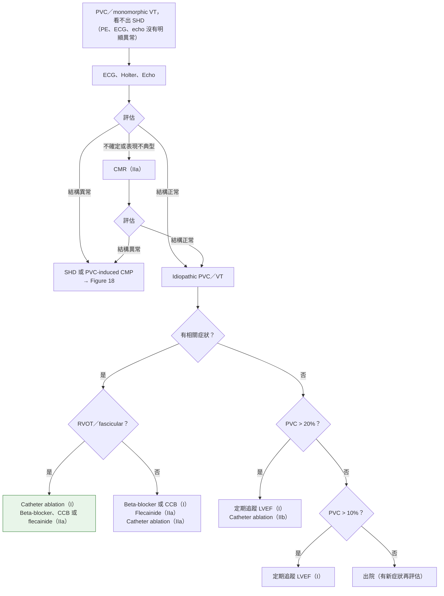
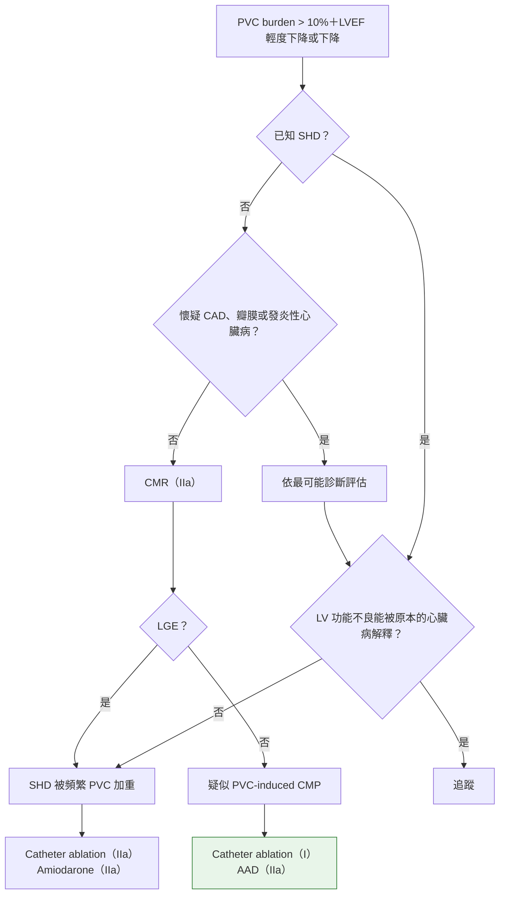

> [!abstract] 一句話重點
> - **STEMI 的 VA**：**緊急再灌流最重要** → 反覆 PVT／VF：**IV beta-blocker（I B）** → **IV amiodarone（IIa C，2015 是 I）** → lidocaine（IIb）；**==預防性 AAD（beta-blocker 以外）不建議（III B）==**
> - **MI 後**：出院前測 LVEF（I）；**LVEF ≤ 40% → 6–12 週後再測（I）**決定 ICD；**MI 40 天內不放 primary prevention ICD**
> - **Chronic CAD primary prevention ICD**：**LVEF ≤ 35%＋NYHA II–III（OMT ≥ 3 個月）→ I A**；NYHA I＋LVEF ≤ 30% → IIa；**LVEF ≤ 40%＋NSVT＋PES 誘發 SMVT → IIa**
> - **CAD 的 SMVT**：**吃 amiodarone 仍反覆 → ablation 優於加藥（I B）**；**LVEF ≥ 40%＋耐受的 SMVT → 有經驗中心 ablation 可取代 ICD（IIa C）**
> - **Idiopathic PVC／VT**：**RVOT 或 left fascicle 有症狀 → ablation 第一線（I B）**；其他起源 → **beta-blocker 或 non-DHP CCB（I C）**；**❌ amiodarone 不當第一線（III）**
> - **PVC burden ≥ 10%＋不明原因 EF 下降 → 想 PVC-induced cardiomyopathy（IIa）→ CMR（IIa）→ ablation（I C）**

> [!info] 系列導覽
> ↑ 回到 [[cardiology/ventricular-arrhythmia-esc-2022/index|2022 ESC 心室心律不整指引總覽]]
>
> ① [[cardiology/ventricular-arrhythmia-esc-2022/va22-1-evaluation|定義與評估]]｜② [[cardiology/ventricular-arrhythmia-esc-2022/va22-2-acute-longterm|急性處置、藥物與 ICD]]｜③ CAD、Idiopathic PVC/VT（本篇）｜④ [[cardiology/ventricular-arrhythmia-esc-2022/va22-4-cardiomyopathies|心肌病變與其他 SHD]]｜⑤ [[cardiology/ventricular-arrhythmia-esc-2022/va22-5-primary-electrical|Primary electrical disease 與特殊族群]]｜📋 [[cardiology/ventricular-arrhythmia-esc-2022/va22-6-recommendations|建議總整理]]｜⑥ [[cardiology/ventricular-arrhythmia-esc-2022/va22-exam|內專考點]]
>
> 本篇來源：2022 ESC VA Guidelines Section 7.1.1–7.1.2、Table 9、Figure 14–18、Recommendation Table 22–27

## ACS 與 vasospasm（Section 7.1.1.1、Recommendation Table 22）

| 建議 | 等級 |
| --- | --- |
| **STEMI 中反覆 PVT／VF → IV beta-blocker**（除非禁忌） | **I B** |
| **ACS 急性期反覆 PVT／VF → IV amiodarone** | **IIa C**（2015 是 I） |
| Beta-blocker、amiodarone 無效或 amiodarone 禁忌 → **IV lidocaine** | IIb C |
| **==ACS 預防性給 AAD（beta-blocker 以外）==** | **III B** |
| **Coronary spasm 造成 SCA 的存活者 → ICD** | **IIa C**（新） |

- **STEMI 有 4–12% 在 48 h 內發生 VA**，**再灌流前**的比再灌流中或之後多
- VA 的預測因子：**血行動力不穩、休克、LVEF < 40%、所有導程 ST 偏移總和**；early repolarization pattern 也和風險有關
- **反覆的 sustained VT（尤其多形）或 VF → 代表再灌流不完全或再缺血 → 立即 CAG**
- **心跳偏慢或 pause 誘發** → pacing 可預防再發
- **早期 VA（48 h 內，PCI 時代幾乎都在 24 h 內）→ 住院死亡最多增加 6 倍，但長期預後不太受影響**；**早期 MVT 比早期 VF 預後差**（長期 ICD 適當治療較多、獨立預測死亡）
- **Vasospasm 的 SCA 存活者復發風險高**：**CCB 可抑制**；**beta-blocker 可能誘發 VA**；藥物可能不足 → 仍應考慮 ICD

### STEMI 的 VA 預防與處理（Figure 14 依內容重新繪製）

- 2023 ESC ACS 指引的整體處置見 [[cardiology/acs-esc-2023/index|急性冠心症 ACS（ESC 2023）]]

## MI 後早期（Section 7.1.1.2、Recommendation Table 23）

| 建議 | 等級 |
| --- | --- |
| **所有急性 MI → 出院前評估 LVEF** | **I B** |
| **==出院前 LVEF ≤ 40% → MI 後 6–12 週再評估 LVEF==**，決定是否需要 primary prevention ICD | **I C** |
| MI 亞急性期反覆 PVT／VF 由**同一 PVC 觸發**、藥物或血管重建無效 → catheter ablation | IIa C |

- **前幾週是猝死風險最高的時候**，但 **DINAMIT、IRIS：MI 後 40 天內常規放 ICD 不降死亡率** → 不建議
- **6 週以前再測 LVEF 分不出 stunning 和 remodelling**
- MI 後早期 storm 或反覆 PVT／VF：先排除缺血；beta-blocker＋amiodarone 仍反覆 → 有用 **quinidine** 壓制的報告

## 慢性 CAD（Section 7.1.1.3、Recommendation Table 24）

| 建議 | 等級 |
| --- | --- |
| **陳舊 STEMI＋暈厥、非侵入性評估後仍不明 → PES** | **I C**（2015 是 IIa） |
| **==CAD＋NYHA II–III＋LVEF ≤ 35%（OMT ≥ 3 個月）→ ICD==** | **I A** |
| CAD＋**NYHA I＋LVEF ≤ 30%**（OMT ≥ 3 個月）→ ICD | IIa B（新） |
| CAD＋**LVEF ≤ 40%**（OMT ≥ 3 個月）＋**NSVT**＋**PES 誘發出 SMVT** → ICD | IIa B（新） |
| **CAD 預防性給 AAD（beta-blocker 以外）** | **III A** |
| 沒有持續缺血、**MI 48 h 後**發生 VF 或不耐受 VT → ICD | **I A** |
| **==CAD＋吃 amiodarone 仍反覆有症狀 SMVT 或 ICD 電擊 → catheter ablation 優於加強 AAD==** | **I B**（新） |
| CAD＋吃 beta-blocker 仍反覆 SMVT 或電擊 → **加 amiodarone 或 beta-blocker 換成 sotalol** | IIa B |
| **CAD＋血行動力耐受的 SMVT＋LVEF ≥ 40% → 有經驗中心 ablation 取代 ICD**（需達成既定終點：誘發不出 VT、消除延遲電位） | **IIa C**（新） |
| 耐受的 SMVT＋LVEF ≥ 40%，**ablation 失敗、做不到或病人不要 → ICD** | IIa C |
| 吃 beta-blocker 或 sotalol 仍反覆 SMVT → catheter ablation | IIa C（新） |
| 符合 ICD 的 CAD → ICD **放置前後立即**做 ablation 以減少 VT 與電擊 | IIb B（2015 是 IIa） |

> [!info] 🆕 新版指引（2026 ESC Heart Failure Guidelines）
> - **缺血性 HFrEF、NYHA II–III、LVEF ≤ 35%、optimal FMT ≥ 3 個月 → ICD：I B1**（2022 VA 寫 I A，適應症相同、證據等級表示法不同）
> - **==MI 40 天內不放 primary prevention ICD：III B1==**；暫時性 SCD 風險可考慮 **wearable defibrillator（IIb C）**
> - 詳見 [[cardiology/heart-failure-esc-2026/hf26-2-chronic-treatment|② 慢性 HF 治療（2026 ESC）]]

### 慢性 CAD 的 primary prevention（Figure 15 依內容重新繪製）

### 慢性 CAD 的 SMVT（Figure 16 依內容重新繪製）

- ICD 病人在**監測區內**有 incessant VT → 考慮 ablation

## 冠狀動脈異常（Section 7.1.1.4、Recommendation Table 25）

| 建議 | 等級 |
| --- | --- |
| **冠狀動脈從對側主動脈竇發出、走兩大動脈之間（interarterial course）→ 運動心臟壓力影像＋心肺運動測試**確認有無缺血 | I C |
| 冠狀動脈異常、**曾 CA、術後** → 運動壓力影像＋心肺運動測試 | I C（新） |
| **冠狀動脈異常＋CA、疑似 VA 造成的暈厥或心絞痛**（排除其他原因）→ **手術** | **I C** |
| 沒症狀但**有缺血證據**，或**左冠狀動脈異常起源＋高風險解剖** → 手術 | IIa C |

- **高風險解剖**：**interarterial course**、**slit-like 開口**、開口位置高、**銳角起始**、**intramural course**（及其長度）

## Idiopathic PVC／VT（Section 7.1.2.1、Recommendation Table 26）

| 建議 | 等級 |
| --- | --- |
| **PVC burden > 10%、心功能正常 → 定期追蹤心室功能** | **I C** |
| 表現**不像 idiopathic**（較老、**RBBB 形態**、像 reentry 的 SMVT）→ 即使 echo 正常也做 **CMR** | IIa C（新） |
| **==有症狀、來自 RVOT 或 left fascicle 的 idiopathic VT／PVC → catheter ablation 第一線==** | **I B**（新） |
| 有症狀、**其他起源** → **beta-blocker 或 non-DHP CCB** | **I C**（新） |
| RVOT／fascicle 但 ablation 做不到、不想做或風險高 → beta-blocker、non-DHP CCB 或 flecainide | IIa B |
| 其他起源 → catheter ablation 或 flecainide | IIa C |
| **沒症狀但追蹤時反覆 PVC > 20%／天** → catheter ablation | IIb B |
| **< 5 歲或 < 10 kg 的小孩不做 ablation**（藥物失敗或 VT 不耐受除外） | III C |
| **==Amiodarone 不當 idiopathic PVC／VT 的第一線==** | **III C** |
| **< 1 歲有 PVC／VT 不用 verapamil**（尤其有 HF 或併用其他 AAD） | III C |

- 藥物怎麼選：
  - **心跳快或運動時 PVC 多 → beta-blocker**；懷疑 **focal triggered activity** → beta-blocker
  - 和心跳沒關係 → **flecainide 或 CCB** 壓制效果較好
  - **Fascicular → CCB 首選**
  - RVOT、fascicle 以外的起源 → beta-blocker 或 CCB（flecainide 有 pro-arrhythmia 疑慮）
- RVOT、fascicular 以外（例如 **sinus of Valsalva、LV summit**）ablation 成功率較低、併發症風險較高
- **沒症狀、心功能正常的頻繁 PVC，治療沒有證據**；PVC burden 常會**自然下降**（尤其小孩）

### Idiopathic PVC／VT 處理流程（Figure 17 依內容重新繪製）

### 藥物與 ablation 對照（Table 9 依內容重新整理）

| 情境 | **Ablation** | Beta-blocker | CCB | Flecainide | **Amiodarone** |
| --- | --- | --- | --- | --- | --- |
| **RVOT／fascicular、有症狀、LV 正常** | **I** | IIa | IIa | IIa | **III** |
| **其他起源、有症狀、LV 正常** | IIa | **I** | **I** | IIa | **III** |
| RVOT／fascicular、**LV 功能不良** | **I** | IIa | **III（IV CCB）** | IIa（只限中度 LV 功能不良） | IIa |
| 其他起源、**LV 功能不良** | **I** | IIa | **III（IV CCB）** | IIa（只限中度） | IIa |
| **PVC burden > 20%、沒症狀、LV 正常** | IIb | — | — | — | **III** |

> [!tip] Pearl：Table 9 的記法
> - **LV 正常 → amiodarone 一律 III**（毒性不值得）；**LV 功能不良 → amiodarone 升為 IIa、IV CCB 變 III**
> - **Ablation：RVOT／fascicular 永遠 I**；LV 功能不良時所有起源都 I

## PVC-induced／aggravated cardiomyopathy（Section 7.1.2.2、Recommendation Table 27）

| 建議 | 等級 |
| --- | --- |
| **==不明原因 EF 下降＋PVC burden ≥ 10% → 考慮 PVC-induced cardiomyopathy==** | **IIa C**（新） |
| 懷疑 PVC-induced cardiomyopathy → **CMR** | IIa B（新） |
| **==懷疑由頻繁且主要單一形態的 PVC 造成的 cardiomyopathy → catheter ablation==** | **I C**（2015 是 IIa） |
| 同上但 ablation 不想做、風險高或失敗 → **AAD** | IIa C |
| **已有 SHD**、頻繁單一形態 PVC 可能加重 cardiomyopathy → **amiodarone 或 ablation** | IIa B |
| **CRT 無反應**、頻繁單一形態 PVC 影響雙心室起搏比例 → ablation 或 AAD | IIa C（新） |

- **PVC burden 是最強的獨立預測因子**：**≥ 10% 是最低門檻，> 20% 風險更高**；< 10% → 想其他 cardiomyopathy 病因、**重做 Holter**（burden 每天會變）
- 預測 LV 惡化：**superior axis、epicardial origin、NSVT、較短的 coupling interval、男性**
- **LGE 陽性 → 比較像本來就有 SHD、被 PVC 加重**；**LVEDD 較小、本身 QRS 較窄**比較像純 PVC-induced

## 相關筆記

- [[cardiology/ventricular-arrhythmia-esc-2022/va22-2-acute-longterm|② 急性處置、藥物與 ICD]]（storm、AAD 表、ICD 設定）
- [[cardiology/ventricular-arrhythmia-esc-2022/va22-4-cardiomyopathies|④ 心肌病變]]（DCM primary prevention 的不同門檻）
- [[cardiology/acs-esc-2023/index|急性冠心症 ACS（ESC 2023）]]
- [[cardiology/chronic-coronary-syndrome-esc-2024/index|慢性冠心症 CCS（ESC 2024）]]
- [[cardiology/heart-failure-esc-2026/hf26-2-chronic-treatment|慢性 HF 治療（2026 ESC）]]
- [[cardiology/ventricular-arrhythmia-esc-2022/va22-exam|⑥ 內專考點]]

## 參考資料

- Zeppenfeld K, Tfelt-Hansen J, de Riva M, et al. 2022 ESC Guidelines for the management of patients with ventricular arrhythmias and the prevention of sudden cardiac death. *Eur Heart J* 2022;43(40):3997–4126（Section 7.1.1–7.1.2、Table 9、Figure 14–18、Recommendation Table 22–27）（參考資料庫：心臟科／2022 ESC Guidelines for the management of patients with ventricular arrhythmias.pdf）
- 2026 ESC Guidelines for the management of heart failure. *Eur Heart J* 2026（ICD 建議等級；參考資料庫：心臟科／2026 ESC Guidelines for the management of heart failure.pdf）
