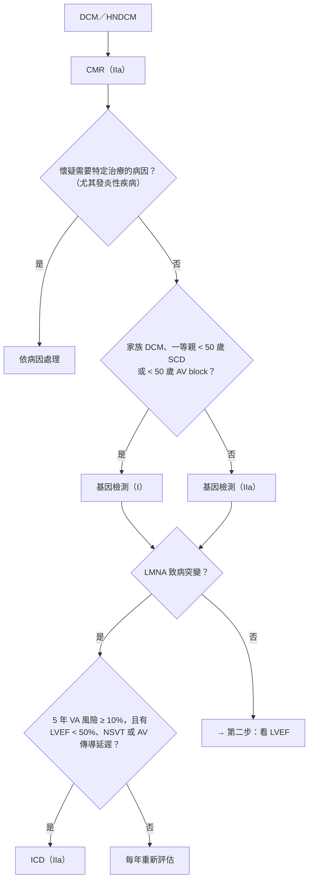
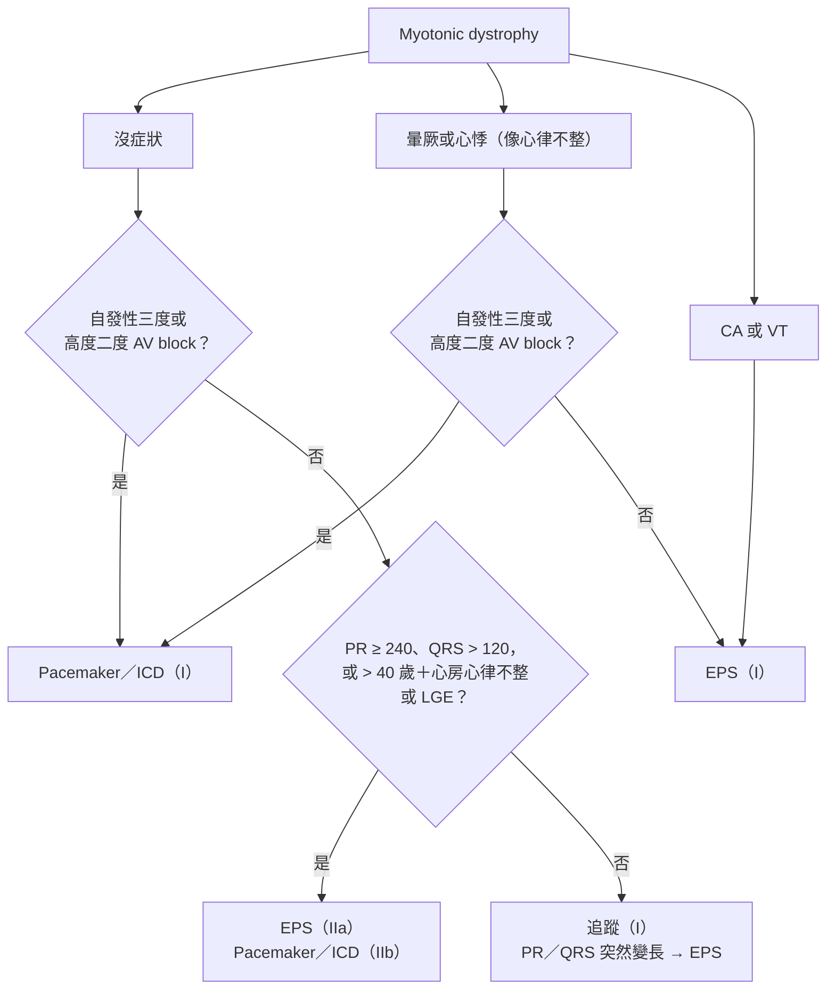
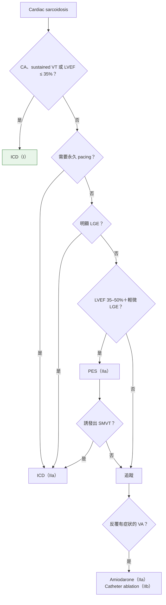
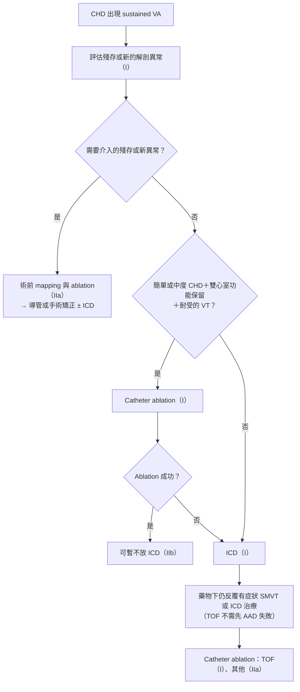

> [!abstract] 一句話重點
> - **DCM／HNDCM**
>   - ==LVEF ≤ 35%＋NYHA II–III 的 ICD 降為 IIa==（2015 是 I）
>   - LVEF < 50%＋≥ 2 個風險因子（暈厥、LGE、PES 誘發 SMVT、LMNA／PLN／FLNC／RBM20）→ ICD（IIa）
>   - LMNA 用專屬 risk calculator：5 年 VA 風險 ≥ 10%＋表現型 → ICD（IIa）
> - **ARVC**
>   - CMR（I）、==避免高強度運動==（I B）、有 VA 給 beta-blocker（I）
>   - Arrhythmic syncope 或嚴重 RV／LV 功能不良 → ICD（IIa）；裝置要能 ATP
> - **HCM**
>   - HCM Risk-SCD 每 1–3 年算一次；==≥ 6% → ICD==（IIa）
>   - 4–6% 再加一項（LGE ≥ 15%、LVEF < 50%、運動血壓反應異常、心尖瘤、sarcomeric 突變）→ ICD（IIa）
>   - < 16 歲用 HCM Risk-Kids
> - **Myotonic dystrophy**
>   - 心悸、暈厥或 CA → EPS（I）
>   - BBR-VT → ablation＋pacemaker／ICD（I）
> - **Sarcoidosis**
>   - ==LVEF ≤ 35% → ICD==（I B）
>   - 需要永久 pacing → 不論 LVEF 考慮 ICD（IIa）
>   - LVEF > 35%＋明顯 LGE → ICD（IIa）
> - **Myocarditis**
>   - 急性期危及生命的 VA → 轉專門中心（I）
>   - 慢性期不耐受的 SMVT → ICD（I C）
> - **瓣膜與先天性**
>   - 主動脈瓣手術後 SMVT → PES 找 BBR-VT 並 ablation（I C）
>   - TOF 修補後的 SMVT → 專門中心 ablation（I C）

> [!info] 系列導覽
> ↑ 回到 [[cardiology/ventricular-arrhythmia-esc-2022/index|2022 ESC 心室心律不整指引總覽]]
>
> ① [[cardiology/ventricular-arrhythmia-esc-2022/va22-1-evaluation|定義與評估]]｜② [[cardiology/ventricular-arrhythmia-esc-2022/va22-2-acute-longterm|急性處置、藥物與 ICD]]｜③ [[cardiology/ventricular-arrhythmia-esc-2022/va22-3-cad-idiopathic|CAD、Idiopathic PVC/VT]]｜④ 心肌病變與其他 SHD（本篇）｜⑤ [[cardiology/ventricular-arrhythmia-esc-2022/va22-5-primary-electrical|Primary electrical disease 與特殊族群]]｜📋 [[cardiology/ventricular-arrhythmia-esc-2022/va22-6-recommendations|建議總整理]]｜⑥ [[cardiology/ventricular-arrhythmia-esc-2022/va22-exam|內專考點]]
>
> 本篇來源：2022 ESC VA Guidelines Section 7.1.3–7.1.6、Figure 19–26、Recommendation Table 28–39

> [!info] 🆕 新版指引（2023 ESC Cardiomyopathies Guidelines）
> - 心肌病變改用**表現型分類**：HCM、DCM、**NDLVC（non-dilated LV cardiomyopathy，取代本指引的 HNDCM）**、ARVC、RCM
> - **疾病專屬 SCD 風險計算器**：**HCM（I B）**；**DCM、NDLVC、ARVC（IIa B）**；ICD 要和病人討論、共同決定
> - 心肌病變的細部 ICD 條件以 2023 心肌病變指引為主要依據；下方為 2022 VA 指引原內容

## 心肌病變的典型 ECG 與 CMR 表現（Figure 20–22、25 依內容重新整理）

| 疾病 | 竇性心律 ECG | VT 形態（起源） | CMR |
| --- | --- | --- | --- |
| **DCM（LMNA 突變）** | P 波小、一度 AV block | RBBB-like、inferior axis（LV summit） | 中隔 mid-wall LGE |
| **ARVC** | V1–V4 T 波倒置、terminal QRS duration > 55 ms | LBBB-like、superior axis（RV 基部） | RV 擴大、基部室壁瘤 |
| **HCM** | V2–V6 與下壁導程 T 波倒置 | RBBB-like、superior axis（LV 心尖） | 心尖室壁瘤＋LGE |
| **Cardiac sarcoidosis** | V1–V3 明顯 R′（RV 受侵犯時常見） | LBBB-like、inferior axis（RVOT） | LGE＋PET-CT 攝取 |

> [!tip] Pearl：LBBB-like＋inferior axis 不一定是良性 RVOT VT
> **ARVC、sarcoidosis 也可以長得像 RVOT VT** → 年紀較大、ECG 有 T 波倒置或 R′、多形 PVC、echo 稍異常 → **做 CMR**（見 ③ Recommendation Table 26）

## DCM 與 HNDCM（Section 7.1.3.1、Recommendation Table 28）

| 建議 | 等級 |
| --- | --- |
| **DCM／HNDCM＋< 50 歲有 AV 傳導延遲，或一等親有 DCM 或 < 50 歲 SCD → 基因檢測（至少 LMNA、PLN、RBM20、FLNC）** | I B（新） |
| **CMR with LGE** 評估病因與 VA／SCD 風險 | IIa B（新） |
| 看似散發、但年輕或像遺傳 → 基因檢測（風險分層） | IIa C（新） |
| **==DCM／HNDCM＋LMNA 突變 → 不參加高強度運動與競賽==** | **III C**（新） |
| **==有症狀 HF（NYHA II–III）＋LVEF ≤ 35%（OMT ≥ 3 個月）→ ICD==** | **IIa A**（2015 是 I） |
| **LMNA 突變**：5 年致命 VA 風險 ≥ 10%＋（NSVT、LVEF < 50% 或 AV 傳導延遲）→ ICD | IIa B |
| **LVEF < 50%＋≥ 2 個風險因子**（暈厥、LGE、PES 誘發 SMVT、LMNA／PLN／FLNC／RBM20 突變）→ ICD | IIa C（新） |
| 不明暈厥、非侵入性評估後仍不明 → EPS | IIa C |
| **存活於 VT／VF 造成的 SCA 或不耐受的 SMVT → ICD** | I B |
| 反覆有症狀的 SMVT 或電擊、AAD 無效 → **專門中心 ablation** | IIa C（2015 是 IIb） |
| 有 ICD、beta-blocker 下仍反覆 VA → **加 amiodarone 或 beta-blocker 換 sotalol** | IIa B |
| **血行動力耐受的 SMVT → ICD** | IIa C（新） |
| **一等親 ECG＋echo**：先證者 < 50 歲診斷、有遺傳特徵、家族有 DCM 或早發猝死 | I C（新） |
| 看似散發的 DCM，一等親 ECG＋echo | IIb C |

- **HNDCM**：LV 收縮不良但沒有擴大（遺傳型的表現型會隨時間改變）
- **DCM 有 25–55% 找得到致病突變**，最常見 **TTN truncating**；LMNA、PLN、RBM20、FLNC → VA 風險高
- **LMNA**：早發心房與心室心律不整、傳導疾病、高 SCD 風險、進展到末期 HF；風險因子 **NSVT、首次 LVEF < 45%、男性、non-missense 突變、AV block**（risk calculator：lmna-risk-vta.fr）
- 降為 IIa 的原因：**DANISH 試驗**（非缺血性、NYHA II–III、LVEF ≤ 35%）放 ICD **SCD 有降、但總死亡沒有降**；較年輕（≤ 70 歲） 的病人總死亡較低 → 要考慮年齡與共病

### DCM／HNDCM 的 primary prevention（Figure 19 依內容重新繪製）

**第一步：CMR、基因檢測，先把 LMNA 分出來**

**第二步：不是 LMNA 的人，看 LVEF**

| LVEF | 條件 | 處置 |
| --- | --- | --- |
| **≤ 35%** | NYHA II–III、OMT ≥ 3 個月 | ==ICD（IIa）== |
| **36–50%** | ≥ 2 個風險因子：不明暈厥、PLN／FLNC／RBM20 突變、LGE、PES 誘發 SMVT | ICD（IIa） |
| 36–50% | < 2 個風險因子，但有不明暈厥 | PES（IIa）：誘發出 SMVT → ICD（IIa）；誘發不出 → ILR（I） |
| 36–50% | < 2 個風險因子、沒有暈厥 | 追蹤 |

## ARVC（Section 7.1.3.2、Recommendation Table 29）

| 建議 | 等級 |
| --- | --- |
| **懷疑 ARVC → CMR** | I B（新） |
| 懷疑或確診 ARVC → **遺傳諮詢與基因檢測** | I B（新） |
| **==確診 ARVC → 避免高強度運動==** | **I B** |
| 帶 ARVC 致病突變但沒有表現型 → 避免高強度運動 | IIb C（新） |
| 所有確診 ARVC → beta-blocker | IIb C（新） |
| **確診 ARVC＋arrhythmic syncope → ICD** | IIa B（2015 是 IIb） |
| **確診 ARVC＋嚴重 RV 或 LV 收縮不良 → ICD** | IIa C（2015 是 IIb） |
| **有症狀**、確診 ARVC、中度 RV 或 LV 功能不良、加上 NSVT 或 PES 誘發 SMVT → ICD | IIa C（新） |
| 症狀很像 VA → PES 風險分層 | IIb C（新） |
| **不耐受的 VT 或 VF → ICD** | I C |
| **有 NSVT 或 sustained VA → beta-blocker** | I C |
| beta-blocker 下仍反覆 SMVT 或電擊 → 專門中心 ablation | IIa C |
| **有 ICD 適應症 → 選能設定高速 ATP 的裝置** | IIa B（新） |
| 耐受的 SMVT → ICD | IIa C |
| beta-blocker 下仍反覆 VT → AAD | IIa C |
| **一等親 → ECG＋echo** | I C |

- 盛行率 1/1000–1/5000，男性先證者多；以 SCD／VF 表現的較年輕（中位數 23 歲），以 SMVT 表現的約 36 歲
- **ARVC 突變（主要是 desmosome 基因）是診斷的主要條件**；**一等親外顯率 28–58%**
- **嚴重 RV 功能不良＝RV FAC ≤ 17% 或 RVEF ≤ 35%**；**中度＝RVEF < 40% 和／或 LVEF < 45%**；LVEF ≤ 35% → 照 DCM 處理
- ECG 與 CMR 範例（Figure 21）見本篇開頭的對照表
- **ARVC 的 VA 有 97% 是 SMVT，ATP 終止 92%** → 選能做 ATP 的 ICD；**運動時特別容易發作**（高劑量 isoproterenol 可誘發 > 90% 病人的 PVT）

## HCM（Section 7.1.3.3、Recommendation Table 30）

| 建議 | 等級 |
| --- | --- |
| **CMR with LGE** 作診斷 | I B（新） |
| **遺傳諮詢與基因檢測** | I B（新） |
| 沒症狀、沒有風險因子的成人 → 可考慮高強度運動 | IIb C（新） |
| **初次評估及每 1–3 年（或臨床改變時）算 5 年 SCD 風險** | I C |
| **≥ 16 歲、HCM Risk-SCD ≥ 6% → ICD** | IIa B |
| **≥ 16 歲、4–6%＋任一**：LGE ≥ 15% LV mass、LVEF < 50%、運動血壓反應異常、LV 心尖瘤、sarcomeric 致病突變 → ICD | IIa B（新） |
| **< 16 歲、HCM Risk-Kids ≥ 6% → ICD** | IIa B（新） |
| ≥ 16 歲、4–6% → ICD | IIb B |
| **≥ 16 歲、< 4%＋任一**：LGE ≥ 15%、LVEF < 50%、心尖瘤 → ICD | IIb B（新） |
| **不耐受的 VT 或 VF → ICD** | I B |
| **耐受的 SMVT → ICD** | IIa C（新） |
| 反覆有症狀的 VA 或 ICD 治療 → AAD | IIa C（新） |
| AAD 無效的 SMVT → 專門中心 ablation（選擇性病人） | IIb C（新） |
| **一等親 → ECG＋echo** | I C（新） |

- **HCM Risk-SCD 的 7 個變數**：**年齡、最大 LV 壁厚、LA 大小、LVOT gradient、NSVT、不明暈厥、家族 SCD**
  - **不適用**：菁英運動員、代謝或浸潤性疾病、**myectomy 或 alcohol septal ablation 後**
- **HCM Risk-Kids（1–16 歲）**：不明暈厥、最大壁厚、LA 大、**LVOT gradient 低**、NSVT（不含年齡與家族史）
- **運動血壓反應異常**：從休息到最大運動 **SBP 上升 < 20 mmHg**，或從最高點下降 > 20 mmHg
- **NSVT 在 < 30 歲預後意義較大**；**PES 誘發的 VA 在 HCM 屬非特異**
- **❌ 沒有藥物證明能預防 SCD**；**beta-blocker、disopyramide 只改善症狀與 LVOT 阻塞**；myectomy 或 alcohol ablation 不是為了降低 SCD
- ICD 後最常見的是 SMVT，**ATP 成功 69–76%**；HCM 的 ablation 結果比其他非缺血性差

> [!danger] HCM 與猝死：不要誤會的三件事
> - ==沒有任何藥物證明能預防 HCM 的 SCD==；beta-blocker、disopyramide 只改善症狀與 LVOT 阻塞
> - Myectomy、alcohol septal ablation 不是為了降低 SCD
> - 做過 myectomy 或 alcohol ablation 的人，HCM Risk-SCD 不適用

## LVNC、RCM、amyloidosis（Recommendation Table 31–32）

| 建議 | 等級 |
| --- | --- |
| **LVNC 表現型 → primary prevention ICD 照 DCM／HNDCM 的建議** | IIa C（新） |
| **AL 或 ATTR cardiac amyloidosis＋血行動力不耐受的 VT → ICD** | IIa C（新） |

- LVNC 的心血管死亡率和 DCM 相近，**和小樑化程度無關**；**有 LGE 才和嚴重事件相關**
- Amyloidosis 死因多為**進行性 HF、自主神經失調、PEA**；**primary prevention ICD 好處不確定**，要討論非心律不整死亡的競爭風險

## 神經肌肉疾病（Section 7.1.3.6、Recommendation Table 33）

| 建議 | 等級 |
| --- | --- |
| **肌肉失養症每年至少一次 12-lead ECG**（即使還在 concealed phase） | I C |
| 有 VA 或心室功能不良 → **治療原則與沒有神經肌肉疾病的人相同** | I C |
| **==Myotonic dystrophy＋懷疑 VA 的心悸或暈厥，或 CA 存活 → 侵入性 EPS==** | **I C**（新） |
| **Myotonic dystrophy＋SMVT 或 CA（不是 BBR-VT 造成）→ ICD** | I C（新） |
| Myotonic dystrophy＋**PR 或 QRS 突然變長** → EPS | IIa B（新） |
| Myotonic dystrophy＋**PR ≥ 240 ms 或 QRS ≥ 120 ms**，或 > 40 歲合併 SVT 或明顯 LGE → EPS | IIa B（新） |
| 沒有 AV 傳導延遲、暈厥高度懷疑 VA → ICD | IIa C（新） |
| 心悸高度懷疑 VA、**誘發出非 BBR 的 VT** → ICD | IIa C（新） |
| **Limb–girdle type 1B 或 Emery–Dreifuss＋有 pacing 適應症 → ICD** | IIa C（新） |
| Duchenne／Becker＋明顯 LGE → ICD | IIb C（新） |
| Myotonic dystrophy＋其他風險因子 → **ICD 優於 permanent pacemaker** | IIb C（新） |
| Myotonic dystrophy 沒有懷疑心律不整或 ECG 傳導惡化 → **不常規重複 EPS** | III C（新） |
| **有症狀的 BBR-VT → catheter ablation** | I C |
| **Myotonic dystrophy 做 BBR-VT ablation → 同時放 pacemaker／ICD** | I C |

- **Myotonic dystrophy 是成人最常見的肌肉失養症**（1/8000）：**DMPK 基因 CTG 重複擴增** → SCN5A 錯誤剪接 → 傳導系統延遲與心律不整
- **支持放 ICD（而非 pacemaker）的因素**：年齡、**CTG 擴增長度**、猝死或家族猝死史、ECG 傳導異常、PR 延長、LBBB、心房心律不整、NSVT、LV 功能不良、CMR 結構異常

### Myotonic dystrophy 流程（Figure 23 依內容重新繪製）

**第一步：誰要做 EPS**

**第二步：依 EPS 結果**

| EPS 結果 | 處置 |
| --- | --- |
| 陰性，且沒症狀或只有心悸 | 追蹤（I） |
| **HV ≥ 70 ms** 或 infra-nodal block | Pacemaker／ICD（I） |
| **BBR-VT** | ==Catheter ablation（I）→ pacemaker／ICD（I）== |
| CA 或 VT，是非 BBR 的 VT 或誘發不出來 | ICD（I） |
| 暈厥或心悸＋誘發出非 BBR 的 VT | ICD（IIa） |

## 發炎性心臟病

### Myocarditis（Recommendation Table 34）

| 建議 | 等級 |
| --- | --- |
| **確診或疑似急性心肌炎＋危及生命的 VA → 轉專門中心** | I C |
| **==慢性期血行動力不耐受的 SMVT → ICD==** | **I C**（2015 是 IIa） |
| **急性期**不耐受的 sustained VT 或 VF → 出院前放 ICD | IIa C（新） |
| 急性期有症狀的 NSVT 或 sustained VA → AAD（**偏好 amiodarone、beta-blocker**） | IIa C |
| 心肌炎後反覆有症狀的 VT → AAD | IIa C（新） |
| 心肌炎後反覆 SMVT 或電擊、AAD 無效 → 專門中心 ablation | IIa C（新） |
| **慢性期耐受的 SMVT → ICD** | IIa C（新） |
| 慢性期耐受的 SMVT、LV 功能保留、疤痕局限可 ablate → **ablation 取代 ICD**（與病人討論、達成終點） | IIb C（新） |

- **年輕人 SCD 有 2–12% 和心肌炎有關**；**giant cell myocarditis 危及生命的 VA 特別多**（初診 14%，之後超過一半變頑固）
- 危及生命的表現（**猛爆性、sustained VA、完全 AV block**）→ 送到能做**心導管、心肌切片、MCS、複雜 VA** 的中心
- 急性期有 sustained VA（LVEF 約 53%）的病人，**3 年 VT／VF 復發高達 45%**；**21% 的急性心肌炎會進展為 DCM**

### Cardiac sarcoidosis（Recommendation Table 35、Figure 24）

| 建議 | 等級 |
| --- | --- |
| **==LVEF ≤ 35% → ICD==** | **I B**（2015 是 IIb） |
| **因高度 AV block 需要永久 pacing → 不論 LVEF，考慮 ICD** | IIa C（2015 是 IIb） |
| **LVEF > 35%＋急性發炎消退後仍有明顯 LGE → ICD** | IIa B（新） |
| LVEF 35–50%＋輕微 LGE（發炎消退後）→ **PES** 風險分層 | IIa C（新） |
| LVEF 35–50%＋**PES 誘發出 SMVT → ICD** | IIa C（新） |
| **有記錄的 sustained VT 或 CA 存活 → ICD** | I B（2015 是 IIb） |
| 反覆有症狀的 VA → AAD | IIa C（新） |
| 有 ICD、反覆 SMVT 或電擊、AAD 無效 → 專門中心 ablation | IIb C（新） |

- 三大心臟表現：**LV 功能不良、AV 傳導異常、VA**；**完全 AV block 多在急性發炎期**，sustained VT 多在晚期疤痕期
- 預後不良因子：**孤立性心臟 sarcoidosis、LVEF < 35%、高度 AV block、RV 或 LV 疤痕（CMR）**；**完全 AV block 的 VA 風險約 2 倍、CMR 有疤痕風險約 10 倍**
- 「明顯 LGE」沒有統一定義：**≥ 9/29 節段或 ≥ 22% LV mass** 和心律不整終點相關
- **類固醇是治療主軸**，但對 VA 的效果只有觀察性資料；**VT 多由疤痕造成、不是發炎本身** → 活動性發炎期 ablation 復發多
- **可能偽裝成 ARVC**（RV 為主時）

### Chagas cardiomyopathy（Recommendation Table 36）

| 建議 | 等級 |
| --- | --- |
| 有症狀的 PVC 或 VT → **amiodarone** 降低心律不整負擔 | IIa C（新） |
| AAD 無效的反覆 SMVT 或電擊 → 專門中心 ablation | IIa C（新） |
| Amiodarone、beta-blocker 無效或不耐受的有症狀 VT → ICD | IIb C（2015 是 IIa） |

- **拉丁美洲最常見的非缺血性心肌病變**；感染後數年到數十年有 20–30% 發展成心肌病變；**SCD（多為 VF）是最常見死因**

## 瓣膜性心臟病（Section 7.1.5、Recommendation Table 37）

| 建議 | 等級 |
| --- | --- |
| **主動脈瓣疾病＋SMVT（尤其瓣膜介入後）→ PES＋待命 ablation，找出並消融 BBR-VT** | I C |
| **瓣膜手術後 LV 功能持續不良 → primary prevention ICD 照 DCM／HNDCM** | I C |

- **TAVI 後**：SCD 和**新出現的傳導異常（LBBB、QRS > 160 ms）**、LVEF ≤ 40% 有關；多由高度 AV block 造成 → pacing 依 2021 ESC pacing 指引；TAVI 後 LVEF ≤ 35% 放 ICD 沒有看到存活好處
- **Arrhythmic MVP syndrome**（猝死風險較高）：**年輕成人（多為女性）**、QTc 延長或下壁導程 T 波倒置、mitral annular disjunction、雙葉脫垂、頻繁 PVC 或 NSVT；infero-basal LV 與乳突肌纖維化（LGE） 是可能的機轉

## 先天性心臟病（Section 7.1.6、Recommendation Table 38–39）

| 建議 | 等級 |
| --- | --- |
| **成人 CHD、雙心室生理、左側體循環心室、NYHA II–III、EF ≤ 35%（OMT ≥ 3 個月）→ ICD** | I C |
| 推測為心律不整的暈厥＋至少中度心室功能不良或 PES 誘發 SMVT → ICD | IIa C |
| 單心室或體循環 RV 功能不良嚴重＋其他風險因子 → ICD | IIb C |
| **TOF 修補後**＋心律不整症狀＋NSVT → EPS（含 PES） | IIa C |
| TOF 修補後＋心律不整症狀＋PES 陽性，或多個風險因子＋PES 陽性 → ICD | IIa C |
| TOF 修補後**沒症狀**、但有多個風險因子 → EPS | IIb C（2015 是 IIa） |
| **CHD 出現 sustained VA → 評估殘存或新的結構異常** | I B（新） |
| **不耐受的 VT 或 VF 造成的 CA（排除可逆原因）→ ICD** | I C |
| 藥物或 ICD 設定無法控制的反覆 SMVT 或電擊 → 專門中心 ablation | IIa C（2015 是 I） |
| **心房 baffle（大動脈轉位）、Fontan、Ebstein＋CA → 評估並治療快速傳導的 SVT** | IIa C（新） |
| **==TOF 修補後的 SMVT 或反覆適當 ICD 治療 → 專門中心 catheter ablation==** | **I C** |
| TOF 修補後的 SMVT、要做手術或經導管肺動脈瓣置換 → **術前 mapping 與切斷 VT 相關的解剖 isthmus** | IIa C |
| TOF 修補後雙心室功能保留＋有症狀 SMVT → ablation（或手術中 ablation）**取代 ICD** | IIb C（新） |

- **TOF 的其他風險因子**：**中度 RV 或 LV 功能不良、RV 大範圍疤痕（CMR）、QRS ≥ 180 ms、嚴重 QRS fragmentation**
- **>90% 先天性心臟病活到成年，SCD 已成為修補後成人的主要死因之一**

## 相關筆記

- [[cardiology/ventricular-arrhythmia-esc-2022/va22-3-cad-idiopathic|③ CAD 與 idiopathic PVC／VT]]（缺血性 primary prevention 門檻的比較）
- [[cardiology/ventricular-arrhythmia-esc-2022/va22-2-acute-longterm|② 急性處置、藥物與 ICD]]
- [[cardiology/heart-failure-esc-2026/hf26-4-advanced-comorbidities|④ Advanced HF、共病（2026 ESC）]]（amyloidosis）
- [[cardiology/heart-failure-esc-2026/hf26-2-chronic-treatment|慢性 HF 治療（2026 ESC）]]（非缺血性 ICD）
- [[cardiology/ventricular-arrhythmia-esc-2022/va22-exam|⑥ 內專考點]]

## 參考資料

- Zeppenfeld K, Tfelt-Hansen J, de Riva M, et al. 2022 ESC Guidelines for the management of patients with ventricular arrhythmias and the prevention of sudden cardiac death. *Eur Heart J* 2022;43(40):3997–4126（Section 7.1.3–7.1.6、Figure 19–26、Recommendation Table 28–39）（參考資料庫：心臟科／2022 ESC Guidelines for the management of patients with ventricular arrhythmias.pdf）
- Arbelo E, Protonotarios A, Gimeno JR, et al. 2023 ESC Guidelines for the management of cardiomyopathies. *Eur Heart J* 2023;44(37):3503–3626（NDLVC 分類、疾病專屬 SCD 風險計算器）
