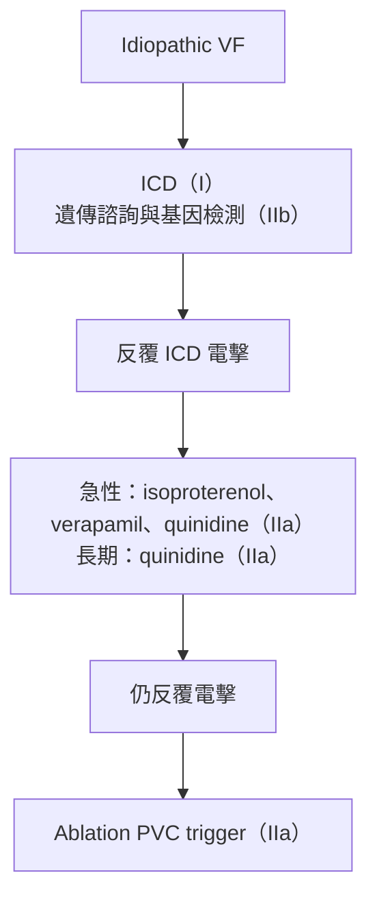
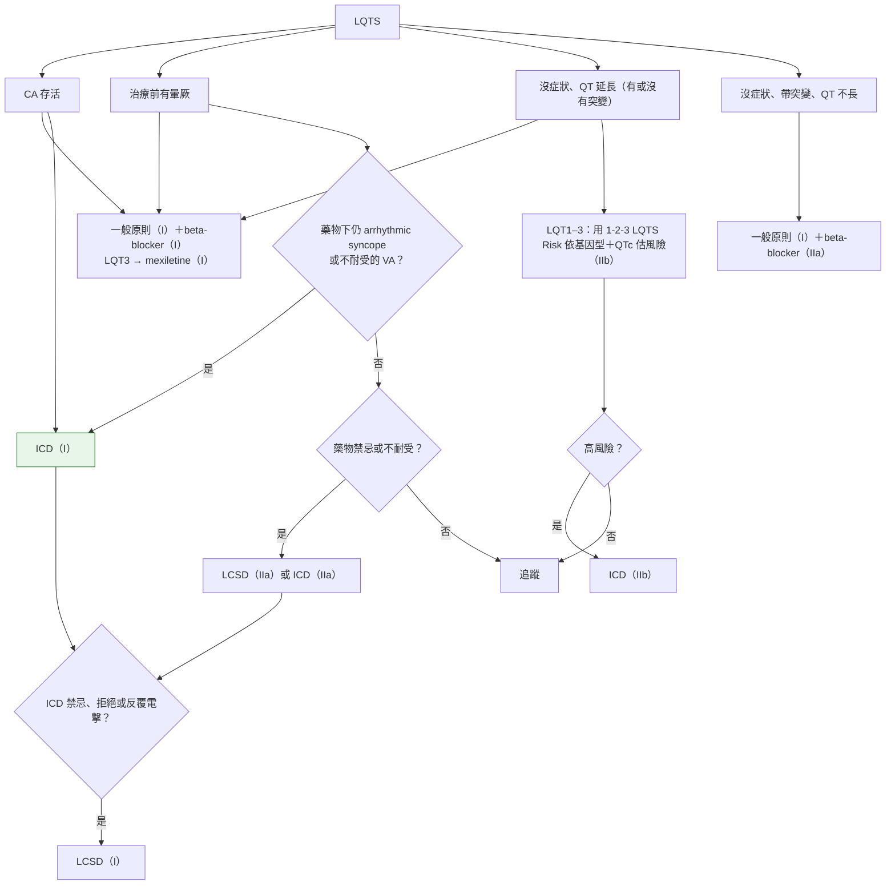
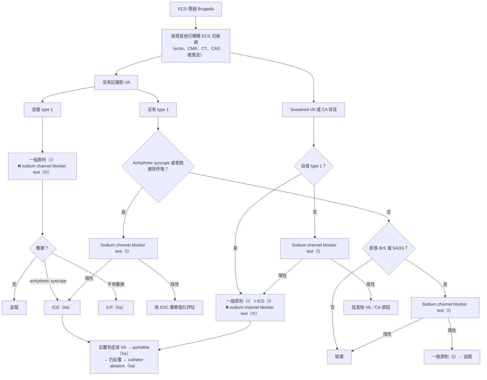
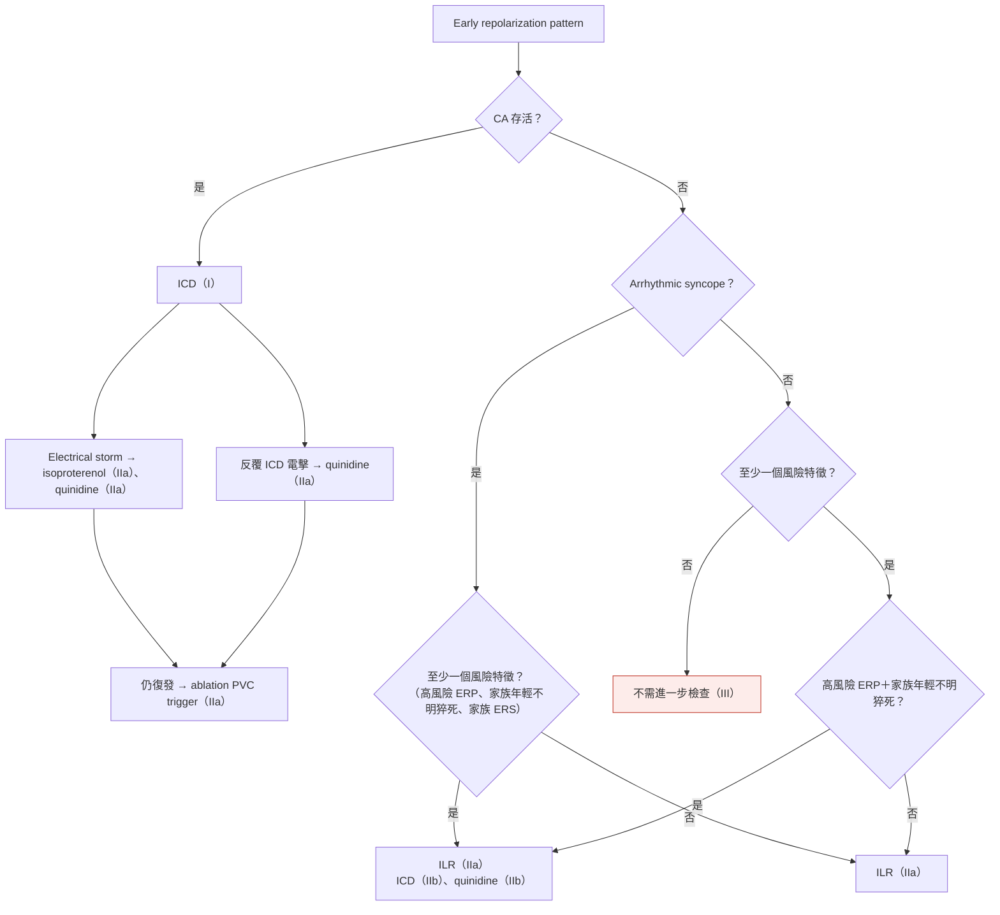
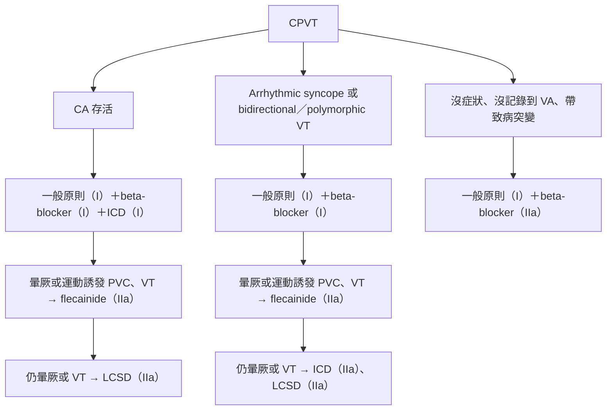

> [!abstract] 一句話重點
> - **LQTS 診斷**：**==QTc ≥ 480 ms（重複 ECG）或 LQTS score > 3（I）==**；有 arrhythmic syncope 時 **QTc ≥ 460** 即可考慮；**帶致病突變不論 QT 都算 LQTS**
>   - 治療：避開延長 QT 的藥、矯正電解質、避開基因型誘因（I）＋**nadolol 或 propranolol（I B）**；**LQT3 → mexiletine（I）**；**CA 存活 → ICD（I B）**
> - **Brugada**：**自發性 type 1 → 診斷（I）**；**藥物誘發的 type 1 單獨不足以診斷**（要合併暈厥、家族史等）
>   - 一般原則：避開 brugadadrugs.org 的藥、**cocaine、大麻、過量酒精**，**發燒要積極退燒**（I）
>   - **CA 或自發 sustained VT → ICD（I）**；**type 1＋arrhythmic syncope → ICD（IIa）**；storm → **isoproterenol**；**quinidine**
> - **CPVT**：**運動或情緒誘發 bidirectional／PVT** → **nadolol 或 propranolol（I）**；不夠加 **flecainide（IIa）** → **LCSD（IIa）**；**CA 後 ICD＋beta-blocker＋flecainide（I）**
> - **SQTS**：**QTc ≤ 360 ms＋（突變、家族史或 VT／VF 存活）（I）**；**QTc ≤ 320 ms 即可考慮（IIa）**
> - **ERP**：**下壁或側壁 ≥ 2 個導程 J point ≥ 1 mm**；**沒症狀的單純 ERP 不需檢查、不放 ICD（III）**；VF 存活＋ERP＝**ERS → ICD（I）**
> - **Idiopathic VF**：排除所有結構、channelopathy、代謝、毒物原因後才診斷 → **ICD（I B）**；storm → **isoproterenol、verapamil、quinidine**

> [!info] 系列導覽
> ↑ 回到 [[cardiology/ventricular-arrhythmia-esc-2022/index|2022 ESC 心室心律不整指引總覽]]
>
> ① [[cardiology/ventricular-arrhythmia-esc-2022/va22-1-evaluation|定義與評估]]｜② [[cardiology/ventricular-arrhythmia-esc-2022/va22-2-acute-longterm|急性處置、藥物與 ICD]]｜③ [[cardiology/ventricular-arrhythmia-esc-2022/va22-3-cad-idiopathic|CAD、Idiopathic PVC/VT]]｜④ [[cardiology/ventricular-arrhythmia-esc-2022/va22-4-cardiomyopathies|心肌病變與其他 SHD]]｜⑤ Primary electrical disease 與特殊族群（本篇）｜📋 [[cardiology/ventricular-arrhythmia-esc-2022/va22-6-recommendations|建議總整理]]｜⑥ [[cardiology/ventricular-arrhythmia-esc-2022/va22-exam|內專考點]]
>
> 本篇來源：2022 ESC VA Guidelines Section 7.2、8、Table 10、Figure 27–37、Recommendation Table 40–50

## 一張表比較五種 channelopathy

| | **LQTS** | **BrS** | **CPVT** | **SQTS** | **ERS** |
| --- | --- | --- | --- | --- | --- |
| **診斷** | QTc ≥ 480 或 score > 3 | **自發 type 1**（V1–V2 coved ST） | 結構正常＋**運動／情緒誘發 bidirectional VT** | **QTc ≤ 360**＋其他條件 | ERP＋不明 VF 存活 |
| 主要基因 | **KCNQ1（LQT1）、KCNH2（LQT2）、SCN5A（LQT3）** | **SCN5A**（陽性率約 20%） | **RYR2**（顯性）、**CASQ2**（隱性） | KCNH2、KCNQ1 gain of function | 基因檢測收穫低 |
| 誘因 | **LQT1 運動（游泳）、LQT2 情緒或聲音、LQT3 睡眠** | **睡眠、發燒**、藥物、酒精、cocaine | **運動、情緒** | — | — |
| **Beta-blocker** | **I（nadolol、propranolol）** | **❌ 不用**（Table 8 列為禁忌） | **I（nadolol、propranolol）** | — | — |
| 特殊藥物 | **LQT3 → mexiletine** | **Quinidine**；storm → **isoproterenol** | **Flecainide** | **Quinidine**；storm → isoproterenol | **Quinidine**；storm → **isoproterenol** |
| **PES** | **❌ 不建議（III）** | 沒症狀自發 type 1 → 可考慮（IIb） | **❌ 不建議（III）** | **❌ 不建議（III）** | — |
| LCSD | **I**（ICD 禁忌或反覆電擊）；IIa | — | **IIa** | — | — |

## Idiopathic VF（Section 7.2.1、Recommendation Table 40、Figure 27–28）

| 建議 | 等級 |
| --- | --- |
| **SCA 存活者（最好有記錄到 VF），排除結構、channelopathy、代謝、毒物原因後才診斷 idiopathic VF** | **I B**（新） |
| 一等親臨床檢查（病史、ECG 含高位導程、運動測試、echo） | IIb B（新） |
| Channelopathy 與 cardiomyopathy 相關基因檢測（陽性率 3–17%） | IIb B（新） |
| **==Idiopathic VF → ICD==** | **I B** |
| **Storm 或反覆電擊的急性處理 → isoproterenol、verapamil 或 quinidine** | **IIa C**（新） |
| **長期壓制 → quinidine** | IIa B（新） |
| **同一 PVC 觸發的反覆 VF、藥物無效 → 有經驗者 ablation** | IIa C |

- **ICD 比 amiodarone 降低心律不整死亡最多 68%**；追蹤 5–6 年約 21–30% 復發、**不當電擊 4.5–17.5%**
- 觸發的 PVC 多來自 **Purkinje 系統**，是 **short-coupled PVC**（打在前一下的 T 波上，Figure 28）；ablation 急性成功率 87–100%
- 一等親檢查的收穫低；**沒症狀親屬的 ERP 意義不明**

## Long QT syndrome（Section 7.2.2、Recommendation Table 41）

| 建議 | 等級 |
| --- | --- |
| **==重複 12-lead ECG 的 QTc ≥ 480 ms（不論症狀），或 LQTS score > 3 → 診斷 LQTS==** | **I C** |
| 臨床診斷 LQTS → **基因檢測與遺傳諮詢** | I C（新） |
| **帶致病突變 → 不論 QT 長度都診斷 LQTS** | I C |
| **重複 ECG QTc 460–479 ms＋arrhythmic syncope**（沒有次發性原因）→ 考慮 LQTS | IIa C |
| **==不常規用 epinephrine challenge 診斷 LQTS==** | **III C**（新） |
| **所有 LQTS：避開延長 QT 的藥、避免並矯正電解質異常、避開基因型特定誘因** | **I C** |
| **有 QT 延長 → beta-blocker（最好 non-selective：nadolol 或 propranolol）** | **I B**（新） |
| **LQT3＋QT 延長 → mexiletine** | **I C**（新） |
| 帶致病突變、QTc 正常 → beta-blocker | IIa B |
| **CA 存活 → ICD＋beta-blocker** | **I B** |
| **吃 beta-blocker 與基因型專屬藥仍有症狀（arrhythmic syncope 或不耐受的 VA）→ ICD** | **I C**（2015 是 IIa） |
| **有症狀 LQTS 的 LCSD**：(a) ICD 禁忌或拒絕；(b) 已有 ICD、藥物下仍多次電擊或暈厥 | **I C** |
| 有症狀、但 beta-blocker 與基因型專屬藥**不耐受或禁忌** → ICD 或 LCSD | IIa C |
| 開始治療前，依**基因型＋QTc** 估算風險 | IIa C（新） |
| 沒症狀、**1-2-3 LQTS Risk calculator** 高風險 → 在基因型專屬治療之外加 ICD | IIb B（新） |
| **侵入性 EPS** | **III C** |

- 平均發病年齡 **14 歲**；**沒症狀、未治療的年 SCD < 0.5%，有暈厥約 5%**
- 基因檢測陽性率約 **75%**，**LQT1–3 佔陽性者 90%**
- 分類：**體顯性 LQTS（約 1/2500）**；有心臟外表現：**Andersen–Tawil（LQT7）**、**Timothy（LQT8：QT 延長、併指、先天心臟畸形、自閉症）**；**體隱性：Jervell and Lange–Nielsen（極長 QT＋先天性耳聾）**
- **Brisk standing test**：從躺到快速站起，**心跳變快但 QT 沒有跟著縮短** → 支持 LQTS（Figure 30）
- **Mexiletine 開長期之前先口服測試，確認 QTc 縮短 ≥ 40 ms**（部分 SCN5A 突變沒反應）
- **CA 存活者吃 beta-blocker 仍有 14% 在 5 年內復發** → ICD
- **LQT2 女性在懷孕、尤其產後第一年風險上升** → **整個孕期與產後持續 beta-blocker**
- **LCSD 不能取代高風險病人的 ICD**（約一半術後仍有事件）

### Modified LQTS diagnostic score（Table 10 依內容重新整理）

| 項目 | | 分數 |
| --- | --- | --- |
| **QTc** | **≥ 480 ms** | **3.5** |
| | 460–479 ms | 2 |
| | 450–459 ms（男性） | 1 |
| | **運動測試恢復期第 4 分鐘 ≥ 480 ms** | 1 |
| ECG 其他 | **Torsade de pointes** | 2 |
| | T wave alternans | 1 |
| | 3 個導程有 notched T | 1 |
| | 心跳以年齡來說偏慢 | 0.5 |
| **暈厥** | **壓力下** | **2** |
| | 沒有壓力 | 1 |
| 家族史 | 家人確診 LQTS | 1 |
| | 一等親 **< 30 歲**不明 SCD | 0.5 |
| **基因** | **致病突變** | **3.5** |

- **總分 > 3 → 診斷 LQTS**

### 三型 LQTS 的 ECG 與誘因（Figure 29–30 依內容重新整理）

| | **LQT1** | **LQT2** | **LQT3** |
| --- | --- | --- | --- |
| 基因 | KCNQ1 | KCNH2 | SCN5A |
| 典型 T 波 | **寬底 T 波** | **低振幅、有切跡（notched）的 T 波** | **長的等電位 ST 段、T 波晚出現** |
| **誘因** | **運動（尤其游泳）** | **情緒、突然的聲音（鬧鐘）** | **睡眠、休息** |
| 特殊治療 | Beta-blocker 效果最好 | Beta-blocker；**產後風險高** | **Mexiletine**（beta-blocker 角色不確定） |

### LQTS 處理流程（Figure 31 依內容重新繪製）

- **一般原則**：避開延長 QT 的藥（crediblemeds.org）；矯正**低血鉀、低血鎂、低血鈣**；避開基因型誘因（**LQT1 劇烈游泳、LQT2 大聲噪音**）

## Andersen–Tawil syndrome type 1（Recommendation Table 42）

| 建議 | 等級 |
| --- | --- |
| 懷疑 Andersen–Tawil → 基因檢測 | I C（新） |
| 沒有 SHD、符合以下**至少 2 項** → 考慮 Andersen–Tawil：**明顯 U 波**（± QT 延長）、**bidirectional 或多形 PVC／VT**、**外觀畸形**、**週期性麻痺**、**KCNJ2 loss of function 突變** | IIa C（新） |
| CA 存活或不耐受的 sustained VT → ICD | I C（新） |
| VA → **beta-blocker 和／或 flecainide（± acetazolamide）** | IIa C（新） |
| 不明暈厥 → ILR | IIa C（新） |
| 不明暈厥或耐受的 sustained VT → ICD | IIb C（新） |

- 也叫 **LQT7**，非常罕見；**KCNJ2（IK1）功能喪失 → U 波變大，QT 反而不太長**
- **Amiodarone 可能 pro-arrhythmic，只在有 ICD 時用**

## Brugada syndrome（Section 7.2.4、Recommendation Table 43）

| 建議 | 等級 |
| --- | --- |
| **==沒有其他心臟病＋自發性 type 1 Brugada ECG → 診斷 BrS==** | **I C** |
| 沒有其他心臟病、**VF 或 PVT 造成的 CA 存活**，且 sodium channel blocker 或**發燒**誘發出 type 1 → 診斷 BrS | I C |
| 先證者 → **SCN5A 基因檢測** | I C（新） |
| 誘發出 type 1＋至少一項（**arrhythmic syncope 或夜間瀕死呼吸**、家族 BrS、**家族 < 45 歲猝死且 autopsy 陰性、情況像 BrS**）→ 考慮 BrS | IIa C（新） |
| **只有**誘發出 type 1、沒有其他心臟病 → 可考慮 BrS | IIb C（新） |
| **==已經出現過 type 1 的人不再做 sodium channel blocker test==** | **III C**（新） |
| **所有 BrS：(a) 避開會讓右胸前導程 ST 上升的藥（brugadadrugs.org）、(b) 避免 cocaine、大麻、過量酒精、(c) 發燒用退燒藥治療** | **I C** |
| **CA 存活和／或自發 sustained VT → ICD** | **I C** |
| **Type 1 pattern＋arrhythmic syncope → ICD** | **IIa C** |
| 不明暈厥 → ILR | IIa C（新） |
| 符合 ICD 但禁忌、拒絕或反覆電擊 → **quinidine** | IIa C |
| **Electrical storm → isoproterenol** | IIa C |
| 藥物無效的反覆適當電擊 → **ablation 觸發 PVC 和／或 RVOT 心外膜基質** | IIa C（2015 是 IIb） |
| 沒症狀、**自發 type 1** → PES | IIb B（新） |
| 沒症狀但 **PES 用最多 2 個額外刺激誘發出 VF** → ICD | IIb C |
| **==沒症狀的 BrS 不做 catheter ablation==** | **III C**（新） |

- **Type 1 Brugada ECG**：V1 或 V2（放在第 2、3 或 4 肋間）至少一個導程 **J point 上升 ≥ 2 mm、coved 型 ST 上升＋T 波倒置**（Figure 32A）
- **藥物或發燒誘發的 type 1 特異性比想像中低**（健康人 2–4%、AVNRT 或 accessory pathway 更高）→ 要**合併其他臨床特徵**才診斷
- **CA 後 10 年 VF 復發 48%**；**約 1/3 以暈厥表現**，不明暈厥的事件風險是沒症狀者的 **4 倍**
- **沒症狀者年事件率約 0.5%**；自發 type 1、ERP、QRS fragmentation 和風險較高有關；**沒症狀者的風險分層仍有爭議**
- Ablation 觸發 PVC（多在 RVOT）或 RVOT 心外膜基質，**> 75% 可抑制 VF 並讓 ECG 正常化**

## Early repolarization pattern／syndrome（Section 7.2.5、Recommendation Table 44）

| 建議 | 等級 |
| --- | --- |
| **==ERP：下壁和／或側壁 2 個相鄰導程 J point 上升 ≥ 1 mm==** | **I C**（新） |
| **ERS：不明原因 VF／PVT 急救成功＋ERP** | **I C**（新） |
| SCD 死者 autopsy 與病歷都陰性、生前 ECG 有 ERP → 考慮 ERS | IIa C（新） |
| ERS 的一等親 → 評估有沒有**高風險特徵的 ERP** | IIa B（新） |
| ERS 基因檢測 | IIb C（新） |
| **==沒症狀的 ERP 不常規做臨床評估==** | **III C**（新） |
| **ERS 的 CA 存活者 → ICD** | **I B**（新） |
| **ERS 的 electrical storm → isoproterenol** | IIa B（新） |
| ERS 反覆 VF → **ICD 之外加 quinidine** | IIa B（新） |
| ERP＋至少一個風險特徵，或 arrhythmic syncope → ILR | IIa C（新） |
| 同一 PVC 觸發的反覆 VF、藥物無效 → PVC ablation | IIa C（新） |
| ERP＋arrhythmic syncope＋其他風險特徵 → ICD 或 quinidine | IIb C（新） |
| 沒症狀但**高風險 ERP＋家族不明年輕猝死** → ICD 或 quinidine | IIb C（新） |
| **==沒症狀的單純 ERP 不放 ICD==** | **III C**（新） |

- **ERP 很常見（成人 5.8%，年輕男性與運動員更多），大多良性**，和 ERS 不同
- **高風險 ERP 特徵**：**J wave > 2 mm**、**J point 與 ST 形態動態變化**、J wave 合併**水平或下斜 ST 段**
- 風險特徵（用來決定 ILR 等）：高風險 ERP、**家族 < 40 歲不明猝死**、家族 ERS
- **ERS 的 VF 至少 40% 會再發**；**isoproterenol** 可壓 storm；**quinidine**（阻斷 Ito）可預防 VF；cilostazol、milrinone 也有報告

## CPVT（Section 7.2.6、Recommendation Table 45）

| 建議 | 等級 |
| --- | --- |
| **==結構正常、ECG 正常，運動或情緒誘發 bidirectional VT 或 PVT → 診斷 CPVT==** | **I C** |
| 帶致病基因突變 → 診斷 CPVT | I C |
| 臨床懷疑或診斷 → **基因檢測與遺傳諮詢** | **I C**（新） |
| **不能做運動測試時 → epinephrine 或 isoproterenol challenge** | IIb C（新） |
| **所有 CPVT：避免競賽運動、劇烈運動、壓力環境** | **I C** |
| **所有臨床診斷 CPVT → beta-blocker（最好 nadolol 或 propranolol）** | **I C**（新） |
| **CA 存活 → ICD＋beta-blocker＋flecainide** | **I C** |
| 基因陽性、沒有表現型 → beta-blocker | IIa C |
| **Beta-blocker＋flecainide 治療劑量無效、不耐受或禁忌 → LCSD** | **IIa C**（2015 是 IIb） |
| **最高耐受 beta-blocker＋flecainide 下仍暈厥或 bidirectional／PVT → ICD** | **IIa C**（2015 是 I） |
| **最高耐受 beta-blocker 下仍反覆暈厥、多形或 bidirectional VT、運動中持續 PVC → 加 flecainide** | IIa C |
| **PES 做 SCD 風險分層** | **III C** |

- 盛行率約 **1/10,000**；Andersen–Tawil 也可以有 bidirectional VT，但有**症候群特徵**可區分
- **運動測試（Figure 36）**：運動時 PVC 逐漸增加 → **bidirectional PVC** → 多形 VT

## Short QT syndrome（Section 7.2.7、Recommendation Table 46）

| 建議 | 等級 |
| --- | --- |
| **==QTc ≤ 360 ms＋至少一項：(a) 致病突變、(b) 家族 SQTS、(c) 沒有心臟病的 VT／VF 存活 → 診斷 SQTS==** | **I C** |
| 診斷 SQTS → 基因檢測 | I C（新） |
| **QTc ≤ 320 ms → 考慮 SQTS** | IIa C（新） |
| **QTc 320–360 ms＋arrhythmic syncope** → 考慮 SQTS | IIa C（新） |
| QTc 320–360 ms＋家族 **< 40 歲猝死** → 可考慮 SQTS | IIb C（新） |
| **CA 存活和／或自發 sustained VT → ICD** | **I C** |
| **年輕 SQTS → ILR** | IIa C（新） |
| **Arrhythmic syncope → ICD** | IIa C（新） |
| 符合 ICD 但禁忌或拒絕，或**沒症狀但家族 SCD** → **quinidine** | IIb C |
| Electrical storm → isoproterenol | IIb C（新） |
| **PES 做 SCD 風險分層** | **III C** |

- 罕見，**短 QT＋早發 AF 與 VF、心臟結構正常**；任何年齡（包括出生後幾個月）都可能致死；**40 歲前首次 CA 機率 > 40%**
- **Quinidine 是證據最多的 AAD**（注意不要讓 QT 過長）；**避開會縮短 QT 的藥（如 nicorandil）**

## 特殊族群（Section 8）

### 懷孕（Recommendation Table 47）

| 建議 | 等級 |
| --- | --- |
| **懷孕中 sustained VT → 電擊** | **I C** |
| 耐受的 SMVT 急性轉律 → beta-blocker、sotalol、flecainide、procainamide 或 overdrive ventricular pacing | IIa C |
| 懷孕中有 ICD 適應症 → **在最佳輻射防護下植入** | I C |
| **==LQTS 或 CPVT：懷孕與產後持續 beta-blocker==** | **I C** |
| ARVC：懷孕中持續 beta-blocker | IIa C（新） |
| Idiopathic sustained VT 的長期處理 → **口服 metoprolol、propranolol 或 verapamil** | IIa C（新） |
| AAD 無效或不耐受的反覆有症狀 SMVT → **非透視 mapping 系統的 ablation，最好第一孕期後** | IIa C（新） |

- **電擊在懷孕任何階段都安全**，事後要監測胎心率；**ICD 在懷孕 8 週後**植入
- **懷孕最後 6 週或產後早期新發 VT → 排除 peripartum cardiomyopathy**；PPCM＋LVEF ≤ 35% 可用 **WCD 3–6 個月**等恢復
- **懷孕禁用的 AAD：amiodarone、atenolol、dronedarone**；耐受性好：**sotalol、口服 verapamil**；禁用 **ACE-I、ARB、ARNI、renin inhibitor**
- **BrS 懷孕沒有額外風險**

### 心臟移植、運動員、WPW、老人（Recommendation Table 48–50）

| 建議 | 等級 |
| --- | --- |
| 等心臟移植 → primary prevention ICD | IIa C |
| 等心臟移植 → WCD | IIb C |
| 移植後 **cardiac allograft vasculopathy 或治療過排斥** → ICD | IIb C（新） |
| 運動員病史、PE 或 ECG 異常 → **echo 和／或 CMR** | I C |
| **運動員診斷出 SCD 相關心血管病 → 依運動資格指引處理** | **I C**（新） |
| **運動場所人員受 CPR 與 AED 訓練** | I C |
| **競賽運動員的參賽前心血管評估** | IIa C（2015 是 I） |
| **年輕（< 35 歲）競賽運動員評估 → 病史、PE、12-lead ECG** | IIa C |
| 中老年人開始劇烈運動前 → 用 **SCORE2** 等評估 CV 風險 | IIa C |
| **老人預期 ICD 沒好處（年齡、共病）→ 可不放 primary prevention ICD** | IIb B（新） |

- 運動員 SCD 隨年齡上升（> 35 歲 2–6.3／10 萬人年；≤ 35 歲 0.4–3）；**女性運動員風險低**（約 1/14）
- **WPW**：最常見 AVRT（80%），其次 AF（20–30%）；**最怕 pre-excited AF 變 VF**（未治療年 0.9–2.4／1000）；**有症狀 AVRT → ablation（I）**，沒症狀高風險 pathway → ablation（I）
- **老人**：MADIT 分析 **≥ 75 歲預測非心律不整死亡**；EU-CERT-ICD **≥ 75 歲沒有 ICD 好處**；DANISH **≤ 70 歲**存活好處最明顯

## 相關筆記

- [[cardiology/ventricular-arrhythmia-esc-2022/va22-1-evaluation|① 定義與評估]]（SCA 存活者、SADS 家屬、Table 6–7）
- [[cardiology/ventricular-arrhythmia-esc-2022/va22-2-acute-longterm|② 急性處置、藥物與 ICD]]（polymorphic storm 依病因、TdP）
- [[cardiology/syncope/index|暈厥 Syncope]]
- [[cardiology/atrial-fibrillation/index|心房顫動 AF（ESC 2024）]]
- [[cardiology/ventricular-arrhythmia-esc-2022/va22-exam|⑥ 內專考點]]

## 參考資料

- Zeppenfeld K, Tfelt-Hansen J, de Riva M, et al. 2022 ESC Guidelines for the management of patients with ventricular arrhythmias and the prevention of sudden cardiac death. *Eur Heart J* 2022;43(40):3997–4126（Section 7.2、8、Table 10、Figure 27–37、Recommendation Table 40–50）（參考資料庫：心臟科／2022 ESC Guidelines for the management of patients with ventricular arrhythmias.pdf）
