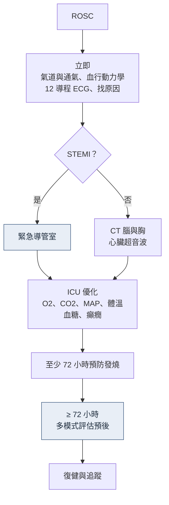

> [!abstract] 一句話重點
> - **AHA 2025**：**IV 優先**（1, A），IO 只在 IV 失敗；**==常規 calcium、bicarbonate、magnesium、vasopressin 都無益==**
> - Epinephrine 1 mg q3–5 min：**非電擊節律越快越好**，**可電擊節律初次電擊失敗後**再給
> - 難治性 VF：amiodarone 或 lidocaine 擇一（2b）；DSED、vector change 各 2b、尚非常規
> - **==院內 VF：電擊延遲超過 2 分鐘，存活率砍半==**；CCU 有監測，看到 VF 就電
> - ROSC 後：**12 導程**，**STEMI → 緊急導管，不管醒不醒**；沒有 STEMI → 不必緊急攝影
> - 目標：**MAP ≥ 65、SpO2 90–98%、PaCO2 35–45**；體溫 **32–37.5 °C、>37.7 °C 就處置**、至少 36–72 小時；**不用冷食鹽水 bolus**
> - 不聽指令做 EEG；**不給預防性抗癲癇藥**；預後 **≥ 72 小時、多模式**
> - ECPR：傳統急救 **10–15 分鐘無效就叫**，**60 分鐘內上流量**；院內 CCU 病人是條件最好的一群

> [!info] 系列導覽
> ↑ 回到 [[critical-care/ccu-orientation/index|CCU orientation 總覽]]
>
> ① [[critical-care/ccu-orientation/ccu-1-workflow|CCU 的一天]]｜② [[critical-care/ccu-orientation/ccu-2-anticoagulation|抗凝與導管]]｜③ 急救與復甦後（本篇）｜④ [[critical-care/ccu-orientation/ccu-4-shock-hf|休克、MCS、急性心衰]]｜⑤ [[critical-care/ccu-orientation/ccu-5-acs-pci|ACS 與 PCI 後]]｜⑥ [[critical-care/ccu-orientation/ccu-6-arrhythmia|心律不整]]｜⑦ [[critical-care/ccu-orientation/ccu-7-other|其他急症]]
>
> 完整的 AHA 2025 流程與劑量見 [[cardiology/resuscitation-aha-2025/index|心肺復甦與急救（2025 AHA）]]

## AHA 2025 成人 ACLS：六個要記的 Class

| 項目 | 2025 AHA |
| --- | --- |
| **給藥路徑** | **IV 優先（1, A）**；IO 只在 IV 失敗或不可行（2a, A）；central line 可考慮（2b） |
| 難治性 VF | **DSED** 與 **vector change** 各 2b, B-R（DOSE VF） |
| **常規 calcium、bicarbonate、magnesium** | **3: No Benefit** |
| **Vasopressin** | 單用或併 epinephrine：**3: No Benefit**；類固醇 2b |
| Epinephrine 時機 | **非電擊節律盡快**；**可電擊節律初次電擊失敗後**（各 2a） |
| 持續性多形性 VT | **立即去顫**（Class 1） |

### Epinephrine

- 建議使用（1, B-R）；**1 mg q3–5 min**（2a, B-R）
- Asystole、PEA：越快越好；VF、pVT：初次去顫失敗後再給
- VAM-IHCA（IHCA，n = 501）：vasopressin＋methylprednisolone 提高 ROSC（42% vs 33%），**30 天存活沒差** → ROSC 升高不等於存活

### IV vs IO

- 3 個 RCT、9,332 人：IO 優先沒有改善 30 天存活（OR 0.99），**持續 ROSC 較低**（OR 0.89）；PARAMEDIC-3 30 天存活 IO 4.5% vs IV 5.1%
- CCU 病人多半已有 IV → **第一支藥從現有管路推**

### 難治性 VF

- DOSE VF：DSED RR 2.21、vector change RR 1.71（存活出院）
- AHA 2025：兩者各 **2b**，尚不建議常規 → 三次電擊仍 VF 可考慮

### 藥物

| 藥物 | 2025 AHA | 備註 |
| --- | --- | --- |
| **Amiodarone 或 lidocaine** | 電擊無效的 VF／pVT：**2b, B-R** | 兩者擇一 |
| Magnesium | 常規 3: No Benefit；**TdP 2b** | 只在 TdP |
| Calcium | 常規 3: No Benefit | 高血鉀、CCB 中毒另論 |
| Sodium bicarbonate | 常規 3: No Benefit | TCA 中毒另論 |
| Vasopressin | 3: No Benefit | 單用或併用都是 |

### ETCO2

- 用動脈壓或 ETCO2 監測 CPR 品質（2b）；ETCO2 突然上升可偵測 ROSC（2b）
- **插管**病人 ETCO2 一直 < 10 mmHg 可作為終止急救的**因素之一**（2b）
- **未插管**病人任何時間都**不能用 ETCO2 決定終止（3: Harm）**

### 院內心跳停止：去顫要快

- IHCA VF／pVT 6,789 人：中位時間到電擊 1 分鐘，**30.1% 延遲超過 2 分鐘**
- **延遲者存活 22.2% vs 39.3%**（校正 OR 0.48），每多一分鐘再往下掉；延遲多發生在無監測病房與非上班時間
- AHA 2025：code team 要有 ALS 訓練者（1）；early warning、快速反應小組、急救後 debriefing（2a）

## ROSC 之後

### 要不要緊急冠狀動脈攝影

| 情境 | 建議 |
| --- | --- |
| **STEMI** | **==緊急冠狀動脈攝影，不論昏迷與否==**（1, B-NR） |
| **無 STEMI** | 緊急攝影**不優於**延遲或選擇性策略（3: No Benefit, B-R）；休克、反覆 VA、持續缺血者可考慮（2a） |

- COACT（可電擊、無 STEMI）：90 天存活 64.5% vs 67.2%
- TOMAHAWK（任何節律）：30 天死亡**立即組 54.0% vs 延遲組 46.0%**（HR 1.28）
- → 半夜三點的決定：**有 STEMI 才送，沒有就先穩定**

### 復甦後照護順序（ERC-ESICM 2021）

（依講義內容整理，非原圖）

### 血壓、氧氣、二氧化碳

| 目標 | 2025 AHA | 證據 |
| --- | --- | --- |
| **MAP** | **≥ 65 mmHg**（1, B-R） | BOX：MAP 77 vs 63，死亡或 CPC 3–4 34% vs 32%（HR 1.08） |
| **氧氣** | 先 100% 直到 SpO2 可靠，再降到 **90–98%**（2a） | BOX O2：低 vs 高氧氣目標無差 |
| **PaCO2** | **35–45 mmHg**（1, B-R） | — |
| ERC 2021 | SpO2 94–98%、PaO2 75–100 mmHg；避免 MAP < 65 | — |

### 癲癇

- **不聽從指令**的病人要做 **EEG**（1, C-LD）
- 治療臨床癲癇（1）與 EEG 上的癲癇（2a）
- **==不建議預防性抗癲癇藥==**（3: No Benefit）
- 沒有 EEG 對應的 myoclonus 不要壓抑（3: No Benefit）

### 體溫控制

| | 內容 |
| --- | --- |
| 目標 | **AHA 2025：32–37.5 °C**（1, B-R）；**ERC-ESICM 2022：預防發燒 > 37.7 °C 至少 72 小時** |
| 33 °C 有沒有比較好 | TTM、TTM2：33 °C 和對照組好神經結果差不多 |
| 多久 | **AHA：總共至少 36 小時**（2a）；BOX（36 vs 72 小時）HR 0.99；ICECAP（33 °C 6–72 小時）越久沒有更好 |
| 非電擊節律 | HYPERION（33 vs 37 °C）：90 天 CPC 1–2 10.2% vs 5.7%，死亡率無差；IPD 統合分析未證實 |
| 院內協定 | 二選一：**預防發燒（> 37.7 處置）**或選擇性 33 °C |

> [!warning] Pitfall：不要用冷生理食鹽水大量 bolus 降溫
> - 院前 RCT（n = 1,359，4 °C 食鹽水最多 2 L）：存活與神經學無益，**再度心跳停止 26% vs 21%**，肺水腫與利尿劑使用增加
> - AHA 2025：院前常規快速冷輸液 3: No Benefit；ERC-ESICM 2022 也建議不要
> - CCU 病人正是最怕肺水腫的族群

### 發抖、鎮靜、電解質、血糖

- **鎮靜**：短效鎮靜劑與類鴉片（例如 fentanyl）；**neuromuscular blocker 只在嚴重發抖**
- **回溫 ≤ 0.5 °C/h**（AHA 2b；院內 0.25 °C/h 符合）；貼片或血管內導管都一樣
- **==發燒處置門檻 37.7 °C，不是 38==**
- 血糖 **140–180 mg/dL**，避免 < 70；**避免低血鉀**（VA 風險）
- **不常規預防性抗生素**，懷疑感染才給

### 神經預後

- AHA 2025：**多模式**（1, B-NR）；**常溫後 ≥ 72 小時**才下結論（2a）
- 個別檢查各 2b：瞳孔與角膜反射（≥ 72 h）、N20 SSEP、NSE 與 NfL、CT 與 MRI
- ERC：ROSC 後 ≥ 72 小時且 motor ≤ 3，加 **≥ 2 項一致**的預測因子
- **永遠不靠單一發現**

## ECPR

### 三個 RCT：一正、一邊緣、一中性

- **ARREST**（正向）、**Prague OHCA**（n = 256；180 天 CPC 1–2 31.5% vs 22.0%，P = 0.09；出血 31% vs 15%）、**INCEPTION**（中性）
- 貝氏統合 RR 1.47（CrI 0.73–3.32）；差異可能來自照護系統、病人選擇與中心經驗

### 時間軸（ELSO 2021）

| 時間點 | 要做什麼 |
| --- | --- |
| 傳統急救 **10–15 分鐘無效** | **考慮 ECPR，叫人、備機** |
| 10–20 分鐘 | 開始置管 |
| **停跳後 60 分鐘內** | **ECMO 上流量** |

### 選案

| ELSO 2021 範例 | RCT 收案條件 |
| --- | --- |
| 年齡 < 70 | ARREST 18–75；INCEPTION 18–70；Prague 18–65 |
| 目擊、no-flow < 5 分鐘 | INCEPTION 要有旁觀者 CPR |
| 初始 VF／pVT／PEA | ARREST：三次電擊後仍 VF |
| 停跳到流量 < 60 分鐘 | Prague：≥ 5 分鐘 ACLS 無 ROSC |
| 插管前 ETCO2 > 10 mmHg | — |
| 無限制壽命的共病、**無 aortic regurgitation** | — |

- AHA 2025：**各中心自訂並定期檢討選案條件**（2a）→ 依院內 ECMO 團隊啟動條件，**先打電話再談條件**
- **院內 ECPR 最有利**：統合分析 IHCA 次組死亡 OR 0.42（OHCA 不顯著）；中心量越大死亡越低
- IHCA ECPR（n = 294）壞神經結果：asystole 88.1%、PEA 66.3%、可電擊 50.6%
- **CCU 病人**：目擊、有監測、可快速置管 → ECPR 條件最好的一群

> [!tip] 模組 3 帶走
> - IV 優先；DSED／vector change 2b；常規鈣、bicarbonate、鎂、vasopressin 無益；多形性 VT 立即去顫
> - 院內 VF 2 分鐘內電；ROSC 後有 STEMI 才緊急送導管室
> - 體溫 32–37.5 °C、> 37.7 就處置、至少 36–72 小時；不用冷食鹽水 bolus；回溫 ≤ 0.5 °C/h
> - MAP ≥ 65、SpO2 90–98、PaCO2 35–45；沒做 EEG 不給預防性抗癲癇藥
> - 預後 ≥ 72 小時多模式；ECPR 10–15 分鐘考慮、60 分鐘內上流量
> - **這是體溫控制，不是低溫治療**

## 📝 講義小考

> [!question]- Q1：ROSC 後昏迷、ECG 沒有 STEMI、血壓穩定。要立刻送導管室嗎？
> (A) 要，所有 OHCA 都該立刻做
> (B) 不用，無 STEMI 的緊急攝影不優於延遲策略
> (C) 看 troponin 再決定
> (D) 等醒來再問
>
> > [!success]- 答案與詳解
> > **(B)**。AHA 2025 對無 STEMI 的緊急攝影是 3: No Benefit（COACT、TOMAHAWK）；休克、反覆 VA 或持續缺血才考慮。

> [!question]- Q2：ROSC 後第 12 小時體溫 38.0 °C，怎麼做？
> (A) 不處理，38 度以下才算發燒
> (B) 超過 37.7 °C 就要處置，用裝置或藥物把體溫控回 ≤ 37.5
> (C) 立刻冷食鹽水 30 mL/kg
> (D) 給抗生素
>
> > [!success]- 答案與詳解
> > **(B)**。復甦後至少 72 小時預防發燒，門檻是 37.7 °C；冷食鹽水 bolus 增加再停跳與肺水腫；抗生素只在懷疑感染時給。

## 🎯 相關內專考點

- [[cardiology/resuscitation-aha-2025/cpr25-exam|CPR 2025 內專考點]]

## 相關筆記

- [[cardiology/resuscitation-aha-2025/cpr25-2-adult-als|成人 ALS（2025 AHA）]]
- [[cardiology/resuscitation-aha-2025/cpr25-3-post-arrest-special|ROSC 後與特殊情況（2025 AHA）]]

## 參考資料

- Ling LC（Lo-Chieh Ling, MD）. CCU orientation 2026（住院醫師講義，模組 3）. 新光吳火獅紀念醫院心臟內科, 2026-11.
- Wigginton JG, et al. 2025 AHA Guidelines Part 9: Adult Advanced Life Support. *Circulation* 2025;152(16 suppl 2):S538–S577.
- Hirsch KG, et al. 2025 AHA Guidelines Part 11: Post-Cardiac Arrest Care. *Circulation* 2025;152(16 suppl 2):S673–S718.
- Dezfulian C, et al. 2025 AHA Guidelines Part 4. *Circulation* 2025;152(16 suppl 2):S353–S384.
- Nolan JP, et al. ERC-ESICM guidelines 2021: post-resuscitation care. *Intensive Care Med* 2021;47:369–421.
- Sandroni C, et al. ERC-ESICM temperature control 2022. *Intensive Care Med* 2022;48:261–269.
- Chan PS, et al. Delayed time to defibrillation after in-hospital cardiac arrest. *N Engl J Med* 2008;358:9–17.
- Cheskes S, et al. DOSE VF. *N Engl J Med* 2022;387:1947–1956.
- Richardson ASC, et al. ELSO ECPR interim guideline. *ASAIO J* 2021;67:221–228.
