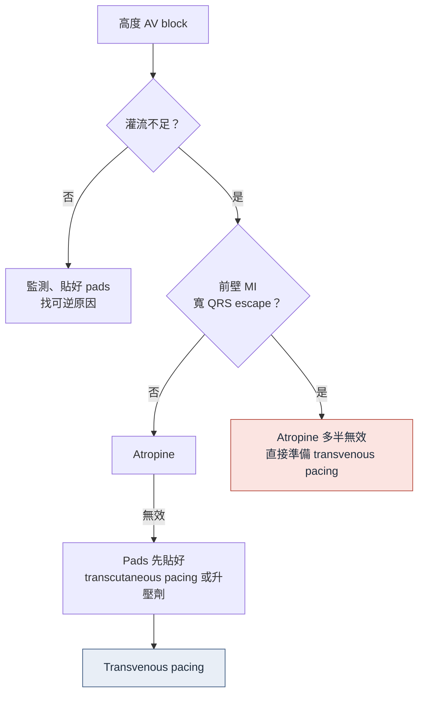

> [!abstract] 一句話重點
> - **高度 AV block**：灌流決定急不急；**atropine → pads 或升壓劑 → transvenous pacing**；**前壁 MI 的寬 QRS block atropine 多半沒用**，直接準備經靜脈節律
> - **先排除可逆原因**（藥物、高血鉀、**BRASH**、缺血）；下壁 MI 的 block 多會恢復、前壁預後差；永久節律器 **≥ 5–10 天後**再說
> - 暫時節律器併發症 **36.7%** → 每天看 threshold、sensing、CXR；**output 2–3 倍 threshold、sensitivity 取感知振幅一半**
> - **CCU 的 AF：先治火（誘因），再治警報**；**==EF ≤ 40% 不能給 IV diltiazem 或 verapamil（3: Harm）==**
> - 電擊整流：**≥ 200 J**、**每一次都確認 sync**；**==電擊後至少 4 週抗凝，不論 CHA₂DS₂-VASc==**
> - **==Pre-excited AF：AV nodal blocker 六種全禁==** → 鎮靜＋同步電擊（講義所述院內無 ibutilide、procainamide）
> - Amiodarone 有三種寫法（VF、AF ACC/AHA、ESC 表），**開的時候寫清楚是哪一種**；digoxin 濃度要給藥後 ≥ 6 小時抽
> - **VT storm**：鎮靜＋**propranolol**；TdP：**IV Mg＋K 補到高正常**、停 QT 延長藥；**MI 後 48 小時內的 VF 不裝 ICD**

> [!info] 系列導覽
> ↑ 回到 [[critical-care/ccu-orientation/index|CCU orientation 總覽]]
>
> ① [[critical-care/ccu-orientation/ccu-1-workflow|CCU 的一天]]｜② [[critical-care/ccu-orientation/ccu-2-anticoagulation|抗凝與導管]]｜③ [[critical-care/ccu-orientation/ccu-3-resuscitation|急救與復甦後]]｜④ [[critical-care/ccu-orientation/ccu-4-shock-hf|休克、MCS、急性心衰]]｜⑤ [[critical-care/ccu-orientation/ccu-5-acs-pci|ACS 與 PCI 後]]｜⑥ 心律不整（本篇）｜⑦ [[critical-care/ccu-orientation/ccu-7-other|其他急症]]

## 高度 AV block

### 前十分鐘

（依講義內容整理，非原圖；劑量見 [[cardiology/resuscitation-aha-2025/index|AHA 2025 流程]]）

- **灌流決定急不急**，不是 ECG 的名字；**再給第二支 atropine 前先把 pads 貼好**

### 下壁 vs 前壁 MI 的 AV block

| | **下壁 MI** | **前壁 MI** |
| --- | --- | --- |
| 阻斷位置 | 多在 **His 之上**（結內、迷走） | 多在 **His 之下**，先有心室內傳導障礙 |
| 意義 | **再灌流後多自行恢復** | 梗塞範圍大、**預後差** |
| 發生率（PPCI，n = 1,295） | 非前壁 10.7% | 前壁 1.7%；**只有前壁的 AV block 預測死亡** |
| 永久節律器 | 觀察到**第 10 天**仍未恢復才裝（ESC 2021） | 前壁、雙束支、進行性 AVB：觀察 **≥ 5 天**（ESC 2021；ESC 2023 I C） |

### 先排除可逆原因

| 類別 | 內容 |
| --- | --- |
| 藥物 | β-blocker、non-DHP CCB、digoxin、amiodarone、clonidine、ivabradine |
| **BRASH** | **Bradycardia、Renal failure、AV nodal blocker、Shock、Hyperkalemia** 互相惡化的循環 → 只治心跳會輸 |
| Lyme carditis | 高度 AVB 是最常見的心臟表現，抗生素後多半恢復；台灣少見，要問旅遊史 |
| 其他 | 缺血、高血鉀、缺氧、甲狀腺低下、感染 |

## 暫時經靜脈節律器

- **高併發症裝置**：32 個研究、4,546 人，併發症 **36.7%**（嚴重 10.2%），近十年仍 22.9%
  - 起搏或感知失敗 9.5%、**移位 4.6%**、**穿孔 1.6%**；美國資料 tamponade 0.6%、pneumothorax 0.9%
  - 64.2% 最後接永久節律器
- 路徑：**右內頸**或左鎖骨下角度最好；**頸靜脈感染比股靜脈低**（RR 0.25）
- ESC 2021：能避免就避免、盡早移除；首選頸靜脈；要放久就用主動固定導線接外置機

### 設定

| 設定 | 原則 | 數字 |
| --- | --- | --- |
| Mode | **VVI**：感知到自身心跳就抑制，不跟它打架 | — |
| Rate | 依灌流決定；備援常 50–60 | 依院內協定 |
| **Output** | 高於量到的 capture threshold，留安全邊際 | **2–3 倍 threshold** |
| **Sensitivity** | 低於量到的感知振幅（mV 越小越敏感） | **約感知振幅的一半** |

- **Threshold 測法**：rate 設比自身心跳快 10/min 全部起搏 → 把 output 往下調到失去 capture
- **Sensing 測法**：rate 設低於自身心跳、output 調低 → 調 sensitivity 到 sense 燈不再跟著跳
- **每天看 threshold、sensing、CXR**

## Brugada 藥物激發試驗

- 講義所述院內用 **口服 flecainide 300 mg**（共識範圍 200–300 mg）；400 mg 只見於小型系列，不用
- Ajmaline 比 flecainide 敏感（100% vs 68%）；**口服陰性不能排除**
- **高位導程**（V1、V2 放第 2、3 肋間）**每一次都做**

### 停止條件

| 停止條件 | 意義 |
| --- | --- |
| 出現 **type 1** | 陽性，停 |
| **QRS 比基礎寬 ≥ 30%** | 安全慣例（40% 的陽性在 QRS 變寬後才出現） |
| 頻繁 PVC、NSVT 或更嚴重 | 停 |
| 二度或三度 AV block | 停 |

- 惡性心律不整 0–10.7%（平均約 1.4%）→ 備好 **isoproterenol**、去顫器、必要時 ECMO、暫時節律
- 監測到 ECG 回到基礎型態
- **不要測**：已有自發 type 1；無症狀 type 2 且無家族史

### 住院與出院衛教

- **==發燒立即積極退燒==**（Class I）
- 用藥前查 **brugadadrugs.org**：class IC 與其他鈉通道阻斷劑、TCA 與部分精神藥、部分麻醉藥、鋰鹽、部分抗組織胺
- 避免過量飲酒；矯正鉀與酸血症
- 家族 ECG 篩檢要用高位導程

## CCU 的 AF

### 先治火，再治警報

- **原因治好後 48 小時內最高 83% 自行轉回竇性**；危重病人緊急整流早期復發率高
- 穩定的急性 AF：**先控制心跳、觀察，同時處理誘因**
- AFIB-ICU（n = 1,415）：校正後 90 天死亡不顯著（HR 1.38）→ AF 是**嚴重度的標記**，多於獨立殺手
- 敗血症 AF 的腸道外抗凝**沒有減少中風**（1.3% vs 1.4%）、出血較多（ACC/AHA 2b）

### 急性心跳控制（2023 ACC/AHA）

| 順序 | 藥物 | Class |
| --- | --- | --- |
| 1 | **β-blocker 或 diltiazem／verapamil（限 EF > 40%）** | COR 1 |
| 2 | Digoxin（前者無效或禁忌） | 2a |
| 加成 | **IV magnesium** | 2a A |
| 3 | IV amiodarone（危重或失代償 HF） | 2b，**可能整流 → 中風風險** |
| **禁** | **IV non-DHP CCB 合併中重度 LV 收縮功能不良** | **3: Harm** |

- 目標：無 HF 的 AF 靜息 < 100–110（2a；RACE II 是門診資料，用在 ICU 是外推）
- 敗血症 AF（觀察性）：β-blocker 1 小時內控制最快

### HF 合併 AF

- IPD 統合：**β-blocker 死亡率益處在竇性 HR 0.73，在 AF 只有 HR 0.97**
- RATE-AF（digoxin vs bisoprolol）：SF-36 無差、症狀改善較多、不良事件 25% vs 64%
- 節律控制（ablation）：CASTLE-AF HR 0.62、CASTLE-HTx HR 0.24、EAST-AFNET 4 HF 次組 HR 0.74；ESC 2024 tachycardiomyopathy 高度可能 I B、其他 IIa B

### 電擊整流

| 情境 | 怎麼做 |
| --- | --- |
| **不穩定且歸因於 AF** | **立刻電**（1） |
| AF ≥ 48 小時（ACC/AHA）或 > 24 小時（ESC） | **3 週抗凝**，或**影像（TEE）排除血栓** |
| TEE 有血栓 | 延後，抗凝 3–6 週再照（1） |
| **電擊後** | **至少 4 週抗凝，不論中風風險**（1）；長期依分數 |
| 講義所述院內日間流程 | 中午 TEE、下午電擊、隔天出院 |

**技術**

- **初始能量 biphasic ≥ 200 J**（2a）：最大固定能量首次成功 75% vs 低能量遞增 34%
- 貼片：2021 RCT anterior-lateral 首次成功 54% vs anterior-posterior 33%（2002 小試驗相反）；ACC/AHA 兩種皆可，長期 AF 可偏好前後位
- **==每一次電擊前都確認 sync==**（1）；失敗 → 換向量、加能量、先給抗心律不整藥
- 鎮靜用 mg 寫，照 ASA 中度鎮靜標準監測

## IV 藥劑量卡

### Amiodarone：三種寫法

| 適應症 | 劑量 | 出處 |
| --- | --- | --- |
| **VF／不穩定 VT** | **150 mg／10 分鐘 → 1 mg/min × 6 小時 → 0.5 mg/min × 18 小時**；之後 720 mg/天 | 仿單 |
| AF 心跳控制 | 150–300 mg IV／1 小時 → 10–50 mg/h × 24 小時 | ACC/AHA Table 21 |
| **ESC 2024 AF 劑量表**（講義所述院內慣用） | **300 mg／30–60 分鐘 → 900–1200 mg／24 小時**，優先中央靜脈 | ESC 2024 |
| 口服 | 總負荷 6–10 g（每天 400–800 mg、1–4 週）→ 每天 200 mg | ACC/AHA Table 23 |

- **「200 mg BID」是負荷期劑量，不是維持**
- 監測：TFT（事前與定期）、LFT、**QTc**、心搏過緩或 AV block（備暫時節律器）、肺；半衰期 9–36 天

### Digoxin

| 項目 | 現行 |
| --- | --- |
| IV 負荷 | 0.25–0.5 mg IV → 之後 0.25 mg q6h，**24 小時最多 1.5 mg** |
| 口服維持 | 0.0625–0.25 mg/天；血中 > 1.2 ng/mL 死亡率上升 |
| **濃度** | < 0.5 ng/mL 效果不足、> 2 ng/mL 毒性；**==給藥後 ≥ 6 小時抽==** |
| 注意 | 電擊前考慮暫停或減量；**WPW pre-excited AF 禁**；急性 MI 不建議；**加 amiodarone 減 15–30%** |

### 其他 IV 藥（2023 ACC/AHA Table 21）

| 藥物 | 劑量 | 注意 |
| --- | --- | --- |
| **Diltiazem** | 0.25 mg/kg IV 2 分鐘，可再 0.35 mg/kg；5–15 mg/h | **HFrEF 避免** |
| Verapamil | 5–10 mg ≥ 2 分鐘，可重複兩次；5 mg/h（最多 20） | **HFrEF 避免** |
| Metoprolol | 2.5–5 mg IV 2 分鐘，最多 3 劑 | — |
| Esmolol | 500 µg/kg 1 分鐘 → 50–300 µg/kg/min | 半衰期 9 分鐘 |
| Propranolol | 1 mg/min，每 2 分鐘重複，至多 3 劑 | VT storm 也用它 |

> [!danger] Pre-excited AF（WPW＋AF）
> **六種 AV nodal blocker 全禁**：verapamil、diltiazem、amiodarone、digoxin、adenosine、β-blocker。
> 指引首選 ibutilide 或 procainamide（講義所述院內無庫存）→ **鎮靜＋同步電擊**。

## VT storm

- 定義：**24 小時內 ≥ 3 次持續性 VT／VF**（各間隔 ≥ 5 分鐘）；不穩定就電
- 交感神經的急症，不是劑量問題
  - ESC 2022：輕中度鎮靜 I C；難治 → 深度鎮靜或插管 IIa C
  - **Propranolol vs metoprolol**（都合併 IV amiodarone）：24 小時無心律不整 **90.0% vs 53.3%**
- 升階：overdrive pacing → 星狀神經節阻斷（個案證據）→ MCS → **早叫 EP 電燒**

## TdP 與多形性 VT

| | **TdP（QT 長）** | **多形性 VT（QT 正常）** |
| --- | --- | --- |
| 原因 | 藥物、電解質、先天 | **缺血** |
| 處置 | **IV magnesium**、**K 補到高正常**；**停所有 QT 延長藥**（amiodarone 也會）；pause-dependent → overdrive pacing 或 isoproterenol | **導管室** |
| 監測 | 住院中每天 QTc，保持 **< 500 ms** | — |

## MI 後的 VF 與 ICD

- APEX-AMI：PPCI STEMI 的 VT／VF 5.7%，**90% 在 48 小時內**
- **==MI 後 48 小時內的 VF／VT 歸因於缺血與再灌流，不裝 ICD==**；48 小時後或持續缺血才做次級預防評估
- DINAMIT、IRIS：**MI 後 40 天內預防性 ICD 全死因無益**；ESC VA 6 週、ESC ACS 6–12 週後再評估 LVEF
- VEST（wearable cardioverter-defibrillator）：心律性死亡無差（中位穿戴每天 18 小時）

> [!tip] 模組 6 帶走
> - AVB：atropine → pads／升壓劑 → 經靜脈；先排可逆原因；下壁多恢復、前壁預後差；永久節律 5–10 天後
> - 暫時節律器併發症 36.7%，每天看 threshold、sensing、CXR
> - Brugada 激發：口服 flecainide、高位導程每次做、四個停止條件、救援備好
> - AF：先治原因；EF > 40% 才 diltiazem；IV Mg 2a；電擊 ≥ 200 J、每次 sync、之後 4 週抗凝
> - Amiodarone 三種寫法、digoxin 間隔 6–8 小時；pre-excited AF 六種藥全禁；storm 用 propranolol＋鎮靜；MI 後 48 小時與 40 天兩條線

## 📝 講義小考

> [!question]- Q1：Pre-excited（WPW）AF，心跳 200、血壓 100/60，可以給哪一種？
> (A) IV diltiazem
> (B) IV amiodarone
> (C) IV digoxin
> (D) 以上都不行：鎮靜後同步電擊
>
> > [!success]- 答案與詳解
> > **(D)**。Pre-excited AF 六種 AV nodal blocker（verapamil、diltiazem、amiodarone、digoxin、adenosine、β-blocker）都禁用，會讓更多衝動走旁路；指引首選 ibutilide 或 procainamide，院內沒有就鎮靜後同步電擊。

> [!question]- Q2：AF 電擊成功，CHA₂DS₂-VASc 0 分。要抗凝嗎？
> (A) 不用，0 分
> (B) 至少 4 週，不論分數
> (C) 終身
> (D) 只有做 TEE 的才要
>
> > [!success]- 答案與詳解
> > **(B)**。電擊後心房 stunning，至少 4 週抗凝與中風風險無關（Class 1）；之後長期抗凝才依 CHA₂DS₂-VASc 決定。

## 🎯 相關內專考點

- [[cardiology/atrial-fibrillation/af-exam|AF 內專考點]]
- [[cardiology/resuscitation-aha-2025/cpr25-exam|CPR 2025 內專考點]]（bradycardia、tachycardia）

## 相關筆記

- [[cardiology/atrial-fibrillation/af-esc-2024-3-rate-rhythm|AF 心跳與節律控制（ESC 2024）]]
- [[cardiology/atrial-fibrillation/af-esc-2024-2-anticoagulation|AF 抗凝（ESC 2024）]]
- [[cardiology/syncope/index|Syncope]]

## 參考資料

- Ling LC（Lo-Chieh Ling, MD）. CCU orientation 2026（住院醫師講義，模組 6）. 新光吳火獅紀念醫院心臟內科, 2026-11.
- Glikson M, et al. 2021 ESC Guidelines on cardiac pacing and CRT. *Eur Heart J* 2021;42:3427–3520.
- Tjong FVY, et al. Temporary transvenous pacing complications. *Neth Heart J* 2019;27:462–473.
- Wilde AAM, et al. Expert consensus on Brugada drug challenge. *Eur Heart J* 2023;44:2427–2439.
- Joglar JA, et al. 2023 ACC/AHA/ACCP/HRS Guideline for AF. *Circulation* 2024;149:e1–e156.
- Van Gelder IC, et al. 2024 ESC Guidelines for AF. *Eur Heart J* 2024;45:3314–3414.
- Schmidt AS, et al. Electrode position for cardioversion. *Circulation* 2021;144:1995–2003.
- Chatzidou S, et al. Propranolol vs metoprolol for electrical storm. *J Am Coll Cardiol* 2018;71:1897–1906.
- Zeppenfeld K, et al. 2022 ESC Guidelines for VA and SCD. *Eur Heart J* 2022;43:3997–4126.
- Tisdale JE, et al. Drug-induced arrhythmias (AHA). *Circulation* 2020;142:e214–e233.
