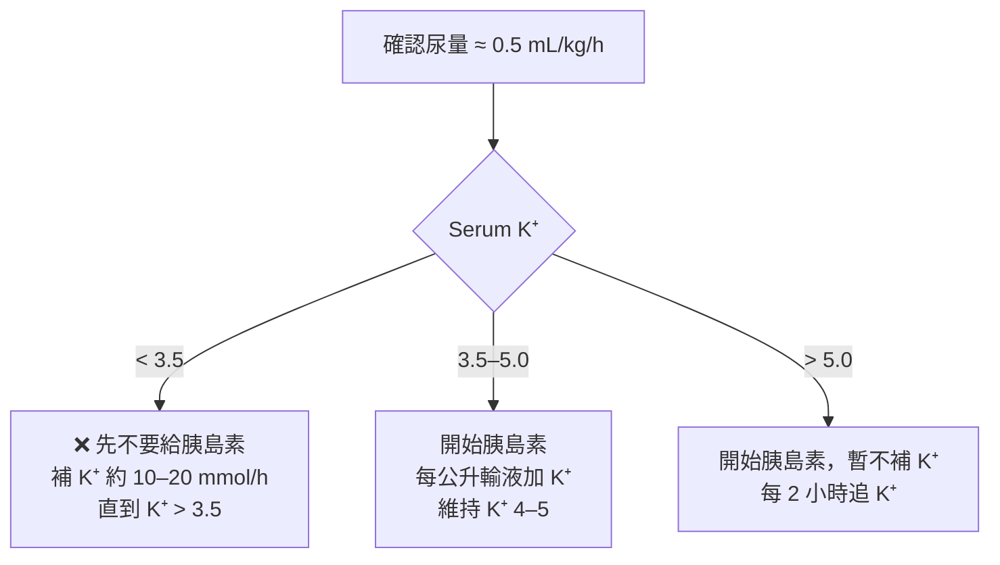

> [!abstract] 一句話重點
> DKA 看的是**酮體與酸**，HHS 看的是**滲透壓與脫水**。治療順序：**先補液 → 確認 K⁺ → 胰島素 → 血糖 < 250 加葡萄糖**，一路監測直到符合緩解標準。

> [!info] 2024 共識的主要更新
> - DKA 血糖門檻從 > 250 **降為 ≥ 200 mg/dL，或已知有糖尿病**（不管血糖多少）
> - 酮體建議直接測 **β-hydroxybutyrate（BOHB）**，診斷與追蹤都不要依賴尿酮
> - 輕中度 DKA 可用**皮下速效胰島素**治療，不一定要進 ICU
> - 輸液可用 0.9% saline 或 **balanced crystalloid**（後者 DKA 緩解較快、較少高氯性酸中毒）

## 定義與流行病學

- 兩者都是**胰島素不足 + 升糖激素（glucagon、catecholamine、cortisol、GH）上升**造成的高血糖急症
  - **DKA**：胰島素幾乎沒有 → 脂肪分解、酮體大量生成 → 酸中毒
  - **HHS**：還剩一點胰島素，足以抑制酮體，但壓不住血糖 → 嚴重高血糖、滲透性利尿、脫水
- DKA 好發於年輕 T1D；HHS 好發於年長 T2D，但兩者在任何類型糖尿病都可能發生
- 約 **1/3 是 DKA 與 HHS 的混合型**
- 常見誘因：**感染**（UTI、肺炎最多）、**漏打胰島素**、新診斷糖尿病、**SGLT2 inhibitor**、急性心肌梗塞、胰臟炎、藥物（類固醇、抗精神病藥）

## 臨床表現

| | DKA | HHS |
| --- | --- | --- |
| 發展速度 | 數小時到數天 | 數天到一週 |
| 意識 | 通常清醒（嚴重時才改變） | 意識改變常見 |
| 特徵 | Kussmaul 呼吸、水果味口氣、**腹痛、噁心嘔吐（> 50%）** | 嚴重脫水，常合併其他急性疾病 |
| 共同 | 多尿、多渴、體重減輕、脫水 | 同左 |

> [!warning] Pitfall
> DKA 的腹痛可能是酸中毒造成，也可能是誘因本身（例如胰臟炎、闌尾炎）。**酸中毒和脫水矯正後腹痛仍未改善，就要進一步找原因**。

## 診斷

### 診斷標準（2024 共識）

| | DKA（三項都要符合） | HHS（四項都要符合） |
| --- | --- | --- |
| 血糖 | **≥ 200 mg/dL 或已知糖尿病** | **≥ 600 mg/dL** |
| 酮體 | **BOHB ≥ 3.0 mmol/L** 或尿酮 ≥ 2+ | BOHB < 3.0 mmol/L 或尿酮 < 2+ |
| 酸鹼 | **pH < 7.3 和／或 HCO₃⁻ < 18** | pH ≥ 7.3 且 HCO₃⁻ ≥ 15 |
| 滲透壓 | — | **有效滲透壓 > 300** 或總滲透壓 > 320 mOsm/kg |

- **有效滲透壓** = 2 × Na + Glucose / 18（mg/dL 單位）
- **校正血鈉**：血糖每高 100 mg/dL，Na 約被稀釋 1.6 mmol/L（見 [[hyponatremia|低血鈉]]）
- 初始檢查：血糖、電解質、**靜脈血氣**、CBC、血酮或尿酮、腎功能、**心電圖**（看高血鉀 T 波、心肌缺血）

### DKA 嚴重度分級

| | Mild | Moderate | Severe |
| --- | --- | --- | --- |
| BOHB（mmol/L） | 3.0–6.0 | 3.0–6.0 | > 6.0 |
| pH | 7.25–7.30 | 7.0–7.25 | < 7.0 |
| HCO₃⁻（mmol/L） | 15–18 | 10–15 | < 10 |
| 意識 | 清醒 | 清醒／嗜睡 | 昏睡／昏迷 |
| 建議照護單位 | 一般病房 | 中重度病房（step-down） | **ICU** |

不需要每一項都符合，最後仍依臨床判斷。HHS、嚴重 DKA、意識改變、或誘因本身很危急（MI、GI bleeding、sepsis）都應進 ICU。

### 酮體檢測的眉角

- **BOHB 是 DKA 主要的酮酸**，但尿液 nitroprusside 試紙只測得到 acetoacetate
  - 早期：尿酮會**低估**嚴重度
  - 治療後：BOHB 轉成 acetoacetate，尿酮反而**高估**，看起來好像還沒好
  - Captopril、valproate 可能造成尿酮偽陽性
- **Anion gap 不建議當第一線診斷或緩解標準**：約 1/3 合併其他酸鹼異常；治療後常出現**高氯性 normal AG acidosis**，會被誤以為 DKA 還沒好

> [!tip] Pearl：Euglycemic DKA
> 約 **10%** 的 DKA 血糖 < 200 mg/dL。原因包括 **SGLT2 inhibitor（現在最常見）**、懷孕、進食量少、酒精、肝衰竭、已打過胰島素。**血糖不高不代表沒有 DKA**，有症狀就要測酮體和血氣。

### 酮體升高的鑑別診斷

| 鑑別 | 支持的線索 |
| --- | --- |
| Starvation ketosis | 每天進食 < 500 kcal，酸中毒輕微 |
| Alcoholic ketoacidosis | 酗酒後狂飲、嘔吐、進食少，血糖可正常或偏低 |
| 懷孕／妊娠劇吐 | 嘔吐造成升糖激素上升 |

另外，高 AG 酸中毒合併**滲透壓間隙升高**時，要想到 methanol、ethylene glycol 中毒。

## 治療

### 監測頻率

- **指尖血糖**：每 1–2 小時
- **電解質、磷、肌酸酐、BOHB、靜脈 pH**：每 2–4 小時，直到穩定（HHS 另外追蹤滲透壓）
- **K⁺**：開始胰島素後 **2 小時**先追一次，之後每 4 小時

### 1. 輸液

- 沒有心腎問題：**0.9% saline 或 balanced crystalloid，前 2–4 小時 500–1,000 mL/h**
  - 嚴重低血容：約 1 L/h
  - 輕度低血容：前 8–12 小時補回估計缺水量的一半
- 之後依血壓、心跳、輸出入量、血鈉調整；**24–48 小時內**補足缺水
- **老人、心衰竭、透析病人**：改用小量 bolus（例如 **250 mL**），密切評估

> [!tip] Pearl
> 單靠輸液，不打胰島素，血糖每小時就會下降約 **50–70 mg/dL**，HHS 病人降得更多。

### 2. 鉀離子：決定能不能開始胰島素

- DKA 病人**全身鉀總量是不足的**（3–6 mmol/kg），但酸中毒和缺胰島素讓鉀跑到細胞外，所以剛來時 K⁺ 多半正常或偏高
- 胰島素、矯正酸中毒、補液都會讓 K⁺ 下降，**48 小時內通常掉 1–2 mmol/L**
- 補鉀量：多數病人每公升輸液加 **20–30 mmol** 就夠

> [!danger] 低血鉀很致命
> 治療中 **K⁺ ≤ 2.5 mmol/L 死亡率增加約 3 倍**。K⁺ < 3.5 時直接打胰島素，可能造成致命心律不整和呼吸肌無力。

### 3. 胰島素

| 情況 | 胰島素用法 |
| --- | --- |
| **中重度 DKA** | **IV regular insulin 固定速率 0.1 U/kg/h**；若建立管路會延遲，可先給 0.1 U/kg bolus |
| **輕度 DKA** | **皮下速效胰島素**：先 0.1 U/kg，之後每 1 小時 0.1 U/kg 或每 2 小時 0.2 U/kg |
| **HHS（無明顯酮體）** | IV **0.05 U/kg/h** |
| **混合型 DKA/HHS** | IV **0.1 U/kg/h** |

- **血糖 < 250 mg/dL 時**：
  - IV 胰島素減為 **0.05 U/kg/h**（皮下改為每 2 小時 0.1 U/kg）
  - 輸液**加入 5–10% dextrose**
  - 目標血糖：**DKA 150–200 mg/dL；HHS 200–250 mg/dL**，維持到緩解
- **Euglycemic DKA**：一開始就要**同時給 dextrose 和胰島素**，否則沒辦法持續給胰島素壓酮體
- 嚴重或複雜 DKA、HHS **不建議**用皮下速效胰島素
- 輸注期間**提早給低劑量 basal insulin（0.15–0.3 U/kg）**，可縮短 DKA 緩解時間和住院天數，也能避免停 IV 後反彈

> [!warning] Pitfall
> DKA 時，血糖通常 **4–8 小時就降到 250 以下，但酮酸中毒還沒好**。這時候要做的是**加葡萄糖繼續給胰島素**，而不是停掉胰島素。

### 4. Bicarbonate

- **不建議常規使用**，輸液加胰島素通常就能矯正酸中毒
- 可能的壞處：低血鉀、組織氧氣利用變差、腦水腫、中樞神經反常性酸中毒
- **pH < 7.0 才考慮**：100 mmol NaHCO₃（8.4%）加入 400 mL 無菌水，每 2 小時給一次，直到 pH > 7.0

### 5. Phosphate

- 胰島素治療後磷會移入細胞內，常出現低血磷
- **不常規補充**：只有在出現肌肉無力（呼吸或心臟受影響）且 phosphate < 1.0 mmol/L 時才補
- 需要時：每公升輸液加 20–30 mmol potassium phosphate；補太快可能造成**低血鈣**

### HHS 的特別注意事項

> [!danger] HHS 矯正速度上限（避免腦水腫與 ODS）
> - 血糖下降：每小時**不超過 90–120 mg/dL**，通常 8–10 小時把血糖降下來
> - 血鈉下降：**24 小時內不超過 10 mmol/L**
> - 滲透壓下降：每小時 **3–8 mOsm/kg**

- 補液初期血糖下降，水移回細胞內，**血鈉會上升，這是預期中的**，不是改用低張液的理由
- **只有在**正輸液平衡、胰島素也足夠，滲透壓卻降不下來時，才改用 **0.45% saline**
- 有專家建議 HHS 先只補液，等血糖不再隨輸液下降後再開始胰島素，避免滲透壓降太快

### 緩解標準

| | 緩解標準 |
| --- | --- |
| **DKA** | **血酮 < 0.6 mmol/L**，且靜脈 **pH ≥ 7.3 或 HCO₃⁻ ≥ 18**（理想上血糖 < 200） |
| **HHS** | **滲透壓 < 300 mOsm/kg**、血糖 < 250 mg/dL、尿量 > 0.5 mL/kg/h、意識改善 |

不要用 anion gap 或尿酮判斷是否緩解。

### 轉換成皮下胰島素

1. 緩解後、能進食時開始皮下 **basal-bolus** 胰島素
2. **皮下 basal insulin 要比停 IV 早 1–2 小時給**（重疊期），避免反彈
3. 估計每日總劑量（TDD）：
   - 沒用過胰島素：**0.5–0.6 U/kg/day**
   - 低血糖高風險（腎衰竭、衰弱）：約 **0.3 U/kg/day**
   - 原本有打胰島素：參考住院前劑量和 HbA1c
4. **40–60% 給 basal**，其餘分成三餐前速效胰島素；禁食時給 basal 加每 4–6 小時矯正劑量
5. 原本控制不好（HbA1c 高）或有誘發藥物，**出院前就要調整**，不要等門診

### SGLT2 inhibitor

- **入院時就停用**，住院期間不要開始或繼續使用
- **T1D 不建議使用** SGLT2 inhibitor
- T2D 發生 DKA 後，因安全性資料不足，**不常規建議再用**
- 病人要學會 **sick day rules**（生病、禁食、手術前暫停）

## 治療中的併發症

| 併發症 | 重點 | 預防與處理 |
| --- | --- | --- |
| **低血糖** | 發生率 16–28%；嚴重低血糖死亡率上升 | 每 1–2 小時測血糖；血糖 < 250 時減胰島素並加葡萄糖 |
| **低血鉀** | 約一半病人會發生 | 每 4 小時追 K⁺；輸液中補鉀 |
| **Normal AG acidosis** | 恢復期常見，大量 0.9% saline 造成，通常自限 | 用 balanced crystalloid 可減少；**不要誤判為 DKA 未緩解** |
| **血栓** | HHS 尤其是高凝血狀態 | 預防性 **LMWH** |
| **腦水腫** | 成人罕見（< 0.1%），死亡率約 30% | 留意意識變化，低門檻做腦部影像；HHS 慢慢矯正滲透壓 |
| **ODS** | HHS 病人校正後可能相對低血鈉，矯正太快時發生 | 用 0.9% saline 降滲透壓，速度 3–8 mOsm/kg/h |
| **AKI** | 約一半病人入院時有 AKI | 通常補液後恢復，每天追腎功能 |

## 預防復發

- 反覆 DKA 中，高達 **75%** 是**漏打胰島素**造成
- 出院前：胰島素注射技巧、血糖和**酮體自我監測**、sick day rules 衛教，確保有足夠的胰島素和耗材
- 出院後 **2–4 週內**回診
- 篩檢**憂鬱、飲食疾患、思覺失調**和社會經濟困難，這些都是 DKA 的獨立危險因子
- 出院後提供 **CGM**，可明顯降低 DKA 再住院

## 🎯 內專考點

> [!example] 出題規律
> 最常考的是**高血糖危象病人的第一瓶輸液**（考了 5 次，答案都是 0.9% saline），其次是 **DKA 處置找錯誤**和 **SGLT2 inhibitor 增加 DKA 風險**。

| 考點 | 怎麼考 | 考古題 |
| --- | --- | --- |
| 初始輸液 | 老年人、意識不清、血糖 500–800、高鈉、BUN/Cr 上升、血壓偏低 → 選 **0.9% saline**；干擾選項有 0.45% saline、含糖液加胰島素、LR | 104-133、105-134、106-132、107-136、108-94 |
| DKA 處置找錯誤 | 急性期要靠 **IV regular insulin** 壓酮體，不是靠 basal insulin；血糖降到 250 要加葡萄糖 | 110-107 |
| SGLT2 inhibitor | 會**增加**（不是降低）DKA，尤其 euglycemic DKA；機轉和 glucagon 上升有關 | 108-133、113-107、109-130 |
| 酸鹼判讀 | DKA 算 AG；用 Winter 公式發現合併肺炎造成的**呼吸性鹼中毒**；胰島素治療後要小心**低血磷**（不是高血磷） | 110-56 |
| 低血磷 | DKA 治療前血磷常正常或偏高，低血磷多在胰島素治療後出現；refeeding 也會造成磷移入細胞 | 110-60 |
| HHS 與滲透性利尿 | 高血糖造成滲透性利尿 → 自由水流失 → **高血鈉、高滲透壓** | 112-65 |
| 酮酸中毒鑑別 | 高 AG 酸中毒加上滲透壓間隙升高、血糖不高 → 甲醇中毒，不是 DKA 或 AKA | 106-86 |
| T1D 診斷 | DKA 常見但**不是**診斷 T1D 的必要條件 | 107-95、109-94 |

> 題號格式為「年份-題號」，可到 [內專刷題網站](http://imboard.dirty-wolf.com/) 用「依年份練習」→「跳題」查看原題與詳解。

> [!question]- 模擬題 1（點開作答）
> 58 歲第 2 型糖尿病男性，長期使用 empagliflozin。膽囊切除術後禁食兩天，出現噁心、嘔吐、呼吸急促。血糖 180 mg/dL，pH 7.18，HCO₃⁻ 10 mmol/L，BOHB 5.4 mmol/L，K⁺ 4.6 mmol/L。開始輸注 0.9% saline 後，下一步最適當的是？
>
> (A) 血糖 < 200 mg/dL，不符合 DKA，先觀察
> (B) 血糖不高，先不給胰島素，以免低血糖
> (C) IV insulin 0.1 U/kg/h，並**同時**給 5–10% dextrose
> (D) 給予 NaHCO₃ 矯正酸中毒
> (E) 繼續使用 empagliflozin，等病人恢復進食
>
> > [!success]- 答案與詳解
> > **答案：(C)**
> >
> > 這是 **SGLT2 inhibitor 相關的 euglycemic DKA**。2024 共識中，已知糖尿病病人不論血糖多少，只要酮體和酸中毒符合就是 DKA。
> >
> > - (A) 錯，血糖門檻不適用於已知糖尿病病人
> > - (B) 錯，胰島素是壓制酮體的關鍵；為了能持續給胰島素，要**一開始就同時給葡萄糖**
> > - (D) 錯，pH 7.18 > 7.0，不需要 bicarbonate
> > - (E) 錯，SGLT2 inhibitor 入院就要停用

> [!question]- 模擬題 2（點開作答）
> 24 歲第 1 型糖尿病女性因 DKA 就醫，血糖 480 mg/dL，pH 7.12，HCO₃⁻ 8 mmol/L，K⁺ 3.1 mmol/L，尿量正常。已開始輸注 0.9% saline，下一步最適當的是？
>
> (A) 立即開始 IV insulin 0.1 U/kg/h
> (B) 給予 IV insulin bolus 0.1 U/kg 後持續輸注
> (C) 暫緩胰島素，先補鉀到 K⁺ > 3.5 mmol/L
> (D) 給予 NaHCO₃ 100 mmol
> (E) 改用 0.45% saline
>
> > [!success]- 答案與詳解
> > **答案：(C)**
> >
> > DKA 病人全身鉀總量不足，胰島素會把鉀推進細胞內。**K⁺ < 3.5 時先補鉀、暫緩胰島素**，避免致命心律不整與呼吸肌無力。
> >
> > - (A)(B) 錯，會讓 K⁺ 進一步下降
> > - (D) 錯，pH 7.12 不需要 bicarbonate，而且 bicarbonate 會讓低血鉀更嚴重
> > - (E) 錯，與本題的關鍵問題（低血鉀）無關

## 相關筆記

- [[hyponatremia|低血鈉 Hyponatremia]]：高血糖造成的稀釋性低血鈉與校正

## 參考資料

- Umpierrez GE, Davis GM, ElSayed NA, et al. Hyperglycemic crises in adults with diabetes: a consensus report. *Diabetes Care*. 2024;47(8):1257–1275.
