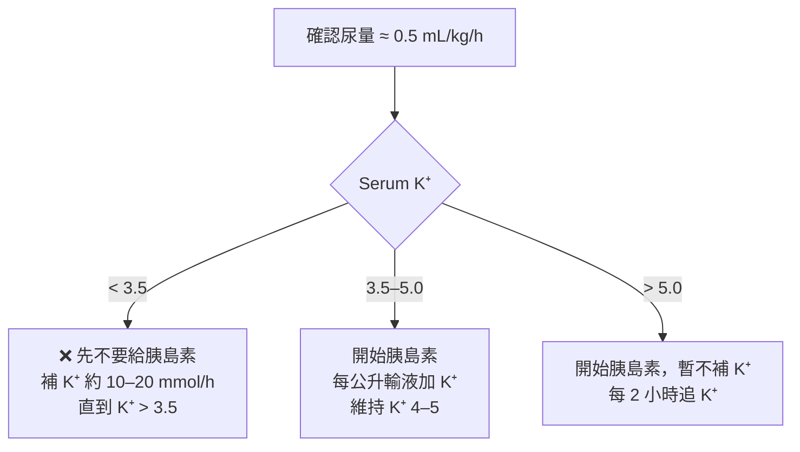

> [!abstract] 一句話重點
> DKA 看的是**酮體與酸**，HHS 看的是**滲透壓與脫水**。治療順序：**==先補液 → 確認 K⁺ → 胰島素 → 血糖 < 250 加葡萄糖==**，一路監測直到符合緩解標準。

> [!info] 2024 共識的主要更新
> - DKA 血糖門檻從 > 250 **==降為 ≥ 200 mg/dL，或已知有糖尿病==**（不管血糖多少）
> - 酮體建議直接測 **β-hydroxybutyrate（BOHB）**，==診斷與追蹤都不要依賴尿酮==
> - 輕中度 DKA 可用**皮下速效胰島素**治療，不一定要進 ICU
> - 輸液可用 0.9% saline 或 **balanced crystalloid**（後者 DKA 緩解較快、較少高氯性酸中毒）

## 定義與流行病學

- 兩者都是**胰島素不足 + 升糖激素（glucagon、catecholamine、cortisol、GH）上升**造成的高血糖急症
  - **DKA**：胰島素幾乎沒有 → 脂肪分解、酮體大量生成 → 酸中毒
  - **HHS**：還剩一點胰島素，足以抑制酮體，但壓不住血糖 → 嚴重高血糖、滲透性利尿、脫水
- DKA 好發於年輕 T1D；HHS 好發於年長 T2D，但兩者在任何類型糖尿病都可能發生
- 約 **1/3 是 DKA 與 HHS 的混合型**（同時符合兩者的診斷標準，見下方說明）
- 常見誘因：**感染**（UTI、肺炎最多）、**漏打胰島素**、新診斷糖尿病、**SGLT2 inhibitor**、急性心肌梗塞、胰臟炎、藥物（類固醇、抗精神病藥）

### 為什麼會有混合型？

DKA 和 HHS 不是兩種不同的病，而是**同一條「胰島素不足」光譜的兩端**，混合型就落在中間。

**1. 抑制酮體比壓血糖需要的胰島素少很多**

| 剩下的胰島素 | 脂肪分解／酮體 | 血糖 | 結果 |
| --- | --- | --- | --- |
| 幾乎沒有 | 壓不住 → 大量酮體 | 高 | **DKA** |
| 部分不足（中間地帶） | **只壓住一部分** → 中度酮體 | 很高 | **混合型** |
| 還剩一些 | 壓得住 → 酮體少 | 壓不住 → 極高 | **HHS** |

- 脂肪細胞對胰島素很敏感，**很低濃度的胰島素就能抑制 lipolysis**；但要讓肌肉、肝臟處理葡萄糖，需要高得多的濃度
- 所以「剩多少胰島素」決定落在光譜哪裡，而這是**連續的**，沒有一條明確的分界線

**2. DKA 拖久了，會往 HHS 走**

- 高血糖 → 尿糖 → **滲透性利尿**，再加上嘔吐、喝不到水 → 自由水持續流失
- 病程越長、越晚就醫（老人、意識差、獨居），滲透壓就越高 → DKA 加上高滲透壓

**3. HHS 太嚴重，也會出現酮體與酸**

- 嚴重脫水 → 壓力荷爾蒙（catecholamine、cortisol、glucagon）更高 → 推動脂肪分解和酮體生成
- **高血糖與高滲透壓本身會抑制胰臟分泌胰島素、加重胰島素阻抗**（glucotoxicity）→ 原本剩下的胰島素也不夠了
- 低灌流造成 **lactic acidosis**、**AKI**（酮酸排不掉）也會讓酸中毒加重

**4. 誘因與病人族群互相重疊**

- 感染、心肌梗塞等重大壓力同時拉高升糖激素；T2D 在重大壓力下也會出現酮酸中毒
- 新診斷糖尿病（尤其年輕人喝大量含糖飲料）常以混合型表現

> [!tip] Pearl：混合型的處置
> - 胰島素照 **DKA 劑量（IV 0.1 U/kg/h）**，因為要壓住酮體
> - 但補液和矯正速度要照 **HHS 的原則**：先充分補液，血糖、血鈉、滲透壓都不能降太快（見下方「HHS 的特別注意事項」）
> - 緩解要**兩個標準都達成**：酮酸中毒緩解，而且滲透壓與意識也恢復

> [!warning] Pitfall
> 只看到酸中毒就當 DKA，可能漏算滲透壓、矯正太快；只看到血糖 > 600 就當 HHS，可能用太低的胰島素劑量，酮體壓不下來。**==每個高血糖危象都要同時算有效滲透壓和看酮體／血氣==**。混合型的住院死亡率也比單純 DKA 高。

## 臨床表現

| | DKA | HHS |
| --- | --- | --- |
| 發展速度 | 數小時到數天 | 數天到一週 |
| 意識 | 通常清醒（嚴重時才改變） | 意識改變常見 |
| 特徵 | Kussmaul 呼吸、水果味口氣、**腹痛、噁心嘔吐（> 50%）** | 嚴重脫水，常合併其他急性疾病 |
| 共同 | 多尿、多渴、體重減輕、脫水 | 同左 |

> [!warning] Pitfall
> DKA 的腹痛可能是酸中毒造成，也可能是誘因本身（例如胰臟炎、闌尾炎）。**酸中毒和脫水矯正後腹痛仍未改善，就要進一步找原因**。

## 診斷

### 診斷標準（2024 共識）

| | DKA（三項都要符合） | HHS（四項都要符合） |
| --- | --- | --- |
| 血糖 | **≥ 200 mg/dL 或已知糖尿病** | **≥ 600 mg/dL** |
| 酮體 | **BOHB ≥ 3.0 mmol/L** 或尿酮 ≥ 2+ | BOHB < 3.0 mmol/L 或尿酮 < 2+ |
| 酸鹼 | **pH < 7.3 和／或 HCO₃⁻ < 18** | pH ≥ 7.3 且 HCO₃⁻ ≥ 15 |
| 滲透壓 | — | **有效滲透壓 > 300** 或總滲透壓 > 320 mOsm/kg |

- **有效滲透壓** = 2 × Na + Glucose / 18（mg/dL 單位）
- **校正血鈉**：血糖每高 100 mg/dL，Na 約被稀釋 1.6 mmol/L（見 [[hyponatremia|低血鈉]]）
- 初始檢查：血糖、電解質、**靜脈血氣**、CBC、血酮或尿酮、腎功能、**心電圖**（看高血鉀 T 波、心肌缺血）

### DKA 嚴重度分級

| | Mild | Moderate | Severe |
| --- | --- | --- | --- |
| BOHB（mmol/L） | 3.0–6.0 | 3.0–6.0 | > 6.0 |
| pH | 7.25–7.30 | 7.0–7.25 | < 7.0 |
| HCO₃⁻（mmol/L） | 15–18 | 10–15 | < 10 |
| 意識 | 清醒 | 清醒／嗜睡 | 昏睡／昏迷 |
| 建議照護單位 | 一般病房 | 中重度病房（step-down） | **ICU** |

不需要每一項都符合，最後仍依臨床判斷。HHS、嚴重 DKA、意識改變、或誘因本身很危急（MI、GI bleeding、sepsis）都應進 ICU。

### 酮體檢測的眉角

- **BOHB 是 DKA 主要的酮酸**，但尿液 nitroprusside 試紙只測得到 acetoacetate
  - 早期：尿酮會**低估**嚴重度
  - 治療後：BOHB 轉成 acetoacetate，尿酮反而**高估**，看起來好像還沒好
  - Captopril、valproate 可能造成尿酮偽陽性
- **Anion gap 不建議當第一線診斷或緩解標準**：約 1/3 合併其他酸鹼異常；治療後常出現**高氯性 normal AG acidosis**，會被誤以為 DKA 還沒好

> [!tip] Pearl：Euglycemic DKA
> 約 **10%** 的 DKA 血糖 < 200 mg/dL。原因包括 **==SGLT2 inhibitor（現在最常見）==**、懷孕、進食量少、酒精、肝衰竭、已打過胰島素。**==血糖不高不代表沒有 DKA==**，有症狀就要測酮體和血氣。

### 酮體升高的鑑別診斷

| 鑑別 | 支持的線索 |
| --- | --- |
| Starvation ketosis | 每天進食 < 500 kcal，酸中毒輕微 |
| Alcoholic ketoacidosis | 酗酒後狂飲、嘔吐、進食少，血糖可正常或偏低 |
| 懷孕／妊娠劇吐 | 嘔吐造成升糖激素上升 |

另外，高 AG 酸中毒合併**滲透壓間隙升高**時，要想到 methanol、ethylene glycol 中毒。

## 治療

### 監測頻率

- **指尖血糖**：每 1–2 小時
- **電解質、磷、肌酸酐、BOHB、靜脈 pH**：每 2–4 小時，直到穩定（HHS 另外追蹤滲透壓）
- **K⁺**：開始胰島素後 **2 小時**先追一次，之後每 4 小時

### 1. 輸液

- 沒有心腎問題：**==0.9% saline 或 balanced crystalloid，前 2–4 小時 500–1,000 mL/h==**
  - 嚴重低血容：約 1 L/h
  - 輕度低血容：前 8–12 小時補回估計缺水量的一半
- 之後依血壓、心跳、輸出入量、血鈉調整；**24–48 小時內**補足缺水
- **老人、心衰竭、透析病人**：改用小量 bolus（例如 **250 mL**），密切評估

> [!tip] Pearl
> 單靠輸液，不打胰島素，血糖每小時就會下降約 **50–70 mg/dL**，HHS 病人降得更多。

### 2. 鉀離子：決定能不能開始胰島素

- DKA 病人**全身鉀總量是不足的**（3–6 mmol/kg），但酸中毒和缺胰島素讓鉀跑到細胞外，所以剛來時 K⁺ 多半正常或偏高
- 胰島素、矯正酸中毒、補液都會讓 K⁺ 下降，**48 小時內通常掉 1–2 mmol/L**
- 補鉀量：多數病人每公升輸液加 **20–30 mmol** 就夠

> [!danger] 低血鉀很致命
> 治療中 **K⁺ ≤ 2.5 mmol/L 死亡率增加約 3 倍**。==K⁺ < 3.5 時直接打胰島素，可能造成致命心律不整和呼吸肌無力==。

### 3. 胰島素

| 情況 | 胰島素用法 |
| --- | --- |
| **中重度 DKA** | **==IV regular insulin 固定速率 0.1 U/kg/h==**；若建立管路會延遲，可先給 0.1 U/kg bolus |
| **輕度 DKA** | **皮下速效胰島素**：先 0.1 U/kg，之後每 1 小時 0.1 U/kg 或每 2 小時 0.2 U/kg |
| **HHS（無明顯酮體）** | IV **0.05 U/kg/h** |
| **混合型 DKA/HHS** | IV **0.1 U/kg/h** |

- **血糖 < 250 mg/dL 時**：
  - IV 胰島素減為 **0.05 U/kg/h**（皮下改為每 2 小時 0.1 U/kg）
  - 輸液**==加入 5–10% dextrose==**
  - 目標血糖：**DKA 150–200 mg/dL；HHS 200–250 mg/dL**，維持到緩解
- **Euglycemic DKA**：一開始就要**==同時給 dextrose 和胰島素==**，否則沒辦法持續給胰島素壓酮體
- 嚴重或複雜 DKA、HHS **不建議**用皮下速效胰島素
- 輸注期間**提早給低劑量 basal insulin（0.15–0.3 U/kg）**，可縮短 DKA 緩解時間和住院天數，也能避免停 IV 後反彈

> [!warning] Pitfall
> DKA 時，血糖通常 **4–8 小時就降到 250 以下，但酮酸中毒還沒好**。這時候要做的是**==加葡萄糖繼續給胰島素==**，而不是停掉胰島素。

### 4. Bicarbonate

- **不建議常規使用**，輸液加胰島素通常就能矯正酸中毒
- 可能的壞處：低血鉀、組織氧氣利用變差、腦水腫、中樞神經反常性酸中毒
- **==pH < 7.0 才考慮==**：100 mmol NaHCO₃（8.4%）加入 400 mL 無菌水，每 2 小時給一次，直到 pH > 7.0

### 5. Phosphate

- 胰島素治療後磷會移入細胞內，常出現低血磷
- **不常規補充**：只有在出現肌肉無力（呼吸或心臟受影響）且 phosphate < 1.0 mmol/L 時才補
- 需要時：每公升輸液加 20–30 mmol potassium phosphate；補太快可能造成**低血鈣**

### HHS 的特別注意事項

> [!danger] HHS 矯正速度上限（避免腦水腫與 ODS）
> - 血糖下降：每小時**不超過 90–120 mg/dL**，通常 8–10 小時把血糖降下來
> - 血鈉下降：**==24 小時內不超過 10 mmol/L==**
> - 滲透壓下降：每小時 **3–8 mOsm/kg**

- 補液初期血糖下降，水移回細胞內，**==血鈉會上升，這是預期中的==**，不是改用低張液的理由
- **只有在**正輸液平衡、胰島素也足夠，滲透壓卻降不下來時，才改用 **0.45% saline**
- 有專家建議 HHS 先只補液，等血糖不再隨輸液下降後再開始胰島素，避免滲透壓降太快

### 緩解標準

| | 緩解標準 |
| --- | --- |
| **DKA** | **血酮 < 0.6 mmol/L**，且靜脈 **pH ≥ 7.3 或 HCO₃⁻ ≥ 18**（理想上血糖 < 200） |
| **HHS** | **滲透壓 < 300 mOsm/kg**、血糖 < 250 mg/dL、尿量 > 0.5 mL/kg/h、意識改善 |

==不要用 anion gap 或尿酮判斷是否緩解==。

### 轉換成皮下胰島素

1. 緩解後、能進食時開始皮下 **basal-bolus** 胰島素
2. **==皮下 basal insulin 要比停 IV 早 1–2 小時給==**（重疊期），避免反彈
3. 估計每日總劑量（TDD）：
   - 沒用過胰島素：**0.5–0.6 U/kg/day**
   - 低血糖高風險（腎衰竭、衰弱）：約 **0.3 U/kg/day**
   - 原本有打胰島素：參考住院前劑量和 HbA1c
4. **40–60% 給 basal**，其餘分成三餐前速效胰島素；禁食時給 basal 加每 4–6 小時矯正劑量
5. 原本控制不好（HbA1c 高）或有誘發藥物，**出院前就要調整**，不要等門診

### SGLT2 inhibitor

- **==入院時就停用==**，住院期間不要開始或繼續使用
- **T1D 不建議使用** SGLT2 inhibitor
- T2D 發生 DKA 後，因安全性資料不足，**不常規建議再用**
- 病人要學會 **sick day rules**（生病、禁食、手術前暫停）

## 治療中的併發症

| 併發症 | 重點 | 預防與處理 |
| --- | --- | --- |
| **低血糖** | 發生率 16–28%；嚴重低血糖死亡率上升 | 每 1–2 小時測血糖；血糖 < 250 時減胰島素並加葡萄糖 |
| **低血鉀** | 約一半病人會發生 | 每 4 小時追 K⁺；輸液中補鉀 |
| **Normal AG acidosis** | 恢復期常見，大量 0.9% saline 造成，通常自限 | 用 balanced crystalloid 可減少；**不要誤判為 DKA 未緩解** |
| **血栓** | HHS 尤其是高凝血狀態 | 預防性 **LMWH** |
| **腦水腫** | 成人罕見（< 0.1%），死亡率約 30% | 留意意識變化，低門檻做腦部影像；HHS 慢慢矯正滲透壓 |
| **ODS** | HHS 病人校正後可能相對低血鈉，矯正太快時發生 | 用 0.9% saline 降滲透壓，速度 3–8 mOsm/kg/h |
| **AKI** | 約一半病人入院時有 AKI | 通常補液後恢復，每天追腎功能 |

## 預防復發

- 反覆 DKA 中，高達 **75%** 是**漏打胰島素**造成
- 出院前：胰島素注射技巧、血糖和**酮體自我監測**、sick day rules 衛教，確保有足夠的胰島素和耗材
- 出院後 **2–4 週內**回診
- 篩檢**憂鬱、飲食疾患、思覺失調**和社會經濟困難，這些都是 DKA 的獨立危險因子
- 出院後提供 **CGM**，可明顯降低 DKA 再住院

## 🎯 內專考點

> [!example] 出題規律
> 最常考的是**高血糖危象病人的第一瓶輸液**（考了 5 次，==答案都是 0.9% saline==），其次是 **DKA 處置找錯誤**和 **SGLT2 inhibitor 增加 DKA 風險**。

題號格式為「年份-題號」，可到 [內專刷題網站](http://imboard.dirty-wolf.com/) 用「依年份練習」→「跳題」查看原題與詳解。每張卡片點開即可看到內容。

### 初始輸液

> [!note]- 104-133｜81 歲意識不清、血糖 800：第一瓶輸液？
> **情境**：81 歲男性，糖尿病只靠飲食控制，有 CAD、CHF、高血壓，意識不清 24 小時
> - BP 96/74、HR 104
> - 血糖 800、Na 150、K 6.1、BUN 80、Cr 3.5
> - ABG：pH 7.32、PaCO₂ 33、HCO₃⁻ 19
>
> **問**：下列哪種輸液最好？（0.9% saline／0.45% saline／LR／鼻胃管灌蒸餾水／D5W 加 RI）
>
> **答**：**0.9% saline**
>
> **重點**：血糖極高、酸中毒輕微 → HHS 合併嚴重脫水，第一步用等張液擴容
> - 0.45% saline：擴容後依校正血鈉才考慮，順序錯
> - LR：詳解認為不是 HHS 初始復甦的標準首選，且含鉀（本題 K 6.1）
> - 鼻胃管灌水：意識不清有吸入風險，也無法快速擴容
> - D5W 加 RI：血糖 800 不該給含糖液，要降到約 250 以下才加

> [!note]- 105-134｜68 歲 HF、血糖 628 合併休克：第一瓶輸液？
> **情境**：68 歲男性，糖尿病 10 年，口服藥服用不規則、拒絕胰島素；心衰竭 NYHA III；意識不清
> - BP 88/58、HR 108
> - 血糖 628、Na 148、K 3.8、BUN 92、Cr 3.9
> - ABG：pH 7.28、PaCO₂ 36、HCO₃⁻ 12
>
> **問**：在監測尿量的前提下，哪種輸液最適當？（LR／0.9% saline／0.45% saline／D5W 加 RI／0.9% saline 加 RI）
>
> **答**：**0.9% saline**
>
> **重點**：DKA 與 HHS 的重疊型合併低血容休克與 AKI，所有高血糖危象的第一步都是等張液擴容
> - 0.45% saline：休克當下無法有效擴容，血容恢復後才依校正血鈉改用
> - D5W 加 RI：血糖 628 給含糖液會更高
> - 0.9% saline 加 RI：補液和胰島素同時開始，血糖與滲透壓驟降會讓血壓更低，且還沒確認 K⁺
> - 詳解補充：校正血鈉約 156

> [!note]- 106-132／108-94（同一題）｜82 歲漏打胰島素、感冒、血糖 525
> **情境**：82 歲男性，體重 58 kg，糖尿病 20 年，打三餐前速效加睡前基礎胰島素，但常漏打餐前針；一個月前 HbA1c 8.8%；感冒一週、胃口差；意識不清
> - BP 98/60、HR 96
> - 血糖 525、Na 151、K 3.5、BUN 62、Cr 2.6
>
> **問**：最適合輸注並監測尿量的輸液？（0.45% saline／LR／0.9% saline／D5W 加 RI／0.45% saline 加 RI）
>
> **答**：**0.9% saline**
>
> **重點**：漏打胰島素加感染誘發的 HHS，嚴重脫水和腎前性 AKI
> - 詳解計算有效滲透壓約 331，校正血鈉約 158
> - 0.45% saline（不論有沒有加 RI）：低血壓時擴容差，太早降滲透壓有腦水腫風險
> - D5W 加 RI：血糖還很高；而且 K 3.5 偏低，胰島素不是第一步

> [!note]- 107-136｜72 歲 HF 喘、水腫，血糖 226：輸液選擇？
> **情境**：72 歲男性，糖尿病 20 年，口服藥加基礎胰島素，HbA1c 7.5%；有心衰竭；因喘和下肢水腫就醫
> - BP 98/62、HR 108
> - 血糖 226、Na 146、K 3.2、Cr 1.8
>
> **問**：考慮輸液並監測尿量，最適當的是？（LR／0.45% saline／0.9% saline／D5W 加 RI／LR 加 RI）
>
> **答**：**0.9% saline**
>
> **重點**：血糖不高，不是 DKA 或 HHS；低血壓、心跳快、高血鈉代表有效循環不足，用等張液擴容，心衰竭病人要控制速度並看尿量
> - 0.45% saline：擴容差，不適合當初始復甦
> - D5W 加 RI：葡萄糖液等於自由水，病人又已經高血糖
> - LR 加 RI：血糖只有 226，不需要 IV 胰島素，還會讓低血鉀更糟

### DKA 處置

> [!note]- 110-107｜DKA 診斷與處置，何者錯誤？
> **問**：關於 DKA 的敘述，哪一個是錯的？
> - 多合併高血糖和代謝性酸中毒 → 對
> - 血中酮體是診斷關鍵 → 對
> - 補液要注意電解質，一般用 0.9% saline 和 0.45% saline → 對
> - **規律注射基礎胰島素是矯正酮酸中毒的重要步驟 → 錯（答案）**
> - 血糖降到 250 時，要同步加上 5% glucose → 對
>
> **重點**：DKA 急性期靠**==持續靜脈輸注 regular insulin==** 關閉酮體生成；basal insulin 是緩解後銜接、避免反彈用的

### SGLT2 inhibitor

> [!note]- 108-133｜SGLT2 inhibitor，何者錯誤？
> **問**：關於 SGLT2 inhibitor 的敘述，哪一個是錯的？
> - 尿糖增加，泌尿道和生殖器感染風險上升 → 對
> - 可降低糖尿病病人心衰竭住院 → 對
> - **降血糖的同時也降低 DKA 機率 → 錯（答案）**
> - 可以和胰島素合併使用 → 對
> - eGFR > 60 的糖尿病病人都可以使用 → 對
>
> **重點**：SGLT2 inhibitor **==增加 DKA 風險==**，而且血糖可能不高（euglycemic DKA）；禁食、感染、手術、胰島素減量時特別容易發生

> [!note]- 113-107｜SGLT2 inhibitor，何者錯誤？（108-133 的翻版）
> **問**：選項幾乎和 108-133 相同，差別是心衰竭那一項改成「糖尿病**和非糖尿病**病人都能降低心衰竭住院」→ 對
>
> **答**：「降血糖的同時也降低 DKA 機率」是錯的
>
> **重點**：DAPA-HF、EMPEROR 等研究證實有沒有糖尿病都能降低心衰竭住院；euglycemic DKA 的機轉是尿糖流失、glucagon 上升、胰島素相對不足 → 脂肪分解和酮體生成增加

> [!note]- 109-130｜SGLT2 inhibitor，何者錯誤？
> **問**：
> - 作用機轉與胰島素無關 → 對
> - **大型研究顯示可減少腦中風 → 錯（答案）**
> - 最擔心的系統性副作用是酮酸中毒，和 glucagon 上升有關 → 對
> - 體重減輕主要來自尿糖排出 → 對
> - 可改善蛋白尿、延緩糖尿病腎病變 → 對
>
> **重點**：SGLT2 inhibitor 確立的好處是**心衰竭住院和腎臟預後**，對中風是中性的；GLP-1 RA 才有比較一致的中風降低訊號

### 酸鹼與電解質

> [!note]- 110-56｜肺炎合併 DKA 的酸鹼判讀
> **情境**：54 歲糖尿病女性，發燒、呼吸道症狀 4 天；姿勢性低血壓、心跳快、Kussmaul 呼吸；胸部 X 光雙下肺浸潤
> - 血糖 385
> - ABG：pH 7.35、PaCO₂ 22、PaO₂ 86、HCO₃⁻ 14
> - Na 130、K 5.1、Cl 96
>
> **問**：哪些敘述正確？
> 1. 呼吸性酸中毒，與肺炎有關
> 2. 代謝性酸中毒，與糖尿病有關
> 3. 呼吸性鹼中毒，與肺炎有關
> 4. Anion gap 正常
> 5. 胰島素加葡萄糖治療時要小心高血磷
>
> **答**：**(2)+(3)**
>
> **重點**：
> - AG = 130 − 96 − 14 = **20**，升高 → DKA 的高 AG 代謝性酸中毒
> - Winter 公式預期 PaCO₂ = 1.5 × 14 + 8 ≈ **29**，實際 22 更低 → **合併肺炎造成的呼吸性鹼中毒**，所以 pH 幾乎正常
> - 胰島素會把磷推進細胞，要小心的是**低血磷**

> [!note]- 110-60｜第 1 型糖尿病厭食，給營養後低血磷的機轉
> **情境**：26 歲第 1 型糖尿病女性，胃口差，一個月瘦 3 kg（6%）；入院後因吃不下給部分靜脈營養，第 3 天血磷 0.8 mg/dL
>
> **問**：急性低血磷最可能的機轉？（DKA 急性期／hungry bone syndrome／原發性副甲狀腺低下／腎臟流失磷／磷移入細胞內）
>
> **答**：**磷移入細胞內**
>
> **重點**：營養不良者重新給予熱量 → 胰島素上升 → 磷隨葡萄糖進入細胞，也就是 **refeeding syndrome**
> - DKA 急性期（治療前）血磷常正常甚至偏高，低血磷多出現在胰島素治療後
> - Hungry bone 見於副甲狀腺或甲狀腺手術後
> - 副甲狀腺低下會造成**高**血磷

> [!note]- 112-65｜75 歲多尿、高血鈉，原因是？
> **情境**：75 歲男性，噁心嘔吐 7 天，虛弱、起身頭暈，頻尿而且每次尿量多；高血壓吃 thiazide 半年；每天喝 9 杯水；BMI 32
> - BP 106/54、HR 92；舌頭乾、皮膚彈性差；說話變慢但定向感正常
> - Na 152、Cl 98、K 3.5、HCO₃⁻ 30、血漿滲透壓 356
> - HbA1c 10.6%；尿液滲透壓 410
>
> **問**：最可能的解釋？（ADH 不足／利尿劑過量／滲透性利尿／腸胃液流失／喝水過多）
>
> **答**：**滲透性利尿**
>
> **重點**：血糖控制極差 → 尿糖造成滲透性利尿 → 流失自由水 → 高血鈉、高滲透壓、脫水
> - 尿崩症的尿液應該很稀，不會到 410
> - Thiazide 比較會造成**低**血鈉
> - 喝水過多應該是低血鈉

### 鑑別診斷

> [!note]- 106-86｜酗酒者高 AG 酸中毒，血糖 150
> **情境**：50 歲男性，有酒精成癮病史，被發現倒在旅館地板
> - BP 120/66、HR 100、RR 30
> - Na 140、K 5.8、Cl 103、BUN 25、Cr 1.4、血糖 150
> - pH 7.16、PaCO₂ 23、HCO₃⁻ 8
> - 血漿滲透壓 332；**血中酒精陰性**
>
> **問**：最可能是？（DKA／飢餓性酮酸中毒／酒精性酮酸中毒／甲醇中毒／水楊酸中毒）
>
> **答**：**甲醇中毒**
>
> **重點**：
> - AG = 140 − 103 − 8 = **29**
> - 計算滲透壓 = 2 × 140 + 150/18 + 25/2.8 ≈ 297，實測 332 → **滲透壓間隙約 35**
> - 高 AG 酸中毒加上滲透壓間隙升高、酒精陰性 → 毒性醇類（甲醇、乙二醇）
> - DKA 血糖不高；飢餓性、酒精性酮酸中毒不會有這麼大的滲透壓間隙；水楊酸是呼吸性鹼中毒加高 AG 酸中毒

> [!note]- 107-95／109-94（同一題）｜第 1 型糖尿病的診斷條件
> **問**：下列哪一項**不是**診斷第 1 型糖尿病的必要條件？
> - 空腹 C-peptide < 0.5 ng/mL
> - 升糖素刺激後 6 分鐘 C-peptide < 1.8 ng/mL
> - 升糖素刺激 6 分與 0 分 C-peptide 差 < 0.7 ng/mL
> - **DKA（答案）**
> - Anti-GAD65 陽性
>
> **重點**：DKA 常是第 1 型糖尿病的初次表現，但**不是必要條件**；LADA 等很多病人診斷時沒有 DKA，第 2 型在重大壓力下也可能發生酮酸中毒

### 模擬題

> [!question]- 模擬題 1（點開作答）
> 58 歲第 2 型糖尿病男性，長期使用 empagliflozin。膽囊切除術後禁食兩天，出現噁心、嘔吐、呼吸急促。血糖 180 mg/dL，pH 7.18，HCO₃⁻ 10 mmol/L，BOHB 5.4 mmol/L，K⁺ 4.6 mmol/L。開始輸注 0.9% saline 後，下一步最適當的是？
>
> (A) 血糖 < 200 mg/dL，不符合 DKA，先觀察
> (B) 血糖不高，先不給胰島素，以免低血糖
> (C) IV insulin 0.1 U/kg/h，並**同時**給 5–10% dextrose
> (D) 給予 NaHCO₃ 矯正酸中毒
> (E) 繼續使用 empagliflozin，等病人恢復進食
>
> > [!success]- 答案與詳解
> > **答案：(C)**
> >
> > 這是 **SGLT2 inhibitor 相關的 euglycemic DKA**。2024 共識中，已知糖尿病病人不論血糖多少，只要酮體和酸中毒符合就是 DKA。
> >
> > - (A) 錯，血糖門檻不適用於已知糖尿病病人
> > - (B) 錯，胰島素是壓制酮體的關鍵；為了能持續給胰島素，要**一開始就同時給葡萄糖**
> > - (D) 錯，pH 7.18 > 7.0，不需要 bicarbonate
> > - (E) 錯，SGLT2 inhibitor 入院就要停用

> [!question]- 模擬題 2（點開作答）
> 24 歲第 1 型糖尿病女性因 DKA 就醫，血糖 480 mg/dL，pH 7.12，HCO₃⁻ 8 mmol/L，K⁺ 3.1 mmol/L，尿量正常。已開始輸注 0.9% saline，下一步最適當的是？
>
> (A) 立即開始 IV insulin 0.1 U/kg/h
> (B) 給予 IV insulin bolus 0.1 U/kg 後持續輸注
> (C) 暫緩胰島素，先補鉀到 K⁺ > 3.5 mmol/L
> (D) 給予 NaHCO₃ 100 mmol
> (E) 改用 0.45% saline
>
> > [!success]- 答案與詳解
> > **答案：(C)**
> >
> > DKA 病人全身鉀總量不足，胰島素會把鉀推進細胞內。**K⁺ < 3.5 時先補鉀、暫緩胰島素**，避免致命心律不整與呼吸肌無力。
> >
> > - (A)(B) 錯，會讓 K⁺ 進一步下降
> > - (D) 錯，pH 7.12 不需要 bicarbonate，而且 bicarbonate 會讓低血鉀更嚴重
> > - (E) 錯，與本題的關鍵問題（低血鉀）無關

## 相關筆記

- [[hyponatremia|低血鈉 Hyponatremia]]：高血糖造成的稀釋性低血鈉與校正

## 參考資料

- Umpierrez GE, Davis GM, ElSayed NA, et al. Hyperglycemic crises in adults with diabetes: a consensus report. *Diabetes Care*. 2024;47(8):1257–1275.
- Kitabchi AE, Umpierrez GE, Miles JM, Fisher JN. Hyperglycemic crises in adult patients with diabetes. *Diabetes Care*. 2009;32(7):1335–1343.（混合型的病生理）
- Pasquel FJ, Tsegka K, Wang H, et al. Clinical outcomes in patients with isolated or combined diabetic ketoacidosis and hyperosmolar hyperglycemic state: a retrospective, hospital-based cohort study. *Diabetes Care*. 2020;43(2):349–357.（混合型的預後）
