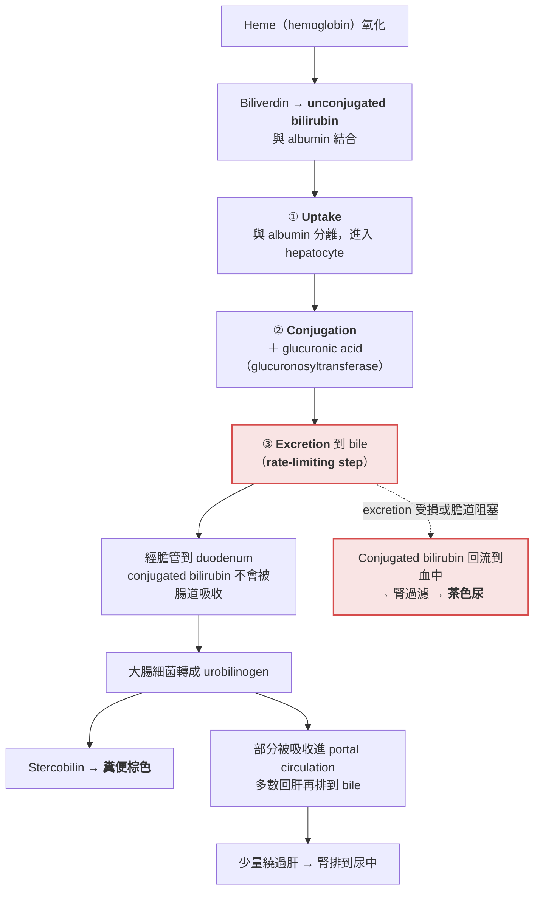
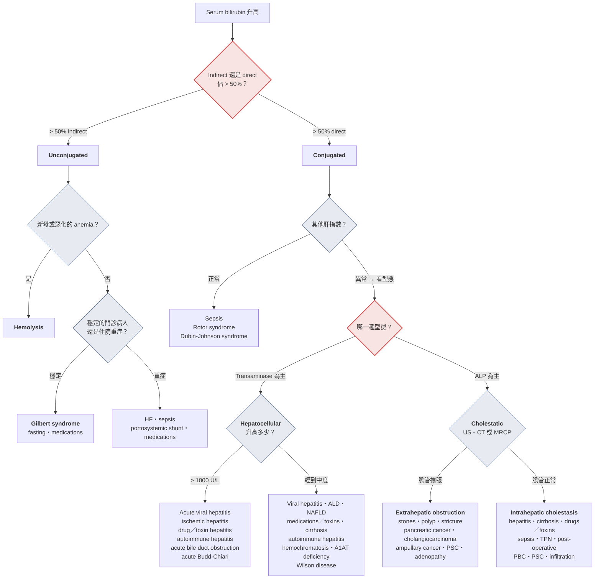
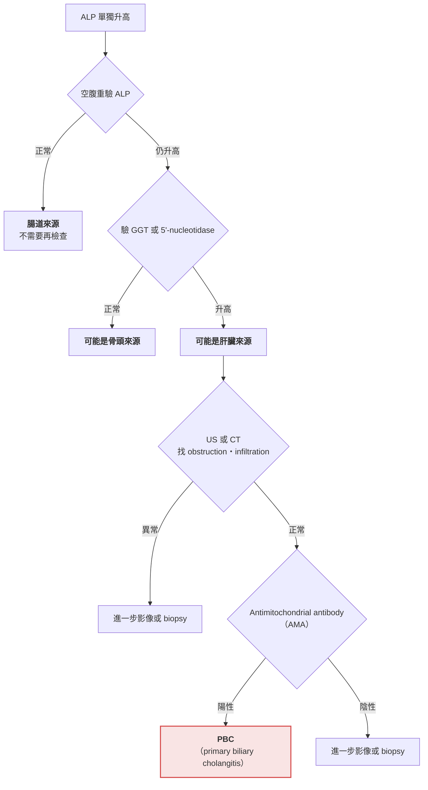

> [!abstract] 一句話重點
> 黃疸的**第一個 pivotal point：bilirubin 是 unconjugated 還是 conjugated**（> 50% direct 算 conjugated）；**茶色尿＝conjugated**，**陶土便＝extrahepatic obstruction**。Conjugated 的第二步看**其他肝指數的型態**：**hepatocellular（transaminase 為主）再看升高程度（> 1000 U/L 的病因很有限）**；**cholestatic（ALP 為主）先做影像看膽管有沒有擴張**。無症狀的 transaminase 輕度升高 → 先停酒與可疑藥物再重驗，持續異常才系統性抽血。

> [!info] 系列導覽
> ↑ 回到 [[gastroenterology/abnormal-liver-tests/index|肝功能異常與黃疸 總覽]]
>
> ① 判讀架構（本篇）｜② [[gastroenterology/abnormal-liver-tests/liver-2-ald-nafld|ALD 與 NAFLD]]｜③ [[gastroenterology/abnormal-liver-tests/liver-3-viral|Viral hepatitis]]｜④ [[gastroenterology/abnormal-liver-tests/liver-4-others|其他重要病因]]｜⑤ [[gastroenterology/abnormal-liver-tests/liver-5-cases|三個病例推理]]｜⑥ [[gastroenterology/abnormal-liver-tests/liver-exam|內專考點]]

> [!tip] 原圖
> 每個 Table、Figure 下方都有「📷 原圖」區塊。原圖存在私人資料庫，只有設定過權杖的瀏覽器看得到。<a class="of-settings-link" href="javascript:void 0">🔑 原圖設定</a>

## Figure 26-1：Bilirubin 代謝與排泄

**圖解**（依原圖內容重新繪製）：

| 重點 | 意義 |
| --- | --- |
| **Unconjugated bilirubin 和 albumin 結合，不會被腎過濾** | Unconjugated hyperbilirubinemia **==不會有茶色尿==** |
| **Conjugated bilirubin 可以被腎過濾** | **==茶色尿（dark, tea-colored urine）代表 conjugated hyperbilirubinemia==** |
| Excretion 是肝內代謝的 **rate-limiting step** | 受損時 conjugated bilirubin 進入 sinusoid 與血液 |
| 糞便的棕色來自 stercobilin | **==陶土便（clay-colored stools）代表 extrahepatic obstruction==**，bilirubin 進不了腸道 |

> [!tip] Pearl
> 高 bilirubin 的**第一個 pivotal point 是判斷升高的是哪一種 bilirubin**。
>
> Bilirubin 分型和肝指數型態（hepatocellular vs cholestatic）是**兩個不同的判斷**，兩者怎麼搭配、什麼時候要做哪一個，見 [[gastroenterology/abnormal-liver-tests/index#🧭 兩個判斷動作：意義一樣嗎？都要做嗎？|總覽頁的比較]]。

## Unconjugated hyperbilirubinemia（> 50% 是 unconjugated）

用病生理分類：

| 機轉 | 病因 |
| --- | --- |
| **Bilirubin 生成增加** | **Hemolysis**；dyserythropoiesis；血液外滲到組織（hematoma 吸收） |
| **肝細胞 uptake 減少** | **HF**；**sepsis**；藥物（rifampin、probenecid、gemfibrozil、atazanavir）；**fasting**；portosystemic shunts |
| **Conjugation 減少**（glucuronosyltransferase 活性下降） | 遺傳：**Gilbert syndrome**、Crigler-Najjar syndrome；後天：新生兒、hyperthyroidism、ethinyl estradiol、肝病（造成 mixed、通常以 conjugated 為主）、sepsis |

> [!tip] Pearl
> **大部分 unconjugated hyperbilirubinemia 是 hemolysis、Gilbert syndrome、HF、sepsis 或非常晚期的 cirrhosis**。

## Conjugated hyperbilirubinemia（> 50% 是 conjugated）

很多書用病生理分類，但臨床上**先看其他肝指數**比較實用：

| 其他肝指數 | 型態 | 病因 |
| --- | --- | --- |
| **ALT、AST 正常** | — | **Sepsis** 或全身感染；**Rotor syndrome**；**Dubin-Johnson syndrome** |
| Transaminase 升高比 ALP 多 | **Hepatocellular**（肝細胞損傷為主） | **明顯升高（> 1000 U/L）**：acute viral hepatitis、**ischemic hepatitis**、藥物或毒物、autoimmune hepatitis、**acute bile duct obstruction**、acute Budd-Chiari syndrome |
| | | **輕到中度升高**（輕度＝< 5 倍 ULN，約 < 175–200 U/L）：ALD、藥物或毒物、chronic hepatitis B 或 C、NAFLD（現稱 MASLD）、autoimmune hepatitis、hemochromatosis、**Wilson disease（< 40 歲）**、alpha-1-antitrypsin deficiency |
| ALP 升高比 transaminase 多 | **Cholestatic**（膽道阻塞） | **Extrahepatic**（bile duct obstruction）：CBD stone、benign stricture、benign polyp、**malignancy（pancreatic cancer、cholangiocarcinoma、ampullary cancer）**、periportal adenopathy、PSC（肝內外都影響） |
| | | **Intrahepatic**（主要是 excretion 受損）：hepatitis（viral、alcoholic）、intrahepatic cholestasis of pregnancy、cirrhosis、medications 與 toxins、sepsis、**TPN**、postoperative jaundice、infiltrative diseases（amyloidosis、lymphoma、sarcoidosis、TB）、PSC、**PBC**（2015 年起改稱 **primary biliary cholangitis**，縮寫不變） |

> [!warning] Pitfall
> 這些肝指數**不太 specific**，從上面兩張表就看得出來不同病因的型態有很多重疊；它們是方向，不是診斷。

## Table 26-1：常用肝指數各代表什麼

| 檢驗 | 反映 | 來源 |
| --- | --- | --- |
| **AST** | Hepatocyte integrity | **Liver、heart、skeletal muscle、kidney、brain、RBC** → 單獨 AST 升高要想到肝外 |
| **ALT** | Hepatocyte integrity | **Liver**（較 specific） |
| **ALP** | Cholestasis | Liver、**bone**、intestine、placenta |
| **GGT** | **和 ALP 一起升高時，表示 ALP 來自肝** | Liver |
| Conjugated bilirubin | Cholestasis、hepatocyte injury | Liver |
| Albumin | **肝的合成功能** | Liver 或飲食（營養不良也會低） |
| **PT** | **肝的合成功能** | 肝合成的 vitamin K dependent clotting factors |

> [!tip] Pearl
> **==肝合成功能最好的指標是 PT==**：所有 hepatitis 病人都要驗 **INR** 找 liver failure 的跡象。

## 理學檢查有多可靠？

| 發現 | 證據 |
| --- | --- |
| **Jaundice** | Total bilirubin > **2.5–3.0 mg/dL** 才看得出來；**scleral icterus 比皮膚黃疸早出現**；bilirubin > 3.0 時 PE sensitivity 78.4%、specificity 68.8%（LR+ 2.5、LR− 0.31）；> 15.0 時 sensitivity 96.4% |
| **Hepatomegaly** | 超音波 cephalocaudad 長度上限 **13 cm**；摸得到肝緣不可靠（LR+ 2.0、LR− 0.41），可能是肺過度擴張把肝推下來 |
| **Splenomegaly** | Percussion 不準；**平躺時摸得到脾臟高度預測 splenomegaly（LR+ 8.2）**，LR− 0.41 |
| **Ascites：history** | **Increased abdominal girth（LR+ 4.1、LR− 0.17）**；recent weight gain（LR+ 3.2）；**ankle swelling（LR− 0.10）** |
| **Ascites：PE** | **Fluid wave（LR+ 5.3）**、**shifting dullness（LR− 0.4）**；要用正確技巧；超音波能偵測 PE 遠遠查不出的少量 ascites |

## Figure 26-2：Hyperbilirubinemia 的診斷流程

**圖解**（依原圖內容重新繪製）：

## Figure 26-7：Isolated ALP elevation

**圖解**（依原圖內容重新繪製）：

## 無症狀的 transaminase 升高

**大多數無症狀的病人只有輕到中度升高**；明顯升高卻沒有症狀很少見，所以思考重點放在 **chronic disease**，先分肝內與肝外：

| 大類 | 病因 |
| --- | --- |
| **Hepatic：明顯升高（> 1000 U/L）** | Acute viral hepatitis、ischemic hepatitis、藥物或毒物、autoimmune hepatitis、acute bile duct obstruction、acute Budd-Chiari syndrome |
| **Hepatic：輕到中度升高** | ALD、藥物或毒物、**chronic hepatitis B 或 C**、**NAFLD**、autoimmune hepatitis、hemochromatosis、Wilson disease（< 40 歲）、alpha-1-antitrypsin deficiency |
| **Nonhepatic** | **Celiac disease**；**hyperthyroidism**；遺傳性肌肉代謝異常或後天 muscle disease（**只有 AST 升高**）；**strenuous exercise（只有 AST 升高）** |

**各族群的病因比例差很多**：

- 19,000 多位年輕健康新兵中，99 位肝指數升高，只有 11 位真的有肝病（4 位 hepatitis B、4 位 hepatitis C、2 位 autoimmune hepatitis、1 位 cholelithiasis）
- 100 位肝指數升高的捐血者：ALD 48%、NAFLD 22%、hepatitis C 17%
- History 與抽血找不到原因而做 biopsy 的人，**> 50% 是 NAFLD**

**容易忽略的藥物**：

- **治療劑量的 acetaminophen 也會造成 transaminase 升高**：一項研究中，每天吃 4 g 的人 50% 出現 transaminase > 2 倍 ULN
- **Statin**：0.5–3% 的人有輕度 transaminase 升高；**不需要因此停 statin**，FDA 也不再建議在 baseline 之後常規追蹤肝指數

### 逐步評估

1. **==先停酒，停掉可能有肝毒性的藥物，再重驗肝指數==**
2. History 能提高某些診斷的機率，但**不夠 sensitive 或 specific**，所以檢查範圍要廣
3. 停酒與停藥後仍持續異常，AGA 建議先驗：**PT、albumin、CBC、hepatitis A、B、C serologies、iron studies（serum iron、TIBC、ferritin）**
4. 必要時再驗 ANA、SMA、ceruloplasmin、alpha-1-antitrypsin level 與 phenotype、TSH、celiac 抗體

> [!info] 🆕 新版指引：B 肝、C 肝改成「每個成人都篩一次」（CDC 2020、2023）
> 原書把 hepatitis serology 放在「肝指數異常才驗」；現在 **不論肝指數，每個成人都要篩**：
> - **HCV（CDC 2020）**：**≥ 18 歲終生至少篩一次**、每次懷孕都篩；先驗 **anti-HCV，陽性自動加驗 HCV RNA（reflex）**；有持續風險者（IDU、hemodialysis）定期重驗
> - **HBV（CDC 2023）**：**≥ 18 歲終生至少篩一次，用三合一：HBsAg、anti-HBs、total anti-HBc**；每次懷孕驗 HBsAg
> - 所以肝指數異常的病人更不能漏驗；詳見 [[gastroenterology/abnormal-liver-tests/liver-3-viral|③ Viral hepatitis]]

> [!info] 🆕 MASLD 的非侵入性分層
> 輕度 transaminase 升高最常見的原因 MASLD（舊稱 NAFLD），現在先用 **FIB-4** 分層 fibrosis（< 1.3 低風險、> 2.67 高風險），中間再做 VCTE；見 [[gastroenterology/abnormal-liver-tests/liver-2-ald-nafld|② ALD 與 MASLD]]。

## 相關筆記

- [[gastroenterology/abnormal-liver-tests/liver-2-ald-nafld|② ALD 與 NAFLD]]
- [[gastroenterology/abnormal-liver-tests/liver-3-viral|③ Viral hepatitis]]
- [[gastroenterology/abnormal-liver-tests/liver-4-others|④ Pancreatic cancer、hemochromatosis、AIH、acetaminophen]]
- [[gastroenterology/acute-biliary-infection/index|急性膽道感染 TG18]]（CBD stone 造成的 cholestatic pattern）

## 參考資料

- Alexander J. I have a patient with jaundice or abnormal liver enzymes. How do I determine the cause? In: Stern SDC, Cifu AS, Altkorn D, eds. *Symptom to Diagnosis: An Evidence-Based Guide*. 4th ed. McGraw-Hill; 2020. Chapter 26（Figure 26-1、26-2、26-7；Table 26-1）。參考資料庫：`腸胃肝膽科/Abnormal liver profile.pdf`
- Schillie S, Wester C, Osborne M, et al. CDC Recommendations for Hepatitis C Screening Among Adults — United States, 2020. *MMWR Recomm Rep*. 2020;69(2):1–17.（🆕）
- Conners EE, Panagiotakopoulos L, Hofmeister MG, et al. Screening and Testing for Hepatitis B Virus Infection: CDC Recommendations — United States, 2023. *MMWR Recomm Rep*. 2023;72(1):1–25.（🆕）
