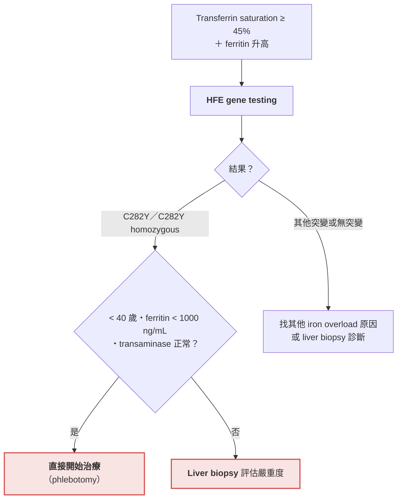
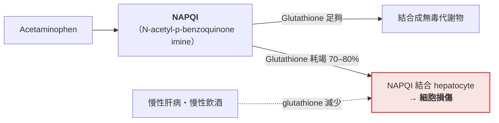

> [!abstract] 一句話重點
> - **Pancreatic cancer**：**無痛性黃疸＋體重減輕＋ALP 為主**，extrahepatic obstruction 最常見的惡性原因
>   - **先 US，看到 mass 做 pancreatic-protocol CT**
> - **Hemochromatosis**：
>   - 先驗 **transferrin saturation（≥ 45%）＋ferritin**，異常再驗 **HFE**
>   - 治療 **phlebotomy**
> - **AIH**：
>   - **ANA＋SMA 合起來才 specific**，用評分表（≥ 7 分 definite）
>   - **prednisolone＋azathioprine**（🆕 EASL 2025：MMF 可取代 azathioprine）
> - **Acetaminophen**：
>   - **AST 可 > 10,000**，用 **Rumack-Matthew nomogram** 判斷 NAC
>   - **==8 小時內給 NAC，肝毒性 < 5–10%==**

> [!info] 系列導覽
> ↑ 回到 [[gastroenterology/abnormal-liver-tests/index|肝功能異常與黃疸 總覽]]
>
> ① [[gastroenterology/abnormal-liver-tests/liver-1-approach|判讀架構]]｜② [[gastroenterology/abnormal-liver-tests/liver-2-ald-nafld|ALD 與 NAFLD]]｜③ [[gastroenterology/abnormal-liver-tests/liver-3-viral|Viral hepatitis]]｜④ 其他重要病因（本篇）｜⑤ [[gastroenterology/abnormal-liver-tests/liver-5-cases|三個病例推理]]｜⑥ [[gastroenterology/abnormal-liver-tests/liver-exam|內專考點]]

## 四個病因一覽

| 病因 | 典型病人 | 肝指數型態 | 關鍵檢查 | 治療 |
| --- | --- | --- | --- | --- |
| **Pancreatic cancer** | 抽菸、家族史；數週到數月模糊腹痛、**體重減輕**、突然**無痛性黃疸** | **Cholestatic**（ALP 為主） | US → **pancreatic-protocol CT**；MRCP、EUS；CA 19-9 | 可切除只約 15%；不可切除做膽道引流 |
| **Hereditary hemochromatosis** | 家族史、DM、關節痛（2、3 MCP） | 輕到中度 transaminase | **Transferrin saturation＋ferritin → HFE** | **Phlebotomy** |
| **Autoimmune hepatitis** | 女性 3–4 倍；其他自體免疫疾病 | Hepatocellular，可 > 1000 | **ANA、SMA**、IgG、biopsy；評分表 | Prednisone ± azathioprine |
| **Acetaminophen** | 過量（一半是意外）、酒精、慢性肝病 | **AST > ALT，可 > 10,000** | 4 小時 acetaminophen level → nomogram | **NAC**；activated charcoal |

---

## Pancreatic cancer

### Textbook presentation

數週到數月**模糊的腹痛**，接著**體重減輕**，可能突然出現**無痛性黃疸**。

### Disease highlights

- **> 90% 是 ductal carcinoma**；60–70% 在 **pancreatic head**、20–25% 在 body 或 tail、10–20% 全胰臟
- **最重要的危險因子：抽菸**（最多 20% 的病例）與**胰臟癌家族史**（7–10%）
- 其他危險因子：chronic pancreatitis 家族史、年紀大、男性、非裔；DM、obesity；非 O 血型；職業暴露（chlorinated hydrocarbon solvents、nickel）；高脂、多肉少菜飲食

**臨床表現**：

1. 症狀隱伏，常 > 2 個月；**38–45% 第一個症狀是 depression**
2. **Abdominal pain 80%、weight loss 85%**
3. **侵犯 splanchnic nerve 或 celiac plexus 時背痛明顯**
4. **Jaundice**：胰頭癌 80%（mass > 2 cm 更多）；body 的癌症要有肝轉移才會黃疸；**可以無痛或合併腹痛**
5. 較少見：acute pancreatitis、malabsorption、**migratory thrombophlebitis**、GI bleeding

**IPMN**（intraductal papillary mucinous neoplasm）：

- Pancreatic ductal carcinoma 的潛在前驅病灶，越來越常在影像中意外發現
- 組織學評估（通常 EUS-FNA）＋影像對找出高風險病灶很重要
  - **< 10 mm：影像追蹤**
  - **> 30 mm 或 MRI 有高風險特徵：做切片**
  - 10–30 mm 的處置不明確
- IPMN 若變成癌，5 年存活約 50%，遠高於 ductal adenocarcinoma

### Evidence-based diagnosis

| 檢查 | 角色與準確度 |
| --- | --- |
| **Ultrasound** | **黃疸病人的第一個影像**；sensitivity 75–89%、specificity 90–99%；**肥胖或操作者經驗少時較差** |
| **Triphasic pancreatic-protocol multidetector CT** | **US 看到胰臟 mass 時的下一步**；sensitivity 86%、specificity 90%（LR+ 8.6、LR− 0.16）；**< 2 cm 的癌 sensitivity 較低**（77% vs 89%）；**判斷能否切除最好的檢查** |
| MRCP | US 沒看到 mass 時可選；非侵入性，準確度與 pancreatic-protocol CT 相近 |
| **EUS** | 需要內視鏡，但併發症比 ERCP 少；sensitivity 94%、specificity 89%（LR+ 8.5、**LR− 0.06**） |
| ERCP | 侵入性，**偵測胰臟癌的 sensitivity 只有 50–60%**（specificity 94%）；併發症：pancreatitis、hemorrhage |
| **CA 19-9** | > 37 U/mL：sensitivity 77%、specificity 87%；**> 1000 U/mL：specificity 94–100%** |

> [!warning] Pitfall
> **正常 CT 不一定能排除胰臟癌**（LR− 0.16）；臨床懷疑高時要加做 EUS 或 MRCP。

### 治療

- **只有約 15% 能完全切除**；即使切除，5 年存活仍只有 20–25%
- **不可切除者的姑息治療**：
  1. **膽道引流（biliary diversion）**：經皮或手術
  2. 放療止痛
  3. Gemcitabine：改善生活品質，但不延長存活（原書；已更新，見下方 🆕）
  4. **Median survival 6 個月**

> [!info] 🆕 現行治療（FDA 2024；NAPOLI 3 試驗）
> - 轉移性胰臟腺癌的第一線是**多藥合併化療**，會**延長存活**（不只是改善生活品質）：**FOLFIRINOX**、**gemcitabine＋nab-paclitaxel**，以及 **NALIRIFOX**（liposomal irinotecan＋oxaliplatin＋5-FU＋leucovorin，**2024 年 2 月 FDA 核准第一線**）
> - NAPOLI 3：NALIRIFOX median OS **11.1 個月** vs gemcitabine＋nab-paclitaxel 9.2 個月（HR 0.84）
> - Borderline resectable 傾向**先做術前化療再手術**（見 [[gastroenterology/abnormal-liver-tests/liver-exam|⑥ 內專考點]]）
> - 阻塞性黃疸的姑息處置現在首選 **ERCP 放膽道支架**

---

## Hereditary hemochromatosis

### Textbook presentation

多數無症狀，少數有 iron overload 的肝外表現；有些是篩檢病人家屬時被發現。

### Disease highlights

- **Autosomal recessive**，鐵調節荷爾蒙 **hepcidin 缺乏** → 腸道鐵吸收增加 → 組織堆積
- 鐵沉積在整個 reticuloendothelial system：

| 器官 | 表現 |
| --- | --- |
| **肝** | Hepatomegaly → fibrosis → cirrhosis；**只有 cirrhosis 才增加 HCC 風險** |
| **關節** | 任何關節都可能，但**典型是第 2、3 MCP joints** |
| **心臟** | 浸潤造成 **cardiomyopathy** |
| 其他 | 次發性 hypogonadism（pituitary 浸潤）、**DM**（pancreatic 浸潤）、hypothyroidism（thyroid 浸潤） |

- **最常見的突變：HFE C282Y**（推測起源於維京或凱爾特祖先）
  - 歐洲血統 iron overload 的人：81% 是 **C282Y homozygous**、5% 是 C282Y／H63D compound heterozygous
  - Homozygosity 盛行率：白人 0.44%，**亞洲人只有 0.000039%**
- **基因表現差異很大**：homozygote 出現 iron overload（transferrin saturation 或 ferritin 異常）的比例 38–76%，**真正出現臨床疾病：男性 2–38%、女性 1–10%**
- **Ferritin > 1000 mcg/L 者 72% 有 cirrhosis**，< 1000 者只有 7.4%
- USPSTF 與 ACP **不建議在基層篩檢一般族群**

### Evidence-based diagnosis

**Liver biopsy 測 hepatic iron index 是 gold standard**。

**初步檢查：transferrin saturation（serum iron／TIBC）＋ferritin**（以下為辨識 homozygote 的準確度）：

| 檢驗 | Sensitivity | Specificity | LR+ | LR− |
| --- | --- | --- | --- | --- |
| Transferrin saturation ≥ 50%（男） | 82.4% | 92.5% | 10.9 | 0.19 |
| Transferrin saturation ≥ 45%（女） | 73.8% | 93.1% | 10.8 | 0.28 |
| Ferritin ≥ 200 ng/mL（男） | 78% | 76% | 3.25 | 0.23 |
| Ferritin ≥ 200 ng/mL（女） | 54% | 95% | 11 | 0.48 |

**流程**：

**圖解**（依原書內容繪製）：

> [!tip] Pearl
> **==Hereditary hemochromatosis 病人的所有一等親都要做基因檢測==**，不論他們的鐵檢查結果如何。

> [!warning] Pitfall
> **NAFLD 有 60% ferritin 會升高**（很少 > 1000）。所以單獨 ferritin 輕度升高不 specific；**transferrin saturation 正常＋ferritin 輕度升高**通常不是 hemochromatosis。

### 治療

**定期 phlebotomy** 降低鐵負荷，已證實能減少進展到 cirrhosis。

> [!info] 🆕 新版指引（ACG 2019 Hereditary Hemochromatosis）
> - **Transferrin saturation 或 ferritin 升高才做 HFE 基因檢測**；致病型態是 **C282Y homozygous**，C282Y／H63D compound heterozygous 較少造成明顯 iron overload
> - **MRI 可估算肝臟鐵濃度**，**transient elastography（FibroScan）** 可找出 advanced fibrosis 或 cirrhosis 風險較高的人，**減少 liver biopsy**
> - **Fatty liver 也會讓 ferritin 升高**
> - **Phlebotomy 仍是治療基石**；**iron chelator 不是第一線**，只給無法耐受或 phlebotomy 無效的人

---

## Autoimmune hepatitis（AIH）

### Textbook presentation

變化很大：從無症狀的 transaminase 升高、非特異的全身症狀，到 advanced liver disease。

### Disease highlights

- 慢性肝臟發炎疾病，但 **25% 以 acute hepatitis 表現**
- 年發生率 1.4／100,000；**女性多 3–4 倍**；從嬰兒到八十幾歲都可能
- **未治療 10 年存活只有 27%**
- **藥物引起的 AIH**（minocycline、nitrofurantoin、atorvastatin、infliximab）病程比 idiopathic AIH 溫和

### Evidence-based diagnosis

**自體抗體**：

| 抗體 | Sensitivity | Specificity | LR+ | LR− |
| --- | --- | --- | --- | --- |
| ANA | 32% | 76% | 1.3 | 0.89 |
| SMA | 16% | 96% | 4 | 0.87 |
| **ANA＋SMA** | 43% | **99%** | **43** | 0.57 |

> [!tip] Pearl
> **單一 ANA 陽性幾乎沒有診斷價值（LR+ 1.3）**；**ANA 與 SMA 都陽性**才大幅提高機率。

### Table 26-7：AIH 診斷評分

| 項目 | 分數 |
| --- | --- |
| ANA 或 SMA ≥ 1:40 | 1 |
| ANA 或 SMA ≥ 1:80，**或** anti-LKM ≥ 1:40，**或** anti-SLA 陽性 | 2 |
| IgG > ULN | 1 |
| IgG > 1.1 × ULN | 2 |
| 組織學**符合** AIH | 1 |
| 組織學**典型** AIH | 2 |
| **沒有 viral hepatitis** | 2 |

- **自體抗體最多算 2 分**
- **6 分＝probable AIH**：sensitivity 88%、specificity 97%（LR+ 29、LR− 0.12）
- **≥ 7 分＝definite AIH**：sensitivity 81%、specificity 99%（**LR+ 81**、LR− 0.19）

### 治療

1. **有活動性發炎的證據（transaminase 升高或組織學）都要治療**
2. **Prednisone 單用，或 prednisone＋azathioprine** 誘導緩解（85% 有效）（原書；新版補充見下方 🆕）
3. 很多人需要維持治療，**最常用 azathioprine**
4. 第一線無效或不能耐受 → 其他免疫抑制劑
5. Cirrhosis 與 decompensated end-stage liver disease → **肝移植效果通常很好**，但 AIH 可能在新肝復發

> [!info] 🆕 新版指引（EASL 2025 Autoimmune Hepatitis CPG）
> - **不再用自體抗體把 AIH 分成 type 1／type 2**；**liver biopsy 仍是診斷基石**，組織學改用 International AIH Pathology Group 的標準
> - 第一線：**prednisolone＋azathioprine**；**==mycophenolate mofetil（MMF）可作為第一線取代 azathioprine==**（療效相當或更好、副作用較少；**有致畸性，生育年齡要小心**）
> - **Budesonide 不再被 EASL 推薦**為誘導治療（安全性與療效疑慮；AASLD 2019 仍列為非 cirrhosis 者的選項）
> - **完全生化反應（complete biochemical response）在 6–12 個月內評估**，而不是嚴格看 6 個月

---

## Acetaminophen-induced hepatotoxicity

### Textbook presentation

多數病人有 nausea、vomiting、malaise、abdominal pain；單次大量服用常是自殺企圖，但**多達一半是意外**。

### Disease highlights

- **建議最大劑量 4 g／天**；部分專家建議 **decompensated cirrhosis 或持續飲酒者 < 2 g／天**
- 美國 Poison Control Center 電話的首位，**acute liver failure 的 42%**
- 非故意過量 48%、故意 44%：其中 **38% 同時吃 ≥ 2 種含 acetaminophen 的製劑**、**63% 用含 opioid 的複方**

**機轉**：

**時間序列**：

| 時間 | 變化 |
| --- | --- |
| **24–36 小時** | Transaminase 開始上升 |
| **72 小時** | Transaminase 高峰 |
| **3–5 天** | **最大肝損傷**：jaundice、coagulopathy、encephalopathy |

- **合併 lactic acidosis 是預後不良指標**：早期是 NAPQI 抑制粒線體功能；晚期是 tissue hypoxia 與 acute liver failure 造成 lactate 清除下降
- **History 不確定時**，要篩檢同時服用的物質與其他 hepatitis 原因

### Evidence-based diagnosis

1. **AST 常 > ALT，可超過 10,000 IU/L**
2. **精確的服用時間與劑量**對診斷與處置很關鍵；要驗 **服用後 4 小時（或盡快）的 acetaminophen level**
3. 服用後時間與濃度畫在 **Rumack-Matthew nomogram** 上，判斷要不要給 **N-acetylcysteine（NAC）**

### Figure 26-6：Acetaminophen outcome nomogram

依原圖內容重新整理：

- 橫軸：服用後時間（4–24 小時）；縱軸：血中 acetaminophen 濃度（對數刻度）
- 圖上有原始的 **「200 線」** 與較低的 **「150 線」**；**==濃度在 150 線以上就要給 NAC==**
- 原圖各區的數字＝**病程中 AST > 1000 的病人比例**，越靠上方、越晚的區域比例越高

| 服用後時間 | 200 線上方 | 150 線與 200 線之間 | 150 線下方 |
| --- | --- | --- | --- |
| 4–10 小時 | 7.73% | 3.45% | 1.08% |
| 10–16 小時 | 22.22% | 10.26% | 2.84% |
| 16–24 小時 | **45.07%** | 12.90% | 3.16% |
| > 24 小時 | 20% | 無資料 | 無資料 |

> [!warning] Pitfall
> Nomogram 只適用於**單次急性服用、已知服用時間**；時間越晚，線上方的肝損傷比例越高——**NAC 越晚給效果越差**。

### 治療

| 措施 | 重點 |
| --- | --- |
| **Activated charcoal** | **服用 4 小時內**給，可減少吸收；**airway 不安全或 GI tract injury 時禁用** |
| **NAC** | **確立的解毒劑**；關鍵是**在 ALT 上升前給**：**==8 小時內給 NAC，肝毒性 < 5–10%==**；**超過 10 小時風險升到 20–30%** |
| 肝移植 | 進展到嚴重 acute liver disease 時可以救命 |

> [!info] 🆕 新版共識（Management of Acetaminophen Poisoning in the US and Canada, 2023）
> - **NAC 不是固定打 21 小時就停**：療程結束時重新評估，**以下全部符合才停**：acetaminophen < 10 mcg/mL、**INR < 2.0**、AST／ALT 正常或已從高峰下降 25–50%、病人臨床狀況好；否則繼續 NAC
> - **Extended-release 製劑**：level 仍在上升時，**超過 4 小時也可給 activated charcoal**；4–12 小時的 level > 10 但低於治療線 → 4–6 小時後重驗
> - **Repeated supratherapeutic ingestion（跨 > 24 小時）不能用 nomogram**：**acetaminophen > 20 mcg/mL 或 AST／ALT 異常就開始 NAC**
> - 複雜病例會診 poison center 或毒物科

## 相關筆記

- [[gastroenterology/abnormal-liver-tests/liver-1-approach|① 判讀架構]]
- [[gastroenterology/abnormal-liver-tests/liver-2-ald-nafld|② ALD 與 NAFLD]]（酒精讓 acetaminophen 更毒）
- [[gastroenterology/abnormal-liver-tests/liver-5-cases|⑤ 病例 1：pancreatic cancer 是 must not miss]]
- [[gastroenterology/acute-pancreatitis|急性胰臟炎]]

## 參考資料

- Alexander J. I have a patient with jaundice or abnormal liver enzymes. How do I determine the cause? In: Stern SDC, Cifu AS, Altkorn D, eds. *Symptom to Diagnosis: An Evidence-Based Guide*. 4th ed. McGraw-Hill; 2020. Chapter 26（Alternative Diagnosis: Pancreatic Cancer；Hereditary Hemochromatosis；Autoimmune Hepatitis；Acetaminophen-Induced Hepatotoxicity；Figure 26-6；Table 26-7）。參考資料庫：`腸胃肝膽科/Abnormal liver profile.pdf`
- 原書 Figure 26-6 引自 Rumack BH. Acetaminophen misconceptions. *Hepatology*. 2004;40(1):10–15.
- Kowdley KV, Brown KE, Ahn J, Sundaram V. ACG Clinical Guideline: Hereditary Hemochromatosis. *Am J Gastroenterol*. 2019;114(8):1202–1218.（🆕）
- European Association for the Study of the Liver. EASL Clinical Practice Guidelines on the management of autoimmune hepatitis. *J Hepatol*. 2025.（🆕）
- Dart RC, Mullins ME, Matoushek T, et al. Management of Acetaminophen Poisoning in the US and Canada: A Consensus Statement. *JAMA Netw Open*. 2023;6(8):e2327739.（🆕）
- FDA. Onivyde（irinotecan liposome）NALIRIFOX 第一線轉移性胰臟腺癌核准，2024 年 2 月 13 日（NAPOLI 3）。（🆕）
