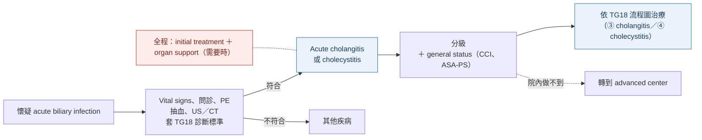

> [!abstract] 一句話重點
> - 懷疑膽道感染：
>   - **先看 vital signs，不穩就先救（不用等確診）** → 問診、PE、抽血、**US（第一線）或 CT** → 用 TG18 標準診斷 → 立刻給**輸液、止痛、足量 IV 抗生素、禁食** → 分級＋評估 general status（**CCI、ASA-PS**）→ 依流程圖治療
>   - 醫院做不到引流或 ICU 就**轉院**
> - 分級要**重複評估**（診斷時、24 h 內、24–48 h）

> [!info] 系列導覽
> ↑ 回到 [[gastroenterology/acute-biliary-infection/index|急性膽道感染 TG18 總覽]]
> 📌 [[gastroenterology/acute-biliary-infection/index#📌 必看表一：Cholangitis vs Cholecystitis 終極對照|必看表一：終極對照]]｜[[gastroenterology/acute-biliary-infection/index#📌 必看表二：Urgent、early、delayed 到底是多久？|必看表二：urgent／early／delayed 多久]]
>
> ① [[gastroenterology/acute-biliary-infection/tg18-1-diagnosis|診斷與嚴重度]]｜② 初始處置與 bundle（本篇）｜③ [[gastroenterology/acute-biliary-infection/tg18-3-cholangitis|Cholangitis 處置與膽道引流]]｜④ [[gastroenterology/acute-biliary-infection/tg18-4-cholecystitis|Cholecystitis 處置與膽囊引流]]｜⑤ [[gastroenterology/acute-biliary-infection/tg18-5-antimicrobial|抗生素]]｜⑥ [[gastroenterology/acute-biliary-infection/tg18-exam|內專考點]]
>
> 本篇來源：Miura 2018（初始處置）、Mayumi 2018（bundle）、Okamoto 2018（轉院標準）

## Figure 1：膽道感染的初始處置流程

依原圖內容重新繪製：

> [!danger] 不穩定先救，不必等確診
> ==Shock 或明顯惡化時，**立刻開始 initial treatment 和呼吸循環支持**，不用等 definitive diagnosis==。

## 懷疑膽道感染時要做什麼

### 症狀線索

Fever、chills、abdominal pain、jaundice、nausea／vomiting、**意識改變**：**只要出現任一項**就要往膽道感染去檢查。

### 問診與身體檢查

- Vital signs 全套：BP、HR、RR、BT、**尿量**、SpO₂、意識
- 症狀出現的時間與性質、過去病史、目前用藥（特別是 antithrombotic）
- PE 一定要看：**意識**、**眼結膜黃疸**、壓痛位置與程度、**腹膜刺激徵象**、**Murphy's sign**（壓 RUQ 深吸氣時因痛而停住，對 cholecystitis 特異）

### 檢驗

| 目的 | 項目 |
| --- | --- |
| 診斷 | WBC、CRP、ALP、GGT、AST、ALT、bilirubin |
| 分級 | **PLT、albumin、BUN／Cr、PT-INR、血液氣體（P/F ratio）** |
| 細菌學 | **高燒時先抽 blood culture**（最晚在給抗生素前） |

### 影像

US 和 CT **至少做一種**；US 便宜、無侵入、可床邊，所以建議先做（缺點是受操作者與病人狀況影響）。Cholangitis 的「發炎」本身影像看不到，影像是看**膽管擴張與阻塞原因**；cholecystitis 則看 GB 腫大、壁增厚、結石、周圍積液或膿瘍、sludge、sonographic Murphy's sign。

## Initial treatment

| 項目 | 內容 |
| --- | --- |
| 輸液與電解質 | **足量輸液**、矯正電解質，監測 BP、HR、**尿量** |
| 抗生素 | **足量 IV 抗生素**（選藥見 ⑤）；給藥前盡量先抽 blood culture |
| 止痛 | **早期積極給**：RCT 顯示 IV morphine 不會降低急腹症的診斷正確率 |
| 禁食 | 原則上禁食，**方便隨時做緊急引流**（沒有高品質證據，但為實務考量） |
| 器官支持 | Shock、意識障礙、呼吸困難、急性腎或肝功能異常、DIC（PLT 下降）→ 呼吸循環支持（插管、升壓劑）**同時考慮緊急膽道引流** |

> [!warning] Pitfall：止痛藥與 sphincter of Oddi
> Opioid（morphine）、pentazocine 等會讓 **sphincter of Oddi 收縮**、可能升高膽道壓力，使用時要小心；但==不要因為怕掩蓋症狀而不給止痛==。

### 分級與 general status

- 分級：用 ① 的 TG18 嚴重度標準，**依治療反應頻繁重新評估**
- General status：**Charlson comorbidity index（CCI）** 與 **ASA-PS**（定義見 ④），決定能不能開刀
- 院內無法處理（緊急手術、IVR、內視鏡）→ 考慮轉院

> [!note] Severe cholangitis 合併 DIC
> 小型研究顯示 **recombinant human soluble thrombomodulin（rTM）** 可改善 DIC 緩解率，但死亡率沒有顯著差異；沒有嚴重副作用，**可以考慮**（Level D）。

## 轉院標準

| Grade | Acute cholangitis（Miura Table 5） | Acute cholecystitis（Okamoto Table 7） |
| --- | --- | --- |
| **III** | 需要緊急引流＋重症照護 → **立刻轉**到做得到的醫院 | 符合條件時只能由**專家在有 ICU 的中心**做 LC；否則考慮轉院 |
| **II** | 要在能做**膽道引流＋全身照護**的醫院治療，做不到就轉 | 要在能做**緊急 GB drainage 或 early LC** 的中心治療，否則考慮轉院 |
| **I** | **CBD 有結石**或**24 h 內對初始治療無反應** → 比照 Grade II 處理 | 因嚴重共病而延後手術者，考慮轉到能做緊急 GB drainage 或 early LC 的中心 |

> [!tip] Pearl
> Cholangitis 的轉院標準是「==Grade II 以上，醫院做不到 ERCP／PTCD 或 ICU 就轉，**不論當下是否真的需要**==」。

## Bundle：該做的事清單

Bundle 是從指引中挑出「一起做會比分開做更有效」的必做項目，類似 sepsis bundle。TG18 版主要是**新增轉院建議**。

### Acute cholangitis bundle（Mayumi Table 1、3）

| # | 做什麼 |
| --- | --- |
| 1 | 懷疑時用 TG18 標準診斷，**未確診前每 6–12 h 重新評估** |
| 2 | 影像：**先 US**，需要時再 CT、MRI／MRCP、HIDA |
| 3 | 分級：**診斷時、24 h 內、24–48 h** 各評一次 |
| 4 | 確診後立刻 initial treatment：輸液、電解質、IV 止痛、**足量 IV 抗生素** |
| 5 | **Grade I**：初始治療 **24 h 無反應 → 立刻引流** |
| 6 | **Grade II**：**立刻引流**（與初始治療同時）；院內做不到就考慮轉院 |
| 7 | **Grade III**：**緊急引流**＋全身支持；做不到就考慮轉院 |
| 8 | **Grade III**：立刻給器官支持（NIPPV／插管、升壓劑、抗生素） |
| 9 | **Grade II、III**：做 **blood 和／或 bile culture** |
| 10 | 急性期過後處理病因（內視鏡、經皮或手術）；**有 GB stone 者在 cholangitis 緩解後做 cholecystectomy** |
| 11 | 院內無法引流或 ICU → Grade II、III 轉院 |

### Acute cholecystitis bundle（Mayumi Table 2、4）

| # | 做什麼 |
| --- | --- |
| 1 | 懷疑時用 TG18 標準診斷，**未確診前每 6–12 h 重新評估** |
| 2 | 影像：**先 US**，需要時 CT 或 HIDA |
| 3 | 分級：診斷時、24 h 內、24–48 h；同時評估**手術風險**（局部發炎、CCI、ASA-PS、predictive factors） |
| 4 | 確診後立刻：輸液、電解質、**禁食**、IV 止痛、**足量 IV 抗生素** |
| 5 | **Grade I**：**發病 7 天內做 LC（72 h 內更好）** |
| 6 | Grade I 選保守治療但 **24 h 無反應** → 若 PS 好且發病 < 7 天，重新考慮 early LC，或做膽囊引流 |
| 7 | **Grade II**：PS 好且有 advanced LC 技術 → **urgent／early LC**；狀況差 → urgent／early 膽囊引流或延後 LC |
| 8 | **Grade III**：手術高風險 → urgent／early 膽囊引流；若**沒有 negative predictive factor、器官衰竭屬於 FOSF（可快速恢復）、PS 好** → 可在 advanced center 做 early LC |
| 9 | **Grade II、III**：做 **blood 和／或 bile culture** |
| 10 | 院內無法做緊急 LC、膽囊引流或 ICU → 考慮轉院 |

> [!warning] Pitfall：兩個 bundle 的 culture 規則一樣
> ==Grade I 不需要常規 culture，**Grade II、III 才要**== blood／bile culture（理由見 ⑤：多數菌血症不會改變治療）。

## 相關筆記

- [[gastroenterology/acute-biliary-infection/tg18-1-diagnosis|① 診斷與嚴重度]]
- [[gastroenterology/acute-biliary-infection/tg18-3-cholangitis|③ Cholangitis 處置與膽道引流]]
- [[gastroenterology/acute-biliary-infection/tg18-4-cholecystitis|④ Cholecystitis 處置與膽囊引流]]
- [[gastroenterology/acute-biliary-infection/tg18-5-antimicrobial|⑤ 抗生素]]

## 參考資料

- Miura F, Okamoto K, Takada T, et al. Tokyo Guidelines 2018: initial management of acute biliary infection and flowchart for acute cholangitis. *J Hepatobiliary Pancreat Sci*. 2018;25:31–40.（參考資料庫：腸胃肝膽科／Miura）
- Mayumi T, Okamoto K, Takada T, et al. Tokyo Guidelines 2018: management bundles for acute cholangitis and cholecystitis. *J Hepatobiliary Pancreat Sci*. 2018;25:96–100.（參考資料庫：腸胃肝膽科／Mayumi）
- Okamoto K, Suzuki K, Takada T, et al. Tokyo Guidelines 2018: flowchart for the management of acute cholecystitis. *J Hepatobiliary Pancreat Sci*. 2018;25:55–72.（Table 7 轉院標準）
