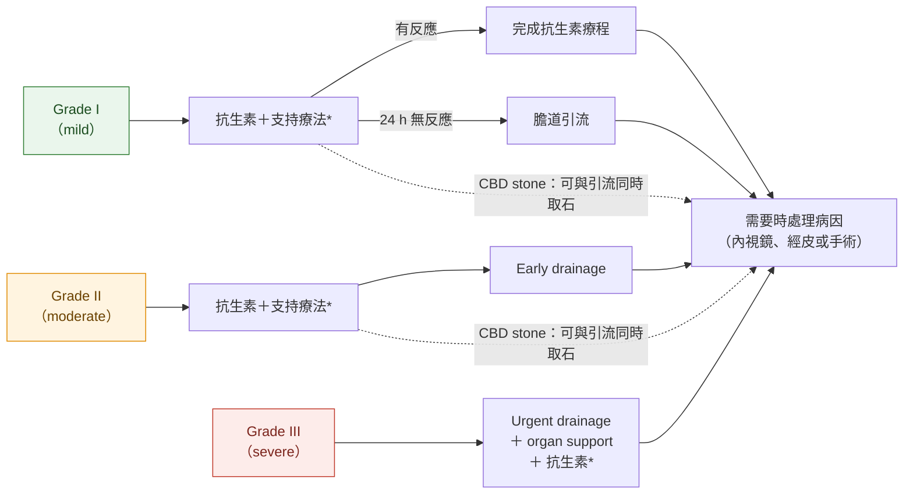

> [!abstract] 一句話重點
> Cholangitis 治療三支柱：**抗生素、膽道引流、處理病因**。**Grade I** 先抗生素，**24 h 沒反應才引流**；**Grade II 早期引流**（最能降低死亡率的族群）；**Grade III 先穩定呼吸循環，再盡快緊急引流**。引流首選 **endoscopic transpapillary drainage（ENBD 或 EBS 都可）**，單純引流**不需要 EST**；凝血異常或抗凝者用 **stent，避免 EST 與 PTCD**。

> [!info] 系列導覽
> ↑ 回到 [[gastroenterology/acute-biliary-infection/index|急性膽道感染 TG18 總覽]]
> 📌 [[gastroenterology/acute-biliary-infection/index#📌 必看表一：Cholangitis vs Cholecystitis 終極對照|必看表一：終極對照]]｜[[gastroenterology/acute-biliary-infection/index#📌 必看表二：Urgent、early、delayed 到底是多久？|必看表二：urgent／early／delayed 多久]]
>
> ① [[gastroenterology/acute-biliary-infection/tg18-1-diagnosis|診斷與嚴重度]]｜② [[gastroenterology/acute-biliary-infection/tg18-2-initial-management|初始處置與 bundle]]｜③ Cholangitis 處置與膽道引流（本篇）｜④ [[gastroenterology/acute-biliary-infection/tg18-4-cholecystitis|Cholecystitis 處置與膽囊引流]]｜⑤ [[gastroenterology/acute-biliary-infection/tg18-5-antimicrobial|抗生素]]｜⑥ [[gastroenterology/acute-biliary-infection/tg18-exam|內專考點]]
>
> 本篇來源：Miura 2018（flowchart）、Mukai 2017（膽道引流技術）、Kiriyama 2018（引流時機資料）、Gomi 2018（抗生素的角色）

## 🧭 決策思維：什麼時候引流？

### 先懂一件事：cholangitis 是「阻塞」造成的感染

膽管阻塞 → **膽道壓力升高** → 感染的膽汁裡的細菌與 endotoxin 被**擠回血流** → 全身發炎、sepsis。所以：

- **抗生素治不好阻塞**：膽道一阻塞，抗生素就**不會分泌到膽汁裡**；真正的 source control 是**減壓（引流）**
- **抗生素的角色是「爭取時間」**：讓病人能從「必須緊急引流」變成「可以擇期引流」（老研究中約一半對抗生素反應好的病人因此改成擇期處理）
- 所以引流時機的問題其實是：==**這個病人能不能靠抗生素撐到擇期？撐不住的代價多大？**==

### 決策三問

| 問題 | 為什麼要問 | 答案怎麼改變決定 |
| --- | --- | --- |
| **① 已經有器官衰竭了嗎？**（Grade III） | 已經 sepsis 合併器官衰竭，阻塞不解除就不會好 | 有 → **先穩定呼吸循環，然後盡快引流**；穩定與引流幾乎同步進行，不是等「完全穩定」 |
| **② 還沒衰竭，但危險因子 ≥ 2 項嗎？**（Grade II） | Grade II 是「**還沒衰竭、但正在往衰竭走**」的人；日台資料中只有這群人早引流能**降低死亡率**（24 h 內 1.7% vs 3.4%） | 是 → **不等抗生素反應，早期引流**（與初始治療同時開始） |
| **③ 對抗生素有反應嗎？**（Grade I） | Grade I 多數靠抗生素就會好，早引流的死亡率沒有差異 | **24 h 內有反應** → 完成抗生素、擇期處理病因；**沒反應或 CBD 有結石** → 比照 Grade II 引流 |

> [!important] 一句話記決策
> ==Grade III：救命 → 盡快引流；Grade II：預防惡化 → 早期引流；Grade I：給抗生素機會 → 24 h 沒反應才引流。==
> Grade 越高，「等抗生素」的空間越小。

### 時間軸

TG 研究對時機的定義：**urgent = 入院當天（24 h 內）**、**early = 入院隔天（24–48 h）**，都是**從入院起算、以小時計**。

> [!warning] 不是 72 h
> 72 h 是 **cholecystitis 開刀**的時間窗（從**發病**算）；cholangitis 引流看的是**入院後 24／48 h**。完整對照見 [[gastroenterology/acute-biliary-infection/index#📌 必看表二：Urgent、early、delayed 到底是多久？|總覽頁必看表二：urgent、early、delayed 到底是多久？]]

到院

24 h 內

24–48 h

全身狀況改善後

Cholangitis 緩解後

Grade III

穩定呼吸循環＋抗生素

盡快 urgent drainage

處理病因（取石等）

有 GB stone → LC

Grade II

抗生素＋支持療法

Early drainage（24 h 內最好，至遲 48 h）

處理病因＊

有 GB stone → LC

Grade I

抗生素，觀察反應

24 h 無反應 → 引流

處理病因＊

有 GB stone → LC

必須盡快做視反應決定可擇期

＊Mild／moderate 的 CBD stone、沒有抗凝或凝血異常 → **可以在引流時一起 EST＋取石**（single-stage），不必等到「改善後」。

### 為什麼 Grade III「穩定後」才引流，不是「立刻衝 ERCP」？

- 指引提醒：重症病人遇到**又長又不順的引流處置**，容易發生嚴重併發症；所以先把**呼吸、循環**穩住（必要時插管、升壓劑），再做
- 這時的引流目標是**最快、最短的減壓**：放 stent 或 ENBD 就收工，**不要在同一次做 EST、取石**（Grade III 常合併凝血異常，EST 出血風險高）；若真要手術引流，也只放 T-tube 不取石
- 日台資料中 Grade III 在 24 h 內引流和沒有引流的死亡率沒有差異，作者推測**可能需要更早（< 12 h）**才看得出效果，所以不是「可以慢慢來」，而是「穩定後要非常快」

### 病因治療（取石）什麼時候做？

| 情境 | 取石時機 | 理由 |
| --- | --- | --- |
| Mild／moderate、沒有凝血異常或抗凝 | **可以和引流同一次**（EST 後取石） | 治癒率、出血率和兩階段相同，住院較短 |
| **Severe**、凝血異常、抗凝 | **先引流（stent），改善後再取** | Cholangitis 本身就增加 EST 出血，凝血異常更危險 |
| **大顆或多顆結石**（需要 EPLBD） | **兩階段** | 發炎的膽管脆，一次大氣球擴張易出血或穿孔 |
| 合併 GB stone | Cholangitis **緩解後做 cholecystectomy** | 膽囊結石仍是 CBD stone 的來源，不處理容易再發 |

## Figure 2：TG18 acute cholangitis 處置流程

依原圖內容重新繪製（實線 = 主要路徑，虛線 = 可同時處理病因）：

\* 給抗生素前考慮抽 **blood culture**；做引流時一定要送 **bile culture**。

### 各級重點

| Grade | 怎麼處理 | 病因治療 |
| --- | --- | --- |
| **I** | 多數**只靠抗生素**就夠，不需要引流；**初始治療沒反應才引流** | 可與引流**同時**做 EST＋取石；術後 cholangitis 通常抗生素即可 |
| **II** | **早期**內視鏡或經皮膽道引流 | 等全身狀況改善後再處理；**TG18 新增**：CBD stone 可與引流**同時**做 EST＋取石 |
| **III** | 迅速**呼吸循環支持**（插管、升壓劑）→ 狀況改善後**盡快**內視鏡或經皮引流 | 全身狀況改善後才處理病因 |

> [!tip] Pearl：TG18 對 Grade II 的修改
> TG13 認為 Grade II 應**先引流、之後再選擇性處理病因**。TG18 依臨床實務改成：==mild 或 moderate 的 CBD stone 造成的 cholangitis，**可以在引流時一起取石**==（single-stage），但 moderate 的證據仍不足，要小心併發症。

> [!warning] Pitfall：同時有 cholecystitis
> Cholangitis 有時合併 acute cholecystitis，治療策略要**兩者的嚴重度和全身狀況一起考量**；有 GB stone 者 cholangitis 緩解後要安排 **cholecystectomy**。

## 為什麼 Grade II 要早引流

日台約 6,000 人的資料（詳見 [[gastroenterology/acute-biliary-infection/tg18-1-diagnosis|① Table 3]]）：Grade II 在 **24 h 內引流**的 30 天死亡率 **1.7% vs 3.4%**，有顯著差異；Grade I、III 則沒有差異。另一研究顯示 mild／moderate 在 24 h 內引流可**縮短住院天數**（約 6.8 vs 9.2 天）。

## 引流方式怎麼選

### Q1：哪種膽道引流最好？

**首選 endoscopic transpapillary biliary drainage**（Rec 1, Level B）：侵入性最低、併發症較少（雖有 post-ERCP pancreatitis 風險），內引流比外引流不痛，CBD stone 還可以同一次處理、縮短住院。

| 方式 | 角色 | 優點 | 缺點 |
| --- | --- | --- | --- |
| **Endoscopic transpapillary**（ENBD／EBS） | **第一線** | 微創、併發症少、可同時取石 | 需要熟練的胰膽內視鏡醫師 |
| **PTCD**（PTBD） | 無法經十二指腸乳頭（上消化道阻塞）、沒有內視鏡專家、或 ERCP 插管失敗時的替代 | 不需內視鏡 | 外引流：外觀、皮膚發炎、膽汁漏，生活品質較差；**出血風險高** |
| **EUS-BD** | ERCP 失敗後的替代（**需專家、高流量中心**） | 與 PTCD 成功率相近（約 90–100%），但出血、cholangitis、膽汁漏較少 | 技術尚未普及；非專家中心成功率只有約 2／3 |
| 手術引流 | 現在極少用 | | **死亡率最高**；若要做，簡單放 T-tube，不做取石、不延長手術 |

> [!note] PTCD 技術重點
> US 引導穿刺肝內膽管（18–22 G 針）→ 導線 → 放 7–10 Fr 導管。**膽管沒擴張時成功率較低**（約 63% vs 擴張時 86%），用細針（22 G）較安全。

### Q2：ENBD 還是 EBS？

**兩者皆可**（Rec 1, Level A）：三個 RCT 的 meta-analysis 在技術成功、臨床成功、併發症、再介入都沒有差異。

| | ENBD（nasobiliary，外引流） | EBS（plastic stent，內引流） |
| --- | --- | --- |
| 好處 | 可**觀察、沖洗膽汁**（膽汁很膿時有用）；**hilar obstruction** 可能較適合（stent 較易阻塞） | **病人較舒服**、不會流失水分與電解質 |
| 壞處 | 鼻管不舒服，**老人常自拔** | 可能阻塞 |
| 規格 | 5–7 Fr 鼻膽管 | 7–10 Fr plastic stent（直型或雙豬尾型都可） |

### Q3：引流時需要做 EST 嗎？

**單純引流不需要**（Rec 2, Level A）：加做 EST 並不能預防 post-ERCP pancreatitis，反而增加出血。==Cholangitis 本身就是 **post-EST bleeding 的危險因子**==；嚴重 cholangitis 合併凝血異常或用 antithrombotic 時**避免 EST**。

EST 的好處只在兩種情況：放**大口徑 stent**（> 10 Fr plastic 或 SEMS）時避免壓住胰管，以及想**一次引流加取石**。

### Q4：CBD stone 要一次取還是分兩次？

| 情況 | 建議 |
| --- | --- |
| **Mild／moderate**、沒有抗凝或凝血異常 | **可考慮 EST 後一次取石**（Rec 2, Level C）：治癒率和出血率與兩階段相同，住院較短 |
| **大顆或多顆結石**（需要 EPLBD） | **先引流，之後再取石（兩階段）**：發炎的膽管較脆，一次做 EPLBD 可能出血或穿孔 |
| 抗凝、凝血異常、severe | 先引流（stent），改善後再處理 |

### Q5：凝血異常或使用 antithrombotic 怎麼辦？

| 建議 | 理由 |
| --- | --- |
| **凝血異常 → 先放 stent（ENBD／EBS）**（Rec 1, Level D） | 低出血風險的處置 |
| **避免 EST** | EST 本來就是高出血風險處置，cholangitis 又會增加出血 |
| **避免 PTCD** | 經肝穿刺，血管多、出血風險高 |
| 需要處理乳頭取石時，可考慮 **EPBD** 取代 EST | EPBD 出血較少（但取石成功率較低、需 lithotripsy 較多、**pancreatitis 較多**）；適合肝硬化等潛在凝血異常、或無法停藥者 |
| Aspirin | 血栓高風險者**可不停** aspirin 做 EST |
| Thienopyridine（clopidogrel 等） | 高出血風險處置前停 **5–7 天**；血栓高風險者與處方醫師討論改 aspirin 或 cilostazol |
| 抗凝劑 | 建議改 **heparin bridging** |

> [!danger] EPBD 的禁忌
> ==**EPBD 單獨做而不引流，不可用於 cholangitis**==（它保留 sphincter 功能，膽汁仍排不出去）；**biliary pancreatitis 也要避免 EPBD**。

### Q6：手術改變過解剖（如 Roux-en-Y）

**有專家時首選 balloon enteroscopy-assisted ERCP（BE-ERCP）**（Rec 2, Level C）：併發症約 3%，遠低於 PTCD（25–31%）與 EUS-BD（8–15%），還能同時處理結石或吻合口狹窄。但技術困難、耗時，成功率 40–95%；不熟練或失敗時改 **PTCD 或 EUS-BD**，或轉到專門中心。

## 相關筆記

- [[gastroenterology/acute-biliary-infection/tg18-1-diagnosis|① 診斷與嚴重度]]
- [[gastroenterology/acute-biliary-infection/tg18-2-initial-management|② 初始處置與 bundle]]
- [[gastroenterology/acute-biliary-infection/tg18-5-antimicrobial|⑤ 抗生素]]：引流後抗生素療程 4–7 天

## 參考資料

- Miura F, Okamoto K, Takada T, et al. Tokyo Guidelines 2018: initial management of acute biliary infection and flowchart for acute cholangitis. *J Hepatobiliary Pancreat Sci*. 2018;25:31–40.（參考資料庫：腸胃肝膽科／Miura）
- Mukai S, Itoi T, Baron TH, et al. Indications and techniques of biliary drainage for acute cholangitis in updated Tokyo Guidelines 2018. *J Hepatobiliary Pancreat Sci*. 2017;24:537–549.（參考資料庫：腸胃肝膽科／Mukai）
- Kiriyama S, Kozaka K, Takada T, et al. Tokyo Guidelines 2018: diagnostic criteria and severity grading of acute cholangitis. *J Hepatobiliary Pancreat Sci*. 2018;25:17–30.（Table 3 引流時機）
