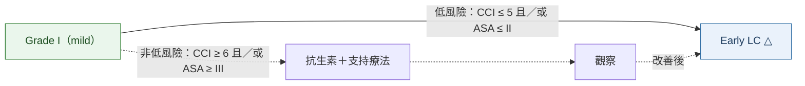
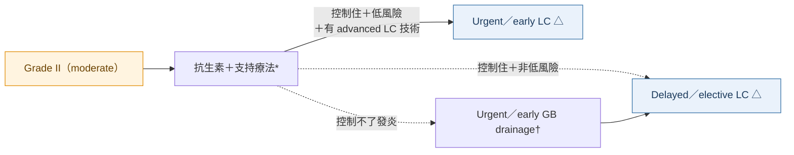
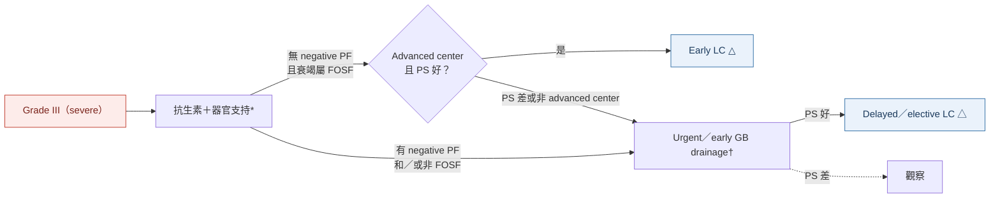

> [!abstract] 一句話重點
> TG18 cholecystitis 以 **early LC 為主軸**，用 **CCI 與 ASA-PS** 判斷能不能開。**Grade I**：低風險 → **early LC**。**Grade II**：低風險＋有 advanced LC 技術 → **urgent／early LC**；抗生素控制不了 → **GB drainage**。**Grade III（TG18 新增）**：**沒有 negative predictive factor（T-bil ≥ 2、意識、呼吸）**、衰竭屬 **FOSF（心血管或腎、可快速恢復）**、PS 好且在 advanced center → 可 **early LC**；否則 **urgent／early GB drainage（首選 PTGBD）**。只要能開，**不必死守 72 h**。

> [!info] 系列導覽
> ↑ 回到 [[gastroenterology/acute-biliary-infection/index|急性膽道感染 TG18 總覽]]
> 📌 [[gastroenterology/acute-biliary-infection/index#📌 必看表一：Cholangitis vs Cholecystitis 終極對照|必看表一：終極對照]]｜[[gastroenterology/acute-biliary-infection/index#📌 必看表二：Urgent、early、delayed 到底是多久？|必看表二：urgent／early／delayed 多久]]
>
> ① [[gastroenterology/acute-biliary-infection/tg18-1-diagnosis|診斷與嚴重度]]｜② [[gastroenterology/acute-biliary-infection/tg18-2-initial-management|初始處置與 bundle]]｜③ [[gastroenterology/acute-biliary-infection/tg18-3-cholangitis|Cholangitis 處置與膽道引流]]｜④ Cholecystitis 處置與膽囊引流（本篇）｜⑤ [[gastroenterology/acute-biliary-infection/tg18-5-antimicrobial|抗生素]]｜⑥ [[gastroenterology/acute-biliary-infection/tg18-exam|內專考點]]
>
> 本篇來源：Okamoto 2018（flowchart）、Mori 2018（膽囊引流）、Wakabayashi 2018（手術安全）、Mayumi 2018（bundle）、Gomi 2018（抗生素角色）

## 🧭 決策思維：什麼時候開刀？什麼時候引流？

### 先懂兩件事

**1. Cholecystitis 的根治是切掉膽囊，引流只是「橋接」**

- 和 cholangitis 不同，cholecystitis 的病灶就是膽囊本身；**cholecystectomy 同時是 source control 和根治**
- **GB drainage（PTGBD）是給「現在不能開」的人**，讓他撐過急性期，之後通常還是要切
- 能開的人先引流**沒有好處**：研究中術前做 drainage 的病人，手術時間、住院天數反而更長，轉開腹率沒有下降

**2. 為什麼「能開就早開」？時間在跟纖維化賽跑**

- 發炎早期纖維化還不明顯；隨著發炎持續，**纖維化、瘢痕**越來越重，Calot's triangle 越難剝，**bile duct injury 風險上升**
- 等延後手術（傳統 ≥ 6 週）期間，有 **6–23%** 復發、被迫緊急開刀；每次復發都讓組織更難開
- 15 個 RCT meta-analysis：early LC 的 bile duct injury、併發症**不比延後手術多**，**總住院天數更短、費用更低**；超過 72 h（72 h–1 週）早開仍有好處
- 但「早期」≠「半夜急開」：24 h 內開並沒有比 72 h 內好；要由**有經驗的外科醫師在適合的時段**做

### 決策三問

| 問題 | 為什麼要問 | 答案怎麼改變決定 |
| --- | --- | --- |
| **① 病人撐得住手術嗎？** | 手術本身有風險；高共病的人急性期開刀死亡率明顯上升 | **Grade I／II**：CCI ≥ 6 或 ASA-PS ≥ III 算高風險 **Grade III**：CCI ≥ 4 或 ASA-PS ≥ III、或有 **negative predictive factor**（**T-bil ≥ 2、意識障礙、呼吸衰竭**）→ 不開；衰竭只有**心血管或腎、且很快恢復（FOSF）** → 仍可開 |
| **② 抗生素控制得住發炎嗎？** | 控制住 → 有時間等；控制不住 → 膽囊持續化膿、可能穿孔或 sepsis，必須立刻 source control | **控制住**：低風險 → 早開；高風險 → 等發炎消退後延後開 **控制不住**＋不能開 → **urgent／early GB drainage** |
| **③ 醫院做得到嗎？** | Grade II、III 發炎重、手術難，要**熟練 advanced LC 的醫師＋ICU** | 做不到 → **轉院**，或先引流 |

> [!important] 一句話記決策
> ==**能開（風險低）＋做得到 → 早開**；**不能開＋抗生素有效 → 等，延後開**；**不能開＋抗生素無效 → 先引流，延後開**。==
> Grade 決定「發炎多重、手術多難」，CCI／ASA／predictive factor 決定「病人撐不撐得住」，兩者一起看。

### 三種結局的比較

| 路徑 | 適合誰 | 時機 |
| --- | --- | --- |
| **Early LC** | 風險低、在做得到的醫院 | **發病 72 h 內最好，7 天內都算早期**；只要能耐受，超過 72 h 也不必放棄早開 |
| **保守治療 → delayed LC** | 風險高但抗生素有效 | 發炎消退、全身狀況改善後；RCT 中「延後」多定義為 **≥ 6 週** |
| **GB drainage → delayed LC** | 風險高且抗生素無效；或 Grade III 不符合開刀條件 | 引流後何時開**沒有共識**；太早開（< 72 h–2 週）出血多、手術久，研究顯示**等 4–6 週**結果較好 |
| **GB drainage → 不開** | PS 差到之後也無法手術 | 觀察；必要時長期引流 |

### 時間軸

這裡的時間都是**從發病（症狀開始）起算**：early LC = **72 h 內最好、7 天內都算**；delayed = **≥ 6 週**。TG18 對「urgent」LC 或 GB drainage **沒有給明確時數**，字義上就是比 early 更快。和 cholangitis 引流（從入院算 24／48 h）的對照見 [[gastroenterology/acute-biliary-infection/index#📌 必看表二：Urgent、early、delayed 到底是多久？|總覽頁必看表二：urgent、early、delayed 到底是多久？]]

到院 24 h

24–72 h

72 h–1 週

1–6 週

≥ 6 週

Grade I／II 低風險

抗生素＋支持療法

Early LC（72 h 內最好，7 天內）

I／II 高風險，抗生素有效

抗生素、觀察，等發炎消退

Delayed／elective LC

抗生素無效（II）

抗生素

Urgent／early GB drainage

Delayed LC（常等 4–6 週）

Grade III 符合條件

器官支持，確認 FOSF 恢復

Early LC（advanced center）

Grade III 不符合

器官支持＋抗生素

Urgent／early GB drainage

PS 好 → delayed LC；差 → 觀察

關鍵處置初始治療擇期

### 中途改變計畫的時機

- **Grade I 選了保守治療，24 h 沒改善或惡化** → 重新評估：發病 **< 7 天且 PS 好 → 改 early LC**；不能開 → **GB drainage**
- **嚴重度要每天重評**（診斷時、24 h 內、24–48 h）：Grade I 可能惡化成 II、III，路徑跟著改
- **手術中發現太難**（無法達到 critical view of safety）→ **bail-out**（subtotal cholecystectomy、轉開腹），不要硬切

> [!warning] Pitfall：把 cholangitis 的邏輯套到 cholecystitis
> Cholangitis 的關鍵處置是**引流**（越重越早）；cholecystitis 的關鍵處置是**切除**，引流只用在「不能切」的人。==Grade III cholecystitis 不是一律引流，符合條件的人 TG18 允許 early LC。==

## 先懂兩個風險工具

### Table 1：Charlson comorbidity index（CCI）

每個共病給分，加總即為 CCI；分數越高，預測死亡率與醫療資源越高。

| 分數 | 共病 |
| --- | --- |
| **1** | MI、CHF、周邊血管疾病、腦血管疾病、dementia、慢性肺病、結締組織病、peptic ulcer、輕度肝病、DM（無併發症） |
| **2** | Hemiplegia、中重度 CKD、DM 合併器官損傷、任何實體腫瘤、leukemia、lymphoma |
| **3** | 中重度肝病 |
| **6** | 轉移性實體腫瘤、AIDS |

### Table 2：ASA physical status

| ASA | 定義 | 例子 |
| --- | --- | --- |
| I | 健康 | 不抽菸、幾乎不喝酒 |
| II | 輕度全身疾病，無功能受限 | 抽菸、社交飲酒、懷孕、肥胖（BMI 30–40）、控制良好的 DM／HTN、輕度肺病 |
| **III** | 重度全身疾病，功能受限 | 控制不良 DM／HTN、COPD、BMI ≥ 40、活動性肝炎、酒癮、pacemaker、EF 中度下降、**規律透析的 ESRD**、> 3 個月前的 MI／CVA／TIA／stent |
| IV | 持續威脅生命的重度疾病 | < 3 個月內的 MI／CVA／TIA／stent、進行中缺血或嚴重瓣膜病、EF 重度下降、**sepsis、DIC**、未規律透析的 ARD／ESRD |
| V | 不開刀就活不了 | 主動脈瘤破裂、嚴重外傷、腦出血合併 mass effect |
| VI | 腦死器官捐贈者 | |

### 高風險的切點（Q5）

| Grade | 不適合（立即）手術的風險因子 |
| --- | --- |
| **I、II** | **CCI ≥ 6** 或 **ASA-PS ≥ III** |
| **III** | **CCI ≥ 4** 或 **ASA-PS ≥ III**（Grade III 已經有器官衰竭，CCI 6 太高、不適合當切點）＋ **negative predictive factors** |

**Negative predictive factors（Grade III）**：多變項分析中和術後 30 天死亡率獨立相關的三項

1. **Jaundice（T-bil ≥ 2 mg/dL）**
2. **Neurological dysfunction**（意識障礙）
3. **Respiratory dysfunction**（P/F < 300）

**FOSF（favorable organ system failure）**：**心血管或腎臟**衰竭，若入院後、early LC 前**很快就能恢復**，屬於「有利的」器官衰竭，不算阻礙手術的因素。

> [!tip] 記法
> Grade III 能不能開刀 = 看「**黃、意識、呼吸**」有沒有（negative PF），以及衰竭是不是「**心、腎、且很快回來**」（FOSF）。
> ==Negative PF：**黃疸（T-bil ≥ 2）、神經、呼吸**；FOSF：**心血管、腎**==

## TG18 cholecystitis 處置流程

制定原則：① 依 predictive factors、CCI、ASA-PS 決定路徑；② **Grade II、III 的 LC 只在 advanced center**（有 advanced laparoscopic 技術的外科醫師與 ICU）做；③ 滿足各級條件才做 LC。

### Figure 8：Grade I

依原圖內容重新繪製：

△ 手術困難時改用 **bail-out procedure**（含轉開腹）。

### Figure 9：Grade II

依原圖內容重新繪製：

\* 給抗生素前考慮 blood culture；† GB drainage 時送 bile culture；低風險 = CCI ≤ 5 且／或 ASA ≤ II。

Grade II 常有**嚴重局部發炎**，LC 難度高，要預期可能需要**轉開腹或 subtotal cholecystectomy**；醫院做不到 early LC 或引流就轉院。

### Figure 10：Grade III

依原圖內容重新繪製：

Negative PF：jaundice（T-bil ≥ 2）、neurological、respiratory dysfunction；Grade III 的 PS 差 = **CCI ≥ 4 或 ASA-PS ≥ III**。

> [!danger] Grade III 開刀的條件很嚴格
> ==Grade III 的 early LC 只能由**有 ICU 的 advanced center、熟練的腹腔鏡專家**執行==；任何一項不符合就先 GB drainage，等病況改善後再 elective LC。

### 三級對照

| | 首選 | 不適合時 |
| --- | --- | --- |
| **Grade I** | **Early LC**（CCI ≤ 5、ASA ≤ II） | 先抗生素，改善後 LC |
| **Grade II** | **Urgent／early LC**（低風險＋advanced 技術） | 控制住 → 延後 LC；控制不了 → **GB drainage** → 延後 LC |
| **Grade III** | 嚴格條件下 **early LC**（無 negative PF、FOSF、PS 好、advanced center） | **Urgent／early GB drainage** → PS 好再延後 LC |

## 手術相關的臨床問題

### Q1：LC 還是開腹？

**建議 LC**（Rec 2, Level A）。RCT meta-analysis 顯示 LC 的併發症（OR 0.34）與住院天數（約少 1.7 天）有較好的趨勢但未達統計顯著；各國 cholecystitis 手術中 LC 已占 7–9 成以上。LC 疼痛少、恢復快，總醫療費用相近。

### Q3：手術時機——一定要 72 h 內嗎？

**只要能耐受手術，不論發病多久都建議早做**（Rec 2, Level B）。

- 15 個 RCT meta-analysis（early = 72 h 內或 1 週內 vs delayed = ≥ 6 週後）：手術時間、bile duct injury 無差異；**總住院天數較短、總費用較低**
- 等待延後手術期間有 **6–23%** 復發而需要緊急手術，反覆發炎讓組織更纖維化、更難開
- 超過 72 h（72 h–1 週）的病人，早開仍有好處
- 24 h 內開並沒有比 72 h 內開更好 → ==「早期」不等於「半夜急開」==，應由有經驗的外科醫師在合適時段執行

> [!warning] Pitfall
> TG13 寫「**發病 72 h 內**」；TG18 放寬為「能開就早開，**不必拘泥 72 h**」。但 Grade II 定義中的「症狀 > 72 h」仍保留（表註：LC 應在發病 96 h 內做）。

### Q4：PTGBD 後多久開刀？

**沒有共識**（Level C）。觀察性研究：PTGBD 後太早開（< 72 h 或 < 2 週）手術時間較長、出血較多；一個 RCT 和一個 cohort 顯示**等 4–6 週再 LC** 結果不錯；但也有研究認為早開比較省錢。由主治醫師依病人風險決定。

## 膽囊引流（Mori 2018）

### Q1：手術高風險病人的標準引流方式

**PTGBD 是標準**（Rec 1, Level B）：比手術侵入性低、併發症少、一般醫師就能做（US 引導 18 G 針穿刺 → 6–10 Fr 導管）。**ETGBD 或 EUS-GBD 只在高流量中心由熟練內視鏡醫師執行時**考慮。

| 方式 | 角色 | 重點 |
| --- | --- | --- |
| **PTGBD**（cholecystostomy） | **標準首選** | 外引流；Grade III 做 PTGBD 的死亡率、再入院率較高（反映病情重） |
| **PTGBA**（只抽不留管） | 不建議當所有人的標準 | 簡單，但濃稠 sludge 或膿可能抽不出來；一個國際研究顯示 3 天內臨床成功率反而較高，待 RCT |
| **ETGBD**（ENGBD 或 EGBS，經乳頭進 cystic duct） | 高流量中心的替代 | 特別適合**嚴重凝血異常、血小板低、或解剖上無法經皮**者；cystic duct 不易通過，需高超技術 |
| **EUS-GBD**（經胃或十二指腸放 stent） | 高流量中心的替代 | 技術成功約 98%、臨床成功約 94%、併發症約 12%；**LAMS** 併發症最少 |

### 凝血異常或用 antithrombotic 時

| 用藥 | PTGBD 怎麼做（依介入放射學會建議） |
| --- | --- |
| Aspirin | 血栓高風險者**可不停** |
| Clopidogrel | **停 5 天**再做 |
| 抗凝劑 | **PT-INR < 1.5**，改 heparin bridging |
| 抗血小板＋抗凝劑併用 | **避免 PTGBD**（缺乏資料）→ 有專家時改 **ETGBD** |

### Q2：ENGBD 還是 EGBS？

**兩者皆可**（Rec 1, Level B）：兩個 RCT 的 meta-analysis 在技術成功、臨床成功、併發症都無差異。ENGBD 可沖洗但病人可能自拔；EGBS 舒適但可能阻塞。

## 手術安全（Wakabayashi 2018）

TG18 擴大了困難條件下 LC 的適應症，因此**一定要避免 bile duct injury（BDI）**，特別是合併血管傷害（vasculo-biliary injury）。內科醫師需要知道的重點：

- **術中發現**（GB 周圍與 Calot's triangle 的纖維化、瘢痕、膿瘍等）是手術困難度的客觀指標；術前危險因子包括 GB wall thickening、男性、高齡、肥胖
- **Critical view of safety（CVS）**：切斷任何結構前要確認 CVS 三條件；所有剝離都在 **Segment 4 底部與 Rouviere's sulcus 連線的上方（腹側）**
- 無法達到 CVS（Calot's triangle 嚴重纖維化）→ **bail-out procedure**：**subtotal cholecystectomy**（fenestrating 或 reconstituting）、fundus-first、轉開腹；subtotal 的 BDI、再手術與死亡率都比轉開腹低，但膽汁漏較多
- **合併 CBD stone**：一階段（LC＋腹腔鏡 CBD exploration 或 rendezvous）與兩階段（先 ERCP 再 LC）**都可以**（Level B），看院內技術
- **Reduced port surgery**：優勢不明，只用於少數選擇過的病人

## 相關筆記

- [[gastroenterology/acute-biliary-infection/tg18-1-diagnosis|① 診斷與嚴重度]]
- [[gastroenterology/acute-biliary-infection/tg18-2-initial-management|② 初始處置與 bundle]]
- [[gastroenterology/acute-biliary-infection/tg18-5-antimicrobial|⑤ 抗生素]]：Grade I、II 開完刀 24 h 內可停抗生素

## 參考資料

- Okamoto K, Suzuki K, Takada T, et al. Tokyo Guidelines 2018: flowchart for the management of acute cholecystitis. *J Hepatobiliary Pancreat Sci*. 2018;25:55–72.（參考資料庫：腸胃肝膽科／Okamoto）
- Mori Y, Itoi T, Baron TH, et al. Tokyo Guidelines 2018: management strategies for gallbladder drainage in patients with acute cholecystitis (with videos). *J Hepatobiliary Pancreat Sci*. 2018;25:87–95.（參考資料庫：腸胃肝膽科／Mori）
- Wakabayashi G, Iwashita Y, Hibi T, et al. Tokyo Guidelines 2018: surgical management of acute cholecystitis: safe steps in laparoscopic cholecystectomy for acute cholecystitis (with videos). *J Hepatobiliary Pancreat Sci*. 2018;25:73–86.（參考資料庫：腸胃肝膽科／Wakabayashi）
