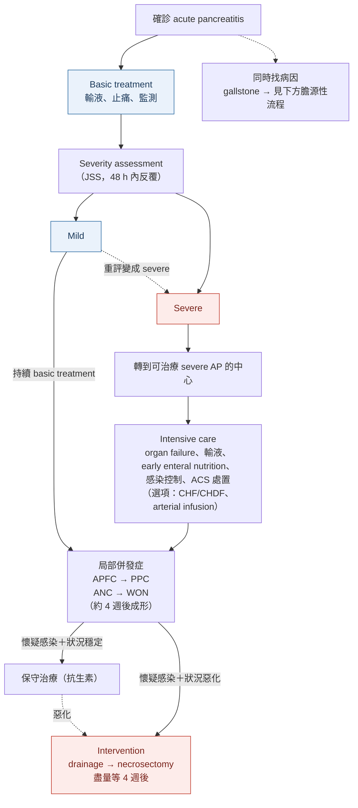
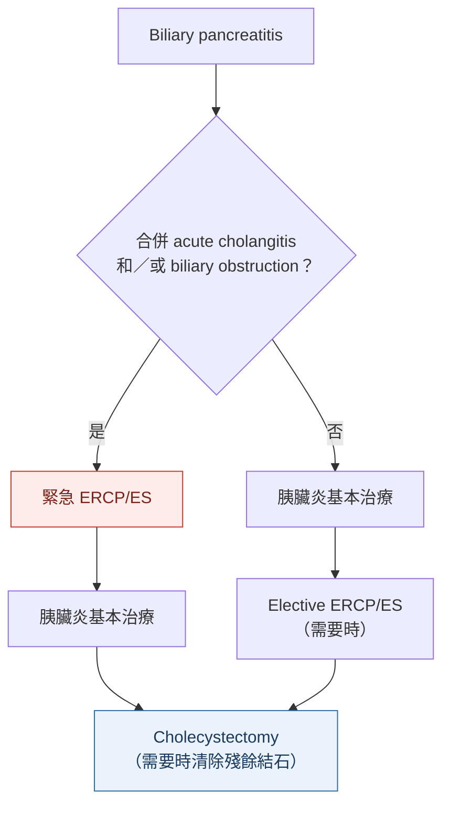

> [!abstract] 一句話重點
> - 診斷看 **upper abdominal pain＋pancreatic enzyme（首選 lipase）＋imaging 三項中兩項**
>   - 確診後**立刻、並在 48 小時內反覆**做 severity assessment（JSS）
> - 早期處置的核心是 **Ringer's lactate**、止痛、**早期 enteral nutrition**
>   - 🆕 輸液改成 **==moderate（1.5 mL/kg/h，低血容才 bolus 10 mL/kg）==**，不再「越多越好」（WATERFALL 2022、ACG 2024）
>   - 🆕 **==Severe AP 不給預防性抗生素==**（ACG 2024）；mild AP **24–48 h 內就開始低脂飲食**
>   - 第一件要分辨的病因是 **gallstone**（合併 cholangitis／膽道阻塞才做 early ERCP/ES，出院前把膽囊拿掉）
> - Necrosis 先保守，真的要介入也**等到 4 週後 WON 期**，用 step-up approach
> - 出院前就要**降低復發**：mild gallstone AP **同次住院切膽囊**、alcohol 做 brief intervention、TG 和 Ca 要追（JAMA 2021）

## 🗺️ 總綱

🗺️ AP：確診 → 48 h 內反覆評估嚴重度 → 輸液＋止痛＋早期灌食 → 先找 gallstone → necrosis 等 4 週

1. 診斷（三項中兩項）
<ul><li>上腹 abdominal pain＋tenderness</li><li>Pancreatic enzyme 上升 → <b>首選 lipase</b></li><li>US、CT 或 MRI 有異常</li><li>Atlanta：lipase／amylase <b>≥ 3 × ULN</b></li></ul>

2. 嚴重度（JSS／BISAP）
<ul><li>確診時、24 h 內、24–48 h <b>反覆評估</b></li><li>JSS：<b>≥ 3 分或 CT Grade ≥ 2 → severe</b></li><li><b>BISAP ≥ 3</b>（24 h 內可算）→ organ failure 風險高</li><li>Atlanta severe：organ failure（<b>Marshall ≥ 2</b>）<b>&gt; 48 h</b></li></ul>

3. 影像
<ul><li>先做 US，同時找 gallstone</li><li>CECT 在<b>發病 4–10 天</b>判斷 necrosis 最準</li><li>一週內顯影差可能只是 ischemia</li><li>病因不明、年紀大 → contrast CT 找<b>腫瘤</b></li></ul>

4. 輸液 🆕
<ul><li><b>Ringer's lactate</b></li><li>🆕 <b>1.5 mL/kg/h</b>；低血容才 bolus <b>10 mL/kg</b></li><li>心、腎病人更要小心 fluid overload</li><li>追 HR、MAP、UO、BUN、Hct；<b>不要「越多越好」</b></li></ul>

5. 支持治療與抗生素
<ul><li>充分止痛；<b>不常規放 NG</b></li><li>Mild：<b>不給</b>預防性抗生素</li><li>🆕 Severe 也<b>不給預防性</b>（ACG 2024）；JPN 2015 曾建議 72 h 內給</li><li>不常規 antifungal、peritoneal lavage</li></ul>

6. 營養
<ul><li>避免單用 TPN</li><li><b>48 h 內少量 enteral</b>，沒腸蠕動也開始</li><li>Jejunal 優先，胃管也可以</li><li>🆕 Mild：<b>24–48 h 內</b>低脂軟食或固體，不必等不痛</li></ul>

7. Gallstone AP
<ul><li>病因中<b>第一優先</b>確認</li><li>合併 <b>cholangitis 或持續膽道阻塞 → early ERCP/ES</b></li><li>沒有這兩者 → 不做 early ERCP</li><li>Mild：<b>同次住院切膽囊</b>；有 collection → 等消退或 6 週</li></ul>

8. Necrosis 與 ACS
<ul><li>APFC → PPC、ANC → WON（約 4 週）</li><li>感染：臨床惡化、CT 有 gas；<b>不常規 FNA</b></li><li><b>等 4 週 WON</b>：drainage → necrosectomy</li><li>ACS：IAP &gt; 20＋器官衰竭；目標 ≤ 15</li></ul>

9. Post-ERCP pancreatitis
<ul><li>沒禁忌症 → <b>全部給 rectal NSAIDs</b></li><li>Guidewire cannulation 當首選</li><li>高風險才放 pancreatic stent</li><li>高風險：SOD、插管困難、precut、balloon dilatation</li></ul>

> [!info] 本篇來源與建議強度
> 主要依據 **JPN Guidelines 2015**（Yokoe et al.，日本肝膽胰外科學會，39 個 CQ、43 條建議，GRADE 方法），並融入 **JAMA 2021 Review**（Mederos, Reber, Girgis；UCLA）：嚴重度評分比較、各國指引的輸液／營養／膽囊切除比較、出院後降低復發。新版指引（WATERFALL 2022、ACG 2024）取代的部分用 🆕 標出。
> - 段落標 **〔JAMA 2021〕** 的是 review 的內容
> - 建議強度：**1＝recommend（強）**、**2＝suggest（弱）**；證據等級 **A（SR/MA/RCT）→ D（case series）**。例如「(1B)」＝強建議、中等證據
> - 「ungraded」＝委員會認為證據不足以分級

## 診斷

### JPN 診斷標準（日本厚生勞動省 2008）

以下三項符合**至少兩項**，且排除其他胰臟疾病與 acute abdomen：

| # | 項目 |
| --- | --- |
| 1 | 上腹部 acute abdominal pain＋tenderness |
| 2 | 血中或尿中 pancreatic enzyme 上升 |
| 3 | US、CT 或 MRI 有 acute pancreatitis 的異常發現 |

- **Chronic pancreatitis 急性惡化**也歸在 acute pancreatitis
- 酵素最好測對胰臟**特異性高**的（pancreatic amylase、lipase）

> [!note] 對照：revised Atlanta（2012）
> 也是三項中兩項，但把酵素門檻寫死：**lipase 或 amylase ≥ 3 × ULN**；腹痛要「符合胰臟炎」（上腹痛、常放射到背部）。JPN 標準沒有寫倍數。

> [!note] 〔JAMA 2021〕臨床表現與第一線檢查
> - **症狀**：持續性上腹痛、常**放射到背部**，吃喝或平躺會加重；常合併噁心、嘔吐、低到中度發燒
> - **理學檢查**：腹脹、腸音減少；**rebound tenderness 不常見**
> - **病史要問**：以前發作過、biliary colic／膽結石、喝酒、家族史、最近感染、創傷、蟲咬、**新藥**
> - **抽血**：amylase、lipase、LFT（**direct bilirubin 或 ALP 上升 → 想到 CBD stone 或剛排出的結石**）、Ca、**TG**；懷疑 autoimmune pancreatitis 驗 **IgG4**
> - **影像**：都要做 **transabdominal US** 找膽結石；CT／MRI 找結構性病因，但**初期處置不是必要**
> - 約 **80%** 的病人靠「腹痛＋酵素」兩項就能確診；CT 用在診斷不確定、要排除 **perforated duodenal ulcer** 等 mimic 時
> - 反覆發作或有家族史、又找不到病因 → 轉介**基因檢測**（hereditary pancreatitis）

### 酵素：lipase 優於 amylase（CQ1–2）

- **測 serum lipase**；測不到 lipase 時才測 serum（pancreatic）amylase **(1B)**
- 與其他腹痛疾病鑑別時，lipase 的診斷能力勝過所有其他胰臟酵素（包括 amylase）
- **Urinary trypsinogen-2 dipstick**：5 分鐘出結果、不用抽血、準確度接近血中酵素；但日本未上市，所以不列入建議（ungraded B）

### 影像（CQ3–6）

| 檢查 | 建議 | 重點 |
| --- | --- | --- |
| **US** | 懷疑時就做 (1C) | 看胰臟腫大、周圍發炎、ascites，以及**病因線索**（CBD stone、膽管擴張）；color Doppler 可找 pseudocyst 內的 **pseudoaneurysm** |
| **CT** | 建議做 (1C) | 臨床、抽血、US 仍無法確診，或**病因不明**時，腎功能許可就做 **contrast-enhanced dynamic CT**；胰臟癌造成胰管狹窄引起的 AP，只做 non-contrast CT 很容易漏掉腫瘤 |
| **MRI** | (2C) | 找**膽管結石**與 **hemorrhagic necrotizing pancreatitis** 比 CT 好；fat necrosis 在 **T1 高訊號、T2 略低**，可和單純 fluid 分開 |
| **CECT（血管併發症）** | (1C) | 診斷 **active hemorrhage、pseudoaneurysm、靜脈 thrombosis**（後者搭配 color Doppler） |

## 嚴重度評估

### 什麼時候評估（CQ8–9）

- **==確診當下就評估，之後反覆評估，特別是 48 小時內==** (1C)；revised Atlanta 也建議入院 24 h、48 h、7 天各重評一次
- **用 scoring system** (1B)：Ranson、Glasgow、APACHE II、SIRS、BISAP、HAPS、**JSS** 等；文中引用的比較研究中，**JSS 與 BISAP 預測 organ failure 最好**，JSS 在入院 48 h 的 AUC 表現最佳

### JPN Severity Score（JSS）

**A. Prognostic factors（每項 1 分）**

| # | 項目 | 門檻 |
| --- | --- | --- |
| 1 | Base excess 或 shock | BE **≤ −3 mEq/L** 或 SBP **< 80 mmHg** |
| 2 | 呼吸 | PaO₂ **≤ 60 mmHg**（room air）或需要 ventilator |
| 3 | 腎功能 | BUN **≥ 40 mg/dL**（或 Cr **≥ 2.0 mg/dL**），或輸液後仍 oliguria（**< 400 mL/day**） |
| 4 | LDH | **≥ 2 × ULN** |
| 5 | Platelet | **≤ 100,000/mm³** |
| 6 | Serum Ca | **≤ 7.5 mg/dL** |
| 7 | CRP | **≥ 15 mg/dL** |
| 8 | SIRS criteria | 符合 **≥ 3 項** |
| 9 | Age | **≥ 70 歲** |

SIRS 四項：BT > 38°C 或 < 36°C；HR > 90；RR > 20 或 PaCO₂ < 32 torr；WBC > 12,000 或 < 4,000，或 bands > 10%。

**B. CT grade（CECT）**

| 項目 | 0 分 | 1 分 | 2 分 |
| --- | --- | --- | --- |
| 胰臟外發炎延伸 | 只到 anterior pararenal space | 到 **root of mesocolon** | **超過腎臟下緣** |
| 胰臟 hypoenhanced 範圍（分頭、體、尾三段） | 局限在單一段內，或只在胰臟周圍 | 跨 2 段 | **佔滿 2 段以上** |

兩項相加：0–1 分＝Grade 1，2 分＝Grade 2，≥ 3 分＝Grade 3。

> [!danger] Severe 的定義
> ==Prognostic factors ≥ 3 分，或 CT Grade ≥ 2，任一成立就是 severe==。

### Revised Atlanta 分級（補充）

| 分級 | 定義 |
| --- | --- |
| **Mild** | 沒有 organ failure，也沒有局部或全身併發症 |
| **Moderately severe** | **Transient organ failure（< 48 h 緩解）**，和／或局部、全身併發症（例如共病惡化），但沒有 persistent organ failure |
| **Severe** | **==Persistent organ failure（> 48 h）==**，單一或多重器官 |

- **Mild** 最常見、自限，通常一週內出院；**moderately severe 和 severe** 常因局部併發症和器官功能障礙拖到數週到數月〔JAMA 2021〕
- 約 **80%** 是 mild 到 moderately severe；約 **1/5** 是 severe，死亡率約 **20%**〔JAMA 2021〕

#### Modified Marshall score（〔JAMA 2021〕Table 1）

依原表內容整理：**任一系統 ≥ 2 分＝organ failure**

| 系統 | 0 | 1 | **2** | 3 | 4 |
| --- | --- | --- | --- | --- | --- |
| 呼吸 PaO₂/FiO₂ | > 400 | 301–400 | **201–300** | 101–200 | < 101 |
| 腎 Cr（mg/dL） | < 1.4 | 1.4–1.8 | **1.9–3.6** | 3.7–4.9 | > 4.9 |
| 心血管 SBP（mmHg） | > 90 | < 90，輸液有反應 | **< 90，輸液沒反應** | < 90，pH < 7.3 | < 90，pH < 7.2 |

- 沒插管的病人用給氧方式估 FiO₂：room air 21%、2 L/min 25%、4 L/min 30%、6–8 L/min 40%、9–10 L/min 50%

### 〔JAMA 2021〕預後評分怎麼選

> [!important] 評分是輔助，**不能取代臨床判斷**；沒有一個工具適用所有 AP

| | **BISAP** | **APACHE II** | **Ranson** |
| --- | --- | --- | --- |
| 項目 | **BUN > 25 mg/dL、意識改變、SIRS ≥ 2 項、年齡 > 60、pleural effusion**（各 1 分） | 12 項生理變數（ICU 用） | 入院 5 項＋48 h 內 6 項 |
| 何時能算 | **24 h 內** | 24 h 內 | **要等 48 h** |
| 預測嚴重度（門檻） | ≥ 3：sens **0.51**、spec **0.91** | ≥ 8：sens **0.83**、spec 0.59 | ≥ 3：sens 0.66、spec 0.78 |
| 預測死亡 AUC | 0.87 | 0.83 | 0.92 |
| 優點 | **簡單**、AP 專用 | 完整 | AP 專用、完整 |
| 缺點 | 敏感度較低 | 非 AP 專用、非 ICU 病人資料不齊 | 48 h 才能算、資料不常規抽 |

- **BISAP**：0 分死亡率 < 1%，最高分 > 20%；**BISAP ≥ 3** 和 organ failure（OR 7.4）、**persistent organ failure（OR 12.7）**、necrosis（OR 3.8）相關
- **==BISAP 特異度高、敏感度低==**：分數高要警覺，分數低不能放心
- **CRP**：入院 48 h 內 **≥ 190 mg/L（＝19 mg/dL）** 或上升 > 90 mg/L，預測 severe 的 PPV 只有約 30%
- **BUN 是最好用的單一指標**：入院 BUN > 20 mg/dL 死亡 OR 4.6；入院 24 h 內 BUN **上升**死亡 OR 4.3；24 h 內每升 5 mg/dL 死亡 OR 2.2
- **CT severity index**：入院時做不準——**發病 < 72 h 的 CECT 會低估或分錯嚴重度**；moderately severe／severe 的病人等病程後段再做

### CECT 在嚴重度評估的角色（CQ10）

- 在**有能力治療 severe AP 的醫院**，CECT 用來找 **poorly enhanced area（necrosis）** 與併發症 (2B)；要考慮顯影劑對胰臟炎、腎功能的影響與過敏
- Non-contrast CT 可以看腫大、發炎延伸、fluid、fat necrosis，但**判斷 necrosis 及範圍一定要 CECT**
- 發病 4–10 天做 CECT，判斷 necrotizing pancreatitis 準確度接近 100%
- 發病一週內 arterial phase 顯影差的區域可能只是**可逆的 ischemia**，不能直接說是壞死；**發病 2 週後**仍顯影差，才強烈懷疑 necrotizing pancreatitis

## 局部併發症的分類（revised Atlanta）

依原圖內容重新整理：以「**有無 necrosis**」和「**發病是否滿 4 週**」兩軸分四類，每一類都可能是 sterile 或 infected。

| | **< 4 週** | **≥ 4 週（有包膜）** |
| --- | --- | --- |
| **沒有 necrosis**（interstitial edematous pancreatitis） | **APFC** acute peripancreatic fluid collection | **PPC** pancreatic pseudocyst |
| **有 necrosis**（necrotizing pancreatitis） | **ANC** acute necrotic collection | **WON** walled-off necrosis |

- **APFC vs ANC**：發病一週內常難分；要靠 non-contrast CT 密度與 CECT 對胰臟及周圍組織的顯影判斷
- **PPC vs WON**：

| | PPC | WON |
| --- | --- | --- |
| 來源 | Edematous pancreatitis 的 fluid 被包起來 | Necrotizing pancreatitis 的壞死物被包起來（ANC 約 4 週後出現包膜） |
| 形狀與範圍 | 較規則、局限 | **不規則**，可延伸到 mesocolon、**paracolic gutter** |
| 內容物 | 均勻 fluid | **Fluid＋壞死組織＋脂肪混雜**，CT 密度高於水、多不均勻 |

## 病因（CQ7）

> [!important] 第一優先：先確認是不是 gallstone pancreatitis
> ==病因診斷中，gallstone-induced AP 是最重要、最緊急的，因為它決定要不要做內視鏡乳頭處置==（1A）。

- **所有病人**都要驗 **bilirubin、ALT、AST、ALP**，並做 **US**
- **MRI/MRCP**：看 CBD stone、pancreaticobiliary maljunction、pancreas divisum
- **EUS**：找 CBD stone 比 US 敏感，還能看 chronic pancreatitis、pancreatic cancer、IPMN

### 〔JAMA 2021〕病因與機轉

- **機轉**：acinar cell 受傷 → **trypsinogen 在胰臟內提早被活化成 trypsin** → 活化其他消化酶、kinin、complement → 自體消化
  - 膽管阻塞（gallstone）→ 胰管壓力升高；細胞內 **Ca²⁺** 持續升高也會提早活化 trypsinogen；酒精的機轉仍不清楚
- **美國比例**：gallstone **21–33%**、alcohol **16–27%**、hypertriglyceridemia **2–5%**（拉丁美洲 gallstone 高達 68%）
- **Iatrogenic**：ERCP 後 **5–10%**、EUS 後 < 1%
- 其他危險因子：肥胖、年紀大、**抽菸**、HIV
- **藥物**：超過 500 種被懷疑，**至少 30 種是確定的**（重複給藥會再發）；臨床常見：**azathioprine、5-ASA（mesalamine、sulfasalazine）、valproic acid、estrogen、furosemide、TMP-SMX、tetracycline、metronidazole、isoniazid、ACEi（enalapril、perindopril）、losartan、statins、saxagliptin（DPP-4i）、tamoxifen、amiodarone**

**常見病因清單（網路來源補充，ACG 2024）**

| 病因 | 重點 |
| --- | --- |
| Gallstone | 最常見；US 不確定可重做 |
| Alcohol | 常見 |
| **Hypertriglyceridemia** | 沒有膽結石、也沒有明顯喝酒時要驗；**TG > 1,000 mg/dL** 才傾向是病因 |
| Hypercalcemia、藥物、post-ERCP、創傷、感染 | 依病史與檢驗 |
| **胰臟腫瘤** | **> 40 歲**找不到病因時，要考慮 pancreatic tumor |
| Idiopathic | 再做 US、MRI 和／或 EUS；多位家人有胰臟疾病時可考慮基因檢測 |

## 〔JAMA 2021〕病程時間軸

依原圖內容重新整理：

| 時間 | Mild | Moderately severe／Severe |
| --- | --- | --- |
| **入院** | 開始輸液（所有嚴重度） | 開始輸液 |
| **24–48 h** | 疼痛很快緩解 → **不痛加劇就開始固體飲食**；**gallstone AP 出院前切膽囊（最好 24–48 h 內）** | 開始**口服或 nasoenteral 營養**；transient organ failure（< 48 h）＝moderately severe，> 48 h＝severe |
| **72 h 後** | — | 持續 SIRS、惡化、懷疑 infected necrosis → **CECT** |
| **2–4 週** | — | Sterile vs **infected necrosis**；CT 或 FNA 確定感染才給抗生素 |
| **> 4 週** | APFC → pseudocyst | ANC → **WON**；局部併發症用 **step-up approach** 處理 |

## 整體處置流程

依原圖內容重新繪製：

## 早期治療

### 轉院（CQ11）

- **Severe（JSS）** 要立刻在能處理 severe AP 的醫院治療，自己做不到就**立即考慮轉院** (1C)：需要 ICU、IVR、CHDF、膽結石內視鏡處置、外科、NST
- 一開始 mild 的也要**反覆評估**，達到 severe 就考慮轉院
- 病人量大的醫院結果較好

### 輸液（CQ12–14）

| 問題 | JPN 2015 建議 |
| --- | --- |
| 用什麼 | **Extracellular fluid，首選 Ringer's lactate** (1C)；RCT 顯示比 saline 更能降低發炎 |
| 有 shock 或脫水 | **短時間快速輸液 150–600 mL/h**（依 shock 與脫水程度），但要小心過量 (1C)（原書；已更新，見下方 🆕） |
| 沒有脫水 | **130–150 mL/h**，密切監測 (1C) |
| 心衰竭、腎衰竭 | 仔細評估循環血量再決定速度 |
| 何時停止快速輸液 | **==MAP ≥ 65 mmHg 且 UO ≥ 0.5 mL/kg/h==** 達到就**降速**，之後調到能維持這兩個數值 (2C) |

- **BUN、Hct、CVP 下降**都不是好的停止指標
- 循環不穩的病人屬於高死亡率族群：可考慮 colloid、catecholamine，部分病人需要 blood purification
- 日本 2011 全國調查：**有達到 bundle 輸液目標**的病人死亡率 **9.5%**，沒達到的 **19.4%**

### 〔JAMA 2021〕各指引比較（輸液、營養、切膽囊）

依原表內容整理（2013–2019 的指引）：

| | IAP/APA 2013 | AGA 2018 | ACG Task Force 2019 | QI Panel 2019 |
| --- | --- | --- | --- | --- |
| **輸液速度與目標** | Goal-directed **5–10 mL/kg/h**，直到 HR < 120、MAP 65–85、UO > 0.5–1 mL/kg/h、Hct 35–44% | Goal-directed，**不建議速度** | Bolus＋維持，48 h 內依 VS、UO、BUN、Hct 調整 | **≥ 3 mL/kg/h**（心、腎衰竭除外）；24–48 h 內每 8–12 h 追 BUN、Hct、Cr |
| **輸液種類** | **LR** | 無建議 | **LR**（除非禁忌） | **LR** |
| **何時開始灌食** | Mild：腹痛減輕、發炎指數改善就恢復進食 | **24 h 內** | **48–72 h 內**（除非 ileus、阻塞） | Mild：症狀控制後 24 h 內 |
| **NG vs NJ** | 都可以 | 都可以（predicted severe） | 都可以 | Severe 3–5 天吃不下 → NJ |
| **飲食種類** | Elemental 或 polymeric | 無建議 | **低脂固體** | 無建議 |
| **切膽囊時機** | Mild：**同次住院**；有 collection → 等消退或 > 6 週 | 同次住院 | 出院前會診外科；有 necrosis／collection → 等發炎消退 | Mild：**2 週內** |

- JAMA 2021 的立場：**早期、積極輸液**有共識，但**速度、量、時間沒有定論**；看 **VS、UO、BUN、Hct 的趨勢**
- **LR vs NS**：meta-analysis 顯示 LR 在 24 h 的 **SIRS 較少（OR 0.38）**，但 3 個 RCT 只有 1 個顯著，證據低到中等
- 輸太多的風險：**pulmonary edema、過度稀釋造成缺氧、intra-abdominal hypertension**；原有腎病、心衰竭要特別小心

> [!info] 🆕 新版指引（WATERFALL 2022、ACG 2024）：輸液改成 moderate
> - **WATERFALL**（NEJM 2022，LR）：aggressive（20 mL/kg bolus＋3 mL/kg/h）vs moderate（低血容才 10 mL/kg bolus＋1.5 mL/kg/h）
>   - 主要結局（進展到 moderately severe／severe）**沒有差異**
>   - **Fluid overload：aggressive 20.5% vs moderate 6.3%** → 第一次期中分析就因安全問題**提前終止**
> - **ACG 2024**：所有 AP 用 **moderately aggressive 輸液 ==1.5 mL/kg/h==**，**有低血容證據才加 bolus 10 mL/kg**；**LR 優於 NS**；心、腎共病要特別注意 volume overload
> - 所以 JAMA 2021 的「early and aggressive」與上表 IAP 5–10 mL/kg/h、QI ≥ 3 mL/kg/h，**都已被取代**（原書；已更新）
> - 實務換算：60 kg 病人 1.5 mL/kg/h ≈ **90 mL/h**

> [!warning] Pitfall：輸太多也會死
> 在入院時已經 shock、oliguria 的 severe AP，**快速大量輸液組**的 mechanical ventilation、**abdominal compartment syndrome（ACS）** 與死亡率都較高。目標達到就要降速。

### NG tube、止痛（CQ15–16）

- **Mild AP 不需要常規放 NG suction** (1A)：8 個以上 RCT 沒有好處，反而**腹痛、噁心持續更久**
- **疼痛要充分控制** (1A)：適當止痛**不會妨礙診斷或治療**；哪一種止痛藥最好沒有共識

### 預防性抗生素、antifungal、protease inhibitor（CQ17–19）

| 情境 | JPN 2015 |
| --- | --- |
| **Mild AP** | ==不需要預防性抗生素== (1A)：感染併發症與死亡率本來就低 |
| **Severe AP、necrotizing pancreatitis** | **發病 72 h 內**給預防性抗生素**可能改善預後** (2B)；日本 meta-analysis 只納入 48–72 h 內開始的 RCT，死亡率與胰臟感染率下降（原書；已更新，見下方 🆕） |
| 療程 | 沒有感染徵象時，==避免連續給超過 2 週==（廣效抗生素可能增加 fungal infection） |
| 預防性 antifungal | **不建議常規使用** (1C) |
| Protease inhibitor（gabexate mesilate）IV | 改善死亡率與併發症**未被證實**；severe 病人的高劑量連續給藥仍需研究（ungraded B） |

> [!info] 🆕 新版指引（ACG 2024）：severe AP 也不給預防性抗生素
> - **==Severe AP 不建議預防性抗生素==**；早期 SIRS 和 sepsis 很難分
> - 有**明確感染**（cholangitis、UTI、pneumonia、infected necrosis）才給；infected necrosis 有些病人單靠抗生素就好，不一定要引流
> - **不常規做 FNA**；**不常規給 antifungal**
> - 〔JAMA 2021〕的時間軸也是「CT 或 FNA 確定 infected necrosis 才給抗生素」

### 營養（CQ20–24）

- **Mild AP 不要給 IV hyperalimentation** (1B)；**單用 TPN（沒有口服或腸道營養）盡量避免** (1B)
- **Severe AP 的 enteral nutrition 重點是「預防感染」而不是補營養** (1A)：和 TPN 相比，感染、手術介入、住院天數都下降；沒有腸道併發症的 severe 病人都可用
- ==入院 48 h 內開始 enteral nutrition==，從**少量**開始 (2A)；注意 severe ileus、腸缺血、腸壞死
- 管路：**原則上放到 Treitz ligament 以下的 jejunum**；放不進去時，**duodenum 或 stomach 也可以**（胃管安全性、併發症不比空腸差）(2B)
- 配方：消化態、半消化態、成分營養都可以，依黏度和滲透壓選；配方之間沒有明顯差異
- **何時開始吃**：依**腹痛緩解**與**serum lipase** 等指標決定 (2B)；mild AP 支持積極早期進食
  - 進食後腹痛復發的相關因子：Balthazar CT grade D、疼痛持續時間長、lipase 高、CRP 高

### 〔JAMA 2021〕營養的證據

- **為什麼要早灌**：AP 是高代謝狀態；腸道灌流下降 → 黏膜受損 → **細菌移位** → organ failure、infected necrosis；enteral 能補熱量、增加 splanchnic blood flow、維持黏膜、促進蠕動
- 「餵食會刺激胰臟分泌、讓胰臟炎變嚴重」的擔心**沒有被證實**
- **Enteral vs TPN**（Cochrane，8 篇、348 人）：死亡 **RR 0.5**、多重器官衰竭 RR 0.55、全身感染 RR 0.39；**severe AP 死亡 ==RR 0.18==**
- **24 h 內開始** enteral vs 延後或 TPN（7 RCT、691 人）：多重器官衰竭 **OR 0.4**
- **不需要等不痛才進食**；能吃的人給**低脂軟食或固體**
- **72 h 內吃不下** → nasoenteral（**NG 或 NJ 都可以**）；ileus、阻塞不能灌 → **72 h 內開始 PN**
- ESPEN：mild／moderately severe 都做**營養篩檢**（MST、NRS-2002）；**severe 一律視為營養高風險**
- 有 steatorrhea → 評估 **exocrine insufficiency**（fecal elastase-1）→ semielemental 配方和／或 **pancreatic enzyme**
- **不常規**用 semielemental、probiotics、immunonutrition 配方

> [!info] 🆕 新版指引（ACG 2024）
> - Mild AP：**24–48 h 內**開始由口進食（依耐受），**一開始就給低脂固體飲食**，不用從流質慢慢進階

> [!tip] Pearl：enteral nutrition 是感染控制
> Severe AP 的 infected necrosis 很大一部分來自**腸道細菌移位**；早期少量灌食維持腸黏膜屏障，所以 bundle 才說「**就算沒有腸蠕動**，也要在 48 h 內少量開始」。

## Intensive care（CQ25–27）

| 治療 | JPN 2015 |
| --- | --- |
| **Peritoneal lavage** | 沒有救命效果，**不建議** (2B)；新 meta-analysis 存活、併發症、住院天數都沒差 |
| **CHF/CHDF** | 充分初始輸液後仍**循環不穩且 anuria**，或合併 **ACS** → 應該使用 (1C)；其他情況**不建議常規使用** (2C) |
| **Continuous regional arterial infusion**（protease inhibitor＋抗生素） | 有報告能降低胰臟感染與死亡率，但**未被證實**；日本 DPC 資料 propensity matching 沒差（ungraded B） |

## Abdominal compartment syndrome（CQ31–32）

- **定義（WSACS）**：**IAH**＝IAP 持續 **≥ 12 mmHg**；**ACS**＝IAP **> 20 mmHg** 合併**新的器官功能障礙**
- AP 合併 ACS 的死亡率很高（系統性回顧約 **47.5%**）
- **要連續測 IAP 的病人** (2C)：輸液過多、高嚴重度、腎或呼吸併發症、CT 上**多處 fluid 堆積**
- **處置** (2D)：
  - IAP 持續或反覆 **≥ 12 mmHg** → 先保守治療：胃腸減壓、腹腔內減壓（引流）、改善腹壁 compliance、適當輸液與循環管理
  - 目標 **IAP ≤ 15 mmHg**
  - **IAP > 20 mmHg 且內科治療無效、出現器官衰竭**，才考慮**外科減壓**

## Gallstone pancreatitis（CQ28–30）

依原圖內容重新繪製：

| 問題 | JPN 2015 |
| --- | --- |
| **Early ERCP/ES 的適應症** | ==合併 cholangitis，或懷疑膽道持續阻塞（黃疸出現或惡化）== (1A)；4 個 RCT 的 meta-analysis 顯示這類病人併發症與死亡率較低 |
| **要不要切膽囊** | 能開刀就要做 cholecystectomy 預防復發 (1B)；**ES＋cholecystectomy** 最能預防胰臟炎與膽道併發症復發。只做 ERCP＋ES、不切膽囊，膽道併發症復發率高，除非有不能開刀的理由，不應只做 ES |
| **何時切** | **==胰臟炎一緩解就切==** (1B)；出院後復發率 **32–61%**，**出院 6 週內**特別高。Mild biliary AP 在**同次住院**切膽囊幾乎沒有再入院 |

### 〔JAMA 2021〕切膽囊的時機

- 同次住院**沒切**：出院後中位 40 天內 **8%** 復發，**5 年 22%**
- **Mild**：**入院 24–48 h 內**切膽囊是安全的，還能縮短住院
- 同次住院做不到（病人意願、還沒準備好、醫院資源）→ **出院後 2–4 週內**切
- **Moderately severe／severe**：先做 **CECT 或 MRI** 看有沒有 peripancreatic collection
  - 有 collection 或 severe → **==不要早切==**（collection 可能被感染、後腹腔腫脹看不清楚）→ 等 collection 消退，或**等 6 週**，需要時和 internal drainage（cystgastrostomy）一起做
- 必須延後切或手術風險高 → 同次住院考慮 **ERCP＋sphincterotomy**，預防結石再卡胰管；但**不能**減少之後的 biliary colic、cholecystitis

> [!info] 🆕 新版指引（ACG 2024）
> - Biliary AP **沒有 cholangitis** → **medical therapy 優於 early（72 h 內）ERCP**（和 JPN 2015 一致）

> [!warning] Pitfall
> 沒有 cholangitis、也沒有持續阻塞的 gallstone pancreatitis，**不是** early ERCP 的適應症。Early ERCP 是為了處理膽道，不是為了治胰臟炎本身。

## 局部併發症的介入（CQ33–36）

- **Necrotizing pancreatitis 原則上先保守治療** (1C)；發病 72 h 內的早期手術死亡率非常高
- **最佳介入適應症**：**懷疑或確定 infected necrosis，且全身狀況惡化**
  - Infected ANC 或 WON 死亡率約 12–26%
  - 就算確診 infected necrosis，**全身狀況穩定**時仍可先用抗生素等保守治療
  - 少見適應症：PPC 壓迫造成胃出口阻塞、壞死造成胰管或胰內段膽管狹窄阻塞

**Infected pancreatic necrosis 怎麼診斷**（CQ34，1C）

- 臨床症狀與抽血**惡化**時要懷疑；支持線索：**blood culture 陽性**、endotoxin 陽性、**procalcitonin 上升**、**CT 看到胰臟或周圍組織內有 gas**
- **不需要常規做 FNA**，用臨床表現＋CT 綜合判斷；狀況惡化時直接做 percutaneous 或 endoscopic **drainage**，同時診斷與治療

**何時、怎麼介入**（CQ35–36）

| 問題 | JPN 2015 |
| --- | --- |
| 時機 | 盡量等到 ==發病 4 週後，壞死被包好的 WON 期== (2C)；早期 necrosectomy 死亡率顯著較高 |
| 方法（**step-up approach**） | **先 drainage**：percutaneous（retroperitoneal）或 **endoscopic transluminal** → 沒改善再 **necrosectomy** (2B) |
| Necrosectomy 路徑 | **Endoscopic** 或 **retroperitoneal**（例如 VARD，video-assisted retroperitoneal debridement）；retroperitoneal 路徑併發症比 laparotomy 少 |

## Post-ERCP pancreatitis（CQ37–38）

| 預防方法 | JPN 2015 |
| --- | --- |
| **Prophylactic temporary pancreatic stent** | 有效，但考量風險與費用，**只用在高風險族群** (2A) |
| **Guidewire cannulation** | 比打顯影劑插管更能降低 PEP，可當首選 (2A) |
| **==Rectal NSAIDs==** | **==沒有禁忌症的 ERCP 病人全部都給==** (2A)；肛門給藥效果明確 |
| 其他藥物 | 效果被否定或不確定，**不要常規使用** |

**PEP 高風險族群**：確定或懷疑 **sphincter of Oddi dysfunction**、**插管困難**、做了 **precut sphincterotomy**、做了 **balloon dilatation**。

## Pancreatitis Bundles 2015（CQ39）

原則上每一項都要做到，並在病歷記錄是否完成；bundle 執行率高的 severe AP 病人預後較好 (1C)。（2010 版 bundle 的資料：做到 8 項以上的病人死亡率顯著低於 7 項以下。）

| # | 項目 | 時間 |
| --- | --- | --- |
| 1 | 用 **JSS** 反覆評估嚴重度 | 確診時、**24 h 內**、**24–48 h** |
| 2 | Severe AP 考慮轉到適當醫院 | 確診後 **3 h 內** |
| 3 | 用病史、抽血、影像找病因 | 確診後 **3 h 內** |
| 4 | Gallstone AP 合併 cholangitis 和／或膽道阻塞（黃疸出現或惡化）→ 考慮 early ERC＋ES | — |
| 5 | 在能治療 severe AP 的醫院做 **CECT**，看 non-enhanced area 與範圍，依 CT grade 評估 | 初始治療後 **3 h 內** |
| 6 | 充分輸液與監測，**MAP ≥ 65 mmHg、UO ≥ 0.5 mL/kg/h** | 發病 **48 h 內** |
| 7 | 止痛 | — |
| 8 | Severe AP 給預防性廣效抗生素 | 發病 **72 h 內** |
| 9 | **沒有腸蠕動也要**少量開始 enteral nutrition（最好 jejunal） | 確診 **48 h 內** |
| 10 | Gallstone AP 合併膽囊結石 → 症狀緩解後切膽囊 | — |

> [!tip] 記憶法：bundle 裡的數字
> **3 h**：轉院、找病因、CECT｜**48 h**：嚴重度反覆評估、輸液達標、開始灌食｜**72 h**：severe 的預防性抗生素

## 〔JAMA 2021〕出院後：降低復發與後遺症

| 病因／問題 | 怎麼做 |
| --- | --- |
| **Gallstone** | 見上方切膽囊時機 |
| **Alcohol** | Alcohol-related AP 是**復發（HR 2.72）**和**變成 chronic pancreatitis（HR 9.16）**的獨立危險因子；AGA：**住院時做 brief alcohol intervention**，出院後 2 年內**每 6 個月**再衛教一次（內容：酒精對胰臟的毒性、改變喝酒習慣、社經問題） |
| **Hypertriglyceridemia、肥胖** | 減重、飲食調整、避免酒精；藥物：**fibrate（降 TG 效果最好）**，可合併 statin、niacin、omega-3 |
| **Hypercalcemia** | 找 **primary hyperparathyroidism**；少見的是惡性腫瘤、thyrotoxicosis |
| **Peripancreatic collection** | 定期追蹤症狀：腹痛、吃不下、發燒 |

**長期後遺症**（就算 mild、第一次發作也有）：

- **復發**危險因子：alcoholic AP、**biliary AP 沒切膽囊**、**抽菸**
- **進展成 chronic pancreatitis**：反覆 AP、抽菸、**necrosis**、alcoholic AP
- **Exocrine insufficiency**：最多 **35%**；necrotizing AP、酒精是最大危險因子 → 有腹瀉、steatorrhea 或 fecal elastase-1 低 → **pancreatic enzyme**
- **Type 3c（pancreatogenic）diabetes**：主要在 chronic pancreatitis，**severe necrotizing AP 後也會發生**

## Pearls & Pitfalls

> [!tip] Pearl
> - 腹痛＋lipase 明顯上升就能診斷，**不需要為了確診做 CT**；CT 留給診斷不明、找病因，或 severe 病人的 necrosis 評估
> - 判斷 necrosis 的最佳時機是**發病 4–10 天**；太早做會把可逆的 ischemia 當成壞死
> - Severe 的判定要**反覆做**：入院時 mild 不代表 48 小時後還是 mild
> - **BUN** 是最實用的單一預後指標：入院偏高或 24 h 內上升都和死亡相關〔JAMA 2021〕
> - Mild AP **不用等不痛**，24–48 h 內就開始低脂飲食；enteral 不只補營養，也在**預防感染**

> [!warning] Pitfall
> - 只看 BUN、Hct、CVP 決定停輸液：JPN 指引認為這些都不是好的停止指標，要看 **MAP 與尿量**
> - 年紀大、找不到病因的 AP，一定要想到**胰臟腫瘤**，影像要做 contrast-enhanced
> - Gallstone AP 治好就出院、膽囊留著：出院後幾週內復發率很高
> - 🆕 還在用「越多越好」的 aggressive 輸液：WATERFALL 顯示 fluid overload 增加、沒有好處
> - 🆕 Severe AP 給預防性 carbapenem：ACG 2024 不建議；有明確感染才給
> - 酒精性 AP 出院卻沒做戒酒衛教：復發與 chronic pancreatitis 風險都高

## 🎯 內專考點

> [!example] 出題規律
> Pancreatitis 是消化科高頻主題（題庫 13 題）。最常考 **BISAP 的五項**（三年考了三次，都是「哪一項不屬於」）；其次是**酵素判讀陷阱**（amylase 正常不能排除、macroamylasemia、chronic pancreatitis 酵素不升）、**病因判斷**（ALT ≥ 150 → gallstone）、**處置選擇**（enteral 優於 TPN、不給預防性抗生素、mild gallstone AP 出院前切膽囊），以及 **IgG4 autoimmune pancreatitis 用 steroid**。

題號格式為「年份-題號」；可到 [內專刷題網站](http://imboard.dirty-wolf.com/) 選「依科目」→ 消化 → Pancreatitis 查看原題與詳解（網站每題沒有獨立網址）。

### 嚴重度：BISAP

> [!note]- 104-51、105-54、110-54｜BISAP 不包含哪一項？（同型題考三次）
> **情境**：急性胰臟炎，用入院 24 h 內的 BISAP 評估嚴重度
>
> **問**：下列何者**不屬於** BISAP？三年的干擾選項不同：
> - 104-51：age > 60、SIRS、pleural effusion、**creatinine > 2.0**、impaired mental status
> - 105-54：BUN > 22、impaired mental status、**hemoconcentration**、age > 60、pleural effusion
> - 110-54：BUN > 25、impaired mental status、SIRS ≥ 2、**amylase > 2000**、pleural effusion
>
> **答**：104-51 **creatinine > 2.0**｜105-54 **hemoconcentration**｜110-54 **amylase > 2000**
>
> **重點**：BISAP＝**B**UN > 25、**I**mpaired mental status、**S**IRS、**A**ge > 60、**P**leural effusion，各 1 分
> - 腎和容積的指標是 **BUN，不是 creatinine**（Cr 是 Marshall／APACHE II 的項目）
> - **Hemoconcentration**（Hct ≥ 44%）是另一個預測 necrosis 的指標，不在 BISAP 裡
> - **酵素高低不在任何嚴重度評分裡**，也不預測嚴重度
> - 105-54 的 BUN 切點寫成 22，仍視為 BISAP 的 B 項；背誦時記 **25**

### 診斷與酵素判讀

> [!note]- 106-44｜上腹痛 3 天、平躺更痛：哪個敘述錯誤？
> **情境**：上腹中央痛 3 天、平躺加劇、嘔吐，懷疑 acute pancreatitis
>
> **問**：何者錯誤？
> - Lipase 較具診斷性 → 對
> - Amylase 正常即可排除急性胰臟炎 → 錯
> - 要注意 TG 是否 > 1000 mg/dL → 對
> - 要注意腰部 Grey Turner sign → 對
> - 要問 furosemide、HCTZ、6-MP／azathioprine 用藥 → 對
>
> **答**：**Amylase 正常即可排除** 是錯的
>
> **重點**：amylase **早升早降**，3–5 天內回到正常；**alcoholic、hypertriglyceridemia** 的 AP amylase 也可能正常 → 驗 **lipase**（持續較久、較特異）
> - Grey Turner（側腹）、Cullen（臍周）瘀斑提示 hemorrhagic necrotizing AP
> - 藥物中 azathioprine、6-MP 證據最強

> [!note]- 106-45｜Macroamylasemia：哪個敘述錯誤？
> **情境**：關於 macroamylasemia 的敘述
>
> **問**：何者錯誤？
> - Amylase 複合物無法排到尿中 → 對
> - 血中 amylase 升高 → 對
> - 血中 lipase 通常也升高 → 錯
> - 可用 chromatography 偵測 → 對
> - 病人通常沒有腹痛 → 對
>
> **答**：**Lipase 也會升高** 是錯的
>
> **重點**：amylase 和 immunoglobulin 結合成大分子，腎臟濾不掉 → **血 amylase 高、尿 amylase 低、lipase 正常、沒有症狀**
> - Amylase/creatinine clearance ratio 偏低（< 1%）可輔助；不需治療
> - 其他 amylase 假性升高：腎功能下降、唾液腺疾病、其他腹腔發炎（perforated ulcer、腸缺血、appendicitis、cholecystitis）

> [!note]- 108-53｜胰臟炎檢驗判讀：哪個敘述錯誤？
> **情境**：關於胰臟炎檢驗的敘述
>
> **問**：何者錯誤？
> - Chronic pancreatitis 的 amylase、lipase 通常不升高 → 對
> - 早期 chronic pancreatitis 影像看不出來時，可用 fecal elastase 協助診斷 → 錯
> - 疑似 AP 但 amylase 正常，可能是 hypertriglyceridemia 干擾 → 對
> - CKD 懷疑 AP 時直接驗 lipase → 對（官方答案視為對）
> - Pleural effusion 的 amylase 升高可能是肺癌 → 對
>
> **答**：**用 fecal elastase 診斷早期 chronic pancreatitis** 是錯的
>
> **重點**：fecal elastase-1 測的是**外分泌功能**；早期 chronic pancreatitis 外分泌多半還正常 → 輕度病人陽性率只約 22%，重度才接近 100%
> - 腎功能差時 amylase、lipase 都可能輕度升高，但 **> 3 × ULN** 的門檻仍有意義
> - Pleural fluid amylase 升高：胰臟疾病、食道破裂、**惡性腫瘤（肺癌）**

> [!note]- 109-46｜Amylase 1000、第三天就正常：哪些敘述正確？
> **情境**：上腹痛一天，amylase 1000 U/L，住院第 3 天恢復正常
>
> **問**：七項中選出全部正確的組合
> - (1) TG 可能 > 1000 mg/dL → 對
> - (2) 要釐清有無膽結石 → 對
> - (3) 可能有 obturator sign → 錯
> - (4) 住院 24 h 內要注意 creatinine → 對
> - (5) 要排除 perforated peptic ulcer → 對
> - (6) 要排除 mesenteric vascular occlusion → 對
> - (7) 每天做腹部超音波判斷嚴重度 → 錯
>
> **答**：**(1)(2)(4)(5)(6)**
>
> **重點**：
> - Obturator sign 是 **appendicitis**（骨盆位置）的徵象
> - **Amylase 升高 ≠ pancreatitis**：perforated ulcer、mesenteric ischemia 都會升高，而且是不能漏的致命診斷
> - 嚴重度看 **organ failure（Marshall）和評分**，不是天天做超音波；US 是用來找 gallstone

### 病因

> [!note]- 114-41｜ALT 162、膽結石＋CBD 擴張，有吃 HCTZ、TG 200：最可能病因？
> **情境**：50 歲女性，上腹痛放射到背 6 h
> - 不喝酒（兩天前一杯啤酒）；用 **HCTZ**、atorvastatin
> - **ALT 162**、AST 130、T/D bilirubin 2.0/1.2、amylase 1000、**TG 200**
> - US：**膽囊結石、CBD 擴張**
>
> **問**：最可能病因？選項：酒精、膽結石、HCTZ、hypertriglyceridemia、胰臟癌
>
> **答**：**膽結石**
>
> **重點**：**ALT ≥ 150 IU/L（約 3 × ULN）→ gallstone AP 機率約 95%**；加上結石和 CBD 擴張
> - TG 要 **> 1000 mg/dL** 才算病因，200 差很遠
> - 藥物（HCTZ）、代謝原因常被**過度歸因**；有證據的藥物很少
> - 喝一杯啤酒不是 alcoholic AP

### 處置

> [!note]- 106-59｜酒精性 AP、CT 有 APFC 沒壞死、發燒 WBC 高：下一步？
> **情境**：34 歲女性，alcohol-related AP 第 5 天
> - BT 38.2°C、HR 101、WBC 15,400；腸音 hypoactive、嘔吐
> - Amylase 388、lipase 924
> - CT：胰臟瀰漫水腫、peripancreatic fluid collection、**沒有 necrosis**
>
> **問**：最適當的下一步？選項：NJ enteral nutrition、IV imipenem、pancreatic debridement、TPN、PO metronidazole
>
> **答**：**經鼻空腸管 enteral nutrition**
>
> **重點**：吃不下 → **enteral 優於 TPN**（感染較少）
> - 發燒、WBC 高是 **SIRS**，不是感染 → **不給預防性抗生素**（ACG 2024 連 severe 都不給）
> - 沒有 necrosis 就沒有 debridement 的對象；就算有，也盡量等約 4 週
> - ACG 2024 認為 NG 和 NJ 效果相當

> [!note]- 109-61｜Mild gallstone AP，輸液後膽紅素和肝指數快速下降：最適當處置？
> **情境**：55 歲男性，6 週內兩次飯後右上腹痛，這次急性腹痛、嘔吐
> - BT 36.8°C、生命徵象穩定；鞏膜黃疸；沒有 guarding、rebound
> - 輸液 12 h 後：**T-bil 4.5 → 1.6**、ALT 350 → 98、lipase 3250 → 1220
> - US：膽結石，膽囊壁不厚、**CBD 不擴張**
>
> **問**：最適當處置？選項：出院前切膽囊、CCK-HIDA、ERCP＋sphincterotomy、IV imipenem、TPN
>
> **答**：**出院前做 cholecystectomy**
>
> **重點**：膽紅素與肝指數快速下降 → 結石已經通過，**沒有 cholangitis 或持續阻塞 → 不做 early ERCP**
> - Mild gallstone AP **同次住院切膽囊**：PONCHO 試驗 6 個月內再入院或死亡 5% vs 延後切 17%
> - 沒有感染 → 不給抗生素；mild → 早期由口進食，不用 TPN

### 慢性胰臟炎與 autoimmune pancreatitis

> [!note]- 106-60｜酗酒、腹痛腹瀉 7 個月、糞便有油、CT 胰臟鈣化：治療？
> **情境**：68 歲男性，酗酒，間歇性腹痛＋腹瀉 7 個月
> - 生命徵象穩定、無壓痛
> - **Amylase 65、lipase 70（正常）**；**糞便有脂肪**
> - CT：胰臟多處**鈣化**
>
> **問**：正確治療？選項：fiber、cholestyramine、loperamide、pancreatic enzyme、ciprofloxacin
>
> **答**：**Pancreatic enzyme**
>
> **重點**：**chronic calcific pancreatitis 合併 exocrine insufficiency** → steatorrhea → **PERT**
> - 晚期腺體萎縮，**酵素可以正常**，不能用來排除
> - EPI 初始檢查用 **fecal elastase**（< 100 μg/g 強烈支持）；PERT 隨餐吃，起始每餐至少 40,000 USP lipase
> - Cholestyramine 治 bile acid diarrhea，不是胰源性 steatorrhea

> [!note]- 111-51、112-46｜黃疸、香腸狀胰臟、IgG4 細胞 > 10/HPF：最適當治療？
> **情境**：74 歲女性，黃疸、茶色尿、灰白便 10 天
> - ALP 175、ALT 57、AST 49、**T/D bilirubin 6.0/4.6**（阻塞型）
> - CT：**胰臟瀰漫腫大呈香腸狀**、胰管狹窄；111-51 另有 **retroperitoneal fibrosis**
> - EUS-FNA：**沒有惡性細胞**，**IgG4 陽性細胞 > 10/HPF**
>
> **問**：最適當治療？選項：azathioprine、ERCP＋biliary stent、prednisolone、methotrexate 或 Plaquenil、total pancreatectomy
>
> **答**：**Prednisolone**
>
> **重點**：**Type 1 autoimmune pancreatitis（IgG4-related disease）** → **steroid 誘導緩解**，type 1 約 99% 有反應
> - Azathioprine 是復發或 steroid 依賴時的維持藥
> - 支架只能減黃，不治本；多數病人 steroid 後支架可拔
> - 良性、可治療 → **不要當成胰臟癌去切**

### 模擬題

> [!question]- 模擬題 1：輸液怎麼給？（點開作答）
> 62 歲男性，體重 70 kg，gallstone pancreatitis 入院。HR 96、BP 128/76、UO 正常，BUN 18 mg/dL，沒有低血容的證據，也沒有心、腎疾病。依目前證據，初始輸液最適當的是？
>
> (A) NS 20 mL/kg bolus，之後 3 mL/kg/h
> (B) LR 20 mL/kg bolus，之後 250–500 mL/h
> (C) LR 不給 bolus，以 1.5 mL/kg/h（約 105 mL/h）輸注，依 HR、UO、BUN 調整
> (D) 先不輸液，等 BISAP 結果再決定
> (E) Albumin 加 NS 輸注
>
> > [!success]- 答案與詳解
> > **答案：(C)**
> >
> > - **WATERFALL（NEJM 2022）**：aggressive（20 mL/kg＋3 mL/kg/h）沒有減少進展成 moderately severe／severe，**fluid overload 20.5% vs 6.3%**，提前終止
> > - **ACG 2024**：moderately aggressive **1.5 mL/kg/h**，**有低血容才加 10 mL/kg bolus**；**LR 優於 NS**
> > - (A)(B) 是被取代的 aggressive 策略；(D) 確診就要開始輸液；(E) 不是第一線

> [!question]- 模擬題 2：Necrotizing pancreatitis 第 10 天（點開作答）
> 48 歲女性，alcoholic necrotizing pancreatitis 第 10 天。CECT 顯示胰臟體尾部 40% 不顯影的 acute necrotic collection，沒有 gas。體溫 37.9°C，生命徵象穩定，已用 NG tube 灌食。下列處置何者最適當？
>
> (A) 立即開腹做 necrosectomy
> (B) 開始 meropenem 預防 infected necrosis
> (C) 常規做 CT-guided FNA 確認是否感染
> (D) 繼續支持治療與 enteral nutrition，臨床惡化或出現感染證據再處理；需要介入時盡量等到約 4 週 WON 期，先 drainage
> (E) 停止灌食，改 TPN 讓胰臟休息
>
> > [!success]- 答案與詳解
> > **答案：(D)**
> >
> > - Sterile necrosis 先保守；介入盡量延到 **WON（約 4 週）**，用 **step-up approach（先 drainage 再 necrosectomy）**
> > - (A) 早期手術死亡率高；(B) ACG 2024 **不建議預防性抗生素**；(C) **不常規 FNA**，靠臨床與 CT（gas）判斷
> > - (E) Enteral 優於 TPN（severe AP 死亡 RR 0.18），不需要讓胰臟「休息」

## 相關筆記

- [[gastroenterology/acute-biliary-infection/index|急性膽道感染 TG18 總覽]]：gallstone AP 合併 cholangitis 時的嚴重度與引流
- [[gastroenterology/acute-biliary-infection/tg18-3-cholangitis|③ Cholangitis 處置與膽道引流]]
- [[gastroenterology/abnormal-liver-tests/liver-4-others|肝功能異常④：Pancreatic cancer]]：無痛性黃疸與胰臟腫瘤的影像選擇
- [[nephrology/calcium-phosphate-disorders|鈣磷鎂異常]]：hypercalcemia 是 AP 病因；AP 會造成 hypocalcemia（JSS 的 Ca ≤ 7.5 mg/dL）
- [[endocrinology/dka-hhs|DKA 與 HHS]]：AP 是 DKA 誘因之一；DKA 腹痛要和 AP 鑑別

## 參考資料

- Yokoe M, Takada T, Mayumi T, et al. Japanese guidelines for the management of acute pancreatitis: Japanese Guidelines 2015. *J Hepatobiliary Pancreat Sci*. 2015;22:405–432. doi:10.1002/jhbp.259（參考資料庫：腸胃肝膽科／Yokoe 2015）
- Banks PA, Bollen TL, Dervenis C, et al. Classification of acute pancreatitis—2012: revision of the Atlanta classification and definitions by international consensus. *Gut*. 2013;62:102–111.（revised Atlanta 分級、organ failure 定義）
- Mederos MA, Reber HA, Girgis MD. Acute pancreatitis: a review. *JAMA*. 2021;325(4):382–390. doi:10.1001/jama.2020.20317（Box 1–2、Figure、Table 1–3）（參考資料庫：`腸胃肝膽科/Acute pancreatitis JAMA  2021.pdf`）
- Tenner S, Vege SS, Sheth SG, et al. American College of Gastroenterology guidelines: management of acute pancreatitis. *Am J Gastroenterol*. 2024;119:419–437.（病因清單：TG 門檻、> 40 歲考慮腫瘤；🆕 moderately aggressive 輸液、severe 不給預防性抗生素、mild 早期低脂固體飲食）
- 🆕 de-Madaria E, Buxbaum JL, Maisonneuve P, et al. Aggressive or moderate fluid resuscitation in acute pancreatitis（WATERFALL）. *N Engl J Med*. 2022;387(11):989–1000. doi:10.1056/NEJMoa2202884
