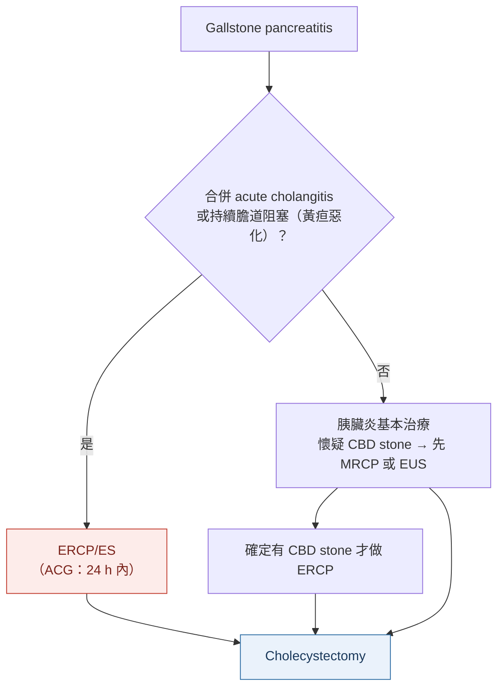
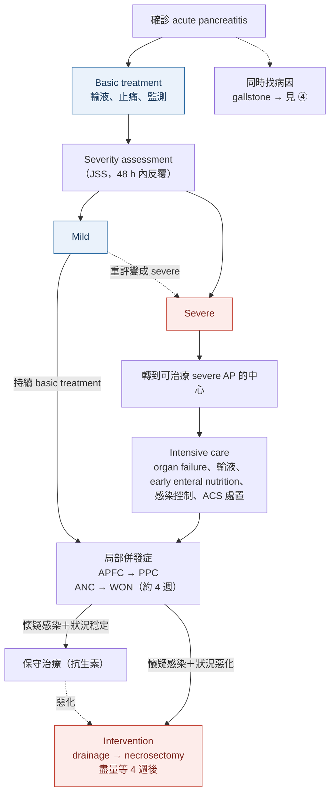

> [!abstract] 一句話重點
> - **診斷**：典型腹痛＋**lipase ≥ 3 × ULN** 就成立 → ==不需要為了確診做 CT==
> - **前 24 h 做三件事**：
>   - 🆕 ==LR 1.5 mL/kg/h，有低血容才 bolus 10 mL/kg==
>   - 充分止痛
>   - US 找 gallstone
> - **嚴重度只看 organ failure**：==持續 > 48 h 才是 severe==；確診時、24 h、48 h 都要重評
> - **三個「不要」**：
>   - 🆕 ==不給預防性抗生素==，severe 也不給
>   - 沒有 cholangitis ==不做 early ERCP==
>   - 腸道能用就不用 TPN
> - **進食**：mild 在 24–48 h 內給低脂固體；吃不下 → 48 h 內少量 enteral（NG 或 NJ）
> - **72 h 還沒好轉** → 做 CECT 找 necrosis
>   - Necrosis 先保守；要介入 ==等 4 週 WON==，用 step-up
> - **出院前**：mild gallstone AP ==同次住院切膽囊==；酒精、TG、Ca、抽菸都要處理

## 🗺️ 總綱：值班決策流程

急診或病房：上腹痛放射到背、lipase 很高 → 懷疑 acute pancreatitis

1
真的是 AP 嗎？<small>三項中兩項：典型腹痛、lipase 或 amylase ≥ 3 × ULN、影像</small>

腹痛＋lipase ≥ 3 × ULN → 確診 <b>不用做 CT</b>（約 80% 靠這兩項就確診）；直接到 2

不典型或酵素不夠高 → CT 先排除會死人的 mimic：<b>perforated ulcer、mesenteric ischemia</b>（這兩個 amylase 也會升）

Amylase <b>3–5 天就降回正常</b>，alcoholic 或高 TG 的 AP 也可能正常 → 要看 <b>lipase</b>｜<b>酵素高低和嚴重度無關</b>，不必追蹤

2
入院 order 怎麼開？<small>前 24 h 是輸液的關鍵期；之後每幾小時看一次反應</small>

📝 入院醫囑一張卡

驗

抽血

<b>Lipase</b>、CBC（<b>Hct</b>）、<b>BUN</b>／Cr、<b>ALT</b>、AST、<b>bilirubin</b>、ALP、<b>Ca</b>、<b>TG</b>、glucose、CRP｜不穩 → ABG、lactate

像

影像

<b>Abdominal US</b>（找 gallstone、CBD 擴張）｜<b>入院不常規做 CT</b>

水

🆕 輸液

<b>Lactated Ringer's 1.5 mL/kg/h</b>（60 kg ≈ 90 mL/h）｜<b>有低血容</b>（低血壓、心跳快、少尿、BUN 或 Hct 高）才先給 <b>10 mL/kg bolus</b>｜心、腎衰竭更要小心｜目標 <b>MAP ≥ 65、UO ≥ 0.5 mL/kg/h</b>，達到就降速

痛

止痛

<b>要給足</b>，不會妨礙診斷｜<b>不常規放 NG</b>（mild 放了反而痛更久）

吃

飲食

<b>不用長時間 NPO</b>：mild 在 24–48 h 內依耐受給<b>低脂固體</b>，不必等不痛（見 5）

抗

🆕 抗生素

<b>不給預防性</b>，severe 也一樣（發燒、WBC 高多半是 SIRS）｜有<b>明確感染</b>才給：cholangitis、肺炎、UTI、infected necrosis

看

監測

VS、<b>尿量</b>、SpO₂｜24–48 h 內每 8–12 h 追 <b>BUN、Hct、Cr</b>｜重評嚴重度（見 3）

<b>不要</b>：🆕 aggressive 輸液（20 mL/kg＋3 mL/kg/h 只多了 fluid overload）｜用 BUN、Hct、CVP 下降當作停止輸液的指標｜為了「讓胰臟休息」而 NPO 好幾天

3
嚴不嚴重？要不要進 ICU？<small>嚴重度＝organ failure 有沒有、持續多久；確診時、24 h、48 h 都要重評</small>

Mild <b>沒有</b> organ failure，也沒有併發症 一般病房，通常一週內出院

Moderately severe Organ failure <b>&lt; 48 h 內恢復</b>，或有局部／全身併發症

Severe → ICU Organ failure <b>持續 &gt; 48 h</b> 死亡率約 20%

🫀 Organ failure 怎麼看（Modified Marshall，任一系統 ≥ 2 分）
<b>呼吸</b>：PaO₂/FiO₂ ≤ 300｜<b>腎</b>：Cr ≥ 1.9 mg/dL｜<b>循環</b>：SBP &lt; 90 mmHg 且<b>輸液沒反應</b>

⚠️ 入院時還沒 organ failure，誰比較會變嚴重？
<b>BUN 是最好用的單一指標</b>：入院 BUN &gt; 20 mg/dL，或 24 h 內<b>還在上升</b> → 死亡風險上升｜<b>BISAP ≥ 3</b>（24 h 內能算：BUN &gt; 25、意識改變、SIRS、age &gt; 60、pleural effusion）→ 要警覺；但<b>低分不能放心</b>（敏感度只有約 50%）｜持續 SIRS、老人、共病多 → 放低門檻、密切追蹤

4
病因？只有幾個會改變處置<small>第一優先：是不是 gallstone</small>

Gallstone（最常見） US 有結石，<b>ALT &gt; 150（約 3 × ULN）</b>強烈提示 有 <b>cholangitis → 24 h 內 ERCP</b> 懷疑 CBD stone 但沒有 cholangitis → 先 <b>MRCP 或 EUS</b>，不要直接 ERCP 出院前<b>切膽囊</b>（見 7）

Alcohol／代謝／藥物 Alcohol → 住院就做戒酒介入 <b>TG &gt; 1000 mg/dL</b> 才算病因 Hypercalcemia → 找 hyperparathyroidism 藥物：azathioprine、6-MP 證據最強；其他常被<b>過度歸因</b>

找不到原因 <b>&gt; 40 歲</b> → 想到<b>胰臟腫瘤</b>，做 contrast CT 重做 US，加 MRCP 或 EUS 反覆發作、家族史 → 基因檢測

5
什麼時候開始吃？怎麼吃？<small>Enteral 不只是補營養，也在預防 infected necrosis</small>

Mild → 由口吃 <b>24–48 h 內</b>依耐受給<b>低脂軟食或固體</b> 不必等不痛，也不必從流質開始

吃不下 → 管灌 <b>48 h 內少量開始</b>，沒腸蠕動也開始 <b>NG 或 NJ 都可以</b>

腸道不能用 → PN 只限 ileus、腸缺血、阻塞，或灌不到足夠熱量 <b>腸道能用就不要 TPN</b>

6
48–72 h 還沒好轉或惡化？<small>持續 SIRS、發燒、organ failure、吃不下、腹脹</small>

做 CECT 找 necrosis 和 collection <b>發病 72 h 後</b>才準（4–10 天最好）；太早做會低估 Collection 依「<b>有無 necrosis</b>」和「<b>是否滿 4 週</b>」分四類：APFC → PPC、ANC → WON <b>Sterile necrosis</b>：先保守，不給抗生素 <b>懷疑 infected necrosis</b>（臨床惡化、CT 有 gas、blood culture 陽性）→ 給抗生素；<b>穩定就先用藥</b>，惡化才介入 介入盡量<b>等 4 週（WON）</b>：先 drainage → 不夠再 necrosectomy（<b>step-up</b>） <b>不常規做 FNA</b>

同時想到 <b>ACS</b>：腹脹＋少尿、呼吸變差 → 測膀胱壓；<b>IAP &gt; 20＋新的 organ failure</b> Cholangitis、肺炎、導管感染 Pseudoaneurysm 出血、靜脈 thrombosis

7
出院前做了嗎？<small>沒處理病因，幾週內就回來</small>

<b>Mild gallstone AP</b> <b>同次住院切膽囊</b>；做不到就 2–4 週內

<b>有 collection 或 severe</b> 先不要切，等 collection 消退或 <b>6 週</b>

<b>不能開刀</b> ERCP＋sphincterotomy 降低 AP 復發

<b>Alcohol</b> Brief intervention；戒菸

<b>TG、Ca</b> TG 高 → fibrate、飲食、減重；Ca 高 → PTH

<b>後遺症</b> Steatorrhea → fecal elastase、PERT；追蹤血糖（type 3c DM）

依 JPN 2015、Mederos 2021（JAMA）、WATERFALL 2022（NEJM）、ACG 2024 整理，自製；🆕＝新版指引已取代原書建議

> [!info] 這篇怎麼讀
> - **值班時看上面的流程就夠了**；下方 ①–⑦ 和流程的編號一致，是每一步的細節與依據
> - 主要依據 **JPN Guidelines 2015**（Yokoe et al.，39 個 CQ），並融入 **JAMA 2021 Review**（Mederos, Reber, Girgis）；被新版指引（WATERFALL 2022、ACG 2024）取代的部分用 🆕 標出
> - 建議強度：**1＝recommend（強）**、**2＝suggest（弱）**；證據 **A（SR/MA/RCT）→ D（case series）**，例如「(1B)」＝強建議、中等證據

## 病程時間軸

依 JAMA 2021 Figure 內容重新整理：

| 時間 | Mild | Moderately severe／Severe |
| --- | --- | --- |
| **入院** | 開始輸液 | 開始輸液 |
| **24–48 h** | 很快不痛 → **開始固體飲食**；gallstone AP **出院前切膽囊** | 開始**口服或 nasoenteral 營養**；organ failure < 48 h＝moderately severe，> 48 h＝severe |
| **72 h 後** | — | 持續 SIRS、惡化、懷疑 infected necrosis → **CECT** |
| **2–4 週** | — | 分辨 sterile 或 **infected necrosis**；確定感染才給抗生素 |
| **> 4 週** | APFC → pseudocyst | ANC → **WON**；需要時用 **step-up approach** 處理 |

## ① 診斷

### 診斷標準

以下三項符合**至少兩項**，並排除其他胰臟疾病與 acute abdomen：

| # | JPN（日本厚生勞動省 2008） | Revised Atlanta 2012 |
| --- | --- | --- |
| 1 | 上腹 acute abdominal pain＋tenderness | 符合胰臟炎的腹痛（上腹痛、常放射到背） |
| 2 | 血中或尿中 pancreatic enzyme 上升 | **Lipase 或 amylase ≥ 3 × ULN** |
| 3 | US、CT 或 MRI 有 AP 的異常 | 影像有 AP 的典型表現 |

- **Chronic pancreatitis 急性惡化**也算 acute pancreatitis
- JPN 沒有規定酵素的倍數；Atlanta 定在 3 倍

### 臨床表現與第一線檢查〔JAMA 2021〕

- **症狀**：持續性上腹痛、**放射到背**，吃東西或平躺會加重；常合併噁心、嘔吐、低到中度發燒
- **理學檢查**：腹脹、腸音減少；**rebound tenderness 不常見**
- **要問的病史**：以前發作過、biliary colic、喝酒、家族史、最近感染、創傷、蟲咬、**新用的藥**
- **抽血**：amylase、lipase、LFT（**direct bilirubin 或 ALP 上升 → 想到 CBD stone 或剛排出的結石**）、Ca、**TG**；懷疑 autoimmune pancreatitis 驗 **IgG4**
- 約 **80%** 靠「腹痛＋酵素」就確診；CT 用在診斷不確定、要排除 **perforated duodenal ulcer** 等 mimic 時

### 酵素：lipase 優於 amylase（CQ1–2）

- **測 serum lipase**；測不到 lipase 才測 serum（pancreatic）amylase (1B)
- 和其他腹痛疾病鑑別時，lipase 的診斷能力勝過其他胰臟酵素
- **Urinary trypsinogen-2 dipstick**：5 分鐘出結果、準確度接近血中酵素；日本未上市，未列入建議（ungraded B）

### 影像（CQ3–6）

| 檢查 | 什麼時候用 | 重點 |
| --- | --- | --- |
| **US** | 懷疑 AP 就做 (1C) | 胰臟腫大、周圍發炎、ascites；**找病因**（CBD stone、膽管擴張）；color Doppler 可找 pseudocyst 內的 **pseudoaneurysm** |
| **CT** | 臨床、抽血、US 仍無法確診，或**病因不明** (1C) | 腎功能許可就做 **contrast-enhanced dynamic CT**；胰臟癌造成的 AP 只做 non-contrast 容易漏掉腫瘤 |
| **MRI** | (2C) | 找**膽管結石**、**hemorrhagic necrotizing pancreatitis** 比 CT 好；fat necrosis 在 **T1 高、T2 略低** |
| **CECT（血管併發症）** | (1C) | **Active hemorrhage、pseudoaneurysm、靜脈 thrombosis** |

> [!info] 🆕 新版指引（ACG 2024）
> **入院時不常規做 CT 評估嚴重度**；診斷不清楚，或 **48–72 h 沒有改善**才做。

## ② 入院處置：輸液、止痛、抗生素

### 輸液

> [!info] 🆕 新版指引（WATERFALL 2022、ACG 2024）：改成 moderate 輸液
> - **ACG 2024**：所有 AP 用 **moderately aggressive 輸液 ==1.5 mL/kg/h==**，**有低血容證據才加 bolus 10 mL/kg**；**LR 優於 NS**；心、腎共病特別注意 volume overload
>   - 前 24 h 最重要；到院 6 h 內就要重評，之後 24–48 h 頻繁重評，目標是 BUN 下降
> - **WATERFALL**（NEJM 2022，LR）：aggressive（20 mL/kg bolus＋3 mL/kg/h）vs moderate（低血容才 10 mL/kg bolus＋1.5 mL/kg/h）
>   - 進展到 moderately severe／severe 的比例**沒有差異**
>   - **Fluid overload：aggressive 20.5% vs moderate 6.3%** → 第一次期中分析就因安全問題**提前終止**
> - 實務換算：60 kg ≈ **90 mL/h**；70 kg ≈ 105 mL/h

| 問題 | JPN 2015 |
| --- | --- |
| 用什麼 | **Extracellular fluid，首選 Ringer's lactate** (1C)；RCT 顯示比 saline 更能減少發炎 |
| 有 shock 或脫水 | 短時間快速輸液 **150–600 mL/h**，小心過量 (1C)（原書；已更新，見上方 🆕） |
| 沒有脫水 | **130–150 mL/h**，密切監測 (1C) |
| 心衰竭、腎衰竭 | 仔細評估循環血量再決定速度 |
| 何時停止快速輸液 | **MAP ≥ 65 mmHg 且 UO ≥ 0.5 mL/kg/h** 就降速，之後調到能維持這兩個數值 (2C) |

- **BUN、Hct、CVP 下降**都不是好的停止指標
- 循環不穩的病人死亡率高：可考慮 colloid、catecholamine，部分需要 blood purification
- 日本 2011 全國調查：**有達到 bundle 輸液目標**的死亡率 **9.5%**，沒達到 **19.4%**
- 〔JAMA 2021〕**LR vs NS**：meta-analysis 顯示 LR 在 24 h 的 **SIRS 較少（OR 0.38）**，證據低到中等
- 〔JAMA 2021〕輸太多的風險：**pulmonary edema、過度稀釋造成缺氧、intra-abdominal hypertension**

> [!warning] Pitfall：輸太多也會死
> 入院時已經 shock、oliguria 的 severe AP，**快速大量輸液**組的 mechanical ventilation、**abdominal compartment syndrome** 與死亡率都較高。目標達到就要降速。

#### 各國指引比較〔JAMA 2021 Table 3〕

依原表內容整理（2013–2019 的指引；輸液速度部分**已被 ACG 2024 取代**）：

| | IAP/APA 2013 | AGA 2018 | ACG Task Force 2019 | QI Panel 2019 |
| --- | --- | --- | --- | --- |
| **輸液速度與目標** | Goal-directed 5–10 mL/kg/h，直到 HR < 120、MAP 65–85、UO > 0.5–1 mL/kg/h、Hct 35–44%（原書；已更新） | Goal-directed，不建議速度 | Bolus＋維持，48 h 內依 VS、UO、BUN、Hct 調整 | ≥ 3 mL/kg/h（心、腎衰竭除外）（原書；已更新）；24–48 h 內每 8–12 h 追 BUN、Hct、Cr |
| **輸液種類** | LR | 無建議 | LR（除非禁忌） | LR |
| **何時開始吃** | Mild：腹痛減輕、發炎指數改善 | **24 h 內** | 48–72 h 內（除非 ileus、阻塞） | Mild：症狀控制後 24 h 內 |
| **NG vs NJ** | 都可以 | 都可以 | 都可以 | Severe 3–5 天吃不下 → NJ |
| **飲食種類** | Elemental 或 polymeric | 無建議 | **低脂固體** | 無建議 |
| **切膽囊時機** | Mild：同次住院；有 collection → 等消退或 > 6 週 | 同次住院 | 出院前會診外科；有 necrosis／collection → 等發炎消退 | Mild：2 週內 |

### NG tube、止痛（CQ15–16）

- **Mild AP 不常規放 NG suction** (1A)：8 個以上 RCT 沒有好處，**腹痛、噁心反而持續更久**
- **疼痛要充分控制** (1A)：不會妨礙診斷或治療；哪種止痛藥最好沒有共識

### 抗生素、antifungal、protease inhibitor（CQ17–19）

> [!info] 🆕 新版指引（ACG 2024）：severe AP 也不給預防性抗生素
> - **==Severe AP 不建議預防性抗生素==**；早期 SIRS 和 sepsis 很難分
> - 有**明確感染**（cholangitis、UTI、pneumonia、infected necrosis）才給；infected necrosis 有些病人單靠抗生素就好
> - **不常規做 FNA**；**不常規給 antifungal**

| 情境 | JPN 2015 |
| --- | --- |
| **Mild AP** | 不需要預防性抗生素 (1A) |
| **Severe AP、necrotizing pancreatitis** | 發病 72 h 內給預防性抗生素**可能改善預後** (2B)（原書；已更新，見上方 🆕） |
| 療程 | 沒有感染徵象時，避免連續給超過 2 週（可能增加 fungal infection） |
| 預防性 antifungal | 不建議常規使用 (1C) |
| Protease inhibitor（gabexate mesilate）IV | 改善死亡率與併發症**未被證實**（ungraded B） |

## ③ 嚴重度

> [!important] 值班只要記一件事
> **嚴重度＝organ failure**：沒有＝mild；**< 48 h 恢復**＝moderately severe；**持續 > 48 h＝severe**。各種評分只是用來**預測**誰會走到 organ failure，**不能取代臨床判斷**。

### 分級：Revised Atlanta 2012

| 分級 | 定義 | 病程 |
| --- | --- | --- |
| **Mild** | 沒有 organ failure，沒有局部或全身併發症 | 最常見、自限，通常一週內出院 |
| **Moderately severe** | **Transient organ failure（< 48 h 恢復）**，和／或局部、全身併發症（例如共病惡化） | 可拖數週 |
| **Severe** | **==Persistent organ failure（> 48 h）==**，單一或多重器官 | 約 1/5 的 AP，**死亡率約 20%** |

- 何時評估：**確診當下就評估，之後反覆評估，特別是 48 h 內** (1C)；Atlanta 建議入院 24 h、48 h、7 天各重評一次
- 入院時 mild **不代表** 48 h 後還是 mild

### Organ failure：Modified Marshall〔JAMA 2021 Table 1〕

依原表內容整理：**任一系統 ≥ 2 分＝organ failure**（粗體＝2 分門檻）

| 系統 | 0 | 1 | **2** | 3 | 4 |
| --- | --- | --- | --- | --- | --- |
| 呼吸 PaO₂/FiO₂ | > 400 | 301–400 | **201–300** | 101–200 | < 101 |
| 腎 Cr（mg/dL） | < 1.4 | 1.4–1.8 | **1.9–3.6** | 3.7–4.9 | > 4.9 |
| 循環 SBP（mmHg） | > 90 | < 90，輸液有反應 | **< 90，輸液沒反應** | < 90，pH < 7.3 | < 90，pH < 7.2 |

- 沒插管的病人估 FiO₂：room air 21%、2 L/min 25%、4 L/min 30%、6–8 L/min 40%、9–10 L/min 50%

### 預測誰會變嚴重：BUN 和 BISAP 就夠用

- **==BUN 是最好用的單一指標==**〔JAMA 2021〕：入院 BUN > 20 mg/dL 死亡 OR 4.6；24 h 內 BUN **上升**死亡 OR 4.3；每升 5 mg/dL OR 2.2
- **BISAP**（24 h 內可算，各 1 分）：**B**UN > 25、**I**mpaired mental status、**S**IRS、**A**ge > 60、**P**leural effusion
  - BISAP ≥ 3：organ failure OR 7.4、persistent organ failure OR 12.7、necrosis OR 3.8
  - **特異度高、敏感度低**：高分要警覺，**低分不能放心**
- **CRP**：48 h 內 ≥ 190 mg/L（19 mg/dL），預測 severe 的 PPV 只有約 30%
- **CT 不適合早期評估**：發病 **< 72 h** 的 CECT 會低估或分錯嚴重度

### 評分工具對照（查表用）

依 JAMA 2021 Table 2 整理：

| | **BISAP** | **APACHE II** | **Ranson** |
| --- | --- | --- | --- |
| 項目 | 5 項（如上） | 12 項生理變數 | 入院 5 項＋48 h 內 6 項 |
| 何時能算 | **24 h 內** | 24 h 內 | **要等 48 h** |
| 預測嚴重度 | ≥ 3：sens 0.51、spec 0.91 | ≥ 8：sens 0.83、spec 0.59 | ≥ 3：sens 0.66、spec 0.78 |
| 預測死亡 AUC | 0.87 | 0.83 | 0.92 |
| 優缺點 | 簡單、AP 專用；敏感度低 | 完整；非 AP 專用、非 ICU 病人資料不齊 | AP 專用；要等 48 h |

### 原書的 JPN Severity Score（JSS）

JPN 2015 用 JSS 判斷 severe，並據此決定**轉院**（CQ8–11）：比較研究中 **JSS 與 BISAP 預測 organ failure 最好** (1B)。

> [!note]- JSS 計分表（點開）
> **A. Prognostic factors（每項 1 分）**
>
> | # | 項目 | 門檻 |
> | --- | --- | --- |
> | 1 | Base excess 或 shock | BE ≤ −3 mEq/L 或 SBP < 80 mmHg |
> | 2 | 呼吸 | PaO₂ ≤ 60 mmHg（room air）或需要 ventilator |
> | 3 | 腎功能 | BUN ≥ 40 mg/dL（或 Cr ≥ 2.0 mg/dL），或輸液後仍 oliguria（< 400 mL/day） |
> | 4 | LDH | ≥ 2 × ULN |
> | 5 | Platelet | ≤ 100,000/mm³ |
> | 6 | Serum Ca | ≤ 7.5 mg/dL |
> | 7 | CRP | ≥ 15 mg/dL |
> | 8 | SIRS criteria | ≥ 3 項 |
> | 9 | Age | ≥ 70 歲 |
>
> SIRS 四項：BT > 38°C 或 < 36°C；HR > 90；RR > 20 或 PaCO₂ < 32 torr；WBC > 12,000 或 < 4,000，或 bands > 10%。
>
> **B. CT grade（CECT）**
>
> | 項目 | 0 分 | 1 分 | 2 分 |
> | --- | --- | --- | --- |
> | 胰臟外發炎延伸 | 只到 anterior pararenal space | 到 root of mesocolon | 超過腎臟下緣 |
> | 胰臟 hypoenhanced 範圍（頭、體、尾三段） | 局限在單一段內，或只在胰臟周圍 | 跨 2 段 | 佔滿 2 段以上 |
>
> 兩項相加：0–1 分＝Grade 1，2 分＝Grade 2，≥ 3 分＝Grade 3。
>
> **Severe**：prognostic factors **≥ 3 分**，或 CT **Grade ≥ 2**。

- Severe（JSS）要立刻在能處理 severe AP 的醫院治療（ICU、IVR、CHDF、內視鏡、外科、NST），做不到就**立即考慮轉院** (1C)；病人量大的醫院結果較好

## ④ 病因與 gallstone pancreatitis

> [!important] 第一優先：先確認是不是 gallstone pancreatitis
> ==Gallstone AP 是病因中最重要、最緊急的==，因為它決定要不要做內視鏡乳頭處置 (1A)。所有病人都驗 **bilirubin、ALT、AST、ALP**，並做 **US**。

### 病因清單

| 病因 | 比例與重點 |
| --- | --- |
| **Gallstone** | 美國 **21–33%**（拉丁美洲可達 68%）；**ALT > 150（約 3 × ULN）**強烈提示；US 不確定可重做 |
| **Alcohol** | **16–27%** |
| **Hypertriglyceridemia** | **2–5%**；沒結石、沒明顯喝酒時要驗；**TG > 1000 mg/dL** 才算病因 |
| **Iatrogenic** | ERCP 後 **5–10%**、EUS 後 < 1% |
| **藥物** | 超過 500 種被懷疑，至少 30 種確定（再給會再發）：azathioprine、5-ASA、valproic acid、estrogen、furosemide、TMP-SMX、tetracycline、metronidazole、isoniazid、ACEi、losartan、statins、DPP-4i、tamoxifen、amiodarone |
| Hypercalcemia、創傷、感染 | 依病史與檢驗 |
| **胰臟腫瘤** | **> 40 歲**找不到病因要想到；做 contrast CT |
| Idiopathic | 再做 US、MRI 和／或 EUS；多位家人有胰臟疾病 → 基因檢測 |

- 其他危險因子：肥胖、年紀大、**抽菸**、HIV
- **MRCP**：看 CBD stone、pancreaticobiliary maljunction、pancreas divisum；**EUS**：找 CBD stone 比 US 敏感，也能看 chronic pancreatitis、腫瘤、IPMN
- **機轉**：acinar cell 受傷 → **trypsinogen 在胰臟內提早活化成 trypsin** → 活化其他消化酶、kinin、complement → 自體消化；gallstone 讓胰管壓力升高，細胞內 **Ca²⁺** 持續升高也會提早活化 trypsinogen

### Gallstone pancreatitis：ERCP 與切膽囊（CQ28–30）

依原圖內容重新繪製，並加上 ACG 2024：

| 問題 | JPN 2015 | 補充 |
| --- | --- | --- |
| **Early ERCP/ES 的適應症** | ==合併 cholangitis，或懷疑膽道持續阻塞（黃疸出現或惡化）== (1A) | 🆕 ACG 2024：有 cholangitis → **24 h 內**；**沒有 cholangitis → medical therapy 優於 72 h 內的 early ERCP**；懷疑 CBD stone → 先 MRCP 或 EUS，避免診斷性 ERCP |
| **要不要切膽囊** | 能開刀就切 (1B)；只做 ES 不切膽囊，膽道併發症復發率高 | — |
| **何時切** | **胰臟炎一緩解就切** (1B)；出院後復發率 32–61%，**6 週內**特別高 | 〔JAMA 2021〕見下 |

**切膽囊時機〔JAMA 2021〕**

- 同次住院**沒切**：出院後中位 40 天內 **8%** 復發，**5 年 22%**
- **Mild**：入院 **24–48 h 內**切是安全的，還能縮短住院；同次住院做不到 → **出院後 2–4 週內**
- **Moderately severe／severe**：先做 CECT 或 MRI 看 peripancreatic collection
  - 有 collection 或 severe → **不要早切** → 等 collection 消退或**等 6 週**，需要時和 internal drainage（cystgastrostomy）一起做
- 必須延後或手術風險高 → 同次住院考慮 **ERCP＋sphincterotomy** 預防 AP 復發；但**不能**減少之後的 biliary colic、cholecystitis

> [!warning] Pitfall
> Early ERCP 是為了處理**膽道**（cholangitis、阻塞），不是治胰臟炎。結石已經過去、膽紅素快速下降的 mild gallstone AP，答案是**出院前切膽囊**，不是 ERCP。

## ⑤ 營養（CQ20–24）

> [!info] 🆕 新版指引（ACG 2024）
> Mild AP：**24–48 h 內**依耐受由口進食，**一開始就給低脂固體**，不用從流質慢慢進階；比傳統 NPO 好。

- **Mild AP 不要給 IV hyperalimentation** (1B)；**單用 TPN 盡量避免** (1B)
- **Severe AP 的 enteral nutrition 重點是「預防感染」** (1A)：和 TPN 相比，感染、手術介入、住院天數都下降
- **入院 48 h 內開始 enteral，從少量開始** (2A)；注意 severe ileus、腸缺血、腸壞死
- 管路：原則上放到 Treitz ligament 以下的 jejunum；放不進去，**duodenum 或 stomach 也可以** (2B)
- 配方：消化態、半消化態、成分營養都可以，沒有明顯差異
- 何時開始吃：依**腹痛緩解**與 **lipase** 等指標決定 (2B)；進食後腹痛復發的相關因子：Balthazar CT grade D、疼痛持續久、lipase 高、CRP 高

**證據〔JAMA 2021〕**

- **為什麼要早灌**：腸道灌流下降 → 黏膜受損 → **細菌移位** → organ failure、infected necrosis；「餵食會讓胰臟炎變嚴重」**沒有被證實**
- **Enteral vs TPN**（Cochrane，8 篇、348 人）：死亡 RR 0.5、多重器官衰竭 RR 0.55、全身感染 RR 0.39；**severe AP 死亡 ==RR 0.18==**
- **24 h 內開始** enteral vs 延後或 TPN：多重器官衰竭 **OR 0.4**
- **72 h 內吃不下** → nasoenteral（**NG 或 NJ 都可以**）；ileus、阻塞不能灌 → **72 h 內開始 PN**
- ESPEN：mild／moderately severe 做營養篩檢（MST、NRS-2002）；**severe 一律視為營養高風險**
- **不常規**用 semielemental、probiotics、immunonutrition 配方

## ⑥ 72 h 後：necrosis、感染、ACS

### CECT 的時機（CQ10）

- 在能治療 severe AP 的醫院，CECT 用來找 **poorly enhanced area（necrosis）** 與併發症 (2B)；判斷 necrosis 範圍**一定要 CECT**
- **發病 4–10 天**做 CECT，判斷 necrotizing pancreatitis 準確度接近 100%
- 發病一週內顯影差的區域可能只是**可逆的 ischemia**；**2 週後**仍顯影差才強烈懷疑 necrosis

### 局部併發症的分類（revised Atlanta）

依原圖內容重新整理：以「**有無 necrosis**」和「**是否滿 4 週**」分四類，每一類都可能是 sterile 或 infected。

| | **< 4 週** | **≥ 4 週（有包膜）** |
| --- | --- | --- |
| **沒有 necrosis**（interstitial edematous） | **APFC** acute peripancreatic fluid collection | **PPC** pancreatic pseudocyst |
| **有 necrosis**（necrotizing） | **ANC** acute necrotic collection | **WON** walled-off necrosis |

- APFC vs ANC：一週內常難分，靠 CT 密度與顯影判斷
- PPC 較規則、局限、內容是均勻 fluid；**WON** 不規則、可延伸到 paracolic gutter，內容是 **fluid＋壞死組織＋脂肪**

### Infected necrosis 與介入（CQ33–36）

- **Necrotizing pancreatitis 原則上先保守** (1C)；發病 72 h 內的早期手術死亡率非常高
- **怎麼診斷感染**（1C）：臨床與抽血**惡化**時懷疑；支持線索：**blood culture 陽性**、**procalcitonin 上升**、endotoxin 陽性、**CT 看到胰臟或周圍有 gas**；**不常規做 FNA**
- **介入適應症**：懷疑或確定 infected necrosis，**且全身狀況惡化**；狀況穩定時仍可先用抗生素保守治療
  - 少見適應症：PPC 壓迫造成胃出口阻塞、壞死造成胰管或膽管阻塞

| 問題 | JPN 2015 |
| --- | --- |
| 時機 | 盡量等到 **發病 4 週後的 WON 期** (2C)；早期 necrosectomy 死亡率顯著較高 |
| 方法（**step-up approach**） | **先 drainage**：percutaneous（retroperitoneal）或 **endoscopic transluminal** → 沒改善再 **necrosectomy** (2B) |
| Necrosectomy 路徑 | **Endoscopic** 或 **retroperitoneal**（例如 VARD）；併發症比 laparotomy 少 |

### Abdominal compartment syndrome（CQ31–32）

- **定義（WSACS）**：IAH＝IAP 持續 **≥ 12 mmHg**；**ACS＝IAP > 20 mmHg＋新的器官功能障礙**；AP 合併 ACS 死亡率約 **47.5%**
- **要連續測 IAP**（膀胱壓）的病人 (2C)：輸液過多、嚴重度高、腎或呼吸併發症、CT 上多處 fluid
- **處置** (2D)：IAP ≥ 12 → 胃腸減壓、腹腔引流、改善腹壁 compliance、調整輸液；目標 **IAP ≤ 15**；**IAP > 20、內科無效且有器官衰竭**才考慮外科減壓

### ICU 的其他治療（CQ25–27）

| 治療 | JPN 2015 |
| --- | --- |
| **Peritoneal lavage** | 沒有救命效果，**不建議** (2B) |
| **CHF/CHDF** | 充分輸液後仍**循環不穩且 anuria**，或合併 **ACS** → 使用 (1C)；其他情況不常規使用 (2C) |
| **Continuous regional arterial infusion** | 未被證實有效（ungraded B） |

## ⑦ 出院前：降低復發與後遺症〔JAMA 2021〕

| 病因／問題 | 怎麼做 |
| --- | --- |
| **Gallstone** | 見 ④ 的切膽囊時機 |
| **Alcohol** | Alcoholic AP 是**復發（HR 2.72）**和**變成 chronic pancreatitis（HR 9.16）**的獨立危險因子；AGA：**住院時做 brief alcohol intervention**，出院後 2 年內每 6 個月再衛教 |
| **Hypertriglyceridemia、肥胖** | 減重、飲食、避免酒精；藥物 **fibrate（降 TG 最有效）**，可合併 statin、niacin、omega-3 |
| **Hypercalcemia** | 找 **primary hyperparathyroidism**；少見的是惡性腫瘤、thyrotoxicosis |
| **Peripancreatic collection** | 追蹤腹痛、吃不下、發燒 |

**長期後遺症**（就算 mild、第一次發作也會有）：

- **復發**危險因子：alcoholic AP、**biliary AP 沒切膽囊**、**抽菸**
- **進展成 chronic pancreatitis**：反覆 AP、抽菸、necrosis、alcoholic AP
- **Exocrine insufficiency**：最多 **35%**；有 steatorrhea 或 fecal elastase-1 低 → **pancreatic enzyme**
- **Type 3c（pancreatogenic）diabetes**：severe necrotizing AP 後也會發生

## 其他

### Post-ERCP pancreatitis（CQ37–38）

| 預防方法 | JPN 2015 |
| --- | --- |
| **Rectal NSAIDs** | **沒有禁忌症的 ERCP 病人全部給** (2A) |
| **Guidewire cannulation** | 比打顯影劑插管更能降低 PEP，可當首選 (2A) |
| **Prophylactic pancreatic stent** | 有效，但**只用在高風險族群** (2A) |
| 其他藥物 | 不要常規使用 |

- **高風險**：sphincter of Oddi dysfunction、插管困難、precut sphincterotomy、balloon dilatation
- ACG 2024：高風險病人建議 **rectal indomethacin**

### 原書整體處置流程（JPN 2015 Figure 9）

依原圖內容重新繪製（上方總綱已整合新版指引，這裡保留原書架構）：

### Pancreatitis Bundles 2015（CQ39）

每一項都要做到並記錄；bundle 執行率高的 severe AP 預後較好 (1C)。

| # | 項目 | 時間 |
| --- | --- | --- |
| 1 | 用 JSS 反覆評估嚴重度 | 確診時、24 h 內、24–48 h |
| 2 | Severe AP 考慮轉院 | 確診後 3 h 內 |
| 3 | 用病史、抽血、影像找病因 | 確診後 3 h 內 |
| 4 | Gallstone AP 合併 cholangitis 和／或膽道阻塞 → 考慮 early ERC＋ES | — |
| 5 | 在能治療 severe AP 的醫院做 CECT，依 CT grade 評估 | 初始治療後 3 h 內（原書；ACG 2024 不建議入院常規 CT） |
| 6 | 充分輸液，MAP ≥ 65 mmHg、UO ≥ 0.5 mL/kg/h | 發病 48 h 內 |
| 7 | 止痛 | — |
| 8 | Severe AP 給預防性廣效抗生素 | 發病 72 h 內（原書；已更新，見 ② 🆕） |
| 9 | 沒有腸蠕動也要少量開始 enteral（最好 jejunal） | 確診 48 h 內 |
| 10 | Gallstone AP 合併膽囊結石 → 緩解後切膽囊 | — |

## Pearls & Pitfalls

> [!tip] Pearl
> - 腹痛＋lipase 明顯上升就能診斷；CT 留給**診斷不明**或 **48–72 h 不好轉**
> - **嚴重度看 organ failure 持續多久**；評分只是預測，BUN 是最實用的單一指標
> - 判斷 necrosis 的最佳時機是**發病 4–10 天**；太早做會把可逆的 ischemia 當成壞死
> - Enteral 不只補營養，也在**預防 infected necrosis**；mild 不用等不痛就能吃

> [!warning] Pitfall
> - 🆕 還在用「越多越好」的 aggressive 輸液 → fluid overload，沒有好處
> - 🆕 Severe AP 給預防性 carbapenem → ACG 2024 不建議；有明確感染才給
> - 用酵素高低判斷嚴重度，或用 amylase 正常排除 AP
> - 沒有 cholangitis 的 gallstone AP 做 early ERCP；或治好就出院、膽囊留著
> - 年紀大、找不到病因的 AP，沒想到**胰臟腫瘤**
> - 酒精性 AP 出院沒做戒酒衛教

## 🎯 內專考點

> [!example] 出題規律
> Pancreatitis 是消化科高頻主題（題庫 13 題）。最常考 **BISAP 的五項**（三年考了三次，都是「哪一項不屬於」）；其次是**酵素判讀陷阱**（amylase 正常不能排除、macroamylasemia、chronic pancreatitis 酵素不升）、**病因判斷**（ALT ≥ 150 → gallstone）、**處置選擇**（enteral 優於 TPN、不給預防性抗生素、mild gallstone AP 出院前切膽囊），以及 **IgG4 autoimmune pancreatitis 用 steroid**。

題號格式為「年份-題號」；可到 [內專刷題網站](http://imboard.dirty-wolf.com/) 選「依科目」→ 消化 → Pancreatitis 查看原題與詳解（網站每題沒有獨立網址）。

### 嚴重度：BISAP

> [!note]- 104-51、105-54、110-54｜BISAP 不包含哪一項？（同型題考三次）
> **情境**：急性胰臟炎，用入院 24 h 內的 BISAP 評估嚴重度
>
> **問**：下列何者**不屬於** BISAP？三年的干擾選項不同：
> - 104-51：age > 60、SIRS、pleural effusion、**creatinine > 2.0**、impaired mental status
> - 105-54：BUN > 22、impaired mental status、**hemoconcentration**、age > 60、pleural effusion
> - 110-54：BUN > 25、impaired mental status、SIRS ≥ 2、**amylase > 2000**、pleural effusion
>
> **答**：104-51 **creatinine > 2.0**｜105-54 **hemoconcentration**｜110-54 **amylase > 2000**
>
> **重點**：BISAP＝**B**UN > 25、**I**mpaired mental status、**S**IRS、**A**ge > 60、**P**leural effusion，各 1 分
> - 腎和容積的指標是 **BUN，不是 creatinine**（Cr 是 Marshall／APACHE II 的項目）
> - **Hemoconcentration**（Hct ≥ 44%）是另一個預測 necrosis 的指標，不在 BISAP 裡
> - **酵素高低不在任何嚴重度評分裡**，也不預測嚴重度
> - 105-54 的 BUN 切點寫成 22，仍視為 BISAP 的 B 項；背誦時記 **25**

### 診斷與酵素判讀

> [!note]- 106-44｜上腹痛 3 天、平躺更痛：哪個敘述錯誤？
> **情境**：上腹中央痛 3 天、平躺加劇、嘔吐，懷疑 acute pancreatitis
>
> **問**：何者錯誤？
> - Lipase 較具診斷性 → 對
> - Amylase 正常即可排除急性胰臟炎 → 錯
> - 要注意 TG 是否 > 1000 mg/dL → 對
> - 要注意腰部 Grey Turner sign → 對
> - 要問 furosemide、HCTZ、6-MP／azathioprine 用藥 → 對
>
> **答**：**Amylase 正常即可排除** 是錯的
>
> **重點**：amylase **早升早降**，3–5 天內回到正常；**alcoholic、hypertriglyceridemia** 的 AP amylase 也可能正常 → 驗 **lipase**（持續較久、較特異）
> - Grey Turner（側腹）、Cullen（臍周）瘀斑提示 hemorrhagic necrotizing AP
> - 藥物中 azathioprine、6-MP 證據最強

> [!note]- 106-45｜Macroamylasemia：哪個敘述錯誤？
> **情境**：關於 macroamylasemia 的敘述
>
> **問**：何者錯誤？
> - Amylase 複合物無法排到尿中 → 對
> - 血中 amylase 升高 → 對
> - 血中 lipase 通常也升高 → 錯
> - 可用 chromatography 偵測 → 對
> - 病人通常沒有腹痛 → 對
>
> **答**：**Lipase 也會升高** 是錯的
>
> **重點**：amylase 和 immunoglobulin 結合成大分子，腎臟濾不掉 → **血 amylase 高、尿 amylase 低、lipase 正常、沒有症狀**
> - Amylase/creatinine clearance ratio 偏低（< 1%）可輔助；不需治療
> - 其他 amylase 假性升高：腎功能下降、唾液腺疾病、其他腹腔發炎（perforated ulcer、腸缺血、appendicitis、cholecystitis）

> [!note]- 108-53｜胰臟炎檢驗判讀：哪個敘述錯誤？
> **情境**：關於胰臟炎檢驗的敘述
>
> **問**：何者錯誤？
> - Chronic pancreatitis 的 amylase、lipase 通常不升高 → 對
> - 早期 chronic pancreatitis 影像看不出來時，可用 fecal elastase 協助診斷 → 錯
> - 疑似 AP 但 amylase 正常，可能是 hypertriglyceridemia 干擾 → 對
> - CKD 懷疑 AP 時直接驗 lipase → 對（官方答案視為對）
> - Pleural effusion 的 amylase 升高可能是肺癌 → 對
>
> **答**：**用 fecal elastase 診斷早期 chronic pancreatitis** 是錯的
>
> **重點**：fecal elastase-1 測的是**外分泌功能**；早期 chronic pancreatitis 外分泌多半還正常 → 輕度病人陽性率只約 22%，重度才接近 100%
> - 腎功能差時 amylase、lipase 都可能輕度升高，但 **> 3 × ULN** 的門檻仍有意義
> - Pleural fluid amylase 升高：胰臟疾病、食道破裂、**惡性腫瘤（肺癌）**

> [!note]- 109-46｜Amylase 1000、第三天就正常：哪些敘述正確？
> **情境**：上腹痛一天，amylase 1000 U/L，住院第 3 天恢復正常
>
> **問**：七項中選出全部正確的組合
> - (1) TG 可能 > 1000 mg/dL → 對
> - (2) 要釐清有無膽結石 → 對
> - (3) 可能有 obturator sign → 錯
> - (4) 住院 24 h 內要注意 creatinine → 對
> - (5) 要排除 perforated peptic ulcer → 對
> - (6) 要排除 mesenteric vascular occlusion → 對
> - (7) 每天做腹部超音波判斷嚴重度 → 錯
>
> **答**：**(1)(2)(4)(5)(6)**
>
> **重點**：
> - Obturator sign 是 **appendicitis**（骨盆位置）的徵象
> - **Amylase 升高 ≠ pancreatitis**：perforated ulcer、mesenteric ischemia 都會升高，而且是不能漏的致命診斷
> - 嚴重度看 **organ failure（Marshall）和評分**，不是天天做超音波；US 是用來找 gallstone

### 病因

> [!note]- 114-41｜ALT 162、膽結石＋CBD 擴張，有吃 HCTZ、TG 200：最可能病因？
> **情境**：50 歲女性，上腹痛放射到背 6 h
> - 不喝酒（兩天前一杯啤酒）；用 **HCTZ**、atorvastatin
> - **ALT 162**、AST 130、T/D bilirubin 2.0/1.2、amylase 1000、**TG 200**
> - US：**膽囊結石、CBD 擴張**
>
> **問**：最可能病因？選項：酒精、膽結石、HCTZ、hypertriglyceridemia、胰臟癌
>
> **答**：**膽結石**
>
> **重點**：**ALT ≥ 150 IU/L（約 3 × ULN）→ gallstone AP 機率約 95%**；加上結石和 CBD 擴張
> - TG 要 **> 1000 mg/dL** 才算病因，200 差很遠
> - 藥物（HCTZ）、代謝原因常被**過度歸因**；有證據的藥物很少
> - 喝一杯啤酒不是 alcoholic AP

### 處置

> [!note]- 106-59｜酒精性 AP、CT 有 APFC 沒壞死、發燒 WBC 高：下一步？
> **情境**：34 歲女性，alcohol-related AP 第 5 天
> - BT 38.2°C、HR 101、WBC 15,400；腸音 hypoactive、嘔吐
> - Amylase 388、lipase 924
> - CT：胰臟瀰漫水腫、peripancreatic fluid collection、**沒有 necrosis**
>
> **問**：最適當的下一步？選項：NJ enteral nutrition、IV imipenem、pancreatic debridement、TPN、PO metronidazole
>
> **答**：**經鼻空腸管 enteral nutrition**
>
> **重點**：吃不下 → **enteral 優於 TPN**（感染較少）
> - 發燒、WBC 高是 **SIRS**，不是感染 → **不給預防性抗生素**（ACG 2024 連 severe 都不給）
> - 沒有 necrosis 就沒有 debridement 的對象；就算有，也盡量等約 4 週
> - ACG 2024 認為 NG 和 NJ 效果相當

> [!note]- 109-61｜Mild gallstone AP，輸液後膽紅素和肝指數快速下降：最適當處置？
> **情境**：55 歲男性，6 週內兩次飯後右上腹痛，這次急性腹痛、嘔吐
> - BT 36.8°C、生命徵象穩定；鞏膜黃疸；沒有 guarding、rebound
> - 輸液 12 h 後：**T-bil 4.5 → 1.6**、ALT 350 → 98、lipase 3250 → 1220
> - US：膽結石，膽囊壁不厚、**CBD 不擴張**
>
> **問**：最適當處置？選項：出院前切膽囊、CCK-HIDA、ERCP＋sphincterotomy、IV imipenem、TPN
>
> **答**：**出院前做 cholecystectomy**
>
> **重點**：膽紅素與肝指數快速下降 → 結石已經通過，**沒有 cholangitis 或持續阻塞 → 不做 early ERCP**
> - Mild gallstone AP **同次住院切膽囊**：PONCHO 試驗 6 個月內再入院或死亡 5% vs 延後切 17%
> - 沒有感染 → 不給抗生素；mild → 早期由口進食，不用 TPN

### 慢性胰臟炎與 autoimmune pancreatitis

> [!note]- 106-60｜酗酒、腹痛腹瀉 7 個月、糞便有油、CT 胰臟鈣化：治療？
> **情境**：68 歲男性，酗酒，間歇性腹痛＋腹瀉 7 個月
> - 生命徵象穩定、無壓痛
> - **Amylase 65、lipase 70（正常）**；**糞便有脂肪**
> - CT：胰臟多處**鈣化**
>
> **問**：正確治療？選項：fiber、cholestyramine、loperamide、pancreatic enzyme、ciprofloxacin
>
> **答**：**Pancreatic enzyme**
>
> **重點**：**chronic calcific pancreatitis 合併 exocrine insufficiency** → steatorrhea → **PERT**
> - 晚期腺體萎縮，**酵素可以正常**，不能用來排除
> - EPI 初始檢查用 **fecal elastase**（< 100 μg/g 強烈支持）；PERT 隨餐吃，起始每餐至少 40,000 USP lipase
> - Cholestyramine 治 bile acid diarrhea，不是胰源性 steatorrhea

> [!note]- 111-51、112-46｜黃疸、香腸狀胰臟、IgG4 細胞 > 10/HPF：最適當治療？
> **情境**：74 歲女性，黃疸、茶色尿、灰白便 10 天
> - ALP 175、ALT 57、AST 49、**T/D bilirubin 6.0/4.6**（阻塞型）
> - CT：**胰臟瀰漫腫大呈香腸狀**、胰管狹窄；111-51 另有 **retroperitoneal fibrosis**
> - EUS-FNA：**沒有惡性細胞**，**IgG4 陽性細胞 > 10/HPF**
>
> **問**：最適當治療？選項：azathioprine、ERCP＋biliary stent、prednisolone、methotrexate 或 Plaquenil、total pancreatectomy
>
> **答**：**Prednisolone**
>
> **重點**：**Type 1 autoimmune pancreatitis（IgG4-related disease）** → **steroid 誘導緩解**，type 1 約 99% 有反應
> - Azathioprine 是復發或 steroid 依賴時的維持藥
> - 支架只能減黃，不治本；多數病人 steroid 後支架可拔
> - 良性、可治療 → **不要當成胰臟癌去切**

### 模擬題

> [!question]- 模擬題 1：輸液怎麼給？（點開作答）
> 62 歲男性，體重 70 kg，gallstone pancreatitis 入院。HR 96、BP 128/76、UO 正常，BUN 18 mg/dL，沒有低血容的證據，也沒有心、腎疾病。依目前證據，初始輸液最適當的是？
>
> (A) NS 20 mL/kg bolus，之後 3 mL/kg/h
> (B) LR 20 mL/kg bolus，之後 250–500 mL/h
> (C) LR 不給 bolus，以 1.5 mL/kg/h（約 105 mL/h）輸注，依 HR、UO、BUN 調整
> (D) 先不輸液，等 BISAP 結果再決定
> (E) Albumin 加 NS 輸注
>
> > [!success]- 答案與詳解
> > **答案：(C)**
> >
> > - **WATERFALL（NEJM 2022）**：aggressive（20 mL/kg＋3 mL/kg/h）沒有減少進展成 moderately severe／severe，**fluid overload 20.5% vs 6.3%**，提前終止
> > - **ACG 2024**：moderately aggressive **1.5 mL/kg/h**，**有低血容才加 10 mL/kg bolus**；**LR 優於 NS**
> > - (A)(B) 是被取代的 aggressive 策略；(D) 確診就要開始輸液；(E) 不是第一線

> [!question]- 模擬題 2：Necrotizing pancreatitis 第 10 天（點開作答）
> 48 歲女性，alcoholic necrotizing pancreatitis 第 10 天。CECT 顯示胰臟體尾部 40% 不顯影的 acute necrotic collection，沒有 gas。體溫 37.9°C，生命徵象穩定，已用 NG tube 灌食。下列處置何者最適當？
>
> (A) 立即開腹做 necrosectomy
> (B) 開始 meropenem 預防 infected necrosis
> (C) 常規做 CT-guided FNA 確認是否感染
> (D) 繼續支持治療與 enteral nutrition，臨床惡化或出現感染證據再處理；需要介入時盡量等到約 4 週 WON 期，先 drainage
> (E) 停止灌食，改 TPN 讓胰臟休息
>
> > [!success]- 答案與詳解
> > **答案：(D)**
> >
> > - Sterile necrosis 先保守；介入盡量延到 **WON（約 4 週）**，用 **step-up approach（先 drainage 再 necrosectomy）**
> > - (A) 早期手術死亡率高；(B) ACG 2024 **不建議預防性抗生素**；(C) **不常規 FNA**，靠臨床與 CT（gas）判斷
> > - (E) Enteral 優於 TPN（severe AP 死亡 RR 0.18），不需要讓胰臟「休息」

## 相關筆記

- [[gastroenterology/acute-biliary-infection/index|急性膽道感染 TG18 總覽]]：gallstone AP 合併 cholangitis 時的嚴重度與引流
- [[gastroenterology/acute-biliary-infection/tg18-3-cholangitis|③ Cholangitis 處置與膽道引流]]
- [[gastroenterology/abnormal-liver-tests/liver-4-others|肝功能異常④：Pancreatic cancer]]：無痛性黃疸與胰臟腫瘤的影像選擇
- [[nephrology/calcium-phosphate-disorders|鈣磷鎂異常]]：hypercalcemia 是 AP 病因；AP 會造成 hypocalcemia（JSS 的 Ca ≤ 7.5 mg/dL）
- [[endocrinology/dka-hhs|DKA 與 HHS]]：AP 是 DKA 誘因之一；DKA 腹痛要和 AP 鑑別

## 參考資料

- Yokoe M, Takada T, Mayumi T, et al. Japanese guidelines for the management of acute pancreatitis: Japanese Guidelines 2015. *J Hepatobiliary Pancreat Sci*. 2015;22:405–432. doi:10.1002/jhbp.259（參考資料庫：腸胃肝膽科／Yokoe 2015）
- Banks PA, Bollen TL, Dervenis C, et al. Classification of acute pancreatitis—2012: revision of the Atlanta classification and definitions by international consensus. *Gut*. 2013;62:102–111.（revised Atlanta 分級、organ failure 定義）
- Mederos MA, Reber HA, Girgis MD. Acute pancreatitis: a review. *JAMA*. 2021;325(4):382–390. doi:10.1001/jama.2020.20317（Box 1–2、Figure、Table 1–3）（參考資料庫：`腸胃肝膽科/Acute pancreatitis JAMA  2021.pdf`）
- Tenner S, Vege SS, Sheth SG, et al. American College of Gastroenterology guidelines: management of acute pancreatitis. *Am J Gastroenterol*. 2024;119:419–437.（病因清單：TG 門檻、> 40 歲考慮腫瘤；🆕 moderately aggressive 輸液、severe 不給預防性抗生素、mild 早期低脂固體飲食）
- 🆕 de-Madaria E, Buxbaum JL, Maisonneuve P, et al. Aggressive or moderate fluid resuscitation in acute pancreatitis（WATERFALL）. *N Engl J Med*. 2022;387(11):989–1000. doi:10.1056/NEJMoa2202884
