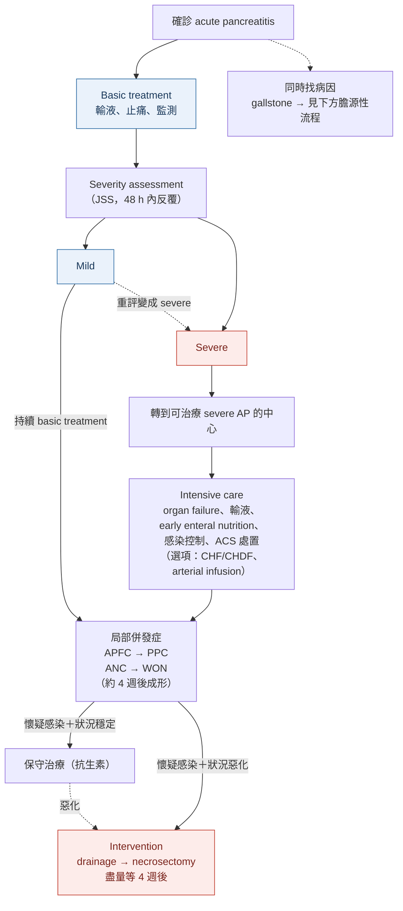
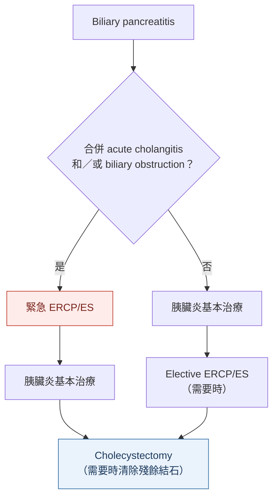

> [!abstract] 一句話重點
> 診斷看 **upper abdominal pain＋pancreatic enzyme（首選 lipase）＋imaging 三項中兩項**；確診後**立刻、並在 48 小時內反覆**做 severity assessment（JSS）。早期處置的核心是 **Ringer's lactate 輸液到 MAP ≥ 65、UO ≥ 0.5 mL/kg/h**、止痛、**早期 enteral nutrition**；第一件要分辨的病因是 **gallstone**（合併 cholangitis／膽道阻塞才做 early ERCP/ES，出院前把膽囊拿掉）。Necrosis 先保守，真的要介入也**等到 4 週後 WON 期**，用 step-up approach。

> [!info] 本篇來源與建議強度
> 主要依據 **JPN Guidelines 2015**（Yokoe et al.，日本肝膽胰外科學會，39 個 CQ、43 條建議，GRADE 方法）；revised Atlanta 分類與病因清單取自網路權威來源補充（見參考資料）。
> - 建議強度：**1＝recommend（強）**、**2＝suggest（弱）**；證據等級 **A（SR/MA/RCT）→ D（case series）**。例如「(1B)」＝強建議、中等證據
> - 「ungraded」＝委員會認為證據不足以分級

## 診斷

### JPN 診斷標準（日本厚生勞動省 2008）

以下三項符合**至少兩項**，且排除其他胰臟疾病與 acute abdomen：

| # | 項目 |
| --- | --- |
| 1 | 上腹部 acute abdominal pain＋tenderness |
| 2 | 血中或尿中 pancreatic enzyme 上升 |
| 3 | US、CT 或 MRI 有 acute pancreatitis 的異常發現 |

- **Chronic pancreatitis 急性惡化**也歸在 acute pancreatitis
- 酵素最好測對胰臟**特異性高**的（pancreatic amylase、lipase）

> [!note] 對照：revised Atlanta（2012）
> 也是三項中兩項，但把酵素門檻寫死：**lipase 或 amylase ≥ 3 × ULN**；腹痛要「符合胰臟炎」（上腹痛、常放射到背部）。JPN 標準沒有寫倍數。

### 酵素：lipase 優於 amylase（CQ1–2）

- **測 serum lipase**；測不到 lipase 時才測 serum（pancreatic）amylase **(1B)**
- 與其他腹痛疾病鑑別時，==lipase 的診斷能力勝過所有其他胰臟酵素（包括 amylase）==
- **Urinary trypsinogen-2 dipstick**：5 分鐘出結果、不用抽血、準確度接近血中酵素；但日本未上市，所以不列入建議（ungraded B）

### 影像（CQ3–6）

| 檢查 | 建議 | 重點 |
| --- | --- | --- |
| **US** | 懷疑時就做 (1C) | 看胰臟腫大、周圍發炎、ascites，以及**病因線索**（CBD stone、膽管擴張）；color Doppler 可找 pseudocyst 內的 **pseudoaneurysm** |
| **CT** | 建議做 (1C) | 臨床、抽血、US 仍無法確診，或**病因不明**時，腎功能許可就做 **contrast-enhanced dynamic CT**；==胰臟癌造成胰管狹窄引起的 AP，只做 non-contrast CT 很容易漏掉腫瘤== |
| **MRI** | (2C) | 找**膽管結石**與 **hemorrhagic necrotizing pancreatitis** 比 CT 好；fat necrosis 在 **T1 高訊號、T2 略低**，可和單純 fluid 分開 |
| **CECT（血管併發症）** | (1C) | 診斷 **active hemorrhage、pseudoaneurysm、靜脈 thrombosis**（後者搭配 color Doppler） |

## 嚴重度評估

### 什麼時候評估（CQ8–9）

- **==確診當下就評估，之後反覆評估，特別是 48 小時內==** (1C)；revised Atlanta 也建議入院 24 h、48 h、7 天各重評一次
- **用 scoring system** (1B)：Ranson、Glasgow、APACHE II、SIRS、BISAP、HAPS、**JSS** 等；文中引用的比較研究中，**JSS 與 BISAP 預測 organ failure 最好**，JSS 在入院 48 h 的 AUC 表現最佳

### JPN Severity Score（JSS）

**A. Prognostic factors（每項 1 分）**

| # | 項目 | 門檻 |
| --- | --- | --- |
| 1 | Base excess 或 shock | BE **≤ −3 mEq/L** 或 SBP **< 80 mmHg** |
| 2 | 呼吸 | PaO₂ **≤ 60 mmHg**（room air）或需要 ventilator |
| 3 | 腎功能 | BUN **≥ 40 mg/dL**（或 Cr **≥ 2.0 mg/dL**），或輸液後仍 oliguria（**< 400 mL/day**） |
| 4 | LDH | **≥ 2 × ULN** |
| 5 | Platelet | **≤ 100,000/mm³** |
| 6 | Serum Ca | **≤ 7.5 mg/dL** |
| 7 | CRP | **≥ 15 mg/dL** |
| 8 | SIRS criteria | 符合 **≥ 3 項** |
| 9 | Age | **≥ 70 歲** |

SIRS 四項：BT > 38°C 或 < 36°C；HR > 90；RR > 20 或 PaCO₂ < 32 torr；WBC > 12,000 或 < 4,000，或 bands > 10%。

**B. CT grade（CECT）**

| 項目 | 0 分 | 1 分 | 2 分 |
| --- | --- | --- | --- |
| 胰臟外發炎延伸 | 只到 anterior pararenal space | 到 **root of mesocolon** | **超過腎臟下緣** |
| 胰臟 hypoenhanced 範圍（分頭、體、尾三段） | 局限在單一段內，或只在胰臟周圍 | 跨 2 段 | **佔滿 2 段以上** |

兩項相加：0–1 分＝Grade 1，2 分＝Grade 2，≥ 3 分＝Grade 3。

> [!danger] Severe 的定義
> ==Prognostic factors ≥ 3 分，或 CT Grade ≥ 2，任一成立就是 severe==。

### Revised Atlanta 分級（補充）

| 分級 | 定義 |
| --- | --- |
| **Mild** | 沒有 organ failure，也沒有局部或全身併發症 |
| **Moderately severe** | **Transient organ failure（< 48 h 緩解）**，和／或局部、全身併發症（例如共病惡化），但沒有 persistent organ failure |
| **Severe** | **==Persistent organ failure（> 48 h）==**，單一或多重器官 |

Organ failure 用 **modified Marshall score**：呼吸（PaO₂/FiO₂）、腎（Cr）、心血管（SBP）任一系統 **≥ 2 分**即算。

### CECT 在嚴重度評估的角色（CQ10）

- 在**有能力治療 severe AP 的醫院**，CECT 用來找 **poorly enhanced area（necrosis）** 與併發症 (2B)；要考慮顯影劑對胰臟炎、腎功能的影響與過敏
- Non-contrast CT 可以看腫大、發炎延伸、fluid、fat necrosis，但**判斷 necrosis 及範圍一定要 CECT**
- ==發病 4–10 天做 CECT，判斷 necrotizing pancreatitis 準確度接近 100%==
- 發病一週內 arterial phase 顯影差的區域可能只是**可逆的 ischemia**，不能直接說是壞死；**發病 2 週後**仍顯影差，才強烈懷疑 necrotizing pancreatitis

## 局部併發症的分類（revised Atlanta）

依原圖內容重新整理：以「**有無 necrosis**」和「**發病是否滿 4 週**」兩軸分四類，每一類都可能是 sterile 或 infected。

| | **< 4 週** | **≥ 4 週（有包膜）** |
| --- | --- | --- |
| **沒有 necrosis**（interstitial edematous pancreatitis） | **APFC** acute peripancreatic fluid collection | **PPC** pancreatic pseudocyst |
| **有 necrosis**（necrotizing pancreatitis） | **ANC** acute necrotic collection | **WON** walled-off necrosis |

- **APFC vs ANC**：發病一週內常難分；要靠 non-contrast CT 密度與 CECT 對胰臟及周圍組織的顯影判斷
- **PPC vs WON**：

| | PPC | WON |
| --- | --- | --- |
| 來源 | Edematous pancreatitis 的 fluid 被包起來 | Necrotizing pancreatitis 的壞死物被包起來（ANC 約 4 週後出現包膜） |
| 形狀與範圍 | 較規則、局限 | **不規則**，可延伸到 mesocolon、**paracolic gutter** |
| 內容物 | 均勻 fluid | **Fluid＋壞死組織＋脂肪混雜**，CT 密度高於水、多不均勻 |

## 病因（CQ7）

> [!important] 第一優先：先確認是不是 gallstone pancreatitis
> ==病因診斷中，gallstone-induced AP 是最重要、最緊急的，因為它決定要不要做內視鏡乳頭處置==（1A）。

- **所有病人**都要驗 **bilirubin、ALT、AST、ALP**，並做 **US**
- **MRI/MRCP**：看 CBD stone、pancreaticobiliary maljunction、pancreas divisum
- **EUS**：找 CBD stone 比 US 敏感，還能看 chronic pancreatitis、pancreatic cancer、IPMN

**常見病因清單（網路來源補充，ACG 2024）**

| 病因 | 重點 |
| --- | --- |
| Gallstone | 最常見；US 不確定可重做 |
| Alcohol | 常見 |
| **Hypertriglyceridemia** | 沒有膽結石、也沒有明顯喝酒時要驗；**TG > 1,000 mg/dL** 才傾向是病因 |
| Hypercalcemia、藥物、post-ERCP、創傷、感染 | 依病史與檢驗 |
| **胰臟腫瘤** | **> 40 歲**找不到病因時，要考慮 pancreatic tumor |
| Idiopathic | 再做 US、MRI 和／或 EUS；多位家人有胰臟疾病時可考慮基因檢測 |

## 整體處置流程

依原圖內容重新繪製：

## 早期治療

### 轉院（CQ11）

- **Severe（JSS）** 要立刻在能處理 severe AP 的醫院治療，自己做不到就**立即考慮轉院** (1C)：需要 ICU、IVR、CHDF、膽結石內視鏡處置、外科、NST
- 一開始 mild 的也要**反覆評估**，達到 severe 就考慮轉院
- 病人量大的醫院結果較好

### 輸液（CQ12–14）

| 問題 | JPN 2015 建議 |
| --- | --- |
| 用什麼 | **Extracellular fluid，首選 Ringer's lactate** (1C)；RCT 顯示比 saline 更能降低發炎 |
| 有 shock 或脫水 | **==短時間快速輸液 150–600 mL/h==**（依 shock 與脫水程度），但要小心過量 (1C) |
| 沒有脫水 | **130–150 mL/h**，密切監測 (1C) |
| 心衰竭、腎衰竭 | 仔細評估循環血量再決定速度 |
| 何時停止快速輸液 | **==MAP ≥ 65 mmHg 且 UO ≥ 0.5 mL/kg/h==** 達到就**降速**，之後調到能維持這兩個數值 (2C) |

- **BUN、Hct、CVP 下降**都不是好的停止指標
- 循環不穩的病人屬於高死亡率族群：可考慮 colloid、catecholamine，部分病人需要 blood purification
- 日本 2011 全國調查：**有達到 bundle 輸液目標**的病人死亡率 **9.5%**，沒達到的 **19.4%**

> [!warning] Pitfall：輸太多也會死
> 在入院時已經 shock、oliguria 的 severe AP，**快速大量輸液組**的 mechanical ventilation、**abdominal compartment syndrome（ACS）** 與死亡率都較高。目標達到就要降速。

### NG tube、止痛（CQ15–16）

- **Mild AP 不需要常規放 NG suction** (1A)：8 個以上 RCT 沒有好處，反而**腹痛、噁心持續更久**
- **疼痛要充分控制** (1A)：適當止痛**不會妨礙診斷或治療**；哪一種止痛藥最好沒有共識

### 預防性抗生素、antifungal、protease inhibitor（CQ17–19）

| 情境 | JPN 2015 |
| --- | --- |
| **Mild AP** | ==不需要預防性抗生素== (1A)：感染併發症與死亡率本來就低 |
| **Severe AP、necrotizing pancreatitis** | **發病 72 h 內**給預防性抗生素**可能改善預後** (2B)；日本 meta-analysis 只納入 48–72 h 內開始的 RCT，死亡率與胰臟感染率下降 |
| 療程 | 沒有感染徵象時，==避免連續給超過 2 週==（廣效抗生素可能增加 fungal infection） |
| 預防性 antifungal | **不建議常規使用** (1C) |
| Protease inhibitor（gabexate mesilate）IV | 改善死亡率與併發症**未被證實**；severe 病人的高劑量連續給藥仍需研究（ungraded B） |

### 營養（CQ20–24）

- **Mild AP 不要給 IV hyperalimentation** (1B)；**單用 TPN（沒有口服或腸道營養）盡量避免** (1B)
- **Severe AP 的 enteral nutrition 重點是「預防感染」而不是補營養** (1A)：和 TPN 相比，感染、手術介入、住院天數都下降；沒有腸道併發症的 severe 病人都可用
- ==入院 48 h 內開始 enteral nutrition==，從**少量**開始 (2A)；注意 severe ileus、腸缺血、腸壞死
- 管路：**原則上放到 Treitz ligament 以下的 jejunum**；放不進去時，**duodenum 或 stomach 也可以**（胃管安全性、併發症不比空腸差）(2B)
- 配方：消化態、半消化態、成分營養都可以，依黏度和滲透壓選；配方之間沒有明顯差異
- **何時開始吃**：依**腹痛緩解**與**serum lipase** 等指標決定 (2B)；mild AP 支持積極早期進食
  - 進食後腹痛復發的相關因子：Balthazar CT grade D、疼痛持續時間長、lipase 高、CRP 高

> [!tip] Pearl：enteral nutrition 是感染控制
> Severe AP 的 infected necrosis 很大一部分來自**腸道細菌移位**；早期少量灌食維持腸黏膜屏障，所以 bundle 才說「**就算沒有腸蠕動**，也要在 48 h 內少量開始」。

## Intensive care（CQ25–27）

| 治療 | JPN 2015 |
| --- | --- |
| **Peritoneal lavage** | 沒有救命效果，**不建議** (2B)；新 meta-analysis 存活、併發症、住院天數都沒差 |
| **CHF/CHDF** | 充分初始輸液後仍**循環不穩且 anuria**，或合併 **ACS** → 應該使用 (1C)；其他情況**不建議常規使用** (2C) |
| **Continuous regional arterial infusion**（protease inhibitor＋抗生素） | 有報告能降低胰臟感染與死亡率，但**未被證實**；日本 DPC 資料 propensity matching 沒差（ungraded B） |

## Abdominal compartment syndrome（CQ31–32）

- **定義（WSACS）**：**IAH**＝IAP 持續 **≥ 12 mmHg**；**ACS**＝IAP **> 20 mmHg** 合併**新的器官功能障礙**
- AP 合併 ACS 的死亡率很高（系統性回顧約 **47.5%**）
- **要連續測 IAP 的病人** (2C)：輸液過多、高嚴重度、腎或呼吸併發症、CT 上**多處 fluid 堆積**
- **處置** (2D)：
  - IAP 持續或反覆 **≥ 12 mmHg** → 先保守治療：胃腸減壓、腹腔內減壓（引流）、改善腹壁 compliance、適當輸液與循環管理
  - 目標 **IAP ≤ 15 mmHg**
  - **IAP > 20 mmHg 且內科治療無效、出現器官衰竭**，才考慮**外科減壓**

## Gallstone pancreatitis（CQ28–30）

依原圖內容重新繪製：

| 問題 | JPN 2015 |
| --- | --- |
| **Early ERCP/ES 的適應症** | ==合併 cholangitis，或懷疑膽道持續阻塞（黃疸出現或惡化）== (1A)；4 個 RCT 的 meta-analysis 顯示這類病人併發症與死亡率較低 |
| **要不要切膽囊** | 能開刀就要做 cholecystectomy 預防復發 (1B)；**ES＋cholecystectomy** 最能預防胰臟炎與膽道併發症復發。==只做 ERCP＋ES、不切膽囊，膽道併發症復發率高==，除非有不能開刀的理由，不應只做 ES |
| **何時切** | **==胰臟炎一緩解就切==** (1B)；出院後復發率 **32–61%**，**出院 6 週內**特別高。Mild biliary AP 在**同次住院**切膽囊幾乎沒有再入院 |

> [!warning] Pitfall
> 沒有 cholangitis、也沒有持續阻塞的 gallstone pancreatitis，**不是** early ERCP 的適應症。Early ERCP 是為了處理膽道，不是為了治胰臟炎本身。

## 局部併發症的介入（CQ33–36）

- **Necrotizing pancreatitis 原則上先保守治療** (1C)；==發病 72 h 內的早期手術死亡率非常高==
- **最佳介入適應症**：**懷疑或確定 infected necrosis，且全身狀況惡化**
  - Infected ANC 或 WON 死亡率約 12–26%
  - 就算確診 infected necrosis，**全身狀況穩定**時仍可先用抗生素等保守治療
  - 少見適應症：PPC 壓迫造成胃出口阻塞、壞死造成胰管或胰內段膽管狹窄阻塞

**Infected pancreatic necrosis 怎麼診斷**（CQ34，1C）

- 臨床症狀與抽血**惡化**時要懷疑；支持線索：**blood culture 陽性**、endotoxin 陽性、**procalcitonin 上升**、**CT 看到胰臟或周圍組織內有 gas**
- **==不需要常規做 FNA==**，用臨床表現＋CT 綜合判斷；狀況惡化時直接做 percutaneous 或 endoscopic **drainage**，同時診斷與治療

**何時、怎麼介入**（CQ35–36）

| 問題 | JPN 2015 |
| --- | --- |
| 時機 | 盡量等到 ==發病 4 週後，壞死被包好的 WON 期== (2C)；早期 necrosectomy 死亡率顯著較高 |
| 方法（**step-up approach**） | **先 drainage**：percutaneous（retroperitoneal）或 **endoscopic transluminal** → 沒改善再 **necrosectomy** (2B) |
| Necrosectomy 路徑 | **Endoscopic** 或 **retroperitoneal**（例如 VARD，video-assisted retroperitoneal debridement）；retroperitoneal 路徑併發症比 laparotomy 少 |

## Post-ERCP pancreatitis（CQ37–38）

| 預防方法 | JPN 2015 |
| --- | --- |
| **Prophylactic temporary pancreatic stent** | 有效，但考量風險與費用，**只用在高風險族群** (2A) |
| **Guidewire cannulation** | 比打顯影劑插管更能降低 PEP，可當首選 (2A) |
| **==Rectal NSAIDs==** | **==沒有禁忌症的 ERCP 病人全部都給==** (2A)；肛門給藥效果明確 |
| 其他藥物 | 效果被否定或不確定，**不要常規使用** |

**PEP 高風險族群**：確定或懷疑 **sphincter of Oddi dysfunction**、**插管困難**、做了 **precut sphincterotomy**、做了 **balloon dilatation**。

## Pancreatitis Bundles 2015（CQ39）

原則上每一項都要做到，並在病歷記錄是否完成；bundle 執行率高的 severe AP 病人預後較好 (1C)。（2010 版 bundle 的資料：做到 8 項以上的病人死亡率顯著低於 7 項以下。）

| # | 項目 | 時間 |
| --- | --- | --- |
| 1 | 用 **JSS** 反覆評估嚴重度 | 確診時、**24 h 內**、**24–48 h** |
| 2 | Severe AP 考慮轉到適當醫院 | 確診後 **3 h 內** |
| 3 | 用病史、抽血、影像找病因 | 確診後 **3 h 內** |
| 4 | Gallstone AP 合併 cholangitis 和／或膽道阻塞（黃疸出現或惡化）→ 考慮 early ERC＋ES | — |
| 5 | 在能治療 severe AP 的醫院做 **CECT**，看 non-enhanced area 與範圍，依 CT grade 評估 | 初始治療後 **3 h 內** |
| 6 | 充分輸液與監測，**MAP ≥ 65 mmHg、UO ≥ 0.5 mL/kg/h** | 發病 **48 h 內** |
| 7 | 止痛 | — |
| 8 | Severe AP 給預防性廣效抗生素 | 發病 **72 h 內** |
| 9 | **沒有腸蠕動也要**少量開始 enteral nutrition（最好 jejunal） | 確診 **48 h 內** |
| 10 | Gallstone AP 合併膽囊結石 → 症狀緩解後切膽囊 | — |

> [!tip] 記憶法：bundle 裡的數字
> **3 h**：轉院、找病因、CECT｜**48 h**：嚴重度反覆評估、輸液達標、開始灌食｜**72 h**：severe 的預防性抗生素

## Pearls & Pitfalls

> [!tip] Pearl
> - 腹痛＋lipase 明顯上升就能診斷，**不需要為了確診做 CT**；CT 留給診斷不明、找病因，或 severe 病人的 necrosis 評估
> - 判斷 necrosis 的最佳時機是**發病 4–10 天**；太早做會把可逆的 ischemia 當成壞死
> - Severe 的判定要**反覆做**：入院時 mild 不代表 48 小時後還是 mild

> [!warning] Pitfall
> - 只看 BUN、Hct、CVP 決定停輸液：JPN 指引認為這些都不是好的停止指標，要看 **MAP 與尿量**
> - 年紀大、找不到病因的 AP，一定要想到**胰臟腫瘤**，影像要做 contrast-enhanced
> - Gallstone AP 治好就出院、膽囊留著：出院後幾週內復發率很高

## 🎯 內專考點

待補（這次無法連到筆電上的內建瀏覽器讀取刷題網站，之後補上）。

## 相關筆記

- [[gastroenterology/acute-biliary-infection/index|急性膽道感染 TG18 總覽]]：gallstone AP 合併 cholangitis 時的嚴重度與引流
- [[gastroenterology/acute-biliary-infection/tg18-3-cholangitis|③ Cholangitis 處置與膽道引流]]
- [[nephrology/calcium-phosphate-disorders|鈣磷鎂異常]]：hypercalcemia 是 AP 病因；AP 會造成 hypocalcemia（JSS 的 Ca ≤ 7.5 mg/dL）
- [[endocrinology/dka-hhs|DKA 與 HHS]]：AP 是 DKA 誘因之一；DKA 腹痛要和 AP 鑑別

## 參考資料

- Yokoe M, Takada T, Mayumi T, et al. Japanese guidelines for the management of acute pancreatitis: Japanese Guidelines 2015. *J Hepatobiliary Pancreat Sci*. 2015;22:405–432. doi:10.1002/jhbp.259（參考資料庫：腸胃肝膽科／Yokoe 2015）
- Banks PA, Bollen TL, Dervenis C, et al. Classification of acute pancreatitis—2012: revision of the Atlanta classification and definitions by international consensus. *Gut*. 2013;62:102–111.（revised Atlanta 分級、organ failure 定義）
- Tenner S, Vege SS, Sheth SG, et al. American College of Gastroenterology guidelines: management of acute pancreatitis. *Am J Gastroenterol*. 2024;119:419–437.（病因清單：TG 門檻、> 40 歲考慮腫瘤）
