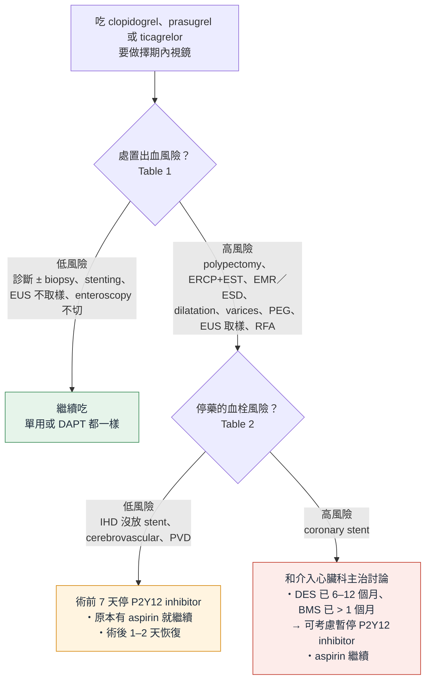
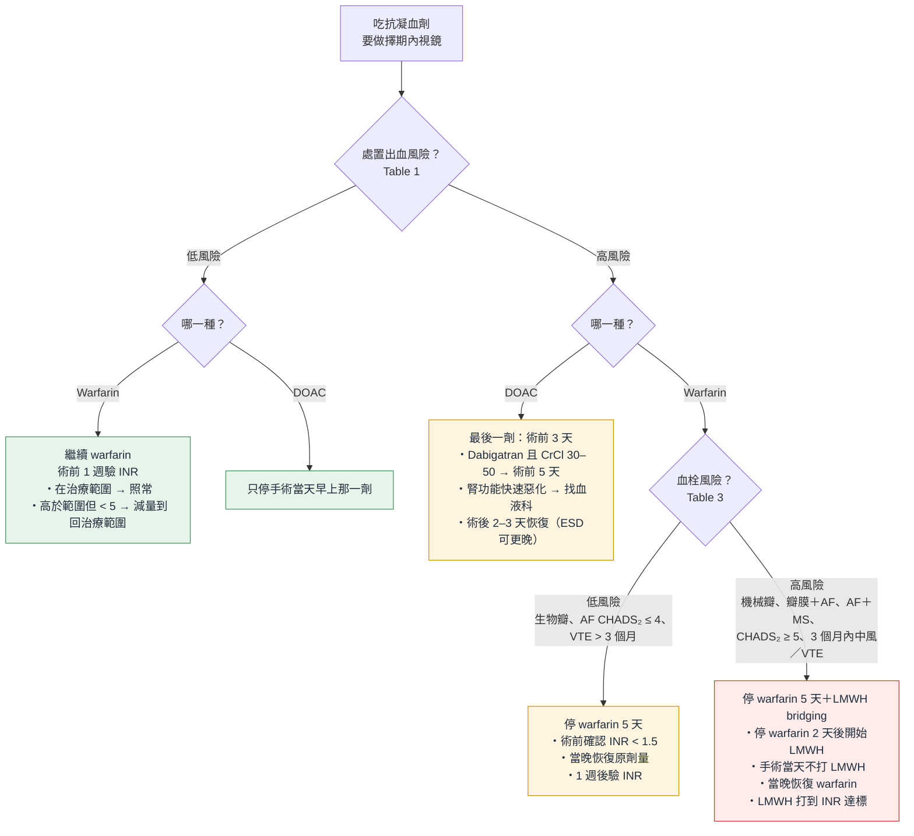

> [!abstract] 一句話重點
> - **先分兩件事**：處置的出血風險（Table 1）× 停藥後的血栓風險（Table 2、3）
> - **Aspirin**：==所有內視鏡都不停==，唯一例外是 **ampullectomy**（個別考慮）
> - **P2Y12 inhibitor**（clopidogrel、prasugrel、ticagrelor）：
>   - 低風險處置 → 繼續（單用或 DAPT 都一樣）
>   - 高風險處置＋低血栓風險 → ==術前 7 天停==，aspirin 繼續，術後 1–2 天恢復
>   - 高風險處置＋**coronary stent** → aspirin 繼續，**P2Y12 要不要停先問介入心臟科**
> - **Warfarin**：
>   - 低風險處置 → 繼續，**前一週驗 INR**（INR > 5 就延期）
>   - 高風險處置 → ==停 5 天，術前 INR < 1.5==，當晚恢復；**高血栓風險才用 LMWH bridging**
> - **DOAC**：
>   - 低風險處置 → **只停當天早上那一劑**
>   - 高風險處置 → ==最後一劑在術前 3 天==；dabigatran 且 **CrCl 30–50 → 術前 5 天**
>   - ==DOAC 不做 bridging==；術後 **2–3 天**恢復
> - **術後恢復**：一般 ≤ 2–3 天；**ESD** 等出血風險很高的可以再晚

> [!info] 系列導覽
> ↑ 回到 [[gastroenterology/antithrombotic-endoscopy-bsg-esge/index|抗栓藥物與內視鏡（BSG/ESGE 2021）總覽]]
>
> ① 擇期內視鏡怎麼停藥（本篇）｜② [[gastroenterology/antithrombotic-endoscopy-bsg-esge/ate-2-procedures|各項內視鏡處置的出血風險]]｜③ [[gastroenterology/antithrombotic-endoscopy-bsg-esge/ate-3-acute-bleeding|抗栓藥物中的急性 GI 出血]]｜④ [[gastroenterology/antithrombotic-endoscopy-bsg-esge/ate-exam|內專考點]]
>
> 本篇涵蓋：Table 1–3、Figure 1–3、擇期處置的所有建議與術後恢復時機

## 第一步：這個處置出血風險高還是低？（Table 1）

分類依據：**處置本身的出血率**（多數資料來自沒吃抗栓藥的病人），加上**出血後需要介入處理的機會**。

| 🔴 高風險處置 | 🟢 低風險處置 |
| --- | --- |
| **Polypectomy**（< 1 cm 可考慮在 clopidogrel 單用下 cold snare） | **診斷性內視鏡 ± biopsy** |
| **ERCP with sphincterotomy** | **Biliary 或 pancreatic stenting**（沒做 sphincterotomy） |
| **Ampullectomy** | **Device-assisted enteroscopy**（沒做 polypectomy） |
| **EMR、ESD** | **Esophageal、enteral、colonic stenting** |
| **上、下消化道 stricture dilatation** | **EUS**（沒有取樣或介入治療） |
| **Varices 治療**（band ligation 等） | |
| **PEG** | |
| **EUS-guided sampling** 或介入治療（FNA、FNB、drainage） | |
| **Esophageal 或 gastric RFA** | |

> [!tip] Pearl
> - 低風險的關鍵字：**看一看、夾一點組織、放支架**（stent 本身 7 天內出血 < 1%）
> - 高風險的關鍵字：**切、燒、撐、打洞**（polypectomy、EMR／ESD、sphincterotomy、dilatation、PEG、RFA）
> - **Colonoscopy 常常是「低風險變高風險」**：大型研究中 22.5–34.2% 會發現 polyp → 醫師可以**一開始就當高風險處理**；ERCP 不確定要不要做 sphincterotomy 時也一樣
> - **APC** 沒有資料，指引不給建議

## 第二步：停藥的血栓風險高不高？

### Table 2：停 P2Y12 inhibitor 的血栓風險

| 🔴 高血栓風險 | 🟢 低血栓風險 |
| --- | --- |
| **Drug-eluting stent（DES）放置 12 個月內** | **Ischemic heart disease，沒有 coronary stent** |
| **Bare-metal stent（BMS）放置 1 個月內** | **Cerebrovascular disease** |
| | **Peripheral vascular disease** |

### Table 3：停 warfarin 時要不要 heparin bridging

| 🔴 高血栓風險 → **要 LMWH bridging** | 🟢 低血栓風險 → 不用 bridging |
| --- | --- |
| **Mechanical heart valve**，mitral 或 **aortic** 位置（aortic 見下方說明） | **Xenograft（生物）heart valve** |
| **Prosthetic valve＋AF** | |
| **AF＋mitral stenosis** | |
| **AF＋曾經 stroke／TIA＋下列 ≥ 3 項**：CHF、HTN（> 140/90 或在吃降壓藥）、age > 75、DM（等於 ==CHADS₂ ≥ 5==） | **AF 沒有上述高風險因子（CHADS₂ ≤ 4）** |
| **AF＋3 個月內 stroke／TIA** | |
| **VTE 發生 < 3 個月** | **VTE 已 > 3 個月** |
| **吃 warfarin 時又發生 VTE**、目標 INR 現在調到 3.5 | |

- **Thrombophilia** 通常不需要 bridging，個案找血液科討論
  - Factor V Leiden、prothrombin G20210A：低風險，不需要
  - Antithrombin、protein C、protein S deficiency：風險較高，但多數仍不需要
- **Mechanical aortic valve**：ESC／EACTS 2017 建議 bridging，BSH 與 ACC／AHA 認為（沒有 AF 的 bileaflet aortic valve）不需要；本版**跟歐洲一樣放進高風險**，但要和負責的心臟科或心臟外科討論
- **VTE < 3 個月**：現在多數人吃 DOAC，**不 bridging**；最好**低風險處置照做、不停藥，高風險處置延到抗凝滿 3 個月後**

> [!warning] Pitfall：CHADS₂ 不是 CHA₂DS₂-VASc
> - 本指引用的是 **CHADS₂ ≥ 5**（沿用英國血液學會 BSH），兩個分數**不能直接換算**
> - 其他指引門檻不同：ASGE 用 CHA₂DS₂-VASc ≥ 2，APAGE／APSDE 用 ≥ 5
> - 注意 Table 3 只適用 **warfarin**；DOAC 一律不 bridging

## Figure 1：吃 P2Y12 inhibitor 的人

依原圖內容重新繪製：

> [!note] 看圖重點
> - 原圖在高風險處置的 polypectomy 旁加註：**< 1 cm colonic polyp 可考慮在 clopidogrel 單用下做 cold snare**
> - Figure 1 寫「術後 **1–2 天**恢復 P2Y12 inhibitor」；本文一般性建議是「停了的藥，依出血與血栓風險 **最多 2–3 天內**恢復」
> - Table 2 把 **DES 12 個月內**都列為高風險；Figure 1 則說 **DES 6–12 個月**的人，和心臟科討論後可考慮暫停

## 抗血小板藥（Antiplatelet agents）

> [!tip] 建議（BSG/ESGE 2021）
> - **所有內視鏡處置都繼續 aspirin**（strong，low）；例外是 **ampullectomy**（weak，low）
>   - 若考慮停 aspirin，要個別評估血栓 vs 出血風險（weak，low）
> - **低風險處置**：P2Y12 inhibitor 不論單用或 DAPT，**繼續**（strong，low）
> - **高風險處置、低血栓風險**：==P2Y12 inhibitor 術前 7 天停==（strong，moderate）；DAPT 的人 **aspirin 繼續**（strong，low）
> - **高風險處置、高血栓風險**：**aspirin 繼續**，P2Y12 inhibitor 要不要停，**和介入心臟科主治討論**（strong，high）

### Aspirin：為什麼幾乎都不停

- **次級預防**的 aspirin 讓 vascular events 少約 1/3、vascular death 少約 1/6
- **停 aspirin → 心血管或腦血管事件約 3 倍**，其中 ==70% 發生在停藥後 7–10 天內==
- 非心臟手術 RCT（220 人，次級預防）：30 天 major cardiac events **1.8%（繼續）vs 9%（停）**，出血沒有差別
- **初級預防**：2018 年三個 RCT 之後已**不常規建議**，只在個別極高風險者考慮

### P2Y12 inhibitor：重點是 coronary stent

- Clopidogrel 停藥後，platelet function 約 **5–7 天**回到正常；prasugrel、ticagrelor 作用更快更強
- **DAPT 中途停藥、stent 還沒內皮化** → stent thrombosis，約 **40% 發生 MI 或死亡**
- DAPT 療程（指引背景說明）：
  - DES 一般 **12 個月**；elective PCI 現在常用 **6 個月**
  - BMS 只需 **1 個月**（現在少用）；polymer-free drug-coated stent（BioFreedom）也是 1 個月；部分第三代 DES 對高出血風險者可縮到 1 個月
- **Stent＋長期 DOAC 的人**（例如 AF）：ESC 不再建議終身加單一抗血小板，但很多介入心臟科仍會保留 → ==這類人的 aspirin 或 clopidogrel 要停，一定先問介入心臟科==
- 停 P2Y12 inhibitor 7 天可把出血風險降到最低；依藥物不同，**時間可以縮短**（指引沒有給各藥天數）
- 極高 stent thrombosis 風險者，可用 IV **cangrelor** 或 GP IIb/IIIa bridging，由心臟科逐案決定（超出本指引範圍）

> [!warning] Pitfall
> - DAPT 的人要停的是 **P2Y12 inhibitor**，不是 aspirin
> - 「Stent 很久了，DAPT 已經結束」的人，剩下的單一抗血小板**常常是 clopidogrel**（例如曾中風的人）→ 這時 clopidogrel 等於他唯一的抗血小板藥
> - 最好聯絡的是**當初放 stent 的那位介入心臟科醫師**

## Figure 2：吃 warfarin 或 DOAC 的人

依原圖內容重新繪製：

> [!note] 看圖重點
> - 只有 **warfarin＋高風險處置**這一格要再看 Table 3；DOAC 不論血栓風險，**流程都一樣、都不 bridging**
> - 原圖註腳：DOAC 恢復時間要看出血與血栓風險，**ESD 可考慮延長間隔**

## Warfarin 的操作步驟

> [!tip] 建議（BSG/ESGE 2021）
> - **低風險處置**：warfarin **繼續**（weak，low）；確定術前一週 INR **沒有超過治療範圍**（strong，low）
> - **高風險處置、低血栓風險**：==停 warfarin 5 天==（strong，**high**）；術前驗 ==INR < 1.5==（strong，low）
> - **高風險處置、高血栓風險**：暫停 warfarin，**改用 LMWH**（strong）

| 情境 | 步驟 |
| --- | --- |
| **低風險處置** | ① 繼續吃，**術前一週驗 INR** ② 在治療範圍 → 照常 ③ 高於治療範圍但 < 5 → **減量**到回治療範圍 ④ ==INR > 5 → 延期==，聯絡抗凝門診或醫師 |
| **高風險處置、低血栓風險** | ① **術前停 5 天** ② 術前驗 INR，確定 < 1.5 ③ **手術當晚**恢復平常劑量 ④ **1 週後驗 INR** |
| **高風險處置、高血栓風險（bridging）** | ① **術前停 5 天** ② 停 warfarin **2 天後**開始 **therapeutic dose LMWH**（每天） ③ 最後一劑 LMWH 在術前 **≥ 24 小時**（手術當天不打） ④ 術前驗 INR < 1.5 ⑤ **手術當晚**恢復 warfarin 平常劑量 ⑥ **術後第 1 天**恢復 therapeutic dose LMWH ⑦ LMWH 打到 **INR 達標**為止 |

> [!tip] Pearl：為什麼 warfarin 當晚就能吃，DOAC 卻要等 2–3 天？
> - Warfarin 要**好幾天**才達到抗凝效果，當晚吃也不會馬上抗凝
> - DOAC **3 小時內就完全抗凝**，所以要等傷口較穩定（高風險處置後 2–3 天）才恢復

## DOAC 的操作步驟

> [!tip] 建議（BSG/ESGE 2021）
> - **低風險處置**：==只停手術當天早上的劑量==（weak，low）——qd、bid 的藥都一樣
> - **高風險處置**：==最後一劑在術前 3 天==（strong，low）
>   - **Dabigatran＋CrCl（或 eGFR）30–50 mL/min** → 最後一劑在**術前 5 天**（strong，low）
>   - 任何人**腎功能快速惡化** → 找血液科（strong，low）

- **Dabigatran** 是 thrombin inhibitor；**rivaroxaban、apixaban、edoxaban** 是 factor Xa inhibitor
- **INR、aPTT 不能可靠反映** DOAC 的抗凝程度，也不需要常規監測
- 半衰期短，但**腎衰竭時會延長**，dabigatran 最明顯
  - Dabigatran 在 **CrCl < 30** 是禁忌
  - eGFR 可以取代 CrCl，數字門檻相同
  - 臨床狀況變差的病人，術前要**重新驗腎功能**
- 本文另一處寫 dabigatran CrCl 30–50 是「術前 **3–5 天**」最後一劑；正式建議與 Figure 2 寫 **5 天**

### Figure 3：PAUSE 試驗的停藥與恢復時程

依原圖內容重新整理（原圖出自 PAUSE 試驗，Douketis 2019 *JAMA Intern Med*；**✅ = 吃藥、⛔ = 不吃**，Day 0 = 手術或內視鏡當天）：

| 藥物 | 處置出血風險 | Day −5 | Day −4 | Day −3 | Day −2 | Day −1 | **Day 0** | 恢復 |
| --- | --- | --- | --- | --- | --- | --- | --- | --- |
| Apixaban、rivaroxaban、dabigatran（CrCl ≥ 50） | **高** | ✅ | ✅ | ✅ 最後一劑 | ⛔ | ⛔ | ⛔ | ==Day +2 至 +3== |
| | 低 | ✅ | ✅ | ✅ | ✅ 最後一劑 | ⛔ | ⛔ | Day +1 |
| **Dabigatran（CrCl < 50）** | **高** | ✅ 最後一劑 | ⛔ | ⛔ | ⛔ | ⛔ | ⛔ | Day +2 至 +3 |
| | 低 | ✅ | ✅ | ✅ 最後一劑 | ⛔ | ⛔ | ⛔ | Day +1 |

> [!note] 看圖重點
> - **PAUSE**（3007 位吃 apixaban、dabigatran、rivaroxaban 的 AF 病人）照固定時程停藥、**完全不 bridging**，major bleeding 與 arterial thromboembolism 都很低
> - 高風險處置「最後一劑在 Day −3」＝**術前完整停 2 天**；低風險處置 PAUSE 停 1 天
> - 本指引對低風險內視鏡**仍只停當天早上那一劑**；但 PAUSE 證明停 1 天也安全，想這樣做也可以

> [!warning] Pitfall：為什麼 biopsy 也要停當天早上的 DOAC？
> - 吃完 DOAC **2–6 小時是血中濃度高峰**，內視鏡時的抗凝程度無法預測，也沒有可靠的檢驗
> - 義大利研究：DOAC 沒停就做 biopsy，出血 5.2% vs 停早上那劑 1.7%（人數少、沒有統計差異）
> - 所以保留這個安全邊際

## Heparin bridging：大多數人不需要

- **AF 吃 warfarin（BRIDGE 試驗）**：1884 人、約一半是 GI endoscopy，LMWH vs placebo
  - 血栓事件**沒有差別**，major bleeding **3.2% vs 1.3%**（bridging 較多）
  - 但收案多是低 CHADS₂，**高風險族群證據不足** → 本指引只對 CHADS₂ ≥ 5 或 3 個月內中風／TIA bridging
- **DOAC bridging 有害**：
  - Dresden 登錄：major bleeding 2.7% vs 0.5%，血栓沒有減少
  - RE-LY 次分析（dabigatran）：major bleeding 6.5% vs 1.8%，血栓沒有差別
- **日本全國資料**（16,977 位 warfarin 或 DOAC、高風險內視鏡，bridging 用 UFH）：bridging → 術後出血**和**血栓都增加
- Colonoscopy 吃 warfarin、用 LMWH bridging：多個研究顯示 post-polypectomy bleeding 增加、血栓沒有減少
- **UFH vs LMWH**：UFH 要住院、IV、監測 aPTT；LMWH 可門診皮下注射；機械瓣有些心臟科偏好 UFH，但 LMWH 已很普遍，AHA／ACC 不偏好任何一種

> [!tip] Pearl
> Table 3 高風險的人仍要 bridging，但要**事先告訴病人術後出血風險會增加**。

## 術後什麼時候恢復？

> [!tip] 建議（BSG/ESGE 2021）
> - 停了抗血小板或抗凝血劑，==術後最多 2–3 天內恢復==，依出血與血栓風險調整（strong，moderate）
> - 告訴所有吃抗栓藥的病人：**術後出血風險比沒吃藥的人高**（strong，low）

- **DOAC** 數小時內就有效；warfarin 要好幾天 → 恢復時機的考量不同
- PAUSE：高風險處置後 2–3 天恢復 DOAC，血栓事件低
- 義大利前瞻研究（照舊版指引做）：
  - Polypectomy 前**沒照指引停 DOAC** → 術中出血有增加趨勢；**停得比指引久**也沒有比較少出血
  - 高風險病人 polypectomy 後**立刻恢復** DOAC（而不是等 24–48 小時）→ delayed bleeding 幾乎加倍、血栓沒減少（未達統計差異）
- **ESD**：meta-analysis 中**術後 ≥ 1 週**才恢復抗栓藥，出血沒有增加；1 週內恢復則出血增加（但沒分析血栓）→ 可考慮延後，個別評估

> [!warning] Pitfall：delayed bleeding 常在恢復吃藥之後
> - 治療後的出血可以晚到 **1–2 週**才發生，這時抗栓藥通常已經恢復
> - 要讓病人知道出血時**任何時間**怎麼求助

## 跟病人說清楚（Patient considerations）

> [!tip] 建議（BSG/ESGE 2021）
> 所有病人都要說明：**停藥的血栓風險**和**不停藥的出血風險**（strong，low）。

- 內視鏡後出血**通常可以再用內視鏡止住、很少致命**；但血栓造成的 stroke 可能終身失能，major cardiac event 可能致死 → 即使血栓風險很低，**病人可能也不接受**，要讓病人參與決定
- 給病人一份**書面加口頭**的個人計畫：每一種藥**最後一劑**和**第一劑恢復**的日期與時間；有 bridging 時各藥分開寫清楚
- PAUSE 那種簡單的時程表（Figure 3）很適合拿來說明

## 相關筆記

- [[gastroenterology/antithrombotic-endoscopy-bsg-esge/ate-2-procedures|② 各項內視鏡處置的出血風險]]：Table 1 每一項的證據
- [[gastroenterology/antithrombotic-endoscopy-bsg-esge/ate-3-acute-bleeding|③ 抗栓藥物中的急性 GI 出血]]
- [[gastroenterology/antithrombotic-endoscopy-bsg-esge/ate-exam|④ 內專考點]]
- [[cardiology/atrial-fibrillation/af-esc-2024-2-anticoagulation|AF ② 抗凝]]：DOAC 劑量、AF＋PCI 的抗栓組合
- [[cardiology/acs-esc-2023/acs23-3-antithrombotic|ACS 抗血栓治療]]：DAPT 療程

## 參考資料

- Veitch AM, Radaelli F, Alikhan R, et al. Endoscopy in patients on antiplatelet or anticoagulant therapy: British Society of Gastroenterology (BSG) and European Society of Gastrointestinal Endoscopy (ESGE) guideline update. *Endoscopy* 2021;53:947–969. doi:10.1055/a-1547-2282（同步刊於 *Gut* 2021;70:1611–1628）（Table 1–3、Figure 1–3）（參考資料庫：腸胃肝膽科／2021_a_1547_2282.pdf）
- Douketis JD, Spyropoulos AC, Duncan J, et al. Perioperative management of patients with atrial fibrillation receiving a direct oral anticoagulant（PAUSE）. *JAMA Intern Med* 2019;179:1469–1478（Figure 3 原始出處）
