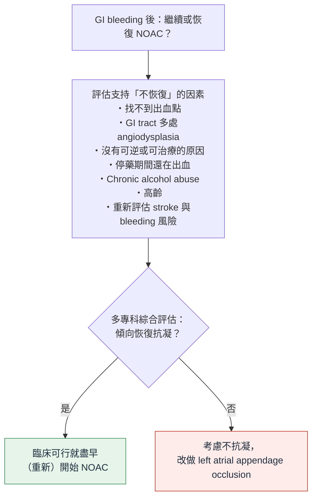

> [!abstract] 一句話重點
> - **抗血小板**：
>   - **初級預防** aspirin → 考慮**永久停用**
>   - **次級預防** aspirin → ==不常規停==；停了就在**止血後立刻恢復**
>   - **Coronary stent＋DAPT** → 盡量繼續，**和介入心臟科一起決定**；大出血要停的話 ==只停 P2Y12 inhibitor、aspirin 繼續、5 天內恢復==
> - **抗凝血劑：兩種藥共通**：先停藥，依出血嚴重度與血栓風險矯正；==矯正凝血不可延誤內視鏡或介入放射治療==
> - **逆轉（只在血行動力不穩時）**：
>   - 【Warfarin】==IV vitamin K＋4-factor PCC==（沒有 PCC 才用 FFP）
>   - 【DOAC】多數**停藥等 12–24 小時**就好；dabigatran 用 **idarucizumab**、Xa inhibitor 用 **4F-PCC**（原書寫 andexanet，🆕 已退出美國市場）；vitamin K、FFP 無效
> - **恢復**（有長期適應症就要恢復）：
>   - 【Warfarin】低血栓風險 ==約第 7 天==；高血栓風險（例如 **mitral 機械瓣**）**3 天內＋heparin bridging**
>   - 【DOAC】指引**沒有 DOAC 資料**，比照 warfarin 約第 7 天；**不 bridging**（2–4 小時就完全抗凝）
>   - 【DOAC，AF】Martin 2023：依 **CHA₂DS₂-VASc × 內視鏡再出血風險**，最多**停 3 天**就恢復；CHA₂DS₂-VASc 0–1 先問還要不要抗凝

> [!info] 系列導覽
> ↑ 回到 [[gastroenterology/antithrombotic-endoscopy-bsg-esge/index|抗栓藥物與內視鏡（BSG/ESGE 2021）總覽]]
>
> ① [[gastroenterology/antithrombotic-endoscopy-bsg-esge/ate-1-elective|擇期內視鏡怎麼停藥]]｜② [[gastroenterology/antithrombotic-endoscopy-bsg-esge/ate-2-procedures|各項內視鏡處置的出血風險]]｜③ 抗栓藥物中的急性 GI 出血（本篇）｜④ [[gastroenterology/antithrombotic-endoscopy-bsg-esge/ate-exam|內專考點]]
>
> 本篇是 2021 版**新增**的章節；UGIB 的一般處置（GBS、輸血、PPI、內視鏡時機）見 [[gastroenterology/upper-gi-bleeding-acg/index|ACG UGIB 指引]]

## 先分清楚：Warfarin 還是 DOAC？

BSG/ESGE 的 6 條抗凝建議中，**逆轉**的兩條明確分藥；**停藥**和**恢復**的三條寫的是「anticoagulation」，沒有分藥。下表把每一點的適用對象標清楚。

| | 【Warfarin（VKA）】 | 【DOAC】 | 出處 |
| --- | --- | --- | --- |
| 停藥後效果持續 | **3–5 天** | **12–24 小時** | BSG/ESGE 內文 |
| 要不要逆轉 | 看出血嚴重度；**血行動力不穩 → 逆轉** | 多數**停藥等它退**；血行動力不穩才考慮 | BSG/ESGE 建議（分藥寫） |
| 逆轉劑 | ==IV vitamin K＋4F-PCC==（無 PCC → FFP）；PCC 時同給低劑量 vitamin K 防 INR rebound | Dabigatran → **idarucizumab**；Xa inhibitor → **4F-PCC 2000 IU**（原書：andexanet） | BSG/ESGE 建議（分藥寫） |
| **無效**的東西 | — | ==Vitamin K、FFP、protamine== | BSG/ESGE 內文 |
| 低血栓風險：何時恢復 | **約第 7 天盡快恢復**（證據就是 warfarin 的回溯研究：< 7 天再出血多、> 30 天血栓多） | **比照 warfarin，約第 7 天**（指引明說 DOAC **沒有資料**）；DOAC 2–4 小時就完全抗凝 → 提早恢復要更小心 | 建議寫「anticoagulation」；內文分開講 |
| 高血栓風險：何時恢復 | **3 天內＋heparin bridging**；極高風險（mitral 機械瓣）早用 UFH，或 LMWH 48–72 小時內調到治療劑量 | 建議**沒有分藥**；但 DOAC 不需要 bridging（指引擇期段落：DOAC 暫停**不 bridging**），內文舉的極高風險例子（機械瓣）也只能用 warfarin → **實務上 bridging 這句是 warfarin 的情境** | 建議寫「anticoagulation」；DOAC 部分為依指引其他段落的解讀 |
| AF 病人何時恢復 | — | **停 1–3 天**，依 CHA₂DS₂-VASc × 再出血風險（不 bridging） | Martin 2023（**只談 NOAC**） |

> [!warning] Pitfall：「3 天內＋heparin bridging」不是 DOAC 的做法
> 這句建議原文只寫 anticoagulation，但 bridging 的目的是在 **warfarin 慢慢起效（好幾天）** 的期間用 heparin 撐住；DOAC 吃下去 2–4 小時就有完整效果，**bridging 只會增加出血**。DOAC 病人若血栓風險高，要的是**早點恢復 DOAC 本身**（例如 Martin 2023 的停 1–3 天），而不是加 heparin。

## 值班一張卡

🩸 吃抗栓藥的人來 GI bleeding

1

<b>先問清楚</b>

吃哪一種、<b>最後一劑何時</b>、為什麼吃（<b>初級 vs 次級預防</b>、<b>stent 何時放</b>、機械瓣？AF？VTE 多久？）、腎功能

2

<b>Aspirin</b>

初級預防 → 考慮<b>永久停</b>｜次級預防 → <b>不常規停</b>，停了就<b>止血後馬上恢復</b>

3

<b>DAPT／stent</b>

<b>盡量繼續</b>，立刻聯絡介入心臟科｜大出血必須停 → <b>只停 P2Y12 inhibitor、aspirin 繼續</b>｜P2Y12 inhibitor <b>5 天內恢復</b>

4

<b>Warfarin</b>

停藥｜<b>血行動力不穩</b> → <b>IV vitamin K＋4-factor PCC</b>（沒有 PCC 才用 FFP）｜機械瓣等高血栓風險，逆轉要小心

5

<b>DOAC</b>

停藥，<b>12–24 h 效果就退</b>，多數等它退即可｜<b>血行動力不穩</b>：dabigatran → <b>idarucizumab</b>；Xa inhibitor → <b>4F-PCC</b>（2000 IU）；原書另列 andexanet（🆕 2025-12 已退出美國市場）｜vitamin K、FFP、protamine <b>無效</b>

6

<b>Warfarin 何時恢復</b>

低血栓風險 → <b>約第 7 天</b>｜高血栓風險（mitral 機械瓣等）→ <b>3 天內＋heparin bridging</b>

7

<b>DOAC 何時恢復</b>

BSG/ESGE：沒有 DOAC 資料，<b>比照 warfarin 約第 7 天</b>｜<b>不 bridging</b>

8

<b>AF 吃 NOAC 何時恢復</b> <small>【Martin 2023】</small>

CHA₂DS₂-VASc ≥ 2：Forrest III → <b>停 1–3 天</b>｜Forrest I–II → <b>停 3 天</b>、確認止血後恢復｜CHA₂DS₂-VASc 0–1：先問還要不要抗凝｜<b>不 bridging</b>

❌ 為了矯正 INR 或等 DOAC 退而延後內視鏡、介入放射治療｜❌ 出院時沒有「什麼時候恢復抗栓藥」的計畫

## 抗血小板

> [!tip] 建議（BSG/ESGE 2021）
> - **初級預防**的 aspirin：考慮**永久停用**（weak，low）
> - **次級預防**的 aspirin：**不要常規停**；停了就在**止血後**或沒有再出血證據時**立刻恢復**（strong，moderate）
> - **Coronary stent** 的人：**DAPT 盡量繼續**，和介入心臟科主治一起處理（strong，moderate）
> - **大出血**：若中斷 P2Y12 inhibitor，**aspirin 要繼續**（strong，moderate）；仍有適應症的話 ==P2Y12 inhibitor 5 天內恢復==（strong，moderate）

- 次級預防停 aspirin：major adverse cardiac events 約 **3 倍**；**有 coronary stent 的人 OR 高達 89**
- 剛放 stent 還在 DAPT 的人出血 → 中斷治療可能造成致命的 stent thrombosis
  - 首要任務：**復甦後盡快在 GI 止血**，急診就要有內視鏡止血能力
  - 急診當下就聯絡介入心臟科
- **5 天的理由**：超過 5 天 stent thrombosis 風險高；這是出血與血栓的平衡點，**沒有前瞻驗證**
- **Aspirin 繼續的證據**（RCT，156 位內視鏡止血後的 UGIB）：
  - 全死因死亡 **1.3% vs 12.9%**（aspirin 組較低）
  - 再出血 10.3% vs 5.4%（aspirin 組較多，但都不致命）
  - Placebo 組有 5 人死於血栓
- 回溯研究（118 位吃抗栓藥的 GI bleeding）：**永久停藥**的人血栓 HR **5.77**、死亡 HR **3.32** → 每位出血病人都要有**恢復抗栓藥的計畫**

> [!tip] Pearl
> 抗血小板出血「只停 P2Y12 inhibitor」的邏輯和擇期內視鏡一樣：**aspirin 是保命的底線**。

## 抗凝血劑：要不要逆轉？

> [!tip] 建議（BSG/ESGE 2021）
> - 【兩者】**暫停口服抗凝**，依**出血嚴重度**和**血栓風險**矯正凝血，與心臟科或血液科一起決定；==矯正凝血不可延誤內視鏡或介入放射治療==（strong，low）
> - 【Warfarin】**VKA＋血行動力不穩**：==IV vitamin K＋4-factor PCC==（strong，low）；沒有 PCC 才用 **FFP**（weak，very low）
> - 【DOAC】**DOAC＋血行動力不穩**：可考慮逆轉劑——dabigatran 用 **idarucizumab**、anti-Xa 用 **andexanet**（weak，low）（原書；已更新，見下方 🆕）；沒有 andexanet 用 **IV 4-factor PCC**（weak，very low）

- **背景**：急性 upper GI bleeding 最多 **15%**、lower GI bleeding 最多 **25%** 在吃抗凝
  - 死亡率高（8–12%），但主要來自**共病**；處理得當的話，抗凝本身**不是**死亡或院內再出血的獨立預測因子
  - 有臨床意義的 GI bleeding → **暫停抗凝是標準處置**
- **內視鏡在治療濃度的抗凝下仍可安全有效地做** → 不必等凝血矯正

### VKA（warfarin）

- 抗凝效果可持續 **3–5 天**
- 要不要快速逆轉主要看**出血嚴重度**；**高血栓風險**（例如機械瓣）要小心，逆轉劑和血栓事件有關
- **Vitamin K 要好幾小時**才起作用 → 活動性出血＋血行動力不穩要用 **4-factor PCC** 快速逆轉
- **PCC 優於 FFP**：體積小、作用快、**不用驗血型**
- 同時給**低劑量 vitamin K**，避免 PCC 退了之後 **INR rebound**

### DOAC

- 半衰期短，抗凝效果通常 **12–24 小時**內退掉 → 多數大出血**停藥等待**即可
- **Vitamin K、FFP、protamine 都無效**
- **Idarucizumab**（dabigatran 的人源化抗體片段）：危及生命或止不住的出血的第一線
  - **幾分鐘內**逆轉，維持約 **24 小時**，> 98% 有效
  - 90 天血栓併發症約 6%
- **Andexanet alfa**（不活化的 factor Xa，吸附 apixaban、rivaroxaban）：指引當時已核准，但**取得困難、昂貴、有促凝血疑慮**（原書；已更新，見下方 🆕）
- **4-factor PCC 固定劑量 2000 IU**：andexanet 的替代，血栓風險較低但效果不確定

> [!info] 🆕 新的藥物核准狀態（FDA 2025-12）
> - **Andexanet alfa（Andexxa）已於 2025-12-22 退出美國市場**：上市後試驗 **ANNEXA-I**（顱內出血）發現 andexanet 組**血栓事件約為一般處置（多為 4F-PCC）的 2 倍**，FDA 認為風險大於效益
> - 美國現在 Xa inhibitor 的危及生命出血，以 **4-factor PCC** 為主要逆轉方式
> - 指引原文「anti-Xa 用 andexanet（weak，low）」→ 在美國已無法使用，改以 4F-PCC 為主
> - 其他國家的供應狀況請依當地藥品資訊確認

> [!warning] Pitfall
> - **Idarucizumab 只對 dabigatran 有效**；-xaban 的藥不能用
> - **Protamine** 是中和 heparin 的，對 warfarin 和 DOAC 都沒用
> - 逆轉劑本身有**血栓風險**；穩定的病人通常不需要

## 什麼時候恢復抗凝？

> [!tip] 建議（BSG/ESGE 2021）
> - 【兩者】有**長期抗凝適應症**的人，急性 GI 出血後要**恢復**抗凝（strong，low）
> - 【兩者，證據來自 warfarin】**低血栓風險**：中斷約 ==7 天後盡快恢復==（weak，low）
> - 【實務上是 warfarin】**高血栓風險**：**更早恢復**，用 **heparin bridging**，最好 ==3 天內==（strong，low）
>
> 這三條建議原文都只寫「anticoagulation」，沒有分 warfarin 或 DOAC；下面依內文標出各自的根據。

- 觀察研究與兩個 meta-analysis 一致：**恢復抗凝有 net clinical benefit**——血栓與死亡減少，雖然再出血增加
- 最佳時機證據有限：
  - 【Warfarin】單一回溯研究：warfarin 中斷 **< 7 天**再出血多，**> 30 天**血栓多；越早恢復血栓越少 → **第 7 天前後盡快恢復**
  - 【DOAC】指引明說**沒有資料**，比照 warfarin，**多數第 7 天前後恢復**
  - 【DOAC】**2–4 小時就完全抗凝**，太早恢復要小心；**不需要 heparin bridging**
- 【Warfarin】**極高血栓風險**（例如 **mitral 位置機械瓣**，這類病人只能用 warfarin）：心臟學會建議早點用 **UFH**，或 prophylactic dose LMWH 在 **48–72 小時內調到 therapeutic dose**，和心臟科討論
- **恢復的風險大於效益**時：會診血液科、神經科或心臟科，考慮替代方案
  - AF → **left atrial appendage occlusion**
  - 急性 DVT → **IVC filter**

> [!tip] Pearl：整理三種「恢復時間」
> | 情境 | 恢復時間 |
> | --- | --- |
> | 擇期內視鏡後（停了的藥） | **≤ 2–3 天**（ESD 可延後） |
> | 出血後的 P2Y12 inhibitor（有 stent） | **5 天內** |
> | 出血後的 warfarin（低血栓風險） | **約第 7 天** |
> | 出血後的 warfarin（高血栓風險） | **3 天內**，heparin bridging |
> | 出血後的 DOAC（BSG/ESGE） | 比照 warfarin **約第 7 天**，不 bridging |
> | 出血後的 NOAC（AF，Martin 2023） | **停 1–3 天**（見下方 Table 1） |
> | 次級預防 aspirin | **止血後立刻** |

## 📄 補充：AF 吃 NOAC 的 GI 出血（Martin 2023）

> [!info] 本節出處
> 以下內容**不是** BSG/ESGE 指引，而是另外補充的文獻：**Martin AC, et al. *Am J Cardiovasc Drugs* 2023**——法國心臟科、腸胃科、血液科、急診科的**多專科討論（review）**，對象是 **AF 吃 NOAC** 的 GI 出血。
> - 每一點標【Martin 2023】；文中引述其他指引的標「Martin 2023 引述」
> - 作者自述：目前**沒有指引**專門處理「出血後怎麼恢復 NOAC」，高品質證據有限
> - 文章的撰稿協助由 **Pfizer／BMS**（apixaban 廠商）贊助，作者也有藥廠利益揭露；看「哪個 NOAC 比較好」的段落時要放在心上

### Table 1：依血栓風險 × 再出血風險決定 NOAC 何時恢復【Martin 2023】

依原表內容重新整理（原表針對 **upper GI bleeding**）：

| | 🟢 **低血栓風險** CHA₂DS₂-VASc 0–1 | 🔴 **高血栓風險** CHA₂DS₂-VASc ≥ 2（原表寫「≥ 2 or > 3」） |
| --- | --- | --- |
| 🟢 **低再出血風險** Forrest III（原表寫「> 2」）、esophageal varices **沒有** red sign、低出血風險的內視鏡處置 | **重新思考還需不需要 NOAC** | **停 1–3 天**，穩定後恢復 |
| 🔴 **高再出血風險** ==Forrest I 或 II==、varices **有** red sign、高出血風險的內視鏡處置 | 重新思考需不需要；真的需要 → **停 3 天後**恢復 | ==停 3 天==，**內視鏡確認止血、穩定後**恢復；可以的話**延後**後續的內視鏡處置 |

> [!tip] Pearl：和 BSG/ESGE 的差別在哪？
> - BSG/ESGE 是「低血栓風險約 **7 天**、高血栓風險 **3 天內＋bridging**」：7 天的證據來自 **warfarin**、DOAC 只是比照；bridging 實務上只用在 warfarin
> - 這張表是**直接寫給 NOAC** 的：最長也只停 **3 天**，**沒有 bridging**（NOAC 幾小時就有效，本身不需要橋）
> - 低血栓風險（CHA₂DS₂-VASc 0–1）的人，第一步是**問還要不要抗凝**，不是問何時恢復

### 恢復時機的證據【Martin 2023】

- **恢復比不恢復好**：
  - Meta-analysis：恢復抗凝 → thromboembolism 少 **70%**、死亡少 **49%**，但再出血多 **91%**
  - 另一個 > 5000 人的 meta-analysis：死亡 **21.3% vs 31%**（OR 0.499）
  - 限制：全是觀察性研究、異質性大、恢復時間不一
- **時間點**：
  - Majeed：==< 7 天恢復，再出血約 3 倍==；但 **< 21 天 vs > 21 天沒有差別**；出血風險隨時間下降，血栓風險則**一直維持**
  - Kido（warfarin）：**7–15 天**恢復 → 死亡與血栓減少、再出血沒有增加
  - 多篇建議**不要超過 2 週**才恢復
  - 試驗中的實際狀況：ARISTOTLE 出血後中位數 **15 天**恢復；REVERSE 66% 在 **16 天內**恢復
- 作者結論：要**及時**恢復，但記得**越早恢復，出血風險越大於血栓風險**；目前**沒有工具**能預測恢復時的再出血風險

### 其他指引怎麼說（Martin 2023 引述）

| 來源 | 建議 |
| --- | --- |
| **EHRA 舊版** | 考慮支持停藥的因素後，major GI bleeding **4–7 天內**恢復 NOAC（效益大於再出血風險時） |
| **EHRA 2021 Practical Guide** | 改成**傾向恢復**：多專科評估後，**臨床可行就盡早恢復**（見下圖） |
| **ACC 2020 Expert Consensus** | **高血栓風險** → 止血、穩定後**早期恢復**；中高再出血風險 → 個別化 |

#### EHRA 2021：要不要恢復 NOAC？（Martin 2023 Figure 2 引用）

依原圖內容重新繪製：

### 急診處置與逆轉的補充【Martin 2023】

- **急診先問**：NOAC **種類與劑量**、**最後一劑時間**、併用藥物；抽 **NOAC 濃度**（有的話）、CBC、creatinine、肝功能、血型
- **Major bleeding 定義（ISTH）**：重要器官出血，或 **Hb 掉 ≥ 20 g/L**，或輸 **≥ 2 單位** RBC
- **大多數 NOAC 出血，「時間」就是最好的解毒劑**；危及生命或復甦後仍止不住才考慮逆轉
- **NOAC 濃度 > 50 ng/mL** 才考慮逆轉；低於此濃度，出血不被認為和 NOAC 有關
- 沒有專一解毒劑時：**PCC 50 IU/kg** 或 **aPCC 30–50 IU/kg**（VKA 逆轉文中寫 PCC 25 IU/kg）
- ==Erythromycin 是 P-gp 與 CYP3A4 抑制劑==：內視鏡前給會**提高 NOAC 濃度**，可能讓出血更久；也要看 QT

> [!warning] Pitfall
> PCC 劑量各來源不同：本文（Martin 2023）寫 Xa inhibitor 用 **PCC 50 IU/kg**；BSG/ESGE 寫 **固定 2000 IU**。照院內 protocol。

### 恢復後怎麼預防再出血【Martin 2023】

- **選 NOAC 不選 VKA**：NOAC 的 major bleeding 有下降趨勢（GI bleeding 可能多約 23%，但整體 major bleeding 少約 14%）
- **各 NOAC 在 RCT 中的 major GI bleeding（vs warfarin）**：

| 藥物（試驗） | Major GI bleeding vs warfarin |
| --- | --- |
| **Dabigatran 150 mg bid**（RE-LY） | **增加**（RR 1.50）；110 mg bid 沒有增加 |
| **Rivaroxaban 20 mg qd**（ROCKET AF） | **增加**（HR 1.66） |
| **Edoxaban 60 mg qd**（ENGAGE AF） | **增加**（HR 1.23）；30 mg qd **減少**（HR 0.67） |
| **Apixaban 5 mg bid**（ARISTOTLE） | **沒有差別**（HR 0.89） |

- 沒有 head-to-head 比較；真實世界的回溯研究中 **apixaban** 的 GI bleeding 較低（見上方贊助提醒）
- 可能機轉：Xa inhibitor 與 dabigatran 有部分**沒被吸收、留在腸道**，可能直接作用在黏膜
- **其他預防**：
  - 依**腎功能**調整劑量，避免累積
  - 避免 **P-gp、CYP3A4 抑制劑**與**抗血小板**（aspirin 讓 major bleeding 至少增加 50%）
  - **不要用 NSAID**
  - 加 **PPI**（注意 PPI 和 dabigatran 的交互作用）
  - Peptic ulcer → 驗 **H. pylori**，陽性就除菌

## 相關筆記

- [[gastroenterology/upper-gi-bleeding-acg/ugib-1-initial#補充：吃抗凝血劑或抗血小板藥的人（ACG-CAG 2022）|UGIB ① 抗凝血劑與抗血小板藥（ACG-CAG 2022）]]：美國與加拿大指引對急性出血的建議
- [[gastroenterology/upper-gi-bleeding-acg/index|ACG 上消化道與潰瘍出血指引]]：GBS、輸血、PPI、內視鏡時機
- [[cardiology/atrial-fibrillation/af-esc-2024-2-anticoagulation#Figure 11：OAC 相關出血的處置|AF ② Figure 11 OAC 相關出血的處置]]
- [[cardiology/acs-esc-2023/acs23-3-antithrombotic|ACS 抗血栓治療]]：DAPT 與出血
- [[gastroenterology/antithrombotic-endoscopy-bsg-esge/ate-1-elective|① 擇期內視鏡怎麼停藥]]

## 參考資料

- Veitch AM, Radaelli F, Alikhan R, et al. Endoscopy in patients on antiplatelet or anticoagulant therapy: BSG and ESGE guideline update. *Endoscopy* 2021;53:947–969. doi:10.1055/a-1547-2282（Acute GI haemorrhage on antiplatelets and anticoagulants）（參考資料庫：腸胃肝膽科／2021_a_1547_2282.pdf）
- Martin AC, Benamouzig R, Gouin-Thibault I, Schmidt J. Management of gastrointestinal bleeding and resumption of oral anticoagulant therapy in patients with atrial fibrillation: a multidisciplinary discussion. *Am J Cardiovasc Drugs* 2023;23:407–418. doi:10.1007/s40256-023-00582-9（📄 補充一節；Young 對話上傳）
- U.S. Food and Drug Administration. Update on the safety of Andexxa（FDA safety communication）. December 18, 2025
- The Medical Letter. In Brief: Andexanet alfa (Andexxa) withdrawn. *Med Lett Drugs Ther* 2026;68(1746):16. doi:10.58347/tml.2026.1746f
