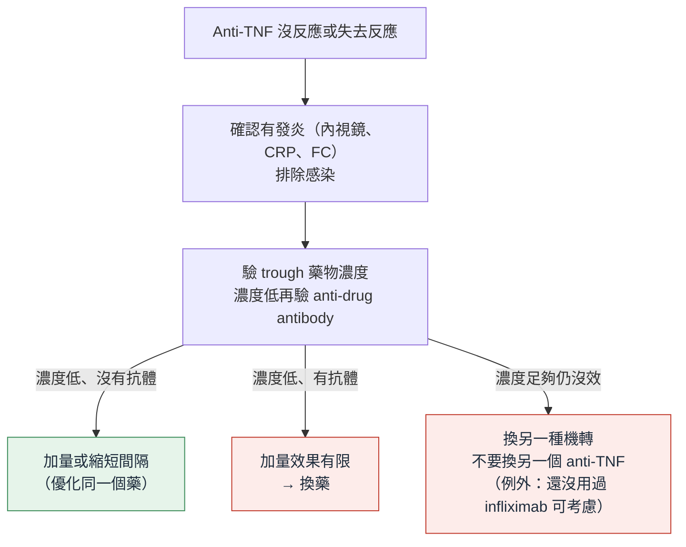

> [!abstract] 一句話重點
> - **誘導**：
>   - 中度可先用 **budesonide MMX**；中重度用**口服全身性類固醇**
>   - ==thiopurine、methotrexate 單用不能誘導==
>   - 有計畫用其他有效誘導藥時，**可以完全不用類固醇**
> - **Advanced therapy 全部 strong recommendation**（Statement 24–31）：
>   - **anti-TNF**：infliximab、adalimumab、golimumab
>   - **anti-integrin**：vedolizumab
>   - **IL-12/23**：ustekinumab
>   - **IL-23p19**：guselkumab、mirikizumab、risankizumab
>   - **JAK**：tofacitinib、upadacitinib
>   - **S1P**：ozanimod、etrasimod
> - **維持**：==用哪個藥誘導成功，就用同一個藥維持==；不要用類固醇維持；類固醇誘導後可用 thiopurine 維持；不用 methotrexate
> - **怎麼選**：
>   - ==infliximab 是首選的 anti-TNF==，搭配 **thiopurine**（Statement 33）
>   - ==vedolizumab 優於 adalimumab==（唯一的 head-to-head RCT）
>   - 怕感染 → vedolizumab 或 anti-IL-23
>   - 合併關節炎 → anti-TNF 或 JAK；合併乾癬 → IL-23
> - **用了 advanced therapy 就停 5-ASA**；**第一線效果最好**，不要拖
> - **Anti-TNF 失效**：
>   - 驗**藥物濃度與抗體**
>   - 濃度夠還沒效 → ==換別的機轉==，不要換另一個 anti-TNF

> [!info] 系列導覽
> ↑ 回到 [[gastroenterology/ulcerative-colitis-acg/index|ACG 潰瘍性結腸炎指引總覽]]
>
> ① [[gastroenterology/ulcerative-colitis-acg/uc-1-diagnosis|診斷、嚴重度與目標]]｜② [[gastroenterology/ulcerative-colitis-acg/uc-2-mild-moderate|輕到中度 UC]]｜③ 中重度 UC 與藥物選擇（本篇）｜④ [[gastroenterology/ulcerative-colitis-acg/uc-4-asuc|住院的 ASUC 與手術]]｜📋 [[gastroenterology/ulcerative-colitis-acg/uc-5-recommendations|建議總整理]]｜⑤ [[gastroenterology/ulcerative-colitis-acg/uc-exam|內專考點]]
>
> 本篇涵蓋：Statement 21–45、Key concept 24–47

## 誰算中重度？

- 依 [[gastroenterology/ulcerative-colitis-acg/uc-1-diagnosis#Table 4：ACG UC 活動度指標|① Table 4]]：排便 > 6 次、頻繁出血、Hb < 正常 75%、MES 2–3、UCEIS 5–8
- **輕到中度但對 5-ASA 沒反應或不耐受** → 當作中重度（Key concept 24）
- **輕到中度但預後因子多** → 當作中重度（Key concept 18）
- ==範圍不限制藥物選擇==：中重度的 isolated proctitis 一樣要能用 advanced therapy（Key concept 26、39）

## 傳統藥物的角色

| 藥物 | 誘導 | 維持 |
| --- | --- | --- |
| **5-ASA** | 只用在**中度**，不用在**重度**（KC 25a） | 對之前**重度**的人效果可能較差（KC 33） |
| **Budesonide MMX** | ==中度 UC 誘導==（strong，#21）；全身性類固醇前先考慮（KC 25b） | **沒有研究**（KC 34） |
| **全身性類固醇** | 中重度誘導（strong，#22）；重度用全身性而非局部（KC 25c） | ==不可以==（strong，#35） |
| **Thiopurine**（AZA、6-MP） | ==單用不能誘導==（strong against，#23）：作用太慢 | **類固醇誘導後**可用 thiopurine 維持（conditional，#36）：NNT 約 5 |
| **Methotrexate** | ==不能誘導==（#23） | **不建議**（conditional against，#37）：MERIT-UC 復發 66% vs 63% |

> [!tip] Key concept 25d：可以完全不用類固醇
> 新藥有很強的省類固醇、甚至免用類固醇的效果；==已經打算用其他有效的誘導藥時，類固醇可以完全不用==。需要類固醇的人，本身就是該用中重度治療的人。

## Advanced therapy 一覽（Statement 24–31、38–43）

全部都是 **strong recommendation**；誘導有效的人，**用同一個藥維持**（KC 35）。劑量依指引內文描述的樞紐試驗整理。

| 類別 | 藥物 | 途徑 | 誘導 | 維持 | 證據 |
| --- | --- | --- | --- | --- | --- |
| **Anti-TNF** | ==Infliximab== | IV（維持可 SC） | **5 mg/kg week 0、2、6** | **5 mg/kg q8w**；或 SC（CT-P13）**120 mg q2w** | **High**（誘導） |
| | Adalimumab | SC | **160 mg → 80 mg（week 2）** | **40 mg q2w** | Moderate |
| | Golimumab | SC | **200 mg → 100 mg** | 50 或 100 mg（100 mg 效果較好） | Moderate |
| **Anti-integrin（α4β7）** | ==Vedolizumab== | IV 或 SC | **300 mg IV week 0、2**（仿單另有 week 6） | **300 mg IV q8w** 或 **108 mg SC q2w** | Moderate |
| **IL-12/23p40** | Ustekinumab | IV → SC | **約 6 mg/kg IV 一次** | **90 mg SC q8w**（或 q12w） | Moderate |
| **IL-23p19** | Guselkumab | IV（🆕 也可 SC）→ SC | **200 mg IV week 0、4、8** | **200 mg SC q4w** 或 **100 mg SC q8w** | Moderate |
| | Mirikizumab | IV → SC | **300 mg IV q4w × 3** | **200 mg SC q4w** | Moderate |
| | Risankizumab | IV → SC | **1,200 mg IV q4w × 3** | **180 或 360 mg SC q8w** | Moderate |
| **JAK** | Tofacitinib（JAK 1/2/3） | 口服 | **10 mg bid × 8 週**（沒反應可再延 8 週） | **5 或 10 mg bid**；==多數人建議 10 mg bid== | Moderate |
| | ==Upadacitinib==（JAK1） | 口服 | **45 mg qd × 8 週** | **15 或 30 mg qd**；多數人用 30 mg | **High**（誘導） |
| **S1P modulator** | Ozanimod（S1P1、5） | 口服 | **0.92 mg qd** | 同劑量持續 | Moderate |
| | Etrasimod（S1P1、4、5） | 口服 | **2 mg qd** | 同劑量持續（treat-through） | Moderate |

> [!info] 🆕 新版核准（FDA 2025）
> **Guselkumab 皮下誘導**：FDA 於 **2025 年 9 月**核准中重度 UC 可用 **400 mg SC week 0、4、8** 誘導（ASTRO 試驗），是第一個 IV 和 SC 誘導都可用的 IL-23 抑制劑；原本指引只描述 200 mg IV 誘導（原書；已更新，見本框）。

### 各類藥物的重點

| 藥物 | 試驗與重點 | 注意事項 |
| --- | --- | --- |
| **Infliximab** | ACT 1／2：week 8 反應 61–69% vs 29–37%；能省類固醇、黏膜癒合、**減少切除大腸** | ==首選 anti-TNF==（KC 45）：效果最一致，可能因 IV、依體重給藥；觀察性研究住院與嚴重感染比 adalimumab 少 |
| **Infliximab＋AZA** | UC SUCCESS：infliximab＋**azathioprine 2.5 mg/kg** 比各自單用好（week 16 無類固醇緩解） | ==用 infliximab 誘導就合併 thiopurine==（strong，#33）；合併療法的資料**只有 infliximab＋thiopurine**（KC 27）；年輕男性或多次皮膚癌者可考慮 methotrexate 代替（外推自 Crohn's） |
| **Adalimumab** | ULTRA 2：week 8 緩解 16.5% vs 9.3%；**用過 anti-TNF 的人沒有顯著效果** | ==Vedolizumab 優於 adalimumab==（#45） |
| **Golimumab** | PURSUIT：week 6 反應 51–55% vs 30% | — |
| **Vedolizumab** | GEMINI 1：week 6 緩解 16.9% vs 5.4%；week 52 維持 40% vs 16%；VISIBLE：SC 維持 46.2% | **只作用在腸道**，安全性極佳；**沒用過 anti-TNF 的反應較好** → 早用 |
| **Ustekinumab** | UNIFI：week 8 緩解 15.5% vs 5.3%；**7 天**就可能改善症狀 | 有 biosimilar |
| **IL-23p19** | QUASAR（guselkumab）、LUCENT（mirikizumab，**改善 urgency**）、INSPIRE／COMMAND（risankizumab） | 免疫原性低；**UC 沒有 p19 vs ustekinumab 的比較**（Crohn's 有）；沒有同類互換的資料 |
| **Tofacitinib** | OCTAVE：week 8 緩解 16.6–18.5% vs 3.6–8.2%；延長誘導再救回 51% | ==Herpes zoster 5.1%==；**血脂上升**；ORAL Surveillance（RA）：MACE、癌症、VTE、死亡較多 → **美國仿單：anti-TNF 失敗後才用**，有心血管或 VTE 危險因子要小心 |
| **Upadacitinib** | U-ACHIEVE／U-ACCOMPLISH：week 8 緩解 26–34% vs 4–5%；==第 1 天就可能改善== | 同樣仿單限制（anti-TNF 後、最低有效維持劑量）；Herpes zoster；觀察性研究比 ustekinumab、tofacitinib 好 |
| **Ozanimod** | True North：week 10 緩解 18.4% vs 6.0%；week 52 37% vs 18.5% | **暫時性心搏過慢、肝指數上升**；==禁忌：明顯心血管病、未治療的嚴重睡眠呼吸中止、傳導異常、併用 MAOI==；沒用過 advanced therapy、中度的人效果較好 |
| **Etrasimod** | ELEVATE UC 52：week 12 緩解 27% vs 7%；==唯一收 isolated proctitis 的樞紐試驗==（43.2% vs 13.6%） | 暫時性心搏過慢、AV block |

> [!warning] Pitfall：5-ASA 與 advanced therapy
> - 5-ASA 失敗、改用 biologic 或 JAK 的人，==不要再加 5-ASA==（#32、#34，conditional）：沒有增加療效，停掉也不會增加復發，停掉較符合成本效益
> - Vedolizumab、ustekinumab、IL-23p19 加 thiopurine 或 methotrexate 沒有正式研究，事後分析沒看到 infliximab＋AZA 那樣的好處

> [!note] 還在研究中
> - **Advanced therapy 合併使用**：VEGA（guselkumab＋golimumab）week 12 反應 83% vs 61%（golimumab）、75%（guselkumab），phase 2a
> - **Curcumin＋QingDai**：一個 RCT 有效；高劑量 QingDai 與**肺高壓**有關，需要更多資料
> - **Filgotinib**（JAK1）：歐洲核准，美國沒有

## 怎麼選第一個、第二個藥？（Statement 44–45、Key concept 40–47）

> [!tip] Statement 45（strong）
> 中重度 UC，==vedolizumab 優於 adalimumab==（VARSITY：week 52 臨床緩解 **31.3% vs 22.5%**、內視鏡改善 39.7% vs 27.7%）。這是 UC 唯一的 head-to-head RCT。

| 情境 | 偏好 |
| --- | --- |
| **選 anti-TNF** | ==Infliximab==（KC 45） |
| **感染風險高**（年長、多共病） | **Vedolizumab** 或 **anti-IL-23**（KC 46） |
| **合併發炎性關節炎**（不只是關節痛） | **Anti-TNF** 或 **JAK**（KC 47） |
| **合併乾癬等發炎性皮膚病**，尤其 **anti-TNF 誘發的** | **IL-23** 策略 |
| **用過 anti-TNF**（觀察性資料） | Upadacitinib 的反應、關節痛改善、內視鏡緩解比 ustekinumab 好；比 tofacitinib 少 IV 類固醇與切除大腸 |

- ==第一個 advanced therapy 的反應最好==（KC 42）→ 中重度要**早點用有效的藥**，不要一直重複類固醇
- 指引**不用 network meta-analysis 或事後分析**來排序藥物（KC 44）；沒有驗證過的預測 biomarker（KC 40）
- 每個藥都要在 **6–12 週**評估療效與安全
- **Biosimilar** 可以取代原廠藥（anti-TNF、ustekinumab），換藥不應延誤（KC 30）
- **SC infliximab、SC vedolizumab** 維持＝IV 標準維持；用在誘導或取代加量則還沒確立（KC 31）
- ==保險的 step therapy 不應該擋在醫病之間==（KC 41）

## 失去反應怎麼辦？（Statement 44）

- **Anti-TNF**：最多 **1/5 一開始就沒反應**，之後**每年 10–15%** 失去反應
- **先排除**：腸道感染、功能性腸症狀疊加；用內視鏡、CRP 或 FC **確認真的有發炎**

- 依指引 Statement 44、Key concept 28–29 與內文整理繪製
- **Proactive TDM**（還沒失效就例行驗）：一般緩解中的病人**證據不足**（KC 36）
- **Vedolizumab、ustekinumab、IL-23p19** 的血中濃度：==不建議驗==（KC 37）
- 同類有很多藥，**分清楚 primary nonresponse 和 secondary loss of response** 才能選下一步（KC 43）

## 什麼時候找外科？

- 中重度 UC **對藥物治療無效或不耐受** → ==照會外科、考慮切除大腸==（KC 32）
- **最佳藥物治療仍無法維持緩解** → 考慮**擇期 proctocolectomy**（KC 38）
- 手術方式見 [[gastroenterology/ulcerative-colitis-acg/uc-4-asuc#手術|④ 手術]]

## 相關筆記

- [[gastroenterology/ulcerative-colitis-acg/uc-2-mild-moderate|② 輕到中度 UC]]
- [[gastroenterology/ulcerative-colitis-acg/uc-4-asuc|④ 住院的 ASUC 與手術]]
- [[gastroenterology/ulcerative-colitis-acg/uc-5-recommendations|📋 建議總整理]]

## 參考資料

- Rubin DT, Ananthakrishnan AN, Siegel CA, Barnes EL, Long MD. ACG Clinical Guideline Update: Ulcerative Colitis in Adults. *Am J Gastroenterol* 2025;120:1187–1224（Statement 21–45、Key concept 24–47）（參考資料庫：腸胃肝膽科／acg-clinical-guideline-update-ulcerative-colitis-in-adults.pdf）
- 🆕 Guselkumab 皮下誘導：FDA 2025 年 9 月 19 日核准（ASTRO 試驗）。HCPLive, Sep 19, 2025: https://www.hcplive.com/view/fda-approves-guselkumab-tremfya-subcutaneous-induction-regimen-for-ulcerative-colitis
