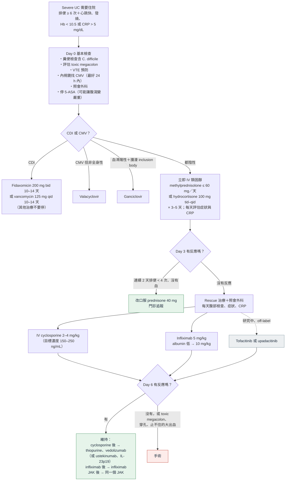

> [!abstract] 一句話重點
> - **定義**：==每天排便 ≥ 6 次＋至少一個全身毒性徵象==（心跳快、發燒、Hb < 10.5 g/dL、ESR > 30 或 CRP 升高）→ 住院
> - **Day 0**：
>   - ==驗 C. difficile==；**72 h 內（最好 24 h）flexible sigmoidoscopy＋切片找 CMV**
>   - 評估 **toxic megacolon**；==藥物預防 VTE（LMWH）==
>   - **停 5-ASA**；避免 NSAID、opioid、anticholinergic
>   - ==不常規給抗生素==、不用 TPN 讓腸道休息
> - **IV 類固醇**：==methylprednisolone 60 mg／天==，或 hydrocortisone 100 mg tid–qid；更高劑量沒有更好
> - **Day 3 沒反應**：
>   - ==rescue：infliximab 或 cyclosporine==（效果相當）
>   - 同時**照會外科**
>   - albumin < 2.5 → infliximab **10 mg/kg**
> - **維持**：
>   - infliximab 救回 → 繼續 infliximab
>   - cyclosporine 救回 → **thiopurine** 或 **vedolizumab**
> - **立即手術**：==toxic megacolon、穿孔、止不住的大出血==、藥物治療無效；**不要拖延開刀**

> [!info] 系列導覽
> ↑ 回到 [[gastroenterology/ulcerative-colitis-acg/index|ACG 潰瘍性結腸炎指引總覽]]
>
> ① [[gastroenterology/ulcerative-colitis-acg/uc-1-diagnosis|診斷、嚴重度與目標]]｜② [[gastroenterology/ulcerative-colitis-acg/uc-2-mild-moderate|輕到中度 UC]]｜③ [[gastroenterology/ulcerative-colitis-acg/uc-3-moderate-severe|中重度 UC 與藥物選擇]]｜④ 住院的 ASUC 與手術（本篇）｜📋 [[gastroenterology/ulcerative-colitis-acg/uc-5-recommendations|建議總整理]]｜⑤ [[gastroenterology/ulcerative-colitis-acg/uc-exam|內專考點]]
>
> 本篇涵蓋：Statement 46–54（內文編號 ASUC 1–9）、Key concept 48–57、Figure 3

## 什麼是 ASUC？

- **定義**（Truelove and Witts）：==每天排便 ≥ 6 次＋至少一項全身毒性==：心跳快、發燒、貧血（**Hb < 10.5 g/dL**）、發炎指標升高（**ESR > 30 mm/h**）
- Figure 3 的「modified ASUC criteria」把發炎指標寫成 **CRP > 5 mg/dL**
- 兒童用 PUCAI ≥ 65
- 歷史上最多 1/4 的 UC 會發生 ASUC，最多 **40% 最後切除大腸**；即使這次沒開，之後切除大腸的風險仍高
- 大多數要住院；少數經挑選的人可以門診密切追蹤

## Figure 3：ASUC 住院處置流程

依原圖內容重新繪製：

> [!note] 看圖重點
> - 三個時間點：**Day 0 檢查與 IV 類固醇 → Day 3 判斷是否需要 rescue → Day 6 判斷 rescue 是否成功**
> - **反應的定義**：==連續 2 天每天排便 < 4 次、沒有直腸出血==
> - 維持期 ==避免類固醇或快速停掉==
> - JAK inhibitor 是虛線：資料多為 off-label 劑量，還在研究中
> - 原圖與內文有兩處不同：
>   - **ASUC 標準**：圖寫 CRP > 5 mg/dL，內文寫 ESR > 30
>   - **Cyclosporine**：圖寫 2–4 mg/kg、目標 **150–250 ng/mL**；內文偏好 **2 mg/kg**、引用的有效濃度 200–400

## Day 0：入院就要做的事

| 項目 | 建議 | 理由 |
| --- | --- | --- |
| **C. difficile** | ==一定要驗==（strong，#46） | 最多 47% 的 UC 住院合併 CDI；合併時**死亡率約 4 倍**；IBD 病人常沒有典型 CDI 危險因子；治療照 IDSA：**vancomycin 或 fidaxomicin** |
| **Flexible sigmoidoscopy** | ==72 h 內，最好 24 h 內==（KC 48） | 評估嚴重度、**切片找 CMV**；全大腸鏡在嚴重發炎時易擴張穿孔，**少打氣**、由有經驗的人做 |
| **Toxic megacolon** | 每個人都要評估（KC 49） | 腹部 X 光：**transverse colon > 5.5 cm** 預後差；壁增厚、haustra 消失、mucosal island；**≥ 3 個擴張的小腸氣圈**＝藥物治療可能失敗 |
| **VTE 預防** | ==LMWH 藥物預防==（strong，#47） | IBD 住院的 VTE 風險高、和發炎程度成正比；**有血便也安全**，不會讓出血惡化 |
| **抗生素** | ==不常規給==（strong against，#48） | 4 個 RCT（metronidazole、tobramycin、ciprofloxacin、vancomycin）都沒用，還增加 CDI；只給**懷疑腸外併發症或全身毒性**的人 |
| **TPN 讓腸道休息** | ==不建議==（conditional against，#49） | RCT 沒有好處；鼓勵**腸道營養**，除非有毒性需開刀 |
| **5-ASA** | **住院時停掉** | 剛開始 5-ASA 的人要懷疑 paradoxical 過敏反應 |
| **止痛** | ==避免 NSAID、opioid、anticholinergic==（KC 51） | NSAID 與復發住院有關；opioid、anticholinergic 會誘發大腸擴張；改用熱敷、**acetaminophen**、抗焦慮藥 |
| **CT** | 只在懷疑腸外併發症、穿孔，或新診斷分不清 Crohn's 時 | — |

### CMV colitis

- 最多 **1/3 對類固醇無效的 ASUC** 有 CMV colitis；危險因子：難治、類固醇、內視鏡潰瘍
- **潰瘍底部**切片陽性率最高；H&E 敏感度差 → 用**免疫組織化學、快速培養或 PCR**
- **對類固醇或 biologic 無效時才治療**：**ganciclovir** IV 再改口服，共 **14 天**（反應約 70%）；部分人可口服 valganciclovir
- 對標準治療有反應的人，加抗病毒藥沒有額外好處
- ==治療 CMV 時不要停止治療大腸炎==；無效者也不要為了打完療程而延後開刀

## IV 類固醇（Statement 50）

> [!tip] Statement 50（strong）
> ==Methylprednisolone 總量 60 mg／天==，或 **hydrocortisone 100 mg 一天 3–4 次**。

- 系統性回顧：平均反應率 **67%**，**27%** 在同次住院切除大腸
- ==超過 60 mg methylprednisolone 沒有更好==；單次、分次或連續滴注效果相同
- 遠端症狀明顯可加局部類固醇
- **3–5 天**就看得出反應，**7 天後幾乎不會再進步** → ==不要一直用 IV 類固醇而不啟動 rescue==
- 懷疑 CDI 或 CMV 時，可能需要繼續類固醇（分不清是感染還是大腸炎）

### 怎麼判斷沒反應？（KC 50）

每天監測：**排便次數、直腸出血、腹部檢查（脹、壓痛）、生命徵象、連續 CRP**。

| 預測工具 | 內容 |
| --- | --- |
| **==Oxford index==** | IV 類固醇 **Day 3**：排便 **> 8 次**，或 **3–8 次＋CRP > 45 mg/L** → **85%** 需要切除大腸（部分反應 40%、完全反應 5%） |
| **Ho index** | 排便次數＋**低 albumin**＋**大腸擴張** |
| 其他 | **ESR > 75 mm/h**、**體溫 > 38°C** |
| 兒童 | PUCAI Day 3 > 45 或 Day 5 > 70 |
| 內視鏡 | **UCEIS ≥ 5**：rescue 50%、切除大腸 33%（≤ 4 分：27%、9%）；**UCEIS ≥ 7** 預測切除大腸比 MES 3 好；**大範圍深潰瘍**＝類固醇無效 |

## Day 3 沒反應：Rescue（Statement 51）

> [!tip] Statement 51（strong）
> IV 類固醇 **3 天**反應不足 → ==infliximab 或 cyclosporine== rescue；同時==照會外科==（KC 52）。

| | **Infliximab** | **Cyclosporine** |
| --- | --- | --- |
| 劑量 | **5 mg/kg**（week 0、2、6）；==albumin < 2.5 g/dL 考慮 10 mg/kg==（KC 57） | IV **2 mg/kg**（和 4 mg/kg 效果相同、副作用少） |
| 證據 | 單劑 RCT：3 個月切除大腸 7/24 vs 14/21；瑞典追蹤：3、12、36、60 個月 colectomy-free 71%、64%、59%、53% | 第一個 RCT：9/11 有反應 vs 安慰劑 0；但長期**最多 80%** 最後切除大腸 |
| 比較 | **CySIF**：治療失敗 54% vs 60%，1 年、5 年 colectomy-free 存活相同；**CONSTRUCT**：生活品質、切除大腸、副作用沒差 | ENEIDA 登錄：效果相同，cyclosporine 副作用較少 |
| 偏好使用 | **之前 thiopurine 失敗**、**albumin 低**（CySIF：< 23 g/L 時 infliximab 較好）、**膽固醇或鎂低**（cyclosporine 神經毒性風險高） | 醫師熟悉劑量與濃度監測的中心；**類固醇禁忌或不耐受**時也可直接用 |
| 維持 | ==同一個 infliximab==（strong，#52） | **Thiopurine**（#53，conditional）：thiopurine-naive 者較好；或 **vedolizumab**（#54，conditional，連 anti-TNF 失敗者也可用） |

- **選哪一個**看：醫師經驗、之前 immunomodulator 或 anti-TNF 是否失敗、**albumin**（KC 53）
- **Accelerated infliximab**（中位數 24 天內打 3 劑）：短期切除大腸較少，但 3 個月時沒差
- **10 vs 5 mg/kg 第一劑**（RCT，138 人）：整體沒差；只有 **albumin < 2.5** 的人 day 7 反應較好
- **Tacrolimus**（類固醇難治）：2 週反應 50% vs 13%，目標 trough **10–15 ng/mL**；長期資料少
- **一個失敗再換另一個**（cyclosporine ↔ infliximab）：緩解 30–40%，但嚴重不良事件約 16%（含敗血症死亡），12 個月約 60% 仍切除大腸 → 嚴密監測
- **Adalimumab、golimumab、vedolizumab 不能當 rescue 誘導**（沒有資料）

> [!warning] Key concept 56：JAK inhibitor 當 rescue
> IV 類固醇 3 天或 infliximab 誘導失敗的 ASUC，==還沒有足夠資料常規使用 tofacitinib 或 upadacitinib==：
> - **TACOS**（印度，tofacitinib **10 mg tid**，off-label）：day 7 反應 83% vs 59%，但幾乎沒人用過 anti-TNF
> - 回溯性研究：**10 mg tid** 有保護、10 mg bid 沒有；upadacitinib 30 mg bid 或 45 mg qd 的小型經驗
> - ==不要高劑量 JAK＋類固醇，或 infliximab 之後立刻接 JAK==：過度免疫抑制、伺機感染

## 手術

> [!danger] Key concept 54：ASUC 的手術適應症
> ==Toxic megacolon、大腸穿孔、嚴重止不住的出血、藥物治療無效==（也包括多重器官衰竭）。IV 類固醇 **3–5 天沒進步**就要考慮切除大腸。

- **延遲開刀＝術後併發症增加**，一定要避免
- ==Infliximab、cyclosporine 不會增加術後併發症==，不要因為用過這些藥而延後手術（KC 55）；術前 anti-TNF 在 UC 不增加感染併發症（Crohn's 會），vedolizumab 也沒有增加；small molecule 沒有資料
- **長期類固醇**才會增加術後感染
- ASUC 的術式：==subtotal 或 total colectomy＋end ileostomy==
- 長期難治 UC：**restorative proctocolectomy＋IPAA**（ileal pouch-anal anastomosis）是首選；==分階段做==，第一次手術不做 pouch，等營養改善、停掉免疫抑制劑再重建
- **營養不良**（6 個月內體重減輕 > 10–15%、BMI < 18.5、albumin < 30 g/L）→ 術前盡量改善，考慮腸道或靜脈營養
- 整體術後死亡率約 **1%**；早期併發症 9–65%、晚期 17–55%
- **大腸切除的適應症**：ASUC、**長期難治**（對 biologic、類固醇、small molecule 無效，或**類固醇依賴**）、dysplasia 或癌症

## 相關筆記

- [[gastroenterology/ulcerative-colitis-acg/uc-3-moderate-severe|③ 中重度 UC 與藥物選擇]]
- [[gastroenterology/ulcerative-colitis-acg/uc-exam|⑤ 內專考點]]：toxic megacolon、類固醇無效的 UC
- [[infectious-disease/c-difficile-idsa/index|C. difficile 感染（IDSA）]]：fidaxomicin 與 vancomycin 劑量

## 參考資料

- Rubin DT, Ananthakrishnan AN, Siegel CA, Barnes EL, Long MD. ACG Clinical Guideline Update: Ulcerative Colitis in Adults. *Am J Gastroenterol* 2025;120:1187–1224（Management of the hospitalized patient with ASUC、Figure 3）（參考資料庫：腸胃肝膽科／acg-clinical-guideline-update-ulcerative-colitis-in-adults.pdf）
