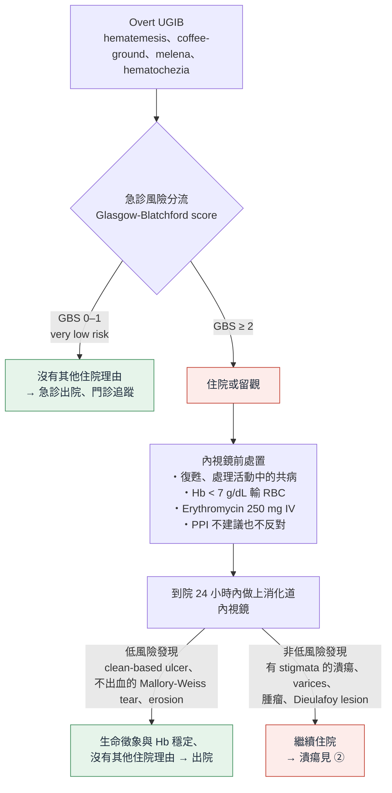

> [!abstract] 一句話重點
> - **分流**：急診算 **Glasgow-Blatchford score（GBS）**，==GBS 0–1＝very low risk → 可出院門診追蹤==（Statement 1）
> - **輸血**：==Hb < 7 g/dL 才輸（restrictive）==；**低血壓、正在大出血**可以早一點輸；**原本有心血管疾病用 8 g/dL**；ACS 可能要更高（Statement 2）
> - **內視鏡前**：**erythromycin 250 mg IV**，輸完 20–90 分鐘做內視鏡（Statement 3）；**pre-endoscopic PPI 不建議也不反對**（Statement 4）
> - **時機**：住院或留觀者 ==24 小時內（從到院算）做內視鏡==；先復甦、處理共病，==不是越早越好==（Statement 5）

> [!info] 系列導覽
> ↑ 回到 [[gastroenterology/upper-gi-bleeding-acg/index|ACG 上消化道與潰瘍出血指引總覽]]
>
> ① 到院到內視鏡（本篇）｜② [[gastroenterology/upper-gi-bleeding-acg/ugib-2-endoscopic|潰瘍出血：內視鏡止血與之後]]｜③ [[gastroenterology/upper-gi-bleeding-acg/ugib-exam|內專考點]]
>
> 本篇涵蓋：Statement 1–5、Table 2–6、Figure 1–2

## Figure 2：從到院到內視鏡的處置流程

依原圖內容重新繪製：

> [!note] 看圖重點
> - 三層架構：**急診分流 → 內視鏡前處置 → 內視鏡**
> - **兩個出院點**：急診時 GBS 0–1；內視鏡看到低風險病灶且穩定
> - 原圖註腳：未來的風險工具，只要對「輸血、止血處置或死亡」的 sensitivity 達 99–100%（false negative ≤ 1%）也可以用

## 風險分流：誰可以從急診回家？（Statement 1）

> [!tip] Statement 1（conditional，very low quality）
> 急診的 UGIB 病人，若被風險工具歸為 **very low risk**（false negative ≤ 1%；例如 ==GBS 0–1==），**建議出院、門診追蹤**，而不是住院。

### Table 2：Glasgow-Blatchford score

| 項目（到院時） | 數值 | 分數 |
| --- | --- | --- |
| **BUN（mg/dL）** | 18.2 至 < 22.4 | 2 |
| | 22.4 至 < 28.0 | 3 |
| | 28.0 至 < 70.0 | 4 |
| | **≥ 70.0** | **6** |
| **Hb（g/dL）** | 男 12.0 至 < 13.0；女 10.0 至 < 12.0 | 1 |
| | 男 10.0 至 < 12.0 | 3 |
| | **< 10.0**（男女都是） | **6** |
| **SBP（mmHg）** | 100–109 | 1 |
| | 90–99 | 2 |
| | **< 90** | **3** |
| **HR** | ≥ 100 | 1 |
| **Melena** | 有 | 1 |
| **Syncope** | 有 | 2 |
| **Hepatic disease** | 有 | 2 |
| **Cardiac failure** | 有 | 2 |

- 原始 GBS 沒有定義 hepatic disease 和 cardiac failure；後來的研究定義為「已知病史，或臨床、檢驗（肝）／心臟超音波（心）上有證據」
- **GBS 0–1 的人要符合**：BUN < 18.2、Hb 男 ≥ 13／女 ≥ 12、SBP ≥ 110、HR < 100，而且沒有 syncope、肝病、心衰竭；只允許「有 melena」這 1 分

> [!tip] Pearl：為什麼是 0–1，不是 0？
> - GBS = 0：sensitivity 99–100%，但 specificity 只有 8–22%（能出院的人太少）
> - ==GBS 0–1：sensitivity 99%（95% CI 下限 97–98%）、specificity 27–40%==，約 **19–24%** 的 UGIB 病人符合
> - 指引接受「false negative ≤ 1%」，換來更多人可以回家；2012 版 ACG 用的是 GBS = 0
> - 實際出院仍要看**年齡、共病、可靠度、家人支持、能不能回診**

### Figure 1：用 2×2 表看懂 sensitivity 與 specificity

依原圖數字重新整理（假想 250 位 UGIB 病人，以 GBS 1 分為切點）：

| | **需要處置或死亡**（100 人） | **不需要處置也沒死**（150 人） |
| --- | --- | --- |
| **GBS > 1** | 99（true positive） | 100（false positive） |
| **GBS 0–1** | ==1（false negative）== | 50（true negative） |
| | **Sensitivity = 99/100 = 99%** | **Specificity = 50/150 = 33%** |

> [!note] 看圖重點
> - Sensitivity 99%：每 100 個「真的需要處置」的人，只有 1 個被誤判成 very low risk 而回家
> - Specificity 只有 33%：150 個其實不需要住院的人，只有 50 個被 GBS 0–1 認出來，**其餘 100 個還是被收住院**
> - 未來的風險工具要做的是：**維持高 sensitivity，同時提高 specificity**；Shung 的 machine learning 模型 specificity 較高，但只在一個地方驗證過

## 輸血門檻（Statement 2）

> [!tip] Statement 2（conditional，low quality）
> UGIB 建議 **restrictive 輸血**，門檻 ==Hb 7 g/dL==（低於 7 才輸）。

### Table 3：Restrictive vs liberal 輸血的 RCT

| | **Villanueva 2013**（NEJM，n = 889） | **Jairath 2015**（TRIGGER，cluster RCT，n = 640） |
| --- | --- | --- |
| 門檻 | **7 vs 9 g/dL** | 8 vs 10 g/dL |
| 再出血 | **10.1% vs 16.0%**（adjusted HR 0.68） | 5.1% vs 8.1%（不顯著） |
| 死亡 | **5.2% vs 9.2%**（adjusted HR 0.55） | 5.4% vs 6.5%（不顯著） |
| 其他 | 輸血反應 3% vs 9%、心臟併發症 11% vs 16% | 偏向 liberal 組收案較多、有 selection bias |

> [!note] 看表重點
> - 7 g/dL 的依據就是 **Villanueva**：restrictive 組**再出血、死亡、輸血反應、心臟併發症都較少**
> - 兩個試驗都**排除 exsanguinating（大量致命）出血**；Villanueva 也排除 90 天內有 stroke、TIA 或有症狀的周邊血管疾病

### 什麼時候可以不照 7 g/dL？

| 情境 | 指引的看法 |
| --- | --- |
| **低血壓** | 可以在 Hb 還沒掉到 7 前就輸：**輸液後 Hb 才會稀釋下來**，到院時的 Hb 會低估失血 |
| **原本有心血管疾病** | ==門檻 8 g/dL==（比照一般輸血指引） |
| **ACS** | 證據很少；小型研究顯示 restrictive 可能增加死亡 → **可考慮高於 8 g/dL** |
| **大量致命出血** | 不在 RCT 範圍內，依臨床判斷 |

> [!warning] Pitfall
> - 急性出血時 **Hb 不能代表失血量**：全血等比例流失，要等組織液回補或輸液稀釋後 Hb 才會下降 → 看**生命徵象與姿勢性變化**
> - 「心血管疾病」（stable CAD 等）用 8，和「正在 ACS」不同，ACS 可能要更高

## 內視鏡前的藥物（Statement 3–4）

### Erythromycin（Statement 3）

> [!tip] Statement 3（conditional，very low quality）
> 內視鏡前建議 **IV erythromycin**。

- **目的**：prokinetic，把胃裡的血和血塊推走 → 內視鏡看得清楚
- **劑量**：==250 mg IV==，輸 5–30 分鐘（多為 20–30 分鐘），**輸完 20–90 分鐘後做內視鏡**
- **效果**：沒有證明減少再出血或死亡，但**減少 second-look endoscopy（OR 0.51）**、**住院天數少約 1.75 天**；便宜、好給 → 建議使用
- **Metoclopramide**：證據只有舊摘要，不支持使用
- **安全**：erythromycin 會延長 QT；torsade de pointes 多見於重複或高劑量。部分試驗排除 QT 延長、心臟病、電解質異常、肝功能不良、併用抗心律不整藥或 CYP3A4 受質

#### Table 4：Erythromycin 的 meta-analysis

| 結果 | 研究數（人數） | Erythromycin vs 沒給或安慰劑 |
| --- | --- | --- |
| 再出血 | 1（29） | RR 0.54（0.05–5.28），不顯著 |
| 死亡 | 3（278） | RR 0.81（0.41–1.60），不顯著 |
| **Second-look endoscopy** | 8（598） | ==OR 0.51（0.34–0.77）== |
| **住院天數** | 5（375） | ==平均少 1.75 天== |
| 輸血單位 | 6（544） | 平均少 1.06 單位，不顯著、異質性大 |

### Pre-endoscopic PPI（Statement 4）

> [!tip] Statement 4
> 對 pre-endoscopic PPI，==無法建議使用，也不反對==。

#### Table 5：Lau 2007 的 RCT（內視鏡前 omeprazole infusion）

| 結果 | Omeprazole（n = 314） | 安慰劑（n = 317） |
| --- | --- | --- |
| 內視鏡前輸注時間 | 平均 14.7 h | 平均 15.2 h |
| 30 天再出血 | 3.5% | 2.5% |
| 30 天死亡 | 2.5% | 2.2% |
| 住院天數 | 4.5 | 4.9 |
| 輸血單位 | 1.54 | 1.88 |
| **需要內視鏡止血** | ==19.1%== | 28.4%（p = 0.007） |

> [!note] 看表重點：為什麼「不建議也不反對」？
> - PPI **只減少內視鏡時需要止血的比例**（看到 high-risk stigmata 的人變少），**再出血、死亡、住院天數都沒差**
> - 不反對的理由：內視鏡後的 high-dose PPI 確實有效（見 ②），所以少數人可能受益；**內視鏡無法做或會延後的人**可以給
> - 重視「少做一次內視鏡止血」的醫師與病人可以選擇給；要考量成本
> - 指引不再用「may be considered」這種不給方向的說法

## 內視鏡時機（Statement 5）

> [!tip] Statement 5（conditional，very low quality）
> 住院或留觀的 UGIB，建議 ==到院（presentation）後 24 小時內==做內視鏡。不論預測是低風險或高風險。

- **用到院時間而不是入院時間**：各醫院從急診到住院的時間差很大
- **證據**：觀察性研究顯示 1 天內做內視鏡 → 住院天數較短，部分研究手術或死亡較少
- **低風險、穩定、沒有嚴重共病**：越早越好（上班時段內）→ 看到低風險病灶可以早點出院

### Table 6：很早（< 6 h）不比 6–24 h 好

Lau 2020（NEJM）：GBS ≥ 12 的高風險病人，GI 會診後 < 6 h vs 6–24 h 做內視鏡。

| 結果 | < 6 h（n = 258） | 6–24 h（n = 258） |
| --- | --- | --- |
| 從到院到內視鏡 | 平均 9.9 h | 平均 24.7 h |
| 30 天再出血 | 10.9% | 7.8% |
| 30 天死亡 | 8.9% | 6.6% |
| 住院天數（中位數） | 5 | 5 |
| 輸血單位 | 2.4 | 2.4 |
| 內視鏡止血 | 60.1% | 48.4% |

> [!warning] Pitfall：高風險 ≠ 越早越好
> - 高風險病人提早做，**再出血和死亡沒有減少**（數字甚至偏高、不顯著），只是做了較多內視鏡止血
> - 丹麥大型世代研究：不穩定的病人在 **6–24 h**、ASA 3–5 的穩定病人在 **12–36 h** 做，死亡率最低；**太早做可能有害**（還沒復甦好）
> - 所以 ==先復甦、處理活動中的共病，再做內視鏡==；2012 版「高風險 12 小時內可考慮」被拿掉了
> - 例外：**復甦後仍休克的人**（Lau 試驗排除，約佔高風險者 5%）需要**緊急內視鏡或 interventional radiology**
> - 這裡的「高風險」指**臨床特徵**（休克、肝硬化、GBS ≥ 12 等），和潰瘍外觀、Rockall 的高風險不同，見 [[gastroenterology/upper-gi-bleeding-acg/index#⚠️「高風險」到底是什麼？|總綱的「高風險」對照表]]

## 補充：吃抗凝血劑或抗血小板藥的人（ACG-CAG 2022）

> [!info] 補充（ACG-CAG Clinical Guideline 2022，非本指引內容）
> 2021 ACG 指引沒有談抗栓藥物；ACG 與加拿大腸胃學會（CAG）2022 另出一份指引，急性 GI 出血的建議都是 conditional、證據很低：
> - **Warfarin**：==不建議 FFP==，也**不建議常規給 vitamin K**；PCC 沒有建議使用或不用，但若需要逆轉，**PCC 優於 FFP**
> - **DOAC**：**不建議常規逆轉**（dabigatran 不給 idarucizumab；rivaroxaban、apixaban 不給 andexanet alfa；不給 PCC）；逆轉只留給**危及生命的出血**
> - **抗血小板**：==不建議輸血小板==；**次級預防的 aspirin 不要停**，若停了，**內視鏡確認止血當天就恢復**
> - 臨床意義：**穩定的病人不要為了矯正 INR 而延後內視鏡**（內專 104-057 就考這個）

## 相關筆記

- [[gastroenterology/upper-gi-bleeding-acg/ugib-2-endoscopic|② 潰瘍出血：內視鏡止血與之後]]
- [[gastroenterology/upper-gi-bleeding-acg/ugib-exam|③ 內專考點]]
- [[gastroenterology/abnormal-liver-tests/index|肝功能異常與黃疸]]：肝病是 GBS 的加分項；varices 出血不在本指引範圍
- [[cardiology/acs-esc-2023/acs23-3-antithrombotic|ACS 抗血栓治療]]：DAPT 病人出血時的抗血小板處理
- [[cardiology/atrial-fibrillation/index|心房顫動]]：抗凝病人出血後何時恢復抗凝

## 參考資料

- Laine L, Barkun AN, Saltzman JR, Martel M, Leontiadis GI. ACG Clinical Guideline: Upper Gastrointestinal and Ulcer Bleeding. *Am J Gastroenterol* 2021;116:899–917. doi:10.14309/ajg.0000000000001245（Statement 1–5、Table 2–6、Figure 1–2）（參考資料庫：腸胃肝膽科／acg-clinical-guideline-upper-gastrointestinal-and-ulcer.pdf）
- Abraham NS, Barkun AN, Sauer BG, et al. American College of Gastroenterology–Canadian Association of Gastroenterology Clinical Practice Guideline: Management of Anticoagulants and Antiplatelets During Acute Gastrointestinal Bleeding and the Periendoscopic Period. *Am J Gastroenterol* 2022;117:542–558. doi:10.14309/ajg.0000000000001627
