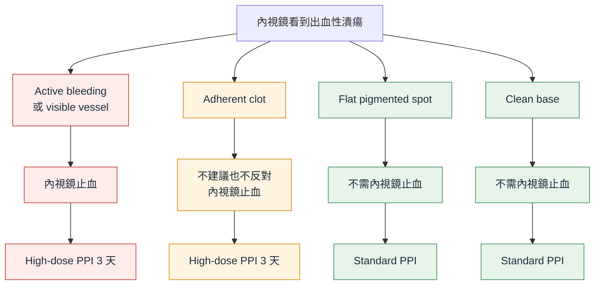

> [!abstract] 一句話重點
> - **哪些潰瘍要止血**：==active spurting、active oozing、non-bleeding visible vessel → 內視鏡止血（strong）==；**adherent clot → 不建議也不反對**；flat pigmented spot、clean base → 不用止血（Statement 6–7）
> - **用什麼止血**：
>   - **strong**：bipolar electrocoagulation、heater probe、absolute ethanol 注射
>   - **conditional**：clip、APC、soft monopolar
>   - ==epinephrine 不可以單獨用，一定要合併第二種方法==
>   - TC-325 粉末用在 active bleeding；over-the-scope clip 用在止血後又再出血（Statement 8–12）
> - **止血後的 PPI**：
>   - ==high-dose PPI 3 天：80 mg bolus → 8 mg/h，或間歇 40 mg 一天 2–4 次==（Statement 13）
>   - 高風險者 **day 4–14 改口服 PPI bid**（Statement 14）
> - **再出血與止血失敗**：==再出血 → 再做一次內視鏡==（Statement 15）；==內視鏡止不住 → TAE（transcatheter arterial embolization）優先於手術==（Statement 16）

> [!info] 系列導覽
> ↑ 回到 [[gastroenterology/upper-gi-bleeding-acg/index|ACG 上消化道與潰瘍出血指引總覽]]
>
> ① [[gastroenterology/upper-gi-bleeding-acg/ugib-1-initial|到院到內視鏡]]｜② 潰瘍出血：內視鏡止血與之後（本篇）｜③ [[gastroenterology/upper-gi-bleeding-acg/ugib-exam|內專考點]]
>
> 本篇涵蓋：Statement 6–16、Table 7–8、Figure 3。指引對內視鏡治療與內視鏡後處置的建議**只針對潰瘍出血**（最常見、RCT 最多）

## Figure 3：依潰瘍外觀決定內視鏡治療與 PPI

依原圖內容重新繪製：

> [!note] 看圖重點
> - **High-dose PPI**：continuous 是 **80 mg bolus → 8 mg/h × 3 天**；intermittent 是 **40 mg 一天 2–4 次 × 3 天**，能口服就口服，可先給 80 mg bolus
> - **Standard PPI**（例如口服 qd）：之前的指引建議，本版沒有重新評估
> - 原圖註腳把 continuous infusion 寫成「8-mg/min」，內文與 Statement 13 都是 **8 mg/hr**，應以 mg/hr 為準

> [!tip] Pearl：對照 Forrest classification（不是本指引內容）
> ACG 指引直接用病灶外觀描述，沒有用 Forrest 分類；臨床與考試常用的對照如下（Forrest 1974）：
>
> | Forrest | 外觀 | ACG 2021 處置 |
> | --- | --- | --- |
> | **Ia** | Active spurting | 內視鏡止血＋high-dose PPI |
> | **Ib** | Active oozing | 內視鏡止血＋high-dose PPI |
> | **IIa** | Non-bleeding visible vessel | 內視鏡止血＋high-dose PPI |
> | **IIb** | Adherent clot | 止血不建議也不反對；high-dose PPI |
> | **IIc** | Flat pigmented spot | 不止血；standard PPI |
> | **III** | Clean base | 不止血；standard PPI；穩定者可出院 |

## 哪些潰瘍需要內視鏡止血？（Statement 6–7）

> [!tip] Statement 6（strong，moderate quality）
> 潰瘍有 **active spurting、active oozing、non-bleeding visible vessel** → **內視鏡止血**。

- 2009 meta-analysis（19 RCT）：
  - active bleeding 止血後再出血 **RR 0.29（NNT 2）**
  - visible vessel **RR 0.49（NNT 5）**
  - 死亡沒有差異
- Spurting 少見（active bleeding 中約 17%），再出血率比 oozing 高
- 但 **oozing 不處理再出血率仍高（合併 39%）** → 一樣要止血
- 各家對 oozing 的定義不同；有的試驗要求**持續出血觀察 5 分鐘**才算，避免把內視鏡碰到的暫時滲血也算進去

> [!tip] Statement 7
> **Adherent clot**（用力沖洗也沖不掉）→ ==內視鏡止血不建議也不反對==。

- Meta-analysis：止血 vs 不止血，再出血、死亡都沒差，但異質性大
- 兩個美國小型 RCT 支持止血，但**沒有用力沖洗**、**術後沒有給 high-dose PPI**、都提早停止
- 香港 RCT 用力沖洗＋high-dose PPI：**24 人只給 PPI 都沒有再出血**；另一 RCT 只給 omeprazole 40 mg bid：再出血 0/64 vs 安慰劑 13/61
- 決定時考慮：內視鏡醫師經驗、病人狀況與偏好、潰瘍位置、有沒有放射科或外科支援（止血時可能誘發大出血）
- 有人會用 cold snare 或探頭把血塊移除或削薄，但沒有試驗比較

## 用什麼方法止血？（Statement 8–12）

| Statement | 建議 | 強度／證據 |
| --- | --- | --- |
| **8** | **Bipolar electrocoagulation、heater probe、absolute ethanol 注射** | **Strong**／moderate |
| **9** | Clip、argon plasma coagulation（APC）、soft monopolar electrocoagulation | Conditional／very low–low |
| **10** | ==Epinephrine 注射不可以單獨用，要合併另一種止血方法== | **Strong**／very low–moderate |
| **11** | **Active bleeding** 的潰瘍可用 hemostatic powder **TC-325** | Conditional／very low |
| **12** | **止血成功後又再出血** → **over-the-scope clip（OTSC）** | Conditional／low |

### Table 7：各種內視鏡止血方法的比較

| 治療 | 比較對象 | 研究數 | 再出血 RR | 死亡 RR |
| --- | --- | --- | --- | --- |
| **Thermal contact**（bipolar、heater probe） | 不做內視鏡治療 | 15 | ==0.44==（0.36–0.54） | ==0.58==（0.34–0.98） |
| **Absolute ethanol** | 不做內視鏡治療 | 3 | ==0.56==（0.38–0.83） | ==0.18==（0.05–0.68） |
| Epinephrine＋polidocanol | 不做內視鏡治療 | 6 | 0.60（0.36–1.00）* | 0.80（不顯著） |
| Thermal contact | Absolute ethanol | 5 | 0.69（0.47–1.01） | 1.60（不顯著） |
| Clip | Epinephrine 單用 | 2 | 0.20（0.07–0.56） | 2.11（不顯著） |
| Clip | Thermal contact | 4 | 1.31（不顯著） | 1.16（不顯著） |
| **Epinephrine＋第二種方法** | **Epinephrine 單用** | 7 | ==0.34==（0.23–0.50） | 0.52（不顯著） |
| APC ± epinephrine | Epinephrine＋第二種方法 | 3 | 0.82（不顯著）* | 0.85（不顯著） |

\* 異質性 I² > 50%

> [!note] 看表重點
> - **只有 thermal contact 和 absolute ethanol 同時降低再出血和死亡** → 這兩種是 strong recommendation
> - Thermal 和 ethanol 互相比較沒差 → 指引沒有偏好其中一種
> - **Clip** 沒有和「不治療」直接比較；它贏過的是 epinephrine 單用（一種不夠好的治療），所以只是間接證據；和 thermal 比較沒差，但信賴區間很寬，**不代表等效** → conditional
> - Epinephrine＋polidocanol 只有「趨勢」→ 指引不推薦 polidocanol

### 各方法的操作重點

| 方法 | 操作與注意 |
| --- | --- |
| **Bipolar／heater probe** | 用大號 3.2 mm 探頭、**用力壓住**；bipolar 約 15 W、每次 8–10 秒；heater probe 30 J |
| **Absolute ethanol** | 每次 0.1–0.2 mL，**總量限 1–2 mL**（避免嚴重組織壞死） |
| **Clip** | 夾在出血點上，以及出血點兩側，試圖封住下方的動脈 |
| **APC** | 氣流 1–2 L/min、40–70 W、探頭距黏膜 2–10 mm；**常抽吸**排煙、減少脹氣 |
| **Soft monopolar** | 原本用在 ESD 止血；連續波、最高電壓限 200 V，凝固但不碳化、不切割；用 monopolar hemostatic forceps 夾住或點在出血點，50–80 W、每次 1–2 秒；4 個 RCT 共 237 人沒有穿孔 |
| **Epinephrine** | 通常 **1:10,000**、每次 0.5–2.0 mL；active bleeding 先打可減少出血、看清楚，再用第二種方法 |

> [!warning] Pitfall：Epinephrine 單用
> - Epinephrine 單用比 bipolar 或 clip 單用**再出血多**（RR 2.20）
> - 加上第二種方法後再出血**減少約 2/3**（RR 0.34）
> - 反過來，**thermal 或 clip 不一定要先打 epinephrine**：支持「先打再燒」的兩個小 RCT，bipolar 單用組再出血率異常高，證據不足
> - 有人會在上 clip **之後**才打 epinephrine，避免先打造成腫脹、不好夾

### TC-325 止血粉（Statement 11）

- **只黏在正在出血的病灶上** → 不出血的病灶用了大概沒效
- 噴法：導管頭距出血點 **1–2 cm**，每次噴 1–2 秒，直到蓋住出血點、血止住
- **Lau 2020 RCT**（224 位 active bleeding 的非靜脈曲張病灶，其中 130 位潰瘍）：TC-325 vs 標準治療（clip 或 thermal ± epinephrine），潰瘍的 30 天再出血 **12.3% vs 15.4%**（不劣於）
- 其他指引把 TC-325 當**暫時止血**，之後要再用第二種確定的方法：粉末 **24 小時內就會脫落排出**，觀察性研究再出血約 31%
- 指引認為 TC-325 **可能可以單用**，但 **spurting 的病例太少**，需要更多研究
- **成本**：美國定價約 2,500 美元，==其他方法可以做時，TC-325 不應該是第一個選擇==

### Over-the-scope clip（Statement 12）

- 做法類似 band ligation：內視鏡前端裝上帶一個 clip 的 cap，**正對病灶**、把病灶吸進 cap，再釋放 clip
- **止血成功後又再出血**的 RCT：OTSC vs 標準治療（94% 是一般 through-the-scope clip），再出血 ==15.2% vs 57.6%==，死亡沒差
- 另一個 RCT（嚴重潰瘍或 Dieulafoy 出血）把 OTSC 當**第一線**：再出血 4% vs 28%，但證據品質很低，指引**沒有把 OTSC 擴大到第一線**

> [!note] 不建議的做法
> - **常規 second-look endoscopy**（約 1 天後例行再看一次並補治療）：美國不是標準做法；有做 second-look 的 RCT 不納入分析
> - **預防性 TAE**：即使是高風險潰瘍，內視鏡止血後預防性 TAE 也不建議（241 人的 RCT）

## 止血後的 PPI（Statement 13–14）

> [!tip] Statement 13（strong，moderate–high quality）
> 潰瘍**內視鏡止血成功後**，給 **high-dose PPI 3 天**，continuous 或 intermittent 都可以。

💊 止血後 PPI 怎麼給

1

<b>Day 1–3</b>（二選一）

<b>Continuous</b>：PPI <b>80 mg IV bolus → 8 mg/h</b> 持續 72 小時｜<b>Intermittent</b>：<b>40 mg 一天 2–4 次</b>（口服或 IV），可先給 <b>80 mg bolus</b>；清醒、不吐、能吞就口服

2

<b>Day 4–14</b>（高風險者）

<b>口服 PPI bid</b> 到內視鏡後滿 2 週（Statement 14）

3

<b>之後</b>

試驗中改為 <b>PPI qd</b> 再 2 週；更長的療程指引沒有評估

High-dose 的定義：<b>每天 ≥ 80 mg、至少 3 天</b>｜西方人的 PPI 效果較亞洲人弱 → intermittent 用較高總劑量可能較好｜口服 PPI 的胃內 pH 上升比 IV 慢約 15–60 分鐘，但效果相當

**為什麼要高劑量？** 體外研究：胃酸降低能促進血塊形成、讓血塊穩定；目標 pH 要接近 7，還是 > 4–5（抑制 pepsin 溶解血塊）就夠，目前不清楚。

| 比較 | 結果 | 證據 |
| --- | --- | --- |
| **High-dose PPI vs 安慰劑或不治療**（7 RCT） | 再出血 RR **0.43**、死亡 RR **0.41**、手術 RR **0.42** | **High** |
| High-dose PPI vs H2RA（9 RCT） | 再出血 RR **0.56**；死亡、手術沒差 | Moderate |
| **Continuous vs intermittent** | ==沒有差異== | — |
| Bolus＋continuous vs 較低強度 PPI（12 RCT） | 再出血 RR 1.12（不顯著），劑量、頻率、途徑都沒差 | — |

> [!tip] Pearl：2021 版的改變
> - 2012 版只建議 continuous infusion；**2021 版擴大到 intermittent 口服或 IV high-dose PPI**
> - 選 continuous 或 intermittent，看給藥方便性與成本

> [!tip] Statement 14（conditional，low quality）
> 高風險潰瘍出血，做了內視鏡止血並在院內給完短期 high-dose PPI 之後，==口服 PPI bid 到內視鏡後滿 2 週==。

- 唯一的 RCT：**Rockall ≥ 6**、active bleeding／visible vessel／adherent clot 止血成功、已給 3 天 bolus＋continuous PPI
- 之後 esomeprazole 40 mg **bid vs qd** 11 天，再全部改 qd 2 週
- 28 天再出血 ==10.8% vs 28.7%==（14 天時也較低）
- 這是 2012 版之後才有證據的**新建議**

## 再出血與止血失敗（Statement 15–16）

> [!tip] Statement 15（conditional）
> 內視鏡止血後**又再出血** → ==再做一次內視鏡止血==，而不是手術或 TAE。

### Table 8：再出血時，再做內視鏡 vs 手術

Lau 1999（NEJM）：止血成功後再出血的病人，隨機分到再做內視鏡或緊急手術。

| 結果 | 再做內視鏡（n = 48） | 手術（n = 44） | 差異 |
| --- | --- | --- | --- |
| 再出血 | 22.9% | 6.8% | 內視鏡多 16% |
| 死亡 | 10.4% | 18.2% | 不顯著 |
| 之後還需要手術 | 27.1% | 9.1%（第二次手術） | 內視鏡多 18% |
| **併發症** | ==14.6%== | ==36.4%== | 內視鏡少 22% |
| 住院天數（中位數） | 10 | 11 | — |

> [!note] 看表重點
> - 再做內視鏡**約 3/4 可以止住**，**併發症少很多**（內視鏡組的併發症幾乎都發生在後來被救援手術的人身上）
> - 沒有 RCT 比較再做內視鏡 vs TAE；但內視鏡成功率高、安全、方便 → 也建議優先於 TAE
> - **重做時小心穿孔**：該 RCT 中 48 人有 2 人在第二次 heater probe 後穿孔；heater probe 的穿孔約一半發生在**連續兩次**治療 → ==第一次用過 thermal，第二次可以換別的方法==
> - **再做內視鏡較可能失敗**：再出血時**低血壓**、**潰瘍 > 2 cm** → 這些人可以考慮直接 TAE 或手術

> [!tip] Statement 16（conditional，very low quality）
> 內視鏡**止血失敗** → 下一步建議 ==transcatheter arterial embolization（TAE）==。

| TAE vs 手術 | Meta-analysis（13 個觀察性研究） | 斯德哥爾摩世代研究 |
| --- | --- | --- |
| 死亡 | 沒差（OR 0.77） | 沒差（HR 0.70） |
| **再出血** | ==TAE 較多==（OR 2.44） | TAE 較多（HR 2.48） |
| **重大併發症** | ==TAE 較少==（OR 0.45） | 8.3% vs 32.2% |
| 住院天數 | — | TAE 中位數 8 天 vs 16 天 |

- 手術止血比較確實，但 **TAE 併發症少很多、死亡率不增加** → TAE 作為第一選擇
- 實際仍依共病、當下狀況、**當地 IR 與外科的經驗**決定；最在意再出血的人可能選手術，最想避免併發症、長期住院的人選 TAE
- 2012 版只說「手術或 TAE 都常用」，2021 版改為 **TAE 優先**

## 相關筆記

- [[gastroenterology/upper-gi-bleeding-acg/ugib-1-initial|① 到院到內視鏡]]
- [[gastroenterology/upper-gi-bleeding-acg/ugib-exam|③ 內專考點]]
- [[cardiology/acs-esc-2023/acs23-3-antithrombotic|ACS 抗血栓治療]]：DAPT 合併 PPI 預防出血

## 參考資料

- Laine L, Barkun AN, Saltzman JR, Martel M, Leontiadis GI. ACG Clinical Guideline: Upper Gastrointestinal and Ulcer Bleeding. *Am J Gastroenterol* 2021;116:899–917. doi:10.14309/ajg.0000000000001245（Statement 6–16、Table 7–8、Figure 3）（參考資料庫：腸胃肝膽科／acg-clinical-guideline-upper-gastrointestinal-and-ulcer.pdf）
- Forrest JA, Finlayson ND, Shearman DJ. Endoscopy in gastrointestinal bleeding. *Lancet* 1974;2:394–397（Forrest 分類對照）
